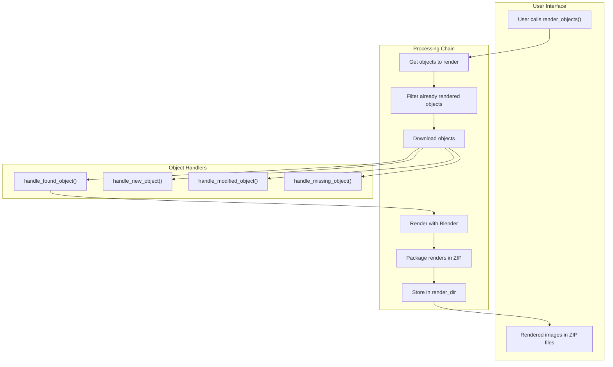
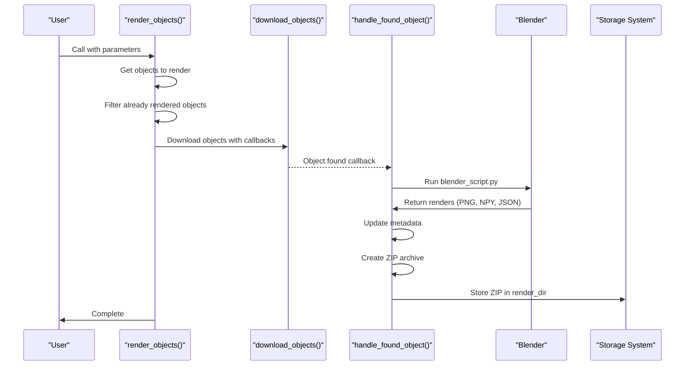
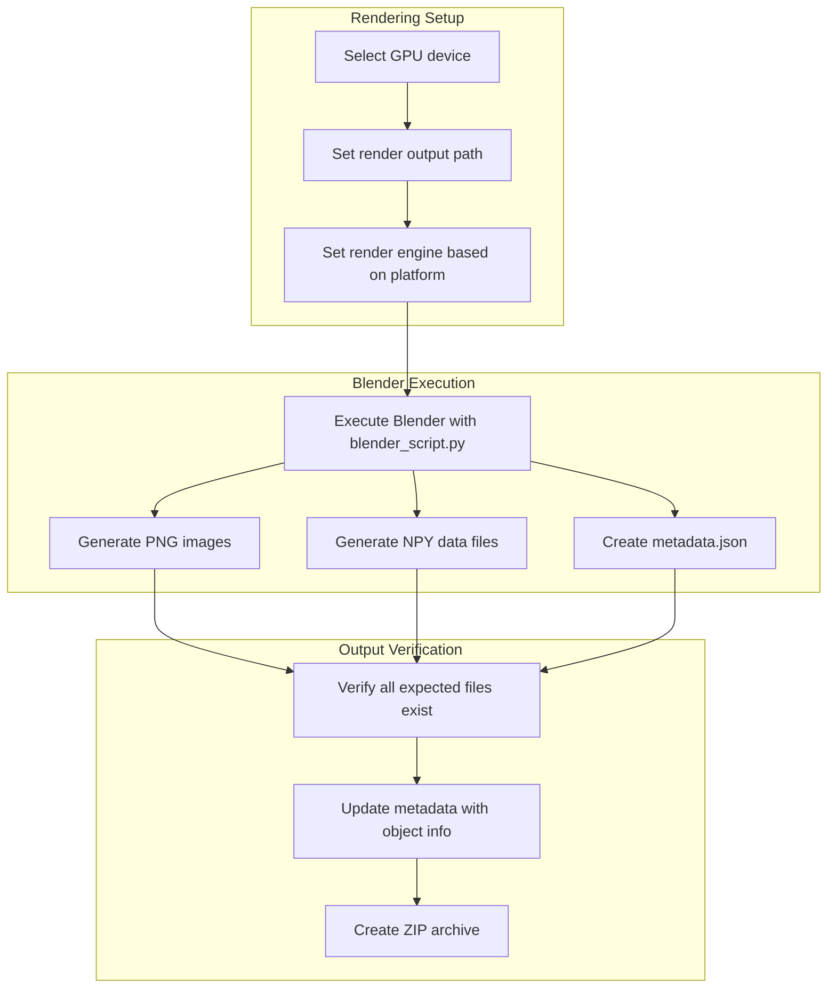
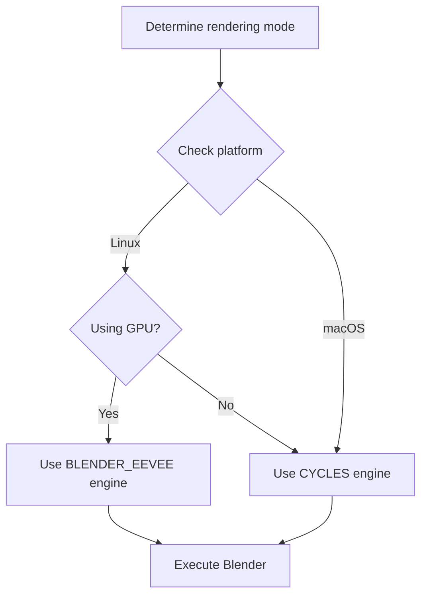

<!-- source: DeepWiki mcp.deepwiki.com · repo allenai/objaverse-xl · page 3.3 Rendering Objects · fetched 2026-10-26 -->

# Rendering Objects

<details>
<summary>Relevant source files</summary>

The following files were used as context for generating this wiki page:

- [README.md](README.md)
- [scripts/rendering/main.py](scripts/rendering/main.py)

</details>


This page documents the rendering system in Objaverse-XL, which allows users to create high-quality 2D image renders from downloaded 3D objects. The rendering process uses Blender as the backend renderer, supporting both GPU and CPU rendering modes.

For information about downloading objects from the dataset, see [Downloading Objects](#3.2).

## System Overview

The rendering system in Objaverse-XL provides a streamlined workflow to generate multiple views of 3D objects. It handles the process of downloading objects (if needed), rendering them with Blender, and storing the rendered images in a structured format.



Sources: [scripts/rendering/main.py:341-451](), [scripts/rendering/main.py:61-208]()

## Rendering Entry Point and Configuration

The main entry point to the rendering system is the `render_objects` function in the rendering module. This function orchestrates the entire rendering pipeline and accepts various configuration parameters.

### Key Parameters

| Parameter | Type | Default | Description |
|-----------|------|---------|-------------|
| `render_dir` | str | "~/.objaverse" | Directory where rendered objects will be stored |
| `download_dir` | Optional[str] | None | Directory where objects will be downloaded |
| `num_renders` | int | 12 | Number of renders to save per object |
| `processes` | Optional[int] | None | Number of parallel processes for downloading |
| `save_repo_format` | Optional[str] | None | Format to save repositories ("zip", "tar", "tar.gz", "files") |
| `only_northern_hemisphere` | bool | False | Whether to render only the northern hemisphere of objects |
| `render_timeout` | int | 300 | Maximum time (seconds) allowed for rendering each object |
| `gpu_devices` | Optional[Union[int, List[int]]] | None | GPU device(s) to use for rendering |

Sources: [scripts/rendering/main.py:341-379]()

## Rendering Workflow

The rendering process follows these key steps:



Sources: [scripts/rendering/main.py:341-451](), [scripts/rendering/main.py:61-208]()

## Object Handling Functions

The rendering system uses callback functions to handle different object states during the download and rendering process:

### 1. `handle_found_object`

This function is called when an object is successfully found and downloaded with the expected SHA256 hash. It:
1. Sets up a temporary directory for rendering
2. Selects the appropriate rendering engine (BLENDER_EEVEE for Linux GPU, CYCLES for macOS or CPU)
3. Runs Blender with a Python script to generate renders
4. Verifies that all expected output files are created
5. Updates metadata and creates a ZIP archive
6. Stores the ZIP in the render directory

Sources: [scripts/rendering/main.py:61-208]()

### 2. `handle_new_object`

Called when a new object is downloaded that wasn't in the original Objaverse-XL dataset. This function simply logs the new object without rendering it.

Sources: [scripts/rendering/main.py:211-237]()

### 3. `handle_modified_object`

Called when a downloaded object's SHA256 hash differs from what was expected. It attempts to render the object using `handle_found_object` and logs the outcome.

Sources: [scripts/rendering/main.py:240-309]()

### 4. `handle_missing_object`

Called when an object that should be in Objaverse-XL cannot be found or downloaded. This function logs the missing object.

Sources: [scripts/rendering/main.py:311-333]()

## Blender Rendering Process

The system uses Blender 3.2.2 to render the 3D objects. The actual rendering is performed by a Python script (`blender_script.py`) that is executed within Blender's environment.



Sources: [scripts/rendering/main.py:61-208](), [scripts/rendering/main.py:143-154]()

## Output Structure

For each successfully rendered object, the system creates:

1. Multiple PNG images (based on `num_renders` parameter)
2. Corresponding NPY files containing depth information
3. A metadata.json file with object information
4. A ZIP archive containing all of the above

The ZIP file is named using a hash of the object's file identifier and stored in the `renders` subdirectory of the specified `render_dir`.

Sources: [scripts/rendering/main.py:177-192]()

## GPU vs. CPU Rendering

The system supports both GPU and CPU rendering:

- **GPU Rendering** (Linux): Uses Blender's EEVEE engine, which is significantly faster
- **CPU Rendering** (Linux/macOS): Uses Blender's CYCLES engine, which is slower but more widely compatible

By default, the system will use all available GPUs. Users can specify particular GPUs to use through the `gpu_devices` parameter.



Sources: [scripts/rendering/main.py:126-136]()

## Logging and Error Handling

The rendering system logs all processed objects, including:
- Successfully rendered objects
- Failed render attempts
- New objects found
- Modified objects
- Missing objects

These logs are stored in CSV files in the `~/.objaverse/logs/` directory, providing an audit trail of the rendering process.

Sources: [scripts/rendering/main.py:24-40]()

## Usage Example

To render objects in the Objaverse-XL dataset:

```python
from scripts.rendering.main import render_objects

# Basic usage
render_objects(
    render_dir="~/my_renders",
    download_dir="~/my_downloads",
    num_renders=24  # More views per object
)

# Advanced usage with GPU selection
render_objects(
    render_dir="~/my_renders",
    download_dir="~/my_downloads",
    num_renders=12,
    processes=16,
    gpu_devices=[0, 1],  # Use only GPUs 0 and 1
    render_timeout=600,  # Allow 10 minutes per render
    only_northern_hemisphere=True  # For photogrammetry objects
)
```

Sources: [scripts/rendering/main.py:341-451]()

## Platform Support

The rendering system currently supports:
- Linux (recommended for GPU rendering)
- macOS (limited to CPU rendering)

Windows is not officially supported at this time.

Sources: [scripts/rendering/main.py:380-383]()

---

