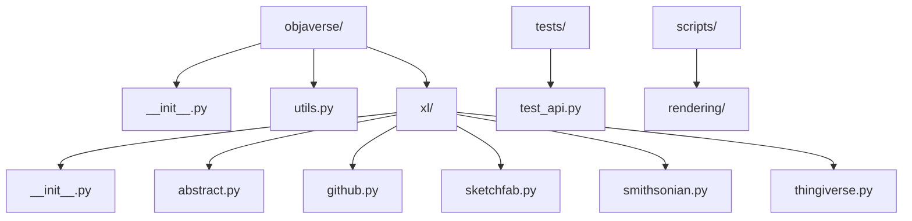
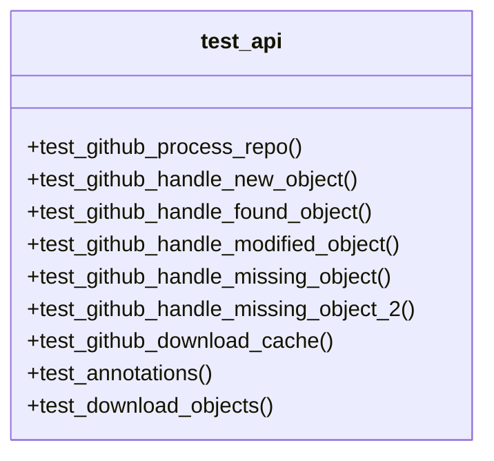
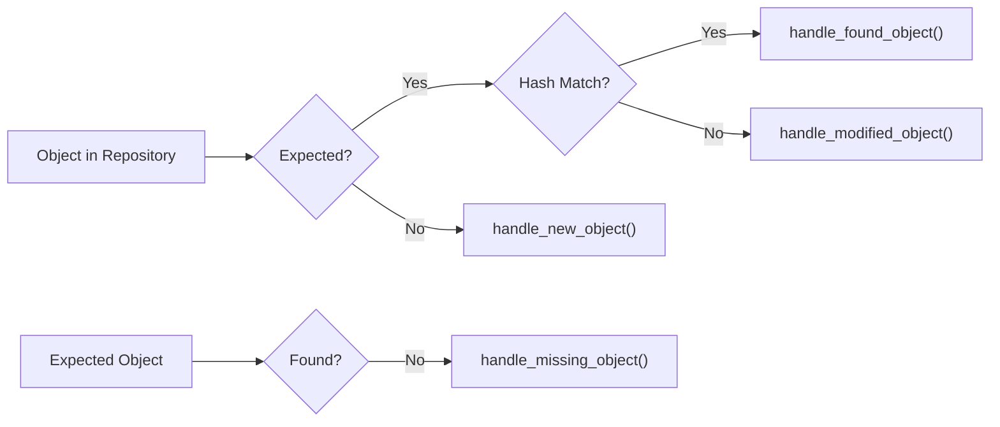
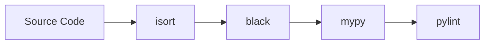
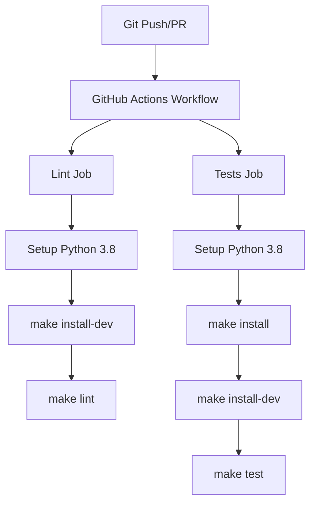
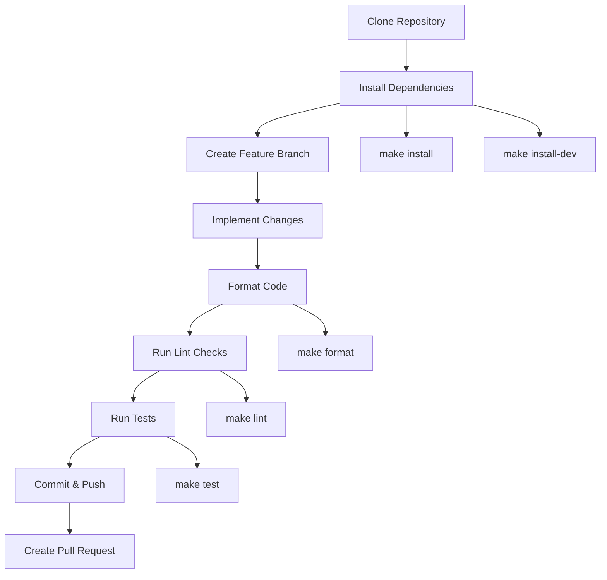

<!-- source: DeepWiki mcp.deepwiki.com · repo allenai/objaverse-xl · page 3.4 Development and Testing · fetched 2026-10-26 -->

# Development and Testing

<details>
<summary>Relevant source files</summary>

The following files were used as context for generating this wiki page:

- [.github/workflows/ci.yaml](.github/workflows/ci.yaml)
- [Makefile](Makefile)
- [setup.py](setup.py)
- [tests/test_api.py](tests/test_api.py)

</details>


This document provides guidance for developers who want to contribute to or extend the Objaverse-XL codebase. It covers development environment setup, testing procedures, and continuous integration processes.

For information about downloading objects from the dataset, see [Downloading Objects](#3.2), and for rendering those objects, see [Rendering Objects](#3.3).

## Development Environment Setup

To begin developing with Objaverse-XL, you'll need to set up your environment properly. The project uses a standard Python package structure with a comprehensive testing framework.

### Package Installation

The repository provides a Makefile with commands to streamline development setup:

```bash
# Install the package in development mode
make install

# Install additional development dependencies
make install-dev
```

The installation process uses `setup.py` which defines package metadata and dependencies. When installed in development mode (`pip install -e .`), code changes take effect immediately without reinstallation.

Sources: [setup.py:11-28](), [Makefile:1-6]()

### Project Structure

The Objaverse-XL codebase is organized as follows:



The main package components include:
- `objaverse/__init__.py`: Core API functions
- `objaverse/xl/abstract.py`: Base class defining the interface for all downloaders
- `objaverse/xl/*.py`: Individual implementations for different data sources
- `tests/test_api.py`: Comprehensive test suite for all downloaders

Sources: [tests/test_api.py:7-10]()

## Testing Framework

Objaverse-XL uses pytest for unit testing, with tests organized in the `tests` directory.

### Running Tests

To execute the test suite:

```bash
make test
```

This command runs pytest with the following options:
- `-x`: Stop on first failure
- `-s`: Allow output capturing
- `-v`: Verbose output

Sources: [Makefile:22-23]()

### Test Architecture

The test suite primarily focuses on testing the downloaders through `test_api.py`:



The tests primarily cover:

1. **GitHub Downloader functionality**:
   - Repository processing with different formats (tar, tar.gz, zip, files)
   - Handling of new, found, modified, and missing objects
   - Caching mechanism for downloaded repositories

2. **API consistency across downloaders**:
   - Verifying annotation structure via `get_annotations()`
   - Testing object download functionality via `download_objects()`

Sources: [tests/test_api.py:13-554]()

### Object Handling Test Flow

The tests simulate various object scenarios through callback functions, providing a comprehensive verification of the downloader functionality:



These callback patterns are tested extensively to ensure proper handling of all possible object states during the download process.

Sources: [tests/test_api.py:82-467]()

## Code Quality Tools

Objaverse-XL maintains code quality through several automated tools configured in the Makefile.

### Linting and Formatting

The codebase uses the following tools:



To run linting checks:

```bash
make lint
```

To automatically format the code:

```bash
make format
```

The `format` command applies automatic formatting to the codebase, while `lint` verifies code meets the style guidelines without making changes.

Sources: [Makefile:8-20]()

## Continuous Integration

Objaverse-XL employs GitHub Actions for continuous integration, defined in `.github/workflows/ci.yaml`.

### CI Workflow



The CI workflow activates on push to the main branch and on pull requests to the main branch. It consists of two jobs:

1. **Lint job**: Runs code quality checks via `make lint`
2. **Tests job**: Executes the test suite via `make test`

Both jobs run on Ubuntu with Python 3.8.

Sources: [.github/workflows/ci.yaml:1-52]()

## Development Workflow

When contributing to Objaverse-XL, follow this recommended workflow:



This process ensures your contributions conform to the project's coding standards and pass all tests before submission.

| Step | Command | Purpose |
|------|---------|---------|
| Install | `make install` | Set up development environment |
| Format | `make format` | Apply code style standards |
| Lint | `make lint` | Verify code quality |
| Test | `make test` | Run the test suite |

Sources: [Makefile:1-28](), [.github/workflows/ci.yaml:1-52]()

## Testing Specific Downloaders

When developing or testing a specific downloader, you can run selective tests using pytest's pattern matching:

```bash
# Test only GitHub downloader functionality
python -m pytest -v tests/test_api.py::test_github_process_repo

# Test all annotations functionality
python -m pytest -v tests/test_api.py::test_annotations
```

This selective testing approach helps focus development efforts when working on a specific component of the system.

Sources: [tests/test_api.py:13-554]()

---

