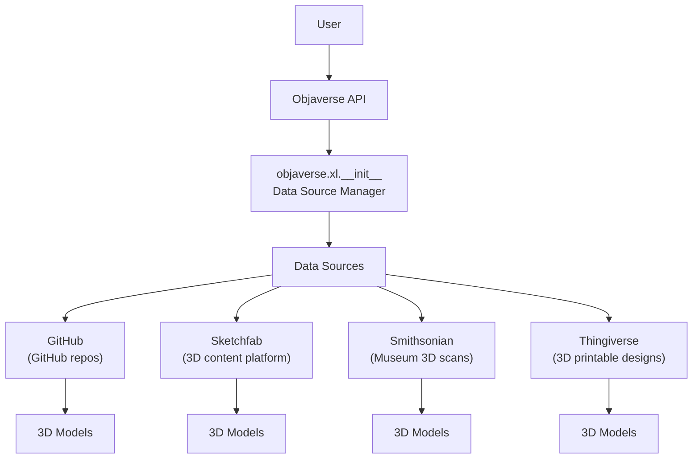
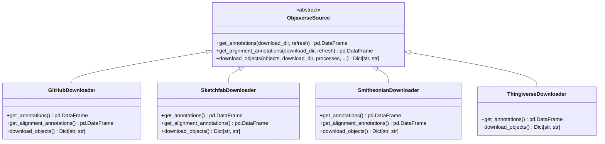
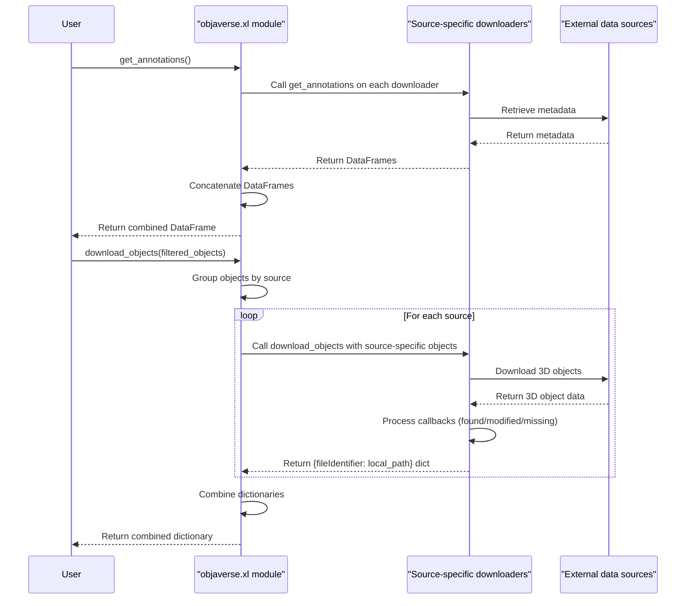

<!-- source: DeepWiki mcp.deepwiki.com · repo allenai/objaverse-xl · page 4 Data Sources and Downloaders · fetched 2026-10-26 -->

# Data Sources and Downloaders

<details>
<summary>Relevant source files</summary>

The following files were used as context for generating this wiki page:

- [objaverse/xl/__init__.py](objaverse/xl/__init__.py)
- [objaverse/xl/abstract.py](objaverse/xl/abstract.py)

</details>


This page documents the data source management and downloader components of Objaverse-XL, which are responsible for retrieving 3D objects from various online repositories. For information about using these downloaders to acquire objects, see [Downloading Objects](#3.2).

## Overview

Objaverse-XL sources 3D objects from four primary platforms:

1. **GitHub** - Public repositories containing 3D model files
2. **Sketchfab** - A platform for publishing, sharing, and discovering 3D content
3. **Smithsonian** - The Smithsonian Institution's digitized 3D models
4. **Thingiverse** - A community for sharing 3D printable designs

The codebase provides specialized downloaders for each of these sources, all implementing a common interface to ensure consistent behavior across different data sources.



Sources: [objaverse/xl/__init__.py:12-17]()

## Downloader Architecture

The downloader system is built around a common abstract interface, `ObjaverseSource`, which each specific downloader implements. This ensures that all downloaders provide consistent functionality regardless of their data source.



Sources: [objaverse/xl/abstract.py:9-124](), [objaverse/xl/__init__.py:7-10]()

The system instantiates these downloaders at module level in a dictionary that maps source names to their respective downloader instances:

```python
downloaders = {
    "github": GitHubDownloader(),
    "thingiverse": ThingiverseDownloader(),
    "smithsonian": SmithsonianDownloader(),
    "sketchfab": SketchfabDownloader(),
}
```

Sources: [objaverse/xl/__init__.py:12-17]()

## ObjaverseSource Interface

The `ObjaverseSource` abstract base class defines the interface that all downloaders must implement. It specifies three essential methods:

1. **get_annotations** - Retrieves metadata about all objects available from the source
2. **get_alignment_annotations** - Retrieves metadata specifically for objects used during alignment fine-tuning
3. **download_objects** - Downloads the actual 3D objects from the source

### get_annotations

```python
@classmethod
@abstractmethod
def get_annotations(
    cls, download_dir: str = "~/.objaverse", refresh: bool = False
) -> pd.DataFrame:
    """Loads the 3D object metadata as a Pandas DataFrame."""
    # Implementation in child classes
```

This method returns a Pandas DataFrame containing metadata about all objects available from the source. The DataFrame includes columns for:
- `fileIdentifier` - Unique identifier for each 3D object
- `license` - License information for the object
- `source` - The source platform (github, sketchfab, etc.)
- `fileType` - Type of 3D file (obj, glb, etc.)
- `sha256` - SHA256 hash of the file contents
- `metadata` - Additional source-specific metadata

Sources: [objaverse/xl/abstract.py:13-30]()

### get_alignment_annotations

```python
@classmethod
@abstractmethod
def get_alignment_annotations(
    cls, download_dir: str = "~/.objaverse", refresh: bool = False
) -> pd.DataFrame:
    """Loads the 3D object metadata that was used for alignment fine-tuning."""
    # Implementation in child classes
```

Similar to `get_annotations`, but returns metadata specifically for objects that were used during alignment fine-tuning. This is a subset of the complete dataset.

Sources: [objaverse/xl/abstract.py:32-50]()

### download_objects

```python
@classmethod
@abstractmethod
def download_objects(
    cls,
    objects: pd.DataFrame,
    download_dir: Optional[str] = "~/.objaverse",
    processes: Optional[int] = None,
    handle_found_object: Optional[Callable] = None,
    handle_modified_object: Optional[Callable] = None,
    handle_missing_object: Optional[Callable] = None,
    **kwargs
) -> Dict[str, str]:
    """Downloads all objects from the source."""
    # Implementation in child classes
```

This method downloads the specified 3D objects from the source. It takes:
- A DataFrame of objects to download (usually filtered from `get_annotations`)
- A download directory
- Number of processes for parallel downloading
- Callback functions for different object states (found, modified, missing)
- Additional source-specific keyword arguments

It returns a dictionary mapping file identifiers to local paths of the downloaded objects.

Sources: [objaverse/xl/abstract.py:52-124]()

## Downloader Implementation

Each downloader implements the `ObjaverseSource` interface with source-specific behavior. The main module provides consolidated functions that operate across all downloaders.

### Main Module Functions

The `objaverse.xl` module provides three primary functions that aggregate results from all downloaders:

#### get_annotations

Retrieves metadata from all sources and combines them into a single DataFrame:

```python
def get_annotations(
    download_dir: str = "~/.objaverse", refresh: bool = False
) -> pd.DataFrame:
    """Loads the 3D object metadata as a Pandas DataFrame."""
    annotations = [
        downloader.get_annotations(download_dir=download_dir, refresh=refresh)
        for downloader in downloaders.values()
    ]
    return pd.concat(annotations, ignore_index=True)
```

Sources: [objaverse/xl/__init__.py:20-41]()

#### get_alignment_annotations

Similar to `get_annotations`, but only retrieves alignment data from GitHub and Sketchfab sources:

```python
def get_alignment_annotations(
    download_dir: str = "~/.objaverse", refresh: bool = False
) -> pd.DataFrame:
    """Loads the 3D object metadata for the objects used during alignment fine-tuning."""
    annotations = [
        downloader.get_alignment_annotations(download_dir=download_dir, refresh=refresh)
        for source, downloader in downloaders.items()
        if source in {"github", "sketchfab"}
    ]
    return pd.concat(annotations, ignore_index=True)
```

Sources: [objaverse/xl/__init__.py:44-66]()

#### download_objects

Routes download requests to the appropriate downloader based on the source of each object:

```python
def download_objects(
    objects: pd.DataFrame,
    download_dir: Optional[str] = "~/.objaverse",
    processes: Optional[int] = None,
    handle_found_object: Optional[Callable] = None,
    handle_modified_object: Optional[Callable] = None,
    handle_missing_object: Optional[Callable] = None,
    **kwargs,
) -> Dict[str, str]:
    """Downloads all objects from the source."""
    # Implementation details...
```

Sources: [objaverse/xl/__init__.py:69-158]()

## Data Flow

The following diagram illustrates the data flow when downloading objects from the Objaverse-XL dataset:



Sources: [objaverse/xl/__init__.py:20-158]()

## Downloader Specifics

Each downloader implementation has unique characteristics based on its data source:

| Downloader | Source | Description | Notable Features |
|------------|--------|-------------|------------------|
| GitHubDownloader | GitHub repositories | Downloads 3D models from public GitHub repositories | Uses Git shallow cloning and LFS support |
| SketchfabDownloader | Sketchfab platform | Downloads models from the Sketchfab 3D content platform | Supports LVIS annotations and additional metadata |
| SmithsonianDownloader | Smithsonian Institution | Downloads 3D scans of museum artifacts | Specialized handling for museum metadata |
| ThingiverseDownloader | Thingiverse | Downloads 3D printable designs | Simplified implementation focused on downloadable models |

Sources: [objaverse/xl/__init__.py:7-10]()

For detailed information on each specific downloader implementation, please refer to:
- [GitHub Downloader](#4.2)
- [Sketchfab Downloader](#4.3)
- [Other Downloaders](#4.4)

## Event Handling

The download system provides a flexible callback mechanism to handle different scenarios during the download process:

1. **handle_found_object** - Called when an object is successfully found and downloaded with the expected SHA256 hash
2. **handle_modified_object** - Called when an object is found but has a different SHA256 hash than expected
3. **handle_missing_object** - Called when an object that exists in the metadata cannot be found or downloaded

These callbacks allow for custom processing of downloaded objects, such as rendering, validation, or custom storage methods.

Sources: [objaverse/xl/abstract.py:82-118](), [objaverse/xl/__init__.py:95-131]()

---

