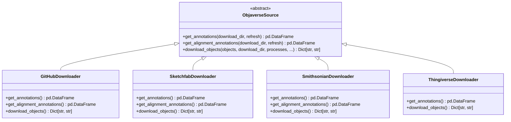
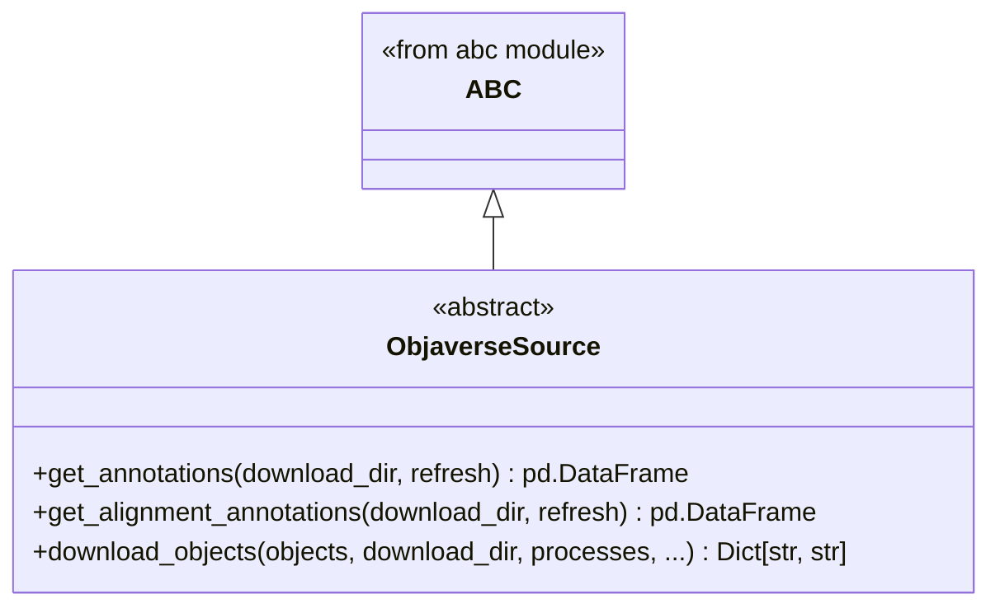
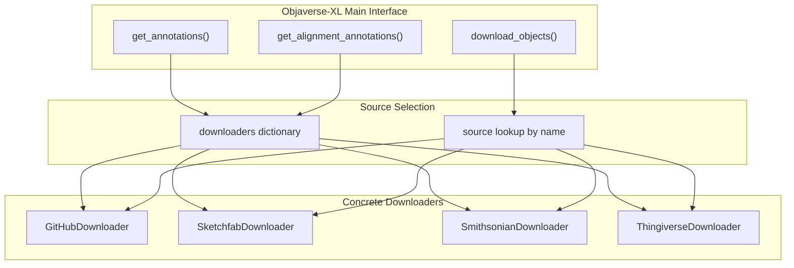
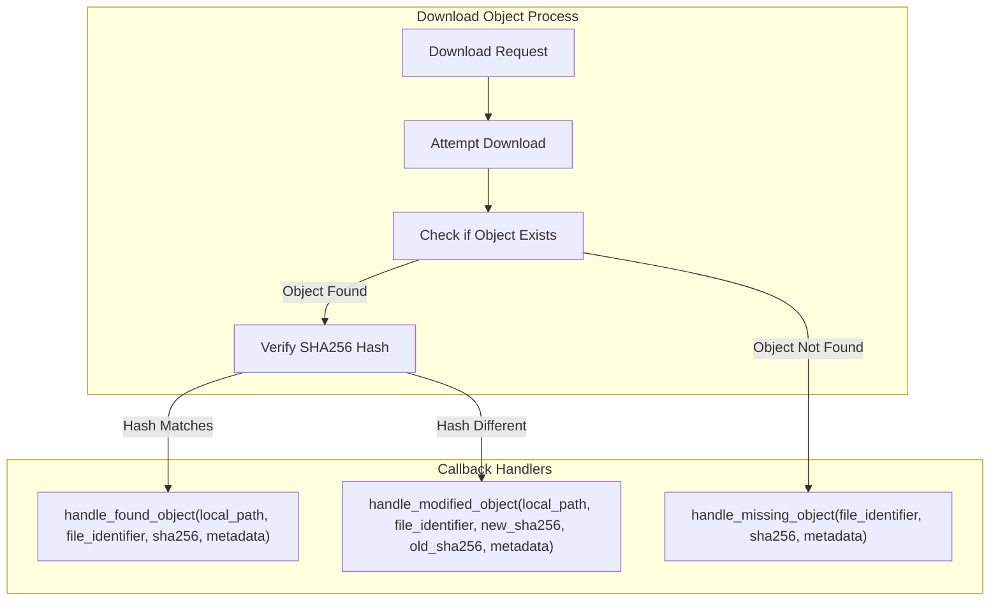

<!-- source: DeepWiki mcp.deepwiki.com · repo allenai/objaverse-xl · page 4.1 Abstract Source Interface · fetched 2026-10-26 -->

# Abstract Source Interface

<details>
<summary>Relevant source files</summary>

The following files were used as context for generating this wiki page:

- [objaverse/xl/__init__.py](objaverse/xl/__init__.py)
- [objaverse/xl/abstract.py](objaverse/xl/abstract.py)

</details>


## Purpose and Scope

The Abstract Source Interface provides a standardized way for Objaverse-XL to access 3D objects from multiple data sources. This page documents the `ObjaverseSource` abstract base class, which defines the interface that all source-specific downloaders must implement. The interface ensures consistent behavior across different data sources, enabling the system to handle GitHub, Sketchfab, Smithsonian, and Thingiverse content using a uniform approach.

For information about specific downloader implementations, see [GitHub Downloader](#4.2), [Sketchfab Downloader](#4.3), and [Other Downloaders](#4.4).

## Interface Definition and Role

The `ObjaverseSource` abstract base class defines a contract that all data source downloaders must fulfill. It establishes three essential operations:

1. Retrieving object metadata
2. Accessing alignment annotations 
3. Downloading 3D objects

This standardization allows the core Objaverse-XL system to work with any data source that implements this interface without needing to know the specifics of how each source operates.



**Diagram: ObjaverseSource Class Hierarchy**

Sources: [objaverse/xl/abstract.py:9-124](), [objaverse/xl/__init__.py:7-10]()

## ObjaverseSource Abstract Class

The `ObjaverseSource` abstract base class is defined in the `abstract.py` file and implements the Abstract Base Class (ABC) pattern from Python's `abc` module:



**Diagram: ObjaverseSource Implementation Details**

Sources: [objaverse/xl/abstract.py:1-10]()

### Abstract Methods

The `ObjaverseSource` class defines three abstract methods that all concrete downloader classes must implement:

#### 1. get_annotations

```python
@classmethod
@abstractmethod
def get_annotations(cls, download_dir: str = "~/.objaverse", refresh: bool = False) -> pd.DataFrame:
```

This method retrieves metadata for 3D objects from a specific source and returns it as a Pandas DataFrame. The DataFrame must include columns for the object's `fileIdentifier`, `license`, `source`, `fileType`, `sha256`, and `metadata`.

Parameters:
- `download_dir`: Directory to download the parquet metadata file
- `refresh`: Whether to refresh annotations by downloading from the remote source

Return value:
- A Pandas DataFrame containing metadata for all objects from this source

Sources: [objaverse/xl/abstract.py:13-30]()

#### 2. get_alignment_annotations

```python
@classmethod
@abstractmethod
def get_alignment_annotations(cls, download_dir: str = "~/.objaverse", refresh: bool = False) -> pd.DataFrame:
```

This method retrieves metadata specifically for objects used during alignment fine-tuning. It follows the same parameter pattern and return structure as `get_annotations`.

Sources: [objaverse/xl/abstract.py:32-50]()

#### 3. download_objects

```python
@classmethod
@abstractmethod
def download_objects(
    cls,
    objects: pd.DataFrame,
    download_dir: Optional[str] = "~/.objaverse",
    processes: Optional[int] = None,
    handle_found_object: Optional[Callable] = None,
    handle_modified_object: Optional[Callable] = None,
    handle_missing_object: Optional[Callable] = None,
    **kwargs
) -> Dict[str, str]:
```

This method downloads 3D objects from the source, managing various scenarios through callback functions.

Parameters:
- `objects`: DataFrame of objects to download (must have `fileIdentifier` and `sha256` columns)
- `download_dir`: Directory to save downloaded objects
- `processes`: Number of parallel processes to use
- `handle_found_object`: Callback for successfully downloaded objects
- `handle_modified_object`: Callback for objects with modified content
- `handle_missing_object`: Callback for objects not found at the source
- `**kwargs`: Additional source-specific parameters

Return value:
- Dictionary mapping file identifiers to local paths of downloaded objects

Sources: [objaverse/xl/abstract.py:52-124]()

## Integration in the Objaverse-XL System

The Abstract Source Interface is central to how Objaverse-XL manages downloads from multiple data sources. The system instantiates concrete downloader classes and organizes them in a dictionary, allowing dynamic selection based on the data source:



**Diagram: Interface Integration in Objaverse-XL**

Sources: [objaverse/xl/__init__.py:12-17](), [objaverse/xl/__init__.py:146-156]()

The main module creates a dictionary of downloader instances:

```python
downloaders = {
    "github": GitHubDownloader(),
    "thingiverse": ThingiverseDownloader(),
    "smithsonian": SmithsonianDownloader(),
    "sketchfab": SketchfabDownloader(),
}
```

When the system needs to retrieve annotations or download objects, it delegates to the appropriate downloader based on the source, as shown in these key functions:

### get_annotations Implementation

The top-level `get_annotations` function gathers annotations from all sources by calling each downloader's implementation of the method:

```python
def get_annotations(download_dir: str = "~/.objaverse", refresh: bool = False) -> pd.DataFrame:
    annotations = [
        downloader.get_annotations(download_dir=download_dir, refresh=refresh)
        for downloader in downloaders.values()
    ]
    return pd.concat(annotations, ignore_index=True)
```

Sources: [objaverse/xl/__init__.py:20-41]()

### download_objects Implementation

Similarly, the `download_objects` function routes download requests to the appropriate downloader based on the source:

```python
def download_objects(objects: pd.DataFrame, ...) -> Dict[str, str]:
    sources = set(objects["source"].unique().tolist())
    # ...
    
    downloaded_objects = {}
    for source in sources:
        source_downloads = downloaders[source].download_objects(
            objects[objects["source"] == source],
            download_dir,
            processes,
            handle_found_object,
            handle_modified_object,
            handle_missing_object,
            **kwargs,
        )
        downloaded_objects.update(source_downloads)
    
    return downloaded_objects
```

Sources: [objaverse/xl/__init__.py:69-158]()

## Callback Function Architecture

The `download_objects` method incorporates a callback system to handle different download scenarios:



**Diagram: Download Callback Architecture**

Sources: [objaverse/xl/abstract.py:73-118]()

These callback functions enable flexible processing of downloaded objects:

| Callback | Purpose | Triggered When |
|----------|---------|---------------|
| `handle_found_object` | Process successfully downloaded objects | Object is found with matching SHA256 |
| `handle_modified_object` | Handle objects with content changes | Object is found but SHA256 differs |
| `handle_missing_object` | Handle objects no longer available | Object cannot be found at source |

Sources: [objaverse/xl/abstract.py:82-118]()

## Implementing New Source Downloaders

When extending Objaverse-XL with a new data source, you must create a new downloader class that inherits from `ObjaverseSource` and implements all three abstract methods. Follow these steps:

1. Create a new Python file for your downloader (e.g., `mynewsource.py`)
2. Import the abstract base class: `from objaverse.xl.abstract import ObjaverseSource`
3. Create a new class that inherits from `ObjaverseSource`
4. Implement the three required methods:
   - `get_annotations`
   - `get_alignment_annotations`
   - `download_objects`
5. Add your downloader to the `downloaders` dictionary in `objaverse/xl/__init__.py`

Example structure for a new downloader:

```python
from objaverse.xl.abstract import ObjaverseSource

class MyNewSourceDownloader(ObjaverseSource):
    @classmethod
    def get_annotations(cls, download_dir="~/.objaverse", refresh=False):
        # Implementation specific to your data source
        pass
        
    @classmethod
    def get_alignment_annotations(cls, download_dir="~/.objaverse", refresh=False):
        # Implementation specific to your data source
        pass
        
    @classmethod
    def download_objects(cls, objects, download_dir="~/.objaverse", processes=None, 
                         handle_found_object=None, handle_modified_object=None, 
                         handle_missing_object=None, **kwargs):
        # Implementation specific to your data source
        pass
```

Sources: [objaverse/xl/abstract.py:9-124]()

---

