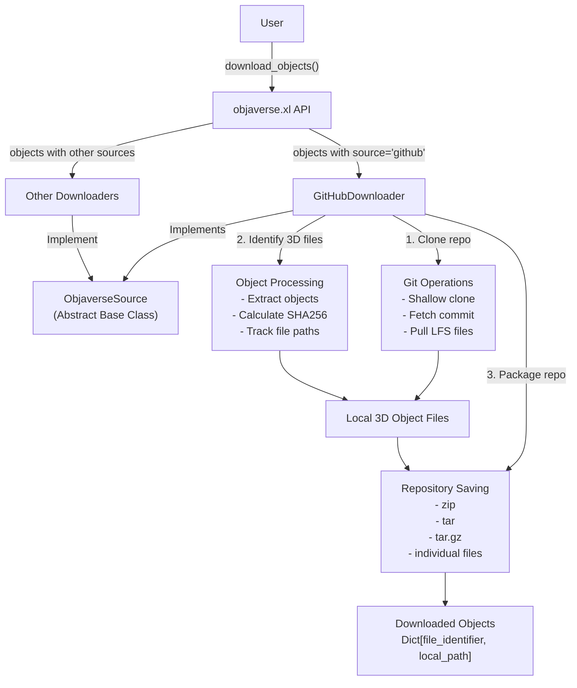
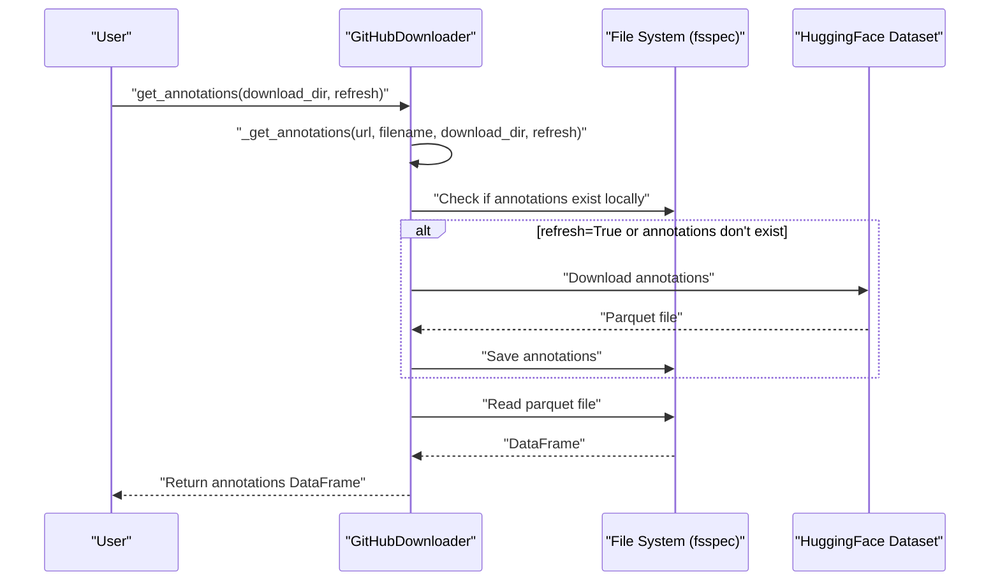
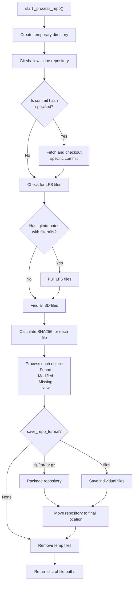
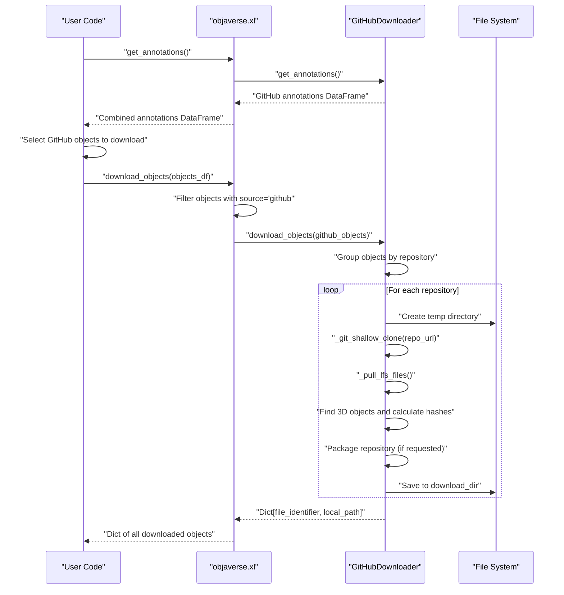

<!-- source: DeepWiki mcp.deepwiki.com · repo allenai/objaverse-xl · page 4.2 GitHub Downloader · fetched 2026-10-26 -->

# GitHub Downloader

Relevant source files

The following files were used as context for generating this wiki page:

- [objaverse/xl/__init__.py](objaverse/xl/__init__.py)
- [objaverse/xl/github.py](objaverse/xl/github.py)

## Purpose and Scope

The GitHub Downloader component is responsible for retrieving 3D object files from GitHub repositories within the Objaverse-XL system. It provides functionality to fetch object metadata, download repositories containing 3D assets, and handle Git LFS files. This page documents the implementation details, architecture, and usage of the GitHub Downloader class.

For information about the abstract interface this class implements, see [Abstract Source Interface](#4.1). For other downloaders like Sketchfab, see [Sketchfab Downloader](#4.3) and [Other Downloaders](#4.4).

Sources: [objaverse/xl/github.py:38-39]()

## Class Overview

The `GitHubDownloader` class is implemented in the `objaverse/xl/github.py` file and inherits from the abstract `ObjaverseSource` class. It specializes in downloading 3D objects from GitHub repositories by implementing the required interface methods while adding GitHub-specific functionality.

### Position in System Architecture

Sources: [objaverse/xl/github.py:38-39](), [objaverse/xl/__init__.py:12-17]()

## Supported File Types

The GitHub Downloader handles several 3D file formats commonly found in GitHub repositories:

| File Extension | Description |
|----------------|-------------|
| .obj           | Wavefront OBJ format |
| .glb           | Binary GL Transmission Format |
| .gltf          | GL Transmission Format |
| .usdz          | Universal Scene Description (zipped) |
| .usd           | Universal Scene Description |
| .fbx           | Filmbox |
| .stl           | Stereolithography |
| .usda          | USD ASCII |
| .dae           | COLLADA |
| .ply           | Polygon File Format |
| .abc           | Alembic |
| .blend         | Blender |

Sources: [objaverse/xl/github.py:22-35]()

## Core Functionality

### Metadata Retrieval

The GitHub Downloader provides two key methods for accessing object metadata:

1. `get_annotations()`: Retrieves the general metadata for GitHub 3D objects
2. `get_alignment_annotations()`: Retrieves metadata specifically for objects used in alignment fine-tuning

Both methods download and cache Parquet files containing the metadata from the Hugging Face dataset repository.

Sources: [objaverse/xl/github.py:41-125]()

### Object Download Process

The `download_objects()` method is the core functionality for retrieving 3D objects from GitHub. It handles:

1. Repository cloning with specific commit hashes
2. Git LFS file retrieval
3. 3D object extraction and verification
4. Repository packaging (zip, tar, or individual files)
5. Parallel processing for efficiency

The method accepts callbacks for handling different scenarios (found, modified, missing, and new objects), allowing flexible integration with rendering systems.

Sources: [objaverse/xl/github.py:468-659]()

## Implementation Details

### Repository Processing

The GitHub Downloader processes repositories through these key steps:

1. **Repository Identification**: Extracts repository organization, name, and commit hash from the file identifiers
2. **Shallow Cloning**: Uses Git's shallow clone feature to minimize download size
3. **Commit Checkout**: Checks out the specific commit hash to ensure reproducibility
4. **LFS File Handling**: Detects and pulls Git LFS files when present
5. **3D File Discovery**: Scans the repository for files with supported 3D extensions
6. **Hash Verification**: Calculates SHA256 hashes to verify file integrity
7. **Repository Packaging**: Stores the repository in the specified format

Sources: [objaverse/xl/github.py:178-382]()

### Parallel Processing

The GitHub Downloader uses Python's multiprocessing to handle repositories in parallel, significantly improving download speed:

1. Groups objects by repository to minimize redundant downloads
2. Creates a worker pool based on available CPU cores
3. Processes repositories concurrently
4. Aggregates results from all workers

Sources: [objaverse/xl/github.py:422-459](), [objaverse/xl/github.py:620-653]()

## API Reference

### Key Methods

| Method | Purpose | Parameters | Return Value |
|--------|---------|------------|--------------|
| `get_annotations()` | Retrieves GitHub object metadata | `download_dir`, `refresh` | DataFrame with object metadata |
| `get_alignment_annotations()` | Retrieves alignment fine-tuning metadata | `download_dir`, `refresh` | DataFrame with object metadata |
| `download_objects()` | Downloads objects from GitHub repositories | `objects`, `download_dir`, `processes`, callbacks... | Dict mapping file identifiers to local paths |

Sources: [objaverse/xl/github.py:78-100](), [objaverse/xl/github.py:103-125](), [objaverse/xl/github.py:468-553]()

### Helper Methods

The class includes several helper methods that support the main functionality:

1. `_get_repo_id_with_hash()`: Extracts repository ID and commit hash
2. `_git_shallow_clone()`: Performs shallow cloning of a Git repository
3. `_pull_lfs_files()`: Detects and pulls Git LFS files
4. `_process_repo()`: Core repository processing logic
5. `_parallel_process_repo()`: Wrapper for parallel processing
6. `_has_lfs_files()`: Checks if a repository uses Git LFS
7. `_list_files()`: Lists all files in a directory recursively

Sources: [objaverse/xl/github.py:128-420]()

## Usage Example Flow

The following diagram illustrates how the GitHub Downloader is typically used within the Objaverse-XL system:

Sources: [objaverse/xl/__init__.py:69-158](), [objaverse/xl/github.py:468-659]()

## Error Handling and Edge Cases

The GitHub Downloader includes robust handling for various scenarios:

1. **Repository Not Found**: If a repository can't be cloned (deleted, made private, etc.), the `handle_missing_object` callback is triggered for each expected object
2. **Commit Hash Not Found**: Falls back to the latest commit if the specified hash isn't available
3. **Modified Objects**: When an object's hash differs from the expected hash, the `handle_modified_object` callback is triggered
4. **New Objects**: 3D files in the repository that weren't part of the original dataset trigger the `handle_new_object` callback
5. **Git LFS Detection**: Automatically detects and pulls Git LFS files when needed

Sources: [objaverse/xl/github.py:220-225](), [objaverse/xl/github.py:233-257](), [objaverse/xl/github.py:282-311]()

## Integration with Objaverse-XL

The GitHub Downloader is one of four downloaders in the Objaverse-XL system, integrated through the initialization code in `objaverse/xl/__init__.py`. The system automatically routes download requests to the appropriate downloader based on the `source` field in the object metadata.

Sources: [objaverse/xl/__init__.py:12-17](), [objaverse/xl/__init__.py:146-156]()

---

