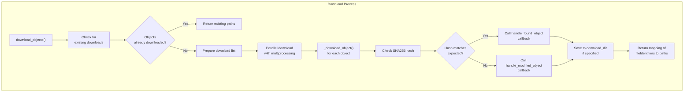
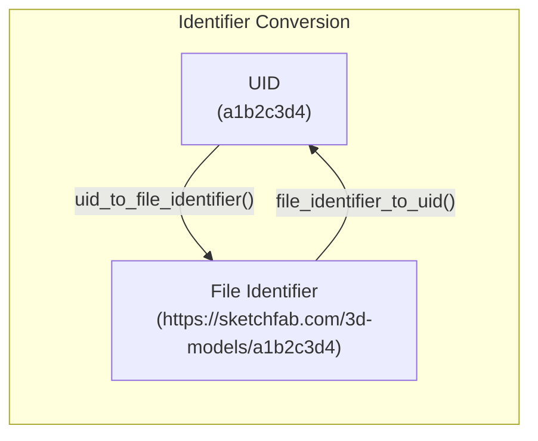
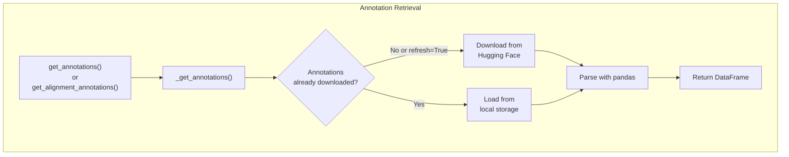
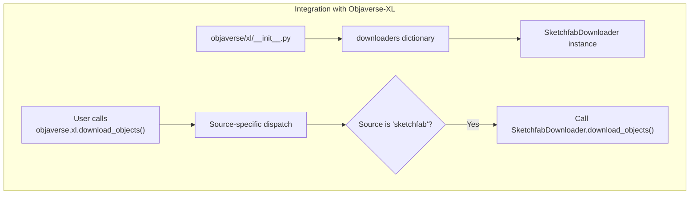

<!-- source: DeepWiki mcp.deepwiki.com · repo allenai/objaverse-xl · page 4.3 Sketchfab Downloader · fetched 2026-10-26 -->

# Sketchfab Downloader

<details>
<summary>Relevant source files</summary>

The following files were used as context for generating this wiki page:

- [objaverse/xl/__init__.py](objaverse/xl/__init__.py)
- [objaverse/xl/sketchfab.py](objaverse/xl/sketchfab.py)

</details>


## Overview

The `SketchfabDownloader` class is responsible for retrieving 3D objects and their metadata from the Sketchfab platform, which is a major source of 3D models in the Objaverse-XL dataset. This class provides functionality for downloading objects, accessing annotations, and converting between different identifier formats. 

The `SketchfabDownloader` implements the `ObjaverseSource` abstract base class (for details on the abstract interface, see [Abstract Source Interface](#4.1)) and is one of four source-specific downloaders in the Objaverse-XL system.

Sources: [objaverse/xl/sketchfab.py:22-602](), [objaverse/xl/__init__.py:8-16]()

## Class Structure and Inheritance

The `SketchfabDownloader` follows the inheritance pattern defined by the Objaverse-XL architecture:

```mermaid
classDiagram
    class "ObjaverseSource" {
        <<abstract>>
        +get_annotations(download_dir, refresh) pd.DataFrame
        +get_alignment_annotations(download_dir, refresh) pd.DataFrame
        +download_objects(objects, download_dir, processes, ...) Dict[str, str]
    }
    
    class "SketchfabDownloader" {
        +get_annotations(download_dir, refresh) pd.DataFrame
        +get_alignment_annotations(download_dir, refresh) pd.DataFrame
        +get_full_annotations(uids, download_dir) Dict[str, Any]
        +get_uids(download_dir) List[str]
        +download_objects(objects, download_dir, processes, ...) Dict[str, str]
        +get_lvis_annotations(download_dir) Dict[str, List[str]]
        -_get_annotations(url, filename, download_dir, refresh) pd.DataFrame
        -_get_object_paths(download_dir) Dict[str, str]
        -_download_object(file_identifier, hf_object_path, download_dir, expected_sha256, ...) Tuple
    }
    
    "ObjaverseSource" <|-- "SketchfabDownloader"
```

Sources: [objaverse/xl/sketchfab.py:22-23](), [objaverse/xl/abstract.py]()

## Core Functionality

The `SketchfabDownloader` provides the following key capabilities:

1. **Annotation Retrieval**: Accessing metadata for Sketchfab 3D objects
2. **Object Download**: Retrieving the actual 3D object files from Hugging Face repositories
3. **Identifier Management**: Converting between UIDs and file identifiers
4. **LVIS Annotations**: Accessing LVIS (Large Vocabulary Instance Segmentation) category information

### Public Methods

| Method | Purpose | Return Type |
|--------|---------|-------------|
| `get_annotations()` | Retrieve basic metadata for all Sketchfab objects | `pd.DataFrame` |
| `get_alignment_annotations()` | Retrieve metadata for objects used in alignment fine-tuning | `pd.DataFrame` |
| `get_full_annotations()` | Get detailed metadata for specified objects | `Dict[str, Any]` |
| `get_uids()` | Retrieve all available Sketchfab UIDs | `List[str]` |
| `download_objects()` | Download 3D objects based on provided identifiers | `Dict[str, str]` |
| `get_lvis_annotations()` | Get LVIS category annotations | `Dict[str, List[str]]` |
| `uid_to_file_identifier()` | Convert a UID to a file identifier | `str` |
| `file_identifier_to_uid()` | Convert a file identifier to a UID | `str` |

Sources: [objaverse/xl/sketchfab.py:66-602]()

## Data Flow for Object Download

The download process in `SketchfabDownloader` follows a specific workflow to efficiently retrieve objects from Hugging Face repositories:



The download process handles three possible object states:
- **Found objects**: Successfully downloaded with matching SHA256 hash
- **Modified objects**: Downloaded but with different SHA256 than expected
- **Missing objects**: Cannot be found in the repository

Sources: [objaverse/xl/sketchfab.py:384-561]()

## Identifier Management

The `SketchfabDownloader` works with two different identifier formats:

1. **UIDs**: Unique identifiers used within Sketchfab (e.g., `a1b2c3d4`)
2. **File Identifiers**: Full URLs to Sketchfab models (e.g., `https://sketchfab.com/3d-models/a1b2c3d4`)

Conversion methods facilitate working between these formats:



Sources: [objaverse/xl/sketchfab.py:360-381]()

## Annotations and Metadata

The `SketchfabDownloader` provides access to three types of annotations:

1. **Basic Annotations**: Essential metadata about each 3D object
2. **Alignment Annotations**: Objects used for alignment fine-tuning
3. **Full Annotations**: Detailed metadata from Objaverse 1.0

### Annotation Retrieval Process



The annotation DataFrame includes columns such as:
- `fileIdentifier`: The URL to the Sketchfab model
- `sha256`: Hash of the 3D object file
- `license`: License information
- `metadata`: Additional object metadata

Sources: [objaverse/xl/sketchfab.py:26-112]()

## Integration with Objaverse-XL

The `SketchfabDownloader` is instantiated and registered in the main Objaverse-XL module:



The global `download_objects()` function in the Objaverse-XL module dispatches to the appropriate downloader based on the source field in the objects DataFrame.

Sources: [objaverse/xl/__init__.py:12-16](), [objaverse/xl/__init__.py:69-158]()

## Implementation Details

### Object Path Retrieval

The `_get_object_paths()` method plays a crucial role in the download process by mapping UIDs to their locations in the Hugging Face repository:

1. It downloads the `object-paths.json.gz` file if not already present
2. This file contains mappings of UIDs to paths within the Hugging Face repository
3. These paths are used to construct the full download URLs

### Parallel Download Process

The `download_objects()` method leverages Python's multiprocessing to download objects efficiently:

1. It first checks for already downloaded objects to avoid redundant downloads
2. Creates a list of objects that need to be downloaded
3. Uses a process pool to download objects in parallel
4. Reports progress with tqdm progress bars

Sources: [objaverse/xl/sketchfab.py:199-231](), [objaverse/xl/sketchfab.py:384-561]()

## Usage Example

Here's how the `SketchfabDownloader` is typically used within the Objaverse-XL framework:

1. **Get annotations and filter objects**:
```python
# Get annotations for all objects
annotations = objaverse.xl.get_annotations()

# Filter for Sketchfab objects
sketchfab_objects = annotations[annotations["source"] == "sketchfab"]

# Further filter by criteria if needed
filtered_objects = sketchfab_objects[sketchfab_objects["license"] == "CC-BY"]
```

2. **Download objects**:
```python
# Download filtered objects
downloaded_paths = objaverse.xl.download_objects(
    objects=filtered_objects,
    download_dir="~/my_objects",
    processes=8
)
```

Sources: [objaverse/xl/__init__.py:20-158]()

---

