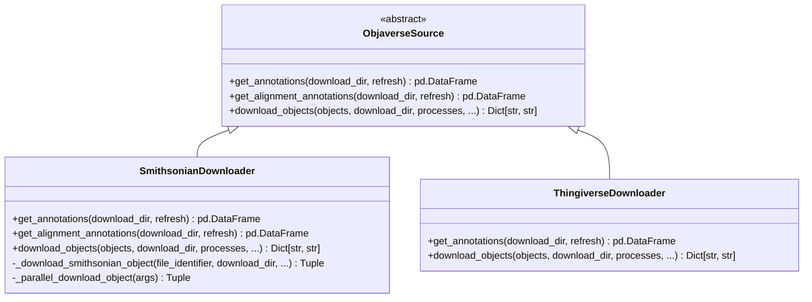
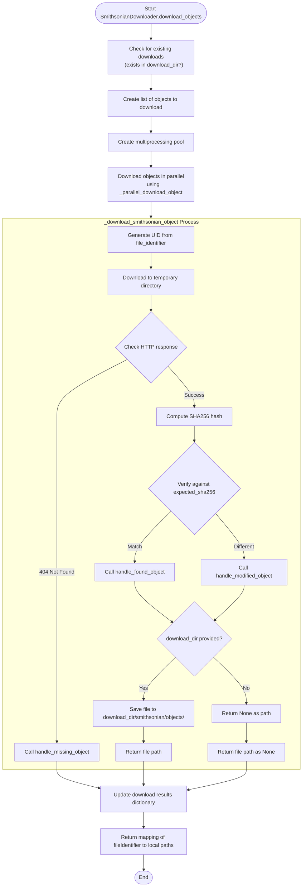
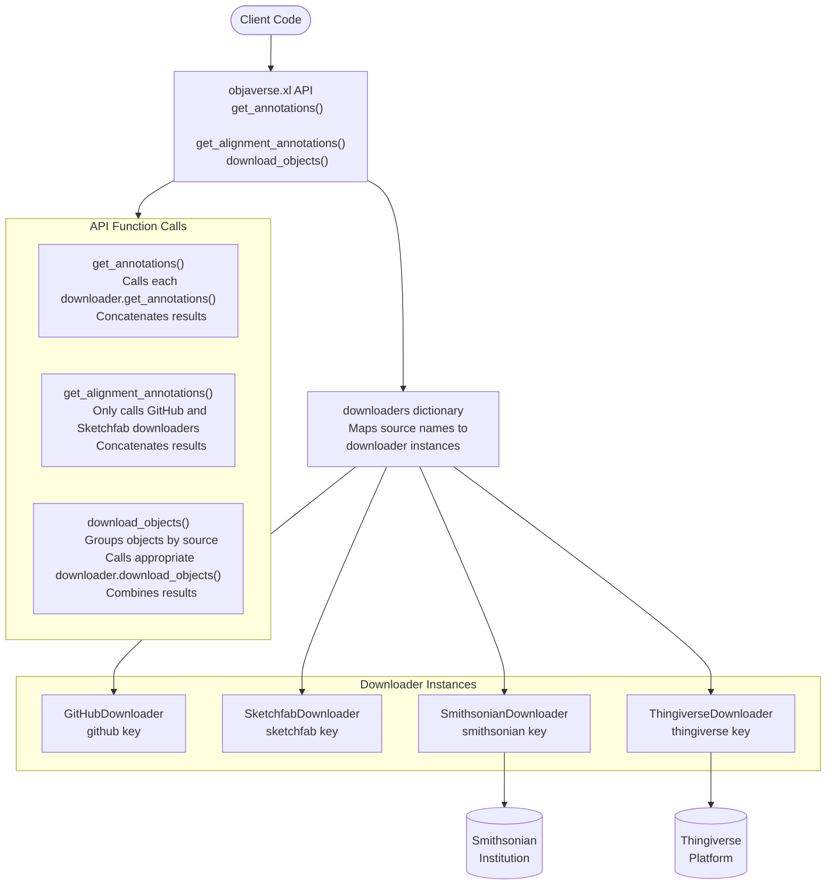
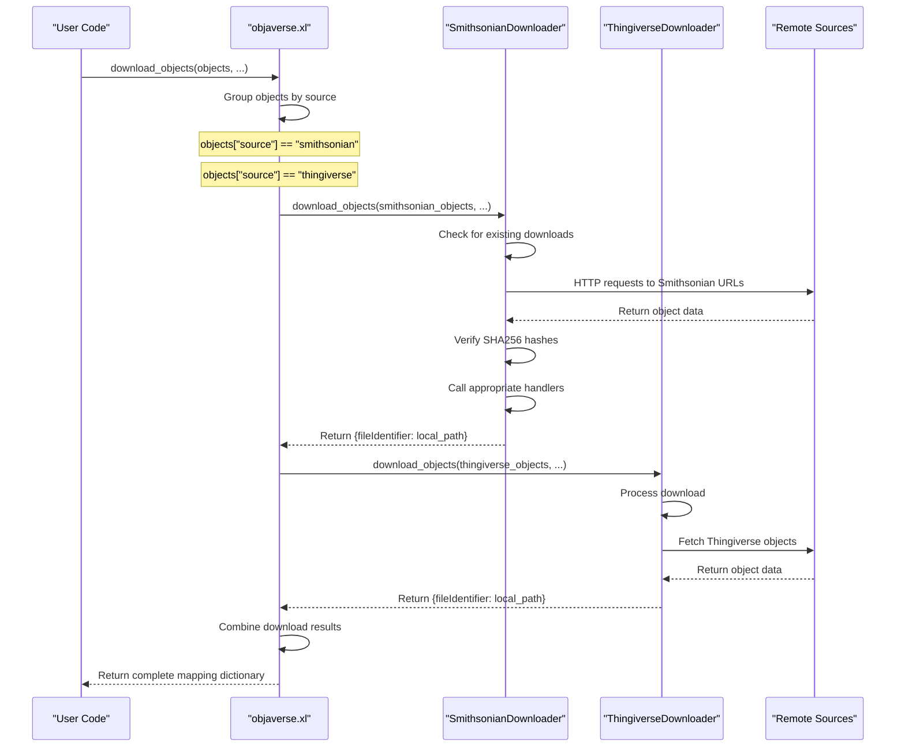

<!-- source: DeepWiki mcp.deepwiki.com · repo allenai/objaverse-xl · page 4.4 Other Downloaders · fetched 2026-10-26 -->

# Other Downloaders

Relevant source files

The following files were used as context for generating this wiki page:

- [objaverse/xl/__init__.py](objaverse/xl/__init__.py)
- [objaverse/xl/smithsonian.py](objaverse/xl/smithsonian.py)

This page documents the "secondary" downloaders in the Objaverse-XL system: the `SmithsonianDownloader` and `ThingiverseDownloader`. These downloaders complement the primary downloaders (GitHub and Sketchfab) by providing access to 3D objects from additional sources. For information about the primary downloaders, see [GitHub Downloader](#4.2) and [Sketchfab Downloader](#4.3). For details about the common interface they all implement, see [Abstract Source Interface](#4.1).

## Downloader Architecture

All downloaders in Objaverse-XL follow a common architecture pattern, inheriting from the abstract `ObjaverseSource` class and implementing its methods to provide source-specific functionality for retrieving and downloading 3D objects.

### Class Hierarchy Diagram

Sources: [objaverse/xl/__init__.py:7-10](), [objaverse/xl/__init__.py:12-17](), [objaverse/xl/smithsonian.py:19-21]()

## SmithsonianDownloader

The `SmithsonianDownloader` provides access to 3D models from the Smithsonian Institution's collection. It implements the standard downloader interface with specific logic for retrieving and validating Smithsonian 3D objects.

### Overview and Features

- Downloads 3D object models from the Smithsonian Institution
- All objects are in GLB file format
- Retrieves metadata from a parquet file hosted on HuggingFace
- Supports parallel downloads using multiprocessing
- Verifies downloaded objects using SHA256 checksums
- Implements object handling callbacks for found, modified, and missing objects

### Download Process Flow

Sources: [objaverse/xl/smithsonian.py:209-346](), [objaverse/xl/smithsonian.py:81-202]()

### Key Implementation Details

1. **Metadata Retrieval**: 
   - Downloads a parquet file from HuggingFace containing Smithsonian object metadata
   - Returns a pandas DataFrame with object metadata including fileIdentifier, sha256, etc.
   - Source: [objaverse/xl/smithsonian.py:23-57]()

2. **Alignment Annotations**:
   - Returns an empty DataFrame since Smithsonian objects aren't used for alignment fine-tuning
   - Source: [objaverse/xl/smithsonian.py:59-78]()

3. **Object Download Process**:
   - Checks for already downloaded objects to avoid redundant downloads
   - Uses multiprocessing for parallel downloads with progress tracking via tqdm
   - Performs object verification via SHA256 hash comparison
   - Handles objects using the provided callback functions
   - Source: [objaverse/xl/smithsonian.py:209-346]()

4. **Single Object Download**:
   - `_download_smithsonian_object` handles the downloading of a single object
   - Downloads to a temporary location first, then verifies and moves to final location
   - Handles HTTP errors (e.g., 404) appropriately
   - Source: [objaverse/xl/smithsonian.py:81-202]()

## ThingiverseDownloader

The `ThingiverseDownloader` provides access to 3D models from Thingiverse, a popular community for sharing user-created 3D printable designs. While we have limited information about its specific implementation, it follows the same interface pattern as other downloaders.

### Overview and Features

- Downloads 3D object models from Thingiverse
- Implements the standard `ObjaverseSource` interface
- Likely retrieves metadata from a parquet file like other downloaders
- Supports the common downloader API used throughout Objaverse-XL

Sources: [objaverse/xl/__init__.py:9](), [objaverse/xl/__init__.py:14]()

## Integration with Objaverse-XL

Both `SmithsonianDownloader` and `ThingiverseDownloader` are registered in the central `downloaders` dictionary in the Objaverse-XL package:

Sources: [objaverse/xl/__init__.py:12-17](), [objaverse/xl/__init__.py:20-41](), [objaverse/xl/__init__.py:44-66](), [objaverse/xl/__init__.py:69-158]()

### Usage in API Functions

1. **In `get_annotations()`**:
   - Both downloaders are included in the collection process
   - Their annotations are concatenated with those from other sources
   - Source: [objaverse/xl/__init__.py:20-41]()

2. **In `get_alignment_annotations()`**:
   - Only GitHub and Sketchfab downloaders are used (not Smithsonian or Thingiverse)
   - The function filters sources to only include GitHub and Sketchfab
   - Source: [objaverse/xl/__init__.py:44-66]()

3. **In `download_objects()`**:
   - Objects are grouped by source
   - Each downloader handles objects from its respective source
   - Results are combined into a single dictionary mapping file identifiers to local paths
   - Source: [objaverse/xl/__init__.py:69-158]()

## Data Flow for Object Downloads

The following diagram illustrates how objects are downloaded through the Objaverse-XL API and routed to the appropriate downloaders:

Sources: [objaverse/xl/__init__.py:69-158](), [objaverse/xl/smithsonian.py:209-346]()

## Summary

The `SmithsonianDownloader` and `ThingiverseDownloader` extend the Objaverse-XL dataset by providing access to 3D objects from additional sources beyond GitHub and Sketchfab. They follow the common downloader interface defined by `ObjaverseSource`, allowing them to be seamlessly integrated into the Objaverse-XL API.

The `SmithsonianDownloader` provides access to cultural and historical 3D objects from the Smithsonian Institution, while the `ThingiverseDownloader` provides access to community-created 3D printable designs from Thingiverse.

Together with the primary downloaders, they enable Objaverse-XL to offer a diverse collection of 3D objects from multiple sources, all accessible through a unified API.

---

