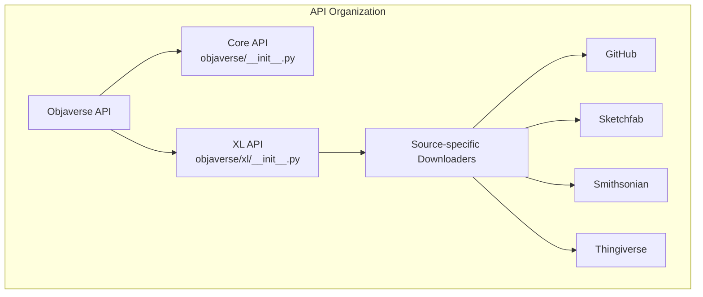
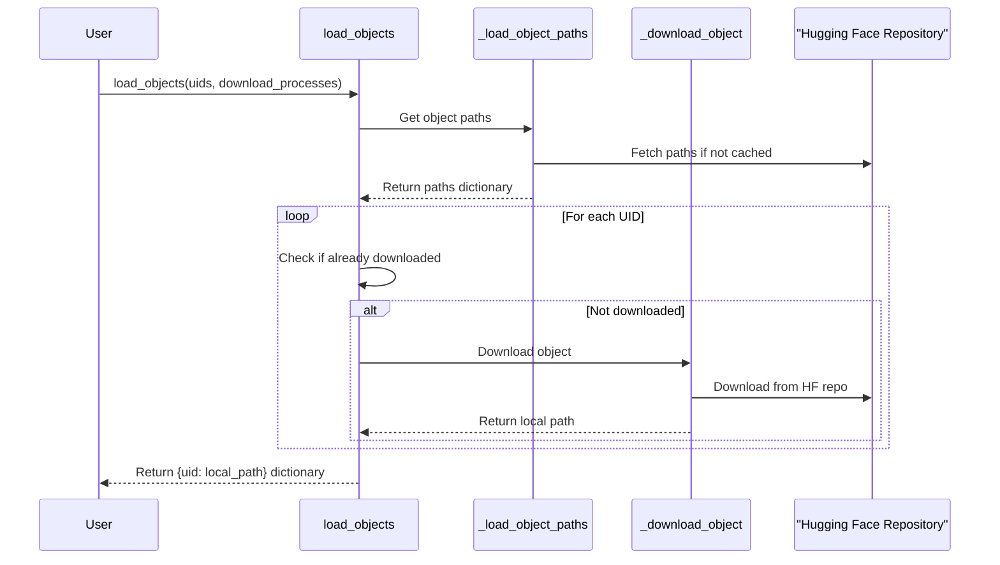
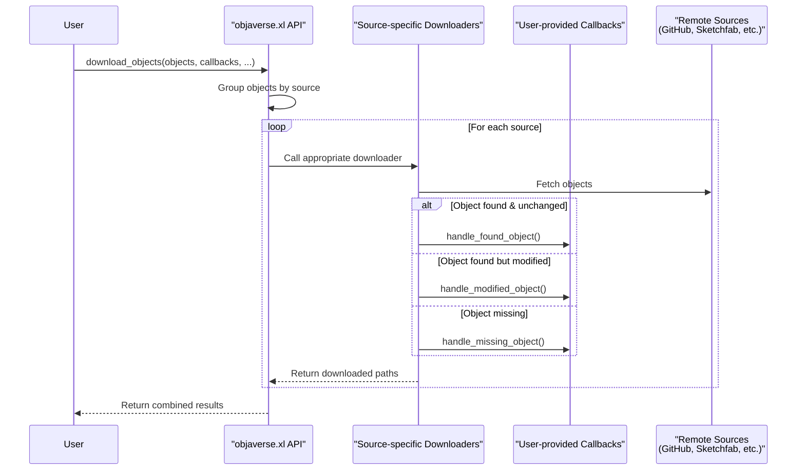
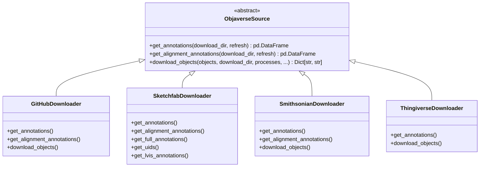
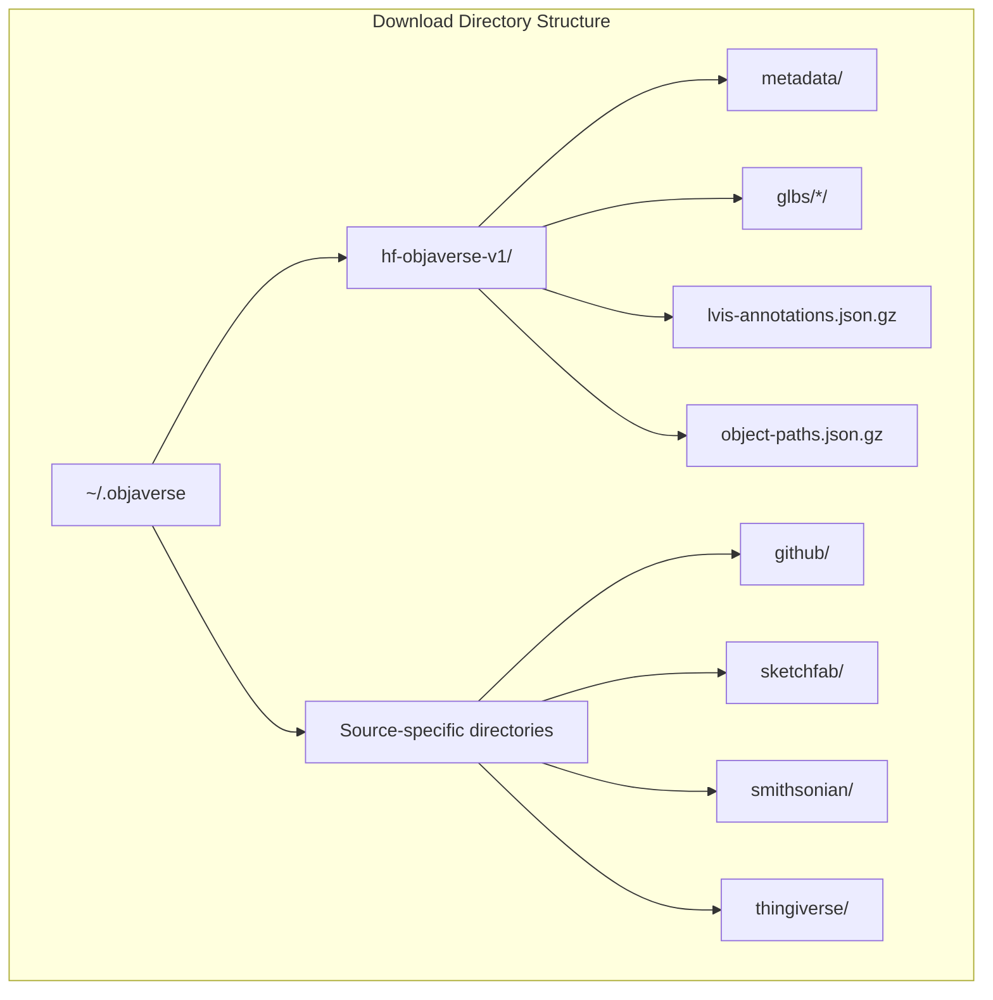

<!-- source: DeepWiki mcp.deepwiki.com · repo allenai/objaverse-xl · page 5 API Reference · fetched 2026-10-26 -->

# API Reference

<details>
<summary>Relevant source files</summary>

The following files were used as context for generating this wiki page:

- [.github/workflows/pypi-publish.yaml](.github/workflows/pypi-publish.yaml)
- [objaverse/__init__.py](objaverse/__init__.py)
- [objaverse/xl/__init__.py](objaverse/xl/__init__.py)

</details>


This document provides a comprehensive reference for the Objaverse-XL API, which enables users to access, download, and process the Objaverse-XL dataset containing over 10 million 3D objects. For an overview of the system architecture, see [System Architecture](#2), and for practical usage instructions, see [Using Objaverse-XL](#3).

## API Structure



Sources: [objaverse/__init__.py:1-212](), [objaverse/xl/__init__.py:1-158]()

## Core API Functions

The following functions are provided by the core Objaverse package for accessing the original Objaverse dataset:

| Function | Description | Key Parameters | Return Value |
|----------|-------------|----------------|--------------|
| `load_annotations(uids)` | Loads metadata for specified objects | `uids`: List of object UIDs (optional) | Dictionary mapping UIDs to metadata |
| `load_uids()` | Gets all available object UIDs | None | List of all object UIDs |
| `load_objects(uids, download_processes)` | Downloads and returns paths to objects | `uids`: List of UIDs, `download_processes`: Parallel processes | Dictionary mapping UIDs to local paths |
| `load_lvis_annotations()` | Loads LVIS category annotations | None | Dictionary mapping categories to UIDs |

### Data Flow in Core API



Sources: [objaverse/__init__.py:20-211]()

## Objaverse-XL API Functions

The Objaverse-XL API extends the core functionality with more advanced features for working with the expanded dataset:

| Function | Description | Key Parameters | Return Value |
|----------|-------------|----------------|--------------|
| `get_annotations(download_dir, refresh)` | Loads metadata for all Objaverse-XL objects | `download_dir`: Download location, `refresh`: Force refresh | DataFrame with object metadata |
| `get_alignment_annotations(download_dir, refresh)` | Loads metadata for alignment fine-tuning objects | `download_dir`: Download location, `refresh`: Force refresh | DataFrame with object metadata |
| `download_objects(objects, download_dir, processes, ...)` | Downloads objects with customizable callbacks | `objects`: DataFrame of objects, `download_dir`: Storage location, Various callback functions | Dictionary mapping IDs to paths |

### Callback Parameters for `download_objects`

The `download_objects` function provides three important callback parameters:

1. `handle_found_object`: Called when an object is successfully found and downloaded
   - Parameters: `local_path`, `file_identifier`, `sha256`, `metadata`

2. `handle_modified_object`: Called when an object is downloaded but has a different hash
   - Parameters: `local_path`, `file_identifier`, `new_sha256`, `old_sha256`, `metadata`

3. `handle_missing_object`: Called when an object in Objaverse-XL isn't found
   - Parameters: `file_identifier`, `sha256`, `metadata`

Sources: [objaverse/xl/__init__.py:20-158]()

## Data Flow in XL API



Sources: [objaverse/xl/__init__.py:69-158]()

## Downloader Classes

Objaverse-XL uses a set of source-specific downloaders that share a common interface:



Sources: [objaverse/xl/__init__.py:7-17]()

## Usage Pattern Examples

### Basic Object Download

```python
import objaverse.xl as oxl

# Get annotations for all objects
annotations = oxl.get_annotations()

# Filter to specific objects (e.g., first 10)
objects_to_download = annotations.head(10)

# Download the objects
downloaded_paths = oxl.download_objects(
    objects=objects_to_download,
    download_dir="~/my_objects",
    processes=4
)

# Use the downloaded objects
for file_id, path in downloaded_paths.items():
    print(f"Downloaded {file_id} to {path}")
```

### Using Custom Callbacks

```python
import objaverse.xl as oxl

# Define custom callbacks
def handle_found(local_path, file_identifier, sha256, metadata):
    print(f"Found and downloaded: {file_identifier}")
    # Process the downloaded file...

def handle_modified(local_path, file_identifier, new_sha256, old_sha256, metadata):
    print(f"Modified object: {file_identifier}")
    # Handle the modified object...

def handle_missing(file_identifier, sha256, metadata):
    print(f"Missing object: {file_identifier}")
    # Log the missing object...

# Download with callbacks
objects = oxl.get_annotations().query("source == 'sketchfab'").head(5)
results = oxl.download_objects(
    objects=objects,
    handle_found_object=handle_found,
    handle_modified_object=handle_modified,
    handle_missing_object=handle_missing
)
```

### Version Information

The package version can be accessed through the `__version__` attribute in the core module:

```python
import objaverse
print(f"Using Objaverse version: {objaverse.__version__}")
```

Sources: [objaverse/__init__.py:16](), [.github/workflows/pypi-publish.yaml:28]()

## API Data Structures

### Metadata DataFrame Structure

The metadata returned by `get_annotations()` and `get_alignment_annotations()` includes the following key columns:

| Column | Description |
|--------|-------------|
| `fileIdentifier` | Unique identifier for the 3D object |
| `license` | License information for the object |
| `source` | Source repository (github, sketchfab, etc.) |
| `fileType` | Format of the 3D file (obj, glb, etc.) |
| `sha256` | SHA256 hash of the object file |
| `metadata` | Source-specific metadata dictionary |

Sources: [objaverse/xl/__init__.py:23-36](), [objaverse/xl/__init__.py:47-60]()

## Download Directory Structure

When using the default download directory (`~/.objaverse`), the API organizes downloaded files as follows:



Sources: [objaverse/__init__.py:14-17](), [objaverse/xl/__init__.py:21-22](), [objaverse/xl/__init__.py:45-46]()

---

