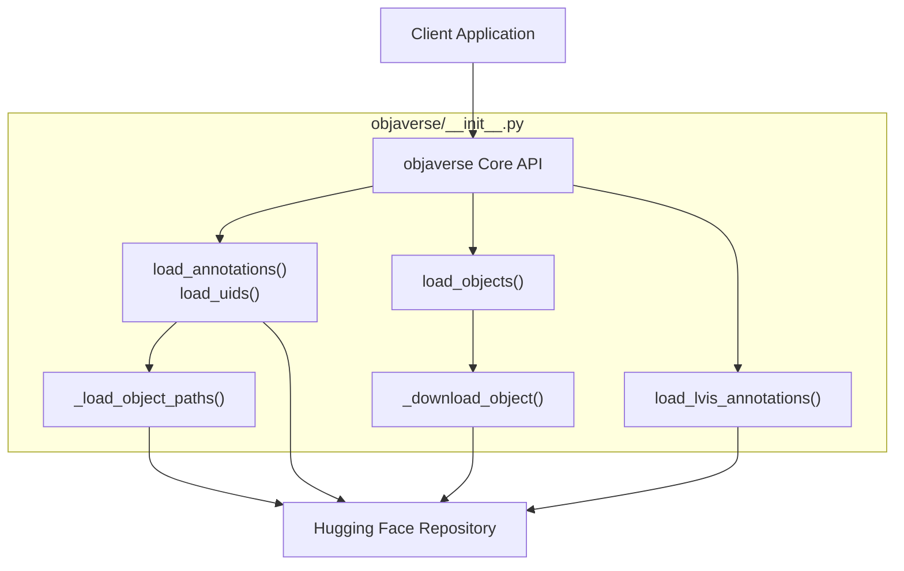
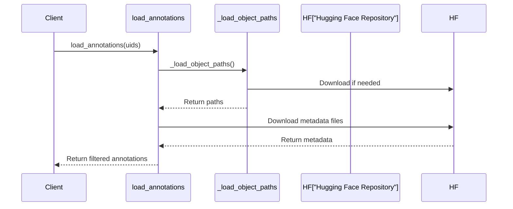
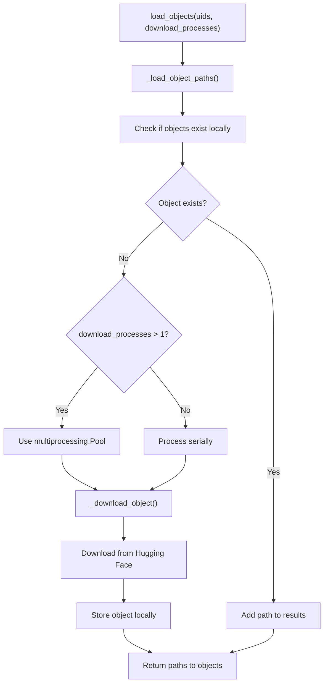
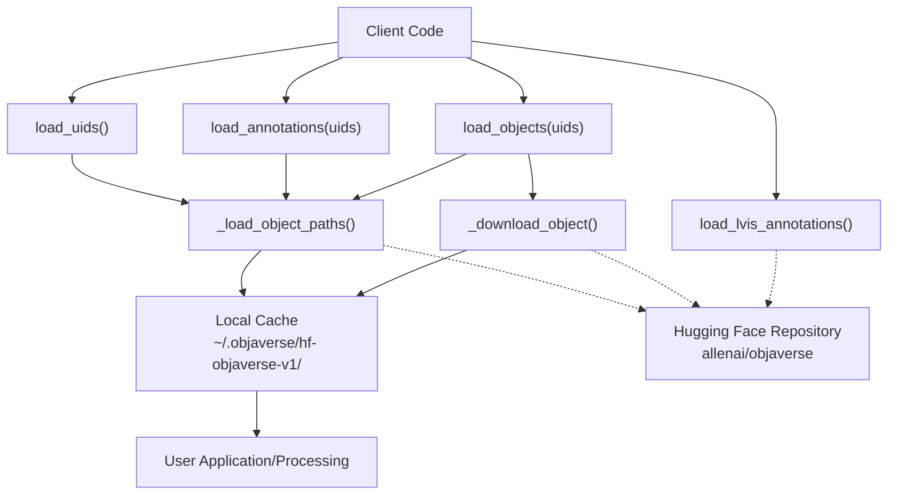

<!-- source: DeepWiki mcp.deepwiki.com · repo allenai/objaverse-xl · page 5.1 objaverse Core API · fetched 2026-10-26 -->

# objaverse Core API

<details>
<summary>Relevant source files</summary>

The following files were used as context for generating this wiki page:

- [.github/workflows/pypi-publish.yaml](.github/workflows/pypi-publish.yaml)
- [objaverse/__init__.py](objaverse/__init__.py)

</details>


## Purpose and Scope

The objaverse Core API provides fundamental access mechanisms to the Objaverse dataset. This API handles basic dataset operations including retrieving metadata, accessing object identifiers, downloading 3D objects, and loading annotations. This core functionality serves as the foundation upon which the more specialized Objaverse-XL API (see [objaverse.xl API](#5.2)) is built.

## API Overview

The objaverse Core API provides a streamlined interface for accessing the base Objaverse dataset, which comprises millions of 3D objects. It handles dataset discovery, metadata management, and object retrieval from Hugging Face repositories.



Sources: [objaverse/__init__.py:1-212]()

## Constants and Configuration

The Core API defines several important constants that determine where data is stored and how it's accessed:

| Constant | Purpose | Default Value |
|----------|---------|---------------|
| `BASE_PATH` | Root directory for all Objaverse data | `~/.objaverse` |
| `__version__` | Package version | Dynamically set during release |
| `_VERSIONED_PATH` | Path to specific dataset version | `~/.objaverse/hf-objaverse-v1` |

Sources: [objaverse/__init__.py:14-17]()

## Loading Metadata

The Core API provides functions to access object metadata and identifiers:

### `load_annotations(uids=None)`

Retrieves the metadata for specified objects or the entire dataset.



**Parameters:**
- `uids` (Optional[List[str]]): List of object UIDs to load metadata for. If None, loads metadata for all objects.

**Returns:**
- Dict[str, Any]: Dictionary mapping UIDs to their metadata.

### `load_uids()`

Returns a list of all object UIDs available in the dataset.

**Returns:**
- List[str]: List of all object UIDs.

Sources: [objaverse/__init__.py:20-85]()

## Object Access and Download

### `load_objects(uids, download_processes=1)`

The central function for accessing 3D objects, retrieving the local paths to objects and downloading them if necessary.



**Parameters:**
- `uids` (List[str]): List of object UIDs to load.
- `download_processes` (int): Number of parallel download processes to use.

**Returns:**
- Dict[str, str]: Dictionary mapping UIDs to local file paths.

Sources: [objaverse/__init__.py:127-193]()

## LVIS Annotations

### `load_lvis_annotations()`

Loads the LVIS (Large Vocabulary Instance Segmentation) annotations that map LVIS categories to object UIDs.

**Returns:**
- Dict[str, List[str]]: Dictionary mapping LVIS categories to lists of UIDs in those categories.

Sources: [objaverse/__init__.py:196-211]()

## Internal Utility Functions

These functions are used internally by the API but aren't typically called directly by users:

### `_load_object_paths()`

Retrieves the paths to all objects in the Hugging Face repository.

**Returns:**
- Dict[str, str]: Dictionary mapping UIDs to object paths in the repository.

### `_download_object(uid, object_path, total_downloads, start_file_count)`

Downloads a specific object from the Hugging Face repository.

**Parameters:**
- `uid` (str): Object UID.
- `object_path` (str): Path to the object in the repository.
- `total_downloads` (float): Total number of downloads to perform.
- `start_file_count` (int): Number of files already downloaded.

**Returns:**
- Tuple[str, str]: UID and local path of the downloaded object.

Sources: [objaverse/__init__.py:58-124]()

## API Data Flow

The following diagram illustrates the typical data flow when using the objaverse Core API:



Sources: [objaverse/__init__.py:1-212]()

## Version Management

The objaverse package version is managed through the CI/CD pipeline using GitHub Actions. When a release is made, the `<REPLACE_WITH_VERSION>` placeholder in `__init__.py` is replaced with the actual version number.

Sources: [.github/workflows/pypi-publish.yaml:25-28](), [objaverse/__init__.py:16]()

## Usage Example

```python
import objaverse

# Get a list of all object UIDs
all_uids = objaverse.load_uids()

# Load a subset of objects (will download if not cached)
sample_uids = all_uids[:10]
object_paths = objaverse.load_objects(sample_uids, download_processes=4)

# Load metadata for these objects
metadata = objaverse.load_annotations(sample_uids)

# Load LVIS annotations
lvis_annotations = objaverse.load_lvis_annotations()
```

This core API provides the essential functionality for accessing the Objaverse dataset, which is then extended by the Objaverse-XL API for the expanded dataset and specialized downloaders.

---

