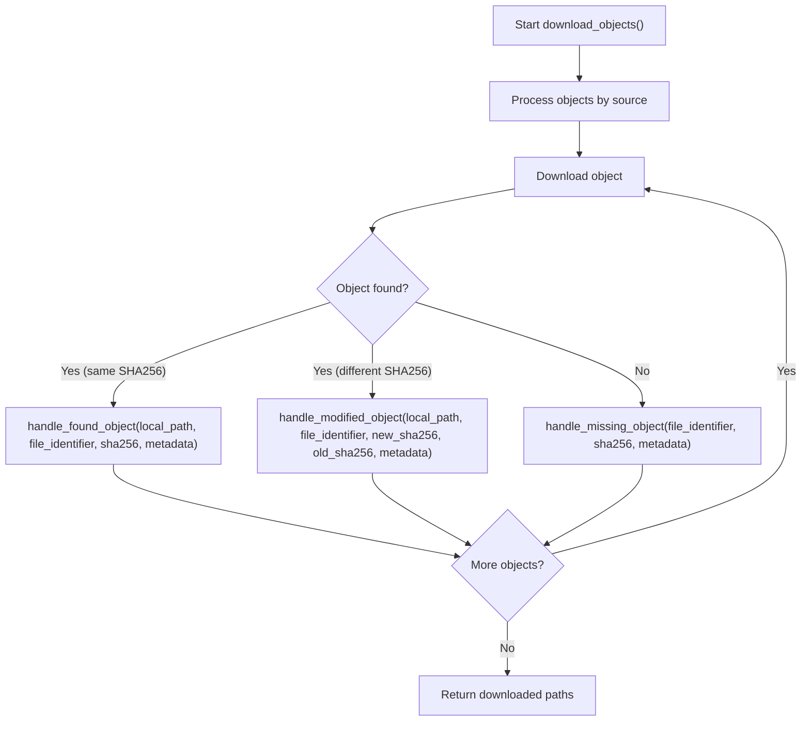
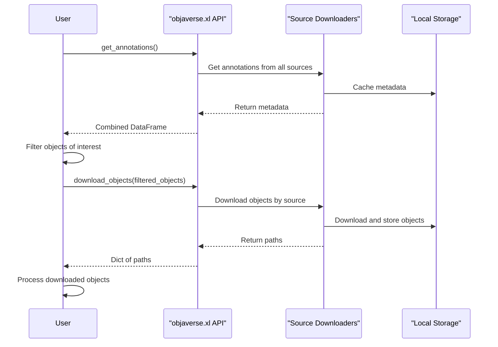

<!-- source: DeepWiki mcp.deepwiki.com · repo allenai/objaverse-xl · page 5.2 objaverse.xl API · fetched 2026-10-26 -->

# objaverse.xl API

<details>
<summary>Relevant source files</summary>

The following files were used as context for generating this wiki page:

- [objaverse/xl/__init__.py](objaverse/xl/__init__.py)
- [objaverse/xl/abstract.py](objaverse/xl/abstract.py)

</details>


This document provides a comprehensive reference for the `objaverse.xl` module, which forms the core API for accessing and downloading 3D objects from the Objaverse-XL dataset. For information about the core Objaverse functionality, see [objaverse Core API](#5.1).

The `objaverse.xl` API enables users to retrieve metadata about the 10M+ 3D objects in the dataset and download objects from multiple sources using a unified interface.

## API Structure

The `objaverse.xl` API is organized around two main components:

1. **Core API Functions** - High-level functions for accessing dataset metadata and downloading objects
2. **Source-Specific Downloaders** - Classes that implement the abstract `ObjaverseSource` interface for different data sources

```mermaid
classDiagram
    class "objaverse.xl" {
        +get_annotations()
        +get_alignment_annotations()
        +download_objects()
        -downloaders: Dict
    }
    
    class "ObjaverseSource" {
        <<abstract>>
        +get_annotations()
        +get_alignment_annotations()
        +download_objects()
    }
    
    class "GitHubDownloader" {
        +get_annotations()
        +get_alignment_annotations()
        +download_objects()
    }
    
    class "SketchfabDownloader" {
        +get_annotations()
        +get_alignment_annotations()
        +download_objects()
    }
    
    class "SmithsonianDownloader" {
        +get_annotations()
        +get_alignment_annotations()
        +download_objects()
    }
    
    class "ThingiverseDownloader" {
        +get_annotations()
        +get_alignment_annotations()
        +download_objects()
    }
    
    "objaverse.xl" --> "GitHubDownloader" : uses
    "objaverse.xl" --> "SketchfabDownloader" : uses
    "objaverse.xl" --> "SmithsonianDownloader" : uses
    "objaverse.xl" --> "ThingiverseDownloader" : uses
    
    "ObjaverseSource" <|-- "GitHubDownloader" : implements
    "ObjaverseSource" <|-- "SketchfabDownloader" : implements
    "ObjaverseSource" <|-- "SmithsonianDownloader" : implements
    "ObjaverseSource" <|-- "ThingiverseDownloader" : implements
```

Sources: [objaverse/xl/__init__.py:1-159](), [objaverse/xl/abstract.py:1-125]()

## Core API Functions

The `objaverse.xl` module exposes three main functions:

### get_annotations()

```python
def get_annotations(download_dir: str = "~/.objaverse", refresh: bool = False) -> pd.DataFrame
```

Retrieves metadata for all 3D objects in the Objaverse-XL dataset by aggregating annotations from all supported sources.

**Parameters:**
- `download_dir` - Directory to cache the downloaded metadata (default: "~/.objaverse")
- `refresh` - Whether to force a refresh of metadata by downloading from remote sources (default: False)

**Returns:**
- A pandas DataFrame with columns: "fileIdentifier", "license", "source", "fileType", "sha256", and "metadata"

**Implementation details:**
- Calls `get_annotations()` on each downloader instance
- Concatenates results from all sources into a single DataFrame

Sources: [objaverse/xl/__init__.py:20-41]()

### get_alignment_annotations()

```python
def get_alignment_annotations(download_dir: str = "~/.objaverse", refresh: bool = False) -> pd.DataFrame
```

Retrieves metadata for the subset of 3D objects used during alignment fine-tuning.

**Parameters:**
- `download_dir` - Directory to cache the downloaded metadata (default: "~/.objaverse")
- `refresh` - Whether to force a refresh of metadata by downloading from remote sources (default: False)

**Returns:**
- A pandas DataFrame with the same structure as `get_annotations()`

**Implementation details:**
- Only aggregates data from GitHub and Sketchfab sources
- Intended for specific alignment-related tasks

Sources: [objaverse/xl/__init__.py:44-66]()

### download_objects()

```python
def download_objects(
    objects: pd.DataFrame,
    download_dir: Optional[str] = "~/.objaverse",
    processes: Optional[int] = None,
    handle_found_object: Optional[Callable] = None,
    handle_modified_object: Optional[Callable] = None,
    handle_missing_object: Optional[Callable] = None,
    **kwargs
) -> Dict[str, str]
```

Downloads selected 3D objects from the dataset based on the provided DataFrame.

**Parameters:**
- `objects` - DataFrame containing objects to download (must have "fileIdentifier", "source", and "sha256" columns)
- `download_dir` - Directory to download objects to (default: "~/.objaverse")
- `processes` - Number of parallel download processes to use (default: number of CPU cores)
- `handle_found_object` - Callback for successfully downloaded objects
- `handle_modified_object` - Callback for objects that have changed since dataset creation
- `handle_missing_object` - Callback for objects that could not be found
- `**kwargs` - Additional source-specific download parameters

**Returns:**
- Dictionary mapping file identifiers to local paths of downloaded objects

**Implementation details:**
- Groups objects by source and delegates downloading to the appropriate downloader
- Validates source values against the set of supported sources
- Supports parallel downloading

Sources: [objaverse/xl/__init__.py:69-158]()

## Downloader Architecture

The `objaverse.xl` API implements a plugin architecture for different data sources through the `ObjaverseSource` abstract base class.

```mermaid
classDiagram
    class "ObjaverseSource" {
        <<abstract>>
        +get_annotations(download_dir, refresh) pd.DataFrame
        +get_alignment_annotations(download_dir, refresh) pd.DataFrame
        +download_objects(objects, download_dir, processes, ...) Dict[str, str]
    }
    
    class "GitHubDownloader" {
        +get_annotations() pd.DataFrame
        +get_alignment_annotations() pd.DataFrame
        +download_objects() Dict[str, str]
        -_process_repo() Dict[str, str]
        -_git_shallow_clone() None
        -_pull_lfs_files() None
    }
    
    class "SketchfabDownloader" {
        +get_annotations() pd.DataFrame
        +get_alignment_annotations() pd.DataFrame
        +download_objects() Dict[str, str]
        +get_full_annotations() Dict[str, Any]
        +get_uids() List[str]
        +get_lvis_annotations() Dict[str, List[str]]
    }
    
    class "SmithsonianDownloader" {
        +get_annotations() pd.DataFrame
        +get_alignment_annotations() pd.DataFrame
        +download_objects() Dict[str, str]
        -_download_smithsonian_object() Tuple
    }
    
    class "ThingiverseDownloader" {
        +get_annotations() pd.DataFrame
        +download_objects() Dict[str, str]
    }
    
    ObjaverseSource <|-- "GitHubDownloader" : implements
    ObjaverseSource <|-- "SketchfabDownloader" : implements
    ObjaverseSource <|-- "SmithsonianDownloader" : implements
    ObjaverseSource <|-- "ThingiverseDownloader" : implements
```

Sources: [objaverse/xl/abstract.py:9-124](), [objaverse/xl/__init__.py:7-17]()

### ObjaverseSource Abstract Base Class

The `ObjaverseSource` abstract class defines the interface that all downloader implementations must adhere to. It requires three methods to be implemented:

1. `get_annotations()` - Retrieves metadata for all objects from a specific source
2. `get_alignment_annotations()` - Retrieves metadata for alignment-specific objects from a source
3. `download_objects()` - Downloads objects from a specific source

Source-specific downloader classes implement these methods to handle the particular requirements of each platform.

Sources: [objaverse/xl/abstract.py:9-124]()

### Available Downloaders

The API includes four downloader implementations:

| Downloader | Source | Description |
|------------|--------|-------------|
| `GitHubDownloader` | GitHub | Downloads 3D objects from GitHub repositories |
| `SketchfabDownloader` | Sketchfab | Downloads 3D models from Sketchfab platform |
| `SmithsonianDownloader` | Smithsonian | Downloads 3D objects from Smithsonian Institution |
| `ThingiverseDownloader` | Thingiverse | Downloads 3D printable objects from Thingiverse |

Each downloader is instantiated once and stored in the `downloaders` dictionary in the `objaverse.xl` module.

Sources: [objaverse/xl/__init__.py:12-17]()

## Callback Functions

The `download_objects()` function supports three callback functions that enable processing of objects as they're downloaded:



Sources: [objaverse/xl/__init__.py:73-131](), [objaverse/xl/abstract.py:82-118]()

### handle_found_object

Called when an object is successfully downloaded and has the same SHA256 hash as recorded in the dataset.

**Parameters:**
- `local_path` - Path to the downloaded object
- `file_identifier` - Unique identifier for the object
- `sha256` - SHA256 hash of the object
- `metadata` - Source-specific metadata

### handle_modified_object

Called when an object is downloaded but has a different SHA256 hash than recorded in the dataset.

**Parameters:**
- `local_path` - Path to the downloaded object
- `file_identifier` - Unique identifier for the object
- `new_sha256` - SHA256 hash of the downloaded object
- `old_sha256` - Expected SHA256 hash from the dataset
- `metadata` - Source-specific metadata

### handle_missing_object

Called when an object that exists in the dataset could not be found or downloaded.

**Parameters:**
- `file_identifier` - Unique identifier for the object
- `sha256` - Expected SHA256 hash from the dataset
- `metadata` - Source-specific metadata

## Typical API Usage Flow

The following diagram illustrates the typical flow of using the `objaverse.xl` API:



Sources: [objaverse/xl/__init__.py:20-158]()

## Example Usage

```python
import objaverse.xl

# Get metadata for all objects
all_objects = objaverse.xl.get_annotations()

# Filter objects (e.g., by source or file type)
github_objs = all_objects[all_objects["source"] == "github"]
glb_files = github_objs[github_objs["fileType"] == "glb"]

# Define callback to process downloaded objects
def process_found_object(local_path, file_identifier, sha256, metadata):
    print(f"Processing {file_identifier} at {local_path}")
    # Add your processing logic here

# Download filtered objects
downloaded_paths = objaverse.xl.download_objects(
    objects=glb_files.head(10),  # Download first 10 GLB files from GitHub
    download_dir="~/data/objaverse",
    processes=4,
    handle_found_object=process_found_object
)

print(f"Downloaded {len(downloaded_paths)} objects")
```

Sources: [objaverse/xl/__init__.py:20-158]()

---

