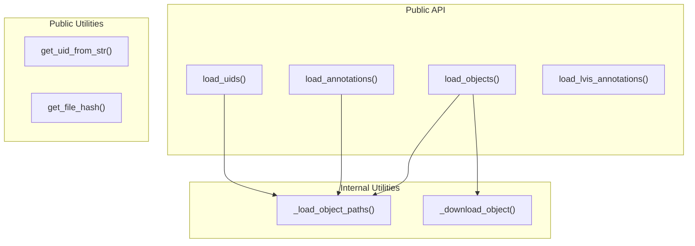
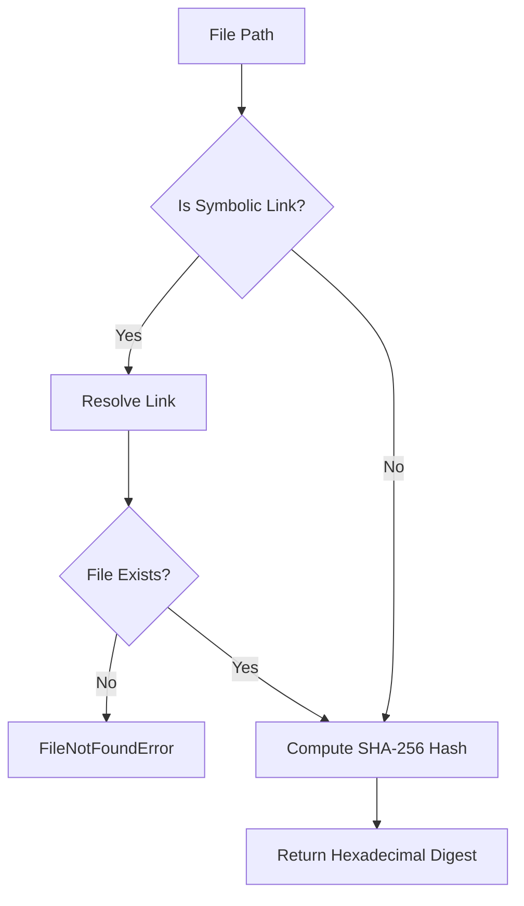
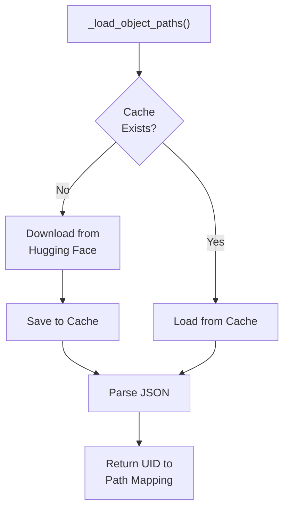
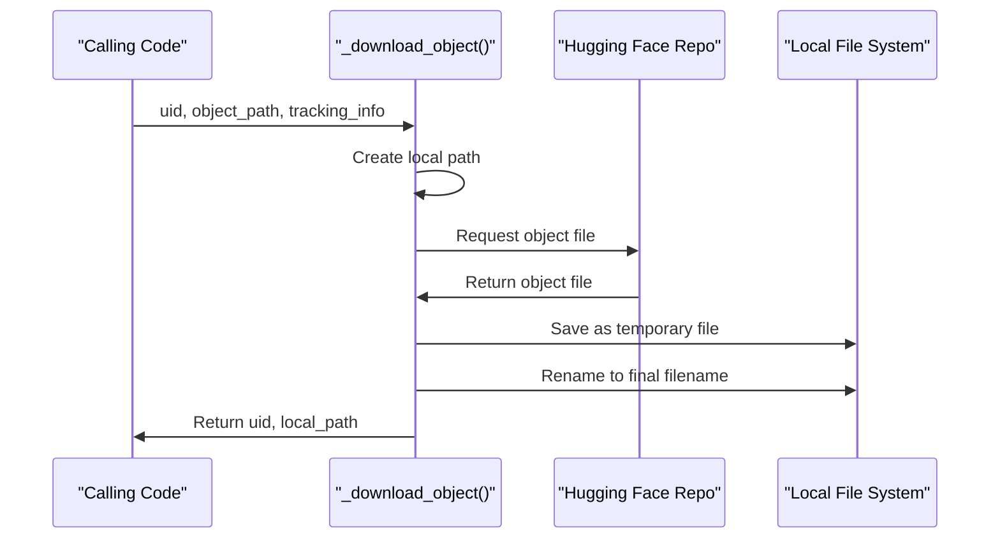
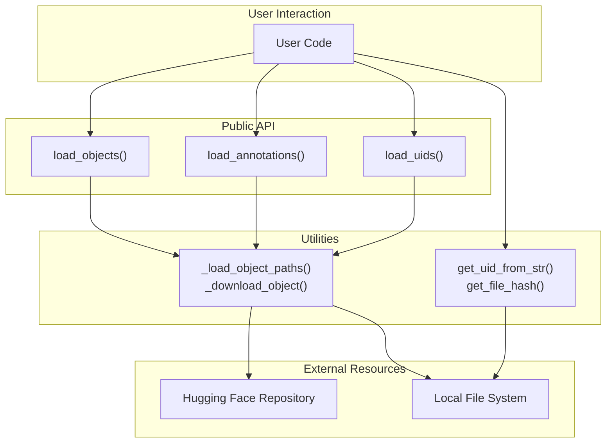

<!-- source: DeepWiki mcp.deepwiki.com · repo allenai/objaverse-xl · page 5.3 Utilities · fetched 2026-10-26 -->

# Utilities

<details>
<summary>Relevant source files</summary>

The following files were used as context for generating this wiki page:

- [.github/workflows/pypi-publish.yaml](.github/workflows/pypi-publish.yaml)
- [objaverse/__init__.py](objaverse/__init__.py)
- [objaverse/utils.py](objaverse/utils.py)

</details>


This page documents the utility functions provided by the Objaverse-XL package that support core operations like file handling, identifier generation, and object management. These utilities serve as building blocks for the main API functions but can also be used directly by developers working with the dataset.

For information about the main Objaverse API functions, see [objaverse Core API](#5.1).

## Overview of Utility Functions

The Objaverse-XL package includes utility functions in two main locations:

1. **Public Utilities** (`objaverse/utils.py`): Functions intended for direct use by developers
2. **Internal Utilities** (`objaverse/__init__.py`): Helper functions mainly used internally by the API

### Utility Function Relationships



Sources: [objaverse/utils.py:1-46](), [objaverse/__init__.py:58-125]()

## File and String Utilities

The `objaverse/utils.py` module provides utility functions for string manipulation and file operations that are commonly needed when working with 3D objects.

### UUID Generation

The `get_uid_from_str()` function generates consistent UUIDs (version 5) from strings, which is useful for creating deterministic identifiers for objects:


**Function Signature:**
```python
def get_uid_from_str(string: str) -> str:
    """Generates a UUID from a string."""
```

Sources: [objaverse/utils.py:8-18]()

### File Hashing

The `get_file_hash()` function computes SHA-256 hashes of files, handling symbolic links properly:



**Function Signature:**
```python
def get_file_hash(file_path: str) -> str:
    """Get the sha256 hash of a file."""
```

Sources: [objaverse/utils.py:21-45]()

## Internal Data Management Utilities

These utilities are primarily used internally by the core API functions but are documented here for completeness.

### Object Path Management

The `_load_object_paths()` function retrieves a mapping between object UIDs and their paths in the Hugging Face repository:



**Function Signature:**
```python
def _load_object_paths() -> Dict[str, str]:
    """Load the object paths from the dataset."""
```

Sources: [objaverse/__init__.py:58-76]()

### Object Download

The `_download_object()` function handles downloading individual 3D objects from the Hugging Face repository:



**Function Signature:**
```python
def _download_object(
    uid: str,
    object_path: str,
    total_downloads: float,
    start_file_count: int,
) -> Tuple[str, str]:
    """Download the object for the given uid."""
```

Sources: [objaverse/__init__.py:88-124]()

## Usage Examples

### Using the UUID Generator

```python
from objaverse.utils import get_uid_from_str

# Generate a deterministic UUID for an object
object_name = "fancy_chair_model_v2"
uid = get_uid_from_str(object_name)
print(f"Generated UUID: {uid}")
# Output: Generated UUID: 5d030c70-4064-5f8e-9d76-25787e6274c0
```

### Checking File Integrity

```python
from objaverse.utils import get_file_hash

# Compute the hash of a downloaded 3D model
model_path = "/home/user/.objaverse/hf-objaverse-v1/glbs/..."
file_hash = get_file_hash(model_path)
print(f"File hash: {file_hash}")
# Output: File hash: a1b2c3d4e5f6...
```

## Constants and Configuration

The Objaverse package defines several important constants used throughout the codebase:

| Constant | Value | Purpose |
|----------|-------|---------|
| `BASE_PATH` | `~/​.objaverse` | Root directory for all downloaded data |
| `_VERSIONED_PATH` | `~/​.objaverse/hf-objaverse-v1` | Path for version 1 of the dataset |
| `__version__` | Dynamic | Current version of the package |

Sources: [objaverse/__init__.py:14-17](), [.github/workflows/pypi-publish.yaml:26-28]()

## Integration with the Public API

The utility functions form the foundation for the public API, handling the lower-level tasks while the public API provides a more user-friendly interface. The version constant (`__version__`) is automatically updated during the release process through CI/CD.



Sources: [objaverse/__init__.py:20-193](), [objaverse/utils.py:1-46]()