# Page: Overview

# Overview

<details>
<summary>Relevant source files</summary>

The following files were used as context for generating this wiki page:

- [README.md](README.md)

</details>


This document provides an introduction to the Objaverse-XL repository, which offers tools for accessing, downloading, and rendering a large-scale 3D object dataset. It covers the purpose of the repository, key components, system architecture, and primary functionalities. For detailed information about the dataset itself, see [Dataset Description](#1.1). For practical usage instructions, see [Using Objaverse-XL](#3).

## Introduction to Objaverse-XL

Objaverse-XL is an open dataset containing over 10 million 3D objects, representing a significant advancement in scale compared to its predecessor, Objaverse 1.0 (which contained approximately 800,000 objects). The repository provides tools to access and work with this massive collection of 3D assets from various sources including GitHub, Sketchfab, Smithsonian Institution, and Thingiverse.

The codebase offers functionality for:
- Downloading 3D objects from multiple sources
- Processing and organizing the objects
- Rendering the 3D objects using Blender
- Supporting various 3D applications like novel view synthesis, image-to-3D, and text-to-3D generation

Sources: [README.md:1-7](), [README.md:11-15]()

## System Architecture

The Objaverse-XL system consists of several interconnected components organized in a modular architecture:

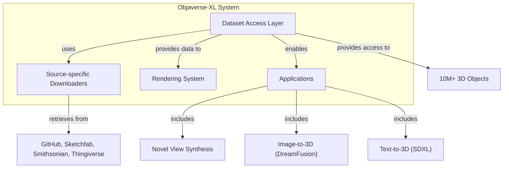

### Code Structure to Component Mapping

The repository's code structure directly maps to the system components:

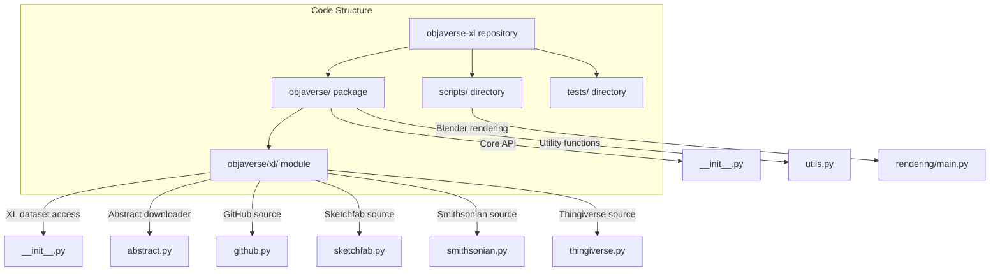

Sources: [README.md:3]()

## Core Components

### Dataset Access Layer

The Dataset Access Layer provides interfaces to access the 3D objects in the Objaverse-XL collection. It consists of:

1. Core dataset access (`objaverse/__init__.py`)
2. Objaverse-XL specific access (`objaverse/xl/__init__.py`)

These components allow users to query and retrieve objects from the dataset, access metadata, and manage downloads.

### Downloaders

The system implements a class hierarchy for downloading 3D objects from different sources:

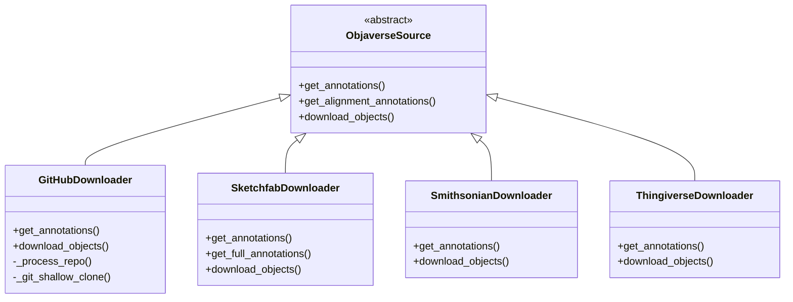

Each downloader is specialized for retrieving objects from a specific source while adhering to a common interface defined by the abstract `ObjaverseSource` class.

Sources: [objaverse/xl/abstract.py](), [objaverse/xl/github.py](), [objaverse/xl/sketchfab.py](), [objaverse/xl/smithsonian.py](), [objaverse/xl/thingiverse.py]()

### Rendering System

The rendering system is primarily implemented in the scripts directory and provides functionality to:

1. Process downloaded 3D objects
2. Generate renders using Blender
3. Capture multiple views of objects
4. Package renders as ZIP archives

The rendering pipeline is designed to handle large batches of objects efficiently, with support for parallel processing.

Sources: [README.md:51-55](), [scripts/rendering/main.py]()

## Data Flow

The following diagram illustrates the typical data flow when working with Objaverse-XL:

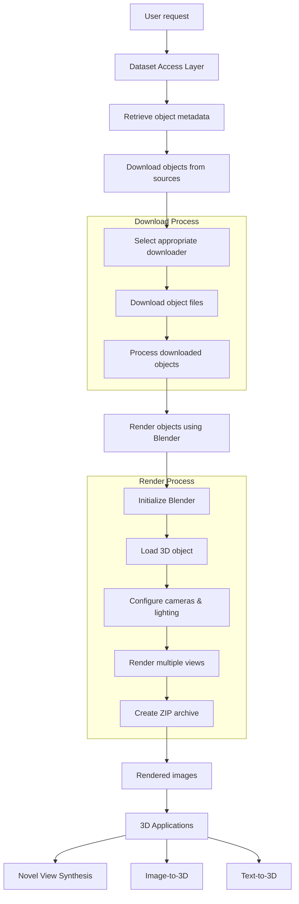

Sources: [objaverse/xl/__init__.py](), [scripts/rendering/main.py]()

## Applications and Use Cases

Objaverse-XL enables several important applications in 3D computer vision:

1. **Novel View Synthesis**: Generate new viewpoints of 3D objects
   - Zero123-XL model trained on Objaverse-XL shows remarkable 0-shot generalization abilities
   - Can synthesize novel views of sketches, cartoons, and people

2. **Image-to-3D**: Create 3D models from single images
   - Combines Zero123-XL with DreamFusion to guide NeRF generation
   - Produces high-quality 3D models from single reference images

3. **Text-to-3D**: Generate 3D models from text descriptions
   - Works with text-to-image models like SDXL to provide initial images
   - Enables creative generation of 3D content from textual descriptions

4. **Research and Development**: The large-scale dataset supports research in 3D vision, including:
   - 3D model generation and editing
   - View synthesis and novel view interpolation
   - 3D scene understanding

For more details on applications and use cases, see [Use Cases and Applications](#1.2).

Sources: [README.md:19-37](), [README.md:39-43]()

## Summary

Objaverse-XL repository provides a comprehensive system for working with a massive dataset of 10+ million 3D objects. It includes components for:

1. Dataset access and metadata retrieval
2. Source-specific object downloading
3. 3D object rendering using Blender
4. Support for various 3D vision applications

The system is designed to be modular, extensible, and efficient, allowing researchers and developers to harness the power of this large-scale 3D dataset. For practical guides on using Objaverse-XL, see [Installation and Setup](#3.1), [Downloading Objects](#3.2), and [Rendering Objects](#3.3).

Sources: [README.md:1-7]()

---

# Page: Dataset Description

# Dataset Description

<details>
<summary>Relevant source files</summary>

The following files were used as context for generating this wiki page:

- [.github/workflows/pypi-publish.yaml](.github/workflows/pypi-publish.yaml)
- [README.md](README.md)
- [objaverse/__init__.py](objaverse/__init__.py)

</details>


This document provides a detailed description of the Objaverse-XL dataset, its composition, structure, and technical characteristics. For information about use cases and applications of the dataset, see [Use Cases and Applications](#1.2).

## Overview

Objaverse-XL is a large-scale open dataset containing over 10 million 3D objects. It represents a significant expansion from the original Objaverse 1.0, which contained approximately 800,000 objects. The dataset aggregates 3D objects from multiple sources and provides a standardized interface for accessing them.

Sources: [README.md:3-7]()

## Dataset Scale and Composition

Objaverse-XL contains 3D objects sourced from multiple platforms, each accessible through dedicated downloader classes in the codebase. The dataset represents more than an order of magnitude increase in scale compared to its predecessor.

### Dataset Scale Comparison

| Dataset | Size | Release Date |
|---------|------|--------------|
| Objaverse-XL | 10M+ 3D objects | 2023 |
| Objaverse 1.0 | 800K 3D objects | December 2022 |

Sources: [README.md:11-15]()

### Data Source Architecture

The diagram below illustrates the different sources of 3D objects in Objaverse-XL and their corresponding downloader implementations in the codebase:

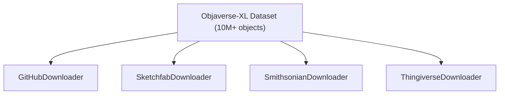

Sources: [README.md:7](), [objaverse/__init__.py:87-193]()

## Object Formats and Structure

Objects in Objaverse-XL are primarily stored as GLB files, which is a binary format for 3D scenes and models. Each object in the dataset:

1. Has a unique identifier (UID)
2. Is stored in a structured file path organization
3. Contains associated metadata
4. May have category annotations (LVIS annotations)

### Data Hosting and Access Structure

The dataset is hosted on Hugging Face and accessed through the Objaverse package's API, which downloads objects and metadata to a local directory structure:

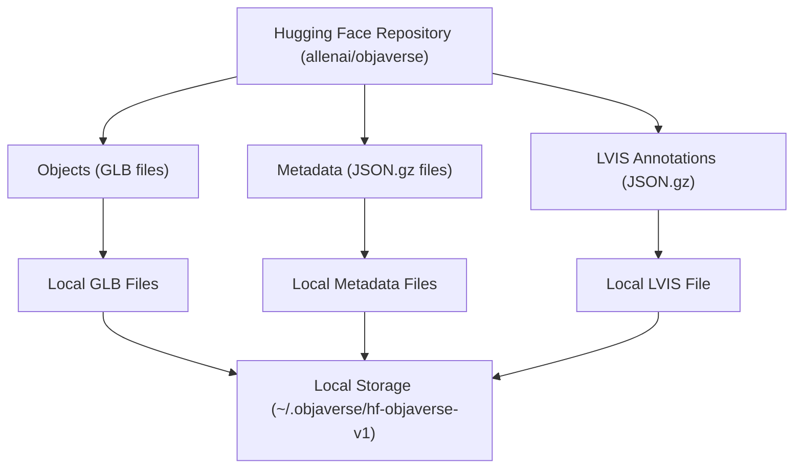

Sources: [objaverse/__init__.py:14-17](), [objaverse/__init__.py:66-76]()

## Metadata and Annotations

Each object in Objaverse-XL has associated metadata that provides additional information about the object. The metadata is organized in gzipped JSON files, with each file containing information for multiple objects. 

### LVIS Annotations

The dataset includes LVIS (Large Vocabulary Instance Segmentation) annotations, which categorize objects according to a common vocabulary. These annotations can be loaded using the `load_lvis_annotations()` function.

Sources: [objaverse/__init__.py:20-55](), [objaverse/__init__.py:196-211]()

## Dataset Access API

The Objaverse package provides several functions for accessing the dataset, as illustrated in the diagram below:

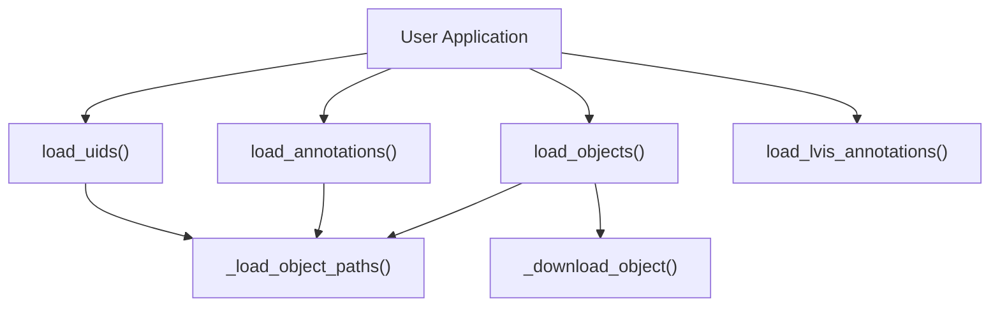

The primary functions for accessing the dataset include:

1. `load_uids()`: Returns a list of all unique identifiers in the dataset
2. `load_annotations(uids)`: Retrieves metadata for specified objects
3. `load_objects(uids, download_processes)`: Downloads and returns paths to the 3D object files
4. `load_lvis_annotations()`: Retrieves category annotations for objects

Sources: [objaverse/__init__.py:20-193]()

## Object Download Process

When requesting objects through the API, the system:

1. Checks if the objects already exist locally
2. Downloads missing objects from Hugging Face to the local storage directory
3. Handles parallel downloads when multiple processes are specified
4. Returns paths to the downloaded objects

The download process supports multiple download processes for parallel retrieval, significantly speeding up the acquisition of large numbers of objects.

Sources: [objaverse/__init__.py:88-193]()

## Licensing

The Objaverse-XL dataset as a whole is licensed under the ODC-By v1.0 license. However, individual objects within the dataset may have their own specific licenses depending on their source. Users should be aware of these licensing considerations when using objects for specific applications.

Sources: [README.md:57-59]()

## Polycam Data Access

In addition to the publicly available data, Polycam data is available to academic researchers for non-commercial use upon request and approval from Polycam. Access requires filling out a request form.

Sources: [README.md:49]()

---

# Page: Use Cases and Applications

# Use Cases and Applications

<details>
<summary>Relevant source files</summary>

The following files were used as context for generating this wiki page:

- [README.md](README.md)

</details>


## Purpose

This document outlines the primary applications and use cases of Objaverse-XL, a large-scale 3D object dataset containing over 10 million 3D objects. It explains how researchers and developers can leverage this dataset for various 3D computer vision tasks, focusing on practical implementations and research opportunities. For information about the dataset itself, see [Dataset Description](#1.1), and for system architecture details, see [System Architecture](#2).

## Overview of Applications

Objaverse-XL enables several groundbreaking applications in 3D vision and generation tasks, powered by its unprecedented scale and diversity of 3D objects.

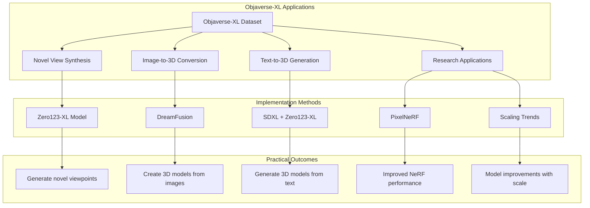

Sources: README.md

## Novel View Synthesis

Novel view synthesis refers to the task of generating new viewpoints of a 3D object given one or more images from different perspectives. Objaverse-XL has enabled significant improvements in this domain through the Zero123-XL model.

### Zero123-XL Capabilities

Zero123-XL, trained on Objaverse-XL, demonstrates remarkable zero-shot generalization abilities compared to its predecessor:

- Performs novel view synthesis on diverse visual domains
- Successfully handles sketches, cartoons, and even human figures
- Maintains consistency across generated views
- Preserves fine details of complex objects

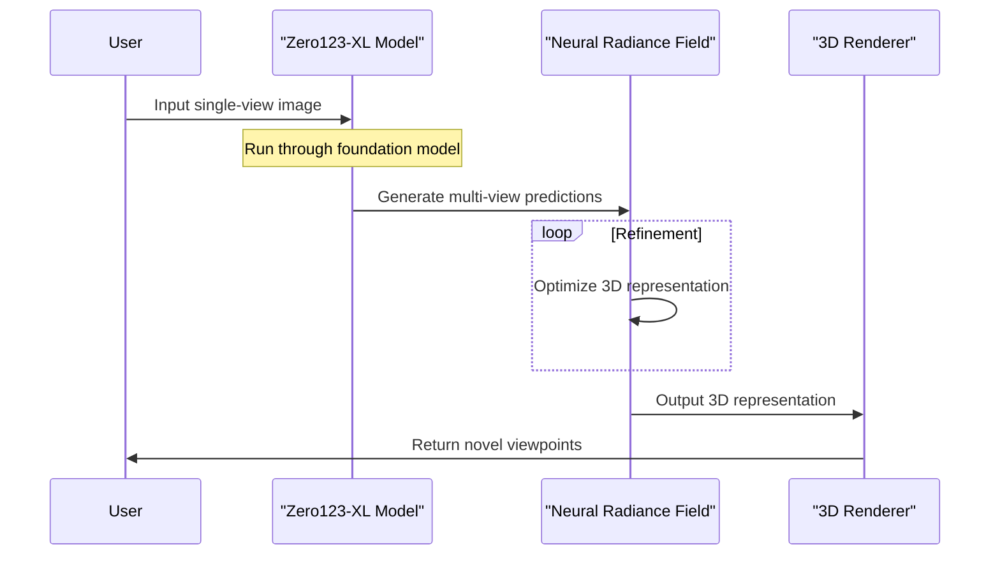

Sources: README.md:19-25

## Image-to-3D Conversion

Objaverse-XL enables high-quality image-to-3D conversion through integration with the DreamFusion methodology.

### How It Works

The system leverages Zero123-XL as a foundation model to guide Neural Radiance Fields (NeRF) optimization:

1. A single image is provided as input
2. Zero123-XL generates multi-view predictions from the single input view
3. These predictions guide the optimization of a NeRF
4. The optimized NeRF represents a complete 3D model that can be rendered from any viewpoint

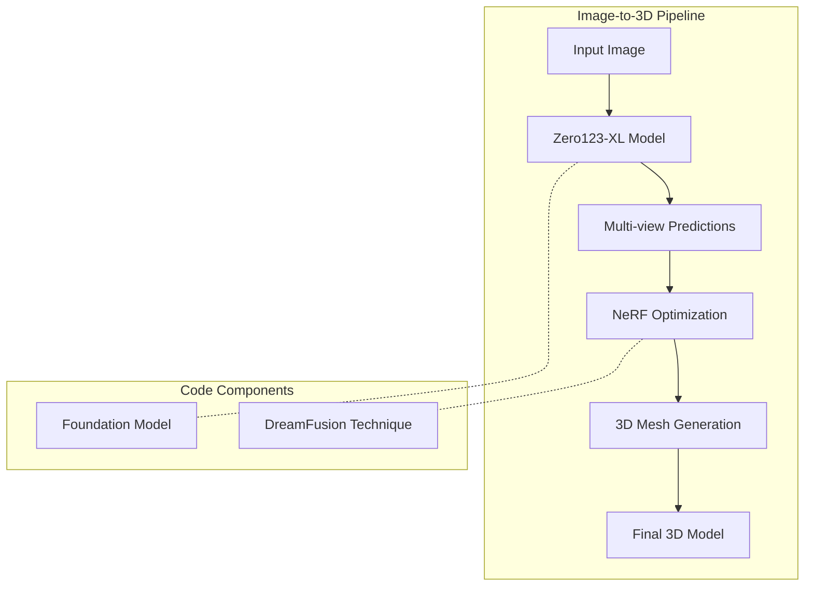

Sources: README.md:27-31

## Text-to-3D Generation

Objaverse-XL's capabilities extend to text-to-3D generation by leveraging text-to-image models in conjunction with the image-to-3D pipeline.

### Pipeline Process

1. Text prompt is provided by the user
2. A text-to-image model (such as SDXL) generates an initial 2D image
3. The generated image is fed into the Zero123-XL pipeline
4. Zero123-XL guides a NeRF to create a consistent 3D model
5. The final 3D model is rendered and can be viewed from any angle

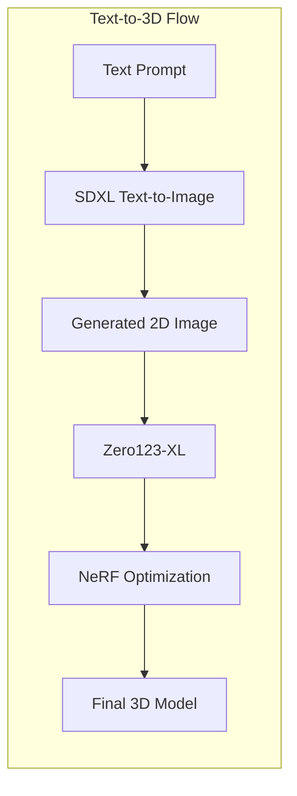

Sources: README.md:33-37

## Research Applications

### Scaling Trends

Objaverse-XL demonstrates clear scaling trends that show improved performance as the dataset size increases:

- Both Zero123-XL and PixelNeRF models show substantial improvements with larger training datasets
- Performance metrics continue to improve without plateauing, suggesting further potential gains with even larger datasets

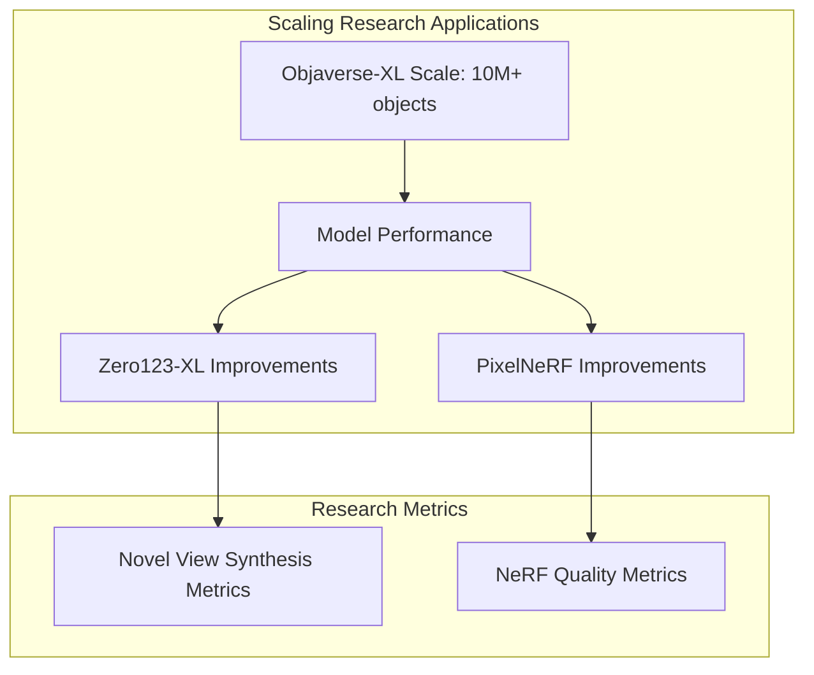

Sources: README.md:39-43

### Cross-Domain Generalization

The scale and diversity of Objaverse-XL enable unprecedented generalization capabilities:

- Models trained on Objaverse-XL can perform novel view synthesis on domains never seen during training
- Generalization to sketches, cartoons, paintings, and real-world photographs
- Ability to handle complex human figures and articulated objects

## Industrial and Educational Applications

### Industry Use Cases

Objaverse-XL enables various industrial applications:

- **Game Development**: Rapid creation and transformation of 3D assets
- **Virtual/Augmented Reality**: Generation of realistic 3D environments from limited inputs
- **E-commerce**: Creating 3D models from product images for immersive shopping experiences
- **Architecture and Design**: Converting concept sketches to 3D visualizations

### Educational Applications

- **Teaching 3D Concepts**: Accessible way to demonstrate 3D principles
- **Research Resource**: Benchmark dataset for 3D vision tasks
- **Training Platform**: Dataset for developing new 3D generative models and techniques

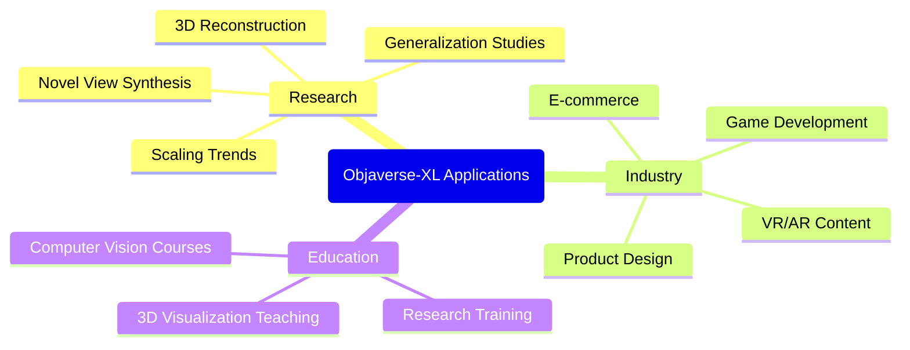

Sources: README.md

## Usage with Blender Rendering

Objaverse-XL provides Blender rendering scripts that allow users to create high-quality renderings of 3D objects in the dataset. These renderings can be used as inputs for the applications described above or for creating training data for new models.

The rendering scripts can be found in the [scripts/rendering directory](scripts/rendering/main.py) and allow for customization of rendering parameters to suit different application needs.

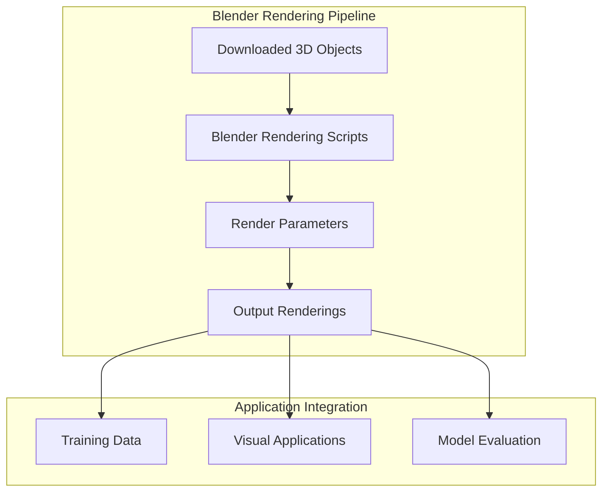

Sources: README.md:51-55

## Conclusion

Objaverse-XL provides a foundation for numerous 3D computer vision applications, from novel view synthesis to text-to-3D generation. Its unprecedented scale has enabled significant improvements in model performance and generalization capabilities. 

The applications outlined in this document represent the current state of research and development using Objaverse-XL, but the dataset's potential extends far beyond these examples. As research continues and new techniques emerge, Objaverse-XL is positioned to support further breakthroughs in 3D vision and generation tasks.

Sources: README.md

---

# Page: System Architecture

# System Architecture

<details>
<summary>Relevant source files</summary>

The following files were used as context for generating this wiki page:

- [.github/workflows/pypi-publish.yaml](.github/workflows/pypi-publish.yaml)
- [README.md](README.md)
- [objaverse/__init__.py](objaverse/__init__.py)
- [objaverse/xl/__init__.py](objaverse/xl/__init__.py)
- [objaverse/xl/abstract.py](objaverse/xl/abstract.py)

</details>


This page provides a comprehensive overview of the Objaverse-XL architecture, detailing the core components and their interactions that enable the system to manage, access, and process a dataset of over 10 million 3D objects. The architecture is designed to efficiently handle large-scale 3D data operations, including downloading from multiple sources, metadata management, and rendering.

For information about the dataset itself and its applications, see [Overview](#1). For details on how to use the system, see [Using Objaverse-XL](#3).

## High-Level Architecture Overview

The following diagram illustrates the main components of the Objaverse-XL system and their relationships:

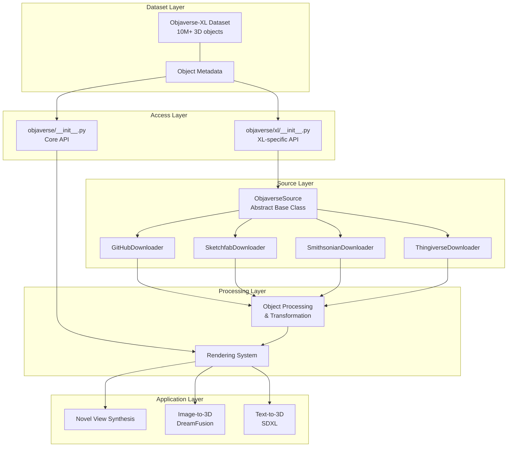

Sources: [objaverse/xl/__init__.py:12-17](), [objaverse/__init__.py:1-196](), [README.md:1-78]()

## Core Components

The Objaverse-XL system consists of four principal components:

| Component | Purpose | Key Files |
|-----------|---------|-----------|
| Dataset Access Layer | Provides interfaces to access 3D objects and metadata | `objaverse/__init__.py`, `objaverse/xl/__init__.py` |
| Downloaders | Source-specific implementation for retrieving 3D objects | `objaverse/xl/github.py`, `objaverse/xl/sketchfab.py`, etc. |
| Rendering System | Processes 3D objects to generate image renders | `scripts/rendering/main.py` |
| Applications | Uses rendered objects for 3D vision tasks | Various application-specific implementations |

Sources: [objaverse/xl/__init__.py:1-158](), [objaverse/__init__.py:1-212]()

### Dataset Access Layer

The Dataset Access Layer provides a unified interface to retrieve metadata and 3D objects from the Objaverse-XL dataset. This layer abstracts away the complexities of accessing different data sources.

```mermaid
classDiagram
    class "objaverse/__init__.py" {
        +load_annotations(uids)
        +load_objects(uids, download_processes)
        +load_uids()
        +load_lvis_annotations()
        -_load_object_paths()
        -_download_object()
    }
    
    class "objaverse/xl/__init__.py" {
        +get_annotations(download_dir, refresh)
        +get_alignment_annotations(download_dir, refresh)
        +download_objects(objects, download_dir, processes, ...)
        -downloaders: Dict
    }
    
    "objaverse/__init__.py" -- "objaverse/xl/__init__.py" : extends functionality
```

The Dataset Access Layer exposes several key functions:

- `get_annotations()`: Retrieves metadata for all 3D objects in the dataset
- `get_alignment_annotations()`: Gets metadata for objects used in alignment fine-tuning
- `download_objects()`: Downloads 3D objects based on source and identifier
- `load_objects()`: Loads 3D objects from the dataset (original API)
- `load_uids()`: Retrieves all unique identifiers in the dataset

Sources: [objaverse/xl/__init__.py:20-66](), [objaverse/__init__.py:20-86]()

### Downloader System

The Downloader System consists of an abstract base class (`ObjaverseSource`) and several concrete implementations for different data sources. Each downloader is responsible for retrieving objects from its specific source.

```mermaid
classDiagram
    class "ObjaverseSource" {
        <<abstract>>
        +get_annotations(download_dir, refresh)
        +get_alignment_annotations(download_dir, refresh)
        +download_objects(objects, download_dir, processes, ...)
    }
    
    class "GitHubDownloader" {
        +get_annotations()
        +get_alignment_annotations()
        +download_objects()
        -_process_repo()
        -_git_shallow_clone()
        -_pull_lfs_files()
    }
    
    class "SketchfabDownloader" {
        +get_annotations()
        +get_alignment_annotations()
        +get_full_annotations()
        +get_uids()
        +download_objects()
        +get_lvis_annotations()
    }
    
    class "SmithsonianDownloader" {
        +get_annotations()
        +get_alignment_annotations()
        +download_objects()
        -_download_smithsonian_object()
    }
    
    class "ThingiverseDownloader" {
        +get_annotations()
        +download_objects()
    }
    
    ObjaverseSource <|-- GitHubDownloader
    ObjaverseSource <|-- SketchfabDownloader
    ObjaverseSource <|-- SmithsonianDownloader
    ObjaverseSource <|-- ThingiverseDownloader
```

The downloaders are initialized and stored in a dictionary in the XL module:

```python
downloaders = {
    "github": GitHubDownloader(),
    "thingiverse": ThingiverseDownloader(),
    "smithsonian": SmithsonianDownloader(),
    "sketchfab": SketchfabDownloader(),
}
```

Sources: [objaverse/xl/__init__.py:12-17](), [objaverse/xl/abstract.py:1-124]()

### Rendering System

The Rendering System processes downloaded 3D objects using Blender to generate multi-view renders. It supports parallel rendering on multiple GPUs and handles different object scenarios.

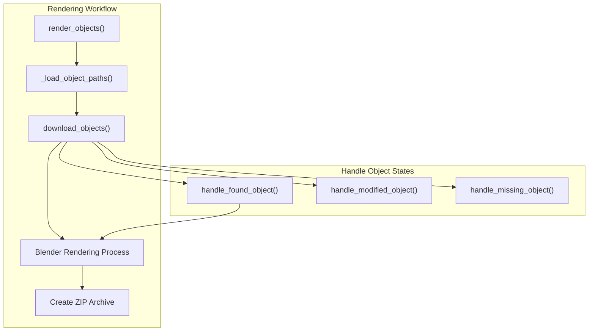

Sources: [objaverse/xl/__init__.py:69-158](), [README.md:51-55]()

## Data Flow

The data flow in Objaverse-XL follows a clear path from object identification to processing and application use:

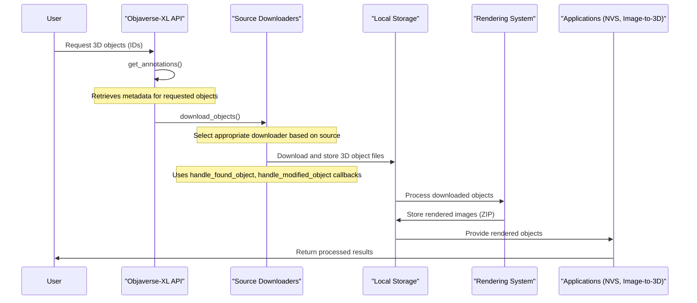

The key processing stages are:

1. **Metadata Retrieval**: The system retrieves object metadata using `get_annotations()` or `get_alignment_annotations()`
2. **Object Download**: Objects are downloaded using the appropriate downloader based on their source
3. **Object Processing**: Downloaded objects are processed through callback functions that handle different scenarios
4. **Rendering**: Objects are rendered using Blender to generate multi-view images
5. **Application**: Rendered objects are used in various 3D applications

Sources: [objaverse/xl/__init__.py:20-42](), [objaverse/xl/__init__.py:69-158]()

## Package Structure

The Objaverse-XL codebase is organized into a modular structure, with clear separation of concerns:

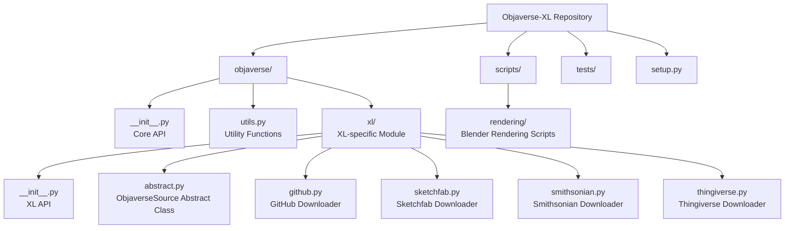

This structure follows a clear pattern:

1. The root `objaverse` package contains core API functions for accessing the original Objaverse dataset
2. The `objaverse/xl` subpackage extends this functionality for the larger XL dataset
3. Source-specific downloaders are implemented in dedicated modules
4. Rendering scripts are kept in a separate directory

Sources: [objaverse/xl/__init__.py:1-158](), [objaverse/__init__.py:1-212](), [objaverse/xl/abstract.py:1-124]()

## Component Interaction Model

The following diagram shows how the different components interact when a user wants to download and render 3D objects:

```mermaid
graph TB
    subgraph "User Request"
        UserReq["User request for objects"]
    end
    
    subgraph "API Layer"
        GetAnnotations["get_annotations()"]
        DownloadObjects["download_objects()"]
    end
    
    subgraph "Source Processing"
        SourceSelect{"Select source<br>based on objects"}
        GitHub["GitHubDownloader.download_objects()"]
        Sketchfab["SketchfabDownloader.download_objects()"]
        Smithsonian["SmithsonianDownloader.download_objects()"]
        Thingiverse["ThingiverseDownloader.download_objects()"]
    end
    
    subgraph "Object Processing"
        Callbacks["Object handling callbacks"]
        ObjectStore["Local object storage"]
    end
    
    subgraph "Rendering"
        RenderProcess["Blender rendering"]
        RenderOutput["Render output (ZIP)"]
    end
    
    UserReq --> GetAnnotations
    GetAnnotations --> DownloadObjects
    DownloadObjects --> SourceSelect
    
    SourceSelect --> GitHub
    SourceSelect --> Sketchfab
    SourceSelect --> Smithsonian
    SourceSelect --> Thingiverse
    
    GitHub & Sketchfab & Smithsonian & Thingiverse --> Callbacks
    Callbacks --> ObjectStore
    ObjectStore --> RenderProcess
    RenderProcess --> RenderOutput
```

This illustrates the full lifecycle of an object request, from user initiation through source-specific downloading to final rendering.

Sources: [objaverse/xl/__init__.py:69-158](), [objaverse/xl/abstract.py:54-123]()

## Technical Specifications

| Component | Features |
|-----------|----------|
| Dataset Size | Over 10 million 3D objects |
| Data Sources | GitHub, Sketchfab, Smithsonian, Thingiverse |
| Object Formats | GLB, OBJ, and other 3D file formats |
| Storage | Local storage with user-configurable paths |
| Parallelism | Multi-process downloading and rendering |
| Callbacks | Configurable callbacks for object handling |
| Rendering | Blender-based rendering with customizable parameters |

Sources: [README.md:1-17](), [objaverse/xl/__init__.py:69-136]()

---

# Page: Package Structure

# Package Structure

<details>
<summary>Relevant source files</summary>

The following files were used as context for generating this wiki page:

- [.github/workflows/pypi-publish.yaml](.github/workflows/pypi-publish.yaml)
- [objaverse/__init__.py](objaverse/__init__.py)
- [objaverse/xl/__init__.py](objaverse/xl/__init__.py)
- [setup.py](setup.py)
- [tests/test_api.py](tests/test_api.py)

</details>


This page documents the organization of the Objaverse-XL codebase, detailing the main packages, modules, and their functions. For information about core components and their interactions, see [Core Components](#2.2).

## Overview

Objaverse-XL is organized as a Python package with several submodules designed to facilitate access to over 10 million 3D objects from multiple sources. The package structure follows a modular design that separates the core functionality (base objaverse package) from the Objaverse-XL specific extensions.

```mermaid
graph TD
    subgraph "Objaverse Package Structure"
        Root["objaverse/"]
        Init["__init__.py<br>Core dataset access"]
        Utils["utils.py<br>Utility functions"]
        XL["xl/<br>XL-specific functionality"]
        
        XLInit["xl/__init__.py<br>XL entry point"]
        Abstract["xl/abstract.py<br>Base classes"]
        Github["xl/github.py<br>GitHub downloader"]
        Sketchfab["xl/sketchfab.py<br>Sketchfab downloader"]
        Smithsonian["xl/smithsonian.py<br>Smithsonian downloader"]
        Thingiverse["xl/thingiverse.py<br>Thingiverse downloader"]
        
        Root --> Init
        Root --> Utils
        Root --> XL
        
        XL --> XLInit
        XL --> Abstract
        XL --> Github
        XL --> Sketchfab
        XL --> Smithsonian
        XL --> Thingiverse
    end
```

Sources: [objaverse/__init__.py:1-211](), [objaverse/xl/__init__.py:1-158](), [setup.py:1-27]()

## Main Package Components

The Objaverse-XL codebase consists of the following main components:

| Component | Description | Key Files |
|-----------|-------------|-----------|
| Core Package | Base functionality for accessing the original Objaverse dataset | `objaverse/__init__.py` |
| XL Package | Extended functionality for Objaverse-XL dataset | `objaverse/xl/__init__.py` |
| Downloaders | Source-specific implementations for retrieving 3D objects | `objaverse/xl/{github,sketchfab,smithsonian,thingiverse}.py` |
| Tests | Test cases for API functionality | `tests/test_api.py` |
| Setup | Package installation configuration | `setup.py` |

Sources: [objaverse/__init__.py:1-211](), [objaverse/xl/__init__.py:1-158](), [setup.py:1-27](), [tests/test_api.py:1-554]()

## Package Hierarchy and Dependencies

The package uses a hierarchical structure with the following dependencies and relationships:

```mermaid
classDiagram
    class objaverse {
        +__init__.py
        +utils.py
        +xl/
        +BASE_PATH
        +load_annotations()
        +load_uids()
        +load_objects()
        +load_lvis_annotations()
    }
    
    class objaverse_xl {
        +__init__.py
        +abstract.py
        +github.py
        +sketchfab.py
        +smithsonian.py
        +thingiverse.py
        +downloaders{}
        +get_annotations()
        +get_alignment_annotations()
        +download_objects()
    }
    
    class GitHubDownloader {
        +get_annotations()
        +get_alignment_annotations()
        +download_objects()
        -_process_repo()
    }
    
    class SketchfabDownloader {
        +get_annotations()
        +get_alignment_annotations()
        +download_objects()
    }
    
    class SmithsonianDownloader {
        +get_annotations()
        +get_alignment_annotations()
        +download_objects()
    }
    
    class ThingiverseDownloader {
        +get_annotations()
        +download_objects()
    }
    
    objaverse --> objaverse_xl : contains
    objaverse_xl --> GitHubDownloader : initializes
    objaverse_xl --> SketchfabDownloader : initializes
    objaverse_xl --> SmithsonianDownloader : initializes
    objaverse_xl --> ThingiverseDownloader : initializes
```

Sources: [objaverse/__init__.py:1-211](), [objaverse/xl/__init__.py:1-158]()

## Core Package (objaverse)

The core objaverse package provides basic functionality for accessing and downloading objects from the original Objaverse dataset.

### Key Functions

- `load_annotations(uids=None)`: Loads metadata for objects
- `_load_object_paths()`: Internal function to load object paths from the dataset
- `load_uids()`: Returns a list of all UIDs in the dataset
- `load_objects(uids, download_processes=1)`: Downloads objects for the given UIDs
- `load_lvis_annotations()`: Loads LVIS (Large Vocabulary Instance Segmentation) annotations

### Constants

- `BASE_PATH`: Default path for storing downloaded data (`~/.objaverse`)
- `__version__`: Package version
- `_VERSIONED_PATH`: Version-specific storage path

Sources: [objaverse/__init__.py:1-211]()

## XL Package (objaverse.xl)

The objaverse.xl package extends the core functionality to support the larger Objaverse-XL dataset with multiple sources.

### Downloader Registry

The `downloaders` dictionary maps source names to their respective downloader instances:

```python
downloaders = {
    "github": GitHubDownloader(),
    "thingiverse": ThingiverseDownloader(),
    "smithsonian": SmithsonianDownloader(),
    "sketchfab": SketchfabDownloader(),
}
```

### Key Functions

- `get_annotations(download_dir="~/.objaverse", refresh=False)`: Retrieves metadata for all objects from all sources
- `get_alignment_annotations(download_dir="~/.objaverse", refresh=False)`: Gets metadata for objects used in alignment fine-tuning
- `download_objects(objects, download_dir="~/.objaverse", processes=None, ...)`: Downloads objects with customizable callback handling

Sources: [objaverse/xl/__init__.py:1-158]()

## Downloader Classes

The downloaders follow a common interface for retrieving objects from different sources:

```mermaid
classDiagram
    class ObjaverseSource {
        <<Abstract>>
        +get_annotations(download_dir, refresh)
        +get_alignment_annotations(download_dir, refresh)
        +download_objects(objects, download_dir, processes, ...)
    }
    
    ObjaverseSource <|-- GitHubDownloader
    ObjaverseSource <|-- SketchfabDownloader
    ObjaverseSource <|-- SmithsonianDownloader
    ObjaverseSource <|-- ThingiverseDownloader
    
    class GitHubDownloader {
        +get_annotations()
        +get_alignment_annotations()
        +download_objects()
        -_process_repo()
        -_git_shallow_clone()
        -_pull_lfs_files()
    }
    
    class SketchfabDownloader {
        +get_annotations()
        +get_alignment_annotations()
        +download_objects()
        +get_lvis_annotations()
    }
    
    class SmithsonianDownloader {
        +get_annotations()
        +get_alignment_annotations()
        +download_objects()
    }
    
    class ThingiverseDownloader {
        +get_annotations()
        +download_objects()
    }
```

Sources: [objaverse/xl/__init__.py:7-10](), [tests/test_api.py:7-10]()

## Package Installation and Setup

The `setup.py` file configures package installation with the following properties:

- **Name**: objaverse
- **Version**: 0.1.7
- **Description**: "Objaverse is an open dataset with over 10 million 3D objects"
- **Dependencies**: Listed in requirements.txt
- **Additional Dependencies**: S3 optional dependency (`s3fs==0.4.2`)

Sources: [setup.py:1-27](), [.github/workflows/pypi-publish.yaml:1-42]()

## Data Flow Process

The following diagram illustrates how data flows through the package from user request to object retrieval:

```mermaid
flowchart TD
    UserReq["User Request<br>download_objects()"]
    GetMeta["get_annotations()"]
    SelectSource["Select Source<br>Based on objects['source']"]
    SrcDownloader["Call appropriate downloader<br>downloaders[source].download_objects()"]
    
    subgraph "Downloader Process"
        ProcessObj["Process Objects"]
        HandleObj["Handle Object Cases<br>(found/modified/missing)"]
        ReturnPaths["Return Paths Dict"]
    end
    
    UserReq --> GetMeta
    GetMeta --> SelectSource
    SelectSource --> SrcDownloader
    SrcDownloader --> ProcessObj
    ProcessObj --> HandleObj
    HandleObj --> ReturnPaths
    ReturnPaths --> UserResult["User Result<br>{file_id: local_path}"]
```

Sources: [objaverse/xl/__init__.py:69-158]()

## Testing Structure

The test directory contains comprehensive tests for:

- Testing individual downloaders (GitHub, Sketchfab, Smithsonian, Thingiverse)
- Testing various object handling scenarios (new, found, modified, missing)
- Testing caching behavior
- Testing annotation retrieval

Tests ensure that all downloaders conform to the expected interface with proper column names and return values.

Sources: [tests/test_api.py:1-554]()

## Release Process

The package uses GitHub Actions for automated releases and PyPI publishing when a commit message follows the pattern `Release X.Y.Z`:

1. The workflow identifies release commits
2. Updates the version in `__init__.py`
3. Creates a GitHub release
4. Builds and publishes the package to PyPI

Sources: [.github/workflows/pypi-publish.yaml:1-42]()

---

# Page: Core Components

# Core Components

<details>
<summary>Relevant source files</summary>

The following files were used as context for generating this wiki page:

- [.github/workflows/pypi-publish.yaml](.github/workflows/pypi-publish.yaml)
- [objaverse/__init__.py](objaverse/__init__.py)
- [objaverse/xl/__init__.py](objaverse/xl/__init__.py)
- [objaverse/xl/abstract.py](objaverse/xl/abstract.py)

</details>


This page describes the essential components that make up the Objaverse-XL system, their responsibilities, and how they interact. It focuses on the core building blocks that enable the functionality for accessing, downloading, and processing the 10+ million 3D objects in the dataset.

For information about the overall system architecture, see [System Architecture](#2), and for package structure details, see [Package Structure](#2.1).

## Component Overview

The Objaverse-XL system consists of several essential components that work together to provide access to the dataset:

```mermaid
flowchart TD
    subgraph "Dataset Access Layer"
        ObjInit["objaverse/__init__.py"]
        XLInit["objaverse/xl/__init__.py"]
        CoreFunctions["Core Functions:
        - get_annotations()
        - get_alignment_annotations()
        - download_objects()"]
    end

    subgraph "Abstract Interface"
        ObjSource["ObjaverseSource
        Abstract Base Class"]
    end

    subgraph "Source-Specific Downloaders"
        GitHub["GitHubDownloader"]
        Sketchfab["SketchfabDownloader"]
        Smithsonian["SmithsonianDownloader"]
        Thingiverse["ThingiverseDownloader"]
    end
    
    Dataset["Objaverse-XL Dataset
    10M+ 3D objects"]
    
    User["Client Code/User"]
    
    User --> XLInit
    User --> ObjInit
    XLInit --> CoreFunctions
    ObjInit --> Dataset
    CoreFunctions --> GitHub & Sketchfab & Smithsonian & Thingiverse
    ObjSource --> GitHub & Sketchfab & Smithsonian & Thingiverse
    GitHub & Sketchfab & Smithsonian & Thingiverse --> Dataset
```

Sources: [objaverse/xl/__init__.py:1-158](), [objaverse/__init__.py:1-211](), [objaverse/xl/abstract.py:1-124]()

## 1. Dataset Access Layer

The Dataset Access Layer provides the primary interfaces for accessing and interacting with the Objaverse-XL dataset. It consists of two main modules:

### 1.1 Basic Dataset Access (objaverse)

The `objaverse` package provides basic functions for accessing the original Objaverse dataset:

- `load_annotations()`: Loads metadata for all objects or specific UIDs
- `load_uids()`: Returns a list of all UIDs in the dataset
- `load_objects()`: Returns paths to object files (downloading if necessary)
- `load_lvis_annotations()`: Loads LVIS annotations mapping categories to UIDs

These functions are focused on the original Objaverse dataset structure, working with UIDs and pulling from Hugging Face.

Sources: [objaverse/__init__.py:20-211]()

### 1.2 Objaverse-XL Specific Access (xl)

The `objaverse.xl` package extends this functionality for the much larger Objaverse-XL dataset with source-specific downloaders:

```mermaid
classDiagram
    class ObjXLInit {
        +downloaders: Dict[str, ObjaverseSource]
        +get_annotations(download_dir, refresh): pd.DataFrame
        +get_alignment_annotations(download_dir, refresh): pd.DataFrame
        +download_objects(objects, download_dir, processes, ...): Dict[str, str]
    }

    class CoreFunctions {
        <<interface>>
        +get_annotations()
        +get_alignment_annotations()
        +download_objects()
    }

    ObjXLInit ..> CoreFunctions : implements
```

The XL-specific module initializes a dictionary of downloaders and provides three core functions that delegate to the appropriate downloader based on the source of each object.

Sources: [objaverse/xl/__init__.py:12-158]()

## 2. Abstract Source Interface

The abstract base class `ObjaverseSource` defines the interface that all downloaders must implement:

```mermaid
classDiagram
    class ObjaverseSource {
        <<abstract>>
        +get_annotations(download_dir, refresh): pd.DataFrame
        +get_alignment_annotations(download_dir, refresh): pd.DataFrame
        +download_objects(objects, download_dir, processes, ...): Dict[str, str]
    }
```

This abstract class ensures that all source-specific downloaders implement the necessary methods:

- `get_annotations()`: Loads 3D object metadata as a pandas DataFrame
- `get_alignment_annotations()`: Loads metadata for objects used in alignment fine-tuning
- `download_objects()`: Downloads objects from the specific source

Each method has parameters for customizing behavior, such as download location and callback functions for handling different download scenarios (found objects, modified objects, missing objects).

Sources: [objaverse/xl/abstract.py:9-124]()

## 3. Source-Specific Downloaders

Objaverse-XL includes multiple downloader classes that implement the `ObjaverseSource` interface. Each is specialized for retrieving objects from a specific platform:

```mermaid
classDiagram
    class ObjaverseSource {
        <<abstract>>
        +get_annotations(download_dir, refresh): pd.DataFrame
        +get_alignment_annotations(download_dir, refresh): pd.DataFrame
        +download_objects(objects, download_dir, processes, ...): Dict[str, str]
    }
    
    class GitHubDownloader {
        +get_annotations(): pd.DataFrame
        +get_alignment_annotations(): pd.DataFrame
        +download_objects(): Dict[str, str]
    }
    
    class SketchfabDownloader {
        +get_annotations(): pd.DataFrame
        +get_alignment_annotations(): pd.DataFrame
        +download_objects(): Dict[str, str]
        +get_lvis_annotations(): Dict[str, List[str]]
    }
    
    class SmithsonianDownloader {
        +get_annotations(): pd.DataFrame
        +get_alignment_annotations(): pd.DataFrame
        +download_objects(): Dict[str, str]
    }
    
    class ThingiverseDownloader {
        +get_annotations(): pd.DataFrame
        +download_objects(): Dict[str, str]
    }
    
    ObjaverseSource <|-- GitHubDownloader
    ObjaverseSource <|-- SketchfabDownloader
    ObjaverseSource <|-- SmithsonianDownloader
    ObjaverseSource <|-- ThingiverseDownloader
```

These downloaders handle the specific requirements for each source:

- **GitHubDownloader**: Clones Git repositories and handles LFS files
- **SketchfabDownloader**: Interacts with Sketchfab's APIs to retrieve 3D models
- **SmithsonianDownloader**: Downloads from the Smithsonian Institution's collections
- **ThingiverseDownloader**: Obtains objects from Thingiverse's platform

Each downloader implements the common interface but adds source-specific logic for efficiently retrieving 3D objects from its platform.

Sources: [objaverse/xl/__init__.py:7-17](), [objaverse/xl/abstract.py:9-124]()

## 4. Core Functions

The three primary functions that users interact with are implemented in `objaverse/xl/__init__.py`:

### 4.1 `get_annotations()`

```python
def get_annotations(download_dir: str = "~/.objaverse", refresh: bool = False) -> pd.DataFrame:
```

This function retrieves metadata for all 3D objects in the dataset, aggregating data from all sources. It returns a pandas DataFrame containing object details such as `fileIdentifier`, `license`, `source`, `fileType`, `sha256`, and `metadata`.

The function delegates to each downloader's `get_annotations()` method and concatenates the results.

Sources: [objaverse/xl/__init__.py:20-41]()

### 4.2 `get_alignment_annotations()`

```python
def get_alignment_annotations(download_dir: str = "~/.objaverse", refresh: bool = False) -> pd.DataFrame:
```

This function retrieves metadata specifically for objects used during alignment fine-tuning. It's similar to `get_annotations()` but focuses on a subset of objects from GitHub and Sketchfab sources.

Sources: [objaverse/xl/__init__.py:44-66]()

### 4.3 `download_objects()`

```python
def download_objects(
    objects: pd.DataFrame,
    download_dir: Optional[str] = "~/.objaverse",
    processes: Optional[int] = None,
    handle_found_object: Optional[Callable] = None,
    handle_modified_object: Optional[Callable] = None,
    handle_missing_object: Optional[Callable] = None,
    **kwargs,
) -> Dict[str, str]:
```

This function downloads 3D objects specified in the provided DataFrame. It has several key features:
- Selects the appropriate downloader based on the object's source
- Supports parallel downloads with a configurable number of processes
- Provides callback functions for handling different download scenarios
- Returns a mapping of file identifiers to local paths of downloaded objects

Sources: [objaverse/xl/__init__.py:69-158]()

## 5. Component Interactions

The interaction between these components follows a clear pattern:

```mermaid
sequenceDiagram
    participant User
    participant XLInit as "objaverse/xl/__init__.py"
    participant Downloader as "Source-specific Downloader"
    participant DataSource as "External Data Source"
    
    User->>XLInit: download_objects(objects)
    XLInit->>XLInit: Group objects by source
    
    loop For each source
        XLInit->>Downloader: download_objects(source_objects)
        Downloader->>DataSource: Request objects
        DataSource-->>Downloader: Return objects
        
        loop For each object
            alt Object found with matching SHA256
                Downloader->>Downloader: handle_found_object()
            else Object found with different SHA256  
                Downloader->>Downloader: handle_modified_object()
            else Object not found
                Downloader->>Downloader: handle_missing_object()
            end
        end
        
        Downloader-->>XLInit: Return paths to downloaded objects
    end
    
    XLInit-->>User: Return consolidated download paths
```

This workflow allows for efficient handling of large numbers of 3D objects from multiple sources, with customizable behavior for different download scenarios.

Sources: [objaverse/xl/__init__.py:69-158](), [objaverse/xl/abstract.py:54-124]()

## 6. Component Initialization

The downloaders are initialized as a dictionary in `objaverse/xl/__init__.py`:

```python
downloaders = {
    "github": GitHubDownloader(),
    "thingiverse": ThingiverseDownloader(),
    "smithsonian": SmithsonianDownloader(),
    "sketchfab": SketchfabDownloader(),
}
```

This structure allows the system to easily select the appropriate downloader based on an object's source.

Sources: [objaverse/xl/__init__.py:12-17]()

## Summary

The core components of Objaverse-XL work together to provide a comprehensive system for accessing, downloading, and processing a vast dataset of 3D objects. The abstract interface ensures consistent behavior across different data sources, while the source-specific downloaders handle the unique requirements of each platform. The core functions provide a simple API for users to interact with the system.

These components form the foundation of the Objaverse-XL system, enabling applications in novel view synthesis, image-to-3D generation, and text-to-3D generation.

---

# Page: Using Objaverse-XL

# Using Objaverse-XL

<details>
<summary>Relevant source files</summary>

The following files were used as context for generating this wiki page:

- [README.md](README.md)
- [setup.py](setup.py)
- [tests/test_api.py](tests/test_api.py)

</details>


This document provides a comprehensive guide for using the Objaverse-XL system to access, download, and render 3D objects from the dataset containing over 10 million 3D objects. For information about the dataset itself and its contents, see [Dataset Description](#1.1). For details about system architecture, see [System Architecture](#2).

## Overview

Objaverse-XL offers a Python API that enables you to:
1. Access metadata about 3D objects
2. Download objects from various sources (GitHub, Sketchfab, Smithsonian, Thingiverse)
3. Render downloaded objects using Blender
4. Use the objects for 3D computer vision applications

The following diagram illustrates the typical user workflow when working with Objaverse-XL:

```mermaid
flowchart TD
    subgraph "User Workflow"
        A["Install Objaverse"] --> B["Access Object Metadata"]
        B --> C["Download Objects"]
        C --> D["Render Objects"]
        D --> E["Use for Applications"]
    end

    subgraph "Core Components Used"
        B --- B1["get_annotations()"]
        C --- C1["download_objects()"]
        D --- D1["render_objects()"]
    end
```

Sources: [setup.py:11-27](), [README.md:1-26]()

## Installation and Setup

To install Objaverse-XL, you can use pip:

```bash
pip install objaverse
```

For S3 support (optional):

```bash
pip install objaverse[s3]
```

The package has several dependencies that will be automatically installed. For rendering, you'll also need Blender installed on your system.

Default storage locations:
- Downloaded objects: `~/.objaverse/`
- Rendered images: `~/.objaverse/renders/`

These paths can be customized during API calls.

Sources: [setup.py:11-27]()

## Accessing Object Metadata

Objaverse-XL provides functions to access metadata about available 3D objects:

```mermaid
flowchart LR
    User["User"] --> GetAnnotations["get_annotations()"]
    GetAnnotations --> DataFrame["DataFrame with object metadata"]
    DataFrame --> |Contains| MetaFields["fileIdentifier\nsource\nlicense\nfileType\nsha256\nmetadata"]
```

Example usage:

```python
import objaverse

# Get annotations for all objects
annotations = objaverse.xl.get_annotations()

# Filter objects by source or file type
github_objects = annotations[annotations['source'] == 'github']
obj_files = annotations[annotations['fileType'] == 'obj']
```

Sources: [tests/test_api.py:514-531]()

## Downloading Objects

Objaverse-XL provides a unified interface for downloading 3D objects from various sources. Under the hood, the system uses source-specific downloaders to handle objects from different platforms.

```mermaid
classDiagram
    class "ObjaverseSource" {
        <<abstract>>
        +get_annotations() DataFrame
        +get_alignment_annotations() DataFrame
        +download_objects() Dict[str, str]
    }
    
    class "GitHubDownloader" {
        +download_objects()
        -_process_repo()
        -_git_shallow_clone()
    }
    
    class "SketchfabDownloader" {
        +download_objects()
        +get_full_annotations()
    }
    
    class "SmithsonianDownloader" {
        +download_objects()
        -_download_smithsonian_object()
    }
    
    class "ThingiverseDownloader" {
        +download_objects()
    }
    
    ObjaverseSource <|-- GitHubDownloader
    ObjaverseSource <|-- SketchfabDownloader
    ObjaverseSource <|-- SmithsonianDownloader
    ObjaverseSource <|-- ThingiverseDownloader
```

Sources: [tests/test_api.py:7-10](), [tests/test_api.py:532-554]()

### Basic Download Example

```python
import objaverse

# Get annotations for all objects
annotations = objaverse.xl.get_annotations()

# Download a subset of objects
subset = annotations.head(10)  # first 10 objects
downloaded_paths = objaverse.xl.download_objects(
    objects=subset,
    download_dir="~/.objaverse/downloads",
    processes=4  # parallel downloads
)
```

### Object Download Workflow

The `download_objects` function handles different scenarios when processing objects:

```mermaid
flowchart TD
    Start["download_objects() called"] --> GetSource["Determine object source"]
    GetSource --> SourceRouter{"Select appropriate downloader"}
    SourceRouter --> |"GitHub"| GitHubD["GitHubDownloader"]
    SourceRouter --> |"Sketchfab"| SketchfabD["SketchfabDownloader"]
    SourceRouter --> |"Smithsonian"| SmithsonianD["SmithsonianDownloader"]
    SourceRouter --> |"Thingiverse"| ThingiverseD["ThingiverseDownloader"]
    
    GitHubD & SketchfabD & SmithsonianD & ThingiverseD --> Process["Process objects"]
    
    Process --> CheckStatus{"Check object status"}
    CheckStatus --> |"New object"| HandleNew["handle_new_object()"]
    CheckStatus --> |"Found object"| HandleFound["handle_found_object()"]
    CheckStatus --> |"Modified object"| HandleModified["handle_modified_object()"]
    CheckStatus --> |"Missing object"| HandleMissing["handle_missing_object()"]
    
    HandleNew & HandleFound & HandleModified --> Return["Return dictionary of downloaded paths"]
```

Sources: [tests/test_api.py:82-231](), [tests/test_api.py:234-388]()

### Source-Specific Download Features

1. **GitHub Downloader**
   - Downloads 3D models from GitHub repositories
   - Supports shallow cloning to minimize download size
   - Can handle Git LFS files
   - Offers various formats for saving repos (tar, tar.gz, zip, files)

2. **Sketchfab Downloader**
   - Downloads models from Sketchfab
   - Provides access to full annotations including metadata
   - Supports LVIS annotations

3. **Smithsonian Downloader**
   - Downloads models from the Smithsonian Institution
   - Handles specialized metadata structure

4. **Thingiverse Downloader**
   - Downloads models from Thingiverse

Sources: [tests/test_api.py:13-80](), [tests/test_api.py:391-512]()

## Rendering Objects

Objaverse-XL provides functionality to render downloaded 3D objects using Blender. The rendering scripts are located in the `scripts/rendering` directory.

```mermaid
flowchart TD
    Start["render_objects() called"] --> Blender["Initialize Blender"]
    Blender --> LoadObject["Load 3D object into scene"]
    LoadObject --> SetupCamera["Set up camera and lighting"]
    SetupCamera --> RenderViews["Render multiple viewpoints"]
    RenderViews --> SaveImages["Save rendered images"]
    SaveImages --> CreateZIP["Create ZIP archive of renders"]
    CreateZIP --> Return["Return render paths"]
```

### Basic Rendering Example

```python
import objaverse

# Path to downloaded objects
object_paths = {
    "object1": "/path/to/object1.obj",
    "object2": "/path/to/object2.glb"
}

# Render the objects
render_results = objaverse.render_objects(
    object_paths=object_paths,
    render_dir="~/.objaverse/renders",
    num_views=12,  # number of viewpoints
    gpu_ids=[0],   # GPU IDs to use
)
```

The rendering system supports:
- Multi-view rendering (different camera angles)
- Parallel rendering across multiple GPUs
- Various output formats
- Customizable rendering parameters

Sources: [README.md:51-55]()

## Applications

Objaverse-XL enables several 3D computer vision applications:

### 1. Novel View Synthesis

Creating new viewpoints of objects using models like Zero123-XL trained on Objaverse-XL.

### 2. Image-to-3D

Converting a single image to a 3D model using techniques like DreamFusion combined with Zero123-XL.

### 3. Text-to-3D

Generating 3D models from text descriptions, typically by first generating an image with a text-to-image model like SDXL, then converting to 3D.

```mermaid
flowchart LR
    subgraph "Text-to-3D Pipeline"
        Text["Text prompt"] --> SDXL["Text-to-Image model\n(e.g., SDXL)"]
        SDXL --> Image["Generated image"]
        Image --> Zero123XL["Zero123-XL"]
        Zero123XL --> NovelViews["Novel views"]
        NovelViews --> NeRF["NeRF optimization"]
        NeRF --> Model3D["3D model"]
    end
```

Sources: [README.md:27-37]()

## Advanced Usage

### Working with Specific Sources

You can work directly with source-specific downloaders:

```python
from objaverse.xl.github import GitHubDownloader
from objaverse.xl.sketchfab import SketchfabDownloader

# GitHub specific operations
github_downloader = GitHubDownloader()
github_annotations = github_downloader.get_annotations()

# Sketchfab specific operations
sketchfab_downloader = SketchfabDownloader()
sketchfab_full_annotations = sketchfab_downloader.get_full_annotations()
```

### Customizing Object Processing

When downloading objects, you can customize how different object states are handled:

```python
def handle_found_object(local_path, file_identifier, sha256, metadata):
    print(f"Found object: {file_identifier}")
    # Custom processing for found objects

def handle_new_object(local_path, file_identifier, sha256, metadata):
    print(f"New object: {file_identifier}")
    # Custom processing for new objects

# Use these handlers when downloading
downloaded_paths = downloader.download_objects(
    objects=objects,
    download_dir="~/.objaverse/downloads",
    handle_found_object=handle_found_object,
    handle_new_object=handle_new_object
)
```

Sources: [tests/test_api.py:82-154](), [tests/test_api.py:157-231]()

## Troubleshooting

Common issues and solutions:

| Issue | Solution |
|-------|----------|
| Download failures | Check network connection and file permissions |
| Missing dependencies | Install all required packages (`pip install -r requirements.txt`) |
| Rendering errors | Ensure Blender is correctly installed and accessible |
| Out of memory | Reduce batch size or number of parallel processes |
| Slow downloads | Consider using a cache or downloading in smaller batches |

For more detailed information about the API and its components, see [API Reference](#5).

Sources: [README.md:45-49]()

---

# Page: Installation and Setup

# Installation and Setup

<details>
<summary>Relevant source files</summary>

The following files were used as context for generating this wiki page:

- [Makefile](Makefile)
- [README.md](README.md)
- [setup.py](setup.py)
- [tests/test_api.py](tests/test_api.py)

</details>


This page provides comprehensive instructions for installing and setting up the Objaverse-XL package, which allows you to access the dataset of over 10 million 3D objects. It covers both standard installation for users and development setup for contributors.

For information about downloading objects after installation, see [Downloading Objects](#3.2). For details on rendering 3D objects, see [Rendering Objects](#3.3).

Sources: [README.md:1-7](), [setup.py:11-27]()

## System Requirements

- Python 3.6 or higher
- Pip package manager
- Sufficient storage space for downloaded objects and renders (potentially hundreds of GB)
- For rendering: Blender 3.2.2 (automatically downloaded by the rendering scripts)

Sources: [README.md:52-55]()

## Regular Installation

The simplest way to install Objaverse-XL is via pip:

```bash
pip install objaverse
```

For S3 support (optional), which enables working with objects stored in S3 buckets:

```bash
pip install objaverse[s3]
```

Sources: [setup.py:11-27](), [setup.py:26]()

## Development Installation

For development purposes or to access the latest features:

1. Clone the repository:
```bash
git clone https://github.com/allenai/objaverse-xl.git
cd objaverse-xl
```

2. Install the package in development mode:
```bash
pip install -e .
```

Alternatively, use the provided Makefile which also updates pip:
```bash
make install
```

3. Install development dependencies:
```bash
make install-dev
```

4. Run tests to verify your setup:
```bash
make test
```

5. Ensure code quality with linting:
```bash
make lint
```

Sources: [Makefile:1-23](), [setup.py:11-27]()

## Installation Workflow

### Installation Process Diagram

```mermaid
flowchart TD
    A["Start"] --> B["Install Method?"]
    B -- "Pip" --> C["pip install objaverse"]
    B -- "Source" --> D["Clone Repository"]
    D --> E["pip install -e ."]
    C --> F["Configure Download Directory"]
    E --> F
    F --> G["Download Objects\nvia Downloaders"]
    G --> H["Render Objects\nvia Blender Scripts"]
    H --> I["End"]
```

Sources: [setup.py:11-27](), [Makefile:1-3]()

### Package Component Structure

```mermaid
graph TD
    A["objaverse Package"] --> B["Core Module\nobjaverse/__init__.py"]
    A --> C["XL Module\nobjaverse/xl/__init__.py"]
    C --> D["GitHubDownloader\nobjaverse/xl/github.py"]
    C --> E["SketchfabDownloader\nobjaverse/xl/sketchfab.py"]
    C --> F["SmithsonianDownloader\nobjaverse/xl/smithsonian.py"]
    C --> G["ThingiverseDownloader\nobjaverse/xl/thingiverse.py"]
    A --> H["Rendering Scripts\nscripts/rendering/"]
```

Sources: [tests/test_api.py:7-10](), [README.md:52-55]()

## Download Directory Configuration

Objaverse-XL downloads and stores 3D objects in a specified directory. By default, it uses `~/.objaverse` but you can customize this:

```python
import objaverse as obv

# Custom download directory
download_dir = "/path/to/your/directory"
objects = obv.xl.download_objects(objects, download_dir=download_dir)
```

The download directory will contain subdirectories for each source:
- `github/` - Objects downloaded from GitHub
- `sketchfab/` - Objects from Sketchfab
- `smithsonian/` - Objects from the Smithsonian Institution
- `thingiverse/` - Objects from Thingiverse

Sources: [tests/test_api.py:497-502]()

## Verification

### Verifying Installation

To verify your installation, import the package and retrieve annotations:

```python
import objaverse as obv

# Get annotations for XL objects
annotations = obv.xl.get_annotations()
print(f"Found {len(annotations)} objects in Objaverse-XL")

# Check the structure of the annotations
print(annotations.columns)
```

The annotations DataFrame should have columns including `fileIdentifier`, `source`, `license`, `fileType`, `sha256`, and `metadata`.

### Testing Specific Downloaders

You can test individual downloaders to ensure they're working correctly:

```python
from objaverse.xl.github import GitHubDownloader
from objaverse.xl.sketchfab import SketchfabDownloader

# Test GitHub downloader
github_downloader = GitHubDownloader()
github_annotations = github_downloader.get_annotations()
print(f"Found {len(github_annotations)} GitHub objects")

# Test Sketchfab downloader
sketchfab_downloader = SketchfabDownloader()
sketchfab_annotations = sketchfab_downloader.get_annotations()
print(f"Found {len(sketchfab_annotations)} Sketchfab objects")
```

Sources: [tests/test_api.py:515-528]()

## Additional Resources

### Google Colab Tutorial

For a quick start, check out the [Google Colab tutorial](https://colab.research.google.com/drive/15XpZMjrHXuky0IgBbXcsUtb_0g-XWYmN?usp=sharing) referenced in the README. This tutorial guides you through downloading and using Objaverse-XL.

### Polycam Data Access

Polycam data is available to academic researchers for non-commercial use upon request and approval from Polycam. For access, fill out the form mentioned in the README.

### Blender Setup for Rendering

The rendering scripts in the `scripts/rendering` directory use Blender. The scripts automatically download and set up Blender 3.2.2, so no manual installation is required.

Sources: [README.md:45-55]()

## Troubleshooting

### Common Issues

| Issue | Solution |
|-------|----------|
| Insufficient disk space | Free up space or specify an alternative download directory |
| Network connectivity problems | Check your internet connection and firewall settings |
| Missing dependencies | Install required dependencies manually or check error messages |
| Permission errors | Run with appropriate permissions for the download directory |

### Enabling Logging

For detailed error messages, enable logging:

```python
import logging
logging.basicConfig(level=logging.INFO)
```

### Save Format Options for GitHub

When downloading from GitHub, you can specify different save formats:

```python
from objaverse.xl.github import GitHubDownloader

github_downloader = GitHubDownloader()
objects = pd.DataFrame([...])  # Your objects dataframe

# Available formats: "tar", "tar.gz", "zip", "files"
downloaded_objects = github_downloader.download_objects(
    objects=objects,
    download_dir="~/.objaverse",
    save_repo_format="zip"
)
```

Sources: [tests/test_api.py:1-554](), [tests/test_api.py:493-511]()

## Next Steps

After installation, you can:
- [Download Objects](#3.2) from various sources
- [Render Objects](#3.3) using the Blender scripts
- Explore the [API Reference](#5) for detailed usage information

Sources: [README.md:1-7]()

---

# Page: Downloading Objects

# Downloading Objects

<details>
<summary>Relevant source files</summary>

The following files were used as context for generating this wiki page:

- [.github/workflows/pypi-publish.yaml](.github/workflows/pypi-publish.yaml)
- [objaverse/__init__.py](objaverse/__init__.py)
- [objaverse/xl/__init__.py](objaverse/xl/__init__.py)
- [objaverse/xl/github.py](objaverse/xl/github.py)
- [objaverse/xl/sketchfab.py](objaverse/xl/sketchfab.py)

</details>


This page explains how to download 3D objects from the Objaverse-XL dataset, which contains over 10 million 3D models collected from various sources. For information about rendering these objects after downloading them, see [Rendering Objects](#3.3).

## Overview

The Objaverse-XL system provides a unified interface for downloading 3D objects from multiple sources, including GitHub, Sketchfab, Smithsonian, and Thingiverse. Each source has its own downloader implementation that handles the specific requirements for retrieving objects from that platform.

```mermaid
flowchart TD
    A["User Code"] --> B["objaverse.xl.download_objects()"]
    B --> C{"Source Selector"}
    C -->|"source='github'"| D["GitHubDownloader"]
    C -->|"source='sketchfab'"| E["SketchfabDownloader"]
    C -->|"source='smithsonian'"| F["SmithsonianDownloader"]
    C -->|"source='thingiverse'"| G["ThingiverseDownloader"]
    
    D --> H["Downloaded Objects"]
    E --> H
    F --> H
    G --> H
    
    H --> I["Local File System"]
```
**Diagram: Download Process Overview**

Sources: [objaverse/xl/__init__.py:69-158](), [objaverse/xl/github.py:468-659](), [objaverse/xl/sketchfab.py:384-561]()

## Basic Usage

To download objects from Objaverse-XL, you first need to get the metadata for the objects you want to download using the `get_annotations()` function, and then pass a filtered version of this metadata to the `download_objects()` function.

```python
import objaverse.xl as oxl

# Get metadata for all objects
annotations = oxl.get_annotations()

# Select objects to download (for example, the first 10)
objects_to_download = annotations.head(10)

# Download the selected objects
downloaded_objects = oxl.download_objects(
    objects=objects_to_download,
    download_dir="~/my_downloads"
)

# downloaded_objects is a dictionary mapping file identifiers to local paths
print(f"Downloaded {len(downloaded_objects)} objects")
```

Sources: [objaverse/xl/__init__.py:20-41](), [objaverse/xl/__init__.py:69-158]()

## Download API

### Getting Object Metadata

Before downloading objects, you need to retrieve their metadata, which includes information like source, file identifier, SHA256 hash, and more.

```mermaid
sequenceDiagram
    participant User
    participant oxl as "objaverse.xl"
    participant Sources as "Source Downloaders"
    participant HF as "HuggingFace Dataset"
    
    User->>oxl: get_annotations()
    oxl->>Sources: get_annotations() for each source
    Sources->>HF: Request parquet files
    HF-->>Sources: Return parquet files
    Sources-->>oxl: Return DataFrame for each source
    oxl->>oxl: Concatenate DataFrames
    oxl-->>User: Combined DataFrame
```
**Diagram: Metadata Retrieval Process**

Sources: [objaverse/xl/__init__.py:20-41](), [objaverse/xl/github.py:77-100](), [objaverse/xl/sketchfab.py:67-88]()

The main functions for getting metadata are:

- `get_annotations()`: Returns metadata for all objects in the dataset
- `get_alignment_annotations()`: Returns metadata for objects used in alignment fine-tuning

Both functions accept the following parameters:

| Parameter | Type | Default | Description |
|-----------|------|---------|-------------|
| download_dir | str | "~/.objaverse" | Directory to download metadata files |
| refresh | bool | False | Whether to refresh metadata by re-downloading |

Sources: [objaverse/xl/__init__.py:20-66]()

### Downloading Objects

The main function for downloading objects is `download_objects()`:

```python
def download_objects(
    objects: pd.DataFrame,
    download_dir: Optional[str] = "~/.objaverse",
    processes: Optional[int] = None,
    handle_found_object: Optional[Callable] = None,
    handle_modified_object: Optional[Callable] = None,
    handle_missing_object: Optional[Callable] = None,
    **kwargs,
) -> Dict[str, str]:
    # Implementation details...
```

Sources: [objaverse/xl/__init__.py:69-158]()

Parameters:

| Parameter | Type | Default | Description |
|-----------|------|---------|-------------|
| objects | pd.DataFrame | Required | Objects to download, obtained from `get_annotations()` |
| download_dir | str | "~/.objaverse" | Directory to download objects |
| processes | int | None (uses CPU count) | Number of parallel download processes |
| handle_found_object | Callable | None | Callback for successfully downloaded objects |
| handle_modified_object | Callable | None | Callback for objects with changed hashes |
| handle_missing_object | Callable | None | Callback for objects not found |
| save_repo_format | str | None | Format for GitHub repos ("zip", "tar", "tar.gz", "files") |

The function returns a dictionary mapping file identifiers to local paths of downloaded objects.

Sources: [objaverse/xl/__init__.py:69-158](), [objaverse/xl/github.py:468-553]()

## Downloader Architecture

The Objaverse-XL downloader system uses a class hierarchy with an abstract base class `ObjaverseSource` that defines the interface implemented by each source-specific downloader.

```mermaid
classDiagram
    class "ObjaverseSource" {
        <<abstract>>
        +get_annotations(download_dir, refresh)
        +get_alignment_annotations(download_dir, refresh)
        +download_objects(objects, download_dir, processes, ...)
    }
    
    class "GitHubDownloader" {
        +get_annotations(download_dir, refresh)
        +get_alignment_annotations(download_dir, refresh)
        +download_objects(objects, download_dir, processes, ...)
        -_process_repo(repo_id, ...)
        -_git_shallow_clone(repo_url, target_directory)
        -_pull_lfs_files(repo_dir)
    }
    
    class "SketchfabDownloader" {
        +get_annotations(download_dir, refresh)
        +get_alignment_annotations(download_dir, refresh)
        +get_full_annotations(uids, download_dir)
        +get_uids()
        +download_objects(objects, download_dir, processes, ...)
        -_download_object(file_identifier, ...)
    }
    
    class "SmithsonianDownloader" {
        +get_annotations(download_dir, refresh)
        +get_alignment_annotations(download_dir, refresh)
        +download_objects(objects, download_dir, processes, ...)
    }
    
    class "ThingiverseDownloader" {
        +get_annotations(download_dir, refresh)
        +download_objects(objects, download_dir, processes, ...)
    }
    
    ObjaverseSource <|-- GitHubDownloader
    ObjaverseSource <|-- SketchfabDownloader
    ObjaverseSource <|-- SmithsonianDownloader
    ObjaverseSource <|-- ThingiverseDownloader
```
**Diagram: Downloader Class Hierarchy**

Sources: [objaverse/xl/__init__.py:12-17](), [objaverse/xl/github.py:38-659](), [objaverse/xl/sketchfab.py:22-602]()

## Source-Specific Downloaders

### GitHub Downloader

The `GitHubDownloader` retrieves 3D models from GitHub repositories. It handles cloning repositories, processing Git LFS files, and extracting 3D models.

```mermaid
flowchart TD
    A["GitHubDownloader.download_objects()"] --> B["Group objects by repository"]
    B --> C["For each repository"]
    C --> D{"Repository already downloaded?"}
    D -->|"Yes"| E["Skip"]
    D -->|"No"| F["Clone repository"]
    F --> G["Pull LFS files"]
    G --> H["Extract 3D models"]
    H --> I["Calculate SHA256 hashes"]
    I --> J{"For each model file"}
    J --> K{"File expected?"}
    K -->|"Yes"| L{"Hash matches?"}
    L -->|"Yes"| M["handle_found_object()"]
    L -->|"No"| N["handle_modified_object()"]
    K -->|"No"| O["handle_new_object()"]
    J --> P["Save repository"]
    P --> Q["Return file paths"]
```
**Diagram: GitHub Download Process Flow**

Sources: [objaverse/xl/github.py:468-659](), [objaverse/xl/github.py:178-382]()

Key features:

- Uses shallow cloning to minimize download size
- Supports Git LFS for large files
- Can save repositories in various formats (zip, tar, tar.gz, or individual files)
- Parallelizes downloads using multiple processes

Sources: [objaverse/xl/github.py:134-176](), [objaverse/xl/github.py:393-406]()

### Sketchfab Downloader

The `SketchfabDownloader` retrieves 3D models from Sketchfab via the Hugging Face dataset cache.

```mermaid
flowchart TD
    A["SketchfabDownloader.download_objects()"] --> B["Load object paths mapping"]
    B --> C["Get UIDs from file identifiers"]
    C --> D["Check for already downloaded objects"]
    D --> E["For each object to download"]
    E --> F["Download from HuggingFace"]
    F --> G["Calculate SHA256 hash"]
    G --> H{"Hash matches expected?"}
    H -->|"Yes"| I["handle_found_object()"]
    H -->|"No"| J["handle_modified_object()"]
    E --> K["Return file paths"]
```
**Diagram: Sketchfab Download Process Flow**

Sources: [objaverse/xl/sketchfab.py:384-561](), [objaverse/xl/sketchfab.py:243-348]()

Key features:

- Retrieves models from the Hugging Face dataset repository
- Supports batch downloading with multiple processes
- Caches metadata and objects locally

Sources: [objaverse/xl/sketchfab.py:200-232](), [objaverse/xl/sketchfab.py:115-197]()

### Other Downloaders

Objaverse-XL also includes downloaders for the Smithsonian and Thingiverse platforms, which follow a similar pattern to the GitHub and Sketchfab downloaders.

Sources: [objaverse/xl/__init__.py:12-17]()

## Advanced Usage

### Custom Callbacks

You can provide custom callback functions to handle different download scenarios:

```python
def handle_found(local_path, file_identifier, sha256, metadata):
    print(f"Found object: {file_identifier} at {local_path}")
    # Process the found object

def handle_missing(file_identifier, sha256, metadata):
    print(f"Missing object: {file_identifier}")
    # Log the missing object

# Use the callbacks in download_objects
downloaded_objects = oxl.download_objects(
    objects=objects_to_download,
    handle_found_object=handle_found,
    handle_missing_object=handle_missing
)
```

Sources: [objaverse/xl/__init__.py:95-131](), [objaverse/xl/github.py:496-527]()

### Parallel Downloads

To speed up downloads, you can specify the number of parallel processes:

```python
# Use 8 parallel processes for downloading
downloaded_objects = oxl.download_objects(
    objects=objects_to_download,
    processes=8
)
```

For very large downloads, it's recommended to set this to a reasonable value based on your system's capabilities.

Sources: [objaverse/xl/__init__.py:87-89](), [objaverse/xl/github.py:557-658](), [objaverse/xl/sketchfab.py:549-556]()

### GitHub-Specific Options

When downloading from GitHub, you can specify the format for saving repositories:

```python
# Download GitHub objects and save repositories as zip files
downloaded_objects = oxl.download_objects(
    objects=github_objects,
    save_repo_format="zip"
)
```

Valid formats are:
- `"zip"`: Save as a ZIP archive
- `"tar"`: Save as a TAR archive
- `"tar.gz"`: Save as a compressed TAR archive
- `"files"`: Save individual files

Sources: [objaverse/xl/github.py:528-544](), [objaverse/xl/github.py:324-369]()

## Example Workflows

### Filtering Objects by Source

```python
import objaverse.xl as oxl

# Get all annotations
annotations = oxl.get_annotations()

# Filter for objects from GitHub only
github_objects = annotations[annotations["source"] == "github"]

# Download GitHub objects
downloaded_github_objects = oxl.download_objects(
    objects=github_objects,
    download_dir="~/objaverse_github"
)
```

Sources: [objaverse/xl/__init__.py:137-155]()

### Handling Large Downloads

For very large downloads, it's recommended to implement custom callbacks that process objects as they are downloaded, rather than waiting for the entire download to complete:

```python
import objaverse.xl as oxl

processed_objects = []

def process_object(local_path, file_identifier, sha256, metadata):
    # Do something with the downloaded object
    processed_objects.append(file_identifier)
    print(f"Processed {len(processed_objects)} objects")

# Download all objects with custom processing
oxl.download_objects(
    objects=oxl.get_annotations(),
    handle_found_object=process_object
)
```

Sources: [objaverse/xl/github.py:496-527](), [objaverse/xl/sketchfab.py:409-445]()

## Common Issues and Solutions

### Missing Objects

If an object can't be found, the `handle_missing_object` callback will be invoked. This can happen if:
- The repository was deleted or renamed (for GitHub)
- The object was removed from the source platform
- The object path has changed

### Modified Objects

If an object's hash doesn't match the expected value, the `handle_modified_object` callback will be invoked. This can happen if:
- The object was updated on the source platform
- There was data corruption during download

### Storage Requirements

Downloading the entire Objaverse-XL dataset requires significant storage space (several terabytes). It's recommended to:
- Filter objects before downloading
- Use a storage location with ample free space
- Consider using cloud storage with the `fsspec` interface

Sources: [objaverse/xl/github.py:484-494](), [objaverse/xl/sketchfab.py:402-408]()

---

# Page: Rendering Objects

# Rendering Objects

<details>
<summary>Relevant source files</summary>

The following files were used as context for generating this wiki page:

- [README.md](README.md)
- [scripts/rendering/main.py](scripts/rendering/main.py)

</details>


This page documents the rendering system in Objaverse-XL, which allows users to create high-quality 2D image renders from downloaded 3D objects. The rendering process uses Blender as the backend renderer, supporting both GPU and CPU rendering modes.

For information about downloading objects from the dataset, see [Downloading Objects](#3.2).

## System Overview

The rendering system in Objaverse-XL provides a streamlined workflow to generate multiple views of 3D objects. It handles the process of downloading objects (if needed), rendering them with Blender, and storing the rendered images in a structured format.

```mermaid
flowchart TD
    subgraph "User Interface"
        Start["User calls render_objects()"]
        Result["Rendered images in ZIP files"]
    end
    
    subgraph "Processing Chain"
        GetObjects["Get objects to render"]
        FilterRendered["Filter already rendered objects"]
        DownloadObjects["Download objects"]
        RenderObjects["Render with Blender"]
        PackageRenders["Package renders in ZIP"]
        StoreRenders["Store in render_dir"]
    end
    
    subgraph "Object Handlers"
        HandleFound["handle_found_object()"]
        HandleNew["handle_new_object()"]
        HandleModified["handle_modified_object()"]
        HandleMissing["handle_missing_object()"]
    end
    
    Start --> GetObjects
    GetObjects --> FilterRendered
    FilterRendered --> DownloadObjects
    DownloadObjects --> HandleFound
    DownloadObjects --> HandleNew
    DownloadObjects --> HandleModified
    DownloadObjects --> HandleMissing
    HandleFound --> RenderObjects
    RenderObjects --> PackageRenders
    PackageRenders --> StoreRenders
    StoreRenders --> Result
```

Sources: [scripts/rendering/main.py:341-451](), [scripts/rendering/main.py:61-208]()

## Rendering Entry Point and Configuration

The main entry point to the rendering system is the `render_objects` function in the rendering module. This function orchestrates the entire rendering pipeline and accepts various configuration parameters.

### Key Parameters

| Parameter | Type | Default | Description |
|-----------|------|---------|-------------|
| `render_dir` | str | "~/.objaverse" | Directory where rendered objects will be stored |
| `download_dir` | Optional[str] | None | Directory where objects will be downloaded |
| `num_renders` | int | 12 | Number of renders to save per object |
| `processes` | Optional[int] | None | Number of parallel processes for downloading |
| `save_repo_format` | Optional[str] | None | Format to save repositories ("zip", "tar", "tar.gz", "files") |
| `only_northern_hemisphere` | bool | False | Whether to render only the northern hemisphere of objects |
| `render_timeout` | int | 300 | Maximum time (seconds) allowed for rendering each object |
| `gpu_devices` | Optional[Union[int, List[int]]] | None | GPU device(s) to use for rendering |

Sources: [scripts/rendering/main.py:341-379]()

## Rendering Workflow

The rendering process follows these key steps:

```mermaid
sequenceDiagram
    participant User as "User"
    participant RenderObjects as "render_objects()"
    participant DownloadObj as "download_objects()"
    participant HandleFound as "handle_found_object()"
    participant Blender as "Blender"
    participant Storage as "Storage System"
    
    User->>RenderObjects: Call with parameters
    RenderObjects->>RenderObjects: Get objects to render
    RenderObjects->>RenderObjects: Filter already rendered objects
    RenderObjects->>DownloadObj: Download objects with callbacks
    
    DownloadObj-->>HandleFound: Object found callback
    HandleFound->>Blender: Run blender_script.py
    Blender->>HandleFound: Return renders (PNG, NPY, JSON)
    HandleFound->>HandleFound: Update metadata
    HandleFound->>HandleFound: Create ZIP archive
    HandleFound->>Storage: Store ZIP in render_dir
    
    RenderObjects->>User: Complete
```

Sources: [scripts/rendering/main.py:341-451](), [scripts/rendering/main.py:61-208]()

## Object Handling Functions

The rendering system uses callback functions to handle different object states during the download and rendering process:

### 1. `handle_found_object`

This function is called when an object is successfully found and downloaded with the expected SHA256 hash. It:
1. Sets up a temporary directory for rendering
2. Selects the appropriate rendering engine (BLENDER_EEVEE for Linux GPU, CYCLES for macOS or CPU)
3. Runs Blender with a Python script to generate renders
4. Verifies that all expected output files are created
5. Updates metadata and creates a ZIP archive
6. Stores the ZIP in the render directory

Sources: [scripts/rendering/main.py:61-208]()

### 2. `handle_new_object`

Called when a new object is downloaded that wasn't in the original Objaverse-XL dataset. This function simply logs the new object without rendering it.

Sources: [scripts/rendering/main.py:211-237]()

### 3. `handle_modified_object`

Called when a downloaded object's SHA256 hash differs from what was expected. It attempts to render the object using `handle_found_object` and logs the outcome.

Sources: [scripts/rendering/main.py:240-309]()

### 4. `handle_missing_object`

Called when an object that should be in Objaverse-XL cannot be found or downloaded. This function logs the missing object.

Sources: [scripts/rendering/main.py:311-333]()

## Blender Rendering Process

The system uses Blender 3.2.2 to render the 3D objects. The actual rendering is performed by a Python script (`blender_script.py`) that is executed within Blender's environment.

```mermaid
flowchart TD
    subgraph "Rendering Setup"
        SelectGPU["Select GPU device"]
        SetRenderPath["Set render output path"]
        SetEngine["Set render engine based on platform"]
    end
    
    subgraph "Blender Execution"
        RunBlender["Execute Blender with blender_script.py"]
        GeneratePNG["Generate PNG images"]
        GenerateNPY["Generate NPY data files"]
        CreateMetadata["Create metadata.json"]
    end
    
    subgraph "Output Verification"
        CheckFiles["Verify all expected files exist"]
        UpdateMetadata["Update metadata with object info"]
        CreateZIP["Create ZIP archive"]
    end
    
    SelectGPU --> SetRenderPath
    SetRenderPath --> SetEngine
    SetEngine --> RunBlender
    RunBlender --> GeneratePNG
    RunBlender --> GenerateNPY
    RunBlender --> CreateMetadata
    GeneratePNG & GenerateNPY & CreateMetadata --> CheckFiles
    CheckFiles --> UpdateMetadata
    UpdateMetadata --> CreateZIP
```

Sources: [scripts/rendering/main.py:61-208](), [scripts/rendering/main.py:143-154]()

## Output Structure

For each successfully rendered object, the system creates:

1. Multiple PNG images (based on `num_renders` parameter)
2. Corresponding NPY files containing depth information
3. A metadata.json file with object information
4. A ZIP archive containing all of the above

The ZIP file is named using a hash of the object's file identifier and stored in the `renders` subdirectory of the specified `render_dir`.

Sources: [scripts/rendering/main.py:177-192]()

## GPU vs. CPU Rendering

The system supports both GPU and CPU rendering:

- **GPU Rendering** (Linux): Uses Blender's EEVEE engine, which is significantly faster
- **CPU Rendering** (Linux/macOS): Uses Blender's CYCLES engine, which is slower but more widely compatible

By default, the system will use all available GPUs. Users can specify particular GPUs to use through the `gpu_devices` parameter.

```mermaid
flowchart TD
    Start["Determine rendering mode"]
    CheckPlatform{"Check platform"}
    CheckGPU{"Using GPU?"}
    UseEEVEE["Use BLENDER_EEVEE engine"]
    UseCYCLES["Use CYCLES engine"]
    Execute["Execute Blender"]
    
    Start --> CheckPlatform
    CheckPlatform -->|"Linux"| CheckGPU
    CheckPlatform -->|"macOS"| UseCYCLES
    CheckGPU -->|"Yes"| UseEEVEE
    CheckGPU -->|"No"| UseCYCLES
    UseEEVEE --> Execute
    UseCYCLES --> Execute
```

Sources: [scripts/rendering/main.py:126-136]()

## Logging and Error Handling

The rendering system logs all processed objects, including:
- Successfully rendered objects
- Failed render attempts
- New objects found
- Modified objects
- Missing objects

These logs are stored in CSV files in the `~/.objaverse/logs/` directory, providing an audit trail of the rendering process.

Sources: [scripts/rendering/main.py:24-40]()

## Usage Example

To render objects in the Objaverse-XL dataset:

```python
from scripts.rendering.main import render_objects

# Basic usage
render_objects(
    render_dir="~/my_renders",
    download_dir="~/my_downloads",
    num_renders=24  # More views per object
)

# Advanced usage with GPU selection
render_objects(
    render_dir="~/my_renders",
    download_dir="~/my_downloads",
    num_renders=12,
    processes=16,
    gpu_devices=[0, 1],  # Use only GPUs 0 and 1
    render_timeout=600,  # Allow 10 minutes per render
    only_northern_hemisphere=True  # For photogrammetry objects
)
```

Sources: [scripts/rendering/main.py:341-451]()

## Platform Support

The rendering system currently supports:
- Linux (recommended for GPU rendering)
- macOS (limited to CPU rendering)

Windows is not officially supported at this time.

Sources: [scripts/rendering/main.py:380-383]()

---

# Page: Development and Testing

# Development and Testing

<details>
<summary>Relevant source files</summary>

The following files were used as context for generating this wiki page:

- [.github/workflows/ci.yaml](.github/workflows/ci.yaml)
- [Makefile](Makefile)
- [setup.py](setup.py)
- [tests/test_api.py](tests/test_api.py)

</details>


This document provides guidance for developers who want to contribute to or extend the Objaverse-XL codebase. It covers development environment setup, testing procedures, and continuous integration processes.

For information about downloading objects from the dataset, see [Downloading Objects](#3.2), and for rendering those objects, see [Rendering Objects](#3.3).

## Development Environment Setup

To begin developing with Objaverse-XL, you'll need to set up your environment properly. The project uses a standard Python package structure with a comprehensive testing framework.

### Package Installation

The repository provides a Makefile with commands to streamline development setup:

```bash
# Install the package in development mode
make install

# Install additional development dependencies
make install-dev
```

The installation process uses `setup.py` which defines package metadata and dependencies. When installed in development mode (`pip install -e .`), code changes take effect immediately without reinstallation.

Sources: [setup.py:11-28](), [Makefile:1-6]()

### Project Structure

The Objaverse-XL codebase is organized as follows:

```mermaid
graph TD
    A["objaverse/"] --> B["__init__.py"]
    A --> C["utils.py"]
    A --> D["xl/"]
    D --> E["__init__.py"]
    D --> F["abstract.py"]
    D --> G["github.py"]
    D --> H["sketchfab.py"]
    D --> I["smithsonian.py"]
    D --> J["thingiverse.py"]
    
    K["tests/"] --> L["test_api.py"]
    
    M["scripts/"] --> N["rendering/"]
```

The main package components include:
- `objaverse/__init__.py`: Core API functions
- `objaverse/xl/abstract.py`: Base class defining the interface for all downloaders
- `objaverse/xl/*.py`: Individual implementations for different data sources
- `tests/test_api.py`: Comprehensive test suite for all downloaders

Sources: [tests/test_api.py:7-10]()

## Testing Framework

Objaverse-XL uses pytest for unit testing, with tests organized in the `tests` directory.

### Running Tests

To execute the test suite:

```bash
make test
```

This command runs pytest with the following options:
- `-x`: Stop on first failure
- `-s`: Allow output capturing
- `-v`: Verbose output

Sources: [Makefile:22-23]()

### Test Architecture

The test suite primarily focuses on testing the downloaders through `test_api.py`:

```mermaid
classDiagram
    class test_api {
        +test_github_process_repo()
        +test_github_handle_new_object()
        +test_github_handle_found_object()
        +test_github_handle_modified_object()
        +test_github_handle_missing_object()
        +test_github_handle_missing_object_2()
        +test_github_download_cache()
        +test_annotations()
        +test_download_objects()
    }
```

The tests primarily cover:

1. **GitHub Downloader functionality**:
   - Repository processing with different formats (tar, tar.gz, zip, files)
   - Handling of new, found, modified, and missing objects
   - Caching mechanism for downloaded repositories

2. **API consistency across downloaders**:
   - Verifying annotation structure via `get_annotations()`
   - Testing object download functionality via `download_objects()`

Sources: [tests/test_api.py:13-554]()

### Object Handling Test Flow

The tests simulate various object scenarios through callback functions, providing a comprehensive verification of the downloader functionality:

```mermaid
flowchart LR
    A["Object in Repository"] --> B{"Expected?"}
    B -->|Yes| C{"Hash Match?"}
    B -->|No| D["handle_new_object()"]
    C -->|Yes| E["handle_found_object()"]
    C -->|No| F["handle_modified_object()"]
    G["Expected Object"] --> H{"Found?"}
    H -->|No| I["handle_missing_object()"]
```

These callback patterns are tested extensively to ensure proper handling of all possible object states during the download process.

Sources: [tests/test_api.py:82-467]()

## Code Quality Tools

Objaverse-XL maintains code quality through several automated tools configured in the Makefile.

### Linting and Formatting

The codebase uses the following tools:

```mermaid
flowchart LR
    A["Source Code"] --> B["isort"]
    B --> C["black"]
    C --> D["mypy"]
    D --> E["pylint"]
```

To run linting checks:

```bash
make lint
```

To automatically format the code:

```bash
make format
```

The `format` command applies automatic formatting to the codebase, while `lint` verifies code meets the style guidelines without making changes.

Sources: [Makefile:8-20]()

## Continuous Integration

Objaverse-XL employs GitHub Actions for continuous integration, defined in `.github/workflows/ci.yaml`.

### CI Workflow

```mermaid
flowchart TD
    A["Git Push/PR"] --> B["GitHub Actions Workflow"]
    B --> C["Lint Job"]
    B --> D["Tests Job"]
    
    C --> C1["Setup Python 3.8"]
    C1 --> C2["make install-dev"]
    C2 --> C3["make lint"]
    
    D --> D1["Setup Python 3.8"]
    D1 --> D2["make install"]
    D2 --> D3["make install-dev"]
    D3 --> D4["make test"]
```

The CI workflow activates on push to the main branch and on pull requests to the main branch. It consists of two jobs:

1. **Lint job**: Runs code quality checks via `make lint`
2. **Tests job**: Executes the test suite via `make test`

Both jobs run on Ubuntu with Python 3.8.

Sources: [.github/workflows/ci.yaml:1-52]()

## Development Workflow

When contributing to Objaverse-XL, follow this recommended workflow:

```mermaid
graph TD
    A["Clone Repository"] --> B["Install Dependencies"]
    B --> C["Create Feature Branch"]
    C --> D["Implement Changes"]
    D --> E["Format Code"]
    E --> F["Run Lint Checks"]
    F --> G["Run Tests"]
    G --> H["Commit & Push"]
    H --> I["Create Pull Request"]
    
    B --> B1["make install"]
    B --> B2["make install-dev"]
    E --> E1["make format"]
    F --> F1["make lint"]
    G --> G1["make test"]
```

This process ensures your contributions conform to the project's coding standards and pass all tests before submission.

| Step | Command | Purpose |
|------|---------|---------|
| Install | `make install` | Set up development environment |
| Format | `make format` | Apply code style standards |
| Lint | `make lint` | Verify code quality |
| Test | `make test` | Run the test suite |

Sources: [Makefile:1-28](), [.github/workflows/ci.yaml:1-52]()

## Testing Specific Downloaders

When developing or testing a specific downloader, you can run selective tests using pytest's pattern matching:

```bash
# Test only GitHub downloader functionality
python -m pytest -v tests/test_api.py::test_github_process_repo

# Test all annotations functionality
python -m pytest -v tests/test_api.py::test_annotations
```

This selective testing approach helps focus development efforts when working on a specific component of the system.

Sources: [tests/test_api.py:13-554]()

---

# Page: Data Sources and Downloaders

# Data Sources and Downloaders

<details>
<summary>Relevant source files</summary>

The following files were used as context for generating this wiki page:

- [objaverse/xl/__init__.py](objaverse/xl/__init__.py)
- [objaverse/xl/abstract.py](objaverse/xl/abstract.py)

</details>


This page documents the data source management and downloader components of Objaverse-XL, which are responsible for retrieving 3D objects from various online repositories. For information about using these downloaders to acquire objects, see [Downloading Objects](#3.2).

## Overview

Objaverse-XL sources 3D objects from four primary platforms:

1. **GitHub** - Public repositories containing 3D model files
2. **Sketchfab** - A platform for publishing, sharing, and discovering 3D content
3. **Smithsonian** - The Smithsonian Institution's digitized 3D models
4. **Thingiverse** - A community for sharing 3D printable designs

The codebase provides specialized downloaders for each of these sources, all implementing a common interface to ensure consistent behavior across different data sources.

```mermaid
flowchart TD
    User["User"] --> API["Objaverse API"]
    API --> DataSourceManager["objaverse.xl.__init__\nData Source Manager"]
    
    DataSourceManager --> Sources["Data Sources"]
    
    Sources --> GitHub["GitHub\n(GitHub repos)"]
    Sources --> Sketchfab["Sketchfab\n(3D content platform)"]
    Sources --> Smithsonian["Smithsonian\n(Museum 3D scans)"]
    Sources --> Thingiverse["Thingiverse\n(3D printable designs)"]
    
    GitHub --> Models1["3D Models"]
    Sketchfab --> Models2["3D Models"]
    Smithsonian --> Models3["3D Models"]
    Thingiverse --> Models4["3D Models"]
```

Sources: [objaverse/xl/__init__.py:12-17]()

## Downloader Architecture

The downloader system is built around a common abstract interface, `ObjaverseSource`, which each specific downloader implements. This ensures that all downloaders provide consistent functionality regardless of their data source.

```mermaid
classDiagram
    class ObjaverseSource {
        <<abstract>>
        +get_annotations(download_dir, refresh) pd.DataFrame
        +get_alignment_annotations(download_dir, refresh) pd.DataFrame
        +download_objects(objects, download_dir, processes, ...) Dict[str, str]
    }
    
    class GitHubDownloader {
        +get_annotations() pd.DataFrame
        +get_alignment_annotations() pd.DataFrame
        +download_objects() Dict[str, str]
    }
    
    class SketchfabDownloader {
        +get_annotations() pd.DataFrame
        +get_alignment_annotations() pd.DataFrame
        +download_objects() Dict[str, str]
    }
    
    class SmithsonianDownloader {
        +get_annotations() pd.DataFrame
        +get_alignment_annotations() pd.DataFrame
        +download_objects() Dict[str, str]
    }
    
    class ThingiverseDownloader {
        +get_annotations() pd.DataFrame
        +download_objects() Dict[str, str]
    }
    
    ObjaverseSource <|-- GitHubDownloader
    ObjaverseSource <|-- SketchfabDownloader
    ObjaverseSource <|-- SmithsonianDownloader
    ObjaverseSource <|-- ThingiverseDownloader
```

Sources: [objaverse/xl/abstract.py:9-124](), [objaverse/xl/__init__.py:7-10]()

The system instantiates these downloaders at module level in a dictionary that maps source names to their respective downloader instances:

```python
downloaders = {
    "github": GitHubDownloader(),
    "thingiverse": ThingiverseDownloader(),
    "smithsonian": SmithsonianDownloader(),
    "sketchfab": SketchfabDownloader(),
}
```

Sources: [objaverse/xl/__init__.py:12-17]()

## ObjaverseSource Interface

The `ObjaverseSource` abstract base class defines the interface that all downloaders must implement. It specifies three essential methods:

1. **get_annotations** - Retrieves metadata about all objects available from the source
2. **get_alignment_annotations** - Retrieves metadata specifically for objects used during alignment fine-tuning
3. **download_objects** - Downloads the actual 3D objects from the source

### get_annotations

```python
@classmethod
@abstractmethod
def get_annotations(
    cls, download_dir: str = "~/.objaverse", refresh: bool = False
) -> pd.DataFrame:
    """Loads the 3D object metadata as a Pandas DataFrame."""
    # Implementation in child classes
```

This method returns a Pandas DataFrame containing metadata about all objects available from the source. The DataFrame includes columns for:
- `fileIdentifier` - Unique identifier for each 3D object
- `license` - License information for the object
- `source` - The source platform (github, sketchfab, etc.)
- `fileType` - Type of 3D file (obj, glb, etc.)
- `sha256` - SHA256 hash of the file contents
- `metadata` - Additional source-specific metadata

Sources: [objaverse/xl/abstract.py:13-30]()

### get_alignment_annotations

```python
@classmethod
@abstractmethod
def get_alignment_annotations(
    cls, download_dir: str = "~/.objaverse", refresh: bool = False
) -> pd.DataFrame:
    """Loads the 3D object metadata that was used for alignment fine-tuning."""
    # Implementation in child classes
```

Similar to `get_annotations`, but returns metadata specifically for objects that were used during alignment fine-tuning. This is a subset of the complete dataset.

Sources: [objaverse/xl/abstract.py:32-50]()

### download_objects

```python
@classmethod
@abstractmethod
def download_objects(
    cls,
    objects: pd.DataFrame,
    download_dir: Optional[str] = "~/.objaverse",
    processes: Optional[int] = None,
    handle_found_object: Optional[Callable] = None,
    handle_modified_object: Optional[Callable] = None,
    handle_missing_object: Optional[Callable] = None,
    **kwargs
) -> Dict[str, str]:
    """Downloads all objects from the source."""
    # Implementation in child classes
```

This method downloads the specified 3D objects from the source. It takes:
- A DataFrame of objects to download (usually filtered from `get_annotations`)
- A download directory
- Number of processes for parallel downloading
- Callback functions for different object states (found, modified, missing)
- Additional source-specific keyword arguments

It returns a dictionary mapping file identifiers to local paths of the downloaded objects.

Sources: [objaverse/xl/abstract.py:52-124]()

## Downloader Implementation

Each downloader implements the `ObjaverseSource` interface with source-specific behavior. The main module provides consolidated functions that operate across all downloaders.

### Main Module Functions

The `objaverse.xl` module provides three primary functions that aggregate results from all downloaders:

#### get_annotations

Retrieves metadata from all sources and combines them into a single DataFrame:

```python
def get_annotations(
    download_dir: str = "~/.objaverse", refresh: bool = False
) -> pd.DataFrame:
    """Loads the 3D object metadata as a Pandas DataFrame."""
    annotations = [
        downloader.get_annotations(download_dir=download_dir, refresh=refresh)
        for downloader in downloaders.values()
    ]
    return pd.concat(annotations, ignore_index=True)
```

Sources: [objaverse/xl/__init__.py:20-41]()

#### get_alignment_annotations

Similar to `get_annotations`, but only retrieves alignment data from GitHub and Sketchfab sources:

```python
def get_alignment_annotations(
    download_dir: str = "~/.objaverse", refresh: bool = False
) -> pd.DataFrame:
    """Loads the 3D object metadata for the objects used during alignment fine-tuning."""
    annotations = [
        downloader.get_alignment_annotations(download_dir=download_dir, refresh=refresh)
        for source, downloader in downloaders.items()
        if source in {"github", "sketchfab"}
    ]
    return pd.concat(annotations, ignore_index=True)
```

Sources: [objaverse/xl/__init__.py:44-66]()

#### download_objects

Routes download requests to the appropriate downloader based on the source of each object:

```python
def download_objects(
    objects: pd.DataFrame,
    download_dir: Optional[str] = "~/.objaverse",
    processes: Optional[int] = None,
    handle_found_object: Optional[Callable] = None,
    handle_modified_object: Optional[Callable] = None,
    handle_missing_object: Optional[Callable] = None,
    **kwargs,
) -> Dict[str, str]:
    """Downloads all objects from the source."""
    # Implementation details...
```

Sources: [objaverse/xl/__init__.py:69-158]()

## Data Flow

The following diagram illustrates the data flow when downloading objects from the Objaverse-XL dataset:

```mermaid
sequenceDiagram
    participant User
    participant XLModule as "objaverse.xl module"
    participant Downloaders as "Source-specific downloaders"
    participant DataSources as "External data sources"
    
    User->>XLModule: get_annotations()
    XLModule->>Downloaders: Call get_annotations on each downloader
    Downloaders->>DataSources: Retrieve metadata
    DataSources-->>Downloaders: Return metadata
    Downloaders-->>XLModule: Return DataFrames
    XLModule->>XLModule: Concatenate DataFrames
    XLModule-->>User: Return combined DataFrame
    
    User->>XLModule: download_objects(filtered_objects)
    XLModule->>XLModule: Group objects by source
    loop For each source
        XLModule->>Downloaders: Call download_objects with source-specific objects
        Downloaders->>DataSources: Download 3D objects
        DataSources-->>Downloaders: Return 3D object data
        Downloaders->>Downloaders: Process callbacks (found/modified/missing)
        Downloaders-->>XLModule: Return {fileIdentifier: local_path} dict
    end
    XLModule->>XLModule: Combine dictionaries
    XLModule-->>User: Return combined dictionary
```

Sources: [objaverse/xl/__init__.py:20-158]()

## Downloader Specifics

Each downloader implementation has unique characteristics based on its data source:

| Downloader | Source | Description | Notable Features |
|------------|--------|-------------|------------------|
| GitHubDownloader | GitHub repositories | Downloads 3D models from public GitHub repositories | Uses Git shallow cloning and LFS support |
| SketchfabDownloader | Sketchfab platform | Downloads models from the Sketchfab 3D content platform | Supports LVIS annotations and additional metadata |
| SmithsonianDownloader | Smithsonian Institution | Downloads 3D scans of museum artifacts | Specialized handling for museum metadata |
| ThingiverseDownloader | Thingiverse | Downloads 3D printable designs | Simplified implementation focused on downloadable models |

Sources: [objaverse/xl/__init__.py:7-10]()

For detailed information on each specific downloader implementation, please refer to:
- [GitHub Downloader](#4.2)
- [Sketchfab Downloader](#4.3)
- [Other Downloaders](#4.4)

## Event Handling

The download system provides a flexible callback mechanism to handle different scenarios during the download process:

1. **handle_found_object** - Called when an object is successfully found and downloaded with the expected SHA256 hash
2. **handle_modified_object** - Called when an object is found but has a different SHA256 hash than expected
3. **handle_missing_object** - Called when an object that exists in the metadata cannot be found or downloaded

These callbacks allow for custom processing of downloaded objects, such as rendering, validation, or custom storage methods.

Sources: [objaverse/xl/abstract.py:82-118](), [objaverse/xl/__init__.py:95-131]()

---

# Page: Abstract Source Interface

# Abstract Source Interface

<details>
<summary>Relevant source files</summary>

The following files were used as context for generating this wiki page:

- [objaverse/xl/__init__.py](objaverse/xl/__init__.py)
- [objaverse/xl/abstract.py](objaverse/xl/abstract.py)

</details>


## Purpose and Scope

The Abstract Source Interface provides a standardized way for Objaverse-XL to access 3D objects from multiple data sources. This page documents the `ObjaverseSource` abstract base class, which defines the interface that all source-specific downloaders must implement. The interface ensures consistent behavior across different data sources, enabling the system to handle GitHub, Sketchfab, Smithsonian, and Thingiverse content using a uniform approach.

For information about specific downloader implementations, see [GitHub Downloader](#4.2), [Sketchfab Downloader](#4.3), and [Other Downloaders](#4.4).

## Interface Definition and Role

The `ObjaverseSource` abstract base class defines a contract that all data source downloaders must fulfill. It establishes three essential operations:

1. Retrieving object metadata
2. Accessing alignment annotations 
3. Downloading 3D objects

This standardization allows the core Objaverse-XL system to work with any data source that implements this interface without needing to know the specifics of how each source operates.

```mermaid
classDiagram
    class ObjaverseSource {
        <<abstract>>
        +get_annotations(download_dir, refresh) pd.DataFrame
        +get_alignment_annotations(download_dir, refresh) pd.DataFrame
        +download_objects(objects, download_dir, processes, ...) Dict[str, str]
    }
    
    class GitHubDownloader {
        +get_annotations() pd.DataFrame
        +get_alignment_annotations() pd.DataFrame
        +download_objects() Dict[str, str]
    }
    
    class SketchfabDownloader {
        +get_annotations() pd.DataFrame
        +get_alignment_annotations() pd.DataFrame
        +download_objects() Dict[str, str]
    }
    
    class SmithsonianDownloader {
        +get_annotations() pd.DataFrame
        +get_alignment_annotations() pd.DataFrame
        +download_objects() Dict[str, str]
    }
    
    class ThingiverseDownloader {
        +get_annotations() pd.DataFrame
        +download_objects() Dict[str, str]
    }
    
    ObjaverseSource <|-- GitHubDownloader
    ObjaverseSource <|-- SketchfabDownloader
    ObjaverseSource <|-- SmithsonianDownloader
    ObjaverseSource <|-- ThingiverseDownloader
```

**Diagram: ObjaverseSource Class Hierarchy**

Sources: [objaverse/xl/abstract.py:9-124](), [objaverse/xl/__init__.py:7-10]()

## ObjaverseSource Abstract Class

The `ObjaverseSource` abstract base class is defined in the `abstract.py` file and implements the Abstract Base Class (ABC) pattern from Python's `abc` module:

```mermaid
classDiagram
    class ABC {
        <<from abc module>>
    }
    class ObjaverseSource {
        <<abstract>>
        +get_annotations(download_dir, refresh) pd.DataFrame
        +get_alignment_annotations(download_dir, refresh) pd.DataFrame
        +download_objects(objects, download_dir, processes, ...) Dict[str, str]
    }
    
    ABC <|-- ObjaverseSource
```

**Diagram: ObjaverseSource Implementation Details**

Sources: [objaverse/xl/abstract.py:1-10]()

### Abstract Methods

The `ObjaverseSource` class defines three abstract methods that all concrete downloader classes must implement:

#### 1. get_annotations

```python
@classmethod
@abstractmethod
def get_annotations(cls, download_dir: str = "~/.objaverse", refresh: bool = False) -> pd.DataFrame:
```

This method retrieves metadata for 3D objects from a specific source and returns it as a Pandas DataFrame. The DataFrame must include columns for the object's `fileIdentifier`, `license`, `source`, `fileType`, `sha256`, and `metadata`.

Parameters:
- `download_dir`: Directory to download the parquet metadata file
- `refresh`: Whether to refresh annotations by downloading from the remote source

Return value:
- A Pandas DataFrame containing metadata for all objects from this source

Sources: [objaverse/xl/abstract.py:13-30]()

#### 2. get_alignment_annotations

```python
@classmethod
@abstractmethod
def get_alignment_annotations(cls, download_dir: str = "~/.objaverse", refresh: bool = False) -> pd.DataFrame:
```

This method retrieves metadata specifically for objects used during alignment fine-tuning. It follows the same parameter pattern and return structure as `get_annotations`.

Sources: [objaverse/xl/abstract.py:32-50]()

#### 3. download_objects

```python
@classmethod
@abstractmethod
def download_objects(
    cls,
    objects: pd.DataFrame,
    download_dir: Optional[str] = "~/.objaverse",
    processes: Optional[int] = None,
    handle_found_object: Optional[Callable] = None,
    handle_modified_object: Optional[Callable] = None,
    handle_missing_object: Optional[Callable] = None,
    **kwargs
) -> Dict[str, str]:
```

This method downloads 3D objects from the source, managing various scenarios through callback functions.

Parameters:
- `objects`: DataFrame of objects to download (must have `fileIdentifier` and `sha256` columns)
- `download_dir`: Directory to save downloaded objects
- `processes`: Number of parallel processes to use
- `handle_found_object`: Callback for successfully downloaded objects
- `handle_modified_object`: Callback for objects with modified content
- `handle_missing_object`: Callback for objects not found at the source
- `**kwargs`: Additional source-specific parameters

Return value:
- Dictionary mapping file identifiers to local paths of downloaded objects

Sources: [objaverse/xl/abstract.py:52-124]()

## Integration in the Objaverse-XL System

The Abstract Source Interface is central to how Objaverse-XL manages downloads from multiple data sources. The system instantiates concrete downloader classes and organizes them in a dictionary, allowing dynamic selection based on the data source:

```mermaid
flowchart TD
    subgraph "Objaverse-XL Main Interface"
        GetAnnotations["get_annotations()"]
        GetAlignmentAnnotations["get_alignment_annotations()"]
        DownloadObjects["download_objects()"]
    end
    
    subgraph "Source Selection"
        SourceDict["downloaders dictionary"]
        SourceLookup["source lookup by name"]
    end
    
    subgraph "Concrete Downloaders"
        GitHub["GitHubDownloader"]
        Sketchfab["SketchfabDownloader"]
        Smithsonian["SmithsonianDownloader"]
        Thingiverse["ThingiverseDownloader"]
    end
    
    GetAnnotations --> SourceDict
    GetAlignmentAnnotations --> SourceDict
    DownloadObjects --> SourceLookup
    
    SourceDict --> GitHub
    SourceDict --> Sketchfab
    SourceDict --> Smithsonian
    SourceDict --> Thingiverse
    
    SourceLookup --> GitHub
    SourceLookup --> Sketchfab
    SourceLookup --> Smithsonian
    SourceLookup --> Thingiverse
```

**Diagram: Interface Integration in Objaverse-XL**

Sources: [objaverse/xl/__init__.py:12-17](), [objaverse/xl/__init__.py:146-156]()

The main module creates a dictionary of downloader instances:

```python
downloaders = {
    "github": GitHubDownloader(),
    "thingiverse": ThingiverseDownloader(),
    "smithsonian": SmithsonianDownloader(),
    "sketchfab": SketchfabDownloader(),
}
```

When the system needs to retrieve annotations or download objects, it delegates to the appropriate downloader based on the source, as shown in these key functions:

### get_annotations Implementation

The top-level `get_annotations` function gathers annotations from all sources by calling each downloader's implementation of the method:

```python
def get_annotations(download_dir: str = "~/.objaverse", refresh: bool = False) -> pd.DataFrame:
    annotations = [
        downloader.get_annotations(download_dir=download_dir, refresh=refresh)
        for downloader in downloaders.values()
    ]
    return pd.concat(annotations, ignore_index=True)
```

Sources: [objaverse/xl/__init__.py:20-41]()

### download_objects Implementation

Similarly, the `download_objects` function routes download requests to the appropriate downloader based on the source:

```python
def download_objects(objects: pd.DataFrame, ...) -> Dict[str, str]:
    sources = set(objects["source"].unique().tolist())
    # ...
    
    downloaded_objects = {}
    for source in sources:
        source_downloads = downloaders[source].download_objects(
            objects[objects["source"] == source],
            download_dir,
            processes,
            handle_found_object,
            handle_modified_object,
            handle_missing_object,
            **kwargs,
        )
        downloaded_objects.update(source_downloads)
    
    return downloaded_objects
```

Sources: [objaverse/xl/__init__.py:69-158]()

## Callback Function Architecture

The `download_objects` method incorporates a callback system to handle different download scenarios:

```mermaid
flowchart TD
    subgraph "Download Object Process"
        DownloadRequest["Download Request"]
        TryDownload["Attempt Download"]
        CheckExists["Check if Object Exists"]
        CheckHash["Verify SHA256 Hash"]
    end
    
    subgraph "Callback Handlers"
        HandleFound["handle_found_object(local_path, file_identifier, sha256, metadata)"]
        HandleModified["handle_modified_object(local_path, file_identifier, new_sha256, old_sha256, metadata)"]
        HandleMissing["handle_missing_object(file_identifier, sha256, metadata)"]
    end
    
    DownloadRequest --> TryDownload
    TryDownload --> CheckExists
    
    CheckExists -- "Object Found" --> CheckHash
    CheckExists -- "Object Not Found" --> HandleMissing
    
    CheckHash -- "Hash Matches" --> HandleFound
    CheckHash -- "Hash Different" --> HandleModified
```

**Diagram: Download Callback Architecture**

Sources: [objaverse/xl/abstract.py:73-118]()

These callback functions enable flexible processing of downloaded objects:

| Callback | Purpose | Triggered When |
|----------|---------|---------------|
| `handle_found_object` | Process successfully downloaded objects | Object is found with matching SHA256 |
| `handle_modified_object` | Handle objects with content changes | Object is found but SHA256 differs |
| `handle_missing_object` | Handle objects no longer available | Object cannot be found at source |

Sources: [objaverse/xl/abstract.py:82-118]()

## Implementing New Source Downloaders

When extending Objaverse-XL with a new data source, you must create a new downloader class that inherits from `ObjaverseSource` and implements all three abstract methods. Follow these steps:

1. Create a new Python file for your downloader (e.g., `mynewsource.py`)
2. Import the abstract base class: `from objaverse.xl.abstract import ObjaverseSource`
3. Create a new class that inherits from `ObjaverseSource`
4. Implement the three required methods:
   - `get_annotations`
   - `get_alignment_annotations`
   - `download_objects`
5. Add your downloader to the `downloaders` dictionary in `objaverse/xl/__init__.py`

Example structure for a new downloader:

```python
from objaverse.xl.abstract import ObjaverseSource

class MyNewSourceDownloader(ObjaverseSource):
    @classmethod
    def get_annotations(cls, download_dir="~/.objaverse", refresh=False):
        # Implementation specific to your data source
        pass
        
    @classmethod
    def get_alignment_annotations(cls, download_dir="~/.objaverse", refresh=False):
        # Implementation specific to your data source
        pass
        
    @classmethod
    def download_objects(cls, objects, download_dir="~/.objaverse", processes=None, 
                         handle_found_object=None, handle_modified_object=None, 
                         handle_missing_object=None, **kwargs):
        # Implementation specific to your data source
        pass
```

Sources: [objaverse/xl/abstract.py:9-124]()

---

# Page: GitHub Downloader

# GitHub Downloader

<details>
<summary>Relevant source files</summary>

The following files were used as context for generating this wiki page:

- [objaverse/xl/__init__.py](objaverse/xl/__init__.py)
- [objaverse/xl/github.py](objaverse/xl/github.py)

</details>


## Purpose and Scope

The GitHub Downloader component is responsible for retrieving 3D object files from GitHub repositories within the Objaverse-XL system. It provides functionality to fetch object metadata, download repositories containing 3D assets, and handle Git LFS files. This page documents the implementation details, architecture, and usage of the GitHub Downloader class.

For information about the abstract interface this class implements, see [Abstract Source Interface](#4.1). For other downloaders like Sketchfab, see [Sketchfab Downloader](#4.3) and [Other Downloaders](#4.4).

Sources: [objaverse/xl/github.py:38-39]()

## Class Overview

The `GitHubDownloader` class is implemented in the `objaverse/xl/github.py` file and inherits from the abstract `ObjaverseSource` class. It specializes in downloading 3D objects from GitHub repositories by implementing the required interface methods while adding GitHub-specific functionality.

### Position in System Architecture

```mermaid
flowchart TD
    User["User"] --> |"download_objects()"| XLInit["objaverse.xl API"]
    XLInit --> |"objects with source='github'"| GitHubDownloader["GitHubDownloader"]
    XLInit --> |"objects with other sources"| OtherDownloaders["Other Downloaders"]
    
    GitHubDownloader --> |"Implements"| ObjaverseSource["ObjaverseSource\n(Abstract Base Class)"]
    OtherDownloaders --> |"Implement"| ObjaverseSource
    
    GitHubDownloader --> |"1. Clone repo"| GitOperations["Git Operations\n- Shallow clone\n- Fetch commit\n- Pull LFS files"]
    GitHubDownloader --> |"2. Identify 3D files"| ObjectProcessing["Object Processing\n- Extract objects\n- Calculate SHA256\n- Track file paths"]
    GitHubDownloader --> |"3. Package repo"| RepoSaving["Repository Saving\n- zip\n- tar\n- tar.gz\n- individual files"]
    
    GitOperations --> LocalFiles["Local 3D Object Files"]
    ObjectProcessing --> LocalFiles
    LocalFiles --> RepoSaving
    RepoSaving --> FinalOutput["Downloaded Objects\nDict[file_identifier, local_path]"]
```

Sources: [objaverse/xl/github.py:38-39](), [objaverse/xl/__init__.py:12-17]()

## Supported File Types

The GitHub Downloader handles several 3D file formats commonly found in GitHub repositories:

| File Extension | Description |
|----------------|-------------|
| .obj           | Wavefront OBJ format |
| .glb           | Binary GL Transmission Format |
| .gltf          | GL Transmission Format |
| .usdz          | Universal Scene Description (zipped) |
| .usd           | Universal Scene Description |
| .fbx           | Filmbox |
| .stl           | Stereolithography |
| .usda          | USD ASCII |
| .dae           | COLLADA |
| .ply           | Polygon File Format |
| .abc           | Alembic |
| .blend         | Blender |

Sources: [objaverse/xl/github.py:22-35]()

## Core Functionality

### Metadata Retrieval

The GitHub Downloader provides two key methods for accessing object metadata:

1. `get_annotations()`: Retrieves the general metadata for GitHub 3D objects
2. `get_alignment_annotations()`: Retrieves metadata specifically for objects used in alignment fine-tuning

Both methods download and cache Parquet files containing the metadata from the Hugging Face dataset repository.

```mermaid
sequenceDiagram
    participant User as "User"
    participant GHD as "GitHubDownloader"
    participant FS as "File System (fsspec)"
    participant HF as "HuggingFace Dataset"
    
    User->>GHD: "get_annotations(download_dir, refresh)"
    GHD->>GHD: "_get_annotations(url, filename, download_dir, refresh)"
    GHD->>FS: "Check if annotations exist locally"
    
    alt refresh=True or annotations don't exist
        GHD->>HF: "Download annotations"
        HF-->>GHD: "Parquet file"
        GHD->>FS: "Save annotations"
    end
    
    GHD->>FS: "Read parquet file"
    FS-->>GHD: "DataFrame"
    GHD-->>User: "Return annotations DataFrame"
```

Sources: [objaverse/xl/github.py:41-125]()

### Object Download Process

The `download_objects()` method is the core functionality for retrieving 3D objects from GitHub. It handles:

1. Repository cloning with specific commit hashes
2. Git LFS file retrieval
3. 3D object extraction and verification
4. Repository packaging (zip, tar, or individual files)
5. Parallel processing for efficiency

The method accepts callbacks for handling different scenarios (found, modified, missing, and new objects), allowing flexible integration with rendering systems.

Sources: [objaverse/xl/github.py:468-659]()

## Implementation Details

### Repository Processing

The GitHub Downloader processes repositories through these key steps:

1. **Repository Identification**: Extracts repository organization, name, and commit hash from the file identifiers
2. **Shallow Cloning**: Uses Git's shallow clone feature to minimize download size
3. **Commit Checkout**: Checks out the specific commit hash to ensure reproducibility
4. **LFS File Handling**: Detects and pulls Git LFS files when present
5. **3D File Discovery**: Scans the repository for files with supported 3D extensions
6. **Hash Verification**: Calculates SHA256 hashes to verify file integrity
7. **Repository Packaging**: Stores the repository in the specified format

```mermaid
flowchart TD
    Start["start _process_repo()"] --> TempDir["Create temporary directory"]
    TempDir --> Clone["Git shallow clone repository"]
    
    Clone --> CheckHash{"Is commit hash\nspecified?"}
    CheckHash -->|"Yes"| GitFetch["Fetch and checkout\nspecific commit"]
    CheckHash -->|"No"| LFSCheck["Check for LFS files"]
    GitFetch --> LFSCheck
    
    LFSCheck --> HasLFS{"Has .gitattributes\nwith filter=lfs?"}
    HasLFS -->|"Yes"| PullLFS["Pull LFS files"]
    HasLFS -->|"No"| FindFiles["Find all 3D files"]
    PullLFS --> FindFiles
    
    FindFiles --> CalculateHashes["Calculate SHA256 for each file"]
    CalculateHashes --> HandleObjects["Process each object:\n- Found\n- Modified\n- Missing\n- New"]
    
    HandleObjects --> SaveFormat{"save_repo_format?"}
    SaveFormat -->|"None"| CleanUp["Remove temp files"]
    SaveFormat -->|"zip/tar/tar.gz"| PackageRepo["Package repository"]
    SaveFormat -->|"files"| SaveFiles["Save individual files"]
    
    PackageRepo --> MoveRepo["Move repository to final location"]
    SaveFiles --> MoveRepo
    MoveRepo --> CleanUp
    
    CleanUp --> ReturnPaths["Return dict of file paths"]
```

Sources: [objaverse/xl/github.py:178-382]()

### Parallel Processing

The GitHub Downloader uses Python's multiprocessing to handle repositories in parallel, significantly improving download speed:

1. Groups objects by repository to minimize redundant downloads
2. Creates a worker pool based on available CPU cores
3. Processes repositories concurrently
4. Aggregates results from all workers

Sources: [objaverse/xl/github.py:422-459](), [objaverse/xl/github.py:620-653]()

## API Reference

### Key Methods

| Method | Purpose | Parameters | Return Value |
|--------|---------|------------|--------------|
| `get_annotations()` | Retrieves GitHub object metadata | `download_dir`, `refresh` | DataFrame with object metadata |
| `get_alignment_annotations()` | Retrieves alignment fine-tuning metadata | `download_dir`, `refresh` | DataFrame with object metadata |
| `download_objects()` | Downloads objects from GitHub repositories | `objects`, `download_dir`, `processes`, callbacks... | Dict mapping file identifiers to local paths |

Sources: [objaverse/xl/github.py:78-100](), [objaverse/xl/github.py:103-125](), [objaverse/xl/github.py:468-553]()

### Helper Methods

The class includes several helper methods that support the main functionality:

1. `_get_repo_id_with_hash()`: Extracts repository ID and commit hash
2. `_git_shallow_clone()`: Performs shallow cloning of a Git repository
3. `_pull_lfs_files()`: Detects and pulls Git LFS files
4. `_process_repo()`: Core repository processing logic
5. `_parallel_process_repo()`: Wrapper for parallel processing
6. `_has_lfs_files()`: Checks if a repository uses Git LFS
7. `_list_files()`: Lists all files in a directory recursively

Sources: [objaverse/xl/github.py:128-420]()

## Usage Example Flow

The following diagram illustrates how the GitHub Downloader is typically used within the Objaverse-XL system:

```mermaid
sequenceDiagram
    participant User as "User Code"
    participant XL as "objaverse.xl"
    participant GHD as "GitHubDownloader"
    participant FS as "File System"
    
    User->>XL: "get_annotations()"
    XL->>GHD: "get_annotations()"
    GHD-->>XL: "GitHub annotations DataFrame"
    XL-->>User: "Combined annotations DataFrame"
    
    User->>User: "Select GitHub objects to download"
    User->>XL: "download_objects(objects_df)"
    XL->>XL: "Filter objects with source='github'"
    XL->>GHD: "download_objects(github_objects)"
    
    GHD->>GHD: "Group objects by repository"
    
    loop For each repository
        GHD->>FS: "Create temp directory"
        GHD->>GHD: "_git_shallow_clone(repo_url)"
        GHD->>GHD: "_pull_lfs_files()"
        GHD->>GHD: "Find 3D objects and calculate hashes"
        GHD->>GHD: "Package repository (if requested)"
        GHD->>FS: "Save to download_dir"
    end
    
    GHD-->>XL: "Dict[file_identifier, local_path]"
    XL-->>User: "Dict of all downloaded objects"
```

Sources: [objaverse/xl/__init__.py:69-158](), [objaverse/xl/github.py:468-659]()

## Error Handling and Edge Cases

The GitHub Downloader includes robust handling for various scenarios:

1. **Repository Not Found**: If a repository can't be cloned (deleted, made private, etc.), the `handle_missing_object` callback is triggered for each expected object
2. **Commit Hash Not Found**: Falls back to the latest commit if the specified hash isn't available
3. **Modified Objects**: When an object's hash differs from the expected hash, the `handle_modified_object` callback is triggered
4. **New Objects**: 3D files in the repository that weren't part of the original dataset trigger the `handle_new_object` callback
5. **Git LFS Detection**: Automatically detects and pulls Git LFS files when needed

Sources: [objaverse/xl/github.py:220-225](), [objaverse/xl/github.py:233-257](), [objaverse/xl/github.py:282-311]()

## Integration with Objaverse-XL

The GitHub Downloader is one of four downloaders in the Objaverse-XL system, integrated through the initialization code in `objaverse/xl/__init__.py`. The system automatically routes download requests to the appropriate downloader based on the `source` field in the object metadata.

Sources: [objaverse/xl/__init__.py:12-17](), [objaverse/xl/__init__.py:146-156]()

---

# Page: Sketchfab Downloader

# Sketchfab Downloader

<details>
<summary>Relevant source files</summary>

The following files were used as context for generating this wiki page:

- [objaverse/xl/__init__.py](objaverse/xl/__init__.py)
- [objaverse/xl/sketchfab.py](objaverse/xl/sketchfab.py)

</details>


## Overview

The `SketchfabDownloader` class is responsible for retrieving 3D objects and their metadata from the Sketchfab platform, which is a major source of 3D models in the Objaverse-XL dataset. This class provides functionality for downloading objects, accessing annotations, and converting between different identifier formats. 

The `SketchfabDownloader` implements the `ObjaverseSource` abstract base class (for details on the abstract interface, see [Abstract Source Interface](#4.1)) and is one of four source-specific downloaders in the Objaverse-XL system.

Sources: [objaverse/xl/sketchfab.py:22-602](), [objaverse/xl/__init__.py:8-16]()

## Class Structure and Inheritance

The `SketchfabDownloader` follows the inheritance pattern defined by the Objaverse-XL architecture:

```mermaid
classDiagram
    class "ObjaverseSource" {
        <<abstract>>
        +get_annotations(download_dir, refresh) pd.DataFrame
        +get_alignment_annotations(download_dir, refresh) pd.DataFrame
        +download_objects(objects, download_dir, processes, ...) Dict[str, str]
    }
    
    class "SketchfabDownloader" {
        +get_annotations(download_dir, refresh) pd.DataFrame
        +get_alignment_annotations(download_dir, refresh) pd.DataFrame
        +get_full_annotations(uids, download_dir) Dict[str, Any]
        +get_uids(download_dir) List[str]
        +download_objects(objects, download_dir, processes, ...) Dict[str, str]
        +get_lvis_annotations(download_dir) Dict[str, List[str]]
        -_get_annotations(url, filename, download_dir, refresh) pd.DataFrame
        -_get_object_paths(download_dir) Dict[str, str]
        -_download_object(file_identifier, hf_object_path, download_dir, expected_sha256, ...) Tuple
    }
    
    "ObjaverseSource" <|-- "SketchfabDownloader"
```

Sources: [objaverse/xl/sketchfab.py:22-23](), [objaverse/xl/abstract.py]()

## Core Functionality

The `SketchfabDownloader` provides the following key capabilities:

1. **Annotation Retrieval**: Accessing metadata for Sketchfab 3D objects
2. **Object Download**: Retrieving the actual 3D object files from Hugging Face repositories
3. **Identifier Management**: Converting between UIDs and file identifiers
4. **LVIS Annotations**: Accessing LVIS (Large Vocabulary Instance Segmentation) category information

### Public Methods

| Method | Purpose | Return Type |
|--------|---------|-------------|
| `get_annotations()` | Retrieve basic metadata for all Sketchfab objects | `pd.DataFrame` |
| `get_alignment_annotations()` | Retrieve metadata for objects used in alignment fine-tuning | `pd.DataFrame` |
| `get_full_annotations()` | Get detailed metadata for specified objects | `Dict[str, Any]` |
| `get_uids()` | Retrieve all available Sketchfab UIDs | `List[str]` |
| `download_objects()` | Download 3D objects based on provided identifiers | `Dict[str, str]` |
| `get_lvis_annotations()` | Get LVIS category annotations | `Dict[str, List[str]]` |
| `uid_to_file_identifier()` | Convert a UID to a file identifier | `str` |
| `file_identifier_to_uid()` | Convert a file identifier to a UID | `str` |

Sources: [objaverse/xl/sketchfab.py:66-602]()

## Data Flow for Object Download

The download process in `SketchfabDownloader` follows a specific workflow to efficiently retrieve objects from Hugging Face repositories:

```mermaid
flowchart TD
    subgraph "Download Process"
        A["download_objects()"] --> B["Check for<br>existing downloads"]
        B --> C{"Objects<br>already downloaded?"}
        C -->|"Yes"| D["Return existing paths"]
        C -->|"No"| E["Prepare download list"]
        E --> F["Parallel download<br>with multiprocessing"]
        F --> G["_download_object()<br>for each object"]
        G --> H["Check SHA256 hash"]
        H --> I{"Hash matches<br>expected?"}
        I -->|"Yes"| J["Call handle_found_object<br>callback"]
        I -->|"No"| K["Call handle_modified_object<br>callback"]
        J --> L["Save to download_dir<br>if specified"]
        K --> L
        L --> M["Return mapping of<br>fileIdentifiers to paths"]
    end
```

The download process handles three possible object states:
- **Found objects**: Successfully downloaded with matching SHA256 hash
- **Modified objects**: Downloaded but with different SHA256 than expected
- **Missing objects**: Cannot be found in the repository

Sources: [objaverse/xl/sketchfab.py:384-561]()

## Identifier Management

The `SketchfabDownloader` works with two different identifier formats:

1. **UIDs**: Unique identifiers used within Sketchfab (e.g., `a1b2c3d4`)
2. **File Identifiers**: Full URLs to Sketchfab models (e.g., `https://sketchfab.com/3d-models/a1b2c3d4`)

Conversion methods facilitate working between these formats:

```mermaid
flowchart LR
    subgraph "Identifier Conversion"
        A["UID<br>(a1b2c3d4)"] -->|"uid_to_file_identifier()"| B["File Identifier<br>(https://sketchfab.com/3d-models/a1b2c3d4)"]
        B -->|"file_identifier_to_uid()"| A
    end
```

Sources: [objaverse/xl/sketchfab.py:360-381]()

## Annotations and Metadata

The `SketchfabDownloader` provides access to three types of annotations:

1. **Basic Annotations**: Essential metadata about each 3D object
2. **Alignment Annotations**: Objects used for alignment fine-tuning
3. **Full Annotations**: Detailed metadata from Objaverse 1.0

### Annotation Retrieval Process

```mermaid
flowchart TD
    subgraph "Annotation Retrieval"
        A["get_annotations()<br>or<br>get_alignment_annotations()"] --> B["_get_annotations()"]
        B --> C{"Annotations<br>already downloaded?"}
        C -->|"No or refresh=True"| D["Download from<br>Hugging Face"]
        C -->|"Yes"| E["Load from<br>local storage"]
        D --> F["Parse with pandas"]
        E --> F
        F --> G["Return DataFrame"]
    end
```

The annotation DataFrame includes columns such as:
- `fileIdentifier`: The URL to the Sketchfab model
- `sha256`: Hash of the 3D object file
- `license`: License information
- `metadata`: Additional object metadata

Sources: [objaverse/xl/sketchfab.py:26-112]()

## Integration with Objaverse-XL

The `SketchfabDownloader` is instantiated and registered in the main Objaverse-XL module:

```mermaid
flowchart TD
    subgraph "Integration with Objaverse-XL"
        A["objaverse/xl/__init__.py"] --> B["downloaders dictionary"]
        B --> C["SketchfabDownloader instance"]
        D["User calls<br>objaverse.xl.download_objects()"] --> E["Source-specific dispatch"]
        E --> F{"Source is 'sketchfab'?"}
        F -->|"Yes"| G["Call SketchfabDownloader.download_objects()"]
    end
```

The global `download_objects()` function in the Objaverse-XL module dispatches to the appropriate downloader based on the source field in the objects DataFrame.

Sources: [objaverse/xl/__init__.py:12-16](), [objaverse/xl/__init__.py:69-158]()

## Implementation Details

### Object Path Retrieval

The `_get_object_paths()` method plays a crucial role in the download process by mapping UIDs to their locations in the Hugging Face repository:

1. It downloads the `object-paths.json.gz` file if not already present
2. This file contains mappings of UIDs to paths within the Hugging Face repository
3. These paths are used to construct the full download URLs

### Parallel Download Process

The `download_objects()` method leverages Python's multiprocessing to download objects efficiently:

1. It first checks for already downloaded objects to avoid redundant downloads
2. Creates a list of objects that need to be downloaded
3. Uses a process pool to download objects in parallel
4. Reports progress with tqdm progress bars

Sources: [objaverse/xl/sketchfab.py:199-231](), [objaverse/xl/sketchfab.py:384-561]()

## Usage Example

Here's how the `SketchfabDownloader` is typically used within the Objaverse-XL framework:

1. **Get annotations and filter objects**:
```python
# Get annotations for all objects
annotations = objaverse.xl.get_annotations()

# Filter for Sketchfab objects
sketchfab_objects = annotations[annotations["source"] == "sketchfab"]

# Further filter by criteria if needed
filtered_objects = sketchfab_objects[sketchfab_objects["license"] == "CC-BY"]
```

2. **Download objects**:
```python
# Download filtered objects
downloaded_paths = objaverse.xl.download_objects(
    objects=filtered_objects,
    download_dir="~/my_objects",
    processes=8
)
```

Sources: [objaverse/xl/__init__.py:20-158]()

---

# Page: Other Downloaders

# Other Downloaders

<details>
<summary>Relevant source files</summary>

The following files were used as context for generating this wiki page:

- [objaverse/xl/__init__.py](objaverse/xl/__init__.py)
- [objaverse/xl/smithsonian.py](objaverse/xl/smithsonian.py)

</details>


This page documents the "secondary" downloaders in the Objaverse-XL system: the `SmithsonianDownloader` and `ThingiverseDownloader`. These downloaders complement the primary downloaders (GitHub and Sketchfab) by providing access to 3D objects from additional sources. For information about the primary downloaders, see [GitHub Downloader](#4.2) and [Sketchfab Downloader](#4.3). For details about the common interface they all implement, see [Abstract Source Interface](#4.1).

## Downloader Architecture

All downloaders in Objaverse-XL follow a common architecture pattern, inheriting from the abstract `ObjaverseSource` class and implementing its methods to provide source-specific functionality for retrieving and downloading 3D objects.

### Class Hierarchy Diagram

```mermaid
classDiagram
    class ObjaverseSource {
        <<abstract>>
        +get_annotations(download_dir, refresh) pd.DataFrame
        +get_alignment_annotations(download_dir, refresh) pd.DataFrame
        +download_objects(objects, download_dir, processes, ...) Dict[str, str]
    }
    
    class SmithsonianDownloader {
        +get_annotations(download_dir, refresh) pd.DataFrame
        +get_alignment_annotations(download_dir, refresh) pd.DataFrame
        +download_objects(objects, download_dir, processes, ...) Dict[str, str]
        -_download_smithsonian_object(file_identifier, download_dir, ...) Tuple
        -_parallel_download_object(args) Tuple
    }
    
    class ThingiverseDownloader {
        +get_annotations(download_dir, refresh) pd.DataFrame
        +download_objects(objects, download_dir, processes, ...) Dict[str, str]
    }
    
    ObjaverseSource <|-- SmithsonianDownloader
    ObjaverseSource <|-- ThingiverseDownloader
```

Sources: [objaverse/xl/__init__.py:7-10](), [objaverse/xl/__init__.py:12-17](), [objaverse/xl/smithsonian.py:19-21]()

## SmithsonianDownloader

The `SmithsonianDownloader` provides access to 3D models from the Smithsonian Institution's collection. It implements the standard downloader interface with specific logic for retrieving and validating Smithsonian 3D objects.

### Overview and Features

- Downloads 3D object models from the Smithsonian Institution
- All objects are in GLB file format
- Retrieves metadata from a parquet file hosted on HuggingFace
- Supports parallel downloads using multiprocessing
- Verifies downloaded objects using SHA256 checksums
- Implements object handling callbacks for found, modified, and missing objects

### Download Process Flow

```mermaid
flowchart TD
    Start([Start SmithsonianDownloader.download_objects]) --> CheckExisting["Check for existing downloads
    (exists in download_dir?)"]
    CheckExisting --> FilterObjects["Create list of objects to download"]
    FilterObjects --> CreatePool["Create multiprocessing pool"]
    CreatePool --> ParallelDownload["Download objects in parallel
    using _parallel_download_object"]
    
    subgraph SingleObjectFlow ["_download_smithsonian_object Process"]
        GetUID["Generate UID from file_identifier"] --> DownloadTemp["Download to temporary directory"]
        DownloadTemp --> CheckResponse{"Check HTTP response"}
        CheckResponse -- "404 Not Found" --> CallMissing["Call handle_missing_object"]
        CheckResponse -- "Success" --> ComputeHash["Compute SHA256 hash"]
        ComputeHash --> VerifyHash{"Verify against expected_sha256"}
        VerifyHash -- "Match" --> CallFound["Call handle_found_object"]
        VerifyHash -- "Different" --> CallModified["Call handle_modified_object"]
        CallFound & CallModified --> CheckDownloadDir{"download_dir provided?"}
        CheckDownloadDir -- "Yes" --> SaveFile["Save file to download_dir/smithsonian/objects/"]
        CheckDownloadDir -- "No" --> ReturnNone["Return None as path"]
        SaveFile --> ReturnPath["Return file path"]
        ReturnNone --> ReturnNone2["Return file path as None"]
    end
    
    ParallelDownload --> SingleObjectFlow
    
    CallMissing --> UpdateResults["Update download results dictionary"]
    ReturnPath & ReturnNone2 --> UpdateResults
    UpdateResults --> ReturnResults["Return mapping of fileIdentifier to local paths"]
    
    ReturnResults --> End([End])
```

Sources: [objaverse/xl/smithsonian.py:209-346](), [objaverse/xl/smithsonian.py:81-202]()

### Key Implementation Details

1. **Metadata Retrieval**: 
   - Downloads a parquet file from HuggingFace containing Smithsonian object metadata
   - Returns a pandas DataFrame with object metadata including fileIdentifier, sha256, etc.
   - Source: [objaverse/xl/smithsonian.py:23-57]()

2. **Alignment Annotations**:
   - Returns an empty DataFrame since Smithsonian objects aren't used for alignment fine-tuning
   - Source: [objaverse/xl/smithsonian.py:59-78]()

3. **Object Download Process**:
   - Checks for already downloaded objects to avoid redundant downloads
   - Uses multiprocessing for parallel downloads with progress tracking via tqdm
   - Performs object verification via SHA256 hash comparison
   - Handles objects using the provided callback functions
   - Source: [objaverse/xl/smithsonian.py:209-346]()

4. **Single Object Download**:
   - `_download_smithsonian_object` handles the downloading of a single object
   - Downloads to a temporary location first, then verifies and moves to final location
   - Handles HTTP errors (e.g., 404) appropriately
   - Source: [objaverse/xl/smithsonian.py:81-202]()

## ThingiverseDownloader

The `ThingiverseDownloader` provides access to 3D models from Thingiverse, a popular community for sharing user-created 3D printable designs. While we have limited information about its specific implementation, it follows the same interface pattern as other downloaders.

### Overview and Features

- Downloads 3D object models from Thingiverse
- Implements the standard `ObjaverseSource` interface
- Likely retrieves metadata from a parquet file like other downloaders
- Supports the common downloader API used throughout Objaverse-XL

Sources: [objaverse/xl/__init__.py:9](), [objaverse/xl/__init__.py:14]()

## Integration with Objaverse-XL

Both `SmithsonianDownloader` and `ThingiverseDownloader` are registered in the central `downloaders` dictionary in the Objaverse-XL package:

```mermaid
graph TD
    Client([Client Code]) --> XLAPI["objaverse.xl API
    get_annotations()
    get_alignment_annotations()
    download_objects()"]
    
    XLAPI --> DownloadersDict["downloaders dictionary
    Maps source names to downloader instances"]
    
    subgraph DownloaderInstances ["Downloader Instances"]
        GitHub["GitHubDownloader
        github key"]
        Sketchfab["SketchfabDownloader
        sketchfab key"]
        Smithsonian["SmithsonianDownloader
        smithsonian key"]
        Thingiverse["ThingiverseDownloader
        thingiverse key"]
    end
    
    DownloadersDict --> GitHub & Sketchfab & Smithsonian & Thingiverse
    
    Smithsonian --> SmithsonianSource[("Smithsonian
    Institution")]
    Thingiverse --> ThingiverseSource[("Thingiverse
    Platform")]
    
    subgraph APICalls ["API Function Calls"]
        GetAnnotations["get_annotations()
        Calls each downloader.get_annotations()
        Concatenates results"]
        GetAlignment["get_alignment_annotations()
        Only calls GitHub and Sketchfab downloaders
        Concatenates results"]
        DownloadObjects["download_objects()
        Groups objects by source
        Calls appropriate downloader.download_objects()
        Combines results"]
    end
    
    XLAPI --> APICalls
```

Sources: [objaverse/xl/__init__.py:12-17](), [objaverse/xl/__init__.py:20-41](), [objaverse/xl/__init__.py:44-66](), [objaverse/xl/__init__.py:69-158]()

### Usage in API Functions

1. **In `get_annotations()`**:
   - Both downloaders are included in the collection process
   - Their annotations are concatenated with those from other sources
   - Source: [objaverse/xl/__init__.py:20-41]()

2. **In `get_alignment_annotations()`**:
   - Only GitHub and Sketchfab downloaders are used (not Smithsonian or Thingiverse)
   - The function filters sources to only include GitHub and Sketchfab
   - Source: [objaverse/xl/__init__.py:44-66]()

3. **In `download_objects()`**:
   - Objects are grouped by source
   - Each downloader handles objects from its respective source
   - Results are combined into a single dictionary mapping file identifiers to local paths
   - Source: [objaverse/xl/__init__.py:69-158]()

## Data Flow for Object Downloads

The following diagram illustrates how objects are downloaded through the Objaverse-XL API and routed to the appropriate downloaders:

```mermaid
sequenceDiagram
    participant User as "User Code"
    participant XL as "objaverse.xl"
    participant SmithsonianDL as "SmithsonianDownloader"
    participant ThingiverseDL as "ThingiverseDownloader"
    participant Remote as "Remote Sources"
    
    User->>XL: download_objects(objects, ...)
    
    XL->>XL: Group objects by source
    Note over XL: objects["source"] == "smithsonian"
    Note over XL: objects["source"] == "thingiverse"
    
    XL->>SmithsonianDL: download_objects(smithsonian_objects, ...)
    SmithsonianDL->>SmithsonianDL: Check for existing downloads
    SmithsonianDL->>Remote: HTTP requests to Smithsonian URLs
    Remote-->>SmithsonianDL: Return object data
    SmithsonianDL->>SmithsonianDL: Verify SHA256 hashes
    SmithsonianDL->>SmithsonianDL: Call appropriate handlers
    SmithsonianDL-->>XL: Return {fileIdentifier: local_path}
    
    XL->>ThingiverseDL: download_objects(thingiverse_objects, ...)
    ThingiverseDL->>ThingiverseDL: Process download
    ThingiverseDL->>Remote: Fetch Thingiverse objects
    Remote-->>ThingiverseDL: Return object data
    ThingiverseDL-->>XL: Return {fileIdentifier: local_path}
    
    XL->>XL: Combine download results
    XL-->>User: Return complete mapping dictionary
```

Sources: [objaverse/xl/__init__.py:69-158](), [objaverse/xl/smithsonian.py:209-346]()

## Summary

The `SmithsonianDownloader` and `ThingiverseDownloader` extend the Objaverse-XL dataset by providing access to 3D objects from additional sources beyond GitHub and Sketchfab. They follow the common downloader interface defined by `ObjaverseSource`, allowing them to be seamlessly integrated into the Objaverse-XL API.

The `SmithsonianDownloader` provides access to cultural and historical 3D objects from the Smithsonian Institution, while the `ThingiverseDownloader` provides access to community-created 3D printable designs from Thingiverse.

Together with the primary downloaders, they enable Objaverse-XL to offer a diverse collection of 3D objects from multiple sources, all accessible through a unified API.

---

# Page: API Reference

# API Reference

<details>
<summary>Relevant source files</summary>

The following files were used as context for generating this wiki page:

- [.github/workflows/pypi-publish.yaml](.github/workflows/pypi-publish.yaml)
- [objaverse/__init__.py](objaverse/__init__.py)
- [objaverse/xl/__init__.py](objaverse/xl/__init__.py)

</details>


This document provides a comprehensive reference for the Objaverse-XL API, which enables users to access, download, and process the Objaverse-XL dataset containing over 10 million 3D objects. For an overview of the system architecture, see [System Architecture](#2), and for practical usage instructions, see [Using Objaverse-XL](#3).

## API Structure

```mermaid
graph TD
    subgraph "API Organization"
        A["Objaverse API"] --> B["Core API<br>objaverse/__init__.py"]
        A --> C["XL API<br>objaverse/xl/__init__.py"]
        C --> D["Source-specific Downloaders"]
        D --> E["GitHub"]
        D --> F["Sketchfab"]
        D --> G["Smithsonian"]
        D --> H["Thingiverse"]
    end
```

Sources: [objaverse/__init__.py:1-212](), [objaverse/xl/__init__.py:1-158]()

## Core API Functions

The following functions are provided by the core Objaverse package for accessing the original Objaverse dataset:

| Function | Description | Key Parameters | Return Value |
|----------|-------------|----------------|--------------|
| `load_annotations(uids)` | Loads metadata for specified objects | `uids`: List of object UIDs (optional) | Dictionary mapping UIDs to metadata |
| `load_uids()` | Gets all available object UIDs | None | List of all object UIDs |
| `load_objects(uids, download_processes)` | Downloads and returns paths to objects | `uids`: List of UIDs, `download_processes`: Parallel processes | Dictionary mapping UIDs to local paths |
| `load_lvis_annotations()` | Loads LVIS category annotations | None | Dictionary mapping categories to UIDs |

### Data Flow in Core API

```mermaid
sequenceDiagram
    participant User
    participant load_objects
    participant _load_object_paths
    participant _download_object
    participant HuggingFace as "Hugging Face Repository"

    User->>load_objects: load_objects(uids, download_processes)
    load_objects->>_load_object_paths: Get object paths
    _load_object_paths->>HuggingFace: Fetch paths if not cached
    _load_object_paths-->>load_objects: Return paths dictionary
    
    loop For each UID
        load_objects->>load_objects: Check if already downloaded
        alt Not downloaded
            load_objects->>_download_object: Download object
            _download_object->>HuggingFace: Download from HF repo
            _download_object-->>load_objects: Return local path
        end
    end
    
    load_objects-->>User: Return {uid: local_path} dictionary
```

Sources: [objaverse/__init__.py:20-211]()

## Objaverse-XL API Functions

The Objaverse-XL API extends the core functionality with more advanced features for working with the expanded dataset:

| Function | Description | Key Parameters | Return Value |
|----------|-------------|----------------|--------------|
| `get_annotations(download_dir, refresh)` | Loads metadata for all Objaverse-XL objects | `download_dir`: Download location, `refresh`: Force refresh | DataFrame with object metadata |
| `get_alignment_annotations(download_dir, refresh)` | Loads metadata for alignment fine-tuning objects | `download_dir`: Download location, `refresh`: Force refresh | DataFrame with object metadata |
| `download_objects(objects, download_dir, processes, ...)` | Downloads objects with customizable callbacks | `objects`: DataFrame of objects, `download_dir`: Storage location, Various callback functions | Dictionary mapping IDs to paths |

### Callback Parameters for `download_objects`

The `download_objects` function provides three important callback parameters:

1. `handle_found_object`: Called when an object is successfully found and downloaded
   - Parameters: `local_path`, `file_identifier`, `sha256`, `metadata`

2. `handle_modified_object`: Called when an object is downloaded but has a different hash
   - Parameters: `local_path`, `file_identifier`, `new_sha256`, `old_sha256`, `metadata`

3. `handle_missing_object`: Called when an object in Objaverse-XL isn't found
   - Parameters: `file_identifier`, `sha256`, `metadata`

Sources: [objaverse/xl/__init__.py:20-158]()

## Data Flow in XL API

```mermaid
sequenceDiagram
    participant User
    participant XL_API as "objaverse.xl API"
    participant Downloaders as "Source-specific Downloaders"
    participant Callback as "User-provided Callbacks"
    participant RemoteSource as "Remote Sources<br>(GitHub, Sketchfab, etc.)"

    User->>XL_API: download_objects(objects, callbacks, ...)
    XL_API->>XL_API: Group objects by source
    
    loop For each source
        XL_API->>Downloaders: Call appropriate downloader
        Downloaders->>RemoteSource: Fetch objects
        
        alt Object found & unchanged
            Downloaders->>Callback: handle_found_object()
        else Object found but modified
            Downloaders->>Callback: handle_modified_object()
        else Object missing
            Downloaders->>Callback: handle_missing_object()
        end
        
        Downloaders-->>XL_API: Return downloaded paths
    end
    
    XL_API-->>User: Return combined results
```

Sources: [objaverse/xl/__init__.py:69-158]()

## Downloader Classes

Objaverse-XL uses a set of source-specific downloaders that share a common interface:

```mermaid
classDiagram
    class ObjaverseSource {
        <<abstract>>
        +get_annotations(download_dir, refresh) pd.DataFrame
        +get_alignment_annotations(download_dir, refresh) pd.DataFrame
        +download_objects(objects, download_dir, processes, ...) Dict[str, str]
    }
    
    ObjaverseSource <|-- GitHubDownloader
    ObjaverseSource <|-- SketchfabDownloader
    ObjaverseSource <|-- SmithsonianDownloader
    ObjaverseSource <|-- ThingiverseDownloader
    
    GitHubDownloader: +get_annotations()
    GitHubDownloader: +get_alignment_annotations()
    GitHubDownloader: +download_objects()
    
    SketchfabDownloader: +get_annotations()
    SketchfabDownloader: +get_alignment_annotations()
    SketchfabDownloader: +get_full_annotations()
    SketchfabDownloader: +get_uids()
    SketchfabDownloader: +get_lvis_annotations()
    
    SmithsonianDownloader: +get_annotations()
    SmithsonianDownloader: +get_alignment_annotations()
    SmithsonianDownloader: +download_objects()
    
    ThingiverseDownloader: +get_annotations()
    ThingiverseDownloader: +download_objects()
```

Sources: [objaverse/xl/__init__.py:7-17]()

## Usage Pattern Examples

### Basic Object Download

```python
import objaverse.xl as oxl

# Get annotations for all objects
annotations = oxl.get_annotations()

# Filter to specific objects (e.g., first 10)
objects_to_download = annotations.head(10)

# Download the objects
downloaded_paths = oxl.download_objects(
    objects=objects_to_download,
    download_dir="~/my_objects",
    processes=4
)

# Use the downloaded objects
for file_id, path in downloaded_paths.items():
    print(f"Downloaded {file_id} to {path}")
```

### Using Custom Callbacks

```python
import objaverse.xl as oxl

# Define custom callbacks
def handle_found(local_path, file_identifier, sha256, metadata):
    print(f"Found and downloaded: {file_identifier}")
    # Process the downloaded file...

def handle_modified(local_path, file_identifier, new_sha256, old_sha256, metadata):
    print(f"Modified object: {file_identifier}")
    # Handle the modified object...

def handle_missing(file_identifier, sha256, metadata):
    print(f"Missing object: {file_identifier}")
    # Log the missing object...

# Download with callbacks
objects = oxl.get_annotations().query("source == 'sketchfab'").head(5)
results = oxl.download_objects(
    objects=objects,
    handle_found_object=handle_found,
    handle_modified_object=handle_modified,
    handle_missing_object=handle_missing
)
```

### Version Information

The package version can be accessed through the `__version__` attribute in the core module:

```python
import objaverse
print(f"Using Objaverse version: {objaverse.__version__}")
```

Sources: [objaverse/__init__.py:16](), [.github/workflows/pypi-publish.yaml:28]()

## API Data Structures

### Metadata DataFrame Structure

The metadata returned by `get_annotations()` and `get_alignment_annotations()` includes the following key columns:

| Column | Description |
|--------|-------------|
| `fileIdentifier` | Unique identifier for the 3D object |
| `license` | License information for the object |
| `source` | Source repository (github, sketchfab, etc.) |
| `fileType` | Format of the 3D file (obj, glb, etc.) |
| `sha256` | SHA256 hash of the object file |
| `metadata` | Source-specific metadata dictionary |

Sources: [objaverse/xl/__init__.py:23-36](), [objaverse/xl/__init__.py:47-60]()

## Download Directory Structure

When using the default download directory (`~/.objaverse`), the API organizes downloaded files as follows:

```mermaid
graph TD
    subgraph "Download Directory Structure"
        BaseDir["~/.objaverse"] --> CoreData["hf-objaverse-v1/"]
        BaseDir --> XLData["Source-specific directories"]
        
        CoreData --> Metadata["metadata/"]
        CoreData --> Objects["glbs/*/"]
        CoreData --> Annotations["lvis-annotations.json.gz"]
        CoreData --> ObjectPaths["object-paths.json.gz"]
        
        XLData --> GitHub["github/"]
        XLData --> Sketchfab["sketchfab/"]
        XLData --> Smithsonian["smithsonian/"]
        XLData --> Thingiverse["thingiverse/"]
    end
```

Sources: [objaverse/__init__.py:14-17](), [objaverse/xl/__init__.py:21-22](), [objaverse/xl/__init__.py:45-46]()

---

# Page: objaverse Core API

# objaverse Core API

<details>
<summary>Relevant source files</summary>

The following files were used as context for generating this wiki page:

- [.github/workflows/pypi-publish.yaml](.github/workflows/pypi-publish.yaml)
- [objaverse/__init__.py](objaverse/__init__.py)

</details>


## Purpose and Scope

The objaverse Core API provides fundamental access mechanisms to the Objaverse dataset. This API handles basic dataset operations including retrieving metadata, accessing object identifiers, downloading 3D objects, and loading annotations. This core functionality serves as the foundation upon which the more specialized Objaverse-XL API (see [objaverse.xl API](#5.2)) is built.

## API Overview

The objaverse Core API provides a streamlined interface for accessing the base Objaverse dataset, which comprises millions of 3D objects. It handles dataset discovery, metadata management, and object retrieval from Hugging Face repositories.

```mermaid
flowchart TD
    User["Client Application"] --> CoreAPI["objaverse Core API"]
    
    subgraph "objaverse/__init__.py"
        CoreAPI --> Metadata["load_annotations()
        load_uids()"]
        CoreAPI --> ObjectAccess["load_objects()"]
        CoreAPI --> Annotations["load_lvis_annotations()"]
        
        Metadata --> InternalPathLoader["_load_object_paths()"]
        ObjectAccess --> InternalDownloader["_download_object()"]
    end
    
    InternalPathLoader --> HFRepo["Hugging Face Repository"]
    InternalDownloader --> HFRepo
    Metadata --> HFRepo
    Annotations --> HFRepo
```

Sources: [objaverse/__init__.py:1-212]()

## Constants and Configuration

The Core API defines several important constants that determine where data is stored and how it's accessed:

| Constant | Purpose | Default Value |
|----------|---------|---------------|
| `BASE_PATH` | Root directory for all Objaverse data | `~/.objaverse` |
| `__version__` | Package version | Dynamically set during release |
| `_VERSIONED_PATH` | Path to specific dataset version | `~/.objaverse/hf-objaverse-v1` |

Sources: [objaverse/__init__.py:14-17]()

## Loading Metadata

The Core API provides functions to access object metadata and identifiers:

### `load_annotations(uids=None)`

Retrieves the metadata for specified objects or the entire dataset.

```mermaid
sequenceDiagram
    participant Client
    participant load_annotations
    participant _load_object_paths
    participant HF["Hugging Face Repository"]
    
    Client->>load_annotations: load_annotations(uids)
    load_annotations->>_load_object_paths: _load_object_paths()
    _load_object_paths->>HF: Download if needed
    _load_object_paths-->>load_annotations: Return paths
    load_annotations->>HF: Download metadata files
    HF-->>load_annotations: Return metadata
    load_annotations-->>Client: Return filtered annotations
```

**Parameters:**
- `uids` (Optional[List[str]]): List of object UIDs to load metadata for. If None, loads metadata for all objects.

**Returns:**
- Dict[str, Any]: Dictionary mapping UIDs to their metadata.

### `load_uids()`

Returns a list of all object UIDs available in the dataset.

**Returns:**
- List[str]: List of all object UIDs.

Sources: [objaverse/__init__.py:20-85]()

## Object Access and Download

### `load_objects(uids, download_processes=1)`

The central function for accessing 3D objects, retrieving the local paths to objects and downloading them if necessary.

```mermaid
flowchart TD
    Start["load_objects(uids, download_processes)"] --> LoadPaths["_load_object_paths()"]
    LoadPaths --> CheckLocal["Check if objects exist locally"]
    CheckLocal --> Exists{"Object exists?"}
    
    Exists -->|"Yes"| AddToResults["Add path to results"]
    Exists -->|"No"| CheckProcs{"download_processes > 1?"}
    
    CheckProcs -->|"Yes"| MultiProcess["Use multiprocessing.Pool"]
    CheckProcs -->|"No"| SingleProcess["Process serially"]
    
    MultiProcess --> Download["_download_object()"]
    SingleProcess --> Download
    
    Download --> HF["Download from Hugging Face"]
    HF --> Store["Store object locally"]
    Store --> Return["Return paths to objects"]
    
    AddToResults --> Return
```

**Parameters:**
- `uids` (List[str]): List of object UIDs to load.
- `download_processes` (int): Number of parallel download processes to use.

**Returns:**
- Dict[str, str]: Dictionary mapping UIDs to local file paths.

Sources: [objaverse/__init__.py:127-193]()

## LVIS Annotations

### `load_lvis_annotations()`

Loads the LVIS (Large Vocabulary Instance Segmentation) annotations that map LVIS categories to object UIDs.

**Returns:**
- Dict[str, List[str]]: Dictionary mapping LVIS categories to lists of UIDs in those categories.

Sources: [objaverse/__init__.py:196-211]()

## Internal Utility Functions

These functions are used internally by the API but aren't typically called directly by users:

### `_load_object_paths()`

Retrieves the paths to all objects in the Hugging Face repository.

**Returns:**
- Dict[str, str]: Dictionary mapping UIDs to object paths in the repository.

### `_download_object(uid, object_path, total_downloads, start_file_count)`

Downloads a specific object from the Hugging Face repository.

**Parameters:**
- `uid` (str): Object UID.
- `object_path` (str): Path to the object in the repository.
- `total_downloads` (float): Total number of downloads to perform.
- `start_file_count` (int): Number of files already downloaded.

**Returns:**
- Tuple[str, str]: UID and local path of the downloaded object.

Sources: [objaverse/__init__.py:58-124]()

## API Data Flow

The following diagram illustrates the typical data flow when using the objaverse Core API:

```mermaid
flowchart TD
    User["Client Code"] --> LoadUID["load_uids()"]
    User --> LoadAnnotations["load_annotations(uids)"]
    User --> LoadObjects["load_objects(uids)"]
    User --> LoadLVIS["load_lvis_annotations()"]
    
    LoadUID --> Internal["_load_object_paths()"]
    LoadAnnotations --> Internal
    LoadObjects --> Internal
    
    LoadObjects --> DownloadObj["_download_object()"]
    
    Internal --> Storage["Local Cache
    ~/.objaverse/hf-objaverse-v1/"]
    DownloadObj --> Storage
    
    Internal -.-> HF["Hugging Face Repository
    allenai/objaverse"]
    DownloadObj -.-> HF
    LoadLVIS -.-> HF
    
    Storage --> UserApplication["User Application/Processing"]
```

Sources: [objaverse/__init__.py:1-212]()

## Version Management

The objaverse package version is managed through the CI/CD pipeline using GitHub Actions. When a release is made, the `<REPLACE_WITH_VERSION>` placeholder in `__init__.py` is replaced with the actual version number.

Sources: [.github/workflows/pypi-publish.yaml:25-28](), [objaverse/__init__.py:16]()

## Usage Example

```python
import objaverse

# Get a list of all object UIDs
all_uids = objaverse.load_uids()

# Load a subset of objects (will download if not cached)
sample_uids = all_uids[:10]
object_paths = objaverse.load_objects(sample_uids, download_processes=4)

# Load metadata for these objects
metadata = objaverse.load_annotations(sample_uids)

# Load LVIS annotations
lvis_annotations = objaverse.load_lvis_annotations()
```

This core API provides the essential functionality for accessing the Objaverse dataset, which is then extended by the Objaverse-XL API for the expanded dataset and specialized downloaders.

---

# Page: objaverse.xl API

# objaverse.xl API

<details>
<summary>Relevant source files</summary>

The following files were used as context for generating this wiki page:

- [objaverse/xl/__init__.py](objaverse/xl/__init__.py)
- [objaverse/xl/abstract.py](objaverse/xl/abstract.py)

</details>


This document provides a comprehensive reference for the `objaverse.xl` module, which forms the core API for accessing and downloading 3D objects from the Objaverse-XL dataset. For information about the core Objaverse functionality, see [objaverse Core API](#5.1).

The `objaverse.xl` API enables users to retrieve metadata about the 10M+ 3D objects in the dataset and download objects from multiple sources using a unified interface.

## API Structure

The `objaverse.xl` API is organized around two main components:

1. **Core API Functions** - High-level functions for accessing dataset metadata and downloading objects
2. **Source-Specific Downloaders** - Classes that implement the abstract `ObjaverseSource` interface for different data sources

```mermaid
classDiagram
    class "objaverse.xl" {
        +get_annotations()
        +get_alignment_annotations()
        +download_objects()
        -downloaders: Dict
    }
    
    class "ObjaverseSource" {
        <<abstract>>
        +get_annotations()
        +get_alignment_annotations()
        +download_objects()
    }
    
    class "GitHubDownloader" {
        +get_annotations()
        +get_alignment_annotations()
        +download_objects()
    }
    
    class "SketchfabDownloader" {
        +get_annotations()
        +get_alignment_annotations()
        +download_objects()
    }
    
    class "SmithsonianDownloader" {
        +get_annotations()
        +get_alignment_annotations()
        +download_objects()
    }
    
    class "ThingiverseDownloader" {
        +get_annotations()
        +get_alignment_annotations()
        +download_objects()
    }
    
    "objaverse.xl" --> "GitHubDownloader" : uses
    "objaverse.xl" --> "SketchfabDownloader" : uses
    "objaverse.xl" --> "SmithsonianDownloader" : uses
    "objaverse.xl" --> "ThingiverseDownloader" : uses
    
    "ObjaverseSource" <|-- "GitHubDownloader" : implements
    "ObjaverseSource" <|-- "SketchfabDownloader" : implements
    "ObjaverseSource" <|-- "SmithsonianDownloader" : implements
    "ObjaverseSource" <|-- "ThingiverseDownloader" : implements
```

Sources: [objaverse/xl/__init__.py:1-159](), [objaverse/xl/abstract.py:1-125]()

## Core API Functions

The `objaverse.xl` module exposes three main functions:

### get_annotations()

```python
def get_annotations(download_dir: str = "~/.objaverse", refresh: bool = False) -> pd.DataFrame
```

Retrieves metadata for all 3D objects in the Objaverse-XL dataset by aggregating annotations from all supported sources.

**Parameters:**
- `download_dir` - Directory to cache the downloaded metadata (default: "~/.objaverse")
- `refresh` - Whether to force a refresh of metadata by downloading from remote sources (default: False)

**Returns:**
- A pandas DataFrame with columns: "fileIdentifier", "license", "source", "fileType", "sha256", and "metadata"

**Implementation details:**
- Calls `get_annotations()` on each downloader instance
- Concatenates results from all sources into a single DataFrame

Sources: [objaverse/xl/__init__.py:20-41]()

### get_alignment_annotations()

```python
def get_alignment_annotations(download_dir: str = "~/.objaverse", refresh: bool = False) -> pd.DataFrame
```

Retrieves metadata for the subset of 3D objects used during alignment fine-tuning.

**Parameters:**
- `download_dir` - Directory to cache the downloaded metadata (default: "~/.objaverse")
- `refresh` - Whether to force a refresh of metadata by downloading from remote sources (default: False)

**Returns:**
- A pandas DataFrame with the same structure as `get_annotations()`

**Implementation details:**
- Only aggregates data from GitHub and Sketchfab sources
- Intended for specific alignment-related tasks

Sources: [objaverse/xl/__init__.py:44-66]()

### download_objects()

```python
def download_objects(
    objects: pd.DataFrame,
    download_dir: Optional[str] = "~/.objaverse",
    processes: Optional[int] = None,
    handle_found_object: Optional[Callable] = None,
    handle_modified_object: Optional[Callable] = None,
    handle_missing_object: Optional[Callable] = None,
    **kwargs
) -> Dict[str, str]
```

Downloads selected 3D objects from the dataset based on the provided DataFrame.

**Parameters:**
- `objects` - DataFrame containing objects to download (must have "fileIdentifier", "source", and "sha256" columns)
- `download_dir` - Directory to download objects to (default: "~/.objaverse")
- `processes` - Number of parallel download processes to use (default: number of CPU cores)
- `handle_found_object` - Callback for successfully downloaded objects
- `handle_modified_object` - Callback for objects that have changed since dataset creation
- `handle_missing_object` - Callback for objects that could not be found
- `**kwargs` - Additional source-specific download parameters

**Returns:**
- Dictionary mapping file identifiers to local paths of downloaded objects

**Implementation details:**
- Groups objects by source and delegates downloading to the appropriate downloader
- Validates source values against the set of supported sources
- Supports parallel downloading

Sources: [objaverse/xl/__init__.py:69-158]()

## Downloader Architecture

The `objaverse.xl` API implements a plugin architecture for different data sources through the `ObjaverseSource` abstract base class.

```mermaid
classDiagram
    class "ObjaverseSource" {
        <<abstract>>
        +get_annotations(download_dir, refresh) pd.DataFrame
        +get_alignment_annotations(download_dir, refresh) pd.DataFrame
        +download_objects(objects, download_dir, processes, ...) Dict[str, str]
    }
    
    class "GitHubDownloader" {
        +get_annotations() pd.DataFrame
        +get_alignment_annotations() pd.DataFrame
        +download_objects() Dict[str, str]
        -_process_repo() Dict[str, str]
        -_git_shallow_clone() None
        -_pull_lfs_files() None
    }
    
    class "SketchfabDownloader" {
        +get_annotations() pd.DataFrame
        +get_alignment_annotations() pd.DataFrame
        +download_objects() Dict[str, str]
        +get_full_annotations() Dict[str, Any]
        +get_uids() List[str]
        +get_lvis_annotations() Dict[str, List[str]]
    }
    
    class "SmithsonianDownloader" {
        +get_annotations() pd.DataFrame
        +get_alignment_annotations() pd.DataFrame
        +download_objects() Dict[str, str]
        -_download_smithsonian_object() Tuple
    }
    
    class "ThingiverseDownloader" {
        +get_annotations() pd.DataFrame
        +download_objects() Dict[str, str]
    }
    
    ObjaverseSource <|-- "GitHubDownloader" : implements
    ObjaverseSource <|-- "SketchfabDownloader" : implements
    ObjaverseSource <|-- "SmithsonianDownloader" : implements
    ObjaverseSource <|-- "ThingiverseDownloader" : implements
```

Sources: [objaverse/xl/abstract.py:9-124](), [objaverse/xl/__init__.py:7-17]()

### ObjaverseSource Abstract Base Class

The `ObjaverseSource` abstract class defines the interface that all downloader implementations must adhere to. It requires three methods to be implemented:

1. `get_annotations()` - Retrieves metadata for all objects from a specific source
2. `get_alignment_annotations()` - Retrieves metadata for alignment-specific objects from a source
3. `download_objects()` - Downloads objects from a specific source

Source-specific downloader classes implement these methods to handle the particular requirements of each platform.

Sources: [objaverse/xl/abstract.py:9-124]()

### Available Downloaders

The API includes four downloader implementations:

| Downloader | Source | Description |
|------------|--------|-------------|
| `GitHubDownloader` | GitHub | Downloads 3D objects from GitHub repositories |
| `SketchfabDownloader` | Sketchfab | Downloads 3D models from Sketchfab platform |
| `SmithsonianDownloader` | Smithsonian | Downloads 3D objects from Smithsonian Institution |
| `ThingiverseDownloader` | Thingiverse | Downloads 3D printable objects from Thingiverse |

Each downloader is instantiated once and stored in the `downloaders` dictionary in the `objaverse.xl` module.

Sources: [objaverse/xl/__init__.py:12-17]()

## Callback Functions

The `download_objects()` function supports three callback functions that enable processing of objects as they're downloaded:

```mermaid
flowchart TD
    Start["Start download_objects()"] --> ProcessSource["Process objects by source"]
    ProcessSource --> DownloadObj["Download object"]
    
    DownloadObj --> IsFound{"Object found?"}
    IsFound -->|"Yes (same SHA256)"| HandleFound["handle_found_object(local_path, file_identifier, sha256, metadata)"]
    IsFound -->|"Yes (different SHA256)"| HandleModified["handle_modified_object(local_path, file_identifier, new_sha256, old_sha256, metadata)"]
    IsFound -->|"No"| HandleMissing["handle_missing_object(file_identifier, sha256, metadata)"]
    
    HandleFound & HandleModified & HandleMissing --> Continue{"More objects?"}
    Continue -->|"Yes"| DownloadObj
    Continue -->|"No"| End["Return downloaded paths"]
```

Sources: [objaverse/xl/__init__.py:73-131](), [objaverse/xl/abstract.py:82-118]()

### handle_found_object

Called when an object is successfully downloaded and has the same SHA256 hash as recorded in the dataset.

**Parameters:**
- `local_path` - Path to the downloaded object
- `file_identifier` - Unique identifier for the object
- `sha256` - SHA256 hash of the object
- `metadata` - Source-specific metadata

### handle_modified_object

Called when an object is downloaded but has a different SHA256 hash than recorded in the dataset.

**Parameters:**
- `local_path` - Path to the downloaded object
- `file_identifier` - Unique identifier for the object
- `new_sha256` - SHA256 hash of the downloaded object
- `old_sha256` - Expected SHA256 hash from the dataset
- `metadata` - Source-specific metadata

### handle_missing_object

Called when an object that exists in the dataset could not be found or downloaded.

**Parameters:**
- `file_identifier` - Unique identifier for the object
- `sha256` - Expected SHA256 hash from the dataset
- `metadata` - Source-specific metadata

## Typical API Usage Flow

The following diagram illustrates the typical flow of using the `objaverse.xl` API:

```mermaid
sequenceDiagram
    participant User
    participant API as "objaverse.xl API"
    participant Downloaders as "Source Downloaders"
    participant Storage as "Local Storage"
    
    User->>API: get_annotations()
    API->>Downloaders: Get annotations from all sources
    Downloaders->>Storage: Cache metadata
    Downloaders-->>API: Return metadata
    API-->>User: Combined DataFrame
    
    User->>User: Filter objects of interest
    
    User->>API: download_objects(filtered_objects)
    API->>Downloaders: Download objects by source
    Downloaders->>Storage: Download and store objects
    Downloaders-->>API: Return paths
    API-->>User: Dict of paths
    
    User->>User: Process downloaded objects
```

Sources: [objaverse/xl/__init__.py:20-158]()

## Example Usage

```python
import objaverse.xl

# Get metadata for all objects
all_objects = objaverse.xl.get_annotations()

# Filter objects (e.g., by source or file type)
github_objs = all_objects[all_objects["source"] == "github"]
glb_files = github_objs[github_objs["fileType"] == "glb"]

# Define callback to process downloaded objects
def process_found_object(local_path, file_identifier, sha256, metadata):
    print(f"Processing {file_identifier} at {local_path}")
    # Add your processing logic here

# Download filtered objects
downloaded_paths = objaverse.xl.download_objects(
    objects=glb_files.head(10),  # Download first 10 GLB files from GitHub
    download_dir="~/data/objaverse",
    processes=4,
    handle_found_object=process_found_object
)

print(f"Downloaded {len(downloaded_paths)} objects")
```

Sources: [objaverse/xl/__init__.py:20-158]()

---

# Page: Utilities

# Utilities

<details>
<summary>Relevant source files</summary>

The following files were used as context for generating this wiki page:

- [.github/workflows/pypi-publish.yaml](.github/workflows/pypi-publish.yaml)
- [objaverse/__init__.py](objaverse/__init__.py)
- [objaverse/utils.py](objaverse/utils.py)

</details>


This page documents the utility functions provided by the Objaverse-XL package that support core operations like file handling, identifier generation, and object management. These utilities serve as building blocks for the main API functions but can also be used directly by developers working with the dataset.

For information about the main Objaverse API functions, see [objaverse Core API](#5.1).

## Overview of Utility Functions

The Objaverse-XL package includes utility functions in two main locations:

1. **Public Utilities** (`objaverse/utils.py`): Functions intended for direct use by developers
2. **Internal Utilities** (`objaverse/__init__.py`): Helper functions mainly used internally by the API

### Utility Function Relationships

```mermaid
graph TD
    subgraph "Public API"
        LoadObjects["load_objects()"]
        LoadAnnotations["load_annotations()"]
        LoadUids["load_uids()"]
        LoadLvisAnnotations["load_lvis_annotations()"]
    end
    
    subgraph "Internal Utilities" 
        LoadObjectPaths["_load_object_paths()"]
        DownloadObject["_download_object()"]
    end
    
    subgraph "Public Utilities"
        GetUidFromStr["get_uid_from_str()"]
        GetFileHash["get_file_hash()"]
    end
    
    LoadObjects --> LoadObjectPaths
    LoadObjects --> DownloadObject
    LoadAnnotations --> LoadObjectPaths
    LoadUids --> LoadObjectPaths
```

Sources: [objaverse/utils.py:1-46](), [objaverse/__init__.py:58-125]()

## File and String Utilities

The `objaverse/utils.py` module provides utility functions for string manipulation and file operations that are commonly needed when working with 3D objects.

### UUID Generation

The `get_uid_from_str()` function generates consistent UUIDs (version 5) from strings, which is useful for creating deterministic identifiers for objects:

```mermaid
graph LR
    Input["Input String"] --> UUIDGen["get_uid_from_str()"]
    UUIDGen --> UUID["UUID v5 (DNS Namespace)"]
```

**Function Signature:**
```python
def get_uid_from_str(string: str) -> str:
    """Generates a UUID from a string."""
```

Sources: [objaverse/utils.py:8-18]()

### File Hashing

The `get_file_hash()` function computes SHA-256 hashes of files, handling symbolic links properly:

```mermaid
graph TD
    FilePath["File Path"] --> IsSymlink{"Is Symbolic Link?"}
    IsSymlink -->|"Yes"| ResolveLink["Resolve Link"]
    ResolveLink --> CheckExists{"File Exists?"}
    CheckExists -->|"No"| Error["FileNotFoundError"]
    CheckExists -->|"Yes"| ComputeHash
    IsSymlink -->|"No"| ComputeHash["Compute SHA-256 Hash"]
    ComputeHash --> HashDigest["Return Hexadecimal Digest"]
```

**Function Signature:**
```python
def get_file_hash(file_path: str) -> str:
    """Get the sha256 hash of a file."""
```

Sources: [objaverse/utils.py:21-45]()

## Internal Data Management Utilities

These utilities are primarily used internally by the core API functions but are documented here for completeness.

### Object Path Management

The `_load_object_paths()` function retrieves a mapping between object UIDs and their paths in the Hugging Face repository:

```mermaid
flowchart TD
    Start["_load_object_paths()"] --> CheckCache{"Cache\nExists?"}
    CheckCache -->|"Yes"| LoadCache["Load from Cache"]
    CheckCache -->|"No"| DownloadPaths["Download from\nHugging Face"]
    DownloadPaths --> SaveCache["Save to Cache"]
    SaveCache --> ParseJSON["Parse JSON"]
    LoadCache --> ParseJSON
    ParseJSON --> ReturnPaths["Return UID to\nPath Mapping"]
```

**Function Signature:**
```python
def _load_object_paths() -> Dict[str, str]:
    """Load the object paths from the dataset."""
```

Sources: [objaverse/__init__.py:58-76]()

### Object Download

The `_download_object()` function handles downloading individual 3D objects from the Hugging Face repository:

```mermaid
sequenceDiagram
    participant Code as "Calling Code"
    participant Download as "_download_object()"
    participant HF as "Hugging Face Repo"
    participant FS as "Local File System"
    
    Code->>Download: uid, object_path, tracking_info
    Download->>Download: Create local path
    Download->>HF: Request object file
    HF->>Download: Return object file
    Download->>FS: Save as temporary file
    Download->>FS: Rename to final filename
    Download->>Code: Return uid, local_path
```

**Function Signature:**
```python
def _download_object(
    uid: str,
    object_path: str,
    total_downloads: float,
    start_file_count: int,
) -> Tuple[str, str]:
    """Download the object for the given uid."""
```

Sources: [objaverse/__init__.py:88-124]()

## Usage Examples

### Using the UUID Generator

```python
from objaverse.utils import get_uid_from_str

# Generate a deterministic UUID for an object
object_name = "fancy_chair_model_v2"
uid = get_uid_from_str(object_name)
print(f"Generated UUID: {uid}")
# Output: Generated UUID: 5d030c70-4064-5f8e-9d76-25787e6274c0
```

### Checking File Integrity

```python
from objaverse.utils import get_file_hash

# Compute the hash of a downloaded 3D model
model_path = "/home/user/.objaverse/hf-objaverse-v1/glbs/..."
file_hash = get_file_hash(model_path)
print(f"File hash: {file_hash}")
# Output: File hash: a1b2c3d4e5f6...
```

## Constants and Configuration

The Objaverse package defines several important constants used throughout the codebase:

| Constant | Value | Purpose |
|----------|-------|---------|
| `BASE_PATH` | `~/​.objaverse` | Root directory for all downloaded data |
| `_VERSIONED_PATH` | `~/​.objaverse/hf-objaverse-v1` | Path for version 1 of the dataset |
| `__version__` | Dynamic | Current version of the package |

Sources: [objaverse/__init__.py:14-17](), [.github/workflows/pypi-publish.yaml:26-28]()

## Integration with the Public API

The utility functions form the foundation for the public API, handling the lower-level tasks while the public API provides a more user-friendly interface. The version constant (`__version__`) is automatically updated during the release process through CI/CD.

```mermaid
graph TD
    subgraph "User Interaction"
        User["User Code"]
    end
    
    subgraph "Public API"
        LoadObjs["load_objects()"]
        LoadAnnots["load_annotations()"]
        LoadUIDs["load_uids()"]
    end
    
    subgraph "Utilities"
        InternalUtils["_load_object_paths()\n_download_object()"]
        PublicUtils["get_uid_from_str()\nget_file_hash()"]
    end
    
    subgraph "External Resources"
        HF["Hugging Face Repository"]
        FS["Local File System"]
    end
    
    User --> LoadObjs
    User --> LoadAnnots
    User --> LoadUIDs
    User --> PublicUtils
    
    LoadObjs & LoadAnnots & LoadUIDs --> InternalUtils
    InternalUtils --> HF
    InternalUtils & PublicUtils --> FS
```

Sources: [objaverse/__init__.py:20-193](), [objaverse/utils.py:1-46]()