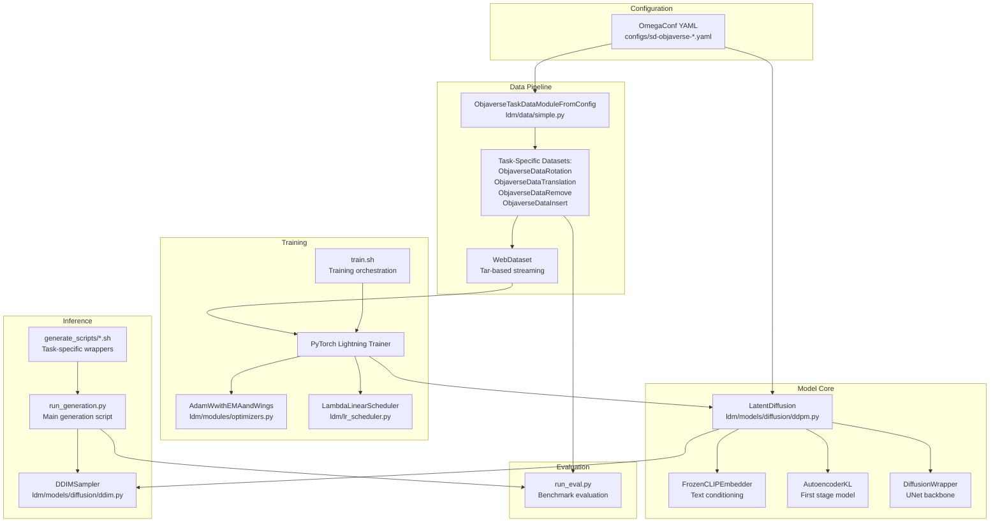
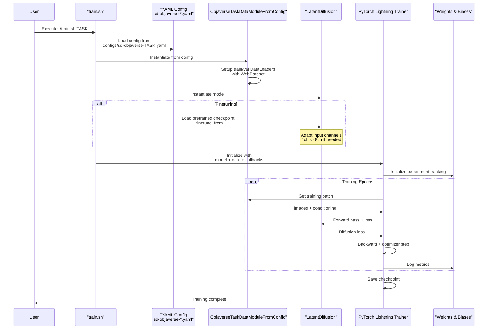
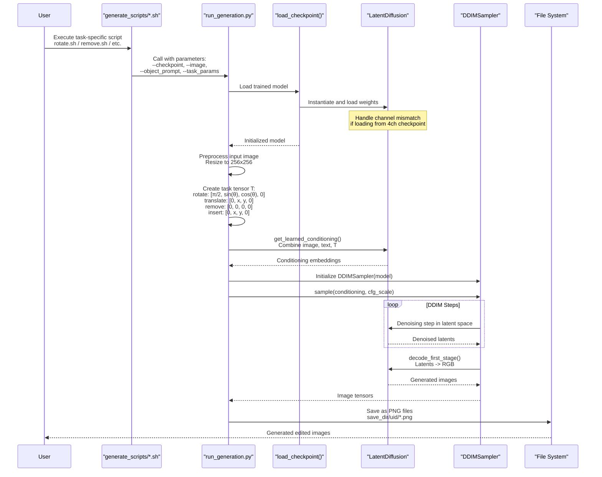

<!-- source: DeepWiki mcp.deepwiki.com · repo allenai/object-edit · page 1 Overview · fetched 2026-10-26 -->

# Overview

<details>
<summary>Relevant source files</summary>

The following files were used as context for generating this wiki page:

- [README.md](README.md)
- [req.txt](req.txt)
- [setup_reqs.sh](setup_reqs.sh)

</details>


This document provides a high-level introduction to the OBJect 3DIT repository, a language-guided 3D-aware image editing system. This overview covers the system's purpose, core capabilities, major components, and typical workflows. For detailed environment setup instructions, see [Environment Setup](#2). For in-depth information about specific subsystems, refer to their respective sections: [Data System](#3), [Training System](#4), [Inference and Generation](#5), and [Evaluation System](#6).

## Purpose and Scope

OBJect 3DIT is a diffusion-based image editing system that enables language-guided manipulation of objects in images with 3D awareness. The system supports four primary editing operations:

| Task | Description | Input | Output |
|------|-------------|-------|--------|
| **Rotation** | Rotate objects by specified angles | Image + object prompt + rotation angle | Edited image with rotated object |
| **Translation** | Move objects to new positions | Image + object prompt + (x, y) coordinates | Edited image with translated object |
| **Removal** | Remove objects from scene | Image + object prompt | Edited image without object |
| **Insertion** | Insert objects into scene | Image + object prompt | Edited image with inserted object |

The system is built on **Latent Diffusion Models (LDM)** and can be initialized from Zero123 or Image-Conditioned Stable Diffusion checkpoints. Training is performed on the Objaverse dataset, a collection of 3D object renderings from multiple viewpoints.

**Sources:** [README.md:1-86](), [setup_reqs.sh:1-17]()

## System Architecture

OBJect 3DIT is organized into five major subsystems that work together to enable training, inference, and evaluation of 3D-aware image editing models.

### Component Overview



**Sources:** [README.md:1-86](), [setup_reqs.sh:1-17]()

### Key Code Entities

The following table maps high-level components to their concrete implementations in the codebase:

| Component | Primary Files | Key Classes/Functions |
|-----------|--------------|----------------------|
| **Data Loading** | `ldm/data/simple.py`, `ldm/data/base.py` | `ObjaverseTaskDataModuleFromConfig`, `Txt2ImgIterableBaseDataset` |
| **Diffusion Model** | `ldm/models/diffusion/ddpm.py` | `LatentDiffusion`, `DDPM` |
| **Sampling** | `ldm/models/diffusion/ddim.py`, `ldm/models/diffusion/plms.py` | `DDIMSampler`, `PLMSSampler` |
| **Conditioning** | `ldm/modules/encoders/modules.py` | `FrozenCLIPEmbedder`, `FrozenCLIPImageEmbedder` |
| **Training Orchestration** | `train.sh`, `configs/*.yaml` | PyTorch Lightning `Trainer` |
| **Generation** | `run_generation.py` | `main()`, `load_checkpoint()` |
| **Evaluation** | `run_eval.py` | Benchmark matching and metrics |

**Sources:** [README.md:1-86]()

## Core Workflows

### Training Workflow

The training workflow begins with configuration and proceeds through data loading, model initialization, and iterative training:



**Sources:** [README.md:47-52]()

### Inference Workflow

The inference workflow loads a trained checkpoint and generates edited images based on task-specific parameters:



**Sources:** [README.md:54-62]()

## Technology Stack

OBJect 3DIT leverages a modern deep learning stack focused on generative computer vision:

### Core Framework Dependencies

| Category | Package | Version | Purpose |
|----------|---------|---------|---------|
| **Deep Learning** | PyTorch | 1.12.1 | Core tensor operations and neural networks |
| | torchvision | 0.13.1 | Image transformations and models |
| | pytorch_lightning | 1.5.0 | Training orchestration and distributed training |
| **Generative Models** | diffusers | 0.12.1 | Hugging Face diffusion models library |
| | taming-transformers-rom1504 | - | VQGAN and autoencoder components |
| **Multimodal** | CLIP | - | Text and image embeddings (OpenAI) |
| | transformers | 4.22.2 | Hugging Face transformer models |
| **Data Pipeline** | webdataset | 0.2.5 | Efficient tar-based dataset streaming |
| | datasets[vision] | 2.4.0 | Hugging Face datasets with vision support |
| | einops | 0.3.0 | Tensor shape manipulation |
| **Computer Vision** | opencv-python | 4.5.5.64 | Image processing utilities |
| | kornia | 0.6 | Differentiable computer vision |
| | carvekit-colab | 4.1.0 | Background removal and segmentation |
| **Training Infrastructure** | omegaconf | 2.1.1 | Hierarchical configuration management |
| | wandb | - | Experiment tracking and logging |
| | torchmetrics[image] | 0.6.0 | Image quality metrics (PSNR, SSIM, etc.) |

**Sources:** [req.txt:1-27](), [setup_reqs.sh:1-17]()

### System Dependencies

The system requires CUDA 11.3 for GPU acceleration and several system libraries installed via [setup_reqs.sh:16]():

```bash
ffmpeg libsm6 libxext6
```

These provide video codec support and X11 extensions needed by OpenCV.

**Sources:** [setup_reqs.sh:16](), [req.txt:1-2]()

## Dataset Structure

The Objaverse dataset used for training and evaluation follows a hierarchical structure organized by task and split:

```
DATASET/
├── rotate/
│   ├── train/
│   ├── val/
│   └── test/
├── translate/
│   ├── train/
│   ├── val/
│   └── test/
└── remove/
    ├── train/
    ├── val/
    └── test/
```

Each sample within a split is organized by a unique identifier (`uid`) containing:

```
uid/
├── 1.png              # Source view
├── 2.png              # Target view (edited)
├── 1_mask.png         # Object mask for source
├── 2_mask.png         # Object mask for target
└── metadata.json      # Viewpoint and object information
```

The insertion task reuses the removal dataset structure, as it operates on the inverse transformation.

**Sources:** [README.md:34-45]()

## Model Checkpoints

The system supports two initialization strategies:

1. **Finetuning from pretrained checkpoints** (recommended):
   - Zero123 checkpoint for 3D-aware generation
   - Image-Conditioned Stable Diffusion for general image editing
   
2. **Training from scratch**: Remove the `--finetune_from` argument in `train.sh`

Checkpoints are available on the Hugging Face page and should be placed in an accessible location for the training script to reference.

**Sources:** [README.md:46-52]()

## Entry Points

The system provides three main entry points for different operations:

| Script | Purpose | Usage |
|--------|---------|-------|
| `train.sh` | Model training and finetuning | `./train.sh [rotate\|remove\|insert\|translate\|multitask]` |
| `run_generation.py` | Image generation and editing | Called via `generate_scripts/*.sh` |
| `run_eval.py` | Benchmark evaluation | Direct invocation with CLI arguments |

Each entry point is documented in detail in its respective section: training in [Training System](#4), generation in [Inference and Generation](#5), and evaluation in [Evaluation System](#6).

**Sources:** [README.md:1-86]()

## Quick Reference: Task-Specific Parameters

Different editing tasks use different conditioning tensor formats in the `run_generation.py` script:

| Task | T Tensor Format | Additional Parameters |
|------|----------------|----------------------|
| **Rotation** | `[π/2, sin(θ), cos(θ), 0]` | `--rotation_angle` (degrees) |
| **Translation** | `[0, x, y, 0]` | `--translate_x`, `--translate_y` (normalized) |
| **Removal** | `[0, 0, 0, 0]` | None |
| **Insertion** | `[0, x, y, 0]` | `--translate_x`, `--translate_y` (normalized) |

All tasks require `--object_prompt` describing the target object (without the editing instruction).

**Sources:** [README.md:54-62]()

## Next Steps

- For immediate hands-on experience, see [Quick Start Guide](#1.1)
- To understand the system architecture in depth, see [System Architecture](#1.2)
- For environment setup, proceed to [Environment Setup](#2)
- For detailed component documentation, navigate to the relevant subsystem sections

---

