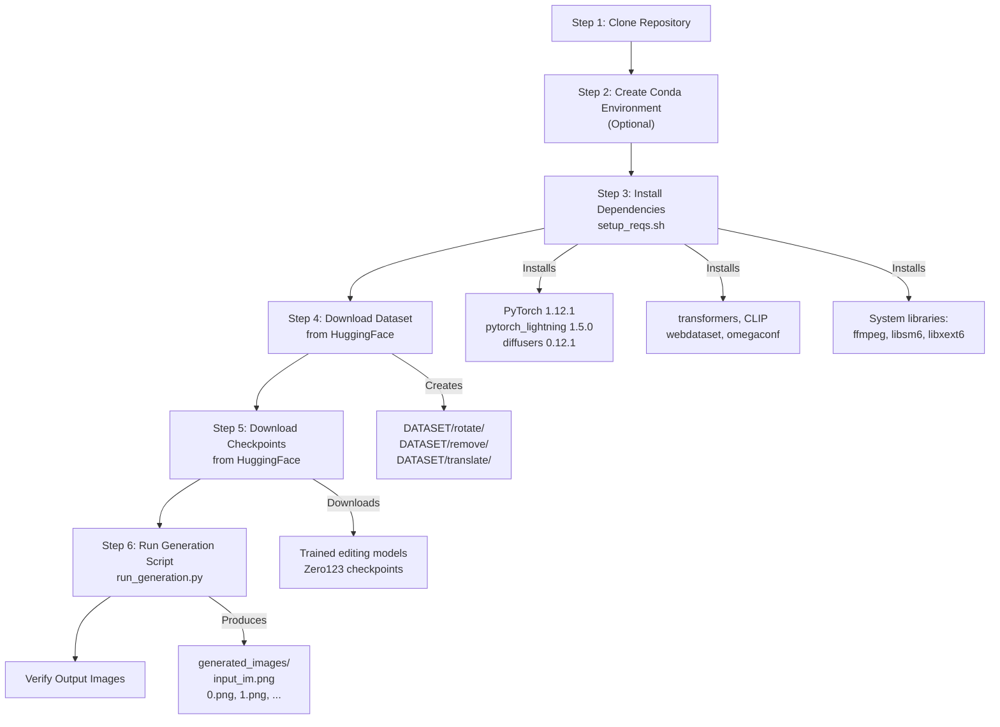
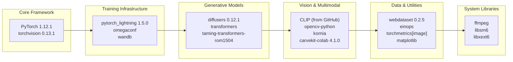
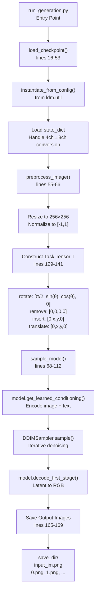
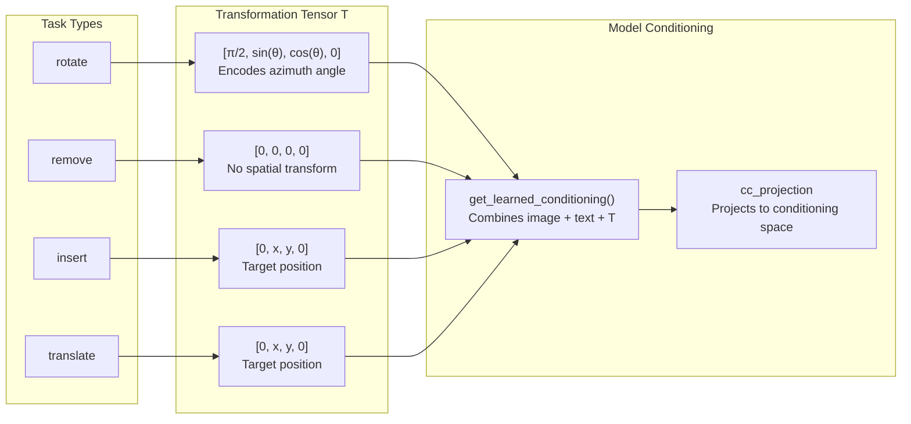

<!-- source: DeepWiki mcp.deepwiki.com · repo allenai/object-edit · page 1.1 Quick Start Guide · fetched 2026-10-26 -->

# Quick Start Guide

<details>
<summary>Relevant source files</summary>

The following files were used as context for generating this wiki page:

- [README.md](README.md)
- [req.txt](req.txt)
- [run_generation.py](run_generation.py)
- [setup_reqs.sh](setup_reqs.sh)

</details>


**Purpose and Scope**: This guide provides step-by-step instructions to set up the OBJect 3DIT environment, download necessary data and checkpoints, and run your first 3D-aware image editing operation. By the end of this guide, you will have a working installation and will have successfully generated edited images for one of the four supported tasks (rotate, remove, insert, translate).

For detailed information about the system architecture and how components interact, see [System Architecture](#1.2). For comprehensive environment configuration and troubleshooting, see [Environment Setup](#2). For in-depth documentation of the generation pipeline, see [Generation Pipeline](#5.1).

---

## Prerequisites

The following system requirements must be met before proceeding:

| Component | Requirement | Notes |
|-----------|-------------|-------|
| **Operating System** | Linux (Ubuntu recommended) | System commands assume Linux environment |
| **Python Version** | 3.9 | Required for compatibility with PyTorch 1.12.1 |
| **CUDA** | 11.3 | Specified in PyTorch installation |
| **GPU Memory** | ≥16GB recommended | Required for loading models and generating images |
| **Disk Space** | ≥50GB | For dataset, checkpoints, and dependencies |
| **System Libraries** | ffmpeg, libsm6, libxext6 | Installed via setup script |

**Sources**: [req.txt:1-2](), [setup_reqs.sh:16](), [README.md:15-20]()

---

## Setup Workflow Overview



**Sources**: [README.md:5-62](), [setup_reqs.sh:1-17]()

---

## Step 1: Clone Repository and Create Directory Structure

Clone the repository from GitHub and create the required `DATASET` directory:

```bash
git clone https://github.com/allenai/object-edit.git
cd object-edit
mkdir DATASET
```

The repository structure after cloning:

```
object-edit/
├── configs/                    # Configuration files for models and tasks
├── ldm/                       # Latent diffusion model implementation
├── generate_scripts/          # Shell scripts for inference demos
├── run_generation.py          # Main generation script
├── run_eval.py               # Evaluation script
├── train.sh                  # Training script
├── setup_reqs.sh             # Dependency installation script
├── req.txt                   # Python requirements
└── DATASET/                  # Created directory for dataset storage
```

**Sources**: [README.md:9-13]()

---

## Step 2: Create Python Environment (Optional)

Create and activate a conda environment to isolate dependencies:

```bash
conda create --name object python=3.9
conda activate object
```

This step is optional but recommended to avoid conflicts with existing Python packages. Python 3.9 is required for compatibility with the specific versions of PyTorch and other dependencies.

**Sources**: [README.md:15-20]()

---

## Step 3: Install Dependencies

Execute the `setup_reqs.sh` script to install all required dependencies:

```bash
. setup_reqs.sh
```

### Dependency Installation Details

The `setup_reqs.sh` script performs the following installations in sequence:



| Package | Version | Purpose |
|---------|---------|---------|
| `torch` | 1.12.1 | Core deep learning framework |
| `pytorch_lightning` | 1.5.0 | Training orchestration |
| `diffusers` | 0.12.1 | Diffusion model implementations |
| `transformers` | 4.22.2 | Language models and CLIP integration |
| `webdataset` | 0.2.5 | Efficient large-scale data loading |
| `omegaconf` | 2.1.1 | Configuration management |
| `CLIP` | from GitHub | Image-text embeddings |
| `carvekit-colab` | 4.1.0 | Image segmentation utilities |
| `kornia` | 0.6 | Differentiable computer vision operations |

**Sources**: [setup_reqs.sh:1-17](), [req.txt:1-27]()

---

## Step 4: Download and Extract Dataset

### Download from HuggingFace

Navigate to the [HuggingFace dataset page](https://huggingface.co/datasets/allenai/object-edit/tree/main) and download the compressed archives for the tasks you need:

- `rotate.tar.gz` - Object rotation task data
- `remove.tar.gz` - Object removal task data  
- `translate.tar.gz` - Object translation task data

The insertion task uses the same data as removal, so no additional download is needed for insert operations.

### Extract Archives

```bash
cd DATASET
tar -xzvf TASK.tar.gz
rm TASK.tar.gz
```

Replace `TASK` with `rotate`, `remove`, or `translate`.

### Dataset Structure

After extraction, the dataset follows this structure:

```
DATASET/
└── {task}/              # "rotate", "remove", or "translate"
    ├── train/
    │   └── {uid}/       # Unique identifier for each sample
    │       ├── 1.png              # First view of the scene
    │       ├── 2.png              # Second view (edited)
    │       ├── 1_mask.png         # Segmentation mask for view 1
    │       ├── 2_mask.png         # Segmentation mask for view 2
    │       └── metadata.json      # Task parameters (angles, positions, etc.)
    ├── val/             # Validation split (same structure)
    └── test/            # Test split (same structure)
```

Each `{uid}` directory contains paired images with corresponding masks and metadata specifying the editing operation parameters.

**Sources**: [README.md:25-45]()

---

## Step 5: Download Model Checkpoints

Download pretrained checkpoints from the [HuggingFace model page](https://huggingface.co/datasets/allenai/object-edit). Available checkpoints include:

- **Trained editing models**: Task-specific finetuned models for each editing operation
- **Zero123 initialization**: Base checkpoint from Zero123 project for initialization
- **Image-Conditioned Stable Diffusion**: Alternative initialization checkpoint

Place downloaded checkpoints in a dedicated directory (e.g., `checkpoints/`). You will need to specify the path to the checkpoint when running generation or training scripts.

**Sources**: [README.md:46]()

---

## Step 6: Run Your First Image Generation

### Using Predefined Generation Scripts

The repository includes ready-to-use shell scripts in the `generate_scripts/` directory:

```bash
# Rotate an object
. generate_scripts/rotate.sh

# Remove an object
. generate_scripts/remove.sh

# Insert an object
. generate_scripts/insert.sh

# Translate an object
. generate_scripts/translate.sh
```

These scripts invoke `run_generation.py` with predefined parameters for demonstration purposes.

### Manual Invocation with Custom Parameters

For custom image editing, invoke `run_generation.py` directly:

```bash
python run_generation.py \
    --task rotate \
    --checkpoint_path /path/to/checkpoint.ckpt \
    --image_path /path/to/input/image.png \
    --save_dir generated_images \
    --object_prompt "red car" \
    --rotation_angle 45.0 \
    --ddim_steps 50 \
    --num_samples 8 \
    --device 0 \
    --cfg_scale 3.0
```

### Key Parameters

| Parameter | Type | Description | Example |
|-----------|------|-------------|---------|
| `--task` | str | Editing operation | `rotate`, `remove`, `insert`, `translate` |
| `--checkpoint_path` | str | Path to model checkpoint | `checkpoints/rotate_model.ckpt` |
| `--image_path` | str | Input image path | `input_images/scene.png` |
| `--save_dir` | str | Output directory | `generated_images` |
| `--object_prompt` | str | Object description (no instruction) | `"red car"` |
| `--rotation_angle` | float | Rotation in degrees (for rotate task) | `45.0` |
| `--position` | str | x,y coordinates for insert/translate | `"0.5,0.3"` |
| `--ddim_steps` | int | Number of denoising steps | `50` |
| `--num_samples` | int | Number of samples to generate | `8` |
| `--cfg_scale` | float | Classifier-free guidance scale | `3.0` |
| `--device` | int | GPU device ID | `0` |

**Important**: The `--object_prompt` should contain only the object description, not the editing instruction. The script automatically constructs the full prompt (e.g., "rotate the red car", "remove the red car") based on the task.

**Sources**: [README.md:54-62](), [run_generation.py:174-235]()

---

## Generation Pipeline Code Flow



**Sources**: [run_generation.py:1-238]()

---

## Verification and Output

### Expected Output Structure

After successful generation, the `save_dir` will contain:

```
generated_images/
├── input_im.png    # Preprocessed input image (256×256)
├── 0.png          # Generated sample 0
├── 1.png          # Generated sample 1
├── 2.png          # Generated sample 2
├── ...
└── 7.png          # Generated sample N-1 (if num_samples=8)
```

### Visual Verification Checklist

- ✅ **Input preservation**: `input_im.png` should match your input image at 256×256 resolution
- ✅ **Sample diversity**: Generated samples should show variation due to stochastic sampling
- ✅ **Task correctness**: 
  - **Rotate**: Object should appear rotated by specified angle
  - **Remove**: Object should be removed with plausible inpainting
  - **Insert**: New object should appear at specified position
  - **Translate**: Object should move to new position
- ✅ **Image quality**: Generated images should be coherent and artifact-free

### Troubleshooting Quick Checks

| Issue | Likely Cause | Solution |
|-------|--------------|----------|
| CUDA out of memory | Insufficient GPU memory | Reduce `--num_samples` or use smaller batch size |
| Checkpoint loading fails | Incorrect path or corrupted file | Verify checkpoint path and re-download if needed |
| Poor generation quality | Low guidance scale | Increase `--cfg_scale` (try 3.0-7.0) |
| Incorrect task execution | Wrong T tensor format | Verify task name matches checkpoint training task |
| Import errors | Incomplete installation | Re-run `setup_reqs.sh` |

**Sources**: [run_generation.py:165-169]()

---

## Understanding Task-Specific Transformations

The `run_generation.py` script constructs different transformation tensors `T` for each task, which condition the diffusion model:



**Task Tensor Details**:

- **Rotation**: Uses spherical coordinates with `[π/2, sin(azimuth), cos(azimuth), 0]` where azimuth is converted from degrees to radians ([run_generation.py:131-132]())
- **Removal**: Uses zero tensor `[0, 0, 0, 0]` as no spatial transformation is needed ([run_generation.py:135]())
- **Insertion & Translation**: Use `[0, x, y, 0]` where x,y ∈ [0,1] specify normalized image coordinates ([run_generation.py:138-141]())

The fourth element (always 0) is reserved for potential future extensions.

**Sources**: [run_generation.py:129-142]()

---

## Next Steps

Now that you have a working installation and have successfully generated your first edited images, explore these topics:

- **[System Architecture](#1.2)**: Understand how components interact across the codebase
- **[Training Workflow and Scripts](#4.2)**: Learn how to finetune or train models from scratch
- **[Generation Parameters and Configuration](#5.3)**: Deep dive into all generation parameters and their effects
- **[Running Evaluations](#6.1)**: Evaluate your generated images against benchmark metrics
- **[Task-Specific Generation](#5.2)**: Detailed documentation of each editing task's unique behavior
- **[Creating Custom Datasets](#8.1)**: Extend the system with your own datasets

For advanced usage including custom conditioning mechanisms and model extensions, see [Advanced Topics](#8).

**Sources**: [README.md:47-86]()

---

