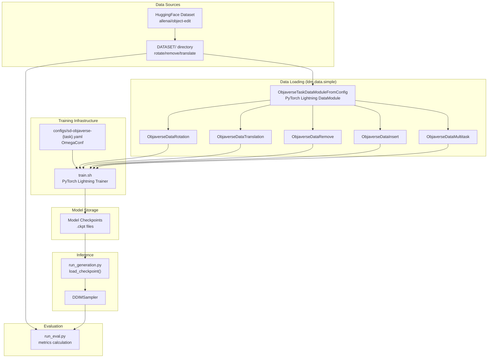
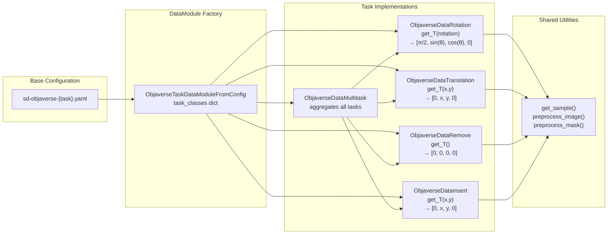
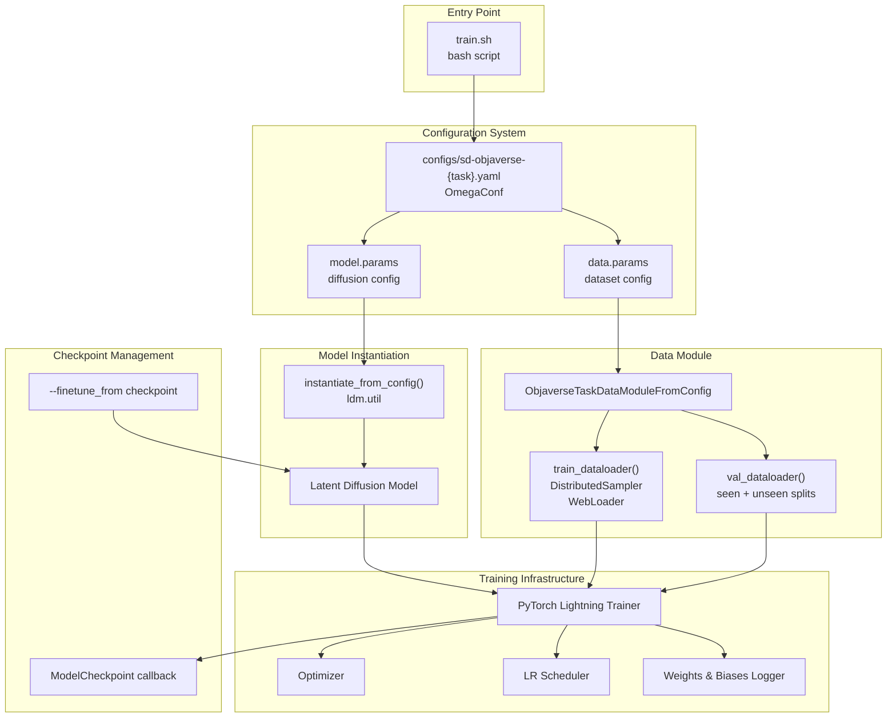
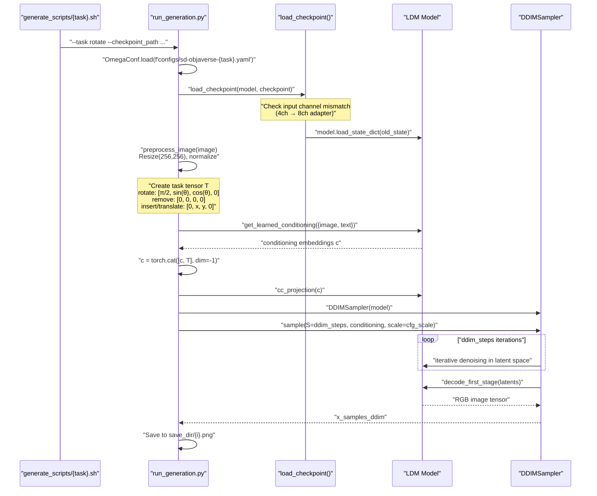
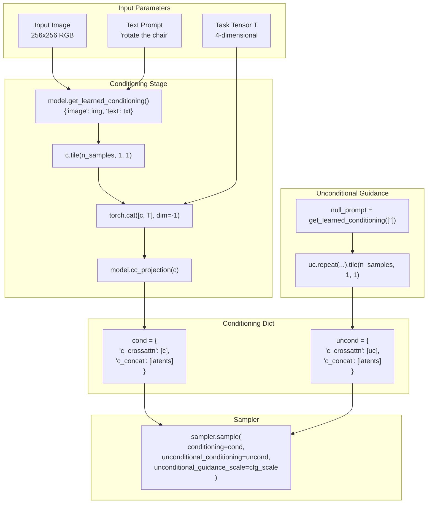
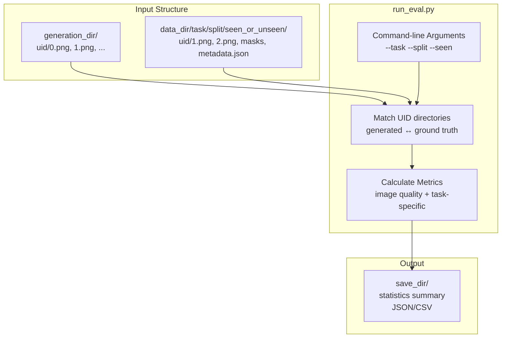

<!-- source: DeepWiki mcp.deepwiki.com · repo allenai/object-edit · page 1.2 System Architecture · fetched 2026-10-26 -->

# System Architecture

<details>
<summary>Relevant source files</summary>

The following files were used as context for generating this wiki page:

- [README.md](README.md)
- [ldm/data/simple.py](ldm/data/simple.py)
- [run_generation.py](run_generation.py)

</details>


## Purpose and Scope

This document explains the high-level architecture of the OBJect 3DIT system, detailing how the major components interact to enable language-guided 3D-aware image editing. It covers the relationships between data loading, training, inference, and evaluation subsystems, as well as the core data flows and interfaces that connect them.

For step-by-step setup instructions, see [Quick Start Guide](#1.1). For detailed information about individual subsystems, refer to: [Data System](#3), [Training System](#4), [Inference and Generation](#5), [Evaluation System](#6), and [Model Architecture](#7).

---

## System Overview

The OBJect 3DIT codebase is organized into five major subsystems that operate in sequence to enable language-guided 3D-aware image editing:

| Subsystem | Primary Component | Key Purpose |
|-----------|------------------|-------------|
| **Environment Setup** | [setup_reqs.sh:1-50]() | Install dependencies and configure system libraries |
| **Data Pipeline** | [ldm/data/simple.py:31-484]() | Load and preprocess Objaverse datasets for training/validation |
| **Training** | [train.sh:1-50]() | Train or finetune Latent Diffusion Models on task-specific data |
| **Inference** | [run_generation.py:1-238]() | Generate edited images using trained models |
| **Evaluation** | [run_eval.py:1-100]() | Benchmark generated images against ground truth |

These subsystems operate independently but share common data formats and model interfaces. The Data Pipeline feeds the Training subsystem, which produces checkpoints consumed by Inference, whose outputs are validated by Evaluation.

**Sources:** [README.md:1-86](), [run_generation.py:1-238](), [ldm/data/simple.py:1-534]()

---

## Core Data Flow



The system follows a linear data flow from raw datasets through training to inference. The `ObjaverseTaskDataModuleFromConfig` class serves as the primary interface between the data layer and training infrastructure, instantiating task-specific dataset classes based on configuration.

**Sources:** [ldm/data/simple.py:31-122](), [README.md:5-86](), [run_generation.py:114-170]()

---

## Data Pipeline Architecture

### Task-Specific Dataset Classes

The data pipeline is built around a polymorphic design where each editing task has a dedicated dataset class:



Each dataset class implements a `get_T()` method that produces task-specific transformation tensors with distinct formats:

| Task | Tensor Format | Source Line |
|------|---------------|-------------|
| **Rotation** | `[π/2, sin(θ), cos(θ), 0]` | [ldm/data/simple.py:167-170]() |
| **Translation** | `[0, x, y, 0]` | [ldm/data/simple.py:246-248]() |
| **Removal** | `[0, 0, 0, 0]` | [ldm/data/simple.py:323-325]() |
| **Insertion** | `[0, x, y, 0]` | [ldm/data/simple.py:395-397]() |

The `ObjaverseTaskDataModuleFromConfig` class [ldm/data/simple.py:31-99]() uses a `task_classes` dictionary [ldm/data/simple.py:41-48]() to instantiate the appropriate dataset based on the `task` parameter.

**Sources:** [ldm/data/simple.py:31-484]()

---

## Training Pipeline Components



The training system is orchestrated through [train.sh:1-50](), which invokes PyTorch Lightning's training infrastructure with task-specific configuration files. The `--finetune_from` argument [README.md:49]() enables initialization from pretrained Zero123 or Stable Diffusion checkpoints.

Key configuration locations:
- Model architecture: `configs/sd-objaverse-{task}.yaml` → `model` section
- Dataset parameters: `configs/sd-objaverse-{task}.yaml` → `data` section
- Task specification: Passed as command-line argument to `train.sh`

**Sources:** [README.md:47-52](), [ldm/data/simple.py:31-99]()

---

## Inference Pipeline



The inference pipeline is implemented in [run_generation.py:114-170]() with the following key steps:

1. **Model Loading** [run_generation.py:116-124](): Loads configuration and checkpoint with automatic channel adaptation for 4ch→8ch models [run_generation.py:25-44]()
2. **Image Preprocessing** [run_generation.py:55-66](): Resizes to 256×256 and normalizes to [-1, 1]
3. **Task Tensor Creation** [run_generation.py:129-141](): Constructs task-specific `T` tensor based on editing operation
4. **Conditioning** [run_generation.py:81-87](): Combines image, text, and task tensor via `get_learned_conditioning()` and `cc_projection()`
5. **Sampling** [run_generation.py:98-106](): DDIM sampling with classifier-free guidance
6. **Decoding** [run_generation.py:108-110](): Converts latents to RGB images
7. **Output** [run_generation.py:165-169](): Saves generated images as PNG files

The `load_checkpoint()` function [run_generation.py:16-53]() includes special handling for input channel mismatches, zero-initializing new channels and copying weights from the first 4 channels [run_generation.py:41-44]().

**Sources:** [run_generation.py:1-238]()

---

## Model Conditioning System

The conditioning system bridges task parameters to model inputs through a multi-stage process:



The conditioning process [run_generation.py:81-95]():
1. Combines image and text via `get_learned_conditioning()` to produce embeddings `c`
2. Tiles `c` to batch size `n_samples`
3. Concatenates the task tensor `T` to the conditioning embeddings
4. Projects through `cc_projection()` to final conditioning space
5. Creates separate `c_crossattn` (cross-attention) and `c_concat` (concatenation) conditioning
6. Generates unconditional embeddings for classifier-free guidance

The latent representation of the input image is encoded via `encode_first_stage()` [run_generation.py:90-91]() and concatenated to the model input during sampling.

**Sources:** [run_generation.py:68-112]()

---

## Evaluation System

The evaluation pipeline validates generated images against ground truth using a directory-based matching system:



The evaluation script [run_eval.py:1-100]() requires:
- `--generation_dir`: Path to generated images organized by UID
- `--data_dir`: Path to original dataset (DATASET/ directory)
- `--task`: One of `rotate`, `remove`, `insert`, `translate`
- `--split`: One of `train`, `val`, `test`
- `--seen`: One of `seen`, `unseen`

**Critical constraint:** Generated images must preserve the UID-based directory structure [README.md:77-85]() for automated matching between generated outputs and ground truth data.

**Sources:** [README.md:64-86](), [run_eval.py:1-100]()

---

## Configuration System

OBJect 3DIT uses OmegaConf YAML files for declarative configuration:

| Configuration File | Purpose |
|-------------------|---------|
| `configs/sd-objaverse-rotate.yaml` | Rotation task model and data configuration |
| `configs/sd-objaverse-translate.yaml` | Translation task configuration |
| `configs/sd-objaverse-remove.yaml` | Removal task configuration |
| `configs/sd-objaverse-insert.yaml` | Insertion task configuration (uses remove data) |
| `configs/sd-objaverse-multitask.yaml` | Multi-task training configuration |

Configuration files are loaded via `OmegaConf.load()` [run_generation.py:117]() and can be dynamically updated [run_generation.py:118]() to override parameters like device placement. The `instantiate_from_config()` utility [run_generation.py:119]() constructs model objects from configuration dictionaries using Python's import system.

**Sources:** [run_generation.py:114-124](), [README.md:49-52]()

---

## Dataset Directory Structure

The system expects datasets in a specific hierarchical format:

```
DATASET/
├── rotate/
│   ├── train/
│   │   └── {uid}/
│   │       ├── 1.png           # condition image
│   │       ├── 2.png           # target image
│   │       ├── 1_mask.png      # condition mask
│   │       ├── 2_mask.png      # target mask
│   │       └── metadata.json   # task parameters
│   ├── val/
│   │   ├── seen/
│   │   │   └── {uid}/...
│   │   └── unseen/
│   │       └── {uid}/...
│   └── test/
│       ├── seen/...
│       └── unseen/...
├── translate/
│   └── (same structure)
├── remove/
│   └── (same structure)
└── (insert uses remove data)
```

Dataset classes navigate this structure using path construction [ldm/data/simple.py:143-148]():
- Training: `{task}/train/`
- Validation/Test: `{task}/{split}/{seen_or_unseen}/`

The `ObjaverseDataInsert` class [ldm/data/simple.py:353-427]() reuses the `remove` dataset by inverting the condition/target pair [ldm/data/simple.py:377](), treating image 2 (without object) as the condition and image 1 (with object) as the target [ldm/data/simple.py:405]().

**Sources:** [README.md:34-45](), [ldm/data/simple.py:123-427]()

---

## Inter-Component Communication

The primary interfaces between subsystems are:

### Training → Inference
- **Medium:** PyTorch checkpoint files (`.ckpt`)
- **Content:** Model state_dict with diffusion_model weights
- **Loading:** [run_generation.py:16-53]() with channel adaptation

### Configuration → All Systems
- **Medium:** OmegaConf YAML files
- **Pattern:** `instantiate_from_config()` constructs objects from config dictionaries
- **Usage:** Model instantiation, data module creation, training parameters

### Dataset → Model
- **Medium:** Dictionary with keys: `image_target`, `cond` (dict with `image`, `text`), `T`, `mask_cond`, `mask_target`, `uid`, `log_key`
- **Source:** `__getitem__()` methods in [ldm/data/simple.py:172-201](), [ldm/data/simple.py:250-278](), etc.

### Inference → Evaluation
- **Medium:** PNG image files in UID-organized directories
- **Constraint:** Directory structure must match dataset format [README.md:78-85]()

**Sources:** [run_generation.py:16-53](), [ldm/data/simple.py:172-278](), [README.md:64-86]()

---

