<!-- source: DeepWiki mcp.deepwiki.com · repo allenai/object-edit · page 2 Environment Setup · fetched 2026-10-26 -->

# Environment Setup

<details>
<summary>Relevant source files</summary>

The following files were used as context for generating this wiki page:

- [README.md](README.md)
- [req.txt](req.txt)
- [setup_reqs.sh](setup_reqs.sh)

</details>


## Purpose and Scope

This document covers the complete environment setup process for the OBJect 3DIT codebase, including system dependencies, Python packages, and installation procedures. This is the foundational step required before training models, running inference, or performing evaluation.

For information about training workflows after environment setup, see [Training System](#4). For details on specific dependencies and their architectural roles, see [Dependencies and Requirements](#2.1). For platform-specific installation guidance, see [Installation Instructions](#2.2).

---

## System Requirements

### Hardware Requirements

The OBJect 3DIT system is designed for GPU-accelerated deep learning workloads:

| Component | Requirement | Notes |
|-----------|-------------|-------|
| **GPU** | NVIDIA GPU with CUDA support | Required for training and inference |
| **CUDA** | Version 11.3 | Specified in [req.txt:1]() |
| **VRAM** | 16+ GB recommended | For training; inference may work with less |
| **CPU RAM** | 32+ GB recommended | For data loading and preprocessing |
| **Storage** | 100+ GB free space | For datasets, checkpoints, and outputs |

### Operating System

The system is designed primarily for Linux environments:

- **Recommended**: Ubuntu 18.04+ or similar Debian-based distributions
- System packages installed via `apt-get` include: `ffmpeg`, `libsm6`, `libxext6` [setup_reqs.sh:16]()

### Python Version

Python 3.9 is recommended based on the conda environment setup in [README.md:18-19]():

```bash
conda create --name object python=3.9
```

Sources: [README.md:1-86](), [req.txt:1-27](), [setup_reqs.sh:1-17]()

---

## Dependency Architecture

The OBJect 3DIT system has a layered dependency architecture, with each layer serving specific functional roles.

### Dependency Layer Diagram

```mermaid
graph TB
    subgraph "System Layer"
        CUDA["CUDA 11.3"]
        FFMPEG["ffmpeg + libsm6 + libxext6"]
    end
    
    subgraph "Core Framework"
        TORCH["torch==1.12.1"]
        TORCHVISION["torchvision==0.13.1"]
        LIGHTNING["pytorch_lightning==1.5.0"]
    end
    
    subgraph "Computer Vision"
        CV["opencv-python==4.5.5.64"]
        KORNIA["kornia==0.6"]
        CARVEKIT["carvekit-colab==4.1.0"]
        IMAGEIO["imageio==2.9.0"]
        IMAGEIOFFMPEG["imageio-ffmpeg==0.4.2"]
    end
    
    subgraph "Generative Models"
        DIFFUSERS["diffusers==0.12.1"]
        TAMING["taming-transformers-rom1504"]
        CLIP["openai/CLIP.git"]
    end
    
    subgraph "NLP and Multimodal"
        TRANSFORMERS["transformers==4.22.2"]
        FTFY["ftfy"]
        REGEX["regex"]
    end
    
    subgraph "Data Pipeline"
        WEBDATASET["webdataset==0.2.5"]
        DATASETS["datasets[vision]==2.4.0"]
        EINOPS["einops==0.3.0"]
    end
    
    subgraph "Training Infrastructure"
        OMEGA["omegaconf==2.1.1"]
        WANDB["wandb"]
        TORCHMETRICS["torchmetrics==0.6.0"]
        TORCHMETRICSIMAGE["torchmetrics[image]"]
    end
    
    subgraph "Development Tools"
        PUDB["pudb==2019.2"]
        IPDB["ipdb"]
        MPL["matplotlib"]
        PLOTLY["plotly==5.13.1"]
        STREAM["streamlit>=0.73.1"]
        TQDM["tqdm"]
    end
    
    CUDA --> TORCH
    FFMPEG --> CV
    FFMPEG --> IMAGEIO
    
    TORCH --> TORCHVISION
    TORCH --> LIGHTNING
    TORCH --> KORNIA
    TORCH --> DIFFUSERS
    TORCH --> EINOPS
    TORCH --> TORCHMETRICS
    
    LIGHTNING --> OMEGA
    LIGHTNING --> WANDB
    
    TORCHVISION --> DATASETS
    
    CV --> CARVEKIT
    
    TRANSFORMERS --> CLIP
    TRANSFORMERS --> STREAM
    
    TAMING -.imported by.-> DIFFUSERS
    CLIP -.imported by.-> DIFFUSERS
```



This diagram shows the dependency hierarchy from system-level requirements through core frameworks to application-specific libraries. Solid arrows indicate direct dependencies; dashed arrows indicate usage relationships.

Sources: [req.txt:1-27](), [setup_reqs.sh:1-17]()

---

## Core Dependencies

### Framework Layer

| Package | Version | Purpose | Installation |
|---------|---------|---------|--------------|
| `torch` | 1.12.1 | Core deep learning framework | [req.txt:2]() |
| `torchvision` | 0.13.1 | Image transformations and models | [req.txt:3]() |
| `pytorch_lightning` | 1.5.0 | Training orchestration and boilerplate reduction | [req.txt:8](), [setup_reqs.sh:3]() |

The PyTorch ecosystem is installed from the CUDA 11.3 index: [req.txt:1]()
```
--extra-index-url https://download.pytorch.org/whl/cu113
```

### Generative AI Components

| Package | Version | Purpose | Code Usage |
|---------|---------|---------|------------|
| `diffusers` | 0.12.1 | Hugging Face diffusion models library | Provides `DDIMScheduler`, `DDPMScheduler` |
| `transformers` | 4.22.2 | Hugging Face transformers for NLP | Text encoding and CLIP integration |
| `taming-transformers-rom1504` | Latest | VQ-GAN and VQVAE components | First-stage encoder/decoder |
| `openai/CLIP` | Git HEAD | Contrastive Language-Image Pre-training | Image-text conditioning |

The CLIP package is installed directly from OpenAI's GitHub repository: [setup_reqs.sh:10](), [req.txt:23]()

### Computer Vision Tools

| Package | Version | Purpose |
|---------|---------|---------|
| `opencv-python` | 4.5.5.64 | Image I/O and basic transformations |
| `kornia` | 0.6 | Differentiable computer vision operations |
| `carvekit-colab` | 4.1.0 | Background removal and segmentation |
| `imageio` | 2.9.0 | Image reading/writing |
| `imageio-ffmpeg` | 0.4.2 | Video I/O support |

### Data Pipeline

| Package | Version | Purpose |
|---------|---------|---------|
| `webdataset` | 0.2.5 | Efficient tar-based dataset streaming for large-scale data |
| `datasets[vision]` | 2.4.0 | Hugging Face datasets library with vision extras |
| `einops` | 0.3.0 | Tensor operations with readable notation |

### Training Infrastructure

| Package | Version | Purpose |
|---------|---------|---------|
| `omegaconf` | 2.1.1 | Hierarchical configuration management (YAML-based) |
| `wandb` | Latest | Weights & Biases experiment tracking |
| `torchmetrics` | 0.6.0 | Metric computation |
| `torchmetrics[image]` | - | Image-specific metrics (SSIM, LPIPS, etc.) |

The `torchmetrics[image]` extra is installed separately: [setup_reqs.sh:17]()

### Development and Visualization

| Package | Version | Purpose |
|---------|---------|---------|
| `streamlit` | ≥0.73.1 | Interactive web UI for demos |
| `plotly` | 5.13.1 | Interactive plotting |
| `matplotlib` | Latest | Static plotting |
| `pudb` | 2019.2 | Console debugger |
| `ipdb` | Latest | IPython debugger |
| `tqdm` | Latest | Progress bars |

### Text Processing

| Package | Purpose |
|---------|---------|
| `ftfy` | Fix text encoding issues |
| `regex` | Enhanced regular expressions |

Sources: [req.txt:1-27](), [setup_reqs.sh:1-17]()

---

## Installation Process

### Installation Flow Diagram

```mermaid
flowchart TD
    START["User starts installation"]
    
    CLONE["git clone allenai/object-edit"]
    MKDIR["mkdir DATASET"]
    
    CONDA_CHECK{"Using conda?"}
    CONDA_CREATE["conda create --name object python=3.9"]
    CONDA_ACTIVATE["conda activate object"]
    
    RUN_SETUP["Execute: . setup_reqs.sh"]
    
    INSTALL_REQ["pip install -r req.txt<br/>(Line 2 of setup_reqs.sh)"]
    
    INSTALL_INDIVIDUAL["Install individual packages:<br/>pytorch_lightning==1.5.0<br/>omegaconf<br/>opencv-python<br/>carvekit-colab==4.1.0<br/>einops<br/>taming-transformers-rom1504<br/>kornia<br/>transformers<br/>wandb<br/>webdataset==0.2.5<br/>ipdb<br/>matplotlib"]
    
    INSTALL_CLIP["pip install git+https://github.com/openai/CLIP.git"]
    
    INSTALL_METRICS["pip install torchmetrics[image]"]
    
    APT_UPDATE["sudo apt-get update"]
    APT_INSTALL["sudo apt-get install ffmpeg libsm6 libxext6 -y"]
    
    DOWNLOAD_DATA["Download dataset from HuggingFace"]
    UNZIP["tar -xzvf TASK.tar.gz"]
    
    VERIFY["Verify installation:<br/>import torch, pytorch_lightning, etc."]
    
    COMPLETE["Environment ready"]
    
    START --> CLONE
    CLONE --> MKDIR
    MKDIR --> CONDA_CHECK
    
    CONDA_CHECK -->|"Yes"| CONDA_CREATE
    CONDA_CREATE --> CONDA_ACTIVATE
    CONDA_ACTIVATE --> RUN_SETUP
    
    CONDA_CHECK -->|"No"| RUN_SETUP
    
    RUN_SETUP --> INSTALL_REQ
    INSTALL_REQ --> INSTALL_INDIVIDUAL
    INSTALL_INDIVIDUAL --> INSTALL_CLIP
    INSTALL_CLIP --> INSTALL_METRICS
    INSTALL_METRICS --> APT_UPDATE
    APT_UPDATE --> APT_INSTALL
    APT_INSTALL --> DOWNLOAD_DATA
    DOWNLOAD_DATA --> UNZIP
    UNZIP --> VERIFY
    VERIFY --> COMPLETE
```



This diagram maps the installation workflow to specific commands and script lines from the codebase.

Sources: [README.md:5-31](), [setup_reqs.sh:1-17]()

---

## Step-by-Step Installation

### 1. Clone Repository and Create Directory Structure

```bash
git clone https://github.com/allenai/object-edit.git
cd object-edit
mkdir DATASET
```

Referenced in [README.md:9-13]()

### 2. Create Conda Environment (Optional but Recommended)

```bash
conda create --name object python=3.9
conda activate object
```

Referenced in [README.md:17-20]()

### 3. Execute Installation Script

The primary installation is performed by the `setup_reqs.sh` script:

```bash
. setup_reqs.sh
```

Referenced in [README.md:23]()

#### Installation Script Breakdown

The `setup_reqs.sh` script executes the following sequence:

| Step | Command | File Reference | Purpose |
|------|---------|----------------|---------|
| 1 | `pip install -r req.txt` | [setup_reqs.sh:2]() | Install base requirements |
| 2 | `pip install pytorch_lightning==1.5.0` | [setup_reqs.sh:3]() | Training framework (reinstall for version guarantee) |
| 3 | `pip install omegaconf` | [setup_reqs.sh:4]() | Configuration management |
| 4 | `pip install opencv-python` | [setup_reqs.sh:5]() | Computer vision operations |
| 5 | `pip install carvekit-colab==4.1.0` | [setup_reqs.sh:6]() | Background removal |
| 6 | `pip install einops` | [setup_reqs.sh:7]() | Tensor operations |
| 7 | `pip install taming-transformers-rom1504` | [setup_reqs.sh:8]() | VQ-GAN components |
| 8 | `pip install kornia` | [setup_reqs.sh:9]() | Differentiable CV ops |
| 9 | `pip install git+https://github.com/openai/CLIP.git` | [setup_reqs.sh:10]() | CLIP from source |
| 10 | `pip install transformers` | [setup_reqs.sh:11]() | Hugging Face transformers |
| 11 | `pip install wandb` | [setup_reqs.sh:12]() | Experiment tracking |
| 12 | `pip install webdataset==0.2.5` | [setup_reqs.sh:13]() | Large-scale data loading |
| 13 | `pip install ipdb` | [setup_reqs.sh:14]() | Debugging |
| 14 | `pip install matplotlib` | [setup_reqs.sh:15]() | Plotting |
| 15 | `sudo apt-get update && sudo apt-get install ffmpeg libsm6 libxext6 -y` | [setup_reqs.sh:16]() | System libraries |
| 16 | `pip install torchmetrics[image]` | [setup_reqs.sh:17]() | Image metrics |

**Note**: Some packages like `pytorch_lightning`, `omegaconf`, and `opencv-python` are installed both in `req.txt` and individually in `setup_reqs.sh`. The individual installations serve as version confirmations or overrides.

### 4. System Package Installation

The script requires `sudo` access to install system-level dependencies [setup_reqs.sh:16]():

- **ffmpeg**: Video/audio processing, required by `imageio-ffmpeg`
- **libsm6**: X11 Session Management library
- **libxext6**: X11 extensions library

These system packages are prerequisites for OpenCV's GUI functionality and video processing.

### 5. Dataset Download

Download the Objaverse dataset from the [HuggingFace repository](https://huggingface.co/datasets/allenai/object-edit/tree/main) and extract:

```bash
cd DATASET
tar -xzvf TASK.tar.gz
rm TASK.tar.gz
```

Where `TASK` is one of: `rotate`, `remove`, `translate`. The `insert` task reuses the `remove` dataset. Referenced in [README.md:25-32]()

Sources: [setup_reqs.sh:1-17](), [README.md:5-33]()

---

## Installation Script to Code Entity Mapping

This diagram maps the installation components to their usage in the codebase:

```mermaid
graph TB
    subgraph "setup_reqs.sh Components"
        SETUP_REQ["pip install -r req.txt<br/>(setup_reqs.sh:2)"]
        SETUP_PL["pytorch_lightning==1.5.0<br/>(setup_reqs.sh:3)"]
        SETUP_OMEGA["omegaconf<br/>(setup_reqs.sh:4)"]
        SETUP_CV["opencv-python<br/>(setup_reqs.sh:5)"]
        SETUP_CARVE["carvekit-colab<br/>(setup_reqs.sh:6)"]
        SETUP_EINOPS["einops<br/>(setup_reqs.sh:7)"]
        SETUP_TAMING["taming-transformers-rom1504<br/>(setup_reqs.sh:8)"]
        SETUP_KORNIA["kornia<br/>(setup_reqs.sh:9)"]
        SETUP_CLIP["git+github.com/openai/CLIP.git<br/>(setup_reqs.sh:10)"]
        SETUP_TRANS["transformers<br/>(setup_reqs.sh:11)"]
        SETUP_WANDB["wandb<br/>(setup_reqs.sh:12)"]
        SETUP_WEB["webdataset==0.2.5<br/>(setup_reqs.sh:13)"]
        SETUP_METRICS["torchmetrics[image]<br/>(setup_reqs.sh:17)"]
    end
    
    subgraph "Code Usage Points"
        TRAINER["pytorch_lightning.Trainer"]
        LDMMODULE["ldm.models.diffusion"]
        
        OMEGACONF_USE["OmegaConf.load()<br/>configs/*.yaml"]
        
        CV_USE["cv2.imread()<br/>cv2.resize()"]
        
        EINOPS_USE["rearrange()<br/>repeat()"]
        
        TAMING_USE["taming.models.vqgan<br/>First stage models"]
        
        CLIP_USE["clip.load()<br/>clip.tokenize()"]
        
        WEBDATA_USE["webdataset.WebDataset<br/>ldm/data/laion.py"]
        
        DATAMODULE["ldm.data.simple<br/>ObjaverseData*"]
    end
    
    SETUP_PL --> TRAINER
    SETUP_PL --> LDMMODULE
    
    SETUP_OMEGA --> OMEGACONF_USE
    
    SETUP_CV --> CV_USE
    
    SETUP_EINOPS --> EINOPS_USE
    
    SETUP_TAMING --> TAMING_USE
    
    SETUP_CLIP --> CLIP_USE
    
    SETUP_WEB --> WEBDATA_USE
    
    SETUP_REQ --> DATAMODULE
```



This mapping shows how installation components correspond to specific code entities used throughout the codebase.

Sources: [setup_reqs.sh:1-17]()

---

## Verification

After installation, verify the environment by checking key imports:

```python
import torch
print(f"PyTorch version: {torch.__version__}")
print(f"CUDA available: {torch.cuda.is_available()}")
print(f"CUDA version: {torch.version.cuda}")

import pytorch_lightning as pl
print(f"PyTorch Lightning version: {pl.__version__}")

import diffusers
import transformers
import clip
import omegaconf
import webdataset
import torchmetrics

print("All key dependencies imported successfully")
```

Expected outputs:
- PyTorch version: 1.12.1
- CUDA available: True
- CUDA version: 11.3
- PyTorch Lightning version: 1.5.0

---

## Directory Structure After Setup

After completing installation and dataset download, the repository structure should be:

```
object-edit/
├── configs/                    # Configuration YAML files
├── DATASET/                    # Downloaded datasets
│   ├── rotate/
│   │   ├── train/
│   │   ├── val/
│   │   └── test/
│   ├── remove/
│   └── translate/
├── ldm/                        # Main package
│   ├── data/                   # Dataset loaders
│   ├── models/                 # Model definitions
│   └── modules/                # Model components
├── req.txt                     # Base requirements
├── setup_reqs.sh               # Installation script
├── train.sh                    # Training script
├── run_generation.py           # Inference script
├── run_eval.py                 # Evaluation script
└── generate_scripts/           # Task-specific generation scripts
```

The `DATASET` directory is created by [README.md:12]() and populated by downloading and extracting task-specific archives.

Sources: [README.md:9-45]()

---

## Common Installation Issues

### CUDA Version Mismatch

**Issue**: PyTorch installed without CUDA support or with wrong CUDA version.

**Solution**: Ensure the `--extra-index-url` in [req.txt:1]() is used, which provides CUDA 11.3 wheels.

### System Package Installation Fails

**Issue**: The `sudo apt-get install` command at [setup_reqs.sh:16]() fails due to permissions.

**Solution**: Either run the script with appropriate sudo privileges or manually install the system packages before running the script.

### CLIP Installation from Git

**Issue**: Git-based CLIP installation at [setup_reqs.sh:10]() fails.

**Solution**: Ensure git is installed and you have network access to GitHub. The package is also specified in [req.txt:23]() as a fallback.

### Import Errors After Installation

**Issue**: Packages like `taming` or `ldm` cannot be imported.

**Solution**: 
- For `taming`: Ensure `taming-transformers-rom1504` was installed successfully [setup_reqs.sh:8]()
- For `ldm`: This is a local package in the repository; ensure you're running Python from the repository root

Sources: [setup_reqs.sh:1-17](), [req.txt:1-27]()

---

## Next Steps

After environment setup is complete:

1. **Download Model Checkpoints**: See [Training System](#4) for information on downloading pretrained Zero123 or Stable Diffusion checkpoints
2. **Configure Training**: See [Training Configuration](#4.1) to understand the YAML-based configuration system
3. **Run Inference**: See [Quick Start Guide](#1.1) for running your first generation
4. **Download Datasets**: See the [Dataset Setup](#3.2) for detailed information on Objaverse dataset structure

Sources: [README.md:46-86]()

---

