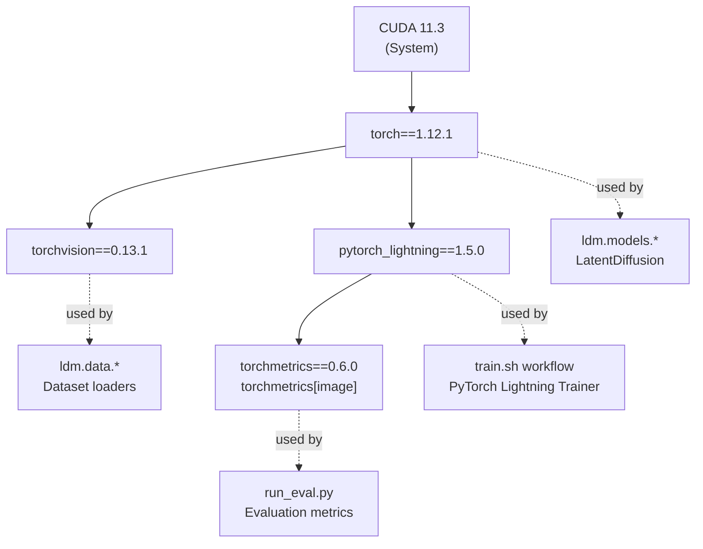
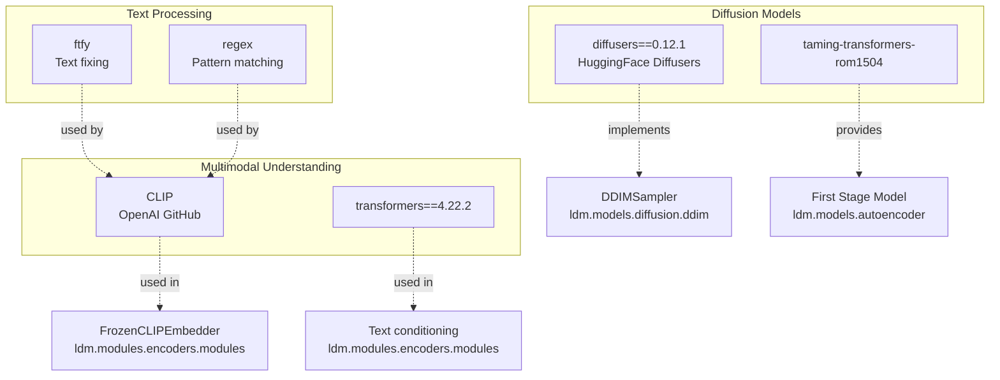
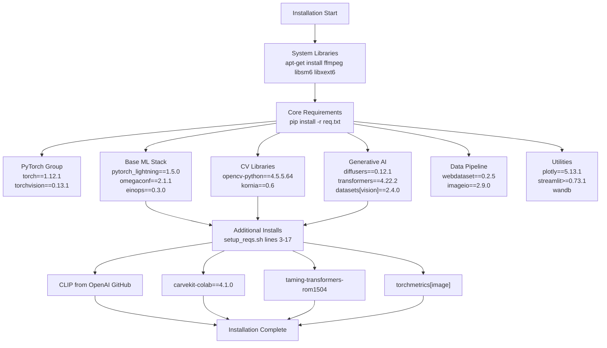
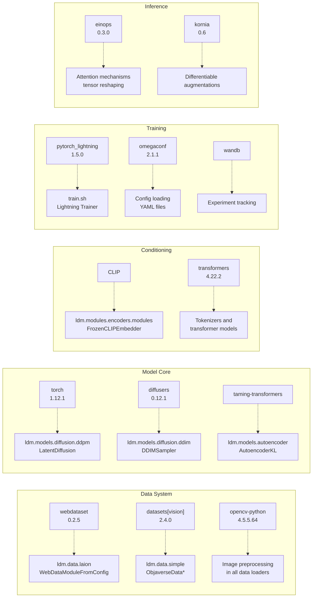

<!-- source: DeepWiki mcp.deepwiki.com · repo allenai/object-edit · page 2.1 Dependencies and Requirements · fetched 2026-10-26 -->

# Dependencies and Requirements

Relevant source files

The following files were used as context for generating this wiki page:

- [req.txt](req.txt)
- [setup_reqs.sh](setup_reqs.sh)

## Purpose and Scope

This document provides a comprehensive reference of all dependencies required to run the OBJect 3DIT system, including Python packages, system libraries, and hardware requirements. It explains the purpose of each major dependency and how they support different components of the system.

For instructions on how to install these dependencies, see [Installation Instructions](#2.2). For details on how the training system uses these dependencies, see [Training System](#4).

---

## System-Level Requirements

The OBJect 3DIT system requires specific system-level dependencies to be installed before Python packages:

### Hardware Requirements

- **CUDA 11.3**: Required for GPU acceleration with PyTorch
- **GPU Memory**: Recommended minimum 12GB for inference, 24GB+ for training

### System Libraries

The following system packages are installed via `apt-get` [setup_reqs.sh:16]():

| Package | Purpose |
|---------|---------|
| `ffmpeg` | Video processing and frame extraction for dataset preprocessing |
| `libsm6` | X11 Session Management library, required by OpenCV |
| `libxext6` | X11 extension library, required by OpenCV |

These are critical for the computer vision pipeline, particularly for `opencv-python` functionality.

**Sources:** [setup_reqs.sh:16]()

---

## Core Framework Dependencies

### PyTorch Ecosystem

The foundation of the system is built on PyTorch and its ecosystem:

**PyTorch Core Dependencies**

| Package | Version | Purpose |
|---------|---------|---------|
| `torch` | 1.12.1 | Core tensor operations, neural network modules, GPU acceleration |
| `torchvision` | 0.13.1 | Image transformations, pretrained models, dataset utilities |
| `pytorch_lightning` | 1.5.0 | Training orchestration, distributed training, checkpointing |
| `torchmetrics` | 0.6.0 | Evaluation metrics including image-specific metrics |

The `pytorch_lightning` package is critical for the training workflow orchestrated in `train.sh` and powers the `LightningModule` implementation in `ldm.models.diffusion.ddpm.LatentDiffusion`.

**Sources:** [req.txt:1-3,8,15](), [req.txt:27](), [setup_reqs.sh:3,17]()

---

## Computer Vision Libraries

Multiple specialized computer vision libraries support image processing and manipulation:

### OpenCV and Image Processing

| Package | Version | Purpose in System |
|---------|---------|-------------------|
| `opencv-python` | 4.5.5.64 | Image I/O, resizing, color conversion in data preprocessing |
| `kornia` | 0.6 | Differentiable computer vision operations, augmentations |
| `albumentations` | (latest) | Advanced image augmentation pipeline |
| `carvekit-colab` | 4.1.0 | Background removal and object segmentation |

The `opencv-python` package is used extensively in:
- Dataset preprocessing in `ldm.data.simple` (Objaverse loaders)
- Image loading in `run_generation.py` for inference
- Visualization utilities throughout the codebase

The `kornia` library provides differentiable transformations that can be used during training, while `carvekit-colab` handles object extraction for dataset preparation.

**Sources:** [req.txt:4](), [req.txt:13](), [setup_reqs.sh:5-6,9]()

---

## Generative AI Components

The core generative capabilities depend on multiple specialized libraries:

### Diffusion and Generative Models

| Package | Version | Core Usage |
|---------|---------|------------|
| `diffusers` | 0.12.1 | Stable Diffusion components, DDIM/PLMS samplers |
| `taming-transformers-rom1504` | (latest) | VQ-GAN and autoencoder implementations |

The `diffusers` library from HuggingFace provides the foundational diffusion model components. The DDIM sampler implementation in `ldm.models.diffusion.ddim.DDIMSampler` uses these components for the iterative denoising process.

The `taming-transformers-rom1504` package provides the first-stage VAE encoder/decoder used in `ldm.models.autoencoder` for working in latent space rather than pixel space, dramatically improving efficiency.

### Multimodal and Text Processing

| Package | Version | Core Usage |
|---------|---------|------------|
| `CLIP` | OpenAI GitHub | Vision-language embeddings for conditioning |
| `transformers` | 4.22.2 | Tokenizers, transformer models, model loading |
| `ftfy` | (latest) | Text normalization for CLIP |
| `regex` | (latest) | Pattern matching for text processing |

The `CLIP` model from OpenAI is used in `ldm.modules.encoders.modules.FrozenCLIPEmbedder` to encode both text prompts and image features for conditioning the diffusion process. The `transformers` library from HuggingFace provides the underlying transformer architecture.

**Sources:** [req.txt:12,16,20-24](), [setup_reqs.sh:8,10-11]()

---

## Data Pipeline Dependencies

The data system relies on specialized tools for loading and processing large-scale datasets:

### WebDataset and Dataset Loaders

| Package | Version | Purpose |
|---------|---------|---------|
| `webdataset` | 0.2.5 | Efficient tar-based streaming for LAION-5B and large datasets |
| `datasets[vision]` | 2.4.0 | HuggingFace datasets library with vision extras |
| `einops` | 0.3.0 | Tensor reshaping and dimension manipulation |
| `imageio` | 2.9.0 | Image reading/writing |
| `imageio-ffmpeg` | 0.4.2 | Video frame extraction |

The `webdataset` package is critical for the LAION-5B data loader in `ldm.data.laion.WebDataModuleFromConfig`. It enables efficient streaming of data from tar archives without loading everything into memory.

The `datasets` library with vision extras provides access to the Objaverse dataset used in `ldm.data.simple` for task-specific loaders like `ObjaverseDataRotation`, `ObjaverseDataRemoval`, etc.

The `einops` library provides clean tensor manipulation throughout the codebase, particularly for rearranging dimensions in attention mechanisms and diffusion model components.

**Sources:** [req.txt:6-7,11,14,17](), [setup_reqs.sh:7,13]()

---

## Training Infrastructure

Several packages support the training workflow, experiment tracking, and optimization:

### Configuration and Experiment Tracking

| Package | Version | Purpose |
|---------|---------|---------|
| `omegaconf` | 2.1.1 | YAML configuration management |
| `wandb` | (latest) | Weights & Biases experiment tracking |

The `omegaconf` package is used to load and manage configuration files like `configs/stable-diffusion/sd-objaverse-task.yaml`. It provides the `OmegaConf` class used throughout the training pipeline for hierarchical configuration.

The `wandb` package integrates with PyTorch Lightning for experiment tracking, logging metrics, and visualizing training progress.

### Optimization and Scheduling

The learning rate schedulers are implemented using PyTorch's built-in optimizers, but the training configuration system in `ldm.lr_scheduler.LambdaLinearScheduler` and `ldm.lr_scheduler.LambdaWarmUpCosineScheduler` provides advanced scheduling capabilities.

**Sources:** [req.txt:9,26](), [setup_reqs.sh:4,12]()

---

## Utility and Development Libraries

Additional utilities support development, debugging, and visualization:

### Development Tools

| Package | Version | Purpose |
|---------|---------|---------|
| `pudb` | 2019.2 | Terminal-based debugger |
| `ipdb` | (latest) | IPython-enhanced debugger |
| `tqdm` | (latest) | Progress bars for loops |

### Visualization

| Package | Version | Purpose |
|---------|---------|---------|
| `matplotlib` | (latest) | Plotting and visualization |
| `plotly` | 5.13.1 | Interactive plots |
| `streamlit` | ≥0.73.1 | Web-based UI for demos |

The `streamlit` library can be used for creating interactive demonstrations and visualizations of the model's capabilities, though it's not required for core training or inference.

**Sources:** [req.txt:5,10,18-22,25](), [setup_reqs.sh:14-15]()

---

## Dependency Installation Order

The installation process follows a specific order to handle dependencies correctly:

**Installation Notes:**

1. **System libraries must be installed first** [setup_reqs.sh:16]() before any Python packages
2. **req.txt is installed first** [setup_reqs.sh:2]() to establish core dependencies
3. **Additional packages are installed individually** [setup_reqs.sh:3-17]() to handle version conflicts and special sources
4. **CLIP is installed from GitHub** [setup_reqs.sh:10]() rather than PyPI to get the latest version
5. **The `--extra-index-url` flag** [req.txt:1]() ensures CUDA 11.3 compatible PyTorch builds are used

**Sources:** [setup_reqs.sh:1-17](), [req.txt:1-27]()

---

## Dependency-to-System Component Mapping

The following diagram shows how major dependencies map to specific system components and code modules:

**Sources:** [setup_reqs.sh:1-17](), [req.txt:1-27]()

---

## Version Pinning and Compatibility

All dependencies use pinned versions to ensure reproducibility:

### Critical Version Constraints

| Package | Pinned Version | Reason |
|---------|----------------|--------|
| `torch` | ==1.12.1 | CUDA 11.3 compatibility, API stability |
| `torchvision` | ==0.13.1 | Must match torch version |
| `pytorch_lightning` | ==1.5.0 | Breaking changes in 2.x API |
| `diffusers` | ==0.12.1 | Stable API for DDIM sampler |
| `webdataset` | ==0.2.5 | Tar streaming behavior |
| `transformers` | ==4.22.2 | CLIP model compatibility |

### Flexible Version Constraints

Some packages use minimum version requirements:
- `streamlit>=0.73.1` [req.txt:10]() - Only UI component, minimum version for required features

### Source-Based Installations

Two packages are installed directly from Git repositories:
- `CLIP` from `git+https://github.com/openai/CLIP.git` [req.txt:23](), [setup_reqs.sh:10]()
- `taming-transformers-rom1504` as PyPI package (fork of original) [req.txt:24](), [setup_reqs.sh:8]()

**Sources:** [req.txt:1-27](), [setup_reqs.sh:1-17]()

---

## Hardware and Runtime Considerations

### GPU Requirements

- **Minimum**: NVIDIA GPU with 12GB VRAM for inference
- **Recommended**: 24GB+ VRAM for training (e.g., RTX 3090, RTX 4090, A100)
- **CUDA Version**: 11.3 as specified in PyTorch index URL [req.txt:1]()

### Memory Requirements

- **System RAM**: 32GB+ recommended for data loading
- **Disk Space**: 
  - ~10GB for dependencies
  - ~50GB+ for Objaverse dataset
  - ~100GB+ for LAION-5B data shards

### Multi-GPU Support

PyTorch Lightning [setup_reqs.sh:3]() provides built-in support for:
- Distributed Data Parallel (DDP)
- Model sharding
- Automatic batch size optimization

These are configured through the training configuration files and command-line arguments in `train.sh`.

**Sources:** [req.txt:1](), [setup_reqs.sh:3]()

---

