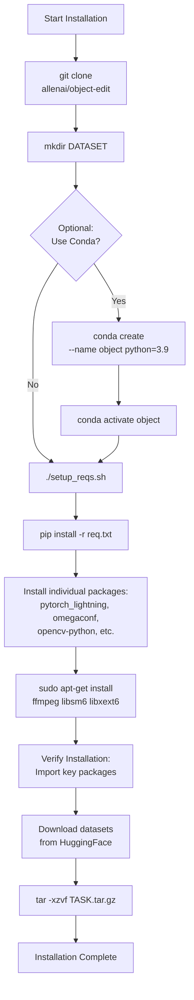
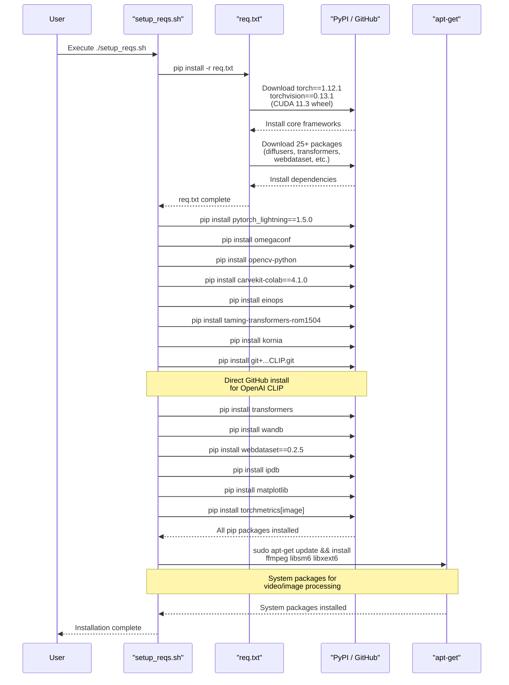

<!-- source: DeepWiki mcp.deepwiki.com · repo allenai/object-edit · page 2.2 Installation Instructions · fetched 2026-10-26 -->

# Installation Instructions

<details>
<summary>Relevant source files</summary>

The following files were used as context for generating this wiki page:

- [README.md](README.md)
- [req.txt](req.txt)
- [setup_reqs.sh](setup_reqs.sh)

</details>


## Purpose and Scope

This page provides detailed step-by-step instructions for installing the OBJect 3DIT development environment on different platforms. It covers repository cloning, environment configuration, dependency installation, and verification procedures. For information about the specific dependencies and their purposes, see [Dependencies and Requirements](#2.1). For a quick setup guide aimed at getting started rapidly, see [Quick Start Guide](#1.1).

## Prerequisites

Before beginning the installation process, ensure your system meets the following requirements:

| Requirement | Specification | Notes |
|-------------|---------------|-------|
| **Operating System** | Linux (Ubuntu recommended) | Windows/macOS may work but are not officially supported |
| **CUDA** | 11.3 | Required for GPU acceleration |
| **Python** | 3.9 | Other versions may work but are not tested |
| **GPU** | CUDA-compatible GPU | Required for training and inference |
| **Disk Space** | ~50GB+ | For dependencies, models, and datasets |
| **Network Access** | Required | For downloading packages and datasets |

**Sources:** [README.md:15-20](), [setup_reqs.sh:16](), [req.txt:1]()

## Installation Workflow Overview



**Installation Workflow Diagram:** This diagram shows the complete installation process from repository cloning to data setup. The workflow follows [README.md:9-31]() and executes [setup_reqs.sh:1-17]().

**Sources:** [README.md:5-33](), [setup_reqs.sh:1-17]()

## Step 1: Clone Repository and Create Directories

Clone the repository from GitHub and create the required directory structure:

```bash
git clone https://github.com/allenai/object-edit.git
cd object-edit
mkdir DATASET
```

The `DATASET` directory will be used to store downloaded datasets from HuggingFace. This path is referenced in configuration files and can be modified if needed (see [Training Configuration](#4.1)).

**Sources:** [README.md:9-13]()

## Step 2: Environment Setup (Optional but Recommended)

Creating an isolated Conda environment prevents dependency conflicts with other projects:

```bash
conda create --name object python=3.9
conda activate object
```

The environment name `object` is a suggested convention but can be customized. Python 3.9 is the tested version for this codebase.

**Sources:** [README.md:15-20]()

## Step 3: Install Dependencies via setup_reqs.sh

The primary installation is performed by executing the `setup_reqs.sh` script:

```bash
. setup_reqs.sh
```

Note: Use `. setup_reqs.sh` (with the leading dot) rather than `bash setup_reqs.sh` to ensure the script runs in the current shell session, which is important for environment variable persistence.

**Sources:** [README.md:21-24](), [setup_reqs.sh:1-17]()

### Installation Sequence Details



**Dependency Installation Sequence:** This diagram shows the execution flow of [setup_reqs.sh:1-17](). The script first installs packages from [req.txt:1-27](), then installs additional packages individually, and finally installs system-level dependencies.

**Sources:** [setup_reqs.sh:1-17](), [req.txt:1-27]()

### Breakdown of Installation Steps

The `setup_reqs.sh` script performs the following operations in sequence:

| Step | Command | Purpose | Lines |
|------|---------|---------|-------|
| 1 | `pip install -r req.txt` | Install 27 core dependencies including PyTorch 1.12.1, torchvision 0.13.1, diffusers, transformers | [setup_reqs.sh:2]() |
| 2 | `pip install pytorch_lightning==1.5.0` | Training orchestration framework | [setup_reqs.sh:3]() |
| 3 | `pip install omegaconf` | Configuration management | [setup_reqs.sh:4]() |
| 4 | `pip install opencv-python` | Image processing utilities | [setup_reqs.sh:5]() |
| 5 | `pip install carvekit-colab==4.1.0` | Image matting and background removal | [setup_reqs.sh:6]() |
| 6 | `pip install einops` | Tensor operations library | [setup_reqs.sh:7]() |
| 7 | `pip install taming-transformers-rom1504` | VQGAN and transformer models | [setup_reqs.sh:8]() |
| 8 | `pip install kornia` | Differentiable computer vision library | [setup_reqs.sh:9]() |
| 9 | `pip install git+...CLIP.git` | OpenAI CLIP model (from GitHub) | [setup_reqs.sh:10]() |
| 10 | `pip install transformers` | HuggingFace transformers library | [setup_reqs.sh:11]() |
| 11 | `pip install wandb` | Experiment tracking and logging | [setup_reqs.sh:12]() |
| 12 | `pip install webdataset==0.2.5` | Large-scale dataset streaming | [setup_reqs.sh:13]() |
| 13 | `pip install ipdb` | Python debugger | [setup_reqs.sh:14]() |
| 14 | `pip install matplotlib` | Plotting and visualization | [setup_reqs.sh:15]() |
| 15 | `sudo apt-get install ffmpeg libsm6 libxext6` | System libraries for video/image codec support | [setup_reqs.sh:16]() |
| 16 | `pip install torchmetrics[image]` | Image quality metrics | [setup_reqs.sh:17]() |

**Sources:** [setup_reqs.sh:1-17](), [req.txt:1-27]()

### Key Dependencies from req.txt

The `req.txt` file specifies the following critical dependencies:

```
--extra-index-url https://download.pytorch.org/whl/cu113
torch==1.12.1
torchvision==0.13.1
opencv-python==4.5.5.64
pytorch_lightning==1.5.0
omegaconf==2.1.1
streamlit>=0.73.1
einops==0.3.0
transformers==4.22.2
kornia==0.6
webdataset==0.2.5
torchmetrics==0.6.0
diffusers==0.12.1
datasets[vision]==2.4.0
```

The `--extra-index-url` directive at [req.txt:1]() ensures PyTorch is installed with CUDA 11.3 support. This is essential for GPU acceleration during training and inference.

**Sources:** [req.txt:1-27]()

## Step 4: Verify Installation

After installation completes, verify that key packages are correctly installed:

```bash
python -c "import torch; print(f'PyTorch: {torch.__version__}, CUDA: {torch.cuda.is_available()}')"
python -c "import pytorch_lightning; print(f'PyTorch Lightning: {pytorch_lightning.__version__}')"
python -c "import diffusers; print(f'Diffusers: {diffusers.__version__}')"
python -c "import transformers; print(f'Transformers: {transformers.__version__}')"
python -c "import clip; print('CLIP: OK')"
```

Expected output should show:
- PyTorch version 1.12.1
- CUDA available: True
- PyTorch Lightning version 1.5.0
- Diffusers version 0.12.1
- Transformers version 4.22.2
- CLIP imports successfully

If CUDA shows as unavailable, verify that:
1. NVIDIA drivers are correctly installed
2. CUDA 11.3 is installed on the system
3. The PyTorch wheel includes CUDA support (check the `--extra-index-url` in req.txt)

**Sources:** [req.txt:1-27](), [setup_reqs.sh:1-17]()

## Step 5: Download and Prepare Datasets

Download the datasets from the [HuggingFace repository](https://huggingface.co/datasets/allenai/object-edit/tree/main):

```bash
cd DATASET
# Download TASK.tar.gz files from HuggingFace
tar -xzvf rotate.tar.gz
tar -xzvf remove.tar.gz
tar -xzvf translate.tar.gz
rm *.tar.gz  # Clean up compressed files
cd ..
```

The dataset structure follows the format described in [Objaverse Dataset](#3.2):

```
DATASET/
└── rotate/
    └── train/
        ├── uid/
        │   ├── 1.png
        │   ├── 2.png
        │   ├── 1_mask.png
        │   ├── 2_mask.png
        │   └── metadata.json
```

Note: The insertion task reuses data from the removal task, so no separate download is needed.

**Sources:** [README.md:25-45]()

## Platform-Specific Notes

### Ubuntu/Debian Systems

The installation script assumes a Debian-based Linux distribution (Ubuntu, Debian) due to the use of `apt-get` for system packages at [setup_reqs.sh:16]().

```bash
sudo apt-get update && sudo apt-get install ffmpeg libsm6 libxext6 -y
```

These packages provide:
- `ffmpeg`: Video codec support for dataset preprocessing
- `libsm6`: X11 Session Management library (required by OpenCV)
- `libxext6`: X11 extensions library (required by OpenCV)

### CentOS/RHEL Systems

For Red Hat-based distributions, replace the apt-get command with:

```bash
sudo yum update
sudo yum install ffmpeg libSM libXext
```

### macOS Systems

For macOS (not officially supported but may work):

```bash
brew install ffmpeg
```

The `libsm6` and `libxext6` packages are Linux-specific and not needed on macOS.

### Windows Systems

Windows is not officially supported. For Windows users, consider:
1. Using Windows Subsystem for Linux (WSL2) with Ubuntu
2. Using Docker with a Linux base image
3. Setting up a Linux virtual machine

**Sources:** [setup_reqs.sh:16]()

## Troubleshooting Common Issues

### Issue 1: CUDA Version Mismatch

**Symptom:** PyTorch installs but `torch.cuda.is_available()` returns `False`

**Solution:** Verify your CUDA version matches the requirement (11.3):

```bash
nvcc --version  # Should show CUDA 11.3
nvidia-smi      # Verify driver compatibility
```

If CUDA 11.3 is not available, modify [req.txt:1]() to match your CUDA version (e.g., `cu116` for CUDA 11.6).

### Issue 2: Permission Denied for apt-get

**Symptom:** `sudo: apt-get: command not found` or permission errors

**Solution:** Ensure you have sudo privileges. If running on a system without sudo access, request administrator installation of ffmpeg, libsm6, and libxext6, or skip the system dependencies (may cause OpenCV errors).

### Issue 3: GitHub Rate Limiting for CLIP

**Symptom:** `git+https://github.com/openai/CLIP.git` installation fails with rate limit error

**Solution:** 
1. Clone CLIP manually and install locally:
   ```bash
   git clone https://github.com/openai/CLIP.git
   cd CLIP
   pip install -e .
   cd ..
   ```
2. Or authenticate with GitHub using a personal access token

### Issue 4: Conflicting Package Versions

**Symptom:** Package version conflicts during installation

**Solution:** 
1. Create a fresh Conda environment
2. Install packages in the exact order specified by `setup_reqs.sh`
3. If conflicts persist, consider using `--no-deps` flag for specific packages and manually resolving dependencies

### Issue 5: Out of Memory During Installation

**Symptom:** Installation fails with memory errors, particularly when building wheels

**Solution:** Increase system swap space or install packages one at a time with `pip install --no-cache-dir`

**Sources:** [setup_reqs.sh:1-17](), [req.txt:1-27]()

## Post-Installation Configuration

After successful installation, you may need to:

1. **Download Pretrained Checkpoints:** For training, download Zero123 or Stable Diffusion checkpoints from the HuggingFace project page. See [Model Checkpoints and Loading](#4.4).

2. **Configure Dataset Paths:** If using custom dataset locations, modify the configuration files. See [Training Configuration](#4.1).

3. **Set up Weights & Biases:** For experiment tracking, configure wandb:
   ```bash
   wandb login
   ```

4. **Verify Training Setup:** Before starting full training, test the configuration:
   ```bash
   # See Quick Start Guide for testing commands
   ```

**Sources:** [README.md:46-52]()

## Next Steps

After completing installation:

- For a quick demonstration of the system, see [Quick Start Guide](#1.1)
- To understand the data pipeline, see [Data System](#3)
- To begin training models, see [Training System](#4)
- To generate images, see [Inference and Generation](#5)

**Sources:** [README.md:1-86]()

---

