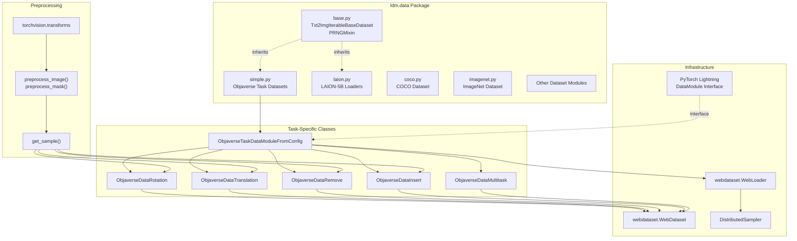
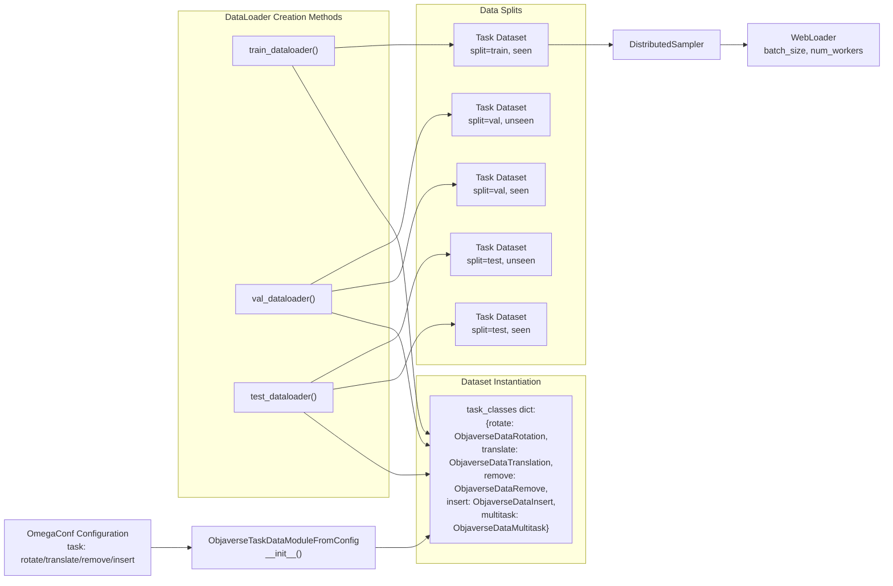
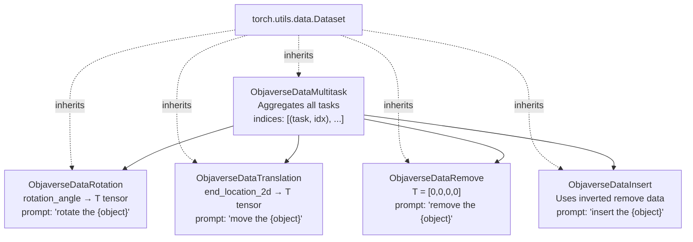
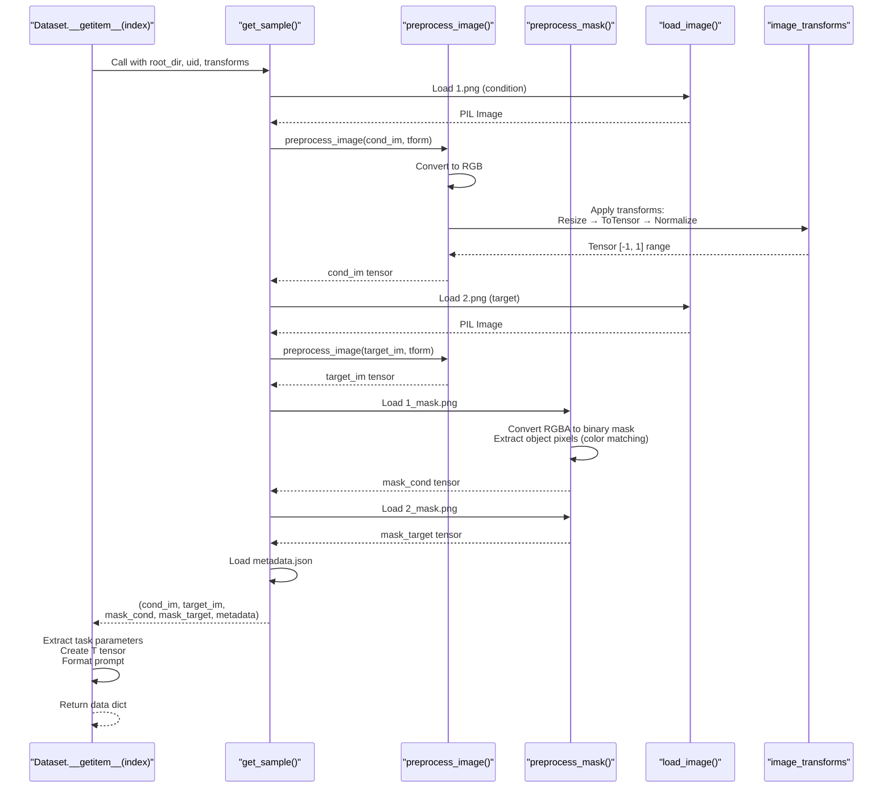
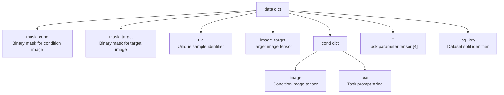
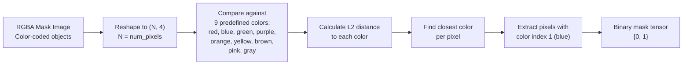
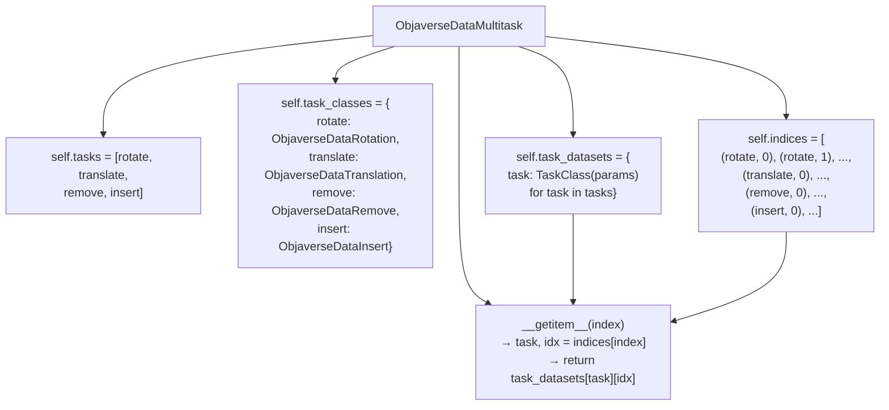

<!-- source: DeepWiki mcp.deepwiki.com · repo allenai/object-edit · page 3 Data System · fetched 2026-10-26 -->

# Data System

<details>
<summary>Relevant source files</summary>

The following files were used as context for generating this wiki page:

- [ldm/data/__init__.py](ldm/data/__init__.py)
- [ldm/data/base.py](ldm/data/base.py)
- [ldm/data/simple.py](ldm/data/simple.py)

</details>


## Purpose and Scope

The Data System is responsible for loading, preprocessing, and preparing image datasets for training and evaluation of the latent diffusion model. It provides unified interfaces for loading Objaverse 3D object datasets with task-specific annotations (rotation, translation, removal, insertion), as well as support for large-scale datasets like LAION-5B and standard computer vision datasets.

This document provides an overview of the data system architecture, core components, and data loading pipeline. For detailed information about:
- Base dataset classes and interfaces, see [Dataset Base Classes](#3.1)
- Objaverse task-specific loaders, see [Objaverse Dataset](#3.2)
- COCO, ImageNet, and LSUN loaders, see [Standard Computer Vision Datasets](#3.3)
- LAION-5B and WebDataset infrastructure, see [LAION and Large-Scale Datasets](#3.4)
- Specialized datasets (NeRF, inpainting, dummy datasets), see [Specialized Datasets](#3.5)

## System Architecture

The data system follows a hierarchical architecture with base classes providing common interfaces, task-specific dataset implementations, and infrastructure for efficient loading and preprocessing.



**Sources:** [ldm/data/base.py:1-41](), [ldm/data/simple.py:1-534]()

## Data Module and DataLoader Creation

The `ObjaverseTaskDataModuleFromConfig` class implements the PyTorch Lightning `DataModule` interface, providing a standardized way to create train, validation, and test dataloaders for different tasks.



**Sources:** [ldm/data/simple.py:31-121]()

### DataModule Configuration

| Parameter | Type | Description |
|-----------|------|-------------|
| `root_dir` | str | Root directory containing task datasets |
| `task` | str | Task name: "rotate", "translate", "remove", "insert", or "multitask" |
| `batch_size` | int | Batch size for dataloaders |
| `num_workers` | int | Number of worker processes for data loading (default: 4) |
| `num_samples` | int | Maximum number of samples to load (default: 100000) |
| `train` | dict | Training dataset configuration |
| `validation` | dict | Validation dataset configuration |

**Sources:** [ldm/data/simple.py:32-39]()

## Task-Specific Dataset Classes

Each task (rotation, translation, removal, insertion) has a dedicated dataset class that handles task-specific data loading, preprocessing, and metadata interpretation.

### Dataset Class Hierarchy



**Sources:** [ldm/data/simple.py:123-484]()

### Task-Specific T Tensor Format

Each task encodes its parameters into a 4-element tensor `T` used for conditioning the diffusion model:

| Task | T Tensor Format | Components | Source |
|------|----------------|------------|---------|
| Rotation | `[π/2, sin(θ), cos(θ), 0]` | Matches Zero123 format with azimuth angle | [ldm/data/simple.py:167-170]() |
| Translation | `[0, x, y, 0]` | x,y are normalized 2D coordinates | [ldm/data/simple.py:246-248]() |
| Removal | `[0, 0, 0, 0]` | No transformation parameters | [ldm/data/simple.py:323-325]() |
| Insertion | `[0, x, y, 0]` | x,y are insertion location coordinates | [ldm/data/simple.py:395-397]() |

**Sources:** [ldm/data/simple.py:167-170](), [ldm/data/simple.py:246-248](), [ldm/data/simple.py:323-325](), [ldm/data/simple.py:395-397]()

## Dataset Directory Structure

Task datasets are organized in a hierarchical directory structure:

```
{root_dir}/
├── rotate/
│   ├── train/
│   │   └── {uid}/
│   │       ├── 1.png              # Condition image
│   │       ├── 2.png              # Target image
│   │       ├── 1_mask.png         # Condition mask
│   │       ├── 2_mask.png         # Target mask
│   │       └── metadata.json      # Task metadata
│   ├── val/
│   │   ├── seen/
│   │   └── unseen/
│   └── test/
│       ├── seen/
│       └── unseen/
├── translate/
│   └── (same structure)
├── remove/
│   └── (same structure)
└── insert/
    └── (uses remove data, inverted)
```

**Sources:** [ldm/data/simple.py:142-147](), [ldm/data/simple.py:222-225](), [ldm/data/simple.py:299-302](), [ldm/data/simple.py:372-377]()

## Data Loading and Preprocessing Pipeline

The data loading pipeline processes raw images and metadata into tensors suitable for model training.



**Sources:** [ldm/data/simple.py:524-532](), [ldm/data/simple.py:487-489](), [ldm/data/simple.py:491-516](), [ldm/data/simple.py:519-522]()

### Image Transform Pipeline

The image transform pipeline normalizes images to the expected input format:

1. **Resize:** Images are resized to the configured size (typically 256×256)
2. **ToTensor:** Convert PIL Image to PyTorch tensor (range [0, 1])
3. **Normalize:** Scale to range [-1, 1] and rearrange dimensions to (H, W, C)

```python
# From ldm/data/simple.py:58-63
image_transforms = [torchvision.transforms.Resize(dataset_config.image_transforms.size)]
image_transforms.extend([
    transforms.ToTensor(),
    transforms.Lambda(lambda x: rearrange(x * 2. - 1., 'c h w -> h w c'))
])
self.image_transforms = torchvision.transforms.Compose(image_transforms)
```

**Sources:** [ldm/data/simple.py:57-63]()

## Data Dictionary Format

Each dataset returns a dictionary containing all necessary information for training:



**Sources:** [ldm/data/simple.py:190-200](), [ldm/data/simple.py:267-277](), [ldm/data/simple.py:340-350](), [ldm/data/simple.py:416-426]()

## Object Annotations and Prompts

Object descriptions are loaded from a JSON file `objaverse_cat_descriptions_64k.json` which maps object UIDs to natural language descriptions. These descriptions are formatted into task-specific prompts.

### Prompt Templates by Task

| Task | Template | Example |
|------|----------|---------|
| Rotation | `"rotate the {description}"` | "rotate the red chair" |
| Translation | `"move the {description}"` | "move the blue lamp" |
| Removal | `"remove the {description}"` | "remove the wooden table" |
| Insertion | `"insert the {description}"` | "insert the green plant" |

**Sources:** [ldm/data/simple.py:152-157](), [ldm/data/simple.py:186-187](), [ldm/data/simple.py:235](), [ldm/data/simple.py:312](), [ldm/data/simple.py:338-339](), [ldm/data/simple.py:414-415]()

## Mask Preprocessing

Masks are stored as RGBA images with color-coded object labels. The preprocessing pipeline converts these colored masks to binary masks identifying the primary object.



The mask color map defines 9 standard colors (red, blue, green, purple, orange, yellow, brown, pink, gray). The preprocessing identifies which pixels correspond to the primary object (color index 1, blue) and creates a binary mask.

**Sources:** [ldm/data/simple.py:491-516]()

## Multitask Dataset Aggregation

The `ObjaverseDataMultitask` class aggregates all four task datasets into a single unified dataset for training models on multiple tasks simultaneously.



The multitask dataset creates a flat index mapping that interleaves samples from all tasks. When accessed, it routes to the appropriate task-specific dataset.

**Sources:** [ldm/data/simple.py:430-484]()

## WebDataset Integration

The data system uses WebDataset for efficient streaming and distributed loading:

1. **WebDataset Wrapping:** Task datasets are wrapped in `webdataset.WebDataset` for streaming
2. **WebLoader:** `webdataset.WebLoader` provides a DataLoader-compatible interface
3. **DistributedSampler:** Ensures each GPU receives different data in distributed training

```python
# From ldm/data/simple.py:75-76
sampler = DistributedSampler(dataset)
return wds.WebLoader(dataset, batch_size=self.batch_size, 
                     num_workers=self.num_workers, shuffle=False, sampler=sampler)
```

**Sources:** [ldm/data/simple.py:66-76](), [ldm/data/simple.py:87-97](), [ldm/data/simple.py:110-121]()

## Error Handling

All task dataset classes implement fallback error handling: if loading a sample fails, they fall back to loading the first sample (`self.samples[0]`). This prevents training crashes from corrupted or missing data files.

```python
# Pattern used in all task datasets
try:
    sample_dir = self.samples[index]
    cond_im, target_im, mask_cond, mask_target, metadata = get_sample(...)
except Exception as e: 
    sample_dir = self.samples[0]
    cond_im, target_im, mask_cond, mask_target, metadata = get_sample(...)
```

**Sources:** [ldm/data/simple.py:176-181](), [ldm/data/simple.py:253-258](), [ldm/data/simple.py:331-336](), [ldm/data/simple.py:403-408]()

## Base Dataset Classes

The `ldm.data.base` module provides foundational classes used across all dataset implementations:

### Txt2ImgIterableBaseDataset

An abstract base class defining the interface for iterable text-to-image datasets. It provides:
- `num_records`: Total number of examples
- `valid_ids`: Set of valid sample identifiers
- `size`: Image size
- `__len__()`: Returns number of records
- `__iter__()`: Abstract method to be implemented by subclasses

**Sources:** [ldm/data/base.py:7-26]()

### PRNGMixin

A mixin class providing process-safe random number generation. The `prng` property returns a `numpy.RandomState` that reinitializes whenever the process ID changes, preventing synchronized sampling in multiprocessing scenarios.

**Sources:** [ldm/data/base.py:28-41]()

## Summary

The Data System provides a modular, task-oriented architecture for loading and preprocessing Objaverse 3D object datasets. Key features include:

- **PyTorch Lightning Integration:** `ObjaverseTaskDataModuleFromConfig` provides standardized DataModule interface
- **Task-Specific Datasets:** Dedicated classes for rotation, translation, removal, and insertion tasks
- **Unified T Tensor Format:** Task parameters encoded as 4-element tensors for model conditioning
- **Flexible Data Splits:** Support for train/val/test splits with seen/unseen categories
- **WebDataset Infrastructure:** Efficient streaming and distributed loading
- **Robust Error Handling:** Fallback mechanisms prevent training crashes
- **Consistent Preprocessing:** Standardized image normalization and mask extraction

For implementation details of specific dataset types, refer to the child pages in the table of contents.

---

