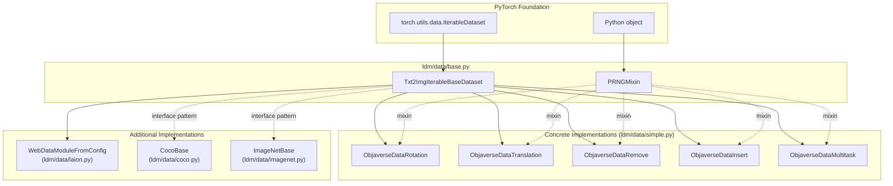
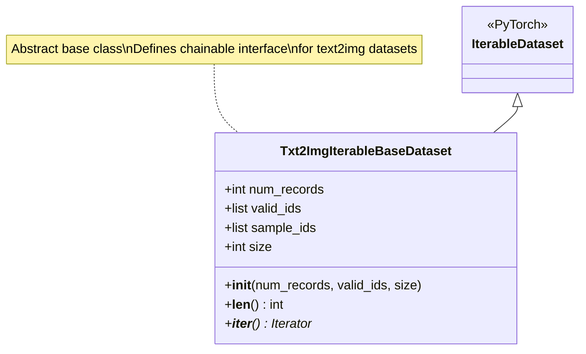
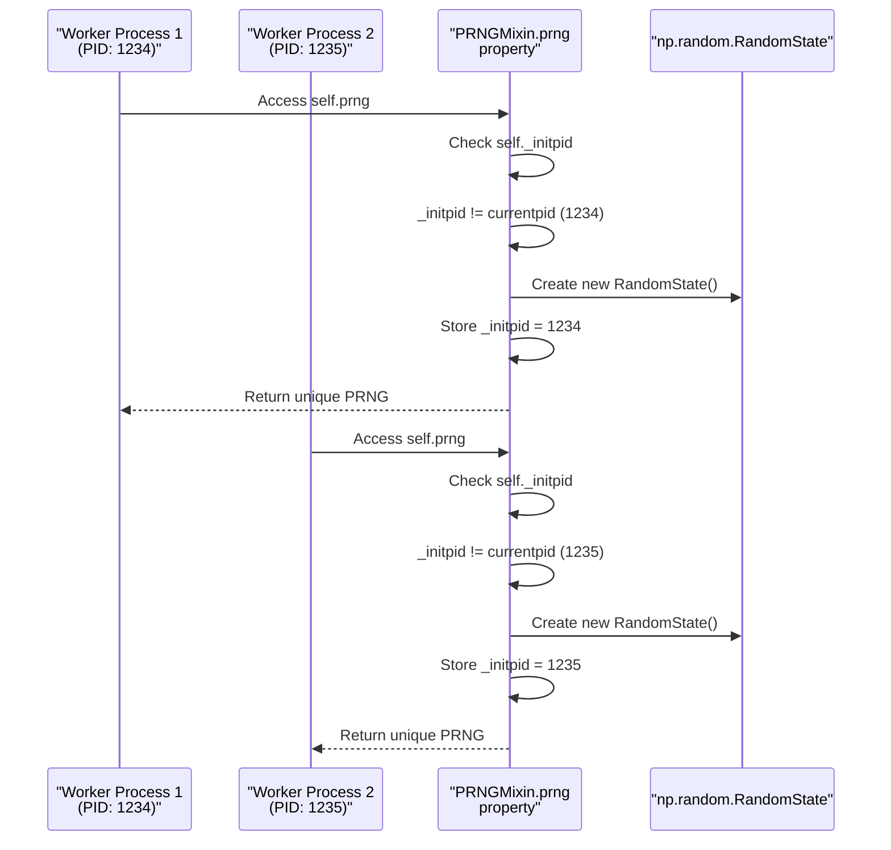
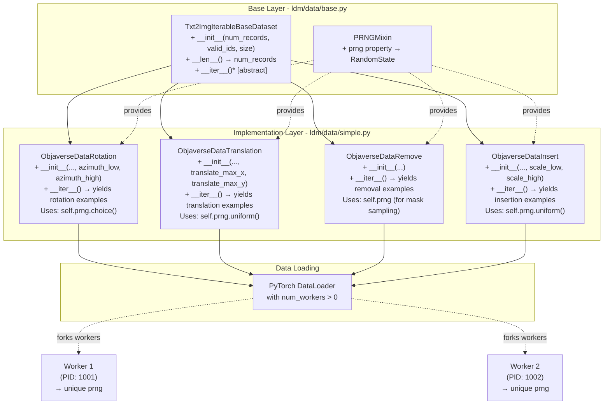

<!-- source: DeepWiki mcp.deepwiki.com · repo allenai/object-edit · page 3.1 Dataset Base Classes · fetched 2026-10-26 -->

# Dataset Base Classes

<details>
<summary>Relevant source files</summary>

The following files were used as context for generating this wiki page:

- [ldm/data/__pycache__/base.cpython-39.pyc](ldm/data/__pycache__/base.cpython-39.pyc)
- [ldm/data/base.py](ldm/data/base.py)

</details>


## Purpose and Scope

This document covers the foundational dataset classes defined in [ldm/data/base.py](), which provide the common interfaces and utilities used by all dataset implementations in the OBJect 3DIT data pipeline. These base classes establish the contract that all dataset loaders must follow and provide process-safe random number generation for multiprocessing scenarios.

For information about specific dataset implementations (Objaverse, LAION, COCO, etc.), see pages [3.2](#3.2), [3.3](#3.3), [3.4](#3.4), and [3.5](#3.5). For the overall data system architecture, see [3](#3).

---

## System Overview

The base class system provides two primary components:

1. **`Txt2ImgIterableBaseDataset`**: An abstract base class that defines the interface for all iterable datasets in the system
2. **`PRNGMixin`**: A mixin class that provides process-safe random number generation for use in multiprocessing contexts

### Architecture Diagram



**Sources:** [ldm/data/base.py:1-41]()

---

## Txt2ImgIterableBaseDataset

### Class Definition

The `Txt2ImgIterableBaseDataset` class is defined at [ldm/data/base.py:7-25](). It inherits from PyTorch's `IterableDataset` and establishes a chainable interface for text-to-image datasets.

### Interface Contract



**Sources:** [ldm/data/base.py:7-25]()

### Constructor Parameters

The `__init__` method at [ldm/data/base.py:11-18]() accepts the following parameters:

| Parameter | Type | Default | Description |
|-----------|------|---------|-------------|
| `num_records` | `int` | `0` | Total number of examples in the dataset |
| `valid_ids` | `list` or `None` | `None` | List of valid sample identifiers |
| `size` | `int` | `256` | Target image size for preprocessing |

### Instance Attributes

The constructor initializes four instance attributes:

- **`self.num_records`**: Stores the total count of dataset examples
- **`self.valid_ids`**: Stores the list of valid sample identifiers
- **`self.sample_ids`**: Set to the same value as `valid_ids` (used for sampling operations)
- **`self.size`**: Stores the target image size

At initialization, the class prints a message indicating the dataset size: [ldm/data/base.py:18]()

```python
print(f'{self.__class__.__name__} dataset contains {self.__len__()} examples.')
```

### Required Methods

Subclasses must implement the following methods:

#### `__len__()` 

Defined at [ldm/data/base.py:20-21](), returns the `num_records` attribute:

```python
def __len__(self):
    return self.num_records
```

This method is **not** abstract and provides a default implementation.

#### `__iter__()` (Abstract)

Declared as abstract at [ldm/data/base.py:23-25]():

```python
@abstractmethod
def __iter__(self):
    pass
```

**All concrete subclasses must implement this method** to define how the dataset yields examples during iteration. This is the primary extension point for dataset implementations.

### Chainability Design

The class docstring at [ldm/data/base.py:8-10]() explicitly states that this interface is designed to make datasets **chainable**. This allows multiple datasets to be combined using PyTorch's `ChainDataset` or similar utilities, enabling flexible data pipeline composition.

**Sources:** [ldm/data/base.py:7-25]()

---

## PRNGMixin

### Purpose

The `PRNGMixin` class at [ldm/data/base.py:28-40]() provides a process-safe random number generator (PRNG) for use in multiprocessing scenarios. This is critical when using PyTorch's `DataLoader` with `num_workers > 0`, where each worker process needs its own independent random state.

### Problem Statement

When multiple worker processes are forked from a parent process, they inherit the same random state. Without proper reinitialization, all workers would generate identical random sequences, leading to:
- Duplicate augmentations across workers
- Synchronized sampling behavior
- Reduced effective randomness in training

### Implementation



**Sources:** [ldm/data/base.py:28-40]()

### Property Implementation

The `prng` property at [ldm/data/base.py:34-40]() implements the following logic:

1. **Get current process ID**: Uses `os.getpid()` to determine the current process
2. **Check initialization**: Compares current PID with stored `_initpid` attribute
3. **Reinitialize if needed**: If PID changed (or first access), creates a new `np.random.RandomState()`
4. **Return PRNG**: Returns the process-specific random state

```python
@property
def prng(self):
    currentpid = os.getpid()
    if getattr(self, "_initpid", None) != currentpid:
        self._initpid = currentpid
        self._prng = np.random.RandomState()
    return self._prng
```

### Usage Pattern

Classes that need process-safe random sampling should inherit from both `Txt2ImgIterableBaseDataset` and `PRNGMixin`:

```python
class MyDataset(Txt2ImgIterableBaseDataset, PRNGMixin):
    def __iter__(self):
        while True:
            # Use self.prng for any random operations
            random_value = self.prng.rand()
            # ... dataset logic ...
```

The property-based design ensures automatic reinitialization without requiring explicit calls in subclasses.

**Sources:** [ldm/data/base.py:28-40]()

---

## Usage Patterns in Concrete Implementations

The base classes are used throughout the codebase in various dataset implementations. The following diagram shows the typical inheritance pattern:

### Inheritance Hierarchy



**Sources:** [ldm/data/base.py:1-41]()

### Key Implementation Requirements

When creating a concrete dataset that inherits from these base classes, developers must:

1. **Call the parent constructor**: Pass `num_records`, `valid_ids`, and `size` to `super().__init__()`
2. **Implement `__iter__()`**: Define the iteration logic that yields dataset examples
3. **Use `self.prng` for randomness**: Access the process-safe PRNG via the property (if using `PRNGMixin`)
4. **Respect `self.size`**: Use the size attribute for image preprocessing/resizing operations
5. **Utilize `self.sample_ids`**: Use for sampling logic if the dataset supports ID-based access

---

## Summary

The base classes in [ldm/data/base.py]() provide a minimal but critical foundation for the entire data system:

| Class | Purpose | Key Features |
|-------|---------|--------------|
| `Txt2ImgIterableBaseDataset` | Abstract base for iterable datasets | Defines interface contract, tracks dataset size, enables chaining |
| `PRNGMixin` | Process-safe randomness | Automatic per-process PRNG initialization, prevents worker synchronization |

These classes are designed for composition: most concrete datasets inherit from `Txt2ImgIterableBaseDataset` and optionally mix in `PRNGMixin` when randomness is needed. This architecture enables the flexible, scalable data pipeline used throughout OBJect 3DIT's training and evaluation workflows.

**Sources:** [ldm/data/base.py:1-41]()

---

