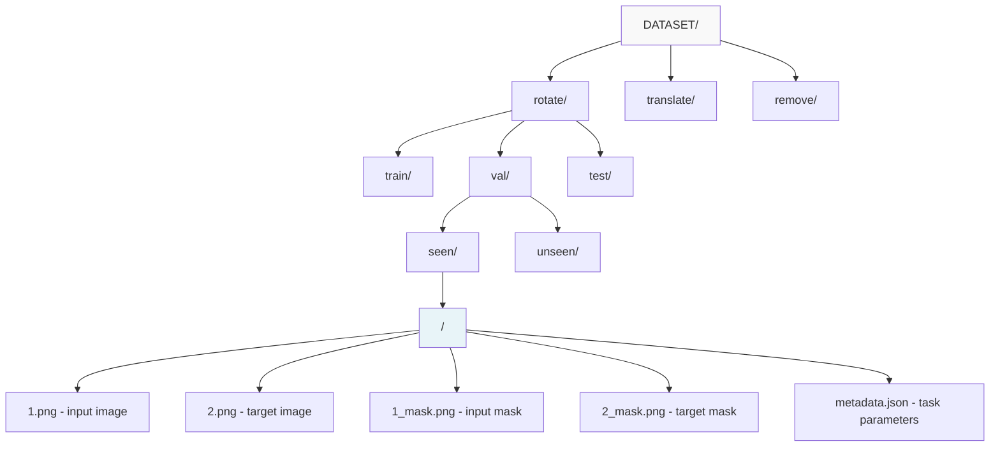
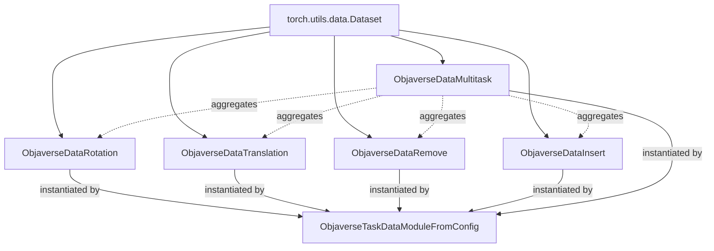
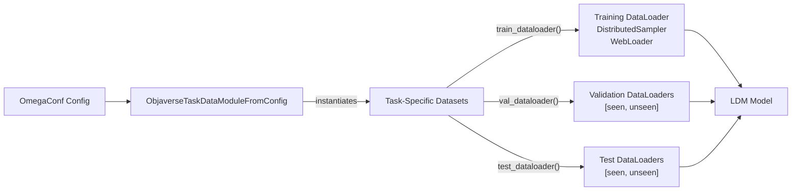
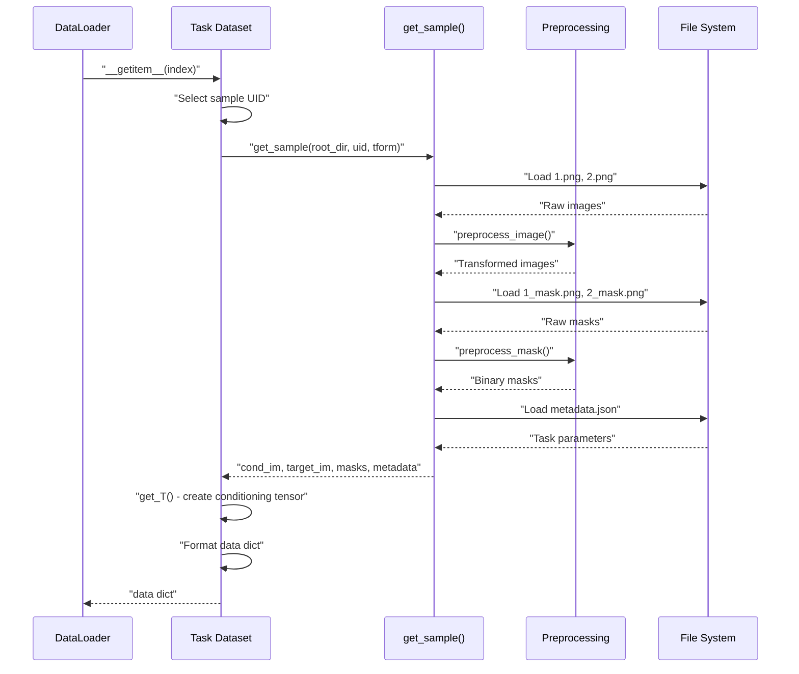

<!-- source: DeepWiki mcp.deepwiki.com · repo allenai/object-edit · page 3.2 Objaverse Dataset · fetched 2026-10-26 -->

# Objaverse Dataset

<details>
<summary>Relevant source files</summary>

The following files were used as context for generating this wiki page:

- [README.md](README.md)
- [ldm/data/__pycache__/simple.cpython-39.pyc](ldm/data/__pycache__/simple.cpython-39.pyc)
- [ldm/data/simple.py](ldm/data/simple.py)

</details>


This page documents the Objaverse dataset loaders and data pipeline for training and evaluating the OBJect 3DIT system. The Objaverse dataset provides paired before/after images for four 3D-aware editing tasks: rotation, translation, object removal, and object insertion.

For information about the base dataset classes and interfaces, see [Dataset Base Classes](#3.1). For other dataset loaders (COCO, ImageNet, LAION), see [Standard Computer Vision Datasets](#3.3) and [LAION and Large-Scale Datasets](#3.4).

## Dataset Organization

### Directory Structure

The Objaverse dataset is organized hierarchically by task, split, and visibility category. Each sample is identified by a unique identifier (UID) and contains paired images, segmentation masks, and metadata.

**Dataset Directory Layout**



**Sources:** [README.md:34-45](), [ldm/data/simple.py:142-148]()

### Data Splits and Visibility Categories

The dataset is partitioned into three splits with two visibility categories:

| Split | Seen Objects | Unseen Objects | Purpose |
|-------|--------------|----------------|---------|
| `train` | ✓ | ✗ | Training only with seen object categories |
| `val` | ✓ | ✓ | Validation on both seen and unseen categories |
| `test` | ✓ | ✓ | Final evaluation on both seen and unseen categories |

The system enforces that training data cannot use unseen objects through assertions in each dataset class [ldm/data/simple.py:137](), [ldm/data/simple.py:217](), [ldm/data/simple.py:294](), [ldm/data/simple.py:367]().

**Sources:** [ldm/data/simple.py:137-148](), [README.md:34-45]()

## Task-Specific Dataset Classes

All task-specific dataset classes inherit from PyTorch's `Dataset` and implement a common interface. Each class is responsible for loading samples, generating task-specific conditioning tensors (T), and formatting data for the model.

### Class Hierarchy



**Sources:** [ldm/data/simple.py:31-48](), [ldm/data/simple.py:430-484]()

### ObjaverseDataRotation

Handles 3D object rotation tasks where objects are rotated by specified azimuth angles around the vertical axis.

**Key Implementation Details:**

- **Location:** [ldm/data/simple.py:123-201]()
- **Task validation:** Enforces `task == "rotate"` [ldm/data/simple.py:138]()
- **Prompt template:** `"rotate the {}"` [ldm/data/simple.py:156]()
- **Conditioning tensor format:** `[π/2, sin(azimuth), cos(azimuth), 0]` [ldm/data/simple.py:167-170]()
- **Metadata field:** `rotation_angle` [ldm/data/simple.py:183]()

The conditioning tensor format matches Zero123's pose representation [ldm/data/simple.py:169]().

**Sources:** [ldm/data/simple.py:123-201]()

### ObjaverseDataTranslation

Handles 2D translation of objects within the image plane to specified (x, y) coordinates.

**Key Implementation Details:**

- **Location:** [ldm/data/simple.py:203-278]()
- **Task validation:** Enforces `task == "translate"` [ldm/data/simple.py:218]()
- **Prompt template:** `"move the {}"` [ldm/data/simple.py:235]()
- **Conditioning tensor format:** `[0, x, y, 0]` [ldm/data/simple.py:246-248]()
- **Metadata field:** `end_location_2d` [ldm/data/simple.py:260]()

**Sources:** [ldm/data/simple.py:203-278]()

### ObjaverseDataRemove

Handles object removal tasks where specified objects are deleted from the scene.

**Key Implementation Details:**

- **Location:** [ldm/data/simple.py:280-351]()
- **Task validation:** Enforces `task == "remove"` [ldm/data/simple.py:295]()
- **Prompt template:** `"delete the {}"` [ldm/data/simple.py:312]()
- **Conditioning tensor format:** `[0, 0, 0, 0]` [ldm/data/simple.py:323-325]()
- **Metadata field:** `removed_object_uid` [ldm/data/simple.py:338]()
- **Special handling:** Uses input mask for both `mask_cond` and `mask_target` since the target has no object [ldm/data/simple.py:341]()

**Sources:** [ldm/data/simple.py:280-351]()

### ObjaverseDataInsert

Handles object insertion tasks where new objects are added to scenes at specified locations. Implemented by inverting the removal dataset.

**Key Implementation Details:**

- **Location:** [ldm/data/simple.py:353-427]()
- **Task validation:** Enforces `task == "insert"` [ldm/data/simple.py:368]()
- **Data reuse:** Uses removal dataset by loading from `"remove"` directory and swapping input/target [ldm/data/simple.py:377](), [ldm/data/simple.py:405]()
- **Prompt template:** `"insert the {}"` implicitly used [ldm/data/simple.py:415]()
- **Conditioning tensor format:** `[0, x, y, 0]` [ldm/data/simple.py:395-397]()
- **Metadata field:** `removed_object_camera_coords` [ldm/data/simple.py:412]()

**Sources:** [ldm/data/simple.py:353-427](), [README.md:32]()

### ObjaverseDataMultitask

Aggregates all four task datasets into a unified multitask dataset for joint training.

**Key Implementation Details:**

- **Location:** [ldm/data/simple.py:430-484]()
- **Task aggregation:** Creates instances of all four task datasets [ldm/data/simple.py:455-464]()
- **Index mapping:** Maintains `(task, index)` tuples to map global indices to task-specific indices [ldm/data/simple.py:466-470]()
- **Dataset length:** Sum of all individual task dataset lengths [ldm/data/simple.py:472-473]()
- **Sample retrieval:** Routes `__getitem__` calls to appropriate task dataset [ldm/data/simple.py:480-483]()

**Sources:** [ldm/data/simple.py:430-484]()

## Data Module

### ObjaverseTaskDataModuleFromConfig

PyTorch Lightning `DataModule` that orchestrates dataset instantiation and data loading for training, validation, and testing.



**Key Responsibilities:**

1. **Task routing:** Maps task string to appropriate dataset class via `task_classes` dictionary [ldm/data/simple.py:41-47]()
2. **Image transforms:** Configures resize, normalization, and rearrangement transforms [ldm/data/simple.py:57-63]()
3. **Data loader creation:** Creates WebDataset loaders with distributed sampling [ldm/data/simple.py:66-121]()
4. **Validation splits:** Returns separate loaders for seen and unseen categories [ldm/data/simple.py:78-98]()

**Transform Pipeline:**

The module applies the following transforms to all images [ldm/data/simple.py:57-63]():

1. `Resize` to configured size (typically 256×256)
2. `ToTensor` conversion
3. `Lambda` for normalization: `(x * 2 - 1)` and rearrangement to `h w c` format

**Sources:** [ldm/data/simple.py:31-121]()

## Data Loading Pipeline

### Sample Loading Flow



**Sources:** [ldm/data/simple.py:524-532](), [ldm/data/simple.py:172-201]()

### get_sample Function

The shared `get_sample()` function [ldm/data/simple.py:524-532]() loads all components of a sample:

```python
# Pseudo-code representation of get_sample
def get_sample(root_dir, fp, tform):
    cond_im = preprocess_image(load_image(path/1.png), tform)
    target_im = preprocess_image(load_image(path/2.png), tform)
    mask_cond = preprocess_mask(path/1_mask.png)
    mask_target = preprocess_mask(path/2_mask.png)
    metadata = json.load(path/metadata.json)
    return cond_im, target_im, mask_cond, mask_target, metadata
```

**Error Handling:** All dataset classes implement fallback to the first sample if loading fails [ldm/data/simple.py:176-181](), [ldm/data/simple.py:253-258](), [ldm/data/simple.py:331-336](), [ldm/data/simple.py:403-408]().

**Sources:** [ldm/data/simple.py:524-532]()

## Preprocessing and Transformations

### Image Preprocessing

**Function:** `preprocess_image()` [ldm/data/simple.py:487-489]()

1. Convert to RGB color space
2. Apply transformation pipeline (resize, normalize, rearrange)

### Mask Preprocessing

**Function:** `preprocess_mask()` [ldm/data/simple.py:491-516]()

Masks are stored as RGBA images with color-coded object segmentation. The preprocessing converts them to binary masks:

1. **Load as RGBA:** [ldm/data/simple.py:492]()
2. **Color mapping:** Map each pixel to nearest color in predefined palette [ldm/data/simple.py:494-509]()
3. **Binary extraction:** Extract channel 1 (the target object) [ldm/data/simple.py:511]()
4. **Tensor conversion:** Convert to PyTorch tensor [ldm/data/simple.py:512]()

The color palette contains 9 distinct colors for different object classes [ldm/data/simple.py:494-504](). The algorithm uses Euclidean distance in RGBA space to find the nearest color [ldm/data/simple.py:507-509]().

**Sources:** [ldm/data/simple.py:491-516]()

### Object Annotations

All datasets load object descriptions from `objaverse_cat_descriptions_64k.json` [ldm/data/simple.py:152-153](), [ldm/data/simple.py:227-228](), [ldm/data/simple.py:309-310](), [ldm/data/simple.py:383-384]().

The annotation file maps object UIDs to human-readable descriptions which are inserted into prompt templates to create full text prompts:

```python
# Example from rotation task
description = object_annot[metadata["object_data"][0]["uid"]]["description"]
prompt = "rotate the {}".format(description)
```

**Sources:** [ldm/data/simple.py:152-153](), [ldm/data/simple.py:186-187]()

## Task Conditioning Tensors

Each task generates a 4-element conditioning tensor `T` that encodes task-specific parameters. These tensors are passed to the model alongside image and text conditioning.

### Conditioning Tensor Format

| Task | Tensor Format | Elements | Code Reference |
|------|---------------|----------|----------------|
| **Rotation** | `[π/2, sin(θ), cos(θ), 0]` | θ = azimuth angle in radians | [ldm/data/simple.py:167-170]() |
| **Translation** | `[0, x, y, 0]` | (x, y) = target 2D coordinates | [ldm/data/simple.py:246-248]() |
| **Removal** | `[0, 0, 0, 0]` | No parameters needed | [ldm/data/simple.py:323-325]() |
| **Insertion** | `[0, x, y, 0]` | (x, y) = insertion 2D coordinates | [ldm/data/simple.py:395-397]() |

**Rotation Encoding:** The rotation tensor uses a format compatible with Zero123, encoding the azimuth angle as `[π/2, sin(θ), cos(θ), 0]` [ldm/data/simple.py:169](). The first element is a constant offset of π/2, while the second and third elements encode the rotation direction trigonometrically.

**Sources:** [ldm/data/simple.py:167-170](), [ldm/data/simple.py:246-248](), [ldm/data/simple.py:323-325](), [ldm/data/simple.py:395-397]()

## Data Dictionary Format

All dataset classes return dictionaries with a standardized structure:

```python
data = {
    "mask_cond": torch.Tensor,      # Binary mask for input image
    "mask_target": torch.Tensor,    # Binary mask for target image
    "uid": str,                     # Unique sample identifier
    "image_target": torch.Tensor,   # Target image (normalized)
    "cond": {
        "image": torch.Tensor,      # Condition image (normalized)
        "text": str                 # Text prompt
    },
    "T": torch.Tensor,              # Task conditioning tensor (4 elements)
    "log_key": str                  # Dataset identifier for logging
}
```

**Sources:** [ldm/data/simple.py:190-200](), [ldm/data/simple.py:267-277](), [ldm/data/simple.py:340-350](), [ldm/data/simple.py:416-426]()

---

