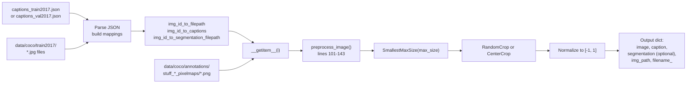
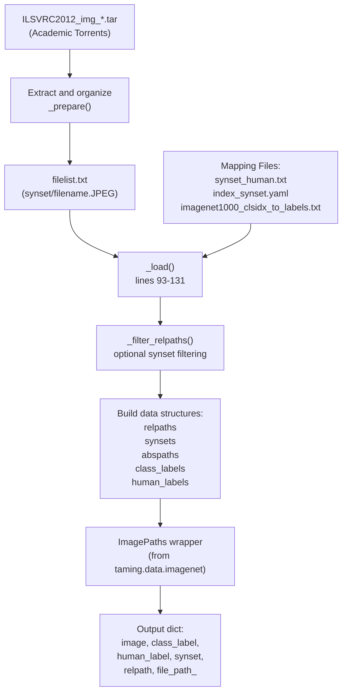
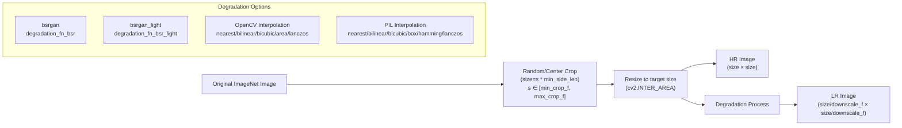
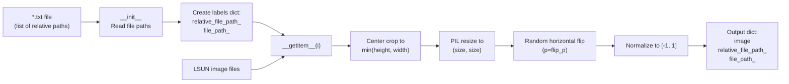

<!-- source: DeepWiki mcp.deepwiki.com · repo allenai/object-edit · page 3.3 Standard Computer Vision Datasets · fetched 2026-10-26 -->

# Standard Computer Vision Datasets

<details>
<summary>Relevant source files</summary>

The following files were used as context for generating this wiki page:

- [ldm/data/coco.py](ldm/data/coco.py)
- [ldm/data/imagenet.py](ldm/data/imagenet.py)
- [ldm/data/lsun.py](ldm/data/lsun.py)

</details>


## Purpose and Scope

This document covers the standard computer vision dataset loaders included in the OBJect 3DIT system, specifically for COCO, ImageNet, and LSUN datasets. These loaders provide alternative training data sources beyond the primary Objaverse dataset. For information about the Objaverse task-specific datasets, see [Objaverse Dataset](#3.2). For LAION-5B and other large-scale web datasets, see [LAION and Large-Scale Datasets](#3.4).

The standard dataset loaders implement PyTorch `Dataset` interfaces and provide image-caption pairs with optional segmentation masks, supporting both training and validation splits with configurable preprocessing pipelines.

## Supported Datasets Overview

The system provides loaders for three major computer vision benchmark datasets:

| Dataset | Primary Use Case | Classes | Features Supported |
|---------|------------------|---------|-------------------|
| COCO | Image captioning, segmentation | N/A | Multiple captions per image, optional segmentation masks, stuffthing annotations |
| ImageNet | Image classification, super-resolution | 1000 synsets | Class labels, human-readable labels, super-resolution variants |
| LSUN | Scene generation | Scene categories | Churches, bedrooms, cats categories |

All three dataset families follow a similar pattern of providing separate train and validation classes with configurable image preprocessing using `albumentations` transformations.

**Diagram: Dataset Class Hierarchy**

```mermaid
graph TB
    subgraph "Base Classes"
        PytorchDataset["torch.utils.data.Dataset"]
    end
    
    subgraph "COCO Datasets"
        CocoBase["CocoBase<br/>(ldm/data/coco.py)"]
        CocoTrain2017["CocoImagesAndCaptionsTrain2017"]
        CocoVal2017["CocoImagesAndCaptionsValidation2017"]
        CocoTrain2014["CocoImagesAndCaptionsTrain2014"]
        CocoVal2014["CocoImagesAndCaptionsValidation2014"]
        
        PytorchDataset --> CocoBase
        CocoBase --> CocoTrain2017
        CocoBase --> CocoVal2017
        CocoBase --> CocoTrain2014
        CocoBase --> CocoVal2014
    end
    
    subgraph "ImageNet Datasets"
        ImageNetBase["ImageNetBase<br/>(ldm/data/imagenet.py)"]
        ImageNetTrain["ImageNetTrain"]
        ImageNetVal["ImageNetValidation"]
        ImageNetSR["ImageNetSR"]
        ImageNetSRTrain["ImageNetSRTrain"]
        ImageNetSRVal["ImageNetSRValidation"]
        
        PytorchDataset --> ImageNetBase
        PytorchDataset --> ImageNetSR
        ImageNetBase --> ImageNetTrain
        ImageNetBase --> ImageNetVal
        ImageNetSR --> ImageNetSRTrain
        ImageNetSR --> ImageNetSRVal
    end
    
    subgraph "LSUN Datasets"
        LSUNBase["LSUNBase<br/>(ldm/data/lsun.py)"]
        LSUNChurchesTrain["LSUNChurchesTrain"]
        LSUNChurchesVal["LSUNChurchesValidation"]
        LSUNBedroomsTrain["LSUNBedroomsTrain"]
        LSUNBedroomsVal["LSUNBedroomsValidation"]
        LSUNCatsTrain["LSUNCatsTrain"]
        LSUNCatsVal["LSUNCatsValidation"]
        
        PytorchDataset --> LSUNBase
        LSUNBase --> LSUNChurchesTrain
        LSUNBase --> LSUNChurchesVal
        LSUNBase --> LSUNBedroomsTrain
        LSUNBase --> LSUNBedroomsVal
        LSUNBase --> LSUNCatsTrain
        LSUNBase --> LSUNCatsVal
    end
```



Sources: [ldm/data/coco.py:1-236](), [ldm/data/imagenet.py:1-395](), [ldm/data/lsun.py:1-93]()

## COCO Dataset

### CocoBase Class

The `CocoBase` class [ldm/data/coco.py:11-163]() provides the foundational implementation for loading COCO dataset image-caption-segmentation triplets. It reads COCO JSON annotation files and supports both 2014 and 2017 dataset versions.

**Key Features:**
- Multiple captions per image (average 5 captions)
- Optional segmentation masks (stuff and thing categories)
- Configurable one-hot encoding for segmentation labels
- Supports random or center cropping strategies

**Constructor Parameters:**

| Parameter | Type | Default | Description |
|-----------|------|---------|-------------|
| `size` | int | None | Target image size after rescaling |
| `dataroot` | str | "" | Root directory containing images |
| `datajson` | str | "" | Path to COCO captions JSON file |
| `onehot_segmentation` | bool | False | Return segmentation as one-hot instead of RGB |
| `use_stuffthing` | bool | False | Include thing categories in segmentation |
| `crop_size` | int | None | Crop size (defaults to `size` if not specified) |
| `force_no_crop` | bool | False | Skip cropping, only resize |
| `given_files` | list | None | Filter to specific filenames |
| `use_segmentation` | bool | True | Load and return segmentation masks |
| `crop_type` | str | None | Cropping strategy: 'random', 'center', or None |

**Data Structure Initialization:**

During initialization [ldm/data/coco.py:32-68](), the class creates three key mappings:
- `img_id_to_filepath`: Maps image IDs to file paths
- `img_id_to_captions`: Maps image IDs to lists of captions
- `img_id_to_segmentation_filepath`: Maps image IDs to segmentation mask paths

**Diagram: COCO Data Loading Flow**



Sources: [ldm/data/coco.py:11-163]()

### Preprocessing Pipeline

The `preprocess_image` method [ldm/data/coco.py:101-143]() implements a two-stage preprocessing pipeline:

1. **Rescaling and Cropping**: Uses `albumentations.SmallestMaxSize` to rescale the smallest dimension to target size, followed by either `RandomCrop` (training) or `CenterCrop` (validation)

2. **Normalization**: Converts uint8 images to float32 in range [-1, 1] via `(image / 127.5 - 1.0)`

For segmentation masks:
- RGB mode: Normalizes masks to [-1, 1] like images
- One-hot mode: Converts to 183-class one-hot encoding [ldm/data/coco.py:130-138]()

### COCO Dataset Variants

**2017 Variants:**
- `CocoImagesAndCaptionsTrain2017` [ldm/data/coco.py:166-179](): Training split with random cropping
- `CocoImagesAndCaptionsValidation2017` [ldm/data/coco.py:182-197](): Validation split with center cropping

**2014 Variants:**
- `CocoImagesAndCaptionsTrain2014` [ldm/data/coco.py:201-216](): Training split, segmentation disabled by default
- `CocoImagesAndCaptionsValidation2014` [ldm/data/coco.py:218-235](): Validation split, segmentation disabled by default

The 2014 variants differ from 2017 primarily in:
- Different annotation file paths (`annotations2014/annotations/`)
- Segmentation disabled by default (`use_segmentation=False`)
- Configurable `crop_type` parameter

**Sample Output Structure:**

```python
{
    "image": np.ndarray,           # shape (H, W, 3), dtype float32, range [-1, 1]
    "caption": str,                # randomly selected from available captions
    "img_path": str,               # full path to source image
    "filename_": str,              # image filename
    "segmentation": np.ndarray,    # (H, W, 3) or (H, W, 183) if use_segmentation=True
    "seg_path": str                # path to segmentation mask
}
```

Sources: [ldm/data/coco.py:145-163](), [ldm/data/coco.py:166-235]()

## ImageNet Dataset

### ImageNetBase Class

The `ImageNetBase` class [ldm/data/imagenet.py:26-131]() provides a flexible foundation for loading ImageNet (ILSVRC2012) data with support for subset selection, class label mapping, and integration with the `taming-transformers` data utilities.

**Key Features:**
- Automatic download of synset mappings and human-readable labels
- Support for arbitrary ImageNet subsets via synset filtering
- Original or remapped class labels
- Optional image processing (can return file paths only)

**Initialization Process:**

The initialization [ldm/data/imagenet.py:27-37]() follows this sequence:
1. `_prepare()`: Subclass-specific preparation (download/extract data)
2. `_prepare_synset_to_human()`: Download synset-to-human-label mapping
3. `_prepare_idx_to_synset()`: Download index-to-synset YAML
4. `_prepare_human_to_integer_label()`: Download class index mapping
5. `_load()`: Load file lists and construct dataset

**Diagram: ImageNet Data Flow**



Sources: [ldm/data/imagenet.py:26-131]()

### Subset Selection

The `_filter_relpaths` method [ldm/data/imagenet.py:48-64]() enables filtering to specific ImageNet synsets via the `sub_indices` config parameter. This allows training on subsets like "all dog breeds" or "vehicles":

```python
# Example config for subset selection
config = {
    "sub_indices": "0-9,15,20-25",  # Select specific class indices
    "keep_orig_class_label": True    # Preserve original ImageNet labels
}
```

The filtering:
1. Converts string indices to list via `str_to_indices()`
2. Maps indices to synsets using `give_synsets_from_indices()`
3. Filters file paths to only include images from selected synsets

### ImageNet Train and Validation

**ImageNetTrain** [ldm/data/imagenet.py:134-194]():
- 1,281,167 images expected
- Automatic download via Academic Torrents (147GB)
- Extracts nested tar archives (one per synset)
- Default random cropping enabled

**ImageNetValidation** [ldm/data/imagenet.py:197-268]():
- 50,000 images expected
- Automatic synset-based reorganization of validation images
- Default center cropping (no randomness)
- Downloads `validation_synset.txt` for correct label assignment

Both classes support `data_root` parameter to override default cache location (`~/.cache/autoencoders/data/`).

Sources: [ldm/data/imagenet.py:134-268]()

### ImageNet Super-Resolution

The `ImageNetSR` class [ldm/data/imagenet.py:272-372]() creates paired high-resolution and low-resolution images for super-resolution training. It wraps either `ImageNetTrain` or `ImageNetValidation` through `Subset` with pre-selected high-quality indices.

**Degradation Pipeline:**



Sources: [ldm/data/imagenet.py:272-372]()

**Constructor Parameters:**

| Parameter | Type | Default | Description |
|-----------|------|---------|-------------|
| `size` | int | Required | Target high-resolution size |
| `degradation` | str | Required | Degradation method: 'bsrgan', 'bsrgan_light', or interpolation name |
| `downscale_f` | int | 4 | Downsampling factor (LR_size = size / downscale_f) |
| `min_crop_f` | float | 0.5 | Minimum crop factor relative to image side |
| `max_crop_f` | float | 1.0 | Maximum crop factor relative to image side |
| `random_crop` | bool | True | Use random crop (vs center crop) |

**Output Structure:**

```python
{
    "image": np.ndarray,        # HR image, shape (size, size, 3), range [-1, 1]
    "LR_image": np.ndarray,     # LR image, shape (LR_size, LR_size, 3), range [-1, 1]
    "caption": str,             # human_label used as dummy caption
    "class_label": int,         # ImageNet class index
    "human_label": str,         # Human-readable class name
    # ... other metadata from base dataset
}
```

**ImageNetSRTrain and ImageNetSRValidation:**

These classes [ldm/data/imagenet.py:375-394]() use pre-filtered indices from pickle files (`imagenet_train_hr_indices.p`, `imagenet_val_hr_indices.p`) to select high-quality images suitable for super-resolution training. They wrap the base train/validation datasets with `Subset`.

Sources: [ldm/data/imagenet.py:272-394]()

## LSUN Dataset

### LSUNBase Class

The `LSUNBase` class [ldm/data/lsun.py:9-59]() provides a simple, consistent interface for loading LSUN (Large-scale Scene Understanding) dataset categories. Unlike COCO and ImageNet, LSUN uses text file lists rather than complex JSON annotations.

**Features:**
- Text file-based image path listing
- Center cropping to square before resizing
- Optional random horizontal flipping
- PIL-based interpolation options

**Constructor Parameters:**

| Parameter | Type | Default | Description |
|-----------|------|---------|-------------|
| `txt_file` | str | Required | Path to text file with image paths |
| `data_root` | str | Required | Root directory for images |
| `size` | int | None | Target image size after preprocessing |
| `interpolation` | str | "bicubic" | PIL interpolation: 'linear', 'bilinear', 'bicubic', 'lanczos' |
| `flip_p` | float | 0.5 | Probability of random horizontal flip |

**Preprocessing Pipeline:**

The `__getitem__` method [ldm/data/lsun.py:39-59]() implements:

1. **Center Crop to Square**: Crops to minimum dimension: `crop = min(height, width)` centered
2. **Resize**: Resizes square crop to target size using specified PIL interpolation
3. **Random Flip**: Applies horizontal flip with probability `flip_p`
4. **Normalize**: Converts to [-1, 1] range



Sources: [ldm/data/lsun.py:9-59]()

### LSUN Category Datasets

LSUN provides six concrete dataset classes, organized by scene category with separate train/validation splits:

**Churches:**
- `LSUNChurchesTrain` [ldm/data/lsun.py:62-64](): Train split with default flip_p=0.5
- `LSUNChurchesValidation` [ldm/data/lsun.py:67-70](): Validation split with flip_p=0.0 (no augmentation)

**Bedrooms:**
- `LSUNBedroomsTrain` [ldm/data/lsun.py:73-75](): Train split with default flip_p=0.5
- `LSUNBedroomsValidation` [ldm/data/lsun.py:78-81](): Validation split with flip_p=0.0

**Cats:**
- `LSUNCatsTrain` [ldm/data/lsun.py:84-86](): Train split with default flip_p=0.5
- `LSUNCatsValidation` [ldm/data/lsun.py:89-92](): Validation split with flip_p=0.0

Each class hardcodes its specific text file and data directory paths:
- Text files: `data/lsun/{category}_{split}.txt`
- Image directories: `data/lsun/{category}/`

**Configuration Pattern:**

All validation classes disable random flipping by default for consistent evaluation, while training classes enable it for data augmentation. Users can override via constructor parameters.

Sources: [ldm/data/lsun.py:62-92]()

## Common Patterns and Preprocessing

### Shared Preprocessing Approach

All three dataset families use similar preprocessing patterns:

| Stage | COCO | ImageNet | LSUN |
|-------|------|----------|------|
| **Rescaling** | `albumentations.SmallestMaxSize` | `albumentations.SmallestMaxSize` (SR only) | PIL resize |
| **Cropping** | `albumentations.RandomCrop` or `CenterCrop` | Via `ImagePaths` or custom (SR) | Center crop to square |
| **Augmentation** | None (in base) | None (in base) | Random horizontal flip |
| **Normalization** | `(x / 127.5 - 1.0)` | `(x / 127.5 - 1.0)` | `(x / 127.5 - 1.0)` |
| **Output Range** | [-1, 1] | [-1, 1] | [-1, 1] |

### Output Dictionary Structure

All datasets return dictionaries with dataset-specific keys:

**Common Keys:**
- `image`: Main image tensor, shape (H, W, 3), dtype float32, range [-1, 1]
- Path information: `file_path_`, `img_path`, or `relative_file_path_`

**Dataset-Specific Keys:**
- COCO: `caption`, `filename_`, `segmentation` (optional), `seg_path` (optional)
- ImageNet: `class_label`, `human_label`, `synset`, `relpath`, `LR_image` (SR only)
- LSUN: Minimal - just image and path information

### Integration with Training System

These datasets integrate with the training system via PyTorch `DataLoader` and the configuration system. Example usage patterns:

```python
# COCO 2017 validation with segmentation
dataset = CocoImagesAndCaptionsValidation2017(
    size=256,
    onehot_segmentation=False,
    use_stuffthing=True,
    crop_size=256
)

# ImageNet subset for dog breeds
dataset = ImageNetTrain(
    config={"sub_indices": "151-268", "size": 512}
)

# LSUN churches for generation
dataset = LSUNChurchesTrain(size=256, interpolation="lanczos")
```

The datasets can be instantiated directly or through configuration files (see [Training Configuration](#4.1)).

Sources: [ldm/data/coco.py:11-236](), [ldm/data/imagenet.py:26-394](), [ldm/data/lsun.py:9-92]()

## Dataset Location Expectations

All three dataset families expect data to be organized in specific directory structures:

**COCO:**
```
data/coco/
├── train2017/              # Training images
├── val2017/                # Validation images
├── train2014/              # COCO 2014 training images
├── val2014/                # COCO 2014 validation images
├── annotations/
│   ├── captions_train2017.json
│   ├── captions_val2017.json
│   ├── stuff_train2017_pixelmaps/  # Segmentation masks
│   └── stuff_val2017_pixelmaps/
└── annotations2014/
    └── annotations/
        ├── captions_train2014.json
        └── captions_val2014.json
```

**ImageNet:**
```
~/.cache/autoencoders/data/ILSVRC2012_train/  (or custom data_root)
├── data/
│   ├── n01440764/           # One directory per synset
│   │   ├── *.JPEG
│   │   └── ...
│   └── ...
├── filelist.txt
├── synset_human.txt
├── index_synset.yaml
└── imagenet1000_clsidx_to_labels.txt
```

**LSUN:**
```
data/lsun/
├── churches/               # Church images
├── bedrooms/              # Bedroom images
├── cats/                  # Cat images
├── church_outdoor_train.txt
├── church_outdoor_val.txt
├── bedrooms_train.txt
├── bedrooms_val.txt
├── cat_train.txt
└── cat_val.txt
```

Sources: [ldm/data/coco.py:39-63](), [ldm/data/imagenet.py:150-222](), [ldm/data/lsun.py:17-25]()

---

