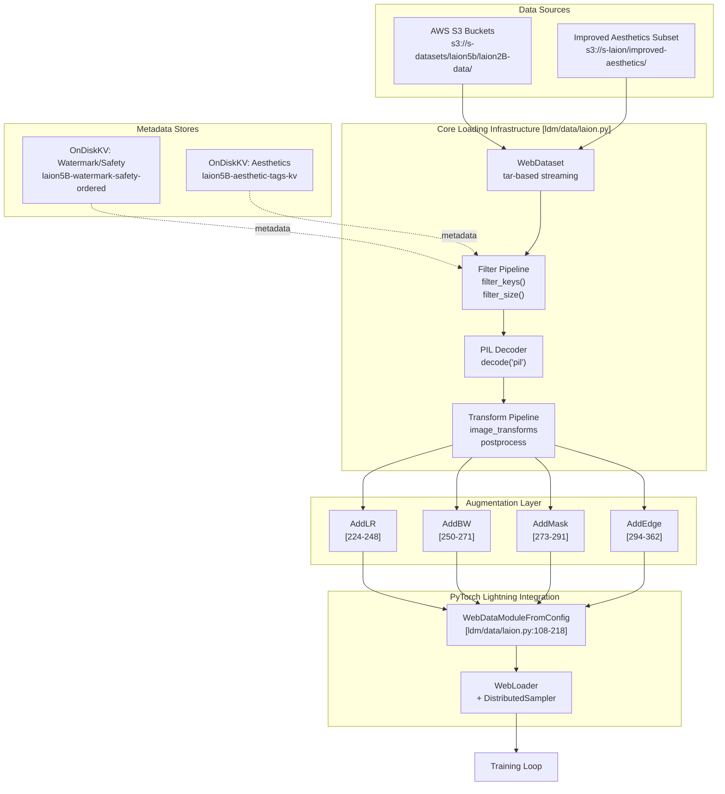
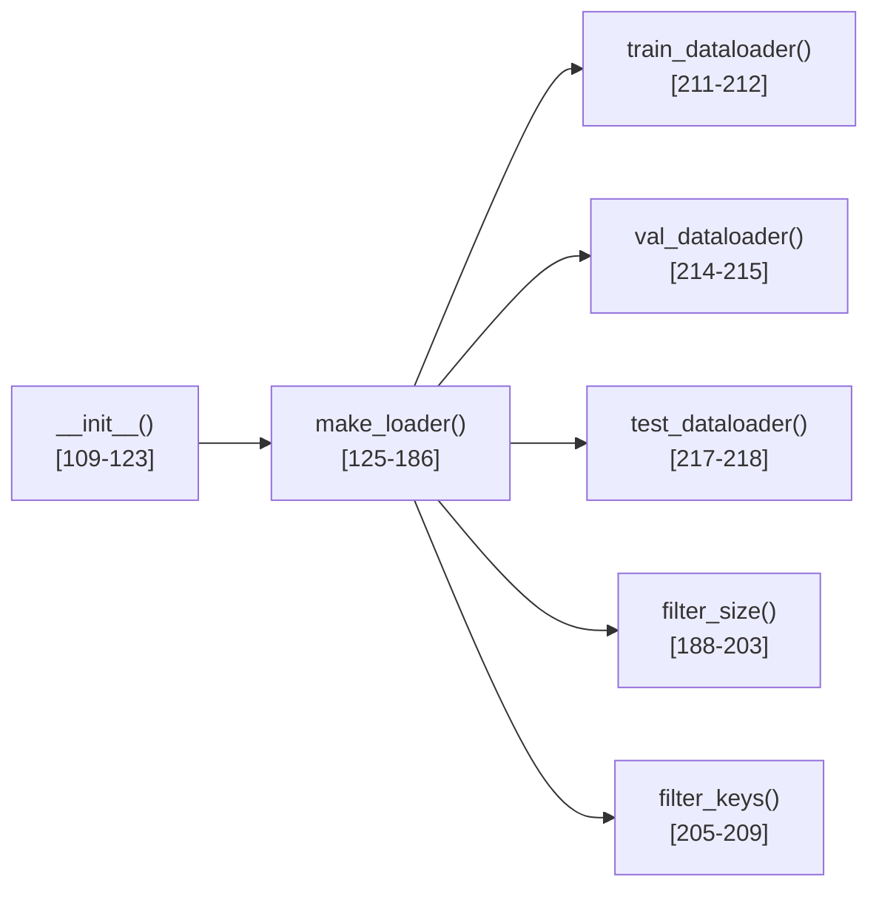
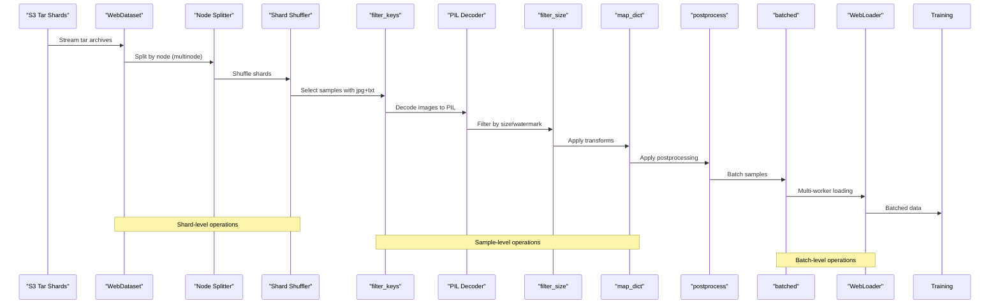
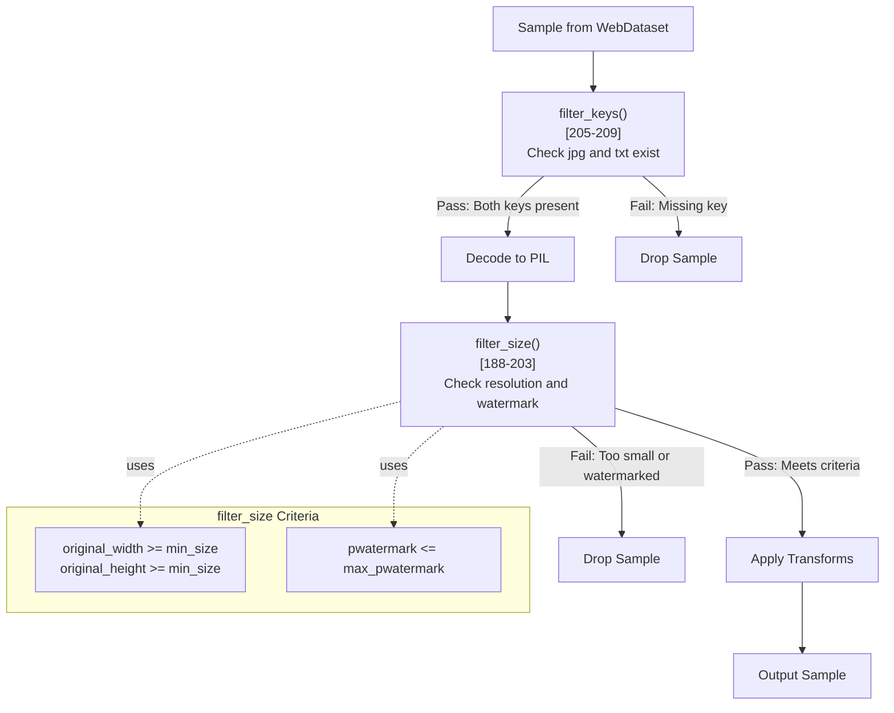
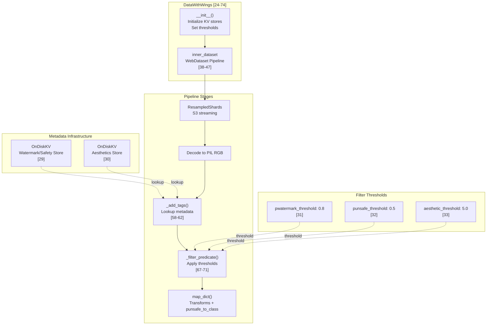
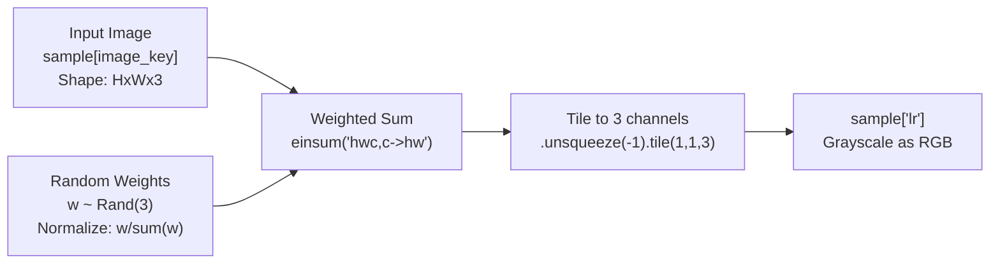
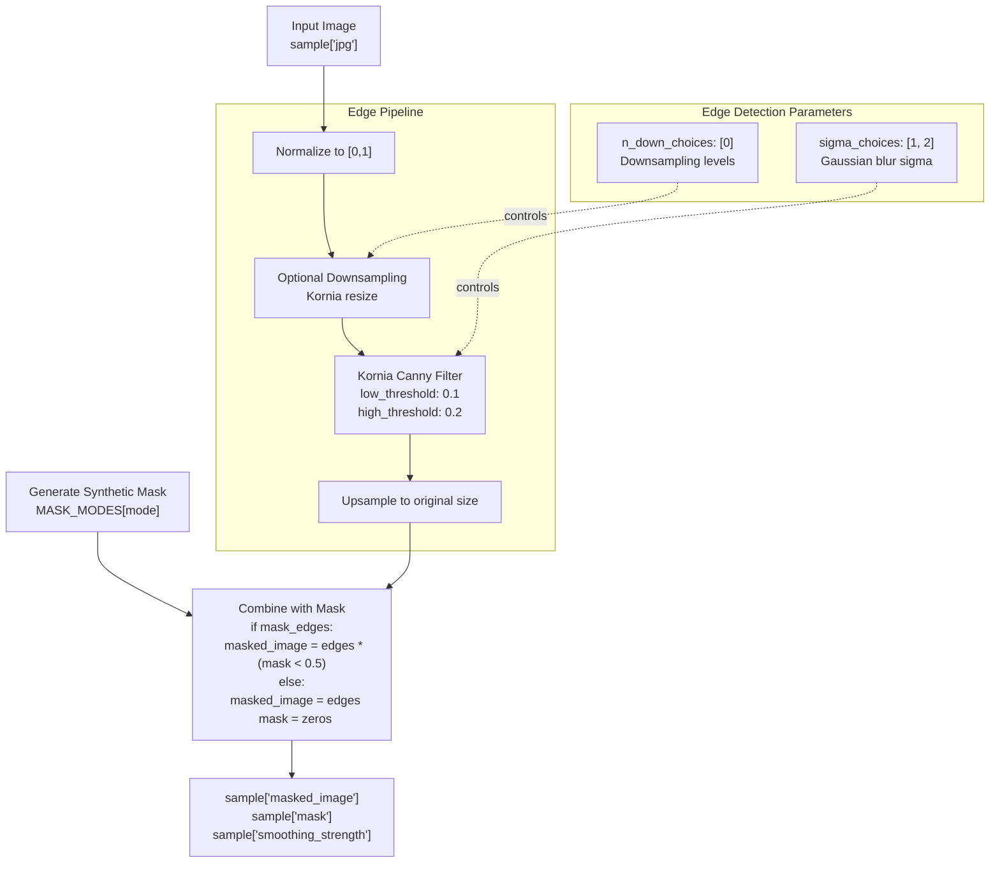
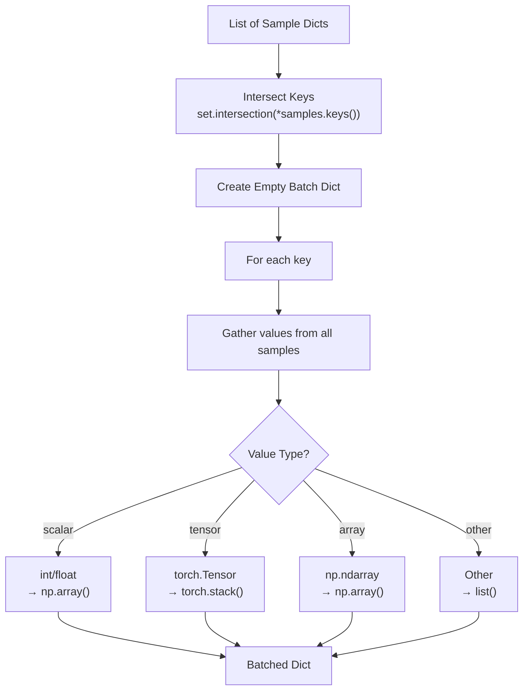
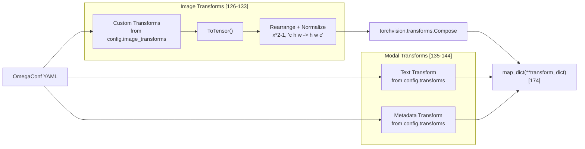
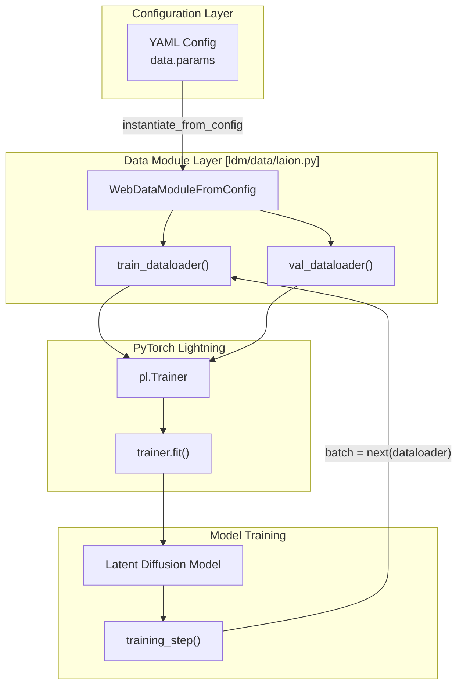

<!-- source: DeepWiki mcp.deepwiki.com · repo allenai/object-edit · page 3.4 LAION and Large-Scale Datasets · fetched 2026-10-26 -->

# LAION and Large-Scale Datasets

<details>
<summary>Relevant source files</summary>

The following files were used as context for generating this wiki page:

- [ldm/data/laion.py](ldm/data/laion.py)

</details>


## Purpose and Scope

This document covers the WebDataset-based data loading system for large-scale image-text datasets, primarily LAION-5B. The system provides efficient streaming from cloud storage (AWS S3) with built-in filtering, quality control, and augmentation pipelines. This infrastructure enables training on billion-scale datasets without requiring local storage of the full dataset.

For base dataset interfaces and mixins, see [Dataset Base Classes](#3.1). For task-specific Objaverse datasets, see [Objaverse Dataset](#3.2). For standard vision datasets like COCO and ImageNet, see [Standard Computer Vision Datasets](#3.3).

**Key Features:**
- Streaming data loading from S3 tar archives
- Metadata-based filtering (watermarks, aesthetics, safety)
- Multi-node distributed training support
- Configurable augmentation pipelines
- PyTorch Lightning integration

## System Architecture

The LAION data loading system is built around the WebDataset library, which provides efficient streaming of tar-archived datasets. The architecture consists of three main layers: data source access, filtering/transformation, and batching/loading.



**Sources:** [ldm/data/laion.py:1-538]()

## WebDataModuleFromConfig

The `WebDataModuleFromConfig` class is the main entry point for configuring LAION-5B data loading in the training pipeline. It extends PyTorch Lightning's `LightningDataModule` to provide train, validation, and test dataloaders.

### Class Structure

| Component | Type | Purpose |
|-----------|------|---------|
| `tar_base` | str | Base path or S3 URL for tar archives |
| `batch_size` | int | Number of samples per batch |
| `num_workers` | int | Number of data loading workers |
| `multinode` | bool | Enable multi-node training support |
| `min_size` | int | Minimum image resolution filter |
| `max_pwatermark` | float | Maximum watermark probability threshold |

**Key Methods:**



**Sources:** [ldm/data/laion.py:108-218]()

### Configuration Pattern

The loader is instantiated from OmegaConf YAML configurations. Example configuration structure:

| Field | Purpose | Example Value |
|-------|---------|---------------|
| `shards` | Tar file pattern | `"{000000..231349}.tar"` |
| `shuffle` | Shuffle buffer size | `10000` |
| `image_key` | Dictionary key for images | `"jpeg"` or `"jpg"` |
| `image_transforms` | List of transform configs | `[Resize, RandomCrop]` |
| `postprocess` | Post-transform processor | `AddMask`, `AddEdge` |

**Sources:** [ldm/data/laion.py:125-186]()

## WebDataset Pipeline Architecture

The data loading pipeline is constructed using WebDataset's functional composition pattern. Each stage in the pipeline performs a specific operation on the streaming data.



**Sources:** [ldm/data/laion.py:163-186]()

### Pipeline Stages

The pipeline construction in `make_loader()` follows this pattern:

1. **Shard Selection** [ldm/data/laion.py:163-168]()
   - Load tar files from S3 or local path
   - Apply node splitting for distributed training
   - Enable shard-level shuffling if configured

2. **Sample Filtering** [ldm/data/laion.py:170-175]()
   - `filter_keys()`: Ensure both image and text exist
   - `decode('pil')`: Convert binary data to PIL images
   - `filter_size()`: Apply resolution and watermark filters

3. **Transformation** [ldm/data/laion.py:174-177]()
   - Apply configured image transforms
   - Transform other modalities (text, metadata)
   - Apply postprocessing augmentations

4. **Batching** [ldm/data/laion.py:178-184]()
   - Use custom `dict_collation_fn` to preserve dictionary structure
   - Create fixed-size batches (no partial batches)
   - Wrap in WebLoader with multi-worker support

**Sources:** [ldm/data/laion.py:125-186]()

## Filtering and Quality Control

The system implements multi-stage filtering to ensure data quality. Filters operate at different stages of the pipeline for efficiency.

### Filter Functions



**Sources:** [ldm/data/laion.py:188-209]()

### Filtering Criteria

| Filter | Location | Criteria | Default Threshold |
|--------|----------|----------|-------------------|
| **Key Filter** | [205-209]() | Both `jpg` and `txt` keys present | N/A (required) |
| **Size Filter** | [188-203]() | `original_width >= min_size` | `min_size` parameter |
| **Size Filter** | [188-203]() | `original_height >= min_size` | `min_size` parameter |
| **Watermark Filter** | [188-203]() | `pwatermark <= max_pwatermark` | `max_pwatermark` parameter |

The filters use exception handling to gracefully skip corrupted or malformed samples without crashing the pipeline.

**Sources:** [ldm/data/laion.py:188-209]()

## DataWithWings: Advanced LAION-5B Loader

The `DataWithWings` class provides a more sophisticated loading system with integrated metadata lookup from on-disk key-value stores. This class is designed for scenarios requiring fine-grained filtering based on watermark, safety, and aesthetic scores.



**Sources:** [ldm/data/laion.py:24-74]()

### Metadata Lookup System

The class uses hash-based lookups to retrieve metadata:

1. **Hash Computation** [ldm/data/laion.py:50-56]()
   - Combines URL and text using MurmurHash3
   - Returns 64-bit hash for key-value lookup

2. **Tag Addition** [ldm/data/laion.py:58-62]()
   - Retrieves watermark and safety scores
   - Retrieves aesthetic score
   - Adds to sample dictionary

3. **Filtering** [ldm/data/laion.py:67-71]()
   - Watermark: `pwatermark < 0.8`
   - Aesthetics: `aesthetic >= 5.0`
   - Resolution: `width >= min_size` and `height >= min_size`

**Sources:** [ldm/data/laion.py:24-74]()

## Augmentation Classes

The module provides specialized augmentation classes that add additional modalities to samples, particularly for conditional generation tasks.

### AddLR: Low-Resolution Degradation

Creates low-resolution versions of images for super-resolution tasks.

| Parameter | Type | Purpose |
|-----------|------|---------|
| `factor` | int | Downsampling factor |
| `output_size` | int | Final output resolution |
| `initial_size` | int (optional) | Pre-degradation resize |
| `image_key` | str | Dictionary key for input image |

**Process:**
1. Convert tensor to NumPy (uint8)
2. Optional initial resize
3. Apply BSR-light degradation
4. Resize to output size
5. Store as `sample['lr']`

**Sources:** [ldm/data/laion.py:224-248]()

### AddBW: Black and White Conversion

Converts images to grayscale using random weighted RGB combination.



**Purpose:** Creates grayscale conditioning for colorization or style transfer tasks while maintaining 3-channel format for encoder compatibility.

**Sources:** [ldm/data/laion.py:250-271]()

### AddMask: Synthetic Mask Generation

Generates random masks for inpainting tasks using the synthetic mask generation system.

| Parameter | Type | Purpose |
|-----------|------|---------|
| `mode` | str | Mask generation mode (e.g., "512train") |
| `p_drop` | float | Probability of using full mask (no masking) |

**Outputs:**
- `sample['mask']`: Binary mask (0 or 1)
- `sample['masked_image']`: Image with masked regions zeroed

**Uses PRNGMixin:** Inherits from `PRNGMixin` (see [Dataset Base Classes](#3.1)) for process-safe random number generation.

**Sources:** [ldm/data/laion.py:273-291]()

### AddEdge: Edge Detection with Masking

Applies Canny edge detection with configurable smoothing, useful for sketch-based generation.



**Key Features:**
- Configurable edge smoothing via sigma parameter
- Optional multi-scale processing via downsampling
- Conditional masking of edge maps
- Normalized smoothing strength stored for conditioning

**Sources:** [ldm/data/laion.py:294-362]()

## Custom Collation Function

The `dict_collation_fn` function handles batching of dictionary-structured samples while preserving all keys and automatically stacking tensors.

### Collation Logic

| Data Type | Behavior | Result Type |
|-----------|----------|-------------|
| `int`, `float` | Stack into NumPy array if `combine_scalars=True` | `np.ndarray` |
| `torch.Tensor` | Stack into tensor batch if `combine_tensors=True` | `torch.Tensor` |
| `np.ndarray` | Stack into array if `combine_tensors=True` | `np.ndarray` |
| Other types | Keep as list | `list` |



**Usage:** Specified as `collation_fn=dict_collation_fn` in WebDataset's `.batched()` call.

**Sources:** [ldm/data/laion.py:77-105]()

## Dataset Selection Patterns

The system supports multiple LAION-5B subsets through configuration.

### Improved Aesthetics Subset

Special tar_base value `"__improvedaesthetic__"` loads a curated high-quality subset:

```python
# Configuration triggers special handling
tar_base = "__improvedaesthetic__"

# Results in loading from:
# pipe:aws s3 cp s3://s-laion/improved-aesthetics-laion-2B-en-subsets/
#   aesthetics_tars/{000000..060207}.tar -
```

**Characteristics:**
- 60,208 tar shards
- Higher aesthetic scores (typically >= 5.0)
- Pre-filtered for quality
- Suitable for high-fidelity generation tasks

**Sources:** [ldm/data/laion.py:156-161]()

### Full LAION-5B Dataset

Standard configuration uses the full dataset:

```python
# Standard tar pattern
tar_base = "/path/to/laion5b/"
shards = "laion2B-data/{000000..231349}.tar"

# Results in loading:
# /path/to/laion5b/laion2B-data/{000000..231349}.tar
```

**Characteristics:**
- 231,350 tar shards
- Full diversity of web images
- Requires aggressive filtering
- Suitable for large-scale pretraining

**Sources:** [ldm/data/laion.py:161]()

## Transform Pipeline Configuration

Transforms are configured via OmegaConf and instantiated dynamically.

### Standard Transform Workflow



**Default Normalization:** Images are converted to range `[-1, 1]` and rearranged to `(H, W, C)` format to match the model's expected input format.

**Sources:** [ldm/data/laion.py:126-144]()

## Multi-Node Training Support

The system handles distributed training across multiple nodes using WebDataset's shard splitting.

### Node Splitting Strategy

```python
# Configuration determines splitting behavior
if multinode:
    nodesplitter = wds.shardlists.split_by_node
else:
    nodesplitter = wds.shardlists.single_node_only

# Applied during WebDataset initialization
dset = wds.WebDataset(
    tars,
    nodesplitter=nodesplitter,  # [154]
    shardshuffle=shardshuffle,
    handler=wds.warn_and_continue
)
```

**Shard Distribution:**
- `split_by_node`: Evenly distributes tar shards across nodes/workers
- Each node/worker processes a disjoint subset of shards
- Ensures no data duplication during distributed training
- Shard shuffling occurs before node splitting

**Sources:** [ldm/data/laion.py:154-168]()

## Example Usage Patterns

The module includes several example functions demonstrating usage patterns.

### Example 01: Basic WebDataset Loading

**Purpose:** Demonstrates basic streaming, shuffling, and batching from S3.

**Key Concepts Shown:**
- URL pattern for multiple shards: `{000000..000002}.tar`
- Node-based shard splitting for distributed training
- Shuffle buffer configuration
- Custom collation function
- Multi-worker data loading

**Sources:** [ldm/data/laion.py:397-436]()

### Example 02: Configuration-Based Loading

**Purpose:** Shows how to instantiate from OmegaConf configuration files.

```python
config = OmegaConf.load("configs/stable-diffusion/txt2img-v2-clip-encoder-improved_aesthetics-256.yaml")
datamod = WebDataModuleFromConfig(**config["data"]["params"])
dataloader = datamod.train_dataloader()
```

**Sources:** [ldm/data/laion.py:438-455]()

### Example 03: Filtering Statistics

**Purpose:** Analyzes filtering effectiveness on improved aesthetics subset.

**Filters Applied:**
- `filter_keys`: Ensure jpg and txt present
- `filter_size`: Minimum 512x512 resolution
- `filter_watermark`: Watermark probability < 0.5

**Use Case:** Quality assessment before full training run.

**Sources:** [ldm/data/laion.py:457-502]()

## Integration with Training System

The LAION data module integrates with the training system through PyTorch Lightning's DataModule interface.



**DataLoader Methods:**
- `train_dataloader()`: Returns training data WebLoader
- `val_dataloader()`: Returns validation data WebLoader
- `test_dataloader()`: Returns test data WebLoader

Each method calls `make_loader()` with the appropriate configuration.

**Sources:** [ldm/data/laion.py:108-218]()

## Performance Considerations

### Streaming Efficiency

| Feature | Benefit | Configuration |
|---------|---------|---------------|
| **Tar Archives** | Sequential read optimization | Use tar shards instead of individual files |
| **S3 Streaming** | No local storage required | `pipe:aws s3 cp` URLs |
| **WebDataset** | Minimal memory footprint | Streaming iteration |
| **Shuffle Buffer** | Balance randomness vs memory | `shuffle=10000` typical |
| **Shard Shuffling** | Epoch-level diversity | `shardshuffle=True` |

### Multi-Worker Configuration

```python
num_workers = 4  # Typical value
loader = wds.WebLoader(
    dset, 
    batch_size=None,  # Batching done in dataset
    shuffle=False,    # Shuffling done in dataset
    num_workers=num_workers
)
```

**Recommendations:**
- `num_workers=4` for local training
- `num_workers=2-8` for cloud instances
- Higher values increase memory usage
- Each worker processes different shards

**Sources:** [ldm/data/laion.py:183-184]()

## Error Handling

The system uses WebDataset's handler system for robust error handling during streaming.

### Handler Types

| Handler | Behavior | Use Case |
|---------|----------|----------|
| `warn_and_continue` | Log warning, skip sample | Default for most stages |
| `ignore_and_continue` | Silent skip | Known noisy operations |
| `warn_and_stop` | Log warning, raise exception | Critical failures |

**Applied at Multiple Stages:**
- Tar file reading: `handler=wds.warn_and_continue` [ldm/data/laion.py:40]()
- Decode: `handler=wds.warn_and_continue` [ldm/data/laion.py:42]()
- Transform: `handler=wds.warn_and_continue` [ldm/data/laion.py:45]()

**Benefit:** Training continues even with corrupted samples or network issues.

**Sources:** [ldm/data/laion.py:16,38-47,167-174]()

---

