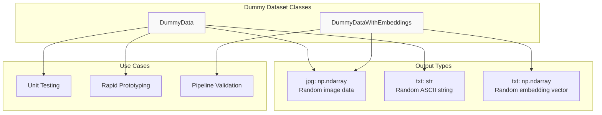
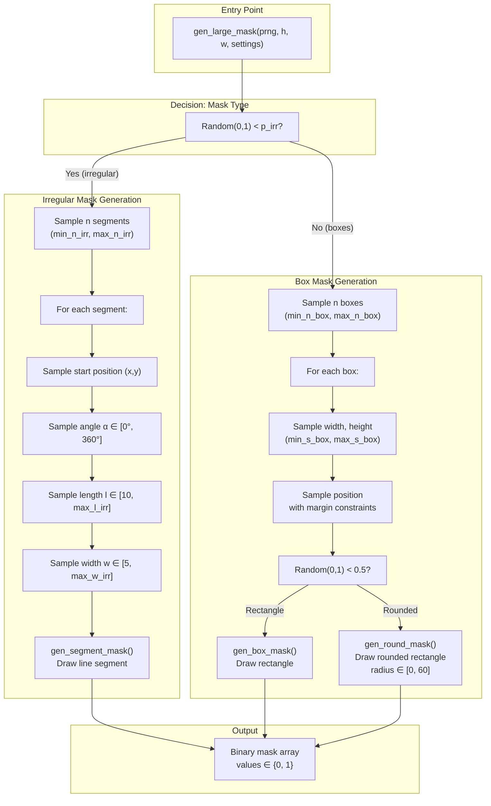
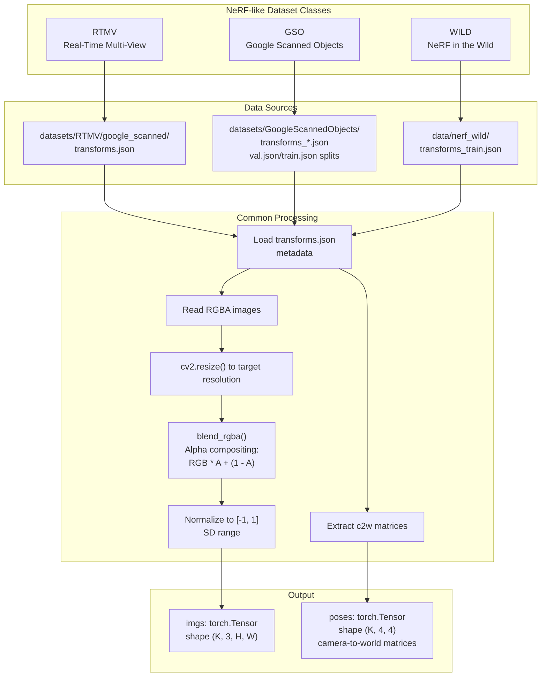
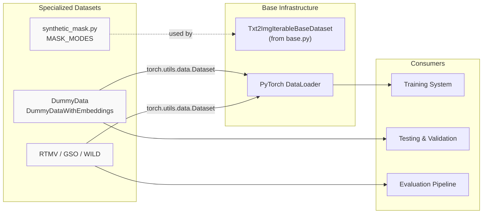

<!-- source: DeepWiki mcp.deepwiki.com · repo allenai/object-edit · page 3.5 Specialized Datasets · fetched 2026-10-26 -->

# Specialized Datasets

<details>
<summary>Relevant source files</summary>

The following files were used as context for generating this wiki page:

- [ldm/data/dummy.py](ldm/data/dummy.py)
- [ldm/data/inpainting/synthetic_mask.py](ldm/data/inpainting/synthetic_mask.py)
- [ldm/data/nerf_like.py](ldm/data/nerf_like.py)

</details>


## Purpose and Scope

This page documents specialized dataset loaders that serve specific purposes beyond the standard computer vision datasets. These include dummy datasets for testing and development, synthetic mask generation utilities for inpainting tasks, and NeRF-like datasets for 3D-aware view synthesis. 

For general dataset architecture and base classes, see [3.1](#3.1). For task-specific Objaverse datasets used in production training, see [3.2](#3.2). For standard datasets like COCO and ImageNet, see [3.3](#3.3).

---

## Dummy Datasets

The system provides dummy datasets that generate synthetic random data for testing and rapid prototyping without requiring actual dataset downloads or preprocessing.

### DummyData Class

The `DummyData` class generates random image-text pairs for basic testing scenarios.

| Parameter | Type | Description |
|-----------|------|-------------|
| `length` | int | Number of samples in the dataset |
| `size` | tuple | Shape of the random image arrays |

**Output Format:**
```python
{
    "jpg": np.ndarray,  # Random array of shape `size`
    "txt": str          # Random 10-character lowercase string
}
```

The image data is sampled from a standard normal distribution using `np.random.randn()`, while text labels are randomly generated ASCII lowercase strings.

**Sources:** [ldm/data/dummy.py:6-18]()

### DummyDataWithEmbeddings Class

The `DummyDataWithEmbeddings` class extends the dummy dataset concept to include pre-computed embeddings instead of raw text, useful for testing models that consume embedding vectors directly.

| Parameter | Type | Description |
|-----------|------|-------------|
| `length` | int | Number of samples in the dataset |
| `size` | tuple | Shape of the random image arrays |
| `emb_size` | tuple | Shape of the embedding vectors |

**Output Format:**
```python
{
    "jpg": np.ndarray,      # Random array of shape `size`
    "txt": np.ndarray       # Random float32 array of shape `emb_size`
}
```

The embeddings are also sampled from a standard normal distribution and explicitly cast to `np.float32` for compatibility with typical model architectures.

**Sources:** [ldm/data/dummy.py:21-33]()

### Dummy Dataset Architecture



**Sources:** [ldm/data/dummy.py:1-35]()

---

## Inpainting Mask Generation

The inpainting subsystem includes a sophisticated synthetic mask generation system that creates realistic masking patterns for training inpainting models. This system is defined in `ldm/data/inpainting/synthetic_mask.py`.

### Mask Generation Modes

The system supports four preconfigured mask generation modes with different characteristics:

| Mode | Resolution | Type Mix | Line Characteristics | Box Characteristics |
|------|-----------|----------|---------------------|---------------------|
| `256narrow` | 256×256 | 100% irregular | 4-50 segments, max length 40px, max width 10px | Not used |
| `256train` | 256×256 | 50% irregular / 50% boxes | 1-5 segments, max length 200px, max width 100px | 1-4 boxes, size 30-150px |
| `512train` | 512×512 | 50% irregular / 50% boxes | 1-5 segments, max length 450px, max width 250px | 1-4 boxes, size 30-300px |
| `512train-large` | 512×512 | 50% irregular / 50% boxes | 1-5 segments, max length 450px, max width 400px | 1-4 boxes, size 75-450px |

**Sources:** [ldm/data/inpainting/synthetic_mask.py:4-53]()

### Mask Generation Pipeline



**Sources:** [ldm/data/inpainting/synthetic_mask.py:85-141]()

### Mask Primitive Functions

The system provides three primitive drawing functions that operate on mask arrays:

#### gen_segment_mask()

Draws a line segment on a mask using PIL's ImageDraw with curve joints for smooth connections.

**Signature:** `gen_segment_mask(mask, start, end, brush_width)`

**Process:**
1. Converts mask to 8-bit image (0 or 255)
2. Uses `ImageDraw.line()` with `joint="curve"` for smooth connections
3. Returns normalized mask (values in [0, 1])

**Sources:** [ldm/data/inpainting/synthetic_mask.py:56-63]()

#### gen_box_mask()

Draws a rectangular masked region using NumPy array slicing.

**Signature:** `gen_box_mask(mask, masked)`

**Parameters:** `masked` tuple contains `(x_0, y_0, w, h)`

**Sources:** [ldm/data/inpainting/synthetic_mask.py:66-69]()

#### gen_round_mask()

Draws a rounded rectangle using PIL's `rounded_rectangle()` method.

**Signature:** `gen_round_mask(mask, masked, radius)`

**Parameters:** 
- `masked`: tuple `(x_0, y_0, w, h)` defining box bounds
- `radius`: corner radius in pixels

**Sources:** [ldm/data/inpainting/synthetic_mask.py:72-82]()

### Mask Mode Access

The system provides lambda functions for convenient access to each mask mode:

```python
make_lama_mask           # 256train mode
make_narrow_lama_mask    # 256narrow mode
make_512_lama_mask       # 512train mode
make_512_lama_mask_large # 512train-large mode
```

These are stored in the `MASK_MODES` dictionary for programmatic access:

```python
MASK_MODES = {
    "256train": make_lama_mask,
    "256narrow": make_narrow_lama_mask,
    "512train": make_512_lama_mask,
    "512train-large": make_512_lama_mask_large
}
```

**Sources:** [ldm/data/inpainting/synthetic_mask.py:143-154]()

---

## NeRF-like Datasets

The system includes dataset loaders for NeRF-style multi-view datasets that provide multiple camera viewpoints of 3D objects or scenes. These datasets are used for view synthesis and 3D-aware generation tasks.

### Coordinate Transformation Functions

The NeRF-like datasets use spherical coordinate transformations to represent camera pose differences:

#### cartesian_to_spherical()

Converts 3D Cartesian coordinates to spherical coordinates (theta, azimuth, radius).

**Formula:**
- `theta`: elevation angle from Z-axis = `arctan2(sqrt(x² + y²), z)`
- `azimuth`: rotation around Z-axis = `arctan2(y, x)`
- `radius`: distance from origin = `sqrt(x² + y² + z²)`

**Sources:** [ldm/data/nerf_like.py:11-18]()

#### get_T()

Computes the relative transformation between two camera poses in a format suitable for conditioning.

**Output Format:**
```python
torch.tensor([
    d_theta,              # Elevation angle difference
    sin(d_azimuth),       # Sine of azimuth difference
    cos(d_azimuth),       # Cosine of azimuth difference
    d_z                   # Radial distance difference
])
```

The azimuth difference is wrapped to `[0, 2π)` using modulo operation, and sin/cos encoding provides a smooth, continuous representation.

**Sources:** [ldm/data/nerf_like.py:21-30]()

#### get_spherical()

Similar to `get_T()` but returns differences in degrees without sin/cos encoding.

**Output Format:**
```python
torch.tensor([
    degrees(d_theta),     # Elevation difference in degrees
    degrees(d_azimuth),   # Azimuth difference in degrees
    d_z                   # Radial distance difference
])
```

**Sources:** [ldm/data/nerf_like.py:32-41]()

### Dataset Classes



**Sources:** [ldm/data/nerf_like.py:43-165]()

### RTMV Dataset

The `RTMV` class loads the Real-Time Multi-View dataset with Google Scanned objects.

**Constructor Parameters:**

| Parameter | Type | Default | Description |
|-----------|------|---------|-------------|
| `root_dir` | str | `'datasets/RTMV/google_scanned'` | Root directory path |
| `first_K` | int | 64 | Number of views to load per scene |
| `resolution` | int | 256 | Target image resolution (H and W) |
| `load_target` | bool | False | If True, loads all K images; if False, only loads first image |

**Data Structure:**
- Each scene has a directory containing `transforms.json` with camera metadata
- Images are referenced by `file_path` in the metadata
- Transform matrices are 4×4 camera-to-world matrices

**RGBA Blending:**
The dataset uses alpha compositing to convert RGBA images to RGB:
```
RGB_output = RGB * Alpha + (1 - Alpha)
```
This blends the foreground object with a white background.

**Sources:** [ldm/data/nerf_like.py:43-81]()

### GSO Dataset

The `GSO` class loads Google Scanned Objects with split-based loading and multiple rendering variants.

**Constructor Parameters:**

| Parameter | Type | Default | Description |
|-----------|------|---------|-------------|
| `root_dir` | str | `'datasets/GoogleScannedObjects'` | Root directory path |
| `split` | str | `'val'` | Data split (`'train'` or `'val'`) |
| `first_K` | int | 5 | Number of views to load |
| `resolution` | int | 256 | Target image resolution |
| `load_target` | bool | False | Whether to load all views or just first |
| `name` | str | `'render_mvs'` | Rendering variant name |

**Key Features:**
- Uses JSON split files (`val.json`, `train.json`) to define scene lists
- Supports multiple rendering variants through the `name` parameter
- Reads from `transforms_{name}.json` files in each scene directory
- Extracts and returns alpha masks separately (though currently unused)

**Sources:** [ldm/data/nerf_like.py:84-125]()

### WILD Dataset

The `WILD` class loads NeRF in the Wild datasets, which contain real-world captured scenes.

**Constructor Parameters:**

| Parameter | Type | Default | Description |
|-----------|------|---------|-------------|
| `root_dir` | str | `'data/nerf_wild'` | Root directory path |
| `first_K` | int | 33 | Number of views to load |
| `resolution` | int | 256 | Target image resolution |
| `load_target` | bool | False | Whether to load all views or just first |

**Key Differences:**
- Always uses `transforms_train.json` for metadata
- Image file paths in metadata lack the `.png` extension, which is appended during loading
- Uses the same RGBA blending and normalization as other NeRF-like datasets

**Sources:** [ldm/data/nerf_like.py:127-165]()

### NeRF Dataset Comparison

| Feature | RTMV | GSO | WILD |
|---------|------|-----|------|
| Default views (first_K) | 64 | 5 | 33 |
| Transform file | `transforms.json` | `transforms_{name}.json` | `transforms_train.json` |
| Split support | Directory-based | JSON file splits | Directory-based |
| Image format | Direct path | Direct path | Path + `.png` suffix |
| Use case | Multi-view synthesis | Object-centric views | Scene-level NeRF |

**Common Features Across All NeRF Datasets:**
1. All return `(imgs, poses)` tuples
2. Images normalized to [-1, 1] range for Stable Diffusion compatibility
3. RGBA to RGB conversion using alpha blending
4. Support for conditional loading via `load_target` parameter
5. OpenCV-based image resizing with linear interpolation

**Sources:** [ldm/data/nerf_like.py:1-165]()

---

## Integration with Data Pipeline

The specialized datasets integrate with the broader data system through standard PyTorch Dataset interfaces:



**Sources:** [ldm/data/dummy.py:4](), [ldm/data/nerf_like.py:1]()

---

## Usage Examples

### Testing with Dummy Datasets

```python
# Basic dummy dataset for quick testing
dataset = DummyData(length=100, size=(3, 256, 256))
sample = dataset[0]
# sample["jpg"]: (3, 256, 256) array
# sample["txt"]: 10-character string

# Dummy dataset with embeddings
dataset = DummyDataWithEmbeddings(
    length=100, 
    size=(3, 256, 256),
    emb_size=(768,)
)
sample = dataset[0]
# sample["jpg"]: (3, 256, 256) array
# sample["txt"]: (768,) float32 array
```

### Generating Inpainting Masks

```python
import numpy as np
from ldm.data.inpainting.synthetic_mask import MASK_MODES

# Create PRNG for reproducibility
prng = np.random.RandomState(seed=42)

# Generate 256x256 training mask
mask_fn = MASK_MODES["256train"]
mask = mask_fn(prng, h=256, w=256)
# mask shape: (256, 256), values in [0, 1]

# Generate 512x512 large mask
mask_fn = MASK_MODES["512train-large"]
mask = mask_fn(prng, h=512, w=512)
```

### Loading NeRF Datasets

```python
# Load Google Scanned Objects validation set
gso_dataset = GSO(
    root_dir='datasets/GoogleScannedObjects',
    split='val',
    first_K=8,
    resolution=256,
    load_target=True  # Load all 8 views
)
imgs, poses = gso_dataset[0]
# imgs shape: (8, 3, 256, 256)
# poses shape: (8, 4, 4)

# Load RTMV dataset
rtmv_dataset = RTMV(
    root_dir='datasets/RTMV/google_scanned',
    first_K=16,
    resolution=512
)
```

**Sources:** [ldm/data/dummy.py:1-35](), [ldm/data/inpainting/synthetic_mask.py:149-154](), [ldm/data/nerf_like.py:43-165]()

---

