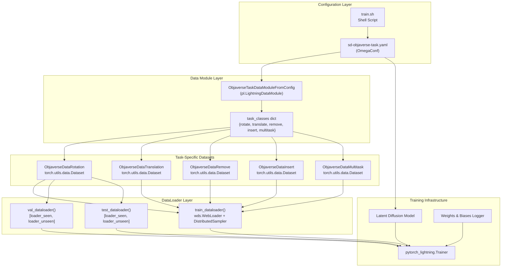
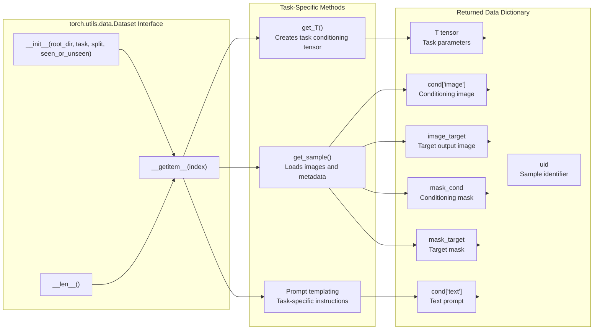
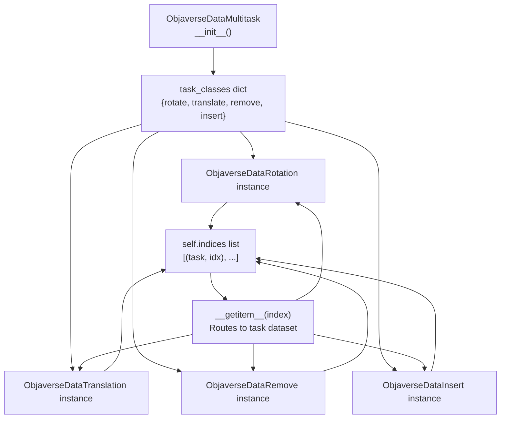
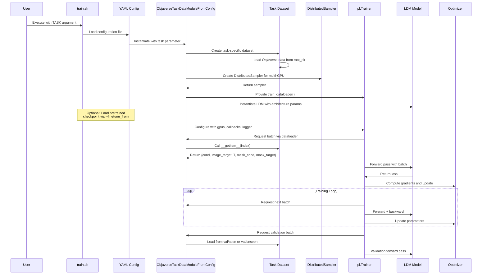

<!-- source: DeepWiki mcp.deepwiki.com · repo allenai/object-edit · page 4 Training System · fetched 2026-10-26 -->

# Training System

<details>
<summary>Relevant source files</summary>

The following files were used as context for generating this wiki page:

- [README.md](README.md)
- [ldm/data/simple.py](ldm/data/simple.py)

</details>


## Purpose and Scope

This document provides an overview of the training system in the OBJect 3DIT repository, which orchestrates the fine-tuning or training from scratch of latent diffusion models for 3D-aware image editing tasks. The training system integrates PyTorch Lightning for training orchestration, task-specific data modules for dataset management, and configuration-driven workflows for reproducibility.

For detailed information about training configuration files and parameters, see [Training Configuration](#4.1). For the complete training workflow and shell scripts, see [Training Workflow and Scripts](#4.2). For checkpoint management and model loading details, see [Model Checkpoints and Loading](#4.4).

**Sources:** [README.md:47-52](), [ldm/data/simple.py:31-76]()

## System Components

The training system consists of four primary components that work together to enable end-to-end model training:

| Component | Primary Classes/Files | Purpose |
|-----------|----------------------|---------|
| **Data Module** | `ObjaverseTaskDataModuleFromConfig` | PyTorch Lightning DataModule that instantiates task-specific datasets and creates train/validation/test dataloaders |
| **Task Datasets** | `ObjaverseDataRotation`, `ObjaverseDataTranslation`, `ObjaverseDataRemove`, `ObjaverseDataInsert`, `ObjaverseDataMultitask` | Dataset implementations for each editing task, handling task-specific data loading and preprocessing |
| **Training Infrastructure** | PyTorch Lightning `Trainer` | Orchestrates training loops, optimization, distributed training, and logging |
| **Configuration System** | OmegaConf YAML files | Defines model architecture, dataset paths, hyperparameters, and training settings |

**Sources:** [ldm/data/simple.py:31-48](), [README.md:47-52]()

## Training Architecture

The following diagram illustrates the complete training architecture, mapping high-level concepts to concrete code entities:



**Training Architecture: Code Entity Mapping**

This architecture follows a hierarchical design where configuration flows down through layers, ultimately feeding data to the PyTorch Lightning Trainer. The `ObjaverseTaskDataModuleFromConfig` class acts as the central coordinator, using the `task_classes` dictionary [ldm/data/simple.py:41-48]() to instantiate the appropriate dataset implementation based on the task specified in the configuration.

**Sources:** [ldm/data/simple.py:31-98](), [README.md:47-52]()

## Data Module System

The `ObjaverseTaskDataModuleFromConfig` class [ldm/data/simple.py:31-64]() is a PyTorch Lightning DataModule that serves as the interface between raw dataset files and the training system. It handles three key responsibilities:

### Task Routing

The data module maintains a `task_classes` dictionary that maps task names to dataset class implementations:

```python
self.task_classes = {
    "rotate": ObjaverseDataRotation,
    "translate": ObjaverseDataTranslation,
    "remove": ObjaverseDataRemove,
    "insert": ObjaverseDataInsert,
    "multitask": ObjaverseDataMultitask
}
```

**Sources:** [ldm/data/simple.py:41-48]()

### DataLoader Creation

The data module implements three methods that return dataloaders for different phases of training:

| Method | Return Type | Purpose | Special Handling |
|--------|-------------|---------|------------------|
| `train_dataloader()` | Single `wds.WebLoader` | Training data with distributed sampling | Uses `DistributedSampler` for multi-GPU training |
| `val_dataloader()` | List of 2 `wds.WebLoader` | Validation data | Returns `[loader_seen, loader_unseen]` for separate evaluation |
| `test_dataloader()` | List of 2 `wds.WebLoader` | Test data | Returns `[loader_seen, loader_unseen]` for separate evaluation |

**Sources:** [ldm/data/simple.py:66-121]()

### Image Preprocessing Pipeline

All datasets receive a shared `image_transforms` pipeline that:
1. Resizes images to the configured size (typically 256×256)
2. Converts to tensors
3. Normalizes from [0,1] to [-1,1] range
4. Rearranges dimensions to HWC format

**Sources:** [ldm/data/simple.py:57-63]()

## Task-Specific Dataset Implementations

Each task has a dedicated dataset class that inherits from `torch.utils.data.Dataset` and implements task-specific logic for loading data and creating conditioning tensors.



**Dataset Interface and Data Flow**

**Sources:** [ldm/data/simple.py:123-483]()

### Task Conditioning Tensor Format

Each task creates a unique 4-dimensional conditioning tensor `T` that encodes task-specific parameters:

| Task | T Tensor Format | Parameters | Code Reference |
|------|----------------|------------|----------------|
| **Rotation** | `[π/2, sin(θ), cos(θ), 0]` | θ = rotation angle in radians | [ldm/data/simple.py:167-170]() |
| **Translation** | `[0, x, y, 0]` | x, y = 2D translation coordinates | [ldm/data/simple.py:246-248]() |
| **Removal** | `[0, 0, 0, 0]` | No parameters (zero vector) | [ldm/data/simple.py:323-325]() |
| **Insertion** | `[0, x, y, 0]` | x, y = 2D insertion location | [ldm/data/simple.py:395-397]() |

The rotation task uses the Zero123 format with `π/2` as the first element and trigonometric encoding of the azimuth angle [ldm/data/simple.py:169](). Translation and insertion use the same format but encode 2D coordinates directly.

**Sources:** [ldm/data/simple.py:167-170](), [ldm/data/simple.py:246-248](), [ldm/data/simple.py:323-325](), [ldm/data/simple.py:395-397]()

### Prompt Templating

Each task uses specific prompt templates that combine with object descriptions from the `objaverse_cat_descriptions_64k.json` annotation file:

- **Rotation:** `"rotate the {description}"`
- **Translation:** `"move the {description}"`
- **Removal:** `"remove the {description}"`
- **Insertion:** `"insert the {description}"`

**Sources:** [ldm/data/simple.py:156-187](), [ldm/data/simple.py:235-264](), [ldm/data/simple.py:312-339](), [ldm/data/simple.py:414]()

### Multitask Dataset Aggregation

The `ObjaverseDataMultitask` class [ldm/data/simple.py:430-483]() aggregates all four task datasets into a single unified dataset:



**Multitask Dataset Architecture**

The multitask dataset creates a flat list of `(task, index)` tuples [ldm/data/simple.py:466-469]() and routes `__getitem__` calls to the appropriate task dataset [ldm/data/simple.py:480-483](), enabling joint training across all editing tasks.

**Sources:** [ldm/data/simple.py:430-483]()

## Training Workflow

The training process follows this sequence from script invocation to model updates:



**Training Sequence: From Script to Model Updates**

The training system uses PyTorch Lightning's automatic training loop, which handles gradient accumulation, mixed precision training, distributed data parallel (DDP) mode, and checkpoint saving. The `DistributedSampler` [ldm/data/simple.py:75]() ensures that each GPU processes different samples during multi-GPU training.

**Sources:** [README.md:47-52](), [ldm/data/simple.py:66-98]()

## Key Training Features

### Seen vs. Unseen Splits

The validation and test dataloaders return two separate loaders [ldm/data/simple.py:78-98]():
- **Seen split:** Evaluates on object categories present in the training set
- **Unseen split:** Evaluates on held-out object categories for generalization testing

This design enables separate tracking of in-distribution vs. out-of-distribution performance. The training split only contains "seen" data [ldm/data/simple.py:137]().

**Sources:** [ldm/data/simple.py:78-121]()

### WebDataset Integration

All dataloaders use `webdataset.WebLoader` [ldm/data/simple.py:76]() instead of standard PyTorch `DataLoader` for efficient streaming of large-scale data. This enables:
- Memory-efficient iteration over tar archives
- Better I/O performance for distributed training
- Seamless integration with the WebDataset format used by large datasets

**Sources:** [ldm/data/simple.py:76-98]()

### Checkpoint Initialization

The training script supports two initialization modes via `train.sh` [README.md:49]():
1. **Fine-tuning:** Use `--finetune_from` argument with path to Zero123 or Stable Diffusion checkpoint
2. **Training from scratch:** Omit `--finetune_from` argument to randomly initialize

Fine-tuning from pretrained checkpoints is the recommended approach as it leverages prior knowledge of 3D-aware image generation and text-image conditioning.

**Sources:** [README.md:47-52]()

### Multi-GPU Training Configuration

The `--gpus` argument in `train.sh` specifies which GPUs to use for distributed training [README.md:49](). PyTorch Lightning automatically handles:
- Distributed Data Parallel (DDP) setup
- Gradient synchronization across GPUs
- Dataset splitting via `DistributedSampler`

**Sources:** [README.md:49](), [ldm/data/simple.py:75]()

## Data Sample Structure

Each sample returned by the dataset classes follows a consistent dictionary structure:

```python
{
    "cond": {
        "image": tensor,  # Conditioning input image (HWC format, normalized to [-1,1])
        "text": str       # Text prompt with task instruction and object description
    },
    "image_target": tensor,   # Target output image (HWC format, normalized to [-1,1])
    "mask_cond": tensor,      # Binary mask for conditioning image (HW format)
    "mask_target": tensor,    # Binary mask for target image (HW format)
    "T": tensor,              # Task conditioning tensor (4D vector)
    "uid": str,               # Unique sample identifier (directory name)
    "log_key": str            # Logging key indicating task/split/seen
}
```

The `mask_cond` and `mask_target` tensors identify object regions using a special color-to-binary conversion [ldm/data/simple.py:491-516]() that extracts the object of interest from a predefined color palette.

**Sources:** [ldm/data/simple.py:172-201](), [ldm/data/simple.py:491-516]()

## Dataset Directory Structure

All task datasets expect the following directory structure in the `root_dir`:

```
root_dir/
└── {task}/                    # rotate, translate, or remove
    └── {split}/               # train, val, or test
        └── {seen_or_unseen}/  # seen or unseen (only for val/test)
            └── {uid}/         # Unique sample identifier
                ├── 1.png
                ├── 2.png
                ├── 1_mask.png
                ├── 2_mask.png
                └── metadata.json
```

For the insertion task, data is loaded from the `remove` directory with images swapped [ldm/data/simple.py:377]().

**Sources:** [README.md:34-45](), [ldm/data/simple.py:143-147](), [ldm/data/simple.py:377]()

---

