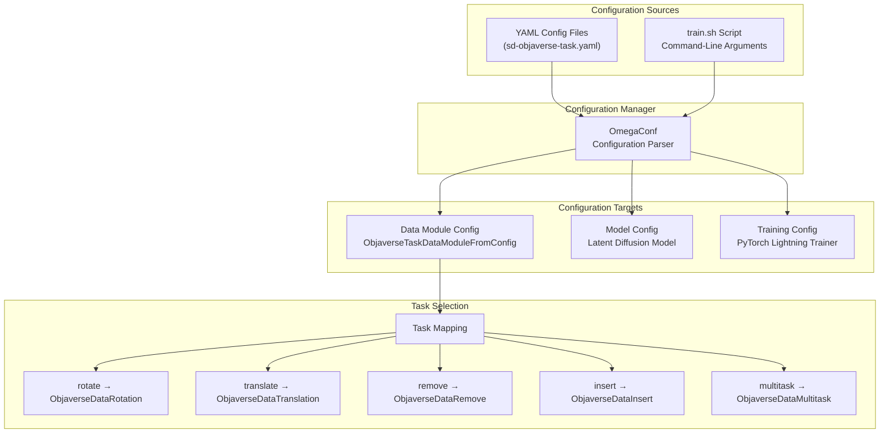
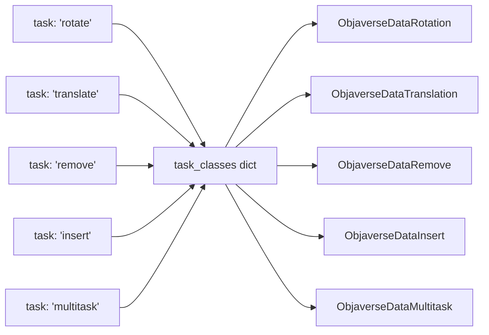
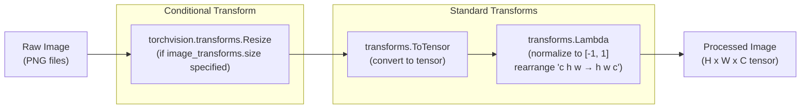
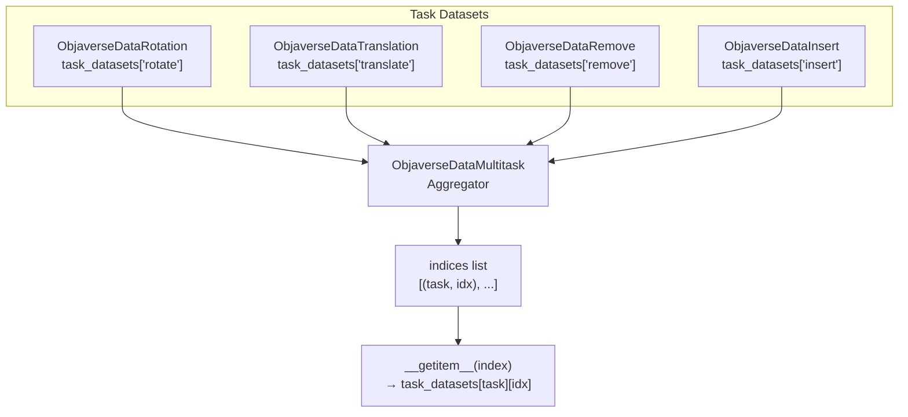
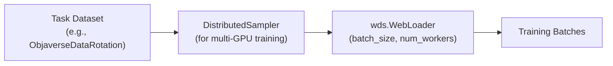
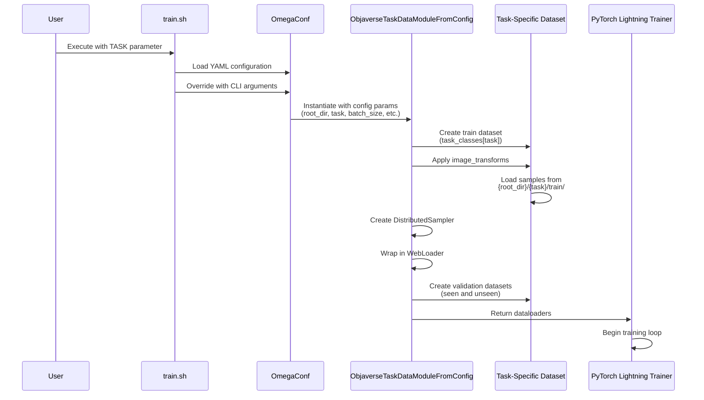

<!-- source: DeepWiki mcp.deepwiki.com · repo allenai/object-edit · page 4.1 Training Configuration · fetched 2026-10-26 -->

# Training Configuration

<details>
<summary>Relevant source files</summary>

The following files were used as context for generating this wiki page:

- [README.md](README.md)
- [ldm/data/simple.py](ldm/data/simple.py)

</details>


## Purpose and Scope

This document explains the configuration system for training the OBJect 3DIT model, including how to specify tasks, datasets, and training parameters through configuration files and command-line arguments. The configuration system uses OmegaConf to manage YAML-based settings for data loading, model parameters, and training hyperparameters.

For information about the actual training workflow and execution, see [Training Workflow and Scripts](#4.2). For details on model checkpoints and loading procedures, see [Model Checkpoints and Loading](#4.4).

## Configuration System Architecture

The training system uses a hierarchical configuration approach where YAML configuration files define the core parameters, which can be overridden by command-line arguments passed to the `train.sh` script.



**Sources:** [README.md:48-52](), [ldm/data/simple.py:31-50]()

## Data Module Configuration

The `ObjaverseTaskDataModuleFromConfig` class serves as the primary interface for configuring data loading. This PyTorch Lightning DataModule accepts configuration parameters that control dataset loading, preprocessing, and batching.

### Core Data Parameters

| Parameter | Type | Description | Default |
|-----------|------|-------------|---------|
| `root_dir` | str | Root directory containing task datasets | Required |
| `task` | str | Task type: "rotate", "translate", "remove", "insert", or "multitask" | Required |
| `batch_size` | int | Number of samples per batch | Required |
| `num_workers` | int | Number of worker processes for data loading | 4 |
| `num_samples` | int | Maximum number of samples to use from dataset | 100000 |
| `train` | DictConfig | Training dataset configuration | None |
| `validation` | DictConfig | Validation dataset configuration | None |
| `test` | DictConfig | Test dataset configuration | None |

**Sources:** [ldm/data/simple.py:31-39]()

### Task Class Mapping

The configuration system maps task strings to specific dataset implementation classes:



The mapping is defined at [ldm/data/simple.py:41-48]() and enforced with an assertion at [ldm/data/simple.py:50]().

**Sources:** [ldm/data/simple.py:41-50]()

## Image Transform Configuration

Image transforms are configured through the dataset configuration and applied to all loaded images. The transform pipeline converts raw images into the format expected by the model.

### Transform Pipeline Structure



The transform configuration is extracted from the dataset config at [ldm/data/simple.py:57-63](). If `image_transforms.size` is specified, a resize operation is added. All images are then converted to tensors, normalized to the range [-1, 1], and rearranged from channel-first to channel-last format.

**Sources:** [ldm/data/simple.py:57-63]()

## Task-Specific Dataset Configuration

Each task type requires specific configuration parameters and generates task-specific conditioning tensors during training.

### Dataset Constructor Parameters

All task-specific datasets share common constructor parameters:

| Parameter | Type | Description | Usage |
|-----------|------|-------------|-------|
| `root_dir` | str | Root directory for dataset | Joined with task/split paths |
| `image_transforms` | list | Composed torchvision transforms | Applied to all images |
| `task` | str | Task identifier | Must match class's expected task |
| `split` | str | Data split: "train", "val", or "test" | Determines subdirectory |
| `seen_or_unseen` | str | Category visibility: "seen" or "unseen" | Not used for training split |
| `num_samples` | int | Maximum samples to load | Limits dataset size |

**Sources:** [ldm/data/simple.py:124-131](), [ldm/data/simple.py:204-211](), [ldm/data/simple.py:281-288](), [ldm/data/simple.py:354-361]()

### Directory Structure Constraints

The configuration enforces a specific directory structure that must be followed:

```
{root_dir}/{task}/{split}/{seen_or_unseen}/
```

For training splits, the structure is simplified to:

```
{root_dir}/{task}/{split}/
```

This is enforced by assertions preventing unseen data in training splits at [ldm/data/simple.py:137](), [ldm/data/simple.py:217](), [ldm/data/simple.py:294](), [ldm/data/simple.py:367]().

**Sources:** [ldm/data/simple.py:137-148](), [ldm/data/simple.py:217-226](), [README.md:34-45]()

### Rotation Task Configuration

The rotation task generates transformation tensors encoding azimuth angles in the format expected by Zero123:

```python
# From ldm/data/simple.py:167-170
def get_T(self, rotation):
    azimuth = math.radians(rotation)
    d_T = torch.tensor([np.pi / 2, math.sin(azimuth), math.cos(azimuth), 0])
    return d_T
```

The rotation angle is extracted from `metadata["rotation_angle"]` in the sample's metadata.json file. Text prompts are formatted as "rotate the {object_description}".

**Sources:** [ldm/data/simple.py:123-201](), [ldm/data/simple.py:167-170]()

### Translation Task Configuration

The translation task generates transformation tensors encoding 2D displacement coordinates:

```python
# From ldm/data/simple.py:246-248
def get_T(self, x, y):
    d_T = torch.tensor([0, x, y, 0])
    return d_T
```

Translation coordinates are extracted from `metadata["end_location_2d"]`. Text prompts are formatted as "move the {object_description}".

**Sources:** [ldm/data/simple.py:203-278](), [ldm/data/simple.py:246-248]()

### Remove Task Configuration

The remove task uses a zero transformation tensor since no spatial transformation is applied:

```python
# From ldm/data/simple.py:323-325
def get_T(self):
    d_T = torch.tensor([0., 0., 0., 0.])
    return d_T
```

Note the special mask handling: `data["mask_target"]` is set to `mask_cond` (not `mask_target`) because the target image has no object after removal [ldm/data/simple.py:341]().

Text prompts are formatted as "remove the {object_description}".

**Sources:** [ldm/data/simple.py:280-351](), [ldm/data/simple.py:323-325](), [ldm/data/simple.py:341]()

### Insert Task Configuration

The insert task reuses the remove dataset directory by inverting source and target images:

```python
# From ldm/data/simple.py:377
self.root_dir = os.path.join(root_dir, os.path.join("remove", split_seen))
```

Images are swapped at [ldm/data/simple.py:405](): `target_im, cond_im, mask_target, mask_cond, metadata = get_sample(...)` (note the order).

Transformation tensors encode the insertion location:

```python
# From ldm/data/simple.py:395-397
def get_T(self, x, y):
    d_T = torch.tensor([0, x, y, 0])
    return d_T
```

The insertion coordinates are extracted from `metadata["removed_object_camera_coords"]`. Text prompts are formatted as "insert the {object_description}".

**Sources:** [ldm/data/simple.py:353-427](), [ldm/data/simple.py:377](), [ldm/data/simple.py:405]()

### Multitask Configuration

The multitask dataset aggregates all individual task datasets and samples from them:



The multitask dataset creates all four task datasets with identical parameters [ldm/data/simple.py:455-464]() and builds a flat index list mapping to (task, index) pairs [ldm/data/simple.py:466-473]().

**Sources:** [ldm/data/simple.py:430-483](), [ldm/data/simple.py:455-464](), [ldm/data/simple.py:466-473]()

## DataLoader Configuration

The configuration creates three types of dataloaders with different characteristics:

### Training DataLoader



Training uses `DistributedSampler` for multi-GPU training and sets `shuffle=False` since shuffling is handled by the sampler [ldm/data/simple.py:75-76]().

**Sources:** [ldm/data/simple.py:66-76]()

### Validation and Test DataLoaders

Validation and test phases create separate dataloaders for seen and unseen categories:

- **Seen loader**: Uses samples from seen categories during training
- **Unseen loader**: Uses samples from categories not seen during training

Both return a list of two loaders `[loader_seen, loader_unseen]` [ldm/data/simple.py:98](), [ldm/data/simple.py:121]().

The validation split uses a fixed 512 samples per category [ldm/data/simple.py:85](), [ldm/data/simple.py:95](), while test uses the full `num_samples` parameter.

**Sources:** [ldm/data/simple.py:78-121]()

## Training Script Parameters

The `train.sh` script accepts several key configuration parameters:

### Required Arguments

| Argument | Description | Example Values |
|----------|-------------|----------------|
| `TASK` | Task to train on | "rotate", "remove", "insert", "translate", "multitask" |

### Optional Arguments

| Argument | Description | Default |
|----------|-------------|---------|
| `--finetune_from` | Path to pretrained checkpoint (Zero123 or SD) | None (train from scratch) |
| `--gpus` | GPU device IDs for training | System-dependent |

To train from scratch, the `--finetune_from` argument should be omitted. When finetuning, the checkpoint path should point to either a Zero123 or Image-Conditioned Stable Diffusion checkpoint.

**Sources:** [README.md:48-52]()

## Object Annotations

All tasks require object descriptions from the `objaverse_cat_descriptions_64k.json` file for generating text prompts. This file maps object UIDs to natural language descriptions:

```python
# Loaded in each dataset class
with open("objaverse_cat_descriptions_64k.json", "r") as f:
    self.object_annot = json.load(f)

# Used to generate prompts
prompt = self.object_annot[metadata["object_data"][0]["uid"]]["description"]
prompt = "rotate the {}".format(prompt)
```

The annotation file is loaded at [ldm/data/simple.py:152-153](), [ldm/data/simple.py:227-228](), [ldm/data/simple.py:309-310](), [ldm/data/simple.py:383-384]().

**Sources:** [ldm/data/simple.py:152-153](), [ldm/data/simple.py:186-187]()

## Configuration Workflow

The complete configuration workflow from YAML to training:



**Sources:** [README.md:48-52](), [ldm/data/simple.py:31-121]()

## Configuration Examples

### Single Task Training Configuration

To configure training for the rotation task:
- Set `task="rotate"` in DataModule configuration
- Dataset directory: `{root_dir}/rotate/train/`
- Text prompts: "rotate the {object}"
- Transformation tensor: `[π/2, sin(θ), cos(θ), 0]`

### Multitask Training Configuration

To configure training for all tasks simultaneously:
- Set `task="multitask"` in DataModule configuration
- Creates four separate datasets internally
- Samples interleaved from all tasks
- Total dataset size = sum of individual task dataset sizes

**Sources:** [ldm/data/simple.py:41-48](), [ldm/data/simple.py:430-483]()

---

