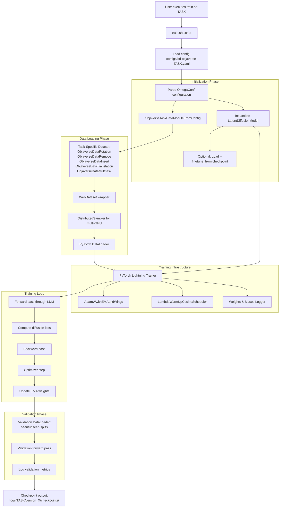
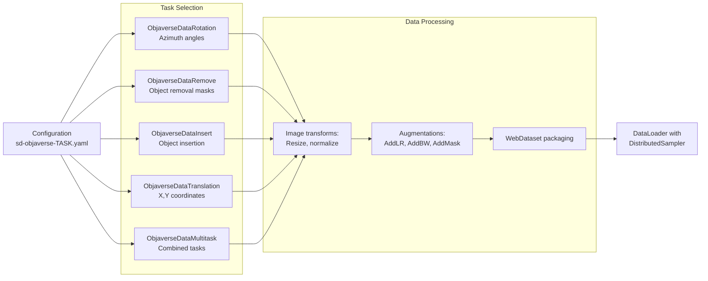
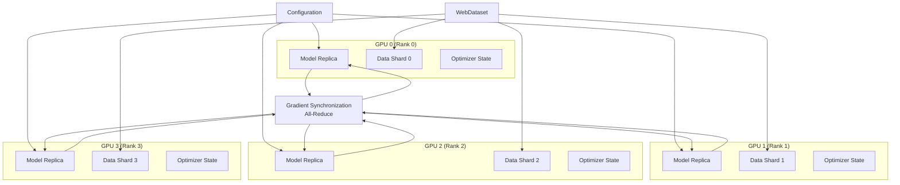

<!-- source: DeepWiki mcp.deepwiki.com · repo allenai/object-edit · page 4.2 Training Workflow and Scripts · fetched 2026-10-26 -->

# Training Workflow and Scripts

<details>
<summary>Relevant source files</summary>

The following files were used as context for generating this wiki page:

- [README.md](README.md)
- [ldm/lr_scheduler.py](ldm/lr_scheduler.py)

</details>


## Purpose and Scope

This document describes the training workflow for the OBJect 3DIT system, focusing on how to execute training runs using the provided shell scripts and understanding the complete training pipeline. For information about configuration files and parameters, see [Training Configuration](#4.1). For details on learning rate scheduling algorithms, see [Learning Rate Scheduling](#4.3). For checkpoint management and model loading, see [Model Checkpoints and Loading](#4.4).

The training system uses PyTorch Lightning to orchestrate the training process and supports both training from scratch and finetuning from pretrained checkpoints such as Zero123 or Stable Diffusion.

## Training Script Overview

The primary entry point for training is the `train.sh` shell script referenced in the README. This script orchestrates the training process by invoking the appropriate Python training module with task-specific configurations.

### Script Usage

```bash
. train.sh TASK
```

Where `TASK` is one of:
- `rotate` - Train the object rotation task
- `remove` - Train the object removal task  
- `insert` - Train the object insertion task
- `translate` - Train the object translation task
- `multitask` - Train a unified model across all tasks

### Key Training Arguments

The training script accepts several critical arguments:

| Argument | Purpose | Example Value |
|----------|---------|---------------|
| `--finetune_from` | Path to pretrained checkpoint for finetuning | Path to Zero123 or SD checkpoint |
| `--gpus` | GPU device IDs to use | `0,1,2,3` for 4 GPUs |
| `--task` | Specific editing task to train | `rotate`, `remove`, `insert`, `translate` |

**Sources:** [README.md:47-52]()

## Training Workflow Architecture

The following diagram illustrates the complete training workflow from script invocation to model output:

### Training Pipeline Flow



**Sources:** [README.md:47-52](), System Architecture Diagram 2

## Training Workflow Steps

### Step 1: Environment and Configuration Setup

When `train.sh` is executed, the system performs the following initialization:

1. **Configuration Loading**: The script loads the task-specific YAML configuration file from `configs/sd-objaverse-{TASK}.yaml` using OmegaConf
2. **Data Module Initialization**: An `ObjaverseTaskDataModuleFromConfig` instance is created, which sets up the appropriate dataset loader
3. **Model Instantiation**: A `LatentDiffusionModel` is instantiated with the configuration parameters

### Step 2: Optional Finetuning Checkpoint Loading

If the `--finetune_from` argument is provided:

1. The system loads the pretrained checkpoint (Zero123 or Image-Conditioned Stable Diffusion)
2. The checkpoint state dictionary is loaded into the model
3. Input channel mismatches are automatically handled (4-channel to 8-channel conversion for concatenated conditioning)

For training from scratch, omit the `--finetune_from` argument entirely.

### Step 3: Data Pipeline Setup

The data pipeline is configured based on the specified task:



**Sources:** [README.md:25-45](), System Architecture Diagram 2

### Step 4: Training Infrastructure Initialization

PyTorch Lightning's `Trainer` class orchestrates the training process:

| Component | Class/Function | Purpose |
|-----------|----------------|---------|
| Optimizer | `AdamWwithEMAandWings` | Parameter updates with exponential moving average |
| LR Scheduler | `LambdaWarmUpCosineScheduler` | Learning rate warm-up and cosine decay |
| Logger | Weights & Biases | Experiment tracking and metrics logging |
| Callbacks | Model checkpointing | Periodic model state saving |

### Step 5: Training Loop Execution

The training loop executes the following steps for each batch:

1. **Forward Pass**: The input image and conditioning (text prompt, task parameters) pass through the `LatentDiffusionModel`
2. **Loss Computation**: The diffusion loss is computed between predicted and actual noise
3. **Backward Pass**: Gradients are computed via backpropagation
4. **Optimizer Step**: Model parameters are updated
5. **EMA Update**: Exponential moving average weights are updated for improved inference quality

### Step 6: Validation

Periodically during training, the model is evaluated on validation data:

- The validation set includes both **seen** and **unseen** object categories
- Validation metrics are computed and logged to Weights & Biases
- No gradient updates occur during validation

### Step 7: Checkpoint Saving

Model checkpoints are saved to `logs/{TASK}/version_{X}/checkpoints/` at regular intervals. Checkpoints include:
- Model state dictionary
- Optimizer state
- Learning rate scheduler state
- Training step counter
- EMA weights

**Sources:** System Architecture Diagram 2

## Finetuning from Pretrained Models

### Supported Pretrained Checkpoints

The system supports finetuning from two types of pretrained checkpoints:

1. **Zero123**: 3D-aware image generation model
2. **Image-Conditioned Stable Diffusion**: Lambda Labs' image-conditioned variant

### Finetuning Workflow

To finetune from a pretrained checkpoint:

1. Download the checkpoint from the Hugging Face repository or the original source
2. Modify the `--finetune_from` path in `train.sh` to point to the checkpoint file
3. Execute the training script:

```bash
. train.sh TASK
```

The system automatically:
- Loads the checkpoint weights
- Handles input channel dimension mismatches
- Continues training from the pretrained state

### Input Channel Adaptation

When finetuning from a 4-channel input model (standard Stable Diffusion) to an 8-channel input model (with concatenated image conditioning), the system automatically:

1. Duplicates the existing 4-channel weights
2. Initializes the additional 4 channels appropriately
3. Allows the model to learn the new input representation during training

**Sources:** [README.md:49-50]()

## Training from Scratch

To train a model from randomly initialized weights:

1. Remove the `--finetune_from` argument from `train.sh`
2. Execute the training script:

```bash
. train.sh TASK
```

Training from scratch requires:
- Longer training time to converge
- More computational resources
- Potentially larger batch sizes for stability

**Sources:** [README.md:49]()

## Task-Specific Training

### Task Parameters

Each task uses different conditioning parameters encoded in the task tensor `T`:

| Task | Tensor Format | Description |
|------|---------------|-------------|
| `rotate` | `[π/2, sin(θ), cos(θ), 0]` | Azimuth rotation angle in radians |
| `remove` | `[0, 0, 0, 0]` | No spatial parameters needed |
| `insert` | `[0, x, y, 0]` | Insertion coordinates (x, y) |
| `translate` | `[0, x, y, 0]` | Translation offsets (x, y) |

### Multitask Training

The `multitask` option trains a single model to handle all four editing tasks:

```bash
. train.sh multitask
```

The multitask model:
- Uses `ObjaverseDataMultitask` dataset loader
- Samples examples from all four tasks during training
- Learns task-agnostic representations
- Requires longer training time but produces a unified model

**Sources:** [README.md:49](), System Architecture Diagram 3

## Multi-GPU Training

### GPU Configuration

The training script supports multi-GPU distributed training via the `--gpus` argument:

```bash
# Example: Use GPUs 0, 1, 2, 3
--gpus 0,1,2,3
```

### Distributed Training Architecture



### Distributed Data Loading

The system uses `DistributedSampler` to:
- Partition the dataset across GPUs
- Ensure each GPU processes unique samples per epoch
- Maintain reproducibility with synchronized random seeds

PyTorch Lightning handles:
- Process group initialization
- Gradient synchronization across GPUs
- Collective operations (all-reduce for gradient averaging)

**Sources:** [README.md:49](), System Architecture Diagram 2

## Experiment Tracking

### Weights & Biases Integration

The training system integrates with Weights & Biases (W&B) for experiment tracking:

1. **Metrics Logging**: Training loss, validation loss, learning rate
2. **System Metrics**: GPU utilization, memory usage, throughput
3. **Hyperparameters**: All configuration parameters are logged
4. **Model Artifacts**: Checkpoints can be uploaded to W&B

### Logged Metrics

During training, the following metrics are tracked:

| Metric Category | Examples |
|-----------------|----------|
| Training Loss | `train/loss`, `train/loss_simple`, `train/loss_vlb` |
| Validation Loss | `val/loss`, `val/rec_loss` |
| Learning Rate | `lr` |
| System | `epoch`, `step`, `gpu_memory` |

**Sources:** System Architecture Diagram 2

## Training Outputs

### Checkpoint Directory Structure

Training outputs are saved in the following structure:

```
logs/
└── {TASK}/
    └── version_{X}/
        ├── checkpoints/
        │   ├── epoch=000-step=000000.ckpt
        │   ├── epoch=001-step=000500.ckpt
        │   └── last.ckpt
        ├── hparams.yaml
        └── events.out.tfevents.*
```

### Checkpoint Contents

Each checkpoint file contains:

| Component | Description |
|-----------|-------------|
| `state_dict` | Model parameters |
| `optimizer_states` | Optimizer state (momentum, etc.) |
| `lr_schedulers` | Learning rate scheduler state |
| `epoch` | Current epoch number |
| `global_step` | Total training steps |
| `model_ema` | EMA model parameters (if enabled) |

### Using Saved Checkpoints

Saved checkpoints can be used for:
1. **Resuming Training**: Continue training from a saved state
2. **Inference**: Generate images using the trained model (see [Generation Pipeline](#5.1))
3. **Evaluation**: Benchmark performance on test sets (see [Running Evaluations](#6.1))
4. **Finetuning**: Initialize a new training run with a trained model

**Sources:** [README.md:46]()

## Training Time and Resources

### Computational Requirements

Typical training resource requirements:

| Configuration | Value |
|---------------|-------|
| GPUs | 4x NVIDIA A100 (40GB) recommended |
| Training Time | ~24-48 hours per task (dataset dependent) |
| Batch Size | 8-16 per GPU (depends on available memory) |
| Checkpoint Size | ~5-10 GB per checkpoint |

### Training Convergence

Training convergence indicators:
- **Training Loss**: Should decrease steadily and stabilize
- **Validation Loss**: Should track training loss without significant divergence
- **Visual Inspection**: Generated samples improve in quality and task accuracy

**Sources:** System Architecture Diagrams

---

