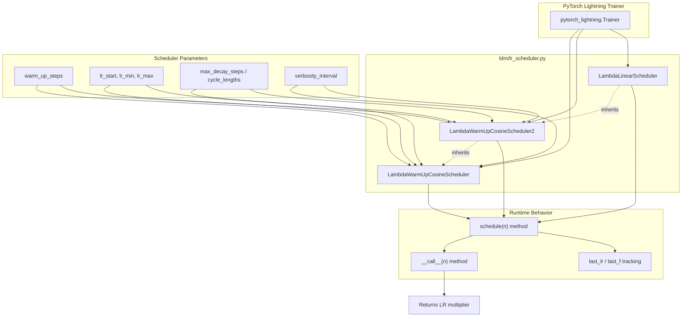
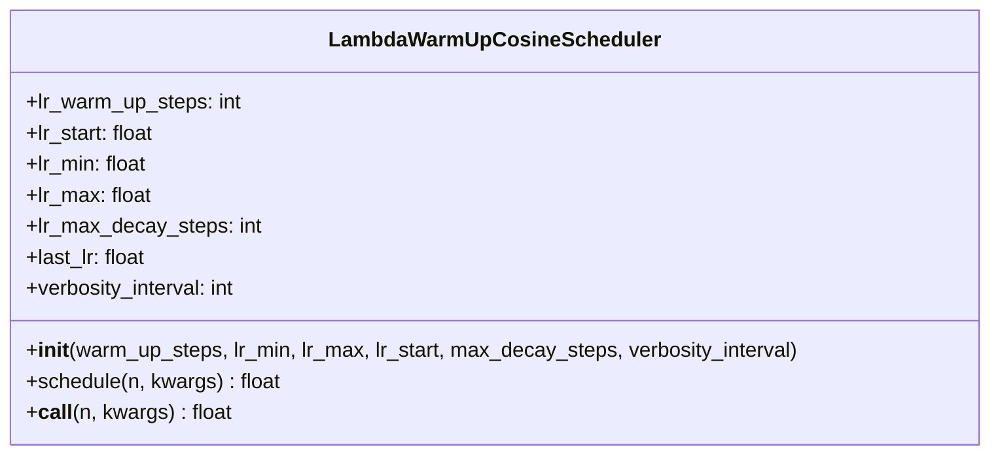
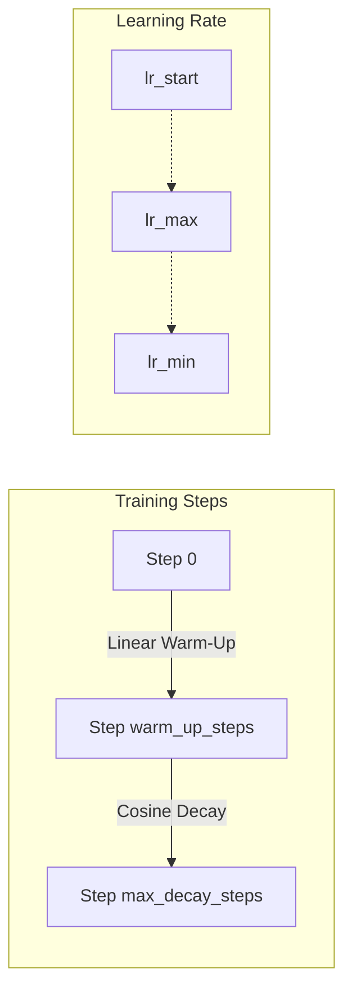
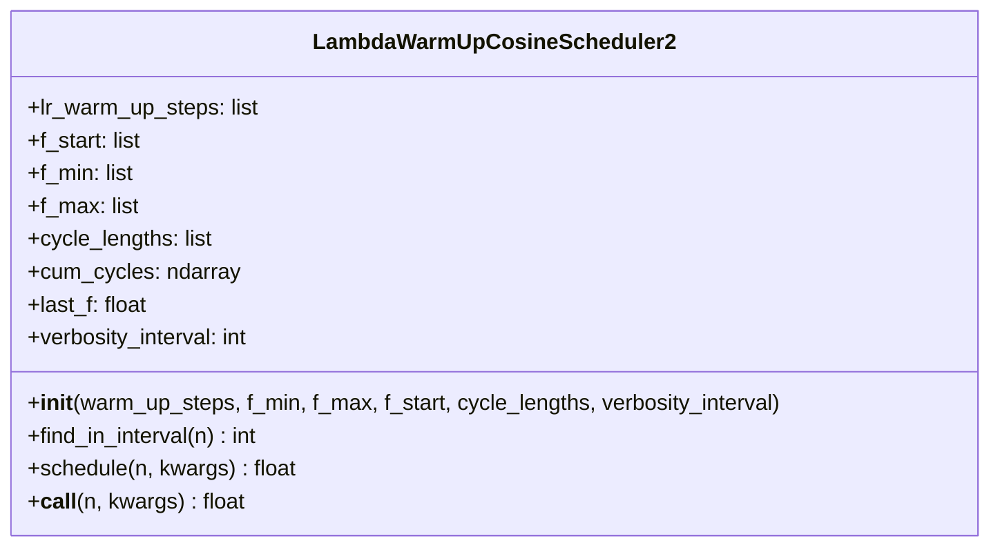
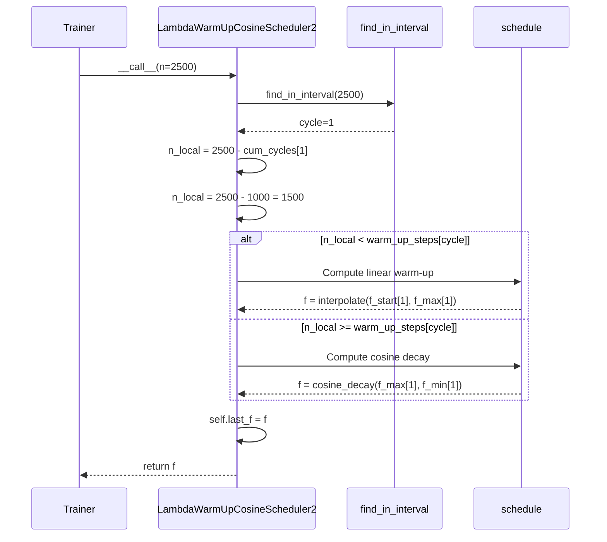
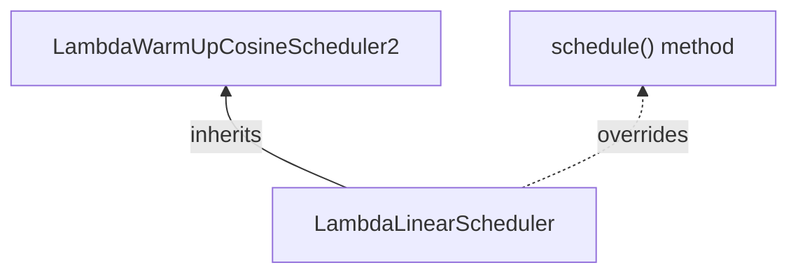
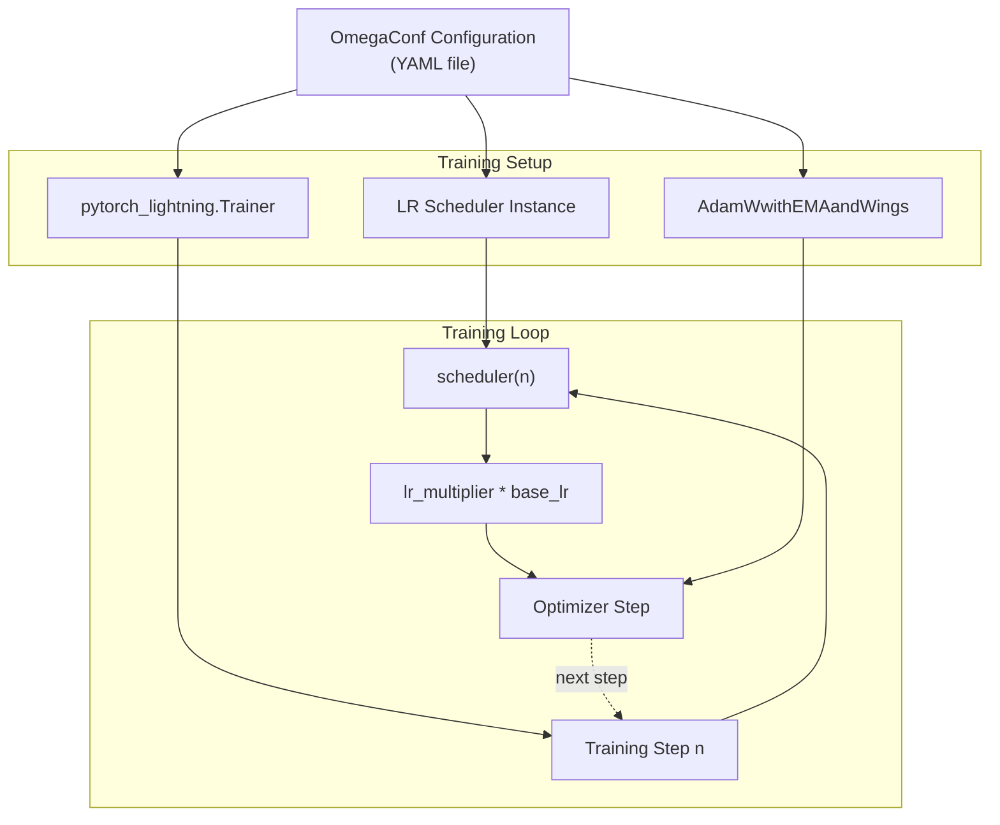

<!-- source: DeepWiki mcp.deepwiki.com · repo allenai/object-edit · page 4.3 Learning Rate Scheduling · fetched 2026-10-26 -->

# Learning Rate Scheduling

<details>
<summary>Relevant source files</summary>

The following files were used as context for generating this wiki page:

- [ldm/__pycache__/lr_scheduler.cpython-39.pyc](ldm/__pycache__/lr_scheduler.cpython-39.pyc)
- [ldm/lr_scheduler.py](ldm/lr_scheduler.py)

</details>


## Purpose and Scope

This document describes the learning rate scheduling system used during model training in the OBJect 3DIT repository. The system provides three scheduler classes that control how the learning rate changes over the course of training, implementing warm-up and decay strategies to improve model convergence.

For information about the broader training workflow and configuration, see [Training System](#4). For details on the optimizer used with these schedulers, see [Training Workflow and Scripts](#4.2). For model checkpointing and training state management, see [Model Checkpoints and Loading](#4.4).

---

## System Overview

The learning rate scheduling system is implemented in [ldm/lr_scheduler.py]() and provides three scheduler classes that compute learning rate multipliers during training. All schedulers are designed to work with a base learning rate of 1.0, returning multiplier values that are applied to the base rate.

**Scheduler Classes:**

| Class | Description | Use Case |
|-------|-------------|----------|
| `LambdaWarmUpCosineScheduler` | Linear warm-up followed by cosine annealing decay | Single-phase training |
| `LambdaWarmUpCosineScheduler2` | Multiple training cycles with configurable warm-up and decay per cycle | Multi-phase or curriculum training |
| `LambdaLinearScheduler` | Linear warm-up followed by linear decay | Simpler alternative to cosine annealing |

All schedulers support optional verbosity logging to track learning rate changes during training.

Sources: [ldm/lr_scheduler.py:1-99]()

---

## Scheduler Architecture



**Scheduler Invocation Flow:**
The trainer calls the scheduler at each training step with the current step number `n`. The scheduler computes and returns a learning rate multiplier based on the training phase (warm-up vs. decay) and the specific decay strategy (cosine, linear, or cyclic).

Sources: [ldm/lr_scheduler.py:4-98]()

---

## LambdaWarmUpCosineScheduler

The `LambdaWarmUpCosineScheduler` class implements a two-phase learning rate schedule: linear warm-up followed by cosine annealing decay.

### Class Structure



### Parameters

| Parameter | Type | Description |
|-----------|------|-------------|
| `warm_up_steps` | int | Number of steps for linear warm-up phase |
| `lr_min` | float | Minimum learning rate multiplier (after decay) |
| `lr_max` | float | Maximum learning rate multiplier (after warm-up) |
| `lr_start` | float | Starting learning rate multiplier at step 0 |
| `max_decay_steps` | int | Total steps over which decay occurs |
| `verbosity_interval` | int | Print logging every N steps (0 = disabled) |

Sources: [ldm/lr_scheduler.py:4-15]()

### Schedule Computation

The scheduler operates in two distinct phases:

**Phase 1: Linear Warm-Up** (steps 0 to `lr_warm_up_steps`)

The learning rate increases linearly from `lr_start` to `lr_max`:

```
lr = (lr_max - lr_start) / lr_warm_up_steps * n + lr_start
```

**Phase 2: Cosine Decay** (steps `lr_warm_up_steps` to `max_decay_steps`)

The learning rate decays following a cosine curve from `lr_max` to `lr_min`:

```
t = (n - lr_warm_up_steps) / (max_decay_steps - lr_warm_up_steps)
t = min(t, 1.0)
lr = lr_min + 0.5 * (lr_max - lr_min) * (1 + cos(t * π))
```

The cosine function creates a smooth decay that starts fast and gradually slows down, which often improves convergence compared to linear decay.

Sources: [ldm/lr_scheduler.py:17-33]()

### Learning Rate Curve Visualization



The learning rate curve:
1. Starts at `lr_start` at step 0
2. Increases linearly to `lr_max` at step `warm_up_steps`
3. Decreases via cosine annealing to `lr_min` at step `max_decay_steps`
4. Remains at `lr_min` for any steps beyond `max_decay_steps`

Sources: [ldm/lr_scheduler.py:20-30]()

---

## LambdaWarmUpCosineScheduler2

The `LambdaWarmUpCosineScheduler2` class extends the basic scheduler to support multiple training cycles, where each cycle can have different warm-up and decay parameters. This is useful for curriculum learning or multi-phase training strategies.

### Class Structure



### Parameters

All parameters except `verbosity_interval` are **lists** with the same length, where each element corresponds to one training cycle:

| Parameter | Type | Description |
|-----------|------|-------------|
| `warm_up_steps` | list[int] | Warm-up steps for each cycle |
| `f_min` | list[float] | Minimum multiplier for each cycle |
| `f_max` | list[float] | Maximum multiplier for each cycle |
| `f_start` | list[float] | Starting multiplier for each cycle |
| `cycle_lengths` | list[int] | Total length of each cycle in steps |
| `verbosity_interval` | int | Print logging every N steps (0 = disabled) |

The class validates that all list parameters have the same length [ldm/lr_scheduler.py:42]().

Sources: [ldm/lr_scheduler.py:36-50]()

### Cycle Management

The scheduler tracks cumulative cycle boundaries using `cum_cycles`:

```python
self.cum_cycles = np.cumsum([0] + list(self.cycle_lengths))
```

For example, with `cycle_lengths = [1000, 2000, 1500]`:
- `cum_cycles = [0, 1000, 3000, 4500]`
- Cycle 0: steps 0-999
- Cycle 1: steps 1000-2999
- Cycle 2: steps 3000-4499

The `find_in_interval(n)` method [ldm/lr_scheduler.py:52-57]() determines which cycle a given step belongs to by comparing against the cumulative boundaries.

Sources: [ldm/lr_scheduler.py:48-57]()

### Multi-Cycle Schedule Flow



The scheduler:
1. Identifies the current cycle using `find_in_interval`
2. Converts the global step `n` to a cycle-local step
3. Applies warm-up or decay using parameters for that specific cycle
4. Returns the computed multiplier

Sources: [ldm/lr_scheduler.py:59-78]()

### Schedule Computation Per Cycle

Within each cycle, the computation mirrors `LambdaWarmUpCosineScheduler`:

**Warm-Up Phase:**
```
f = (f_max[cycle] - f_start[cycle]) / lr_warm_up_steps[cycle] * n_local + f_start[cycle]
```

**Decay Phase:**
```
t = (n_local - lr_warm_up_steps[cycle]) / (cycle_lengths[cycle] - lr_warm_up_steps[cycle])
t = min(t, 1.0)
f = f_min[cycle] + 0.5 * (f_max[cycle] - f_min[cycle]) * (1 + cos(t * π))
```

Sources: [ldm/lr_scheduler.py:65-75]()

---

## LambdaLinearScheduler

The `LambdaLinearScheduler` class inherits from `LambdaWarmUpCosineScheduler2` but replaces the cosine decay with linear decay. This provides a simpler, more predictable decay pattern.

### Inheritance Structure



The class inherits all initialization logic and cycle management from `LambdaWarmUpCosineScheduler2` but overrides only the `schedule()` method to implement linear decay.

Sources: [ldm/lr_scheduler.py:81-97]()

### Linear Decay Implementation

The decay phase uses a linear interpolation from `f_max` to `f_min`:

```
f = f_min[cycle] + (f_max[cycle] - f_min[cycle]) * (cycle_lengths[cycle] - n) / cycle_lengths[cycle]
```

This formula ensures:
- At `n = lr_warm_up_steps[cycle]`: `f = f_max[cycle]`
- At `n = cycle_lengths[cycle]`: `f = f_min[cycle]`
- The decay rate is constant throughout the decay phase

Sources: [ldm/lr_scheduler.py:94-96]()

### Comparison: Cosine vs. Linear Decay

| Aspect | Cosine Decay | Linear Decay |
|--------|--------------|--------------|
| Initial decay rate | Fast | Constant |
| Late decay rate | Slow | Constant |
| Mathematical form | `0.5 * (1 + cos(t * π))` | `1 - t` |
| Use case | Better convergence for many tasks | Simpler, more predictable |
| Implementation | `LambdaWarmUpCosineScheduler2` | `LambdaLinearScheduler` |

Sources: [ldm/lr_scheduler.py:70-73](), [ldm/lr_scheduler.py:95]()

---

## Integration with Training System

The learning rate schedulers are integrated into the PyTorch Lightning training workflow through the optimizer and trainer configuration.

### Scheduler Usage Pattern



**Integration Flow:**
1. Configuration specifies scheduler type and parameters
2. Scheduler instance is created during training setup
3. At each training step, the trainer calls `scheduler(n)` to get the current multiplier
4. The multiplier is applied to the base learning rate
5. The optimizer performs a parameter update with the adjusted learning rate

Sources: [ldm/lr_scheduler.py:17-33](), [ldm/lr_scheduler.py:59-78]()

### Verbosity and Logging

All schedulers support optional logging via the `verbosity_interval` parameter. When set to a positive integer, the scheduler prints the current step and learning rate multiplier every N steps:

```python
if self.verbosity_interval > 0:
    if n % self.verbosity_interval == 0: 
        print(f"current step: {n}, recent lr-multiplier: {self.last_lr}")
```

For cyclic schedulers, the output also includes the current cycle number [ldm/lr_scheduler.py:63-64]().

This logging helps monitor training progress and debug learning rate schedules during development.

Sources: [ldm/lr_scheduler.py:18-19](), [ldm/lr_scheduler.py:62-64](), [ldm/lr_scheduler.py:86-88]()

---

## Configuration Examples

### Single-Phase Training Example

For a typical training run with 100,000 steps:

```python
scheduler = LambdaWarmUpCosineScheduler(
    warm_up_steps=10000,      # 10% of training for warm-up
    lr_start=1e-7,            # Start very small
    lr_max=1.0,               # Peak at base_lr
    lr_min=1e-2,              # Decay to 1% of base_lr
    max_decay_steps=100000,   # Total training steps
    verbosity_interval=1000   # Log every 1000 steps
)
```

This produces:
- Steps 0-10,000: Linear ramp from 1e-7 to 1.0
- Steps 10,000-100,000: Cosine decay from 1.0 to 1e-2

Sources: [ldm/lr_scheduler.py:8-15]()

### Multi-Phase Training Example

For curriculum learning with three phases:

```python
scheduler = LambdaWarmUpCosineScheduler2(
    warm_up_steps=[5000, 2000, 1000],
    f_start=[1e-7, 1e-2, 1e-2],
    f_max=[1.0, 0.5, 0.1],
    f_min=[1e-2, 1e-2, 1e-3],
    cycle_lengths=[50000, 30000, 20000],
    verbosity_interval=1000
)
```

This produces three training phases:
- **Phase 0** (steps 0-49,999): Warm-up to 1.0, decay to 1e-2
- **Phase 1** (steps 50,000-79,999): Warm-up to 0.5, decay to 1e-2
- **Phase 2** (steps 80,000-99,999): Warm-up to 0.1, decay to 1e-3

Sources: [ldm/lr_scheduler.py:41-50]()

### Linear Decay Example

For simpler linear decay instead of cosine:

```python
scheduler = LambdaLinearScheduler(
    warm_up_steps=[10000],
    f_start=[1e-7],
    f_max=[1.0],
    f_min=[1e-2],
    cycle_lengths=[100000],
    verbosity_interval=0
)
```

This produces a single cycle with linear warm-up and linear decay.

Sources: [ldm/lr_scheduler.py:81-97]()

---

## Design Considerations

### Base Learning Rate Convention

All schedulers are designed with the convention that **base_lr = 1.0**. The scheduler returns a multiplier that is applied to the base rate. This design:

- Decouples the scheduling logic from absolute learning rate values
- Makes it easy to experiment with different base learning rates without changing scheduler parameters
- Allows the same scheduler configuration to work with different optimizers

The note "use with a base_lr of 1.0" appears in the docstrings of both `LambdaWarmUpCosineScheduler` [ldm/lr_scheduler.py:5-6]() and `LambdaWarmUpCosineScheduler2` [ldm/lr_scheduler.py:37-39]().

Sources: [ldm/lr_scheduler.py:5-7](), [ldm/lr_scheduler.py:37-40]()

### State Tracking

All schedulers maintain state to track the most recently computed learning rate multiplier:
- `LambdaWarmUpCosineScheduler` stores `self.last_lr` [ldm/lr_scheduler.py:14]()
- `LambdaWarmUpCosineScheduler2` and `LambdaLinearScheduler` store `self.last_f` [ldm/lr_scheduler.py:49]()

This state is used for optional verbosity logging and can be queried for monitoring purposes, though it does not affect the scheduler's computation logic.

Sources: [ldm/lr_scheduler.py:14](), [ldm/lr_scheduler.py:49]()

### Callable Interface

All schedulers implement the `__call__` method, which simply delegates to the `schedule` method:

```python
def __call__(self, n, **kwargs):
    return self.schedule(n, **kwargs)
```

This allows schedulers to be used as callables: `lr = scheduler(step_number)`, which is the standard interface expected by PyTorch Lightning and other training frameworks.

Sources: [ldm/lr_scheduler.py:32-33](), [ldm/lr_scheduler.py:77-78]()

---

