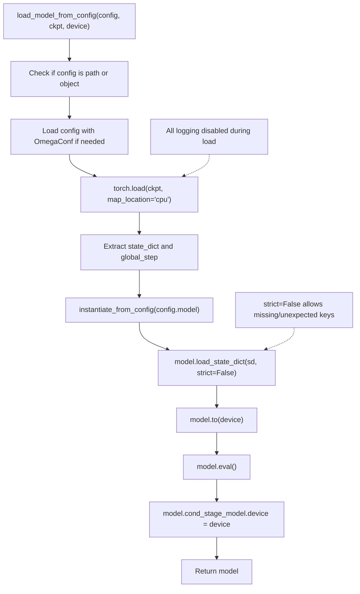
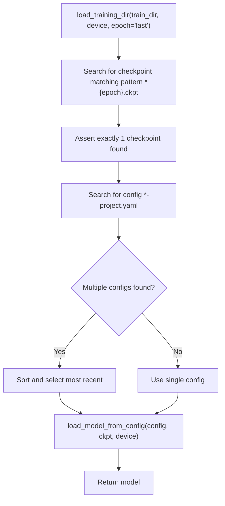
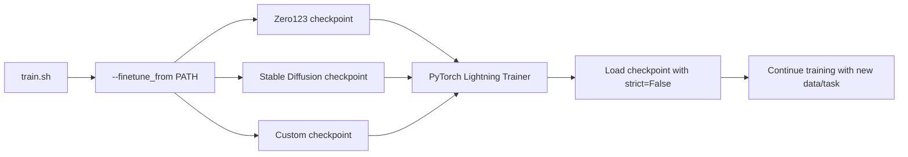
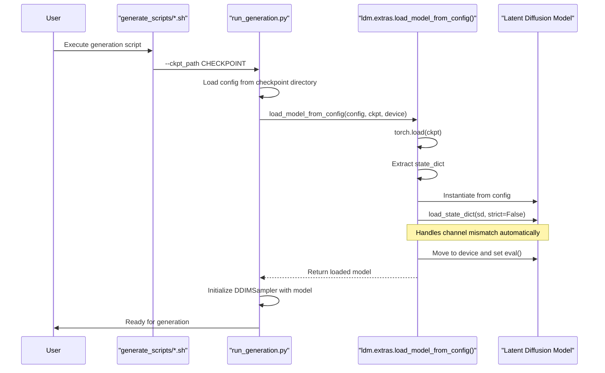
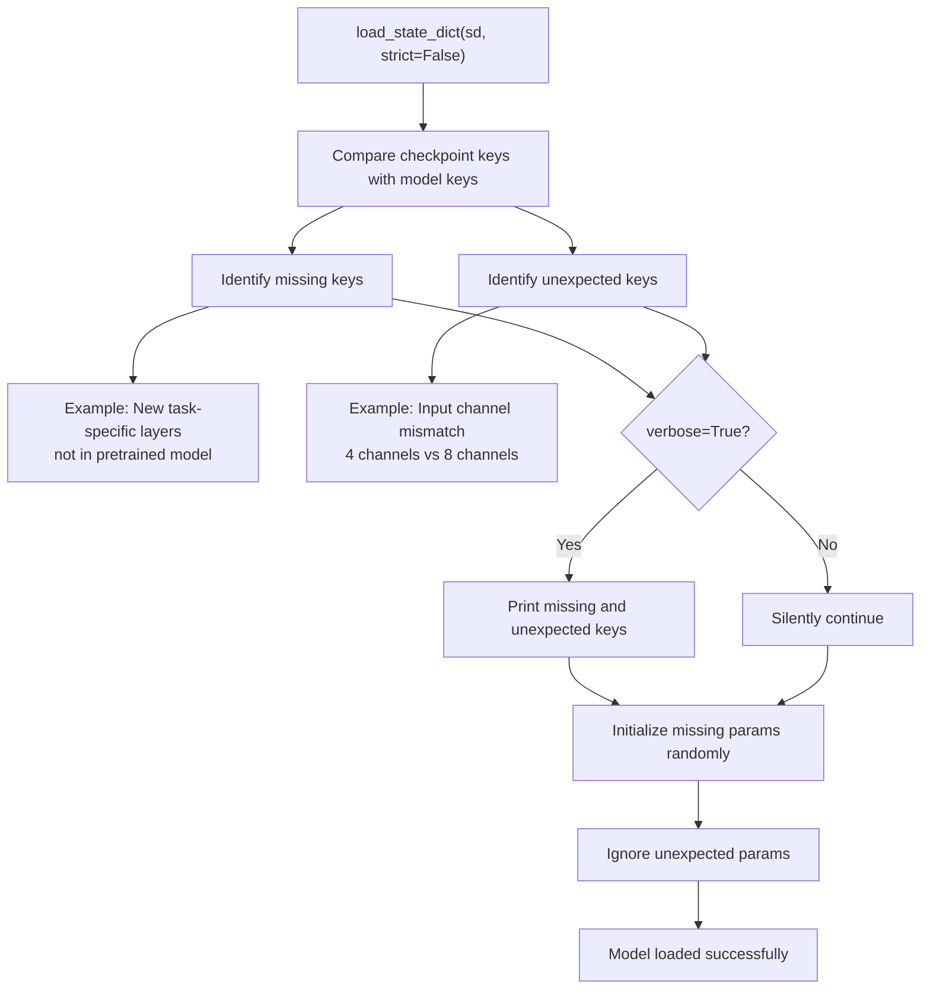
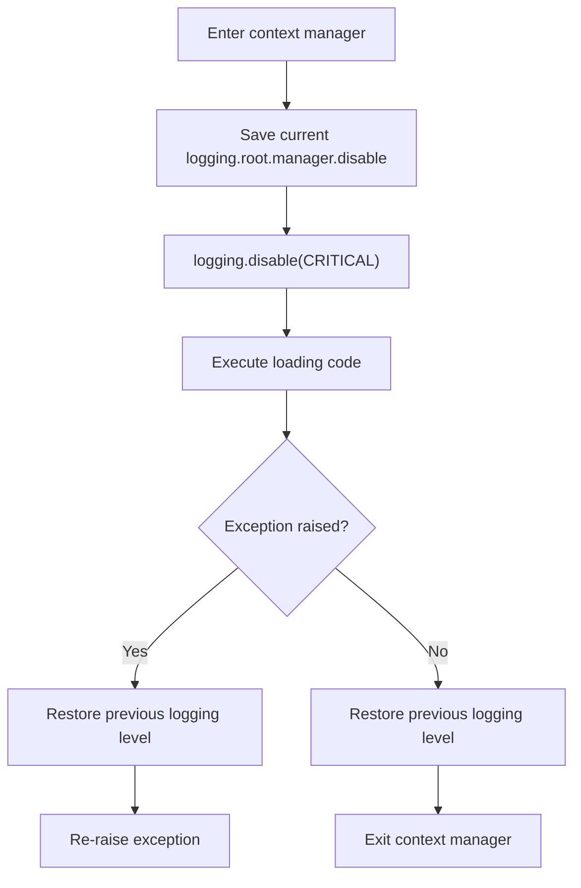
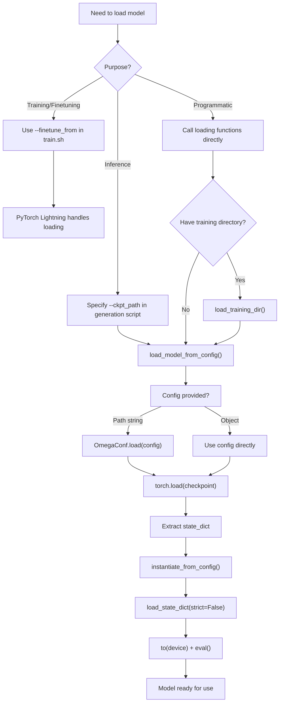

<!-- source: DeepWiki mcp.deepwiki.com · repo allenai/object-edit · page 4.4 Model Checkpoints and Loading · fetched 2026-10-26 -->

# Model Checkpoints and Loading

<details>
<summary>Relevant source files</summary>

The following files were used as context for generating this wiki page:

- [README.md](README.md)
- [ldm/extras.py](ldm/extras.py)

</details>


## Purpose and Scope

This document explains the checkpoint management system in OBJect 3DIT, including how pretrained models are loaded, how training can be resumed or finetuned from existing checkpoints, and the mechanisms for handling model architecture variations. For information about the training workflow that generates these checkpoints, see [Training Workflow and Scripts](#4.2). For details about using loaded models for image generation, see [Generation Pipeline](#5.1).

## Checkpoint File Format

The system uses PyTorch Lightning's checkpoint format, which stores checkpoints as `.ckpt` files containing multiple components in a serialized dictionary structure.

### Checkpoint Structure

A checkpoint file contains the following top-level keys:

| Key | Description | Usage |
|-----|-------------|-------|
| `state_dict` | Model parameters (weights and biases) | Loaded into model via `load_state_dict()` |
| `global_step` | Training iteration count | Used for tracking training progress |
| `epoch` | Training epoch number | Used for resuming training |
| `optimizer_states` | Optimizer state | Used when resuming training |
| `lr_schedulers` | Learning rate scheduler state | Used when resuming training |

The `state_dict` contains all trainable parameters with keys following PyTorch's naming convention (e.g., `model.diffusion_model.input_blocks.0.0.weight`).

**Sources:** [ldm/extras.py:64-66]()

## Core Loading Functions

The system provides two primary functions for loading checkpoints, located in the `ldm.extras` module.

### load_model_from_config()



**Function: `load_model_from_config(config, ckpt, device="cpu", verbose=False)`**

This is the primary checkpoint loading function used throughout the codebase.

**Parameters:**
- `config`: OmegaConf configuration object or path to YAML config file
- `ckpt`: Path to checkpoint file (`.ckpt`)
- `device`: Target device (`"cpu"`, `"cuda"`, etc.)
- `verbose`: Whether to print missing/unexpected keys

**Behavior:**
1. Loads the config file if a path is provided [ldm/extras.py:59-60]()
2. Suppresses all logging messages using context manager [ldm/extras.py:62]()
3. Loads checkpoint file from disk [ldm/extras.py:64]()
4. Extracts `state_dict` and `global_step` [ldm/extras.py:65-66]()
5. Instantiates model from config [ldm/extras.py:67]()
6. Loads state dict with `strict=False` [ldm/extras.py:68]()
7. Moves model to target device and sets to eval mode [ldm/extras.py:74-75]()
8. Fixes conditioning stage device reference [ldm/extras.py:76]()

**Key Design Choice:** The function uses `strict=False` when loading the state dict, allowing the model to load even when there are missing or unexpected keys. This is critical for:
- Loading pretrained models with different input channels
- Finetuning from related architectures
- Adding new components to existing models

**Sources:** [ldm/extras.py:55-77]()

### load_training_dir()



**Function: `load_training_dir(train_dir, device, epoch="last")`**

Convenience function for loading a checkpoint from a training output directory.

**Parameters:**
- `train_dir`: Path to training directory containing checkpoints and config
- `device`: Target device
- `epoch`: Checkpoint epoch to load (default: `"last"`)

**Behavior:**
1. Recursively searches training directory for checkpoint files [ldm/extras.py:40]()
2. Asserts exactly one matching checkpoint exists [ldm/extras.py:41]()
3. Searches for project config files [ldm/extras.py:42]()
4. If multiple configs exist, selects the most recent [ldm/extras.py:44-47]()
5. Delegates to `load_model_from_config()` [ldm/extras.py:53]()

This function is useful for loading models from PyTorch Lightning's default checkpoint directory structure.

**Sources:** [ldm/extras.py:37-53]()

## Loading for Training and Finetuning

### Finetuning from Pretrained Checkpoints

The training script supports initializing from pretrained checkpoints using the `--finetune_from` argument.



**Training Command Structure:**

From the training script, finetuning is configured as:

```bash
--finetune_from /path/to/checkpoint.ckpt
```

**Supported Pretrained Models:**
1. **Zero123** - 3D-aware image generation model
2. **Image-Conditioned Stable Diffusion** - Lambda Labs checkpoint
3. **Custom trained checkpoints** - Previously trained OBJect 3DIT models

The system automatically handles architecture differences between the pretrained model and target task through the `strict=False` loading mechanism.

**Sources:** [README.md:49-51]()

### Checkpoint Storage Locations

Pretrained checkpoints are available from multiple sources:

| Source | Purpose | Access Method |
|--------|---------|---------------|
| HuggingFace Hub | Official pretrained models for all tasks | Download from [allenai/object-edit](https://huggingface.co/datasets/allenai/object-edit) |
| Zero123 GitHub | Base 3D-aware generation model | Download from [cvlab-columbia/zero123](https://github.com/cvlab-columbia/zero123) |
| Lambda Labs HF | Image-conditioned Stable Diffusion | Download from [lambdalabs/stable-diffusion-image-conditioned](https://huggingface.co/lambdalabs/stable-diffusion-image-conditioned) |
| Local training | User-trained checkpoints | Saved by PyTorch Lightning in training output directory |

**Sources:** [README.md:46-49]()

## Loading for Inference

### Inference Loading Pipeline



The inference pipeline loads checkpoints through the same `load_model_from_config()` function, but with specific considerations:

1. **Model is set to evaluation mode** - `model.eval()` disables dropout and batch normalization training behavior [ldm/extras.py:75]()
2. **Gradients are not needed** - Inference typically wraps generation in `torch.no_grad()` context
3. **Device placement is explicit** - Model is moved to specified device before generation [ldm/extras.py:74]()
4. **Conditioning stage device fix** - Ensures text encoder uses correct device [ldm/extras.py:76]()

**Sources:** [ldm/extras.py:55-77]()

## Handling Architecture Mismatches

### Strict Loading vs Lenient Loading



The system uses `strict=False` in all checkpoint loading operations, enabling flexible model initialization:

**Missing Keys Handling:**
- Keys present in model but not in checkpoint are randomly initialized
- Common when adding new components (e.g., task-specific conditioning layers)
- Allows progressive model development and finetuning

**Unexpected Keys Handling:**
- Keys present in checkpoint but not in model are ignored
- Common when loading checkpoints from different architectures
- Enables transfer learning from related models

**Verbose Output:**
When `verbose=True`, the function prints detailed information about mismatched keys:

```python
m, u = model.load_state_dict(sd, strict=False)
if len(m) > 0 and verbose:
    print("missing keys:")
    print(m)
if len(u) > 0 and verbose:
    print("unexpected keys:")
    print(u)  # Note: line 73 prints u but doesn't show its content
```

**Sources:** [ldm/extras.py:68-73]()

### Channel Adaptation Example

A common architecture mismatch occurs when loading models with different input channel counts:

| Scenario | Pretrained Model | Target Model | Handling |
|----------|-----------------|--------------|----------|
| Zero123 to Objaverse Tasks | 4 channels (RGB + alpha) | 8 channels (image + conditioning) | Ignore 4-channel conv weights, initialize 8-channel randomly |
| Standard SD to Conditioned SD | 4 channels | 4 channels | Direct loading |
| Custom modifications | Variable | Variable | Partial loading with `strict=False` |

The `strict=False` approach automatically handles these mismatches without manual intervention.

**Sources:** [ldm/extras.py:68](), Diagram 3 from system overview

## Logging Suppression During Loading

### all_logging_disabled Context Manager



The loading functions wrap checkpoint operations in a logging suppression context manager to prevent verbose output from dependencies:

**Purpose:**
- Suppresses warnings and info messages from PyTorch, transformers, and other libraries
- Keeps checkpoint loading output clean and focused
- User still sees the main "Loading model from..." message [ldm/extras.py:63]()

**Implementation:**
Uses the `all_logging_disabled()` context manager which:
1. Saves the current logging disable level [ldm/extras.py:28]()
2. Disables all logging up to CRITICAL level [ldm/extras.py:30]()
3. Restores previous level on exit (even if exception occurs) [ldm/extras.py:32-35]()

**Sources:** [ldm/extras.py:11-35](), [ldm/extras.py:62]()

## Checkpoint Loading Workflow Summary

### Complete Loading Decision Tree



**Key Takeaways:**

1. **All loading uses `strict=False`** - Enables flexible architecture adaptation
2. **Logging is suppressed** - Clean output during loading
3. **Device placement is explicit** - Model is moved to correct device after loading
4. **Evaluation mode is default** - `model.eval()` is called automatically
5. **Config and checkpoint are paired** - Both are needed for proper instantiation

**Sources:** [ldm/extras.py:37-77](), [README.md:46-51]()

---

