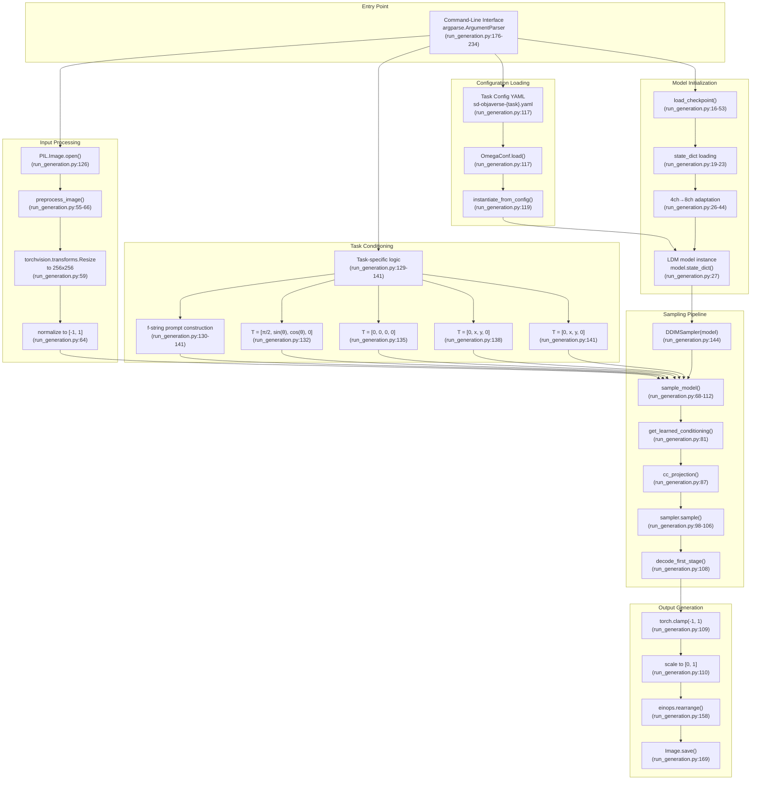
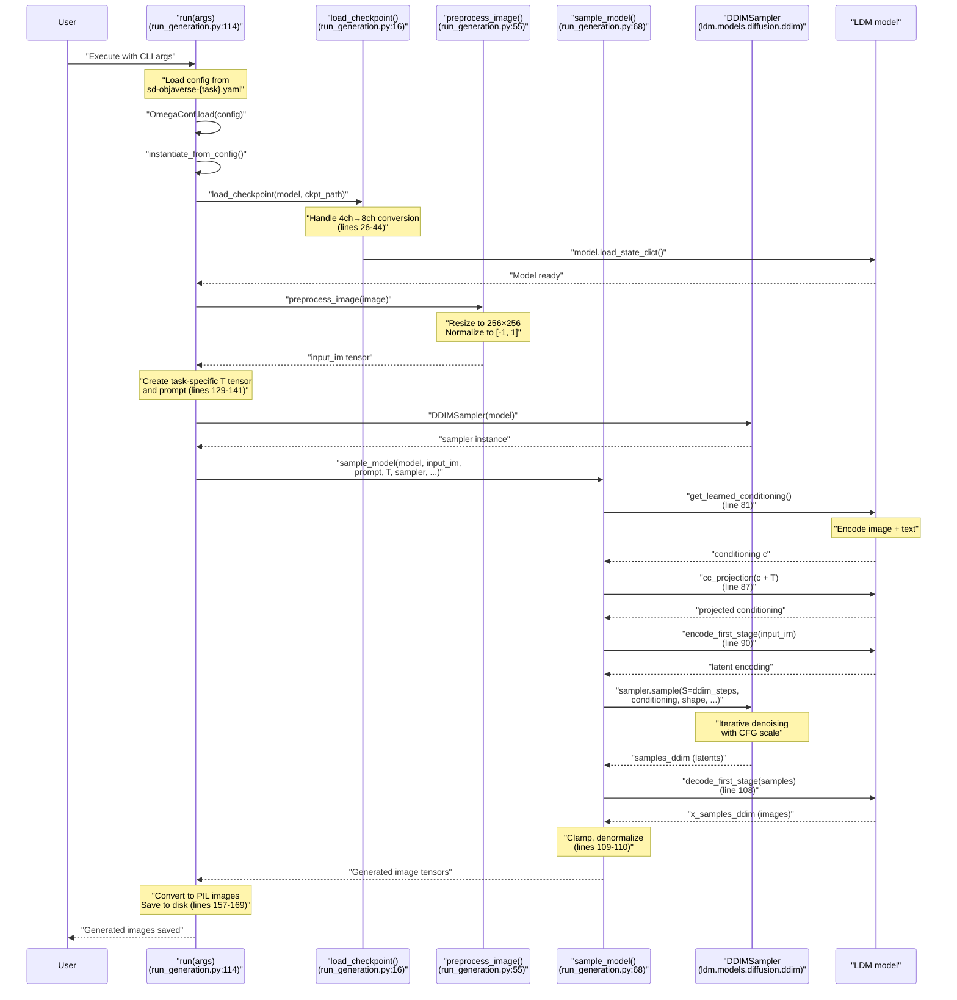
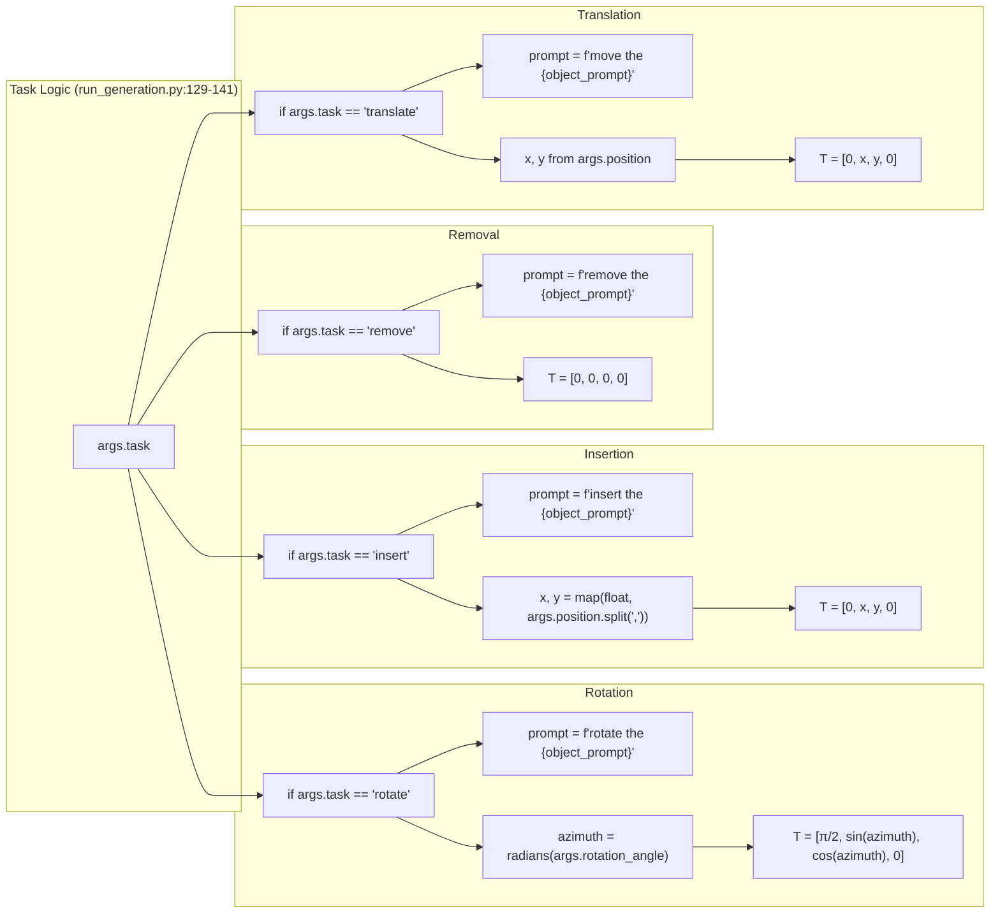
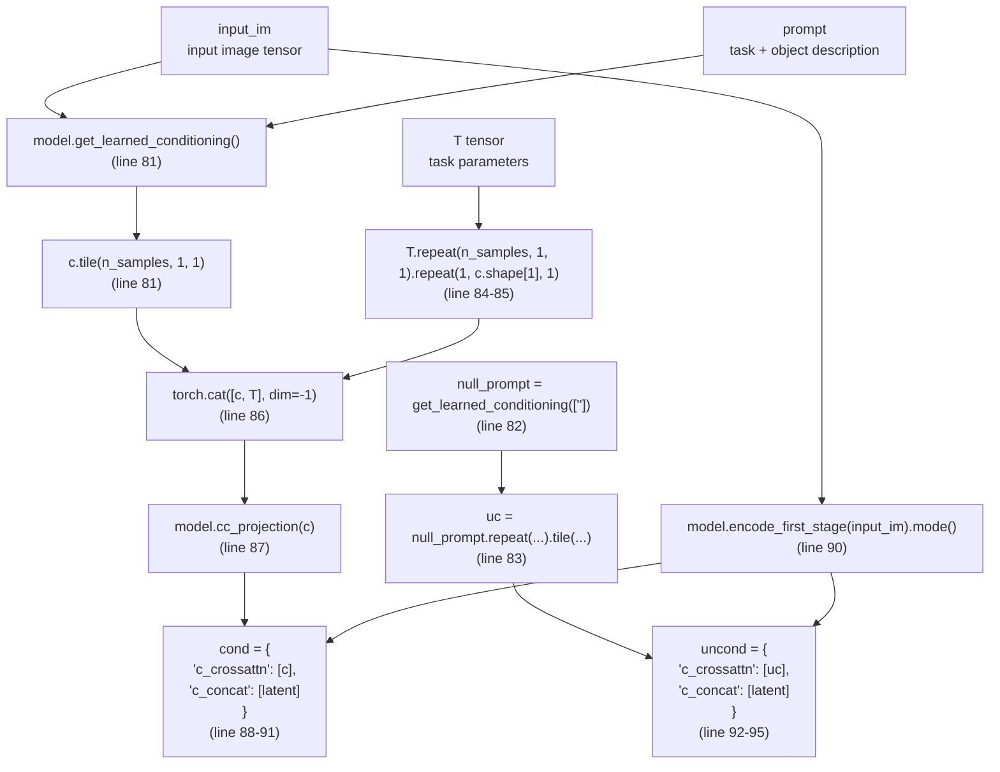

<!-- source: DeepWiki mcp.deepwiki.com · repo allenai/object-edit · page 5 Inference and Generation · fetched 2026-10-26 -->

# Inference and Generation

<details>
<summary>Relevant source files</summary>

The following files were used as context for generating this wiki page:

- [README.md](README.md)
- [run_generation.py](run_generation.py)

</details>


## Purpose and Scope

This document provides an overview of the inference and generation system used to perform language-guided 3D-aware image editing with trained OBJect 3DIT models. The system takes an input image, a text prompt describing the object to edit, and task-specific parameters (e.g., rotation angle, translation coordinates), then generates edited output images using pretrained diffusion models.

For detailed information about:
- The step-by-step generation pipeline and internal processing, see [Generation Pipeline](#5.1)
- How individual tasks (rotate, remove, insert, translate) create their conditioning tensors, see [Task-Specific Generation](#5.2)
- Complete parameter documentation and configuration options, see [Generation Parameters and Configuration](#5.3)
- Model architecture details, see [Model Architecture](#7)
- Training procedures that produce the checkpoints used here, see [Training System](#4)

This page focuses on the high-level architecture and workflow of the inference system as implemented in `run_generation.py`.

## System Overview

The inference system consists of a single main entry point script that orchestrates the entire generation process. The system is designed to work with checkpoints from different tasks and automatically adapts to model configurations.

### Core Components

| Component | Code Location | Purpose |
|-----------|--------------|---------|
| Main Orchestrator | `run_generation.py:run()` | Coordinates the entire inference workflow |
| Checkpoint Loader | `run_generation.py:load_checkpoint()` | Loads pretrained weights with automatic input channel adaptation |
| Image Preprocessor | `run_generation.py:preprocess_image()` | Normalizes and resizes input images to 256×256 |
| Sampling Function | `run_generation.py:sample_model()` | Implements DDIM sampling with classifier-free guidance |
| Sampler Class | `ldm.models.diffusion.ddim.DDIMSampler` | Performs iterative denoising in latent space |

**Sources:** [run_generation.py:1-238]()

## Inference Architecture

The following diagram maps the natural language concepts in the inference system to their concrete code implementations:



**Sources:** [run_generation.py:1-238](), [README.md:54-62]()

## Generation Workflow

The generation process follows a linear pipeline from input to output. The following sequence diagram shows the exact function calls and data transformations:



**Sources:** [run_generation.py:114-170](), [run_generation.py:68-112](), [run_generation.py:16-53]()

## Checkpoint Loading and Model Initialization

The checkpoint loading system includes automatic adaptation for models with different input channel configurations. This is critical when loading Zero123 or Stable Diffusion checkpoints (4 input channels) into the 8-channel OBJect 3DIT architecture.

### Channel Adaptation Mechanism

The `load_checkpoint()` function [run_generation.py:16-53]() performs the following operations:

1. **Load checkpoint** from disk with `torch.load()` [run_generation.py:19]()
2. **Extract state dict** if nested under `"state_dict"` key [run_generation.py:21-23]()
3. **Check input channel mismatch** by comparing shapes [run_generation.py:26-29]()
4. **Zero-initialize new channels** and copy existing weights [run_generation.py:42-44]()
5. **Load with strict=False** to handle missing/unexpected keys [run_generation.py:46]()

The adaptation specifically handles the input block weights at `model.diffusion_model.input_blocks.0.0.weight`, ensuring the first 4 channels retain pretrained weights while additional channels are zero-initialized.

**Sources:** [run_generation.py:16-53]()

## Image Preprocessing

Input images undergo standardized preprocessing before conditioning:

| Operation | Implementation | Result |
|-----------|---------------|--------|
| Color conversion | `img.convert("RGB")` [run_generation.py:57]() | Ensures 3-channel RGB |
| Resizing | `torchvision.transforms.Resize((256,256))` [run_generation.py:59]() | Standard 256×256 resolution |
| Tensorization | `torchvision.transforms.ToTensor()` [run_generation.py:60]() | Converts to [0,1] tensor |
| Normalization | `img*2. - 1.` [run_generation.py:64]() | Maps to [-1, 1] range |
| Batching | `img.unsqueeze(0)` [run_generation.py:65]() | Adds batch dimension |

**Sources:** [run_generation.py:55-66]()

## Task-Specific Conditioning

Each editing task uses a 4-dimensional transformation tensor `T` that encodes task-specific parameters:



The tensor `T` is concatenated with the learned conditioning before being projected by `model.cc_projection()` [run_generation.py:87](). This allows the model to condition generation on both the semantic content (from text and image embeddings) and the geometric transformation parameters.

**Sources:** [run_generation.py:128-141](), [run_generation.py:84-87]()

## Sampling Pipeline

The core generation happens in `sample_model()` [run_generation.py:68-112](), which implements classifier-free guidance with DDIM sampling:

### Conditioning Construction



### Iterative Denoising

The DDIM sampler performs `ddim_steps` iterations [run_generation.py:98]() of denoising in latent space:

1. **Initialize shape**: `[4, h//8, w//8]` for 256×256 output [run_generation.py:96-97]()
2. **Sample with guidance**: `sampler.sample()` with `unconditional_guidance_scale` [run_generation.py:98-106]()
3. **Decode latents**: `model.decode_first_stage()` converts to RGB [run_generation.py:108]()
4. **Clamp and normalize**: Ensures valid pixel range [run_generation.py:109-110]()

The `unconditional_guidance_scale` parameter (exposed as `--cfg_scale` in CLI) controls the strength of conditioning, with higher values producing outputs more faithful to the text prompt and task parameters.

**Sources:** [run_generation.py:68-112](), [run_generation.py:146-155]()

## Output Format

Generated images are saved as PNG files in the specified output directory [run_generation.py:165-169]():

```
save_dir/
├── input_im.png      # Preprocessed input image
├── 0.png             # Sample 1
├── 1.png             # Sample 2
├── ...
└── N.png             # Sample N (N = num_samples)
```

Each sample is generated independently from the same conditioning, providing multiple variations of the requested edit. The number of samples is controlled by `--num_samples` parameter [run_generation.py:220-223]().

**Sources:** [run_generation.py:156-169]()

## Command-Line Interface

The system is invoked through shell scripts that call `run_generation.py`:

| Script | Task | Example Command |
|--------|------|-----------------|
| `generate_scripts/rotate.sh` | Object rotation | Rotates specified object by angle |
| `generate_scripts/remove.sh` | Object removal | Removes specified object |
| `generate_scripts/insert.sh` | Object insertion | Inserts object at position |
| `generate_scripts/translate.sh` | Object translation | Moves object to position |

All scripts follow the pattern of executing `python run_generation.py` with task-specific arguments. The `--object_prompt` parameter should contain only the object description (e.g., "red car"), not the full editing instruction—the system automatically prepends task-specific verbs like "rotate the", "remove the", etc. [run_generation.py:129-141]().

**Sources:** [README.md:54-62](), [run_generation.py:176-235]()

## Usage Example

Basic workflow for running inference:

1. **Prepare checkpoint**: Download from HuggingFace or use trained checkpoint
2. **Prepare input**: Ensure image is accessible on disk
3. **Execute generation script**:
   ```bash
   . generate_scripts/rotate.sh
   ```
4. **Modify parameters** in the script as needed (checkpoint path, image path, object prompt, rotation angle)
5. **Retrieve outputs** from the specified `save_dir`

For complete parameter documentation and advanced configuration options, see [Generation Parameters and Configuration](#5.3).

**Sources:** [README.md:54-62]()

---

