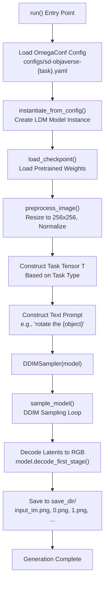
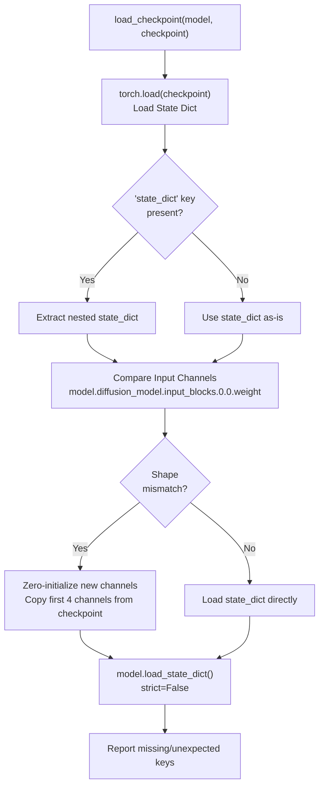
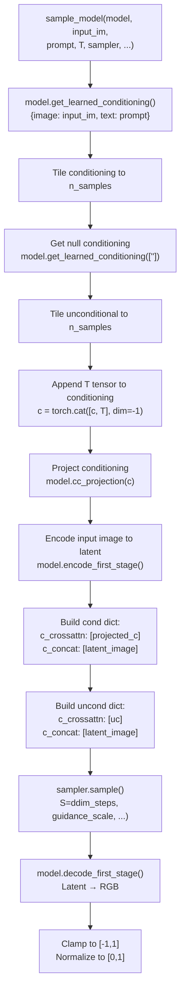
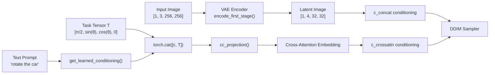
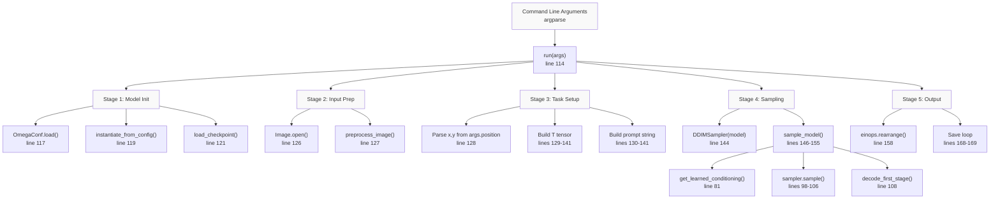

<!-- source: DeepWiki mcp.deepwiki.com · repo allenai/object-edit · page 5.1 Generation Pipeline · fetched 2026-10-26 -->

# Generation Pipeline

<details>
<summary>Relevant source files</summary>

The following files were used as context for generating this wiki page:

- [run_generation.py](run_generation.py)

</details>


## Purpose and Scope

This document provides a detailed technical walkthrough of the image generation pipeline implemented in [run_generation.py](). The generation pipeline is responsible for taking a trained latent diffusion model and using it to perform 3D-aware image editing tasks (rotation, removal, insertion, translation) on input images.

This page covers the complete flow from checkpoint loading through DDIM sampling to final image output. For information about the specific differences between tasks and how task parameters are constructed, see [Task-Specific Generation](#5.2). For a complete reference of all command-line parameters and configuration options, see [Generation Parameters and Configuration](#5.3). For details on how conditioning embeddings are computed within the model, see [Conditioning and Guidance System](#7.2).

## Overview

The generation pipeline consists of five major stages:

1. **Model Initialization**: Loading configuration and instantiating the latent diffusion model
2. **Checkpoint Loading**: Loading pretrained weights with automatic channel adaptation
3. **Input Preprocessing**: Converting input images to the expected format and resolution
4. **Conditioning Construction**: Creating task-specific prompts and transformation tensors
5. **Iterative Sampling**: Performing DDIM sampling in latent space to generate output images

The entire pipeline is orchestrated by the `run()` function in [run_generation.py:114-172]().

## High-Level Generation Flow



**Sources**: [run_generation.py:114-172]()

## Model Initialization and Checkpoint Loading

### Configuration Loading

The pipeline begins by loading a task-specific configuration file using OmegaConf:

```python
config = OmegaConf.load(f"configs/sd-objaverse-{args.task}.yaml")
```

The configuration specifies the model architecture, conditioning mechanisms, and other hyperparameters. The device for the conditioning stage is updated dynamically based on the command-line argument.

**Sources**: [run_generation.py:117-119]()

### Model Instantiation

The model is instantiated using the `instantiate_from_config()` utility function from the LDM codebase:

```python
model = instantiate_from_config(config.model)
```

This creates a complete latent diffusion model instance including:
- First stage encoder/decoder (VAE)
- Diffusion model (UNet)
- Conditioning stage (CLIP or transformer)
- Cross-attention projection layers

**Sources**: [run_generation.py:119]()

### Checkpoint Loading with Channel Adaptation

The `load_checkpoint()` function handles loading pretrained weights with special logic for adapting models trained with different input channel counts:



The channel adaptation is necessary when finetuning from a 4-channel Stable Diffusion checkpoint to an 8-channel model (4 for latent input + 4 for conditioning image). The function handles two keys:

- `model.diffusion_model.input_blocks.0.0.weight`
- `model_ema.diffusion_modelinput_blocks00weight`

For mismatched channels, the function zero-initializes the new weight tensor and copies the first 4 channels from the checkpoint.

**Sources**: [run_generation.py:16-53]()

## Input Image Preprocessing

### Image Transformation Pipeline

The `preprocess_image()` function converts PIL images to the format expected by the model:

| Transformation Step | Operation | Parameters |
|---------------------|-----------|------------|
| Color Conversion | `img.convert("RGB")` | Ensure 3-channel RGB |
| Resize | `torchvision.transforms.Resize()` | Target: 256×256 |
| Tensorization | `torchvision.transforms.ToTensor()` | Convert to [0,1] tensor |
| Normalization | `img * 2. - 1.` | Normalize to [-1, 1] |
| Batch Dimension | `img.unsqueeze(0)` | Shape: [1, 3, 256, 256] |

The preprocessing pipeline ensures consistency with training data normalization and dimensions.

**Sources**: [run_generation.py:55-66]()

## Task-Specific Conditioning Construction

### Transformation Tensor (T) Format

The pipeline constructs a 4-dimensional transformation tensor `T` that encodes task-specific parameters. The format varies by task:

```python
# Rotation task
T = torch.tensor([π/2, sin(θ), cos(θ), 0])

# Remove task
T = torch.tensor([0., 0., 0., 0.])

# Insert/Translate tasks
T = torch.tensor([0, x, y, 0])
```

The first element distinguishes rotation (π/2) from translation/insertion (0). The middle two elements encode either polar coordinates (for rotation) or Cartesian coordinates (for translation/insertion). The fourth element is reserved for future use.

### Prompt Construction

Text prompts follow a simple template based on the task and object description:

```python
# Task-specific prompt templates
"rotate the {object_prompt}"    # Rotation
"remove the {object_prompt}"    # Removal
"insert the {object_prompt}"    # Insertion
"move the {object_prompt}"      # Translation
```

**Sources**: [run_generation.py:128-141]()

## DDIM Sampling Process

### Sampler Initialization

The pipeline uses the DDIM (Denoising Diffusion Implicit Models) sampler for efficient generation:

```python
sampler = DDIMSampler(model)
```

The `DDIMSampler` class is imported from `ldm.models.diffusion.ddim` and provides deterministic sampling with fewer steps than DDPM.

**Sources**: [run_generation.py:7](), [run_generation.py:144]()

### Sample Model Function

The `sample_model()` function implements the core sampling logic with classifier-free guidance:



#### Conditioning Construction Details

The function constructs two types of conditioning:

**Conditional (with prompt and image)**:
- `c_crossattn`: Text and task embedding projected through `cc_projection`
- `c_concat`: Encoded input image latent (VAE encoding)

**Unconditional (for classifier-free guidance)**:
- `c_crossattn`: Empty prompt embedding
- `c_concat`: Same encoded input image latent

Both conditioning paths include the input image latent via `c_concat`, which provides the model with the original image context during denoising.

**Sources**: [run_generation.py:68-112]()

### Key Parameters

| Parameter | Type | Purpose |
|-----------|------|---------|
| `ddim_steps` | int | Number of denoising steps (default: 50) |
| `n_samples` | int | Number of images to generate (default: 8) |
| `scale` | float | Classifier-free guidance scale (default: 1.0) |
| `ddim_eta` | float | Stochasticity parameter (default: 1.0) |
| `shape` | list | Latent shape [4, 32, 32] for 256×256 output |

The latent shape is always `[4, 32, 32]` because the VAE downsamples by a factor of 8 (256/8 = 32) and uses 4 latent channels.

**Sources**: [run_generation.py:74-77](), [run_generation.py:96-97]()

## Conditioning Embedding Flow



The model receives conditioning through two mechanisms:
1. **Cross-attention** (`c_crossattn`): Text + task parameters projected to embedding space
2. **Concatenation** (`c_concat`): Input image latent concatenated with noise in channel dimension

**Sources**: [run_generation.py:81-95]()

## Output Processing and Saving

### Latent Decoding

After DDIM sampling completes, the pipeline decodes latents to RGB images:

```python
x_samples_ddim = model.decode_first_stage(samples_ddim)
x_samples_ddim = torch.clamp(x_samples_ddim, -1., 1.)
x_samples_ddim = ((x_samples_ddim + 1.0) / 2.0).cpu()
```

The decoding process:
1. Passes latents through VAE decoder
2. Clamps values to [-1, 1] range
3. Normalizes to [0, 1] for image saving
4. Moves to CPU for post-processing

**Sources**: [run_generation.py:108-110]()

### Image Saving

Generated images are saved with a consistent naming scheme:

```
save_dir/
  ├── input_im.png       # Preprocessed input image
  ├── 0.png              # First generated sample
  ├── 1.png              # Second generated sample
  └── ...                # Additional samples
```

Each tensor is converted using:

```python
x_sample = 255.0 * rearrange(x_sample.cpu().numpy(), 'c h w -> h w c')
Image.fromarray(x_sample.astype(np.uint8))
```

This rearranges from CHW (channels, height, width) to HWC (height, width, channels) format and scales to [0, 255] for PNG encoding.

**Sources**: [run_generation.py:157-169]()

## Complete Pipeline Code Flow

The following diagram maps the natural language pipeline stages to specific code entities:



**Sources**: [run_generation.py:1-238]()

## Error Handling and Edge Cases

### Channel Mismatch Handling

The checkpoint loading function explicitly handles the common case of loading a 4-channel Stable Diffusion checkpoint into an 8-channel model:

```python
if in_shape != in_filters_load.shape:
    # Zero-initialize and copy first 4 channels
    input_weight.zero_()
    input_weight[:, :4, :, :].copy_(old_state[input_key])
```

This allows seamless finetuning from pretrained Stable Diffusion weights.

**Sources**: [run_generation.py:30-44]()

### Strict Loading

The model state dict is loaded with `strict=False`, allowing missing or unexpected keys. The function prints diagnostics for debugging:

```python
m, u = model.load_state_dict(old_state, strict=False)
if len(m) > 0:
    print("missing keys:")
    print(m)
if len(u) > 0:
    print("unexpected keys:")
    print(u)
```

**Sources**: [run_generation.py:46-53]()

## Performance Considerations

### Latent Space Operations

The entire sampling process occurs in a compressed 4-channel latent space (32×32) rather than RGB space (256×256). This provides:
- **8× spatial compression**: 32×32 vs 256×256
- **3/4 channel reduction**: 4 channels vs 3 RGB channels
- **~21× fewer operations** per denoising step

Only the final decode operation converts from latent to RGB space.

### Batch Generation

The pipeline supports generating multiple samples in a single forward pass via the `n_samples` parameter. Conditioning tensors are tiled to match the batch size:

```python
c = model.get_learned_conditioning(...).tile(n_samples, 1, 1)
```

This amortizes the cost of model loading and conditioning computation across multiple outputs.

**Sources**: [run_generation.py:81]()

## Summary

The generation pipeline in [run_generation.py]() provides a complete inference workflow for 3D-aware image editing. Key design features include:

- **Modular checkpoint loading** with automatic channel adaptation for finetuning
- **Task-agnostic architecture** with task-specific conditioning via T tensors
- **Efficient sampling** in compressed latent space using DDIM
- **Classifier-free guidance** for improved generation quality
- **Batch generation** support for generating multiple variants

The pipeline is designed to be easily invoked from shell scripts (see `generate_scripts/` directory) and supports all four editing tasks: rotation, removal, insertion, and translation.

---

