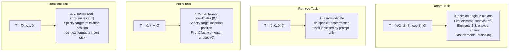
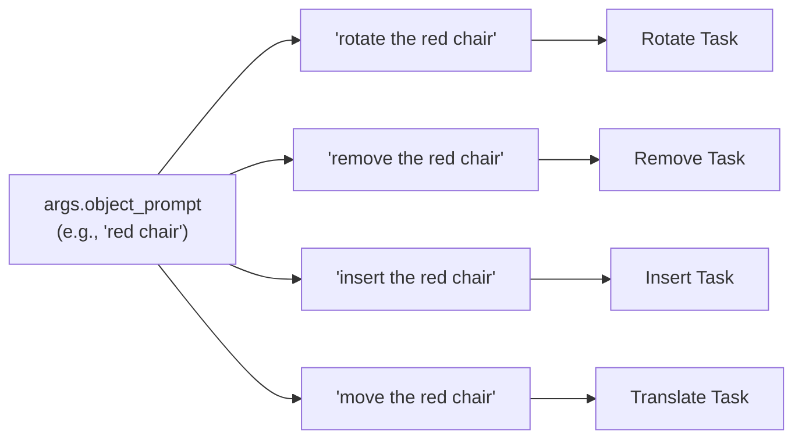
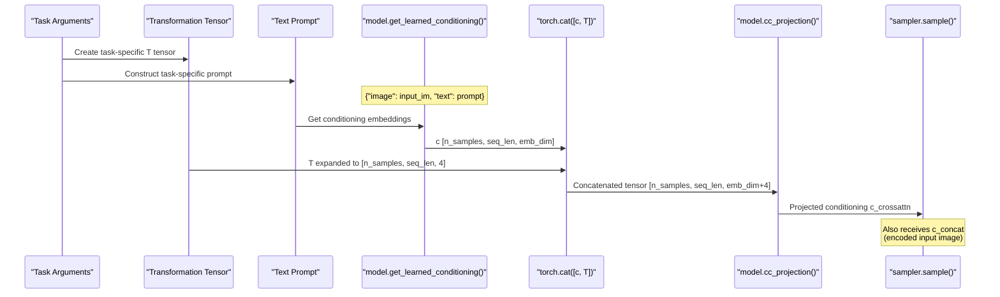
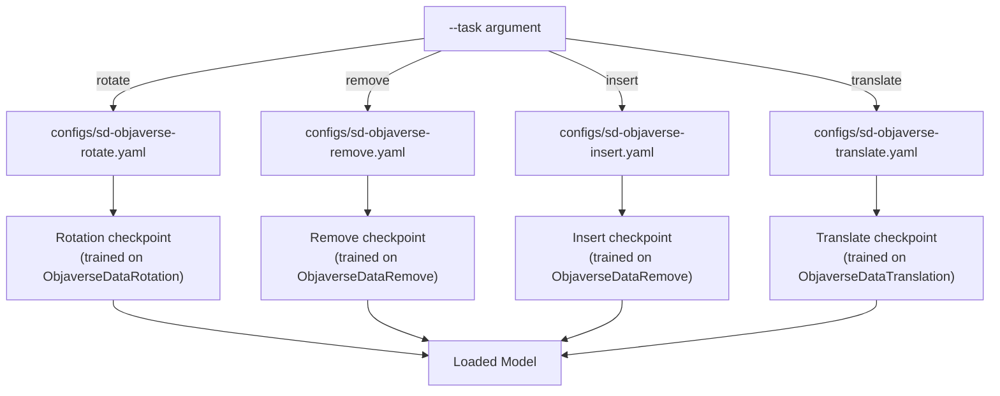

<!-- source: DeepWiki mcp.deepwiki.com · repo allenai/object-edit · page 5.2 Task-Specific Generation · fetched 2026-10-26 -->

# Task-Specific Generation

<details>
<summary>Relevant source files</summary>

The following files were used as context for generating this wiki page:

- [README.md](README.md)
- [run_generation.py](run_generation.py)

</details>


## Purpose and Scope

This document explains how the OBJect 3DIT system handles different 3D-aware image editing tasks through task-specific transformation tensors and prompt construction. Each of the four supported editing tasks—rotation, removal, insertion, and translation—uses a distinct conditioning strategy to guide the diffusion model.

For information about the overall generation pipeline and sampling process, see [Generation Pipeline](#5.1). For details on command-line parameters and configuration options, see [Generation Parameters and Configuration](#5.3).

**Sources:** [run_generation.py:114-172]()

---

## Overview of Editing Tasks

The system supports four distinct 3D-aware editing operations, each configured through the `--task` argument:

| Task | Operation | Description |
|------|-----------|-------------|
| `rotate` | Object Rotation | Rotates a specified object around its vertical axis by a given azimuth angle |
| `remove` | Object Removal | Removes a specified object from the scene |
| `insert` | Object Insertion | Inserts a specified object at a target position in normalized coordinates |
| `translate` | Object Translation | Moves a specified object to a target position in normalized coordinates |

Each task transforms the input image based on a user-provided object description (`--object_prompt`) and task-specific parameters (e.g., rotation angle or position coordinates).

**Sources:** [run_generation.py:177-181](), [README.md:49-62]()

---

## Task-Specific Transformation Tensors

The core mechanism that differentiates tasks is the **transformation tensor `T`**, a 4-dimensional vector that encodes task-specific spatial or geometric information. This tensor is concatenated with the conditioning embeddings before being passed to the diffusion model.

### Transformation Tensor Formats



### Implementation Details

The transformation tensor is constructed in [run_generation.py:129-141]() based on the selected task:

#### Rotation Task
```python
azimuth = math.radians(args.rotation_angle)
T = torch.tensor([np.pi / 2, math.sin(azimuth), math.cos(azimuth), 0])
```
- **Element 0:** Fixed value of π/2 (approximately 1.5708)
- **Element 1:** Sine of the azimuth angle
- **Element 2:** Cosine of the azimuth angle  
- **Element 3:** Unused (set to 0)

The rotation angle is provided in degrees via `--rotation_angle` and converted to radians. The sine/cosine encoding provides a continuous, periodic representation suitable for angular transformations.

#### Remove Task
```python
T = torch.tensor([0., 0., 0., 0.])
```
All elements are zero. The removal operation is primarily distinguished by its text prompt; the zero tensor indicates no spatial transformation is required.

#### Insert Task
```python
x, y = map(float, args.position.split(','))
T = torch.tensor([0, x, y, 0])
```
- **Element 0:** Unused (set to 0)
- **Element 1:** Normalized x-coordinate [0, 1]
- **Element 2:** Normalized y-coordinate [0, 1]
- **Element 3:** Unused (set to 0)

Coordinates are normalized such that (0, 0) represents the top-left corner and (1, 1) represents the bottom-right corner of the image.

#### Translate Task
```python
x, y = map(float, args.position.split(','))
T = torch.tensor([0, x, y, 0])
```
The translate task uses an identical tensor format to the insert task. The semantic difference (moving an existing object vs. inserting a new one) is encoded in the text prompt rather than the transformation tensor.

**Sources:** [run_generation.py:129-141]()

---

## Prompt Construction

Each task automatically constructs a task-specific prompt by combining a verb phrase with the user-provided object description:



### Prompt Template per Task

| Task | Template | Example |
|------|----------|---------|
| Rotate | `"rotate the {object_prompt}"` | `"rotate the red chair"` |
| Remove | `"remove the {object_prompt}"` | `"remove the red chair"` |
| Insert | `"insert the {object_prompt}"` | `"insert the red chair"` |
| Translate | `"move the {object_prompt}"` | `"move the red chair"` |

**Important:** The `--object_prompt` argument should contain only a description of the target object, **not** the editing instruction. The verb phrase is automatically prepended based on the task type. As noted in [README.md:62](), "the object prompt should not contain the editing instruction, that will be filled in automatically."

**Sources:** [run_generation.py:130-141](), [README.md:62]()

---

## Conditioning Integration Pipeline

The transformation tensor `T` is integrated into the model's conditioning mechanism through a multi-step process:



### Step-by-Step Process

1. **Tensor Creation** [run_generation.py:129-141]()
   - Task-specific `T` tensor is created with 4 elements
   - Text prompt is constructed by prepending task verb

2. **Text and Image Conditioning** [run_generation.py:81]()
   - `model.get_learned_conditioning()` encodes both the input image and text prompt
   - Returns conditioning tensor `c` with shape `[batch_size, sequence_length, embedding_dim]`

3. **Tensor Expansion** [run_generation.py:84-85]()
   - `T` is expanded from shape `[4]` to `[n_samples, sequence_length, 4]`
   - This matches the sequence length dimension of the conditioning tensor

4. **Concatenation** [run_generation.py:86]()
   - `T` is concatenated with `c` along the last dimension
   - Result has shape `[n_samples, sequence_length, embedding_dim + 4]`

5. **Projection** [run_generation.py:87]()
   - The concatenated tensor passes through `model.cc_projection`
   - This learned projection layer maps the extended embedding space back to the expected dimensionality

6. **Sampling** [run_generation.py:89-106]()
   - The projected conditioning is packaged into a dictionary with key `c_crossattn`
   - Also includes `c_concat` containing the encoded input image
   - Both are passed to the DDIM sampler for iterative denoising

**Sources:** [run_generation.py:68-112]()

---

## Task Configuration Examples

The following examples demonstrate how to configure each task using the shell scripts in `generate_scripts/`:

### Rotation Example

```bash
# generate_scripts/rotate.sh
python run_generation.py \
    --task rotate \
    --checkpoint_path path/to/rotate_checkpoint.ckpt \
    --image_path input_image.png \
    --object_prompt "red chair" \
    --rotation_angle 45.0 \
    --save_dir outputs/rotation
```

- Creates prompt: `"rotate the red chair"`
- Generates `T = [π/2, sin(45°), cos(45°), 0]`
- Rotates the red chair 45 degrees around vertical axis

### Removal Example

```bash
# generate_scripts/remove.sh
python run_generation.py \
    --task remove \
    --checkpoint_path path/to/remove_checkpoint.ckpt \
    --image_path input_image.png \
    --object_prompt "red chair" \
    --save_dir outputs/removal
```

- Creates prompt: `"remove the red chair"`
- Generates `T = [0, 0, 0, 0]`
- Removes the red chair from the scene

### Insertion Example

```bash
# generate_scripts/insert.sh
python run_generation.py \
    --task insert \
    --checkpoint_path path/to/insert_checkpoint.ckpt \
    --image_path input_image.png \
    --object_prompt "red chair" \
    --position "0.7,0.3" \
    --save_dir outputs/insertion
```

- Creates prompt: `"insert the red chair"`
- Generates `T = [0, 0.7, 0.3, 0]`
- Inserts a red chair at position (70% from left, 30% from top)

### Translation Example

```bash
# generate_scripts/translate.sh
python run_generation.py \
    --task translate \
    --checkpoint_path path/to/translate_checkpoint.ckpt \
    --image_path input_image.png \
    --object_prompt "red chair" \
    --position "0.5,0.5" \
    --save_dir outputs/translation
```

- Creates prompt: `"move the red chair"`
- Generates `T = [0, 0.5, 0.5, 0]`
- Moves the red chair to the center of the image

**Sources:** [README.md:54-62](), [run_generation.py:174-235]()

---

## Task-Specific Model Checkpoints

Each task requires a dedicated checkpoint trained on task-specific data. The system loads task-specific configurations from YAML files:



The configuration file is loaded at [run_generation.py:117]():
```python
config = OmegaConf.load(f"configs/sd-objaverse-{args.task}.yaml")
```

**Note:** The insertion task uses the same training data as the removal task (see [README.md:32]()), but with inverted semantics—instead of removing objects, it learns to insert them.

**Sources:** [run_generation.py:117](), [README.md:32](), [README.md:49-51]()

---

## Coordinate System Conventions

For tasks that use spatial coordinates (insert and translate), the coordinate system follows these conventions:

| Coordinate | Range | Interpretation |
|------------|-------|----------------|
| x | [0, 1] | Horizontal position: 0 = left edge, 1 = right edge |
| y | [0, 1] | Vertical position: 0 = top edge, 1 = bottom edge |

Coordinates are specified as a comma-separated string via the `--position` argument (e.g., `"0.7,0.3"`). The system parses this at [run_generation.py:128]():

```python
x, y = map(float, args.position.split(','))
```

The normalization ensures that the model can learn position-independent representations that work across different image sizes, though all images are resized to 256×256 during preprocessing [run_generation.py:59]().

**Sources:** [run_generation.py:128](), [run_generation.py:209-212]()

---

## Classifier-Free Guidance and Task Performance

All tasks support classifier-free guidance through the `--cfg_scale` parameter. The guidance scale affects task performance differently:

- **Rotation:** Higher guidance (e.g., 3.0-5.0) typically improves geometric consistency
- **Remove:** Moderate guidance (e.g., 1.5-3.0) balances object removal with scene coherence
- **Insert/Translate:** Lower guidance (e.g., 1.0-2.0) often produces more natural-looking results

The guidance mechanism is implemented in the `sample_model()` function by providing both conditional and unconditional (null prompt) embeddings to the sampler [run_generation.py:82-95]().

**Sources:** [run_generation.py:82-95](), [run_generation.py:103](), [run_generation.py:230-233]()

---

## Summary of Task Differences

| Aspect | Rotate | Remove | Insert | Translate |
|--------|--------|--------|--------|-----------|
| **Prompt Verb** | "rotate the" | "remove the" | "insert the" | "move the" |
| **T[0]** | π/2 | 0 | 0 | 0 |
| **T[1]** | sin(θ) | 0 | x | x |
| **T[2]** | cos(θ) | 0 | y | y |
| **T[3]** | 0 | 0 | 0 | 0 |
| **Key Parameter** | `--rotation_angle` (degrees) | None | `--position` (x,y) | `--position` (x,y) |
| **Training Data** | ObjaverseDataRotation | ObjaverseDataRemove | ObjaverseDataRemove | ObjaverseDataTranslation |
| **Typical Guidance** | 3.0-5.0 | 1.5-3.0 | 1.0-2.0 | 1.0-2.0 |

**Sources:** [run_generation.py:129-141](), [README.md:32]()

---

