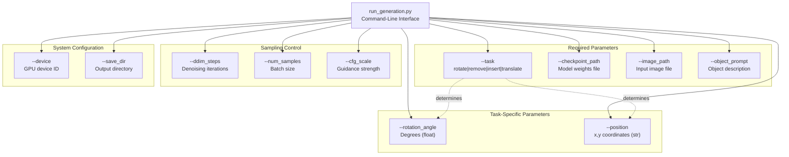
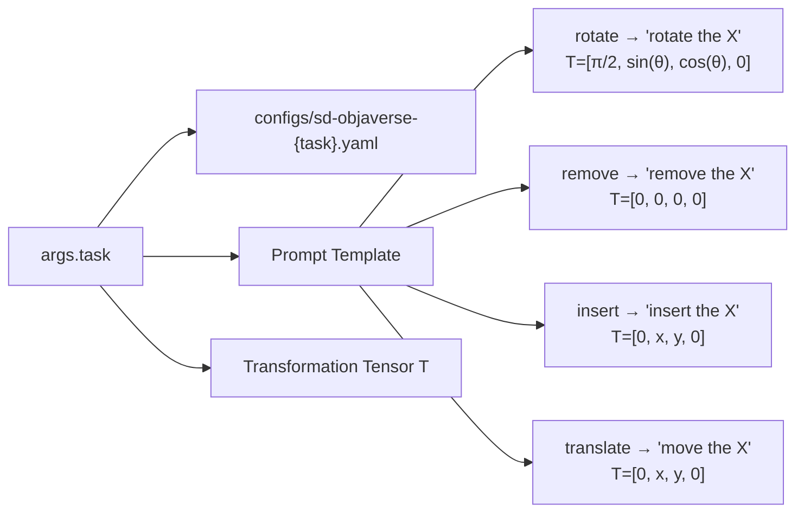
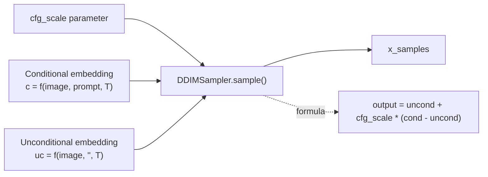
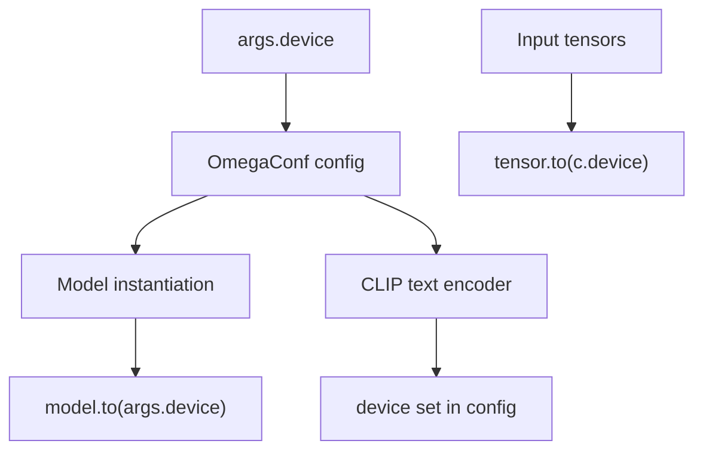
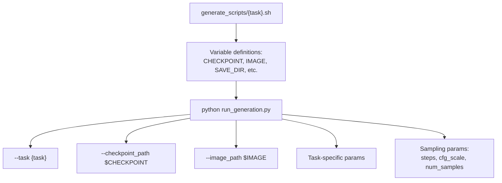
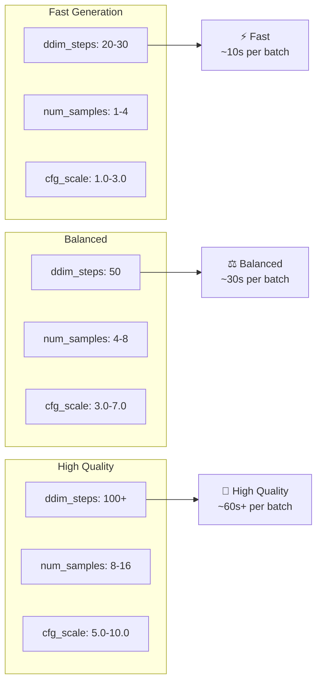

<!-- source: DeepWiki mcp.deepwiki.com · repo allenai/object-edit · page 5.3 Generation Parameters and Configuration · fetched 2026-10-26 -->

# Generation Parameters and Configuration

<details>
<summary>Relevant source files</summary>

The following files were used as context for generating this wiki page:

- [README.md](README.md)
- [run_generation.py](run_generation.py)

</details>


## Purpose and Scope

This page documents all command-line parameters and configuration options available when generating images using the trained OBJect 3DIT models. It covers the arguments for `run_generation.py`, their valid values, default settings, and how they interact with the generation pipeline.

For the overall generation workflow and internal processing steps, see [Generation Pipeline](#5.1). For task-specific conditioning logic and transformation tensors, see [Task-Specific Generation](#5.2).

---

## Command-Line Interface Overview

The primary interface for image generation is the `run_generation.py` script, which accepts a comprehensive set of arguments to control the editing task, model loading, sampling behavior, and output configuration.



**Diagram: Command-Line Parameter Categories**

Sources: [run_generation.py:176-234]()

---

## Parameter Reference

### Complete Parameter Table

| Parameter | Type | Required | Default | Valid Values | Description |
|-----------|------|----------|---------|--------------|-------------|
| `--task` | str | Yes | - | `rotate`, `remove`, `insert`, `translate` | Editing operation to perform |
| `--checkpoint_path` | str | Yes | - | File path | Path to trained model checkpoint |
| `--image_path` | str | Yes | - | Image file | Input image to edit |
| `--object_prompt` | str | Yes | - | Text string | Description of target object (no instruction) |
| `--save_dir` | str | No | `generated_images` | Directory path | Output directory for results |
| `--rotation_angle` | float | No | `0.0` | Degrees | Rotation angle for `rotate` task |
| `--position` | str | No | `0.5,0.5` | `x,y` where 0≤x,y≤1 | Target position for `insert`/`translate` |
| `--ddim_steps` | int | No | `50` | Positive integer | Number of denoising steps |
| `--num_samples` | int | No | `8` | Positive integer | Number of images to generate |
| `--device` | int | No | `0` | GPU device ID | CUDA device index |
| `--cfg_scale` | float | No | `1.0` | Non-negative float | Classifier-free guidance scale |

Sources: [run_generation.py:176-234]()

---

## Core Required Parameters

### Task Selection

The `--task` parameter determines which editing operation to perform and automatically configures the prompt template and transformation tensor construction.

**Valid choices:**
- `rotate`: 3D rotation of object around vertical axis
- `remove`: Object removal/inpainting
- `insert`: Object insertion at specified position
- `translate`: Object translation to new position

**Code usage:** The task parameter is used to load the appropriate configuration file and construct task-specific prompts at [run_generation.py:117]() and [run_generation.py:129-141]().



**Diagram: Task Parameter Controls Multiple System Components**

Sources: [run_generation.py:117](), [run_generation.py:129-141]()

### Checkpoint Path

The `--checkpoint_path` parameter specifies the trained model weights to load. The system supports automatic channel adaptation for checkpoints with mismatched input dimensions (e.g., loading a 4-channel checkpoint into an 8-channel model).

**Checkpoint loading logic:**
- Attempts to load from the specified path at [run_generation.py:16-53]()
- Handles nested `state_dict` keys automatically at [run_generation.py:21-23]()
- Performs 4ch→8ch input weight adaptation if needed at [run_generation.py:25-44]()
- Loads weights with `strict=False` to allow partial loading at [run_generation.py:46]()

**Available checkpoints** (from HuggingFace):
- Task-specific trained models for each editing operation
- Zero123 initialization checkpoint
- Image-Conditioned StableDiffusion checkpoint

Sources: [run_generation.py:16-53](), [README.md:46]()

### Image Path and Object Prompt

**Image Path (`--image_path`):**
- Must be a valid image file readable by PIL
- Automatically preprocessed to 256×256 resolution at [run_generation.py:55-66]()
- Converted to RGB format (removes alpha channel if present)
- Normalized to [-1, 1] range for model input

**Object Prompt (`--object_prompt`):**
- Should describe the target object WITHOUT including the editing instruction
- The task-specific instruction is automatically prepended at [run_generation.py:130-141]()
- Example: Use `"red apple"` not `"remove the red apple"`
- The prompt is embedded using the model's text encoder via `get_learned_conditioning` at [run_generation.py:81]()

Sources: [run_generation.py:55-66](), [run_generation.py:130-141](), [run_generation.py:81](), [README.md:62]()

---

## Task-Specific Parameters

### Rotation Angle

**Parameter:** `--rotation_angle` (float, default: `0.0`)

**Usage:** Only relevant for `--task rotate`

**Interpretation:**
- Specified in degrees (converted to radians internally at [run_generation.py:131-132]())
- Represents the azimuthal rotation angle around the vertical axis
- Positive values indicate counter-clockwise rotation
- Encoded into transformation tensor as: `T = [π/2, sin(θ), cos(θ), 0]`

**Example:**
```bash
--task rotate --rotation_angle 90.0  # Rotate object 90° counter-clockwise
```

Sources: [run_generation.py:129-132]()

### Position Coordinates

**Parameter:** `--position` (string, default: `"0.5,0.5"`)

**Usage:** Relevant for `--task insert` and `--task translate`

**Format:** Comma-separated `x,y` coordinates where both values are in [0, 1]
- `(0, 0)`: Top-left corner
- `(1, 1)`: Bottom-right corner
- `(0.5, 0.5)`: Center of image

**Parsing and encoding:**
- Parsed at [run_generation.py:128]() via `map(float, args.position.split(','))`
- Encoded into transformation tensor as: `T = [0, x, y, 0]`
- Used identically for both `insert` and `translate` tasks at [run_generation.py:136-141]()

**Example:**
```bash
--task insert --position "0.3,0.7"  # Insert object at 30% from left, 70% from top
```

Sources: [run_generation.py:128](), [run_generation.py:136-141](), [run_generation.py:209-213]()

---

## Sampling Parameters

These parameters control the DDIM sampling process that generates images from the learned latent distribution.

### DDIM Steps

**Parameter:** `--ddim_steps` (int, default: `50`)

**Description:**
- Number of denoising iterations in the DDIM sampling process
- Higher values → better quality but slower generation
- Lower values → faster generation but potentially lower quality

**Typical ranges:**
- Fast preview: 20-30 steps
- Standard quality: 50 steps (default)
- High quality: 100+ steps

**Code usage:** Passed to `sample_model` at [run_generation.py:152]() and used by `DDIMSampler.sample` at [run_generation.py:98]().

Sources: [run_generation.py:74](), [run_generation.py:98](), [run_generation.py:152](), [run_generation.py:215-218]()

### Classifier-Free Guidance Scale

**Parameter:** `--cfg_scale` (float, default: `1.0`)

**Description:**
- Controls the strength of classifier-free guidance (CFG)
- `1.0`: No guidance (unconditional generation)
- `> 1.0`: Stronger adherence to conditioning (text prompt and task parameters)
- Typical range: 1.0 to 10.0

**Implementation:**
- Requires both conditional and unconditional embeddings
- Unconditional embeddings computed with empty prompt at [run_generation.py:82-83]()
- Applied during sampling via `unconditional_guidance_scale` at [run_generation.py:103]()

**Trade-offs:**
- Higher values → more faithful to prompt, potentially less diverse
- Lower values → more diverse outputs, potentially less accurate



**Diagram: Classifier-Free Guidance Flow**

Sources: [run_generation.py:76](), [run_generation.py:82-95](), [run_generation.py:103](), [run_generation.py:154](), [run_generation.py:230-233]()

### Number of Samples

**Parameter:** `--num_samples` (int, default: `8`)

**Description:**
- Number of images to generate in a single batch
- All samples use the same conditioning but different noise initializations
- Limited by GPU memory capacity

**Output:**
- Images saved as `0.png`, `1.png`, ..., `{num_samples-1}.png` in the save directory
- Additionally saves the input image as `input_im.png`

**Code usage:**
- Used to tile conditioning tensors at [run_generation.py:75](), [run_generation.py:81]()
- Determines batch size for sampling at [run_generation.py:100]()
- Iterates through outputs for saving at [run_generation.py:157-169]()

Sources: [run_generation.py:75](), [run_generation.py:81](), [run_generation.py:100](), [run_generation.py:157-169](), [run_generation.py:219-223]()

---

## System Configuration

### Device Selection

**Parameter:** `--device` (int, default: `0`)

**Description:**
- CUDA device index for GPU execution
- Used to configure both the model and the CLIP text encoder
- Set via `OmegaConf.update` for the conditioning stage at [run_generation.py:118]()

**Code flow:**


**Diagram: Device Configuration Propagation**

Sources: [run_generation.py:118](), [run_generation.py:122](), [run_generation.py:225-228]()

### Save Directory

**Parameter:** `--save_dir` (str, default: `"generated_images"`)

**Description:**
- Output directory for generated images
- Created automatically if it doesn't exist via `os.makedirs(..., exist_ok=True)` at [run_generation.py:165]()
- Contains numbered output images and the preprocessed input image

**Output structure:**
```
save_dir/
├── input_im.png          # Preprocessed input (256×256)
├── 0.png                 # First generated sample
├── 1.png                 # Second generated sample
├── ...
└── {num_samples-1}.png   # Last generated sample
```

Sources: [run_generation.py:165-169](), [run_generation.py:194-197]()

---

## Configuration Files

The `--task` parameter determines which YAML configuration file is loaded. These files specify model architecture, conditioning mechanisms, and other hyperparameters.

**Configuration loading:**
```python
config = OmegaConf.load(f"configs/sd-objaverse-{args.task}.yaml")
```

**Configuration file locations:**
- `configs/sd-objaverse-rotate.yaml`
- `configs/sd-objaverse-remove.yaml`
- `configs/sd-objaverse-insert.yaml`
- `configs/sd-objaverse-translate.yaml`

**Dynamic configuration updates:**
- The device setting is updated at runtime: [run_generation.py:118]()
- Allows override of config parameters without modifying files

Sources: [run_generation.py:117-118]()

---

## Shell Script Examples

The repository provides example shell scripts in the `generate_scripts/` directory that demonstrate typical parameter combinations for each task.

### Script Structure Pattern

All generation scripts follow a common structure:



**Diagram: Shell Script Organization**

Sources: [README.md:55-61]()

### Rotation Script Example

**File:** `generate_scripts/rotate.sh`

**Key parameters:**
- Uses `--task rotate`
- Specifies `--rotation_angle` (in degrees)
- Typically uses higher `--cfg_scale` for accurate rotation control

### Removal Script Example

**File:** `generate_scripts/remove.sh`

**Key parameters:**
- Uses `--task remove`
- No task-specific parameters needed
- The `--position` parameter is ignored for this task

### Insertion Script Example

**File:** `generate_scripts/insert.sh`

**Key parameters:**
- Uses `--task insert`
- Requires `--position` to specify insertion location
- Object described in `--object_prompt` is synthesized at the target position

### Translation Script Example

**File:** `generate_scripts/translate.sh`

**Key parameters:**
- Uses `--task translate`
- Requires `--position` to specify target location
- Moves existing object to new coordinates

Sources: [README.md:55-61]()

---

## Parameter Interactions and Recommendations

### Task-Parameter Dependencies

| Task | Required Params | Ignored Params | Recommended CFG Scale |
|------|----------------|----------------|----------------------|
| `rotate` | `rotation_angle` | `position` | 3.0 - 7.0 |
| `remove` | None | `rotation_angle`, `position` | 1.0 - 3.0 |
| `insert` | `position` | `rotation_angle` | 5.0 - 10.0 |
| `translate` | `position` | `rotation_angle` | 3.0 - 7.0 |

### Quality vs. Speed Trade-offs



**Diagram: Parameter Profiles for Different Use Cases**

### Memory Considerations

**GPU memory usage scales with:**
1. `num_samples`: Linear scaling (each sample uses ~1GB VRAM)
2. `ddim_steps`: Minimal impact on peak memory
3. Image resolution: Fixed at 256×256 in latent space (32×32×4)

**Typical memory requirements:**
- `num_samples=4`: ~4-5 GB VRAM
- `num_samples=8`: ~8-9 GB VRAM
- `num_samples=16`: ~16-18 GB VRAM

---

## Advanced Parameter Usage

### DDIM Eta Parameter

While not exposed in the command-line interface, the `ddim_eta` parameter can be modified in the code at [run_generation.py:77]() and [run_generation.py:105]().

**Default value:** `1.0`

**Effect:**
- `eta=0.0`: Deterministic DDIM sampling (same noise → same output)
- `eta=1.0`: Stochastic sampling (equivalent to DDPM)
- Intermediate values blend deterministic and stochastic behavior

### Null Text Conditioning

The system automatically generates unconditional embeddings using an empty prompt for classifier-free guidance at [run_generation.py:82-83]():

```python
null_prompt = model.get_learned_conditioning([""])
uc = null_prompt.repeat(1, c.shape[1], 1).tile(n_samples, 1, 1)
```

This is required for any `cfg_scale > 1.0`.

Sources: [run_generation.py:77](), [run_generation.py:82-83](), [run_generation.py:105]()

---

## Parameter Validation

The script performs minimal parameter validation:

**Enforced constraints:**
1. `--task` must be one of the four valid choices (enforced by argparse at [run_generation.py:181]())
2. All required parameters must be provided (enforced by argparse)

**Not enforced (user responsibility):**
- Valid checkpoint file path
- Valid image file path
- `position` coordinates in [0, 1] range
- Reasonable `ddim_steps` and `cfg_scale` values
- Sufficient GPU memory for `num_samples`

Sources: [run_generation.py:176-234]()

---

## Summary Reference

**Minimal working example:**
```bash
python run_generation.py \
  --task rotate \
  --checkpoint_path checkpoints/rotate.ckpt \
  --image_path input.png \
  --object_prompt "wooden chair" \
  --rotation_angle 45.0
```

**Full parameter example:**
```bash
python run_generation.py \
  --task translate \
  --checkpoint_path checkpoints/translate.ckpt \
  --image_path input.png \
  --object_prompt "red ball" \
  --position "0.7,0.3" \
  --ddim_steps 100 \
  --num_samples 16 \
  --cfg_scale 5.0 \
  --device 0 \
  --save_dir results/translation_experiment
```

Sources: [run_generation.py:114-235](), [README.md:55-61]()

---

