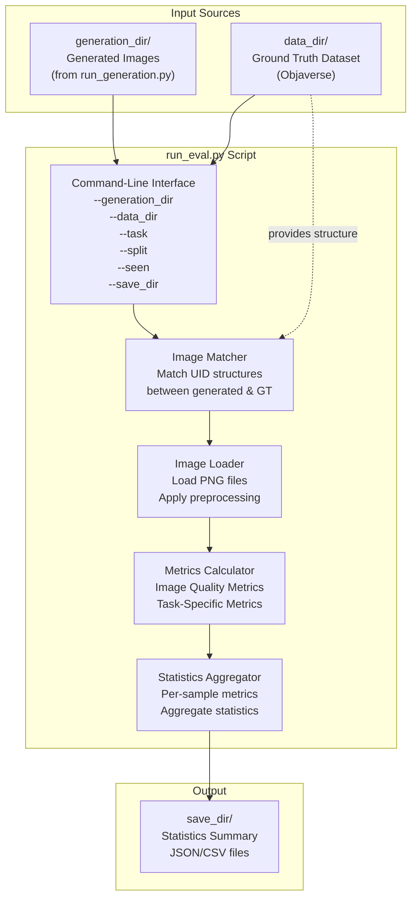
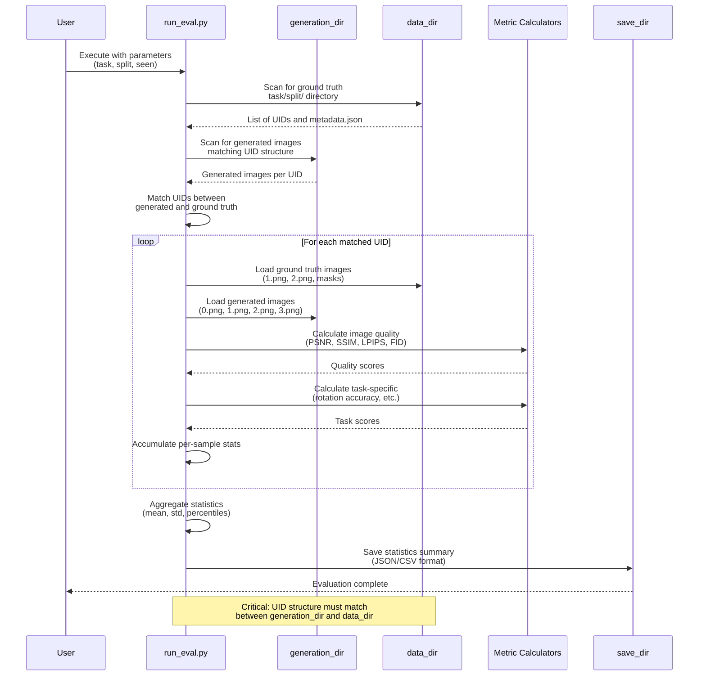
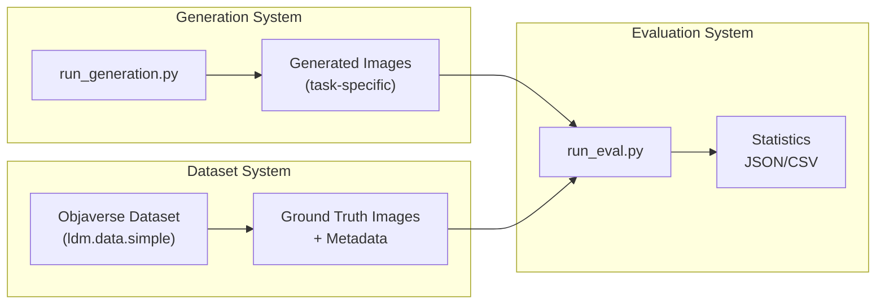

<!-- source: DeepWiki mcp.deepwiki.com · repo allenai/object-edit · page 6 Evaluation System · fetched 2026-10-26 -->

# Evaluation System

<details>
<summary>Relevant source files</summary>

The following files were used as context for generating this wiki page:

- [README.md](README.md)

</details>


## Purpose and Scope

The Evaluation System provides automated benchmarking capabilities for validating generated images against ground truth data from the Objaverse dataset. This system enables quantitative assessment of the model's performance across different editing tasks (rotation, removal, insertion, translation), data splits (train/val/test), and object categories (seen/unseen).

This page covers the overall evaluation architecture and workflow. For detailed instructions on running evaluations, see [Running Evaluations](#6.1). For information about specific metrics and benchmark interpretation, see [Metrics and Benchmarks](#6.2). For details about the generation process that produces images to be evaluated, see [Inference and Generation](#5).

**Sources:** [README.md:64-86]()

## System Overview

The evaluation system operates as a validation loop that compares generated images with ground truth images from the original dataset. It calculates multiple image quality metrics and task-specific accuracy measurements to provide comprehensive performance statistics.

The system consists of three primary components:

| Component | Purpose | Key Script |
|-----------|---------|-----------|
| **Image Matching** | Matches generated images to ground truth based on UID structure | `run_eval.py` |
| **Metric Calculation** | Computes image quality and task-specific metrics | `run_eval.py` |
| **Results Aggregation** | Generates statistics summaries in JSON/CSV format | `run_eval.py` |

**Sources:** [README.md:64-86]()

## Evaluation Architecture



**Diagram: Evaluation System Architecture - Components of run_eval.py**

The evaluation script coordinates the flow from input directories through matching, loading, metric calculation, and aggregation to produce final statistics.

**Sources:** [README.md:64-86]()

## Evaluation Workflow



**Diagram: Evaluation Sequence Flow - Step-by-step evaluation process**

The workflow shows how `run_eval.py` orchestrates the comparison between generated and ground truth images, computing metrics for each matched UID pair.

**Sources:** [README.md:64-86]()

## Directory Structure Requirements

The evaluation system requires strict adherence to the UID-based directory structure. Generated images must be organized with the same UID identifiers as the ground truth dataset.

### Ground Truth Structure

```
data_dir/
└── {task}/              # rotate, remove, insert, or translate
    └── {split}/         # train, val, or test
        └── {uid}/       # Unique identifier for each sample
            ├── 1.png
            ├── 2.png
            ├── 1_mask.png
            ├── 2_mask.png
            └── metadata.json
```

### Generated Images Structure

```
generation_dir/
└── {uid}/               # Must match ground truth UIDs
    ├── 0.png
    ├── 1.png
    ├── 2.png
    └── 3.png
```

The evaluation script assumes this structure and will fail to match images if the UID directories do not correspond between the two locations.

**Sources:** [README.md:77-86]()

## Command-Line Interface

The `run_eval.py` script accepts the following command-line arguments:

| Argument | Required | Description | Valid Values |
|----------|----------|-------------|--------------|
| `--generation_dir` | Yes | Path to directory containing generated images | Valid directory path |
| `--data_dir` | Yes | Path to Objaverse dataset root directory | Valid directory path |
| `--task` | Yes | Editing task to evaluate | `rotate`, `remove`, `insert`, `translate` |
| `--split` | Yes | Dataset split to evaluate | `train`, `val`, `test` |
| `--seen` | Yes | Object category type | `seen`, `unseen` |
| `--save_dir` | Yes | Path to save statistics summary | Valid directory path |

### Example Usage

```bash
python run_eval.py \
  --generation_dir outputs/rotate_experiment_001 \
  --data_dir DATASET \
  --task rotate \
  --split val \
  --seen unseen \
  --save_dir results/rotate_val_unseen
```

This command evaluates rotation task results on the validation split for unseen objects, comparing generated images in `outputs/rotate_experiment_001` against ground truth in `DATASET/rotate/val/`.

**Sources:** [README.md:67-75]()

## Evaluation Parameters

### Task Selection

The `--task` parameter determines which editing operation to evaluate:

- **rotate**: Evaluates object rotation accuracy and consistency
- **remove**: Evaluates clean object removal and background inpainting quality
- **insert**: Evaluates object insertion realism and blending
- **translate**: Evaluates object translation accuracy and scene coherence

Each task may use different task-specific metrics in addition to standard image quality metrics.

### Split and Seen Parameters

The `--split` parameter selects which portion of the dataset to evaluate:
- **train**: Training set samples (typically for debugging)
- **val**: Validation set for model selection
- **test**: Test set for final benchmark results

The `--seen` parameter filters evaluation by object category:
- **seen**: Objects that appeared in the training data
- **unseen**: Objects not seen during training (tests generalization)

**Sources:** [README.md:67-75]()

## System Integration

The evaluation system integrates with other components of the OBJect 3DIT pipeline:



**Diagram: System Integration - How evaluation connects to generation and data systems**

The evaluation system serves as the final validation stage, consuming outputs from the generation system ([Inference and Generation](#5)) and comparing them against the ground truth data loaded by the data system ([Data System](#3)).

**Sources:** [README.md:64-86]()

## Output and Results

The evaluation script saves results to the specified `--save_dir` directory. The output includes:

| Output Type | Description | Format |
|------------|-------------|--------|
| **Per-Sample Statistics** | Metrics for each evaluated UID | JSON/CSV |
| **Aggregate Statistics** | Mean, standard deviation, percentiles across all samples | JSON/CSV |
| **Task-Specific Metrics** | Task-dependent measurements (e.g., rotation error) | JSON/CSV |
| **Image Quality Metrics** | Standard metrics (PSNR, SSIM, LPIPS, FID) | JSON/CSV |

These statistics enable:
- Model comparison across different training runs
- Performance analysis across different object categories
- Identification of failure cases and edge conditions
- Benchmark reporting for research publications

For detailed information about specific metrics computed and how to interpret benchmark results, see [Metrics and Benchmarks](#6.2).

**Sources:** [README.md:74-75]()

---

