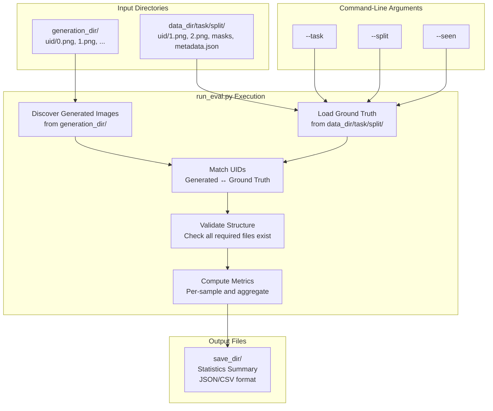
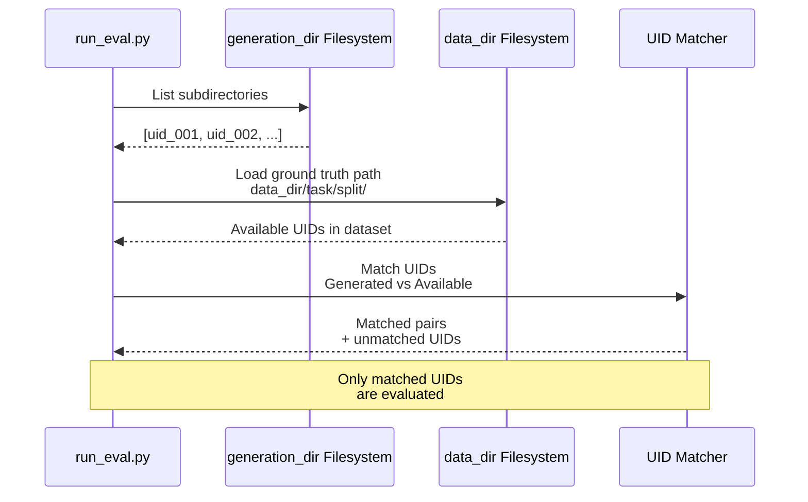
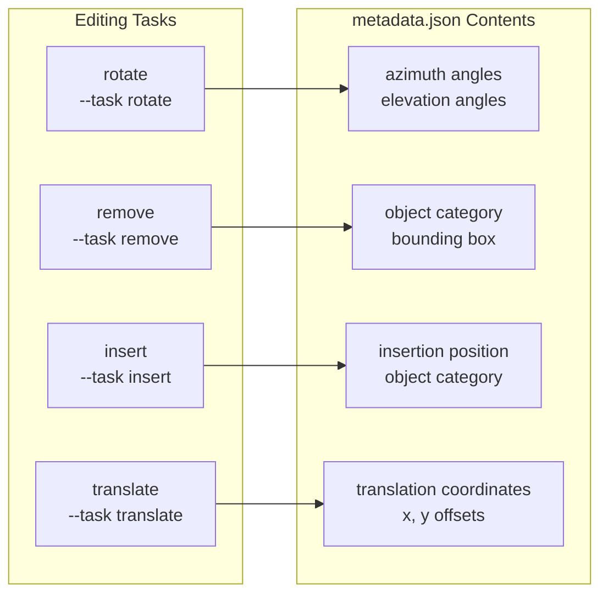
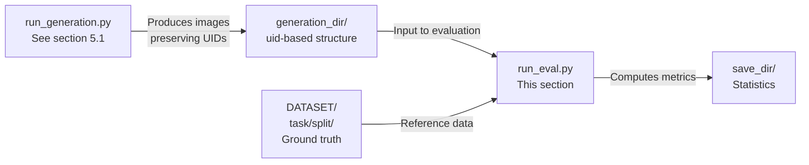

<!-- source: DeepWiki mcp.deepwiki.com · repo allenai/object-edit · page 6.1 Running Evaluations · fetched 2026-10-26 -->

# Running Evaluations

<details>
<summary>Relevant source files</summary>

The following files were used as context for generating this wiki page:

- [README.md](README.md)

</details>


## Purpose and Scope

This document explains how to execute evaluations using the `run_eval.py` script to benchmark generated images against ground truth data from the Objaverse dataset. The evaluation system validates the quality and correctness of images produced by the generation pipeline (see [Generation Pipeline](#5.1)) by comparing them to reference data.

For information about the specific metrics calculated and how to interpret benchmark results, see [Metrics and Benchmarks](#6.2). For details on how to generate images for evaluation, see [Task-Specific Generation](#5.2).

**Sources:** [README.md:64-86]()

---

## Directory Structure Requirements

The evaluation system enforces a strict directory structure requirement: **generated images must preserve the uid-based directory structure** from the original dataset. This enables automated matching between generated outputs and ground truth data.

### Required Structure

```
generation_dir/
│
├── uid_001/
│   ├── 0.png
│   ├── 1.png
│   ├── 2.png
│   └── 3.png
│
├── uid_002/
│   ├── 0.png
│   ├── 1.png
│   └── ...
│
└── uid_N/
    └── ...
```

### Ground Truth Structure

The ground truth data directory follows this structure:

```
data_dir/
└── TASK/                    # rotate, remove, insert, or translate
    └── SPLIT/               # train, val, or test
        └── uid/
            ├── 1.png        # Reference images
            ├── 2.png
            ├── 1_mask.png   # Object masks
            ├── 2_mask.png
            └── metadata.json # Task metadata (angles, positions, etc.)
```

The evaluation script matches each `uid` directory in `generation_dir` with the corresponding `uid` in `data_dir/TASK/SPLIT/`, enabling per-sample metric computation.

**Sources:** [README.md:34-45](), [README.md:78-85]()

---

## Command-Line Interface

### Basic Usage

```bash
python run_eval.py \
  --generation_dir YOUR_GENERATED_IMAGES_PATH \
  --data_dir PATH_OF_OBJECT_DATASET \
  --task [rotate|remove|insert|translate] \
  --split [train|val|test] \
  --seen [seen|unseen] \
  --save_dir PATH_TO_SAVE_STATISTICS_SUMMARY
```

### Arguments Reference

| Argument | Type | Required | Description |
|----------|------|----------|-------------|
| `--generation_dir` | Path | Yes | Directory containing generated images with uid-based subdirectories |
| `--data_dir` | Path | Yes | Root directory of the Objaverse dataset (contains task subdirectories) |
| `--task` | Choice | Yes | Editing task to evaluate: `rotate`, `remove`, `insert`, or `translate` |
| `--split` | Choice | Yes | Dataset split to use: `train`, `val`, or `test` |
| `--seen` | Choice | Yes | Object category: `seen` (training categories) or `unseen` (held-out categories) |
| `--save_dir` | Path | Yes | Output directory for evaluation statistics and summary files |

### Example Commands

**Evaluate rotation edits on validation set (seen objects):**
```bash
python run_eval.py \
  --generation_dir outputs/rotate_val_seen \
  --data_dir DATASET \
  --task rotate \
  --split val \
  --seen seen \
  --save_dir eval_results/rotate_val_seen
```

**Evaluate removal edits on test set (unseen objects):**
```bash
python run_eval.py \
  --generation_dir outputs/remove_test_unseen \
  --data_dir DATASET \
  --task remove \
  --split test \
  --seen unseen \
  --save_dir eval_results/remove_test_unseen
```

**Sources:** [README.md:65-75]()

---

## Evaluation Workflow

The following diagram illustrates the complete evaluation process from input directories to output statistics:

**Evaluation Pipeline Architecture**



**Sources:** [README.md:64-86]()

---

## Evaluation Process Details

### Step-by-Step Execution

**1. UID Discovery and Matching**



**2. File Validation**

For each matched uid, the script validates:

| Generated Images | Ground Truth Files |
|-----------------|-------------------|
| `uid/0.png` | `uid/1.png` (reference view 1) |
| `uid/1.png` | `uid/2.png` (reference view 2) |
| `uid/2.png` | `uid/1_mask.png` (object mask 1) |
| `uid/3.png` | `uid/2_mask.png` (object mask 2) |
| ... | `uid/metadata.json` (task parameters) |

**3. Metric Computation**

The evaluation system computes metrics by:
- Loading generated and ground truth image pairs
- Extracting task-specific metadata from `metadata.json`
- Computing image quality metrics (see [Metrics and Benchmarks](#6.2))
- Aggregating results across all samples

**Sources:** [README.md:77-85](), [README.md:34-45]()

---

## Task-Specific Considerations

Different editing tasks have specific evaluation requirements based on their metadata:

**Task-Metadata Mapping**



### Rotation Task
- Metadata includes target azimuth/elevation angles
- Evaluation checks if object is rotated to correct viewpoint
- Reference images show different viewing angles

### Removal Task
- Metadata specifies which object to remove
- Evaluation verifies object absence using masks
- Background should remain coherent

### Insertion Task
- Uses same ground truth as removal (inverse operation)
- Metadata specifies insertion position
- Evaluation checks object presence and placement

### Translation Task
- Metadata includes x, y translation coordinates
- Evaluation validates object moved to correct position
- Object appearance should be preserved

**Sources:** [README.md:49-51](), [README.md:32]()

---

## Output Format and Location

The evaluation script saves results to the specified `save_dir` with the following structure:

### Output Directory Structure

```
save_dir/
├── summary.json           # Aggregate statistics across all samples
├── per_sample_results.csv # Individual sample metrics
└── metadata.json          # Evaluation configuration and parameters
```

### Summary Statistics

The summary files typically contain:
- **Aggregate metrics**: Mean, median, std dev across all samples
- **Task-specific accuracy**: Rotation accuracy, removal completeness, etc.
- **Image quality metrics**: PSNR, SSIM, LPIPS, FID (see [Metrics and Benchmarks](#6.2))
- **Evaluation parameters**: Task, split, seen/unseen, number of samples evaluated

### Per-Sample Results

Individual sample metrics enable:
- Identifying failure cases
- Analyzing performance by object category
- Debugging generation issues for specific UIDs

**Sources:** [README.md:74]()

---

## Common Issues and Troubleshooting

### UID Mismatch Errors

**Problem:** Script reports "UID not found in ground truth"

**Solution:** Ensure `generation_dir` uses the same uid naming as the dataset. The generation pipeline (see [Task-Specific Generation](#5.2)) should preserve uid directories when saving outputs.

### Missing Files

**Problem:** "Required file not found" errors

**Solution:** Verify the ground truth dataset is properly extracted:
```bash
cd DATASET
tar -xzvf TASK.tar.gz
```

### Incorrect Split/Seen Combination

**Problem:** No samples found for evaluation

**Solution:** Check that the combination of `--split` and `--seen` exists in the dataset. Not all combinations may have data depending on the dataset structure.

### Path Configuration

**Problem:** Cannot locate dataset or generation directories

**Solution:** Use absolute paths or ensure paths are relative to the script execution directory. The default dataset location is `DATASET/` as configured in the training configs (see [Training Configuration](#4.1)).

**Sources:** [README.md:26-31](), [README.md:77]()

---

## Integration with Generation Pipeline

The evaluation system is designed to work seamlessly with the generation pipeline:

**Generation-to-Evaluation Workflow**



When running the generation scripts in `generate_scripts/` ([Task-Specific Generation](#5.2)), ensure the output directory structure matches the evaluation requirements. The `--save_dir` argument in `run_generation.py` should create uid subdirectories automatically.

**Sources:** [README.md:54-62](), [README.md:77-85]()

---

