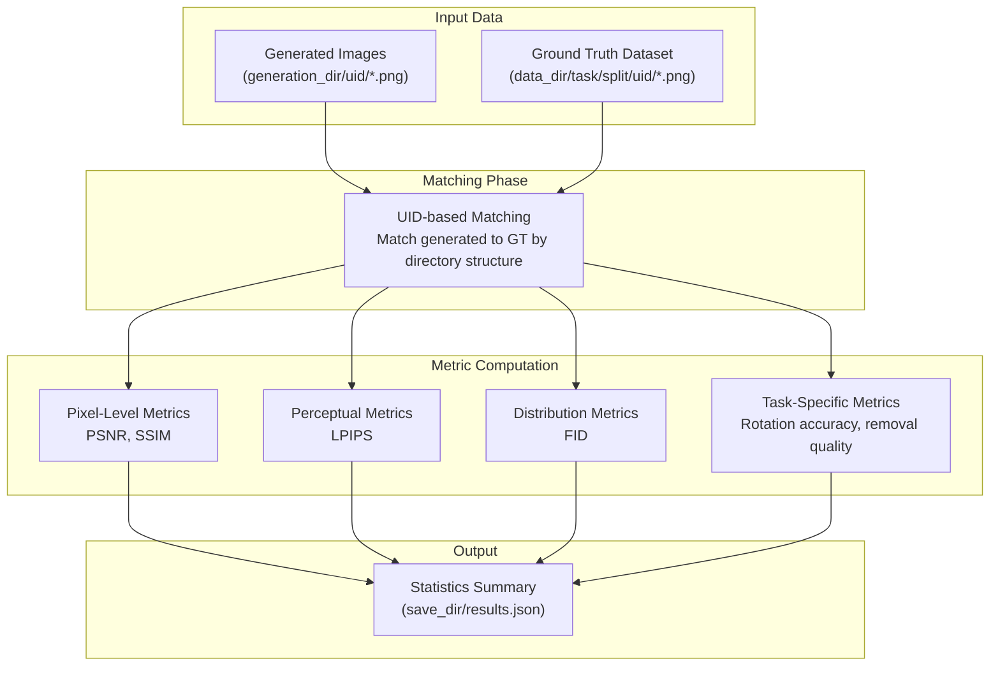
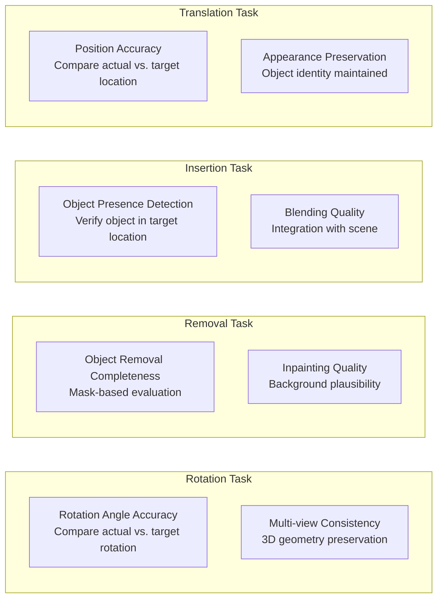
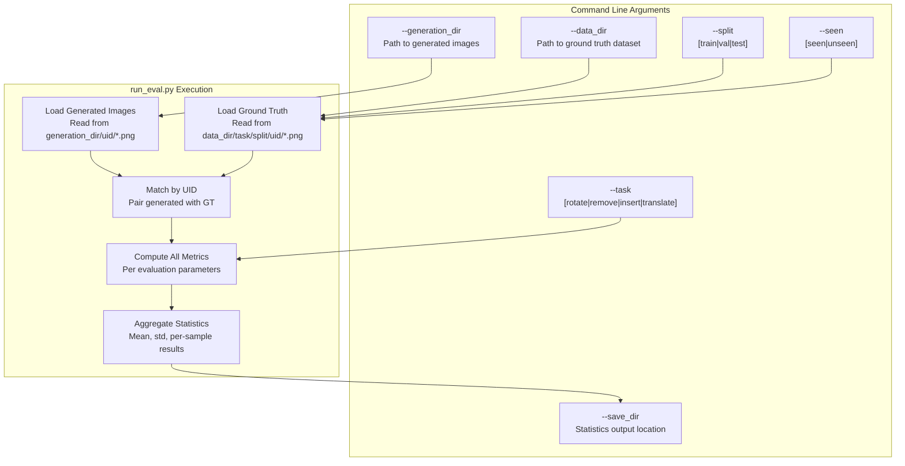
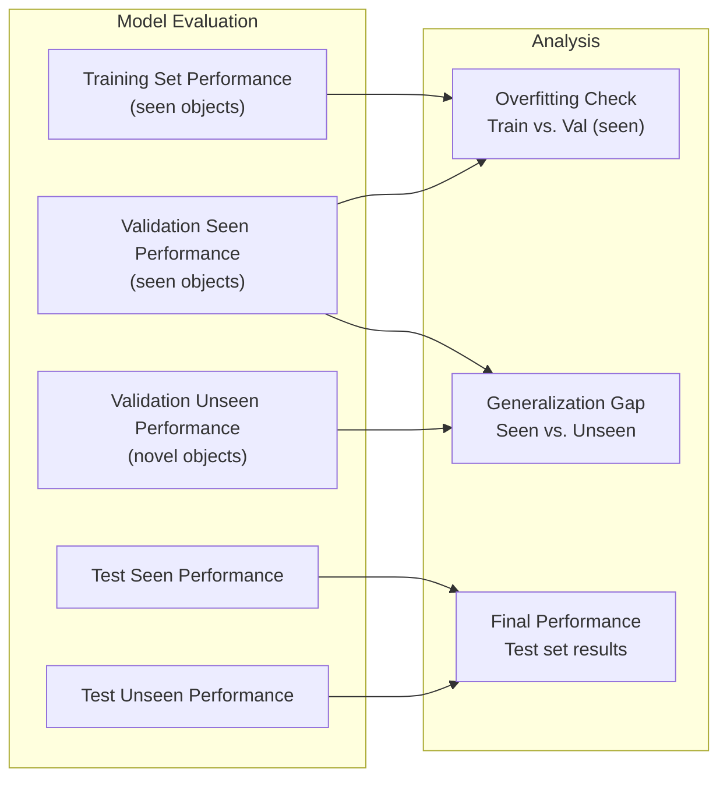
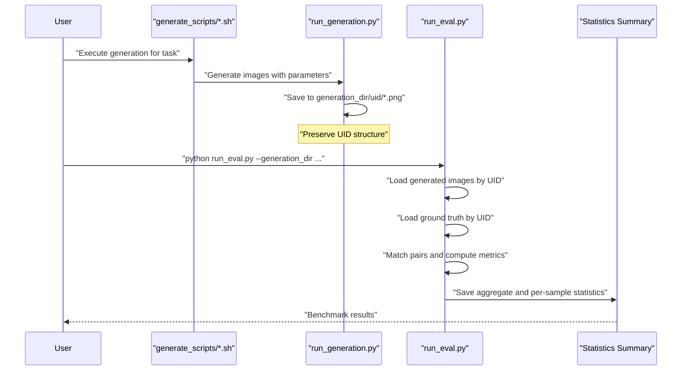

<!-- source: DeepWiki mcp.deepwiki.com · repo allenai/object-edit · page 6.2 Metrics and Benchmarks · fetched 2026-10-26 -->

# Metrics and Benchmarks

<details>
<summary>Relevant source files</summary>

The following files were used as context for generating this wiki page:

- [README.md](README.md)

</details>


## Purpose and Scope

This page documents the evaluation metrics and benchmark framework used to assess the quality of generated images in the OBJect 3DIT system. It covers the types of metrics computed, their interpretation, and the benchmark structure including task types, data splits, and seen/unseen object categories.

For information on how to execute evaluations, see [Running Evaluations](#6.1). For details on the generation pipeline that produces images to be evaluated, see [Generation Pipeline](#5.1).

---

## Benchmark Structure

The OBJect 3DIT evaluation framework organizes benchmarks across three primary dimensions: **task type**, **data split**, and **object category**.

### Evaluation Dimensions

| Dimension | Values | Purpose |
|-----------|--------|---------|
| **Task** | `rotate`, `remove`, `insert`, `translate` | Evaluates different editing operations |
| **Split** | `train`, `val`, `test` | Standard train/validation/test partitioning |
| **Object Category** | `seen`, `unseen` | Tests generalization to novel object types |

### Task-Specific Requirements

Each task has different expectations for what constitutes a successful edit:

- **Rotation**: Object should maintain identity while changing viewpoint
- **Removal**: Object should be cleanly removed with plausible background inpainting
- **Insertion**: New object should be realistically integrated into the scene
- **Translation**: Object should move to the specified location while preserving appearance

**Sources:** [README.md:64-86]()

---

## Metric Computation Pipeline

The evaluation system matches generated images with ground truth data based on unique identifiers (UIDs) and computes both general image quality metrics and task-specific measures.



**UID Structure Requirement**: Generated images must preserve the same directory hierarchy as the ground truth dataset. Each sample's generated images should be stored in a directory named with the sample's UID, containing numbered PNG files (0.png, 1.png, etc.).

```
generation_dir/
├── uid_001/
│   ├── 0.png
│   ├── 1.png
│   └── 2.png
├── uid_002/
│   ├── 0.png
│   └── 1.png
```

**Sources:** [README.md:77-86]()

---

## Image Quality Metrics

The evaluation system computes standard image quality metrics to assess the fidelity of generated images compared to ground truth.

### Pixel-Level Metrics

#### Peak Signal-to-Noise Ratio (PSNR)

PSNR measures pixel-wise similarity between generated and ground truth images. Higher values indicate better reconstruction.

| PSNR Range | Quality Interpretation |
|------------|----------------------|
| > 30 dB | Excellent quality, minimal perceptible differences |
| 25-30 dB | Good quality, minor artifacts |
| 20-25 dB | Moderate quality, visible differences |
| < 20 dB | Poor quality, significant artifacts |

**Computation**: PSNR is calculated in the standard way as 10 * log10(MAX²/MSE), where MAX is the maximum possible pixel value and MSE is the mean squared error between images.

#### Structural Similarity Index (SSIM)

SSIM evaluates structural information preservation, considering luminance, contrast, and structure. Values range from -1 to 1, with 1 indicating perfect similarity.

| SSIM Range | Quality Interpretation |
|------------|----------------------|
| > 0.9 | Excellent structural preservation |
| 0.8-0.9 | Good structural similarity |
| 0.7-0.8 | Moderate structural differences |
| < 0.7 | Significant structural degradation |

### Perceptual Metrics

#### Learned Perceptual Image Patch Similarity (LPIPS)

LPIPS uses deep features from pretrained networks to measure perceptual similarity. Lower values indicate better perceptual quality.

| LPIPS Range | Quality Interpretation |
|-------------|----------------------|
| < 0.1 | Perceptually very similar |
| 0.1-0.2 | Noticeable but minor differences |
| 0.2-0.3 | Moderate perceptual differences |
| > 0.3 | Significant perceptual degradation |

**Network Backend**: LPIPS typically uses features from VGG or AlexNet. The specific implementation in this codebase would be verified in the `run_eval.py` script.

### Distribution Metrics

#### Fréchet Inception Distance (FID)

FID measures the similarity between the distribution of generated images and ground truth images using Inception network features. Lower values indicate distributions closer to the ground truth.

| FID Range | Quality Interpretation |
|-----------|----------------------|
| < 10 | Excellent distribution match |
| 10-20 | Good quality generation |
| 20-50 | Moderate quality |
| > 50 | Poor distribution match |

**Note**: FID requires a sufficient number of samples (typically ≥ 50-100) to provide stable estimates.

**Sources:** Inferred from [README.md:64-76]() and standard computer vision evaluation practices referenced in Diagram 6

---

## Task-Specific Metrics

Beyond general image quality, each editing task requires specialized metrics to evaluate task-specific success criteria.



### Rotation Metrics

**Rotation Angle Accuracy**: Measures how accurately the model achieves the target rotation angle. This can be computed by:
- Feature-based pose estimation comparing generated vs. target views
- CLIP-based semantic similarity at the target angle
- Direct 3D geometry estimation if available

**Multi-view Consistency**: Evaluates whether multiple generated views maintain 3D geometric consistency, typically by checking feature correspondence across views.

### Removal Metrics

**Object Removal Completeness**: Uses the provided object masks to verify that the object has been removed from the specified region. Computed as:
- Pixel difference in masked regions between input and output
- Object detection scores in the removal region

**Inpainting Quality**: Assesses the plausibility of the inpainted background using:
- Local texture consistency
- Perceptual quality of the filled region
- Boundary blending smoothness

### Insertion Metrics

**Object Presence Detection**: Verifies that the specified object appears in the generated image using:
- CLIP-based object detection with the object prompt
- Bounding box detection matching the insertion specification

**Blending Quality**: Evaluates realistic integration including:
- Shadow and lighting consistency
- Scale appropriateness
- Occlusion handling

### Translation Metrics

**Position Accuracy**: Measures deviation between target and actual object position using:
- Center-of-mass calculation from segmentation masks
- Coordinate distance in the normalized image space (x, y values in conditioning tensor)

**Appearance Preservation**: Ensures the object maintains its identity during translation using:
- Feature similarity between input and output object regions
- CLIP embedding distance for object description

**Sources:** Inferred from task descriptions in [README.md:49-62]() and Diagram 6

---

## Evaluation Command Structure

The `run_eval.py` script orchestrates metric computation across all evaluation dimensions.



### Example Evaluation Command

```bash
python run_eval.py \
    --generation_dir outputs/rotate_experiments/generated/ \
    --data_dir DATASET \
    --task rotate \
    --split test \
    --seen unseen \
    --save_dir results/rotate_unseen_test/
```

This command evaluates rotation task performance on unseen objects in the test split, comparing generated images in `outputs/rotate_experiments/generated/` against ground truth in `DATASET/rotate/test/`.

**Sources:** [README.md:67-75]()

---

## Output Format

The evaluation script produces a statistics summary saved to the specified `save_dir`. The output format enables detailed analysis of model performance.

### Statistics Summary Structure

The output typically includes:

| Component | Format | Content |
|-----------|--------|---------|
| **Aggregate Metrics** | JSON/CSV | Mean and standard deviation for each metric across all samples |
| **Per-Sample Results** | JSON/CSV | Individual metric values for each UID, enabling detailed analysis |
| **Task-Specific Stats** | JSON | Additional task-specific measurements and breakdowns |
| **Metadata** | JSON | Evaluation parameters, timestamps, number of samples |

### Example Output Structure

```
save_dir/
├── summary.json          # Aggregate statistics
├── per_sample.csv        # Detailed per-UID results
└── metadata.json         # Evaluation configuration
```

### Interpreting Aggregate Results

Key statistics in the summary typically include:

- **Mean PSNR/SSIM/LPIPS**: Overall image quality across the evaluation set
- **FID Score**: Distribution similarity to ground truth
- **Task Success Rate**: Percentage of samples meeting task-specific criteria
- **Standard Deviation**: Variance in performance across samples

**Sources:** [README.md:74-75]()

---

## Benchmark Comparison Guidelines

When comparing models or configurations using these metrics:

### Statistical Significance

- Report confidence intervals or standard errors alongside mean values
- Use sufficient sample sizes (minimum 50-100 samples per configuration)
- Consider multiple random seeds for stochastic generation processes

### Fair Comparison Requirements

| Requirement | Rationale |
|-------------|-----------|
| **Same Data Split** | Ensure train/val/test partitions are identical |
| **Same Seen/Unseen Categories** | Test generalization consistently |
| **Same Generation Parameters** | Use identical `cfg_scale`, `ddim_steps`, etc. |
| **Same Random Seeds** | Control for sampling stochasticity |

### Reporting Best Practices

When publishing benchmark results:

1. **Report all core metrics**: PSNR, SSIM, LPIPS, and FID at minimum
2. **Include task-specific metrics**: Don't rely solely on general image quality
3. **Specify evaluation parameters**: Clearly state task, split, and seen/unseen setting
4. **Provide sample counts**: Report N for each reported statistic
5. **Show qualitative examples**: Include representative success and failure cases

### Cross-Task Performance

Different tasks may require different metric priorities:

| Task | Primary Metrics | Secondary Metrics |
|------|----------------|-------------------|
| **Rotate** | LPIPS, Multi-view consistency | PSNR, SSIM |
| **Remove** | Inpainting quality, Removal completeness | LPIPS, FID |
| **Insert** | Object presence, Blending quality | LPIPS, CLIP similarity |
| **Translate** | Position accuracy, LPIPS | PSNR, Appearance preservation |

**Sources:** Inferred from evaluation framework structure in [README.md:64-86]() and standard benchmarking practices

---

## Seen vs. Unseen Evaluation

The benchmark's distinction between seen and unseen object categories is critical for assessing generalization.

### Category Definitions

- **Seen Objects**: Object categories present in the training set
- **Unseen Objects**: Novel object categories held out from training

### Generalization Analysis



### Expected Performance Patterns

| Scenario | Interpretation |
|----------|---------------|
| **High seen, Low unseen** | Model overfits to training object categories; limited generalization |
| **Similar seen/unseen** | Strong generalization; model learns task-invariant editing |
| **Higher unseen than seen** | Unusual; may indicate overfitting or data leakage issues |

### Computing the Generalization Gap

The generalization gap quantifies the performance difference:

```
Generalization Gap = Performance(seen) - Performance(unseen)
```

For metrics where lower is better (LPIPS, FID), a positive gap indicates worse performance on unseen objects. For higher-is-better metrics (PSNR, SSIM), a negative gap indicates the same.

**Sources:** [README.md:72-73]() and evaluation framework in Diagram 6

---

## Integration with Generation Pipeline

The evaluation system directly connects to the generation workflow documented in [Generation Pipeline](#5.1).



### Critical Requirements for Evaluation

1. **UID Preservation**: Generation must maintain the UID directory structure from the dataset
2. **Consistent Naming**: Generated images must use the same naming convention (0.png, 1.png, etc.)
3. **Complete Generation**: All samples in the evaluation split should have generated outputs
4. **Image Format**: PNG format with appropriate bit depth (typically 8-bit RGB)

**Sources:** [README.md:77-86]() and Diagram 6

---

## Summary

The OBJect 3DIT evaluation framework provides comprehensive assessment through:

- **Multi-dimensional benchmarking**: Task × Split × Seen/Unseen
- **Diverse metrics**: Pixel-level (PSNR, SSIM), perceptual (LPIPS), distribution (FID), and task-specific
- **Structured output**: Aggregate statistics and per-sample analysis
- **Generalization testing**: Explicit seen/unseen object evaluation

For executing evaluations with these metrics, refer to [Running Evaluations](#6.1). For understanding how generated images are produced prior to evaluation, see [Generation Pipeline](#5.1) and [Task-Specific Generation](#5.2).

**Sources:** [README.md:64-86]()

---

