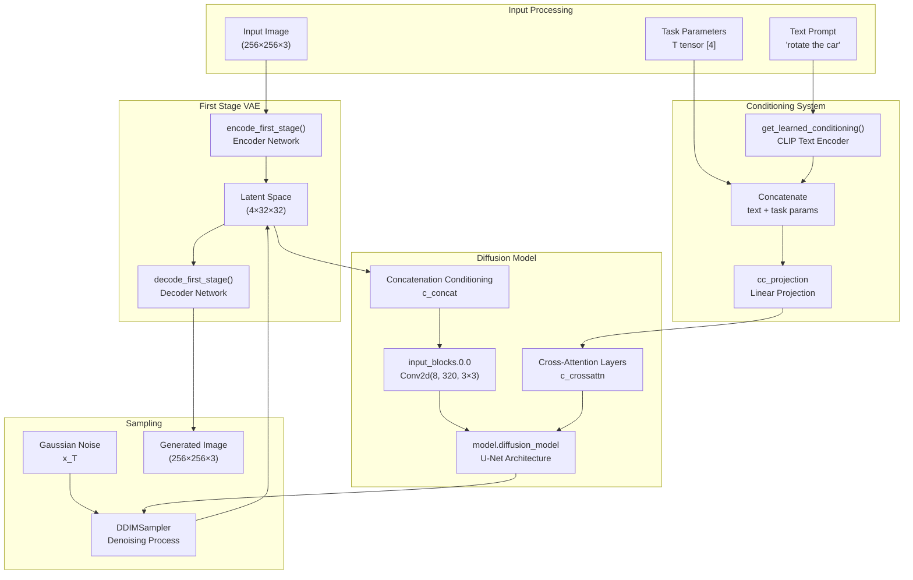
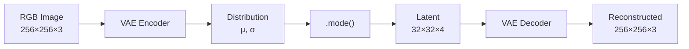
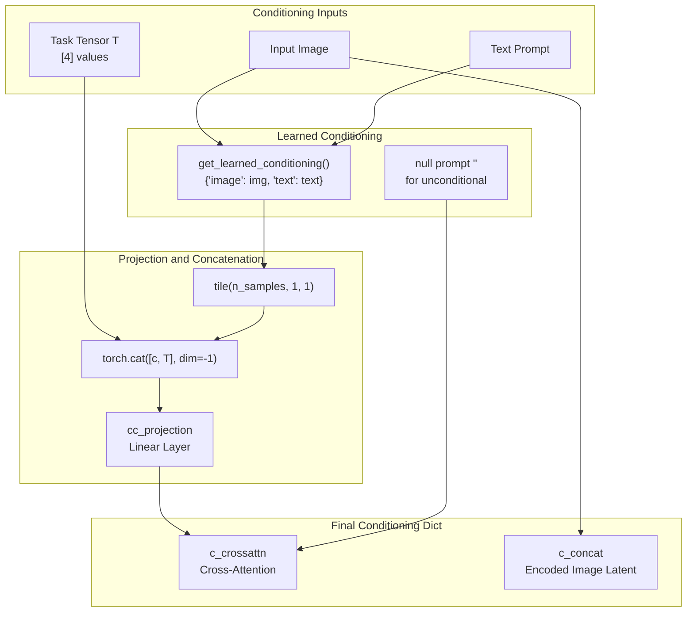
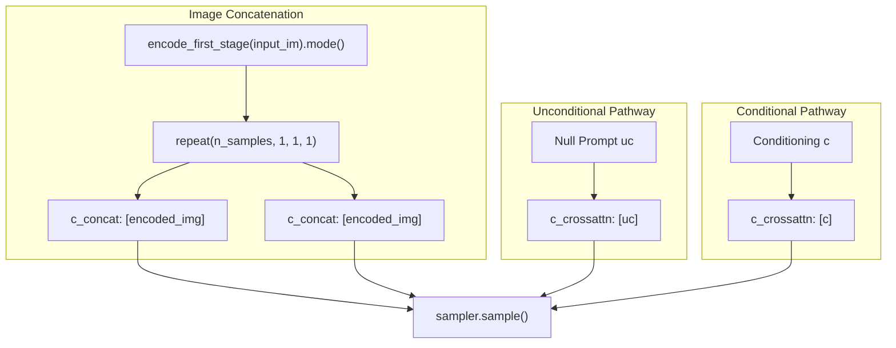
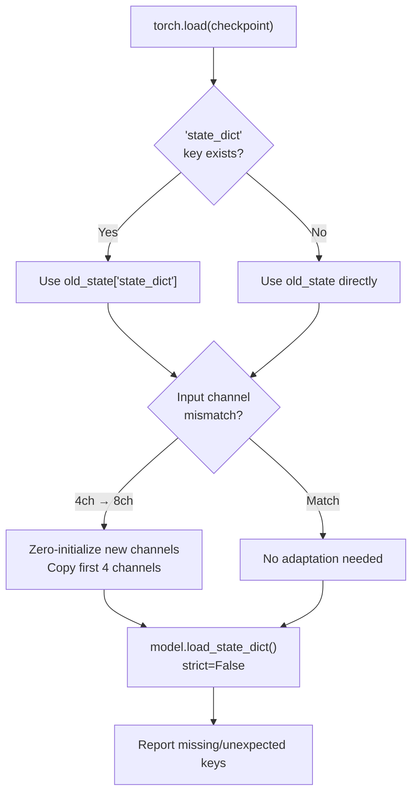
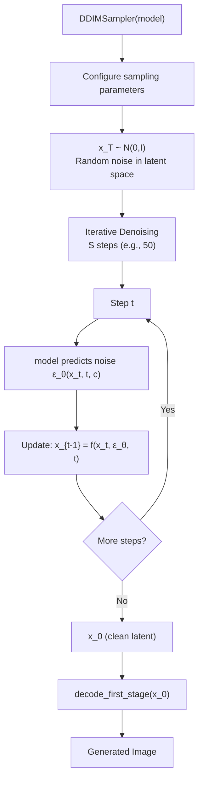

<!-- source: DeepWiki mcp.deepwiki.com · repo allenai/object-edit · page 7 Model Architecture · fetched 2026-10-26 -->

# Model Architecture

<details>
<summary>Relevant source files</summary>

The following files were used as context for generating this wiki page:

- [ldm/extras.py](ldm/extras.py)
- [run_generation.py](run_generation.py)

</details>


## Purpose and Scope

This page provides a detailed technical overview of the **Latent Diffusion Model (LDM)** architecture used in OBJect 3DIT for language-guided 3D-aware image editing. The document covers the core model components, conditioning mechanisms, and sampling procedures. 

For information about training the model, see [Training System](#4). For details on the inference pipeline that uses this architecture, see [Generation Pipeline](#5.1). For specifics on how conditioning is computed for different tasks, see [Task-Specific Generation](#5.2).

---

## Core Architecture Overview

The OBJect 3DIT model is built on a **Latent Diffusion Model** architecture that operates in a compressed latent space rather than directly in pixel space. This architecture consists of three primary components that work together during both training and inference.



**Sources:** [run_generation.py:68-112](), [run_generation.py:119-123]()

---

## Model Components

### First Stage VAE

The first stage is a **Variational Autoencoder (VAE)** that compresses input images into a lower-dimensional latent space. This component is responsible for the perceptual compression that enables efficient diffusion in a compact representation.

| Method | Input | Output | Purpose |
|--------|-------|--------|---------|
| `encode_first_stage()` | Image tensor (B×3×256×256) | Latent tensor (B×4×32×32) | Compress to latent space |
| `decode_first_stage()` | Latent tensor (B×4×32×32) | Image tensor (B×3×256×256) | Reconstruct from latent |

The VAE operates at a compression factor of 8 (256/32 = 8), reducing computational requirements while preserving perceptual quality. The `.mode()` method is called on encoded latents to use the mode of the distribution rather than sampling [run_generation.py:90]().



**Sources:** [run_generation.py:90-91](), [run_generation.py:94-95](), [run_generation.py:108]()

### Diffusion Model

The core diffusion model is implemented as a U-Net architecture accessed via `model.diffusion_model`. This network learns to predict noise at each timestep of the diffusion process.

#### Input Block Architecture

The first input block is particularly important as it handles channel concatenation:

```
model.diffusion_model.input_blocks.0.0.weight
Shape: (320, 8, 3, 3)
```

This Conv2d layer accepts **8 input channels**:
- **4 channels**: Noisy latent representation
- **4 channels**: Encoded input image (conditioning via concatenation)

The 8-channel input design enables the model to be conditioned on both the noisy latent and the original input image simultaneously [run_generation.py:26-44]().

**Sources:** [run_generation.py:26-29](), [run_generation.py:30-44]()

### Conditioning System

The conditioning system combines multiple sources of information to guide the diffusion process. It uses both **cross-attention conditioning** (`c_crossattn`) and **concatenation conditioning** (`c_concat`).



**Sources:** [run_generation.py:81-95]()

---

## Conditioning Mechanisms

### Text and Image Conditioning

The model uses `get_learned_conditioning()` to encode both text prompts and input images into a unified conditioning representation [run_generation.py:81]().

**Input format:**
```python
conditioning_input = {
    "image": input_im,  # Preprocessed image tensor
    "text": prompt       # Text description string
}
c = model.get_learned_conditioning(conditioning_input)
```

The method returns a tensor of shape `(1, N, C)` where:
- `N`: Sequence length (typically 77 for CLIP)
- `C`: Conditioning dimension

**Sources:** [run_generation.py:81]()

### Task Parameter Encoding

Task-specific parameters are encoded as a 4-element tensor `T` that is concatenated with the learned conditioning before projection:

| Task | T Encoding | Dimensions Used |
|------|-----------|-----------------|
| **rotate** | `[π/2, sin(θ), cos(θ), 0]` | [0]: elevation, [1-2]: azimuth encoding, [3]: unused |
| **remove** | `[0, 0, 0, 0]` | All zeros (no spatial info) |
| **insert** | `[0, x, y, 0]` | [1-2]: normalized x,y coordinates |
| **translate** | `[0, x, y, 0]` | [1-2]: normalized x,y coordinates |

The task tensor is repeated to match the conditioning sequence length and then concatenated [run_generation.py:84-86]():

```python
T = T[None, None, :].repeat(n_samples, 1, 1).to(c.device)
T = T.repeat(1, c.shape[1], 1)  # Repeat along sequence dimension
c = torch.cat([c, T], dim=-1)    # Concatenate along feature dimension
```

**Sources:** [run_generation.py:84-87](), [run_generation.py:129-141]()

### Conditioning Projection

After concatenation, the combined conditioning vector passes through `cc_projection`, a learned linear layer that projects it to the dimension expected by the cross-attention layers [run_generation.py:87]().

```
Input: [conditioning_features + 4]
Output: [cross_attention_dimension]
```

**Sources:** [run_generation.py:87]()

### Dual Conditioning Pathways

The diffusion model receives conditioning through two pathways:

1. **Cross-Attention (`c_crossattn`)**: Projected text+task conditioning that interacts with features via attention mechanisms
2. **Concatenation (`c_concat`)**: Encoded image latent that is concatenated with the noisy latent at the input layer



Note that the same encoded image latent is used for both conditional and unconditional pathways during classifier-free guidance [run_generation.py:90-95]().

**Sources:** [run_generation.py:88-95]()

---

## Model Instantiation and Loading

### Config-Based Instantiation

Models are instantiated from configuration files using the `instantiate_from_config()` utility function. The configuration specifies all model parameters including architecture details, conditioning mechanisms, and training hyperparameters.

```python
from ldm.util import instantiate_from_config
from omegaconf import OmegaConf

config = OmegaConf.load(f"configs/sd-objaverse-{task}.yaml")
model = instantiate_from_config(config.model)
```

**Sources:** [run_generation.py:117-119](), [ldm/extras.py:67]()

### Checkpoint Loading

Checkpoint loading handles nested state dictionaries and performs necessary weight adaptations:



**Sources:** [run_generation.py:16-53]()

### Channel Adaptation for Input Mismatch

When loading a 4-channel pretrained model (e.g., from Stable Diffusion) into an 8-channel model, the loader automatically adapts the input layer weights [run_generation.py:30-44]():

```python
if in_shape != in_filters_load.shape:
    input_weight = new_state[input_key]
    input_weight.zero_()
    input_weight[:, :4, :, :].copy_(old_state[input_key])
    old_state[input_key] = torch.nn.parameter.Parameter(input_weight)
```

This initialization:
1. Zero-initializes the 8-channel weight tensor
2. Copies the 4-channel pretrained weights to the first 4 channels
3. Leaves the additional 4 channels at zero (to be learned during finetuning)

**Sources:** [run_generation.py:25-44]()

### Loading from Training Directory

The `ldm/extras.py` module provides utilities for loading models from training directories:

```python
from ldm.extras import load_training_dir, load_model_from_config

# Load from training directory (finds latest checkpoint)
model = load_training_dir(train_dir, device, epoch="last")

# Load from explicit config and checkpoint
model = load_model_from_config(config, ckpt_path, device)
```

The `load_model_from_config()` function automatically sets the model to evaluation mode and configures the conditioning stage device [ldm/extras.py:74-76]().

**Sources:** [ldm/extras.py:37-53](), [ldm/extras.py:55-76]()

---

## Sampling Process

### DDIM Sampling

The model uses **Denoising Diffusion Implicit Models (DDIM)** for sampling via the `DDIMSampler` class [run_generation.py:144]().



**Sampling parameters:**
- **S (ddim_steps)**: Number of denoising steps (default: 50)
- **shape**: Latent space shape `[4, 32, 32]` for 256×256 output
- **eta**: Stochasticity parameter (0 = deterministic DDIM)

**Sources:** [run_generation.py:98-106](), [run_generation.py:144]()

### Classifier-Free Guidance

The sampling process uses **classifier-free guidance** to improve generation quality and prompt following. This technique combines conditional and unconditional predictions:

```
ε̃_θ = ε_θ(x_t, c) + scale * (ε_θ(x_t, c) - ε_θ(x_t, ∅))
```

Where:
- `ε_θ(x_t, c)`: Conditional noise prediction
- `ε_θ(x_t, ∅)`: Unconditional noise prediction (null prompt)
- `scale`: Guidance scale (unconditional_guidance_scale parameter)

**Implementation details:**

Both conditional (`cond`) and unconditional (`uncond`) dictionaries are passed to the sampler [run_generation.py:88-95]():

```python
cond = {
    'c_crossattn': [c],           # Projected text+task conditioning
    'c_concat': [encoded_image]    # Input image latent
}

uncond = {
    'c_crossattn': [uc],          # Null prompt conditioning
    'c_concat': [encoded_image]    # Same input image latent
}
```

The guidance scale is controlled via the `unconditional_guidance_scale` parameter [run_generation.py:103]().

**Sources:** [run_generation.py:82-95](), [run_generation.py:98-106]()

---

## Model Interface Summary

### Key Methods

| Method | Purpose | Input | Output |
|--------|---------|-------|--------|
| `get_learned_conditioning()` | Encode text and image | `{"image": tensor, "text": str}` | Conditioning tensor |
| `encode_first_stage()` | Encode to latent space | Image tensor (B×3×H×W) | Latent distribution |
| `decode_first_stage()` | Decode from latent | Latent tensor (B×4×H/8×W/8) | Image tensor |
| `cc_projection()` | Project conditioning | Concatenated conditioning | Cross-attention features |

**Sources:** [run_generation.py:81](), [run_generation.py:87](), [run_generation.py:90-91](), [run_generation.py:94-95](), [run_generation.py:108]()

### Model State Dictionary Keys

Important checkpoint keys for debugging and adaptation:

```
model.diffusion_model.input_blocks.0.0.weight     # First conv layer (8 → 320 channels)
model_ema.diffusion_modelinput_blocks00weight     # EMA version (alternate naming)
```

**Sources:** [run_generation.py:26](), [run_generation.py:32-33]()

### Typical Image Processing Pipeline

```mermaid
graph LR
    PIL["PIL Image"] --> RESIZE["Resize(256, 256)"]
    RESIZE --> TOTENSOR["ToTensor()"]
    TOTENSOR --> NORM["Normalize [-1, 1]"]
    NORM --> BATCH["unsqueeze(0)"]
    BATCH --> DEVICE["to(device)"]
    DEVICE --> MODEL["Model Processing"]
    MODEL --> CLAMP["clamp(-1, 1)"]
    CLAMP --> DENORM["Denormalize [0, 1]"]
    DENORM --> UINT8["* 255 → uint8"]
    UINT8 --> SAVE["PIL.Image.fromarray()"]
```



**Sources:** [run_generation.py:55-66](), [run_generation.py:109-110](), [run_generation.py:158-163]()

---

## Dimensions and Shapes Reference

| Component | Shape | Notes |
|-----------|-------|-------|
| Input Image | (B, 3, 256, 256) | RGB image, normalized to [-1, 1] |
| Encoded Latent | (B, 4, 32, 32) | 8× compression factor |
| Task Tensor T | (B, N, 4) | Repeated along sequence dimension N |
| Conditioning | (B, N, C) | N ≈ 77 (CLIP tokens), C varies |
| Projected Conditioning | (B, N, D) | D = cross-attention dimension |
| Diffusion Input | (B, 8, 32, 32) | 4 noisy + 4 conditioning channels |
| Output Image | (B, 3, 256, 256) | RGB image, range [0, 1] after processing |

**Sources:** [run_generation.py:55-66](), [run_generation.py:81-87](), [run_generation.py:90-97]()

---

