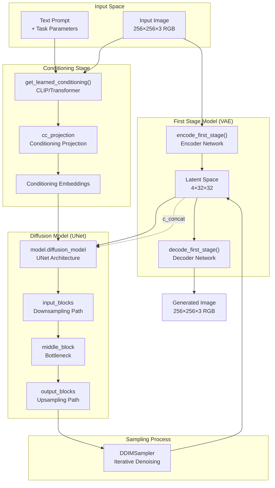
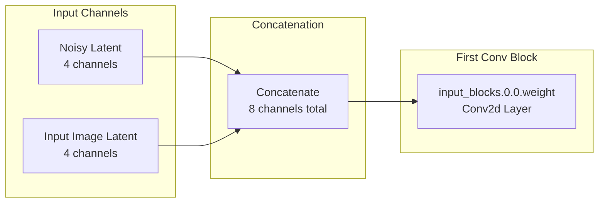
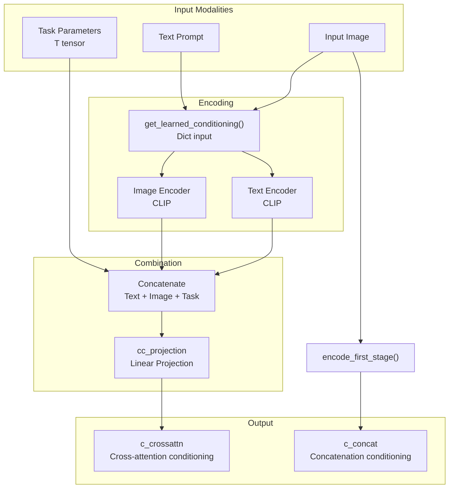
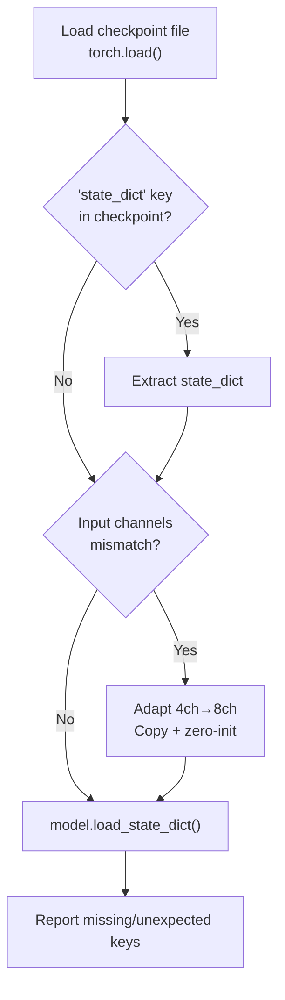
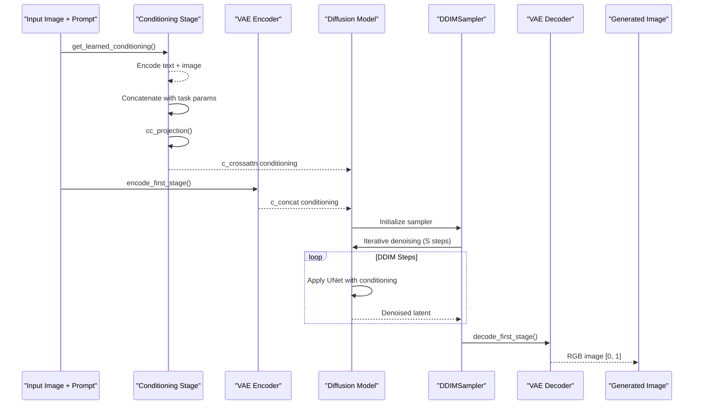

<!-- source: DeepWiki mcp.deepwiki.com · repo allenai/object-edit · page 7.1 Latent Diffusion Model Components · fetched 2026-10-26 -->

# Latent Diffusion Model Components

<details>
<summary>Relevant source files</summary>

The following files were used as context for generating this wiki page:

- [ldm/extras.py](ldm/extras.py)
- [run_generation.py](run_generation.py)

</details>


## Purpose and Scope

This document describes the core architectural components of the Latent Diffusion Model (LDM) used in OBJect 3DIT. It covers the three primary subsystems: the **First Stage Model** (VAE encoder/decoder), the **Diffusion Model** (UNet), and the **Conditioning Stage** (text/image encoder). 

For information about how conditioning is applied during generation and how text prompts and task parameters are processed, see [Conditioning and Guidance System](#7.2). For model loading utilities and helper functions, see [Utilities and Helper Functions](#7.3).

**Sources:** [run_generation.py:1-238]()

---

## Architecture Overview

The Latent Diffusion Model operates in a compressed latent space rather than directly on pixel space, enabling efficient training and inference. The architecture consists of three main components that work together during both training and inference.

### High-Level Component Diagram



**Sources:** [run_generation.py:68-112](), [run_generation.py:114-124]()

---

## First Stage Model: VAE Encoder and Decoder

The first stage model is a Variational Autoencoder (VAE) that compresses images into a lower-dimensional latent representation and reconstructs them back to pixel space. This compression enables efficient diffusion modeling in latent space.

### Encoding Process

The `encode_first_stage()` method converts RGB images to latent representations:

| Operation | Input | Output | Purpose |
|-----------|-------|--------|---------|
| `encode_first_stage()` | 256×256×3 image | 4×32×32 latent | Compress to latent space |
| `.mode()` | Distribution | 4×32×32 tensor | Extract mode of distribution |

The encoding process in the generation pipeline:

```python
# From run_generation.py:90-91, 94-95
latent = model.encode_first_stage(input_im.to(device)).mode().detach()
```

This produces a 4-channel latent representation at 1/8th the spatial resolution (32×32 for 256×256 input).

**Sources:** [run_generation.py:90-95]()

### Decoding Process

The `decode_first_stage()` method reconstructs RGB images from latent representations:

| Operation | Input | Output | Purpose |
|-----------|-------|--------|---------|
| `decode_first_stage()` | 4×32×32 latent | 256×256×3 image | Reconstruct to pixel space |
| `torch.clamp()` | Unbounded | [-1, 1] | Normalize output range |
| Post-processing | [-1, 1] | [0, 1] | Convert to displayable range |

The decoding process in the generation pipeline:

```python
# From run_generation.py:108-110
x_samples_ddim = model.decode_first_stage(samples_ddim)
x_samples_ddim = torch.clamp(x_samples_ddim, -1., 1.)
x_samples_ddim = ((x_samples_ddim + 1.0) / 2.0).cpu()
```

**Sources:** [run_generation.py:108-110]()

### Latent Space Properties

The latent space has specific dimensional properties:

| Property | Value | Description |
|----------|-------|-------------|
| Channels | 4 | Number of latent feature channels |
| Spatial Size | 32×32 | For 256×256 input images |
| Downsampling Factor | 8 | Ratio of input to latent resolution |
| Value Range | Unbounded | No explicit normalization |

**Sources:** [run_generation.py:96-97]()

---

## Diffusion Model: UNet Architecture

The diffusion model is a UNet-based neural network that learns to denoise latent representations. It operates on concatenated inputs that combine the noisy latent with the encoded input image.

### Input Channel Configuration

The diffusion model input block handles channel concatenation:



**Sources:** [run_generation.py:26-44]()

### Channel Adaptation for Fine-tuning

When loading pretrained checkpoints, the system handles mismatches between 4-channel (standard) and 8-channel (conditioned) input configurations:

| Checkpoint Type | Input Channels | Adaptation Strategy |
|----------------|----------------|---------------------|
| Standard SD | 4 | Copy weights to first 4 channels, zero-initialize remaining 4 |
| Conditioned | 8 | Load directly without adaptation |

The adaptation logic:

```python
# From run_generation.py:30-44
if in_shape != in_filters_load.shape:
    input_keys = [
        "model.diffusion_model.input_blocks.0.0.weight",
        "model_ema.diffusion_modelinput_blocks00weight",
    ]
    
    for input_key in input_keys:
        if input_key not in old_state or input_key not in new_state:
            continue
        input_weight = new_state[input_key]
        if input_weight.size() != old_state[input_key].size():
            print(f"Manual init: {input_key}")
            input_weight.zero_()
            input_weight[:, :4, :, :].copy_(old_state[input_key])
            old_state[input_key] = torch.nn.parameter.Parameter(input_weight)
```

This enables fine-tuning from standard Stable Diffusion checkpoints (4-channel input) to task-conditioned models (8-channel input with concatenated conditioning).

**Sources:** [run_generation.py:25-44]()

### UNet Block Structure

The diffusion model consists of three main sections:

| Component | Key in State Dict | Purpose |
|-----------|------------------|---------|
| Input Blocks | `model.diffusion_model.input_blocks.*` | Downsampling path with cross-attention |
| Middle Block | `model.diffusion_model.middle_block.*` | Bottleneck with full resolution processing |
| Output Blocks | `model.diffusion_model.output_blocks.*` | Upsampling path with skip connections |

**Sources:** [run_generation.py:26-44]()

---

## Conditioning Stage: Text and Image Encoding

The conditioning stage processes both text prompts and input images to create embeddings that guide the diffusion process.

### Conditioning Pipeline



**Sources:** [run_generation.py:81-95]()

### Conditioning Dictionary Format

The `get_learned_conditioning()` method accepts a dictionary with specific keys:

```python
# From run_generation.py:81
conditioning_input = {
    "image": input_im,  # Preprocessed image tensor
    "text": prompt      # Text prompt string
}
c = model.get_learned_conditioning(conditioning_input)
```

**Sources:** [run_generation.py:81]()

### Conditioning Concatenation and Projection

The conditioning embeddings are concatenated with task-specific parameters and projected:

```python
# From run_generation.py:84-87
T = T[None, None, :].repeat(n_samples, 1, 1).to(c.device)
T = T.repeat(1, c.shape[1], 1)
c = torch.cat([c, T], dim=-1)
c = model.cc_projection(c)
```

The `cc_projection` is a learned linear layer that projects the concatenated conditioning to the appropriate dimensionality for cross-attention.

**Sources:** [run_generation.py:84-87]()

### Dual Conditioning Mechanism

The model uses two types of conditioning simultaneously:

| Conditioning Type | Key | Source | Purpose |
|------------------|-----|--------|---------|
| Cross-Attention | `c_crossattn` | Text + Image + Task (projected) | Guides content generation |
| Concatenation | `c_concat` | Encoded input image latent | Preserves spatial structure |

```python
# From run_generation.py:88-95
cond = {}
cond['c_crossattn'] = [c]
cond['c_concat'] = [model.encode_first_stage((input_im.to(c.device))).mode().detach()
                    .repeat(n_samples, 1, 1, 1)]
```

**Sources:** [run_generation.py:88-95]()

---

## Model Instantiation and Configuration

### Configuration-Based Instantiation

Models are instantiated from YAML configuration files using OmegaConf:

```python
# From run_generation.py:117-119
config = OmegaConf.load(f"configs/sd-objaverse-{args.task}.yaml")
OmegaConf.update(config, "model.params.cond_stage_config.params.device", args.device)
model = instantiate_from_config(config.model)
```

The configuration specifies:
- Model class and parameters
- Conditioning stage configuration (device, model type)
- First stage model configuration
- UNet architecture details

**Sources:** [run_generation.py:117-119](), [ldm/extras.py:55-76]()

### Checkpoint Loading Process

The checkpoint loading process handles both nested and flat state dictionaries:



**Sources:** [run_generation.py:16-53]()

### State Dictionary Keys

Important state dictionary keys for the model components:

| Component | Key Pattern | Example |
|-----------|-------------|---------|
| Diffusion Model Input | `model.diffusion_model.input_blocks.*` | `model.diffusion_model.input_blocks.0.0.weight` |
| Diffusion Model EMA | `model_ema.diffusion_model*` | `model_ema.diffusion_modelinput_blocks00weight` |
| Conditioning Projection | `model.cc_projection.*` | Not explicitly shown but referenced |
| First Stage Encoder | `first_stage_model.encoder.*` | Not shown in provided code |
| First Stage Decoder | `first_stage_model.decoder.*` | Not shown in provided code |

**Sources:** [run_generation.py:26-44]()

### Device Management

The model loading process includes explicit device management:

```python
# From run_generation.py:120-123
model.cpu()  # Load on CPU first
load_checkpoint(model, args.checkpoint_path)
model.to(args.device)  # Move to target device
model.eval()  # Set to evaluation mode
```

This pattern avoids OOM errors during checkpoint loading by loading on CPU first, then transferring to GPU.

**Sources:** [run_generation.py:120-123]()

---

## Latent Space Dimensionality

The relationship between image space and latent space:

| Space | Resolution | Channels | Total Elements | Compression Ratio |
|-------|-----------|----------|----------------|-------------------|
| Image | 256×256 | 3 | 196,608 | 1× (baseline) |
| Latent | 32×32 | 4 | 4,096 | 48× compression |

The 48× compression enables efficient processing while maintaining sufficient representational capacity for high-quality image generation.

**Sources:** [run_generation.py:96-97]()

---

## Component Interaction During Sampling

The complete flow during image generation:



**Sources:** [run_generation.py:68-112]()

---

