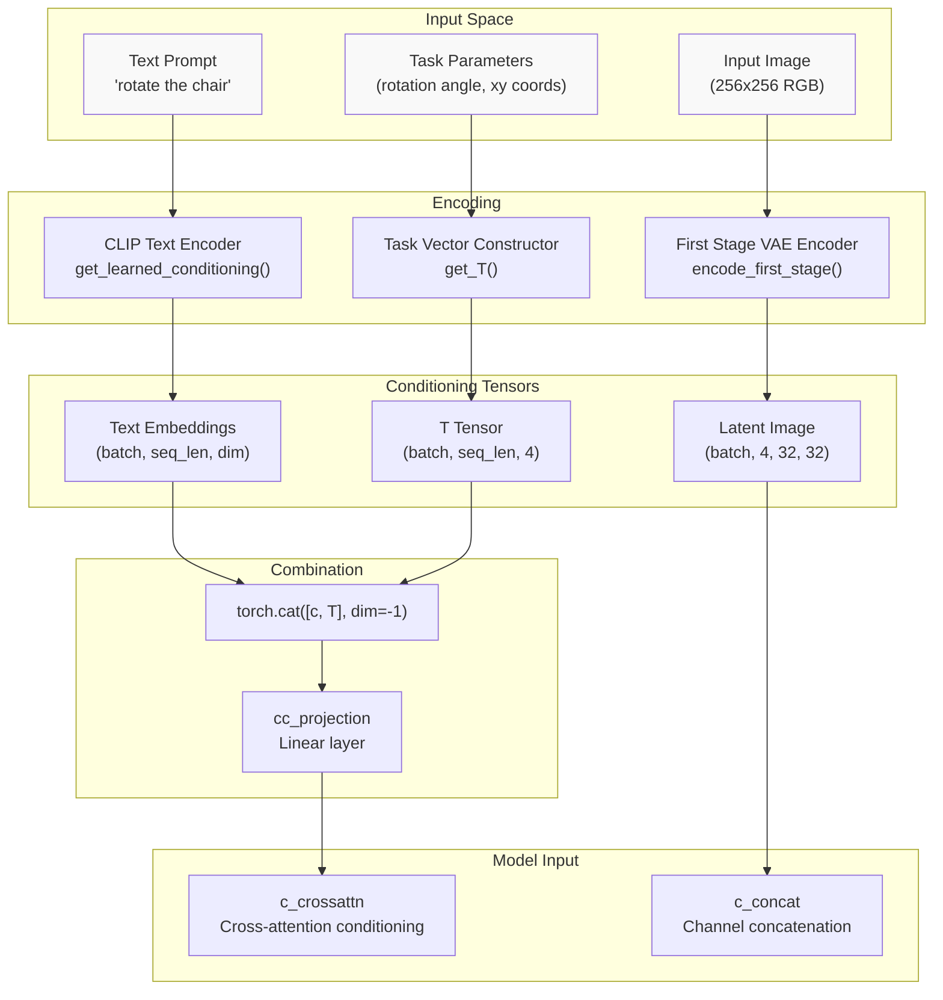
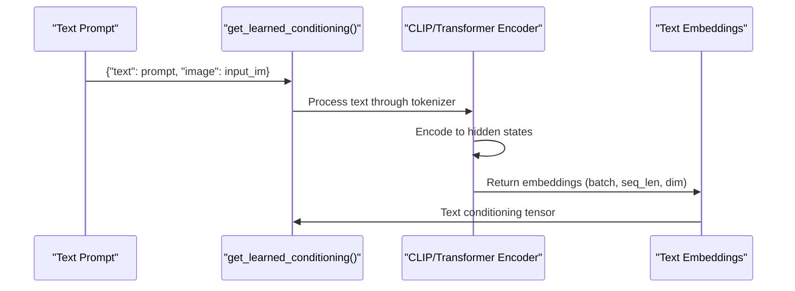
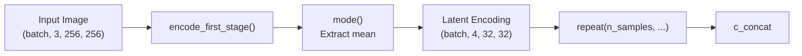
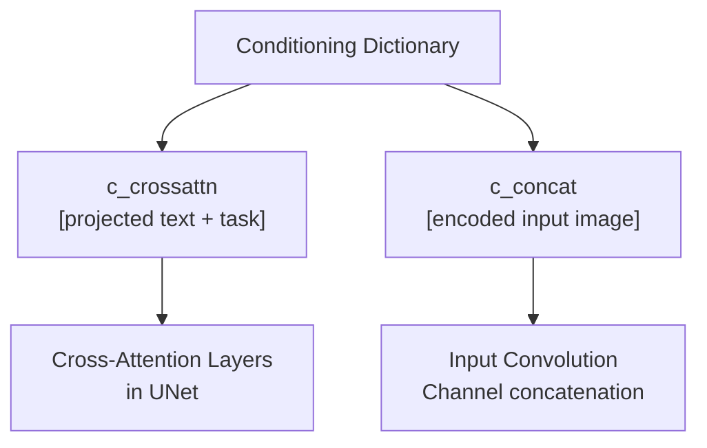
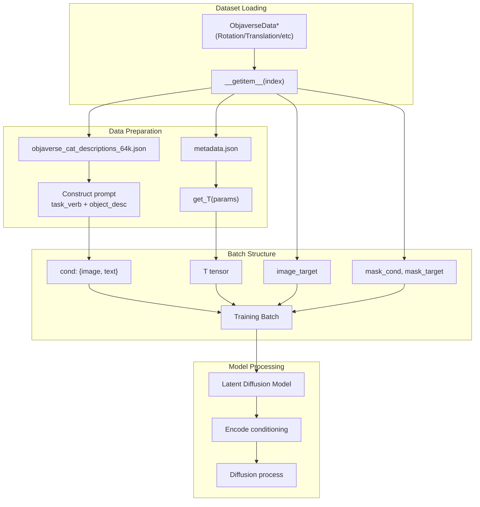
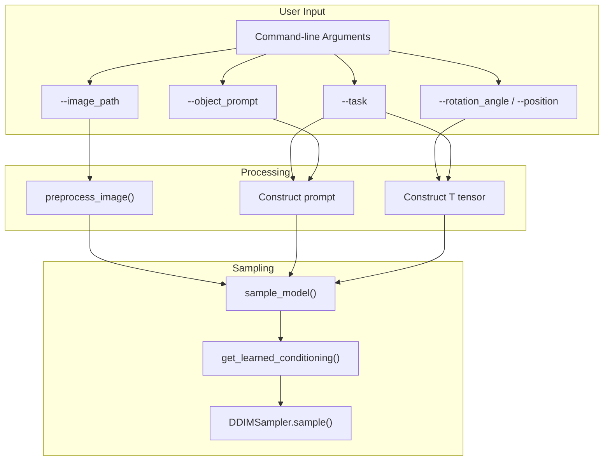

<!-- source: DeepWiki mcp.deepwiki.com · repo allenai/object-edit · page 7.2 Conditioning and Guidance System · fetched 2026-10-26 -->

# Conditioning and Guidance System

<details>
<summary>Relevant source files</summary>

The following files were used as context for generating this wiki page:

- [ldm/data/simple.py](ldm/data/simple.py)
- [run_generation.py](run_generation.py)

</details>


## Purpose and Scope

This document describes the conditioning and guidance mechanisms used in the OBJect 3DIT latent diffusion model. Conditioning refers to how the model receives and processes control signals (text prompts, input images, and task parameters) to guide the image generation process. The guidance system controls the strength and application of these conditioning signals during sampling.

For details about the underlying model architecture components (encoder, decoder, diffusion process), see [Latent Diffusion Model Components](#7.1). For information about how these conditioning mechanisms are used during generation, see [Generation Pipeline](#5.1).

---

## Overview of Conditioning Architecture

The OBJect 3DIT system uses a multi-modal conditioning approach that combines three distinct types of information:

1. **Text Conditioning**: Natural language descriptions of the editing task (e.g., "rotate the chair")
2. **Image Conditioning**: The input image to be edited, encoded into latent space
3. **Task Parameter Conditioning**: Task-specific numeric parameters (rotation angles, translation coordinates)

These three conditioning modalities are processed, combined, and projected before being fed into the diffusion model's cross-attention and concatenation mechanisms.



**Sources:** [run_generation.py:81-96](), [run_generation.py:129-141]()

---

## Text Conditioning

Text conditioning uses natural language prompts to describe the desired editing operation. The system constructs task-specific prompts by combining a verb phrase with an object description.

### Prompt Construction

Each task type has a specific prompt template:

| Task | Prompt Template | Example |
|------|----------------|---------|
| **rotate** | `"rotate the {object}"` | "rotate the chair" |
| **remove** | `"remove the {object}"` | "remove the lamp" |
| **insert** | `"insert the {object}"` | "insert the table" |
| **translate** | `"move the {object}"` | "move the vase" |

The object descriptions are retrieved from the Objaverse dataset annotations stored in `objaverse_cat_descriptions_64k.json`.

### Text Encoding Process

Text prompts are encoded using the model's conditioning stage (typically CLIP-based):



The `get_learned_conditioning()` method processes the text prompt and returns embeddings that capture semantic information about the editing task.

**Sources:** [run_generation.py:81](), [ldm/data/simple.py:156-187](), [ldm/data/simple.py:235-264](), [ldm/data/simple.py:312-339]()

---

## Image Conditioning

The input image is encoded into latent space and provided to the model through channel concatenation (`c_concat`). This allows the diffusion model to condition on the spatial structure of the input image throughout the denoising process.

### Image Preprocessing

Before encoding, input images undergo standardized preprocessing:

1. **Resize**: Images are resized to 256×256 pixels
2. **Normalization**: Pixel values are normalized from [0, 1] to [-1, 1]
3. **Format**: Converted to torch tensors with shape `(batch, 3, 256, 256)`

[run_generation.py:55-66]() implements this preprocessing:

```
Resize(256, 256) → ToTensor() → Normalize([-1, 1])
```

### Latent Encoding

The preprocessed image is encoded using the first-stage VAE:



The encoding produces a 4-channel latent representation at 32×32 spatial resolution (8× downsampling). The `.mode()` operation extracts the mean of the VAE's distribution, providing a deterministic encoding.

**Sources:** [run_generation.py:90-91](), [run_generation.py:94-95](), [run_generation.py:127]()

---

## Task Parameter Conditioning (T Tensor)

Each editing task requires specific numeric parameters that control the transformation. These are encoded in a 4-dimensional tensor called `T`, which is concatenated with the text embeddings before being fed to the model.

### T Tensor Format by Task

The `T` tensor has shape `(batch, seq_len, 4)` and different tasks use different formats:

| Task | T[0] | T[1] | T[2] | T[3] | Description |
|------|------|------|------|------|-------------|
| **rotate** | π/2 | sin(θ) | cos(θ) | 0 | Follows Zero123 convention for azimuth encoding |
| **translate** | 0 | x | y | 0 | x, y are normalized coordinates in [0, 1] |
| **insert** | 0 | x | y | 0 | x, y are insertion position coordinates |
| **remove** | 0 | 0 | 0 | 0 | No parameters needed for removal |

### Rotation Task

For rotation, the azimuth angle is encoded trigonometrically:

[run_generation.py:131-132]():
```python
azimuth = math.radians(args.rotation_angle)
T = torch.tensor([np.pi / 2, math.sin(azimuth), math.cos(azimuth), 0])
```

[ldm/data/simple.py:167-170]():
```python
def get_T(self, rotation):
    azimuth = math.radians(rotation)
    d_T = torch.tensor([np.pi / 2, math.sin(azimuth), math.cos(azimuth), 0])
    return d_T
```

This encoding matches the Zero123 convention, where the first element is a constant (π/2), and the next two elements encode the angle using sin/cos to provide rotational continuity.

### Translation and Insertion Tasks

Translation and insertion use normalized 2D coordinates:

[run_generation.py:138-141]():
```python
elif args.task == "insert":
    prompt = f"insert the {args.object_prompt}"
    T = torch.tensor([0, x, y, 0])
```

[ldm/data/simple.py:246-248]():
```python
def get_T(self, x, y):
    d_T = torch.tensor([0, x, y, 0])
    return d_T
```

The coordinates `x` and `y` are in the range [0, 1], representing normalized positions in the image.

### Removal Task

Removal requires no parameters:

[run_generation.py:134-135]():
```python
elif args.task == "remove":
    prompt = f"remove the {args.object_prompt}"
    T = torch.tensor([0., 0., 0., 0.])
```

**Sources:** [run_generation.py:129-141](), [ldm/data/simple.py:167-170](), [ldm/data/simple.py:246-248](), [ldm/data/simple.py:323-325](), [ldm/data/simple.py:395-397]()

---

## Conditioning Combination and Projection

The text embeddings and task parameter tensor are combined and projected before being used for cross-attention conditioning.

### Concatenation Step

The text conditioning `c` and task tensor `T` are concatenated along the feature dimension:

[run_generation.py:84-86]():
```python
T = T[None, None, :].repeat(n_samples, 1, 1).to(c.device)
T = T.repeat(1, c.shape[1], 1)  # Expand to match sequence length
c = torch.cat([c, T], dim=-1)   # Concatenate features
```

This produces a combined conditioning tensor of shape `(batch, seq_len, text_dim + 4)`.

### Projection Layer

The concatenated conditioning is passed through a learnable projection layer (`cc_projection`):

[run_generation.py:87]():
```python
c = model.cc_projection(c)
```

This projection layer:
- Maps the combined conditioning to the dimensionality expected by the cross-attention layers
- Allows the model to learn how to weight and combine text and task information
- Produces the final `c_crossattn` conditioning tensor

### Conditioning Dictionary Structure

The final conditioning is organized into a dictionary structure:



[run_generation.py:88-91]():
```python
cond = {}
cond['c_crossattn'] = [c]
cond['c_concat'] = [model.encode_first_stage((input_im.to(c.device))).mode().detach()
                    .repeat(n_samples, 1, 1, 1)]
```

**Sources:** [run_generation.py:84-91]()

---

## Classifier-Free Guidance

Classifier-free guidance improves generation quality by using the difference between conditional and unconditional predictions to strengthen the conditioning signal.

### Unconditional Conditioning

An unconditional version of the conditioning is created using an empty text prompt:

[run_generation.py:82-83]():
```python
null_prompt = model.get_learned_conditioning([""])
uc = null_prompt.repeat(1, c.shape[1], 1).tile(n_samples, 1, 1)
```

The unconditional conditioning dictionary mirrors the conditional structure but uses the null prompt:

[run_generation.py:92-95]():
```python
uncond = {}
uncond['c_crossattn'] = [uc]
uncond['c_concat'] = [model.encode_first_stage((input_im.to(c.device))).mode().detach()
                    .repeat(n_samples, 1, 1, 1)]
```

Note that the image conditioning (`c_concat`) is the same for both conditional and unconditional paths—only the text conditioning differs.

### Guidance Scale

The guidance scale (`cfg_scale` or `unconditional_guidance_scale`) controls the strength of the guidance:

[run_generation.py:103]():
```python
samples_ddim, _ = sampler.sample(
    S=ddim_steps,
    conditioning=cond,
    batch_size=n_samples,
    shape=shape,
    verbose=False,
    unconditional_guidance_scale=scale,  # <-- Guidance scale
    unconditional_conditioning=uncond,
    eta=ddim_eta,
    x_T=None
)
```

During sampling, the model computes:

```
output = uncond_output + scale * (cond_output - uncond_output)
```

Higher values of `scale` (typically 1.0-10.0) strengthen the conditioning effect, making the model pay more attention to the text prompt and task parameters.

**Sources:** [run_generation.py:82-95](), [run_generation.py:98-106](), [run_generation.py:230-233]()

---

## Conditioning Flow: Training vs Inference

The conditioning system operates similarly during training and inference, with some key differences in how data is prepared and batched.

### Training Flow



During training, the dataset classes construct the conditioning data:

[ldm/data/simple.py:194-199]():
```python
data["cond"] = {
    "image": cond_im,
    "text": prompt
}
data["T"] = self.get_T(rotation_angle)
```

### Inference Flow



During inference, the conditioning is constructed from user-provided parameters:

[run_generation.py:129-141]()

**Sources:** [ldm/data/simple.py:172-201](), [ldm/data/simple.py:250-278](), [run_generation.py:114-170]()

---

## Conditioning Tensor Shapes Summary

Understanding the tensor shapes is crucial for debugging and extending the system:

| Component | Shape | Description |
|-----------|-------|-------------|
| Input image (RGB) | `(batch, 3, 256, 256)` | Preprocessed input |
| Latent image | `(batch, 4, 32, 32)` | VAE-encoded, for `c_concat` |
| Text embeddings | `(batch, seq_len, text_dim)` | CLIP/transformer output |
| T tensor (raw) | `(4,)` | Task parameters |
| T tensor (expanded) | `(batch, seq_len, 4)` | Repeated to match text |
| Combined conditioning | `(batch, seq_len, text_dim + 4)` | Before projection |
| Projected conditioning | `(batch, seq_len, proj_dim)` | After `cc_projection`, for `c_crossattn` |

The sequence length (`seq_len`) depends on the text tokenization and typically includes a special token, often resulting in `seq_len=77` for CLIP-based models.

**Sources:** [run_generation.py:81-91]()

---

## Key Implementation Details

### Channel Adaptation

When loading checkpoints trained with 4-channel input (standard Stable Diffusion) for use with 8-channel input (4 latent + 4 concat), the loading function automatically adapts:

[run_generation.py:26-44]():
```python
if in_shape != in_filters_load.shape:
    input_weight = new_state[input_key]
    input_weight.zero_()
    input_weight[:, :4, :, :].copy_(old_state[input_key])
```

This zero-initializes the new channels and copies the original weights, allowing fine-tuning from pretrained models.

### Batch Replication

The conditioning tensors are replicated across the batch dimension to support generating multiple samples:

[run_generation.py:81]():
```python
c = model.get_learned_conditioning({"image": input_im, "text": prompt}).tile(n_samples, 1, 1)
```

Each sample in the batch receives identical conditioning, with variation introduced through the stochastic sampling process.

**Sources:** [run_generation.py:16-54](), [run_generation.py:81]()

---

## Related Configuration

The conditioning system is configured through the model configuration files:

- **Model config**: `configs/sd-objaverse-{task}.yaml` defines the conditioning stage configuration
- **Conditioning stage**: Typically uses CLIP or similar encoder, configured under `model.params.cond_stage_config`

[run_generation.py:117-119]():
```python
config = OmegaConf.load(f"configs/sd-objaverse-{args.task}.yaml")
OmegaConf.update(config, "model.params.cond_stage_config.params.device", args.device)
model = instantiate_from_config(config.model)
```

**Sources:** [run_generation.py:117-124]()

---

