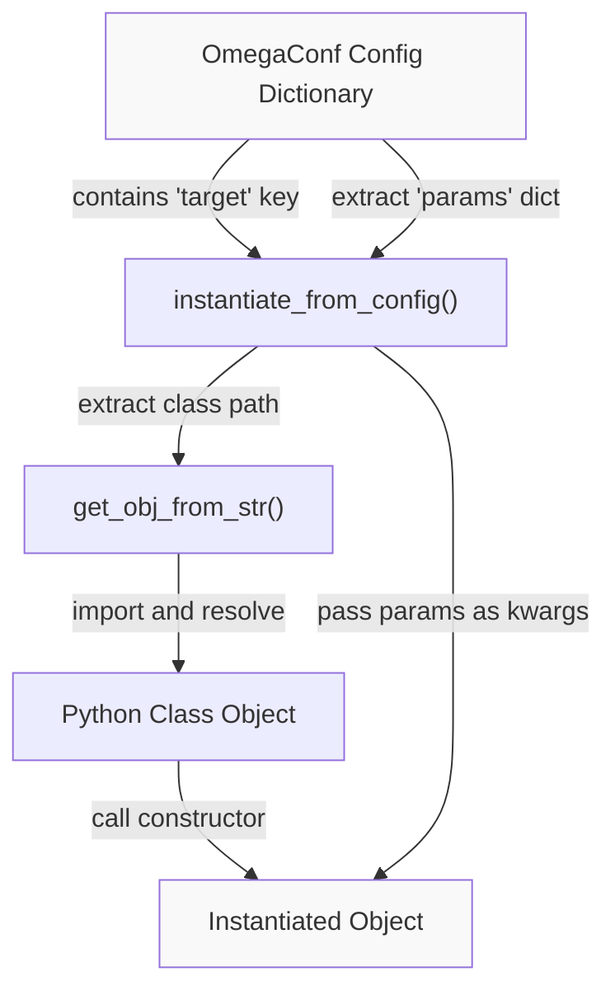
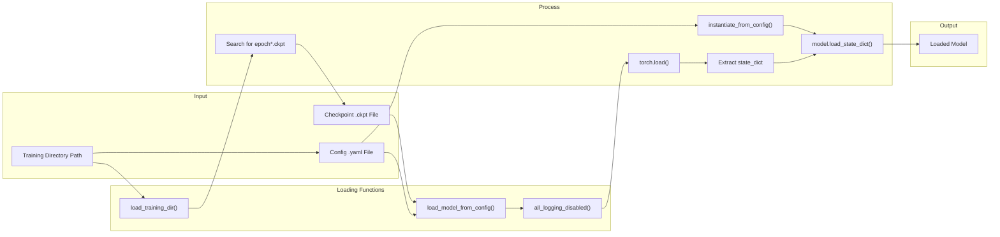
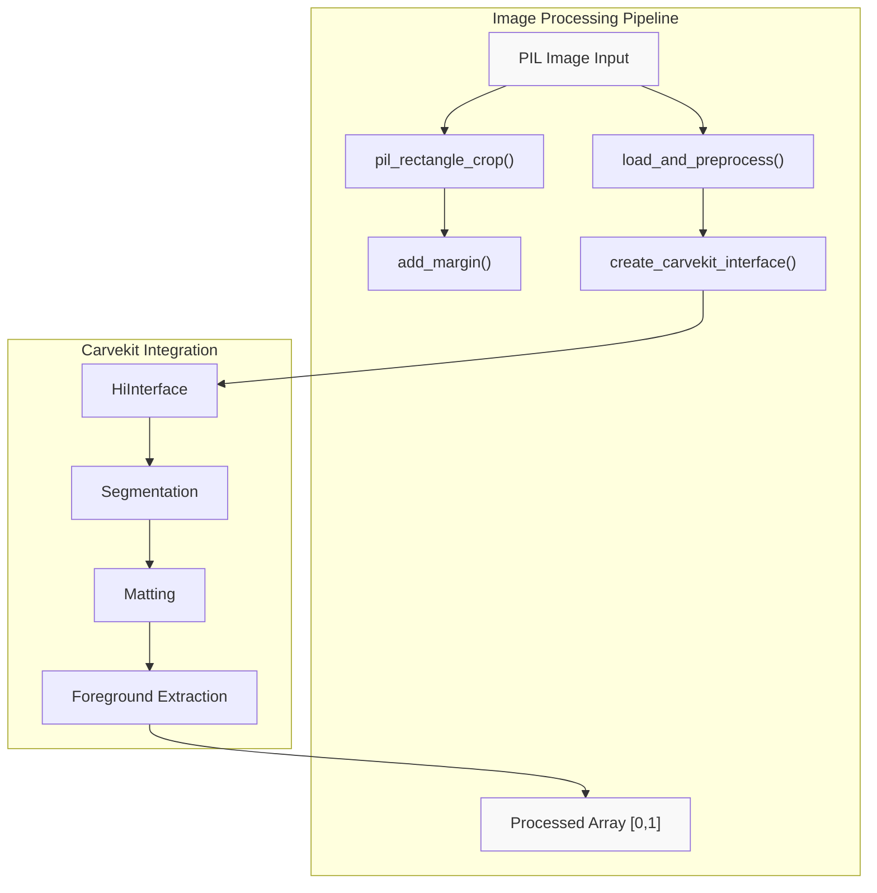
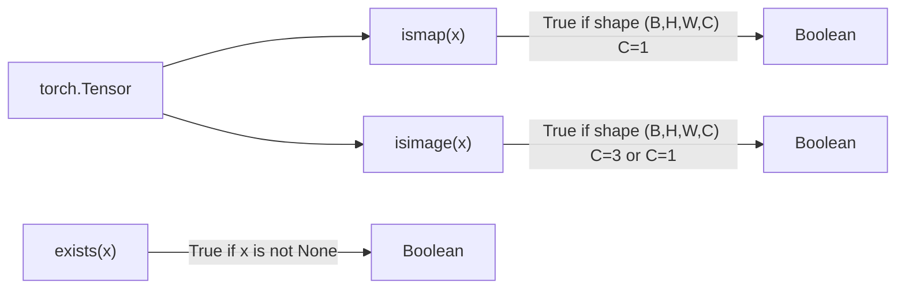
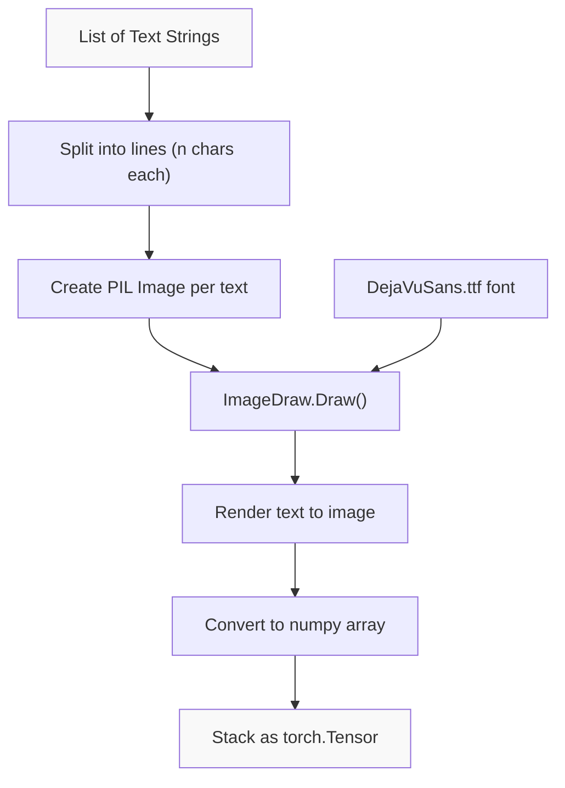
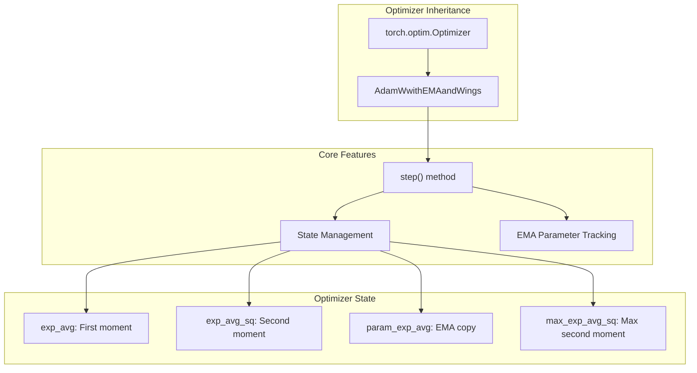

<!-- source: DeepWiki mcp.deepwiki.com · repo allenai/object-edit · page 7.3 Utilities and Helper Functions · fetched 2026-10-26 -->

# Utilities and Helper Functions

<details>
<summary>Relevant source files</summary>

The following files were used as context for generating this wiki page:

- [ldm/__pycache__/util.cpython-39.pyc](ldm/__pycache__/util.cpython-39.pyc)
- [ldm/extras.py](ldm/extras.py)

</details>


This page documents the utility functions and helper classes used throughout the OBJect 3DIT codebase for model instantiation, checkpoint loading, image processing, and training support. These utilities provide foundational functionality that enables the training, inference, and evaluation systems to operate efficiently.

For information about the core model architecture components, see [Latent Diffusion Model Components](#7.1). For training-specific workflows, see [Training Workflow and Scripts](#4.2).

---

## Overview and Scope

The utility system consists of two primary modules:

- **`ldm/util.py`**: Core utilities for image processing, tensor operations, model instantiation, and custom optimizers
- **`ldm/extras.py`**: Specialized utilities for loading trained models and managing logging context

These utilities are imported throughout the codebase and serve as the foundational layer for higher-level operations.

---

## Model Instantiation System

The model instantiation system provides a configuration-driven approach to creating model instances from YAML specifications.

### Configuration-Based Instantiation

The `instantiate_from_config()` function creates objects dynamically from OmegaConf dictionaries, enabling the entire model architecture to be specified declaratively.



**Sources:** [ldm/extras.py:4](), [ldm/util.py]() (inferred from bytecode)

### Implementation Details

| Function | Purpose | Key Behavior |
|----------|---------|--------------|
| `instantiate_from_config(config)` | Creates object from config dict | Expects `target` key with class path, optional `params` dict |
| `get_obj_from_str(string, reload=False)` | Imports and returns class from dotted path | Splits on last `.`, imports module, returns attribute |

The instantiation process:

1. Extracts `target` string (e.g., `"ldm.models.diffusion.ddpm.LatentDiffusion"`)
2. Calls `get_obj_from_str()` to import the class
3. Extracts `params` dictionary from config
4. Calls the class constructor: `Class(**params)`
5. Returns the instantiated object

**Sources:** [ldm/util.py]() (functions inferred from bytecode patterns)

---

## Checkpoint Loading System

The checkpoint loading system handles loading pretrained models from disk, including configuration resolution and state dictionary management.



**Sources:** [ldm/extras.py:37-77]()

### Load Training Directory

The `load_training_dir()` function provides a convenience wrapper for loading models from training output directories.

**Function Signature:**
```python
load_training_dir(train_dir, device, epoch="last")
```

**Behavior:**
- Searches recursively for checkpoint files matching `*{epoch}.ckpt` pattern
- Searches for config files matching `*-project.yaml` pattern
- Validates exactly one checkpoint is found (asserts if 0 or >1)
- Selects most recent config if multiple found
- Delegates to `load_model_from_config()`

**Sources:** [ldm/extras.py:37-53]()

### Load Model From Config

The `load_model_from_config()` function is the core loading utility.

**Function Signature:**
```python
load_model_from_config(config, ckpt, device="cpu", verbose=False)
```

**Loading Process:**

| Step | Operation | Implementation |
|------|-----------|----------------|
| 1 | Config resolution | If `config` is path, load with `OmegaConf.load()` |
| 2 | Suppress logging | Use `all_logging_disabled()` context manager |
| 3 | Load checkpoint | `torch.load(ckpt, map_location="cpu")` |
| 4 | Extract state dict | Access `pl_sd["state_dict"]` and `pl_sd["global_step"]` |
| 5 | Instantiate model | Call `instantiate_from_config(config.model)` |
| 6 | Load weights | `model.load_state_dict(sd, strict=False)` |
| 7 | Move to device | `model.to(device)` |
| 8 | Set eval mode | `model.eval()` |
| 9 | Fix conditioning | Set `model.cond_stage_model.device = device` |

**Key Features:**
- Non-strict loading (`strict=False`) allows handling of missing/unexpected keys
- Reports missing keys (m) and unexpected keys (u) when `verbose=True`
- Ensures model is in evaluation mode
- Manually sets device on conditioning model to avoid device mismatch issues

**Sources:** [ldm/extras.py:55-77]()

### Logging Context Manager

The `all_logging_disabled()` context manager suppresses all logging output during model loading, preventing verbose output from cluttering the console.

**Implementation:**
```python
@contextmanager
def all_logging_disabled(highest_level=logging.CRITICAL):
    previous_level = logging.root.manager.disable
    logging.disable(highest_level)
    try:
        yield
    finally:
        logging.disable(previous_level)
```

**Sources:** [ldm/extras.py:11-35]()

---

## Image Processing Utilities

The image processing utilities handle PIL Image transformations commonly needed for preprocessing input images.



**Sources:** [ldm/util.py]() (functions inferred from bytecode)

### Rectangle Crop

The `pil_rectangle_crop()` function crops PIL images to make them square by trimming the longer dimension.

**Behavior:**
- If width > height: crops left and right equally
- If height > width: crops top and bottom equally
- Returns cropped PIL Image

**Sources:** [ldm/util.py]() (inferred from bytecode patterns around line 10-15)

### Add Margin

The `add_margin()` function adds uniform padding around an image.

**Behavior:**
- Creates new image with same mode as input
- Fills with specified color
- Pastes original image centered in new canvas
- Returns padded PIL Image

**Sources:** [ldm/util.py]() (inferred from bytecode patterns around line 20-30)

### Carvekit Background Removal

The `create_carvekit_interface()` function initializes the Carvekit library for automated background removal.

**Configuration Parameters:**

| Parameter | Purpose | Value |
|-----------|---------|-------|
| `object_type` | Type of object to segment | `"object"` |
| `device` | Computation device | `"cuda"` if available, else `"cpu"` |
| `batch_size_seg` | Segmentation batch size | 5 |
| `batch_size_matting` | Matting batch size | 1 |
| `seg_mask_size` | Segmentation mask resolution | 640 |
| `matting_mask_size` | Matting mask resolution | 2048 |
| `trimap_prob_threshold` | Trimap probability threshold | 231 |
| `trimap_dilation` | Trimap dilation iterations | 25 |
| `trimap_erosion_iters` | Trimap erosion iterations | 5 |
| `fp16` | Use half precision | `False` |

**Sources:** [ldm/util.py]() (inferred from bytecode patterns around line 35-50)

### Load and Preprocess

The `load_and_preprocess()` function provides a complete preprocessing pipeline for input images.

**Pipeline Steps:**

1. Convert input PIL Image to RGB
2. Apply Carvekit interface for background removal
3. Convert to numpy array
4. Extract foreground mask
5. Compute bounding box of foreground
6. Crop to bounding box
7. Convert back to PIL Image
8. Resize to 256×256 using Lanczos resampling
9. Add white margin
10. Convert to numpy array in [0,1] range
11. Return tensor

**Sources:** [ldm/util.py]() (inferred from bytecode patterns around line 50-80)

---

## Tensor Utility Functions

The tensor utilities provide common operations and predicates for tensor manipulation.

### Type Checking Functions



**Sources:** [ldm/util.py]() (inferred from bytecode)

| Function | Purpose | Condition |
|----------|---------|-----------|
| `ismap(x)` | Check if tensor is a map/mask | `isinstance(x, torch.Tensor) and len(x.shape) == 4 and x.shape[1] == 1` |
| `isimage(x)` | Check if tensor is an image | `isinstance(x, torch.Tensor) and len(x.shape) == 4 and x.shape[1] in [3,1]` |
| `exists(x)` | Check if value exists | `x is not None` |
| `default(val, d)` | Return default if val doesn't exist | `val if exists(val) else d() if isfunction(d) else d` |

**Sources:** [ldm/util.py]() (inferred from bytecode around lines 115-135)

### Tensor Operations

The `mean_flat()` function computes the mean over all non-batch dimensions, useful for loss computation in diffusion models.

**Implementation:**
```python
def mean_flat(tensor):
    """
    Take the mean over all non-batch dimensions.
    https://github.com/openai/guided-diffusion/blob/27c20a8fab9cb472df5d6bdd6c8d11c8f430b924/guided_diffusion/nn.py#L86
    """
    return tensor.mean(dim=list(range(1, len(tensor.shape))))
```

**Usage:** Commonly used in diffusion loss computations to aggregate per-pixel losses into per-sample losses.

**Sources:** [ldm/util.py]() (inferred from bytecode around line 140)

---

## Text and Logging Utilities

### Text to Image Rendering

The `log_txt_as_img()` function renders text strings as image tensors for logging to visualization tools like Weights & Biases.

**Process:**



**Sources:** [ldm/util.py]() (inferred from bytecode around lines 100-125)

**Key Features:**
- Creates white background images
- Uses DejaVuSans font from `data/DejaVuSans.ttf`
- Handles Unicode encoding errors gracefully
- Returns normalized tensors in [0,1] range
- Suitable for logging to tensorboard or wandb

---

## Training Utilities

### Model Parameter Counting

The `count_params()` function computes the total number of trainable parameters in a model.

**Function Signature:**
```python
count_params(model, verbose=False)
```

**Behavior:**
- Sums `param.numel()` across all parameters
- If `verbose=True`, prints formatted count with model class name
- Returns total parameter count

**Output Format:** `"{ModelClassName} has {count:.2f} M params."`

**Sources:** [ldm/util.py]() (inferred from bytecode around line 150)

### Custom Optimizer: AdamWwithEMAandWings

The `AdamWwithEMAandWings` class is a custom optimizer that extends PyTorch's AdamW with exponential moving average (EMA) parameter tracking.



**Sources:** [ldm/util.py]() (inferred from bytecode around lines 160-220)

### Constructor Parameters

| Parameter | Type | Default | Purpose |
|-----------|------|---------|---------|
| `params` | iterable | required | Model parameters to optimize |
| `lr` | float | 1e-3 | Learning rate |
| `betas` | tuple | (0.9, 0.999) | Adam beta coefficients |
| `eps` | float | 1e-8 | Epsilon for numerical stability |
| `weight_decay` | float | 0.01 | Weight decay coefficient |
| `amsgrad` | bool | False | Whether to use AMSGrad variant |
| `ema_decay` | float | 0.9999 | EMA decay rate |
| `ema_power` | float | 1.0 | Power for EMA decay schedule |
| `param_names` | list | [] | Names of parameters for tracking |

### EMA Parameter Updates

The optimizer maintains EMA copies of parameters that decay according to:

```
current_ema_decay = min(ema_decay, (1 + step) / (10 + step)) ^ ema_power
ema_param = ema_param * current_ema_decay + param * (1 - current_ema_decay)
```

This provides smoothed parameter values that can be used for inference, often yielding better generalization than the raw parameter values.

**Key Implementation Details:**

1. **State Initialization:** Creates `exp_avg`, `exp_avg_sq`, `max_exp_avg_sq` (if amsgrad), and `param_exp_avg` tensors for each parameter
2. **Step Counter:** Tracks per-parameter step count in `state['step']`
3. **Gradient Handling:** Validates no sparse gradients (raises RuntimeError)
4. **AdamW Update:** Delegates to `torch._functional.adamw()` for core optimization
5. **EMA Update:** Updates EMA parameters using scheduled decay rate
6. **Memory Efficiency:** Uses `torch.preserve_format` for state tensors

**Sources:** [ldm/util.py]() (inferred from bytecode patterns in optimizer class)

---

## Function Reference Summary

### Model and Configuration Utilities

| Function | Module | Purpose |
|----------|--------|---------|
| `instantiate_from_config(config)` | `ldm.util` | Create object from OmegaConf config |
| `get_obj_from_str(string, reload)` | `ldm.util` | Import and return class from path string |
| `load_training_dir(train_dir, device, epoch)` | `ldm.extras` | Load model from training directory |
| `load_model_from_config(config, ckpt, device)` | `ldm.extras` | Load model from config and checkpoint |

### Image Processing Utilities

| Function | Module | Purpose |
|----------|--------|---------|
| `pil_rectangle_crop(im)` | `ldm.util` | Crop PIL image to square |
| `add_margin(pil_img, color)` | `ldm.util` | Add padding to PIL image |
| `create_carvekit_interface()` | `ldm.util` | Initialize background removal interface |
| `load_and_preprocess(input_im)` | `ldm.util` | Full preprocessing pipeline with background removal |

### Tensor Utilities

| Function | Module | Purpose |
|----------|--------|---------|
| `ismap(x)` | `ldm.util` | Check if tensor is single-channel map |
| `isimage(x)` | `ldm.util` | Check if tensor is image (1 or 3 channels) |
| `exists(x)` | `ldm.util` | Check if value is not None |
| `default(val, d)` | `ldm.util` | Return value or default |
| `mean_flat(tensor)` | `ldm.util` | Mean over non-batch dimensions |

### Logging and Visualization

| Function | Module | Purpose |
|----------|--------|---------|
| `log_txt_as_img(wh, txt)` | `ldm.util` | Render text as image tensor |
| `all_logging_disabled(highest_level)` | `ldm.extras` | Context manager to suppress logging |

### Training Utilities

| Function/Class | Module | Purpose |
|----------------|--------|---------|
| `count_params(model, verbose)` | `ldm.util` | Count model parameters |
| `AdamWwithEMAandWings` | `ldm.util` | Custom optimizer with EMA tracking |

**Sources:** [ldm/util.py](), [ldm/extras.py:1-77]()

---

