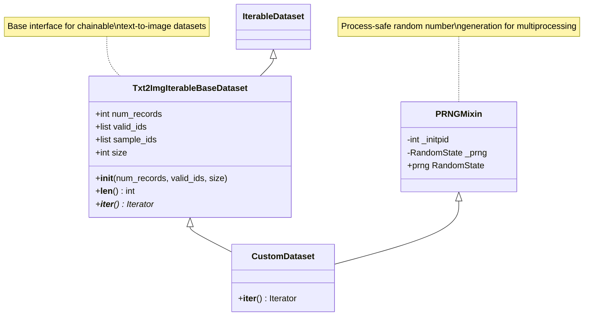
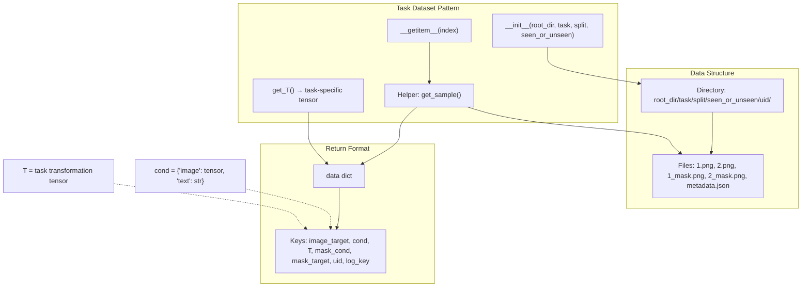
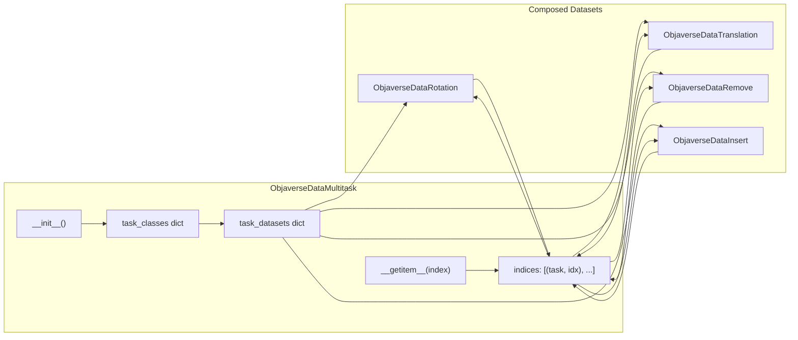
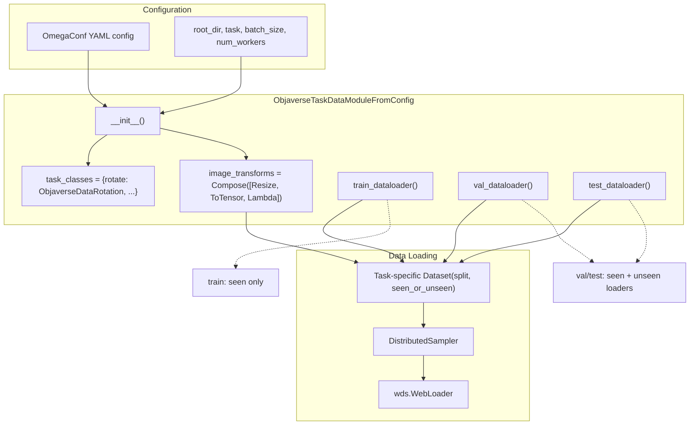

<!-- source: DeepWiki mcp.deepwiki.com · repo allenai/object-edit · page 8 Advanced Topics · fetched 2026-10-26 -->

# Advanced Topics

<details>
<summary>Relevant source files</summary>

The following files were used as context for generating this wiki page:

- [ldm/data/base.py](ldm/data/base.py)
- [ldm/data/simple.py](ldm/data/simple.py)

</details>


## Purpose and Scope

This page covers advanced usage scenarios and extension points in the OBJect 3DIT codebase. It is intended for developers who want to customize the system beyond basic training and inference workflows. Topics include implementing custom dataset loaders, extending the model architecture, and working with specialized techniques like inpainting and masking.

For basic training workflows, see [Training System](#4). For standard inference operations, see [Inference and Generation](#5). For details on the base data pipeline, see [Data System](#3).

---

## Extension Architecture Overview

The OBJect 3DIT system is designed with several key extension points that allow customization without modifying core functionality. The primary extension mechanisms are:

| Extension Point | Base Class/Interface | Primary Use Case | Key Methods to Override |
|----------------|---------------------|------------------|------------------------|
| Dataset Loaders | `Txt2ImgIterableBaseDataset` | Custom data sources | `__iter__()`, `__len__()` |
| Task-Specific Datasets | `torch.utils.data.Dataset` | New editing tasks | `__getitem__()`, `get_T()` |
| Data Modules | `pl.LightningDataModule` | Training orchestration | `train_dataloader()`, `val_dataloader()` |
| Conditioning Mechanisms | Model conditioning layers | New control signals | `get_learned_conditioning()` |

The system follows a hierarchical design where abstract base classes define interfaces and concrete implementations provide task-specific behavior.

**Sources:** [ldm/data/base.py:1-41](), [ldm/data/simple.py:31-122]()

---

## Dataset Extension Patterns

### Base Dataset Interface

The foundation for custom datasets is the `Txt2ImgIterableBaseDataset` class, which provides a minimal interface for iterable datasets:



**Diagram: Base Dataset Class Hierarchy**

The `Txt2ImgIterableBaseDataset` class [ldm/data/base.py:7-26]() defines the contract for iterable datasets:
- `num_records`: Total number of samples in the dataset
- `valid_ids`: Optional list of valid sample identifiers
- `__iter__()`: Abstract method that must be implemented to yield samples

The `PRNGMixin` class [ldm/data/base.py:28-41]() provides process-safe random number generation. It reinitializes the numpy `RandomState` whenever the process ID changes, preventing synchronized sampling in multiprocessing contexts.

**Sources:** [ldm/data/base.py:7-41]()

### Task-Specific Dataset Pattern

For non-iterable datasets (standard PyTorch `Dataset` subclasses), the system uses a consistent pattern across all task types:



**Diagram: Task Dataset Data Flow**

All task-specific datasets (`ObjaverseDataRotation`, `ObjaverseDataTranslation`, `ObjaverseDataRemove`, `ObjaverseDataInsert`) follow this pattern:

1. **Initialization** [ldm/data/simple.py:124-160](): Sets up directory paths, loads samples, and prepares transforms
2. **Sampling** [ldm/data/simple.py:172-201](): Implements `__getitem__()` to return a standardized data dictionary
3. **Task Encoding** [ldm/data/simple.py:167-170](): Implements `get_T()` to create task-specific transformation tensors
4. **Shared Loading** [ldm/data/simple.py:524-532](): Uses `get_sample()` helper for consistent image/mask loading

**Sources:** [ldm/data/simple.py:123-201](), [ldm/data/simple.py:524-532]()

### Task Transformation Tensor Format

Each task type encodes its parameters into a 4-element tensor `T` with different semantics:

| Task | T[0] | T[1] | T[2] | T[3] | Implementation |
|------|------|------|------|------|----------------|
| **rotate** | π/2 | sin(azimuth) | cos(azimuth) | 0 | [ldm/data/simple.py:167-170]() |
| **translate** | 0 | x_coordinate | y_coordinate | 0 | [ldm/data/simple.py:246-248]() |
| **remove** | 0 | 0 | 0 | 0 | [ldm/data/simple.py:323-325]() |
| **insert** | 0 | x_coordinate | y_coordinate | 0 | [ldm/data/simple.py:395-397]() |

The rotation format matches Zero123's pose encoding convention, using trigonometric components to represent azimuth angles.

**Sources:** [ldm/data/simple.py:167-170](), [ldm/data/simple.py:246-248](), [ldm/data/simple.py:323-325](), [ldm/data/simple.py:395-397]()

---

## Multi-Task Dataset Architecture

The `ObjaverseDataMultitask` class demonstrates a composition pattern for combining multiple task datasets:



**Diagram: Multi-Task Dataset Composition**

The multi-task dataset [ldm/data/simple.py:430-483]() creates a unified dataset by:

1. **Instantiation** [ldm/data/simple.py:455-464](): Creates one instance of each task-specific dataset
2. **Index Mapping** [ldm/data/simple.py:466-470](): Builds a flat index mapping `(task_name, task_index)` tuples
3. **Delegation** [ldm/data/simple.py:480-483](): Delegates `__getitem__()` calls to the appropriate task dataset

This pattern allows training on mixed tasks while maintaining task-specific data loading logic. The total dataset length equals the sum of individual task dataset lengths [ldm/data/simple.py:472-474]().

**Sources:** [ldm/data/simple.py:430-483]()

---

## Data Module Integration

The `ObjaverseTaskDataModuleFromConfig` class bridges datasets to PyTorch Lightning's training infrastructure:



**Diagram: Data Module Structure and Flow**

The data module [ldm/data/simple.py:31-122]() provides:

- **Task Mapping** [ldm/data/simple.py:41-50](): Maps task names to dataset classes
- **Transform Configuration** [ldm/data/simple.py:57-63](): Configures image preprocessing pipeline
- **Train Loader** [ldm/data/simple.py:66-76](): Creates training dataloader with distributed sampling for "seen" data only
- **Val/Test Loaders** [ldm/data/simple.py:78-121](): Returns two dataloaders (seen and unseen) as a list

The assertion `assert not (split == "train" and seen_or_unseen == "unseen")` [ldm/data/simple.py:137]() enforces that training only uses "seen" categories, while validation and testing evaluate on both seen and unseen splits.

**Sources:** [ldm/data/simple.py:31-122]()

---

## Image and Mask Preprocessing

The system uses specialized preprocessing for images and segmentation masks:

### Image Preprocessing Pipeline

The image transformation chain [ldm/data/simple.py:57-63]() applies:

1. **Resize**: Optional resizing to configured dimensions
2. **ToTensor**: Conversion to torch tensor
3. **Normalization**: Lambda function that normalizes to [-1, 1] and rearranges dimensions

The normalization uses `rearrange(x * 2. - 1., 'c h w -> h w c')` to convert from [0, 1] range to [-1, 1] and change from channel-first to channel-last format.

### Mask Color-to-ID Mapping

Masks are stored as color images and converted to binary masks using nearest-neighbor color mapping [ldm/data/simple.py:491-516]():

| Color Map Index | RGBA Value | Semantic Meaning |
|----------------|------------|------------------|
| 0 | (0.894, 0.102, 0.110, 1.0) | Background/other |
| 1 | (0.216, 0.494, 0.722, 1.0) | **Target object** |
| 2 | (0.302, 0.686, 0.290, 1.0) | Secondary object |
| 3-8 | Various colors | Additional objects |

The preprocessing:
1. Reshapes mask to (N, 4) array of RGBA pixels
2. Computes L2 distance to each color in the predefined map
3. Assigns each pixel the ID of the nearest color
4. Creates binary mask where `mask = (id == 1)` selects only the target object

This approach allows rendering masks with distinct colors for visualization while extracting precise binary masks for training.

**Sources:** [ldm/data/simple.py:487-516](), [ldm/data/simple.py:524-532]()

---

## Custom Dataset Implementation Guide

To implement a custom dataset for a new task:

### Step 1: Define Dataset Class

```python
class CustomTaskDataset(Dataset):
    def __init__(self, root_dir, image_transforms, task, split, seen_or_unseen, num_samples):
        # Validate inputs
        assert not (split == "train" and seen_or_unseen == "unseen")
        assert task == "your_task_name"
        
        # Set up paths
        self.root_dir = os.path.join(root_dir, task, split)
        self.samples = [list of sample identifiers]
        self.tform = image_transforms
        
    def __len__(self):
        return len(self.samples)
    
    def get_T(self, task_params):
        # Return 4-element tensor encoding task parameters
        return torch.tensor([param0, param1, param2, param3])
    
    def __getitem__(self, index):
        # Load images and masks
        # Create data dictionary
        return {
            "image_target": target_image,
            "cond": {"image": cond_image, "text": prompt},
            "T": self.get_T(params),
            "mask_cond": cond_mask,
            "mask_target": target_mask,
            "uid": sample_id,
            "log_key": logging_key
        }
```

### Step 2: Register in Data Module

Add the custom dataset to the task mapping in `ObjaverseTaskDataModuleFromConfig`:

```python
self.task_classes = {
    "rotate": ObjaverseDataRotation,
    "translate": ObjaverseDataTranslation,
    "remove": ObjaverseDataRemove,
    "insert": ObjaverseDataInsert,
    "your_task": CustomTaskDataset  # Add here
}
```

### Step 3: Configure Dataset Directory Structure

Organize data following the expected structure:
```
root_dir/
  your_task/
    train/
      sample_uid_1/
        1.png          # Condition image
        2.png          # Target image
        1_mask.png     # Condition mask
        2_mask.png     # Target mask
        metadata.json  # Task parameters
      sample_uid_2/
        ...
    val/
      seen/
        ...
      unseen/
        ...
    test/
      seen/
        ...
      unseen/
        ...
```

**Sources:** [ldm/data/simple.py:123-201](), [ldm/data/simple.py:31-50]()

---

## Specialized Dataset Techniques

### Insert Task: Data Reuse Pattern

The `ObjaverseDataInsert` class demonstrates an efficient data reuse pattern [ldm/data/simple.py:353-427]():

1. **Source Reuse**: Uses the "remove" task data directory [ldm/data/simple.py:377]()
2. **Inversion**: Swaps condition and target images [ldm/data/simple.py:405]()
3. **Location Mapping**: Extracts insertion coordinates from `removed_object_camera_coords` [ldm/data/simple.py:412]()

This allows training an insertion model without creating duplicate datasets, by simply inverting the removal task data.

### Exception Handling Pattern

All task datasets use a consistent fallback pattern [ldm/data/simple.py:176-181]():

```python
try:
    sample_dir = self.samples[index]
    cond_im, target_im, mask_cond, mask_target, metadata = get_sample(...)
except Exception as e:
    sample_dir = self.samples[0]  # Fall back to first sample
    cond_im, target_im, mask_cond, mask_target, metadata = get_sample(...)
```

This ensures training doesn't crash on corrupted samples by falling back to a known-good example (index 0).

### Metadata Integration

Each sample includes a `metadata.json` file containing task-specific parameters:

| Task | Key Metadata Fields |
|------|-------------------|
| rotate | `rotation_angle`, `rotation_category`, `object_data` |
| translate | `end_location_2d`, `translation_category`, `object_data` |
| remove | `removed_object_uid`, object descriptions |
| insert | `removed_object_camera_coords`, `removed_object_uid` |

The metadata is loaded in `get_sample()` [ldm/data/simple.py:529-530]() and used to construct task-specific prompts and transformation tensors.

**Sources:** [ldm/data/simple.py:353-427](), [ldm/data/simple.py:176-181](), [ldm/data/simple.py:524-532]()

---

## Subsections

For detailed implementation guides on specific advanced topics, see:

- **[Creating Custom Datasets](#8.1)**: Step-by-step guide for implementing new dataset loaders
- **[Extending the Model](#8.2)**: Techniques for modifying model architecture and conditioning
- **[Inpainting and Masking](#8.3)**: Advanced masking techniques and synthetic mask generation

---

