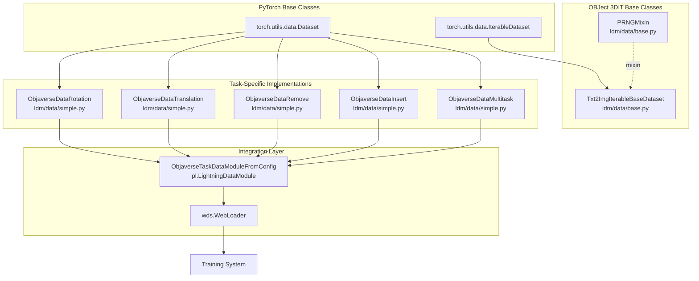
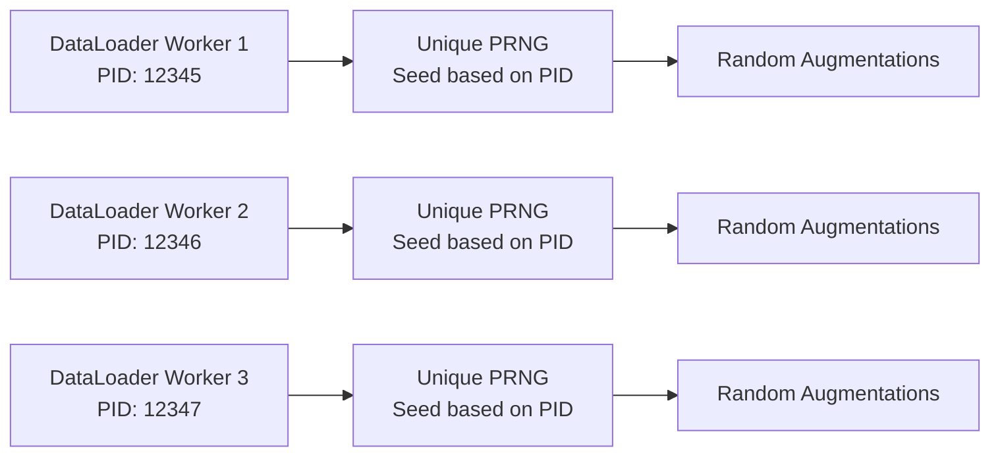
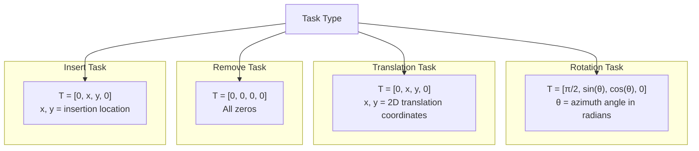
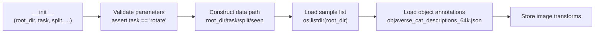
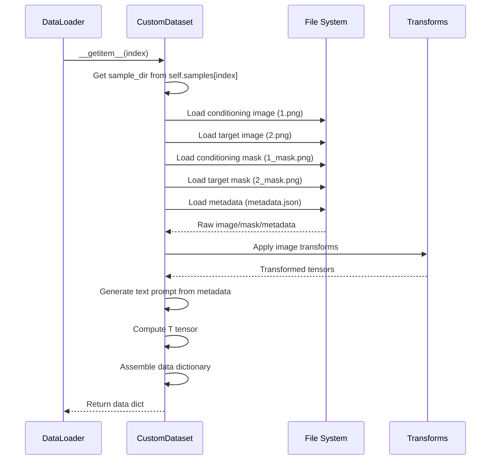
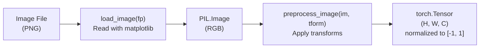
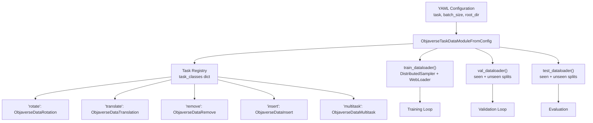
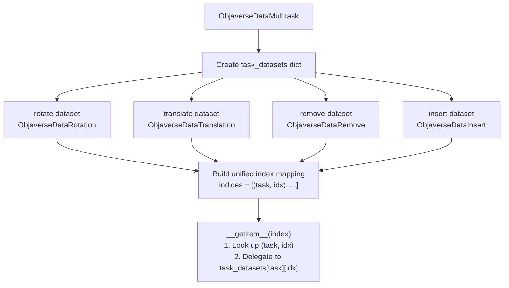

<!-- source: DeepWiki mcp.deepwiki.com · repo allenai/object-edit · page 8.1 Creating Custom Datasets · fetched 2026-10-26 -->

# Creating Custom Datasets

<details>
<summary>Relevant source files</summary>

The following files were used as context for generating this wiki page:

- [ldm/data/base.py](ldm/data/base.py)
- [ldm/data/simple.py](ldm/data/simple.py)

</details>


## Purpose and Scope

This document provides technical guidance for implementing custom dataset loaders in the OBJect 3DIT system. It covers the base dataset interfaces, required methods, expected data formats, and integration with the training pipeline. By following this guide, developers can create dataset loaders for new tasks or data sources beyond the provided Objaverse task datasets.

For information about using the existing Objaverse datasets, see [Objaverse Dataset](#3.2). For details on the overall data system architecture, see [Data System](#3).

---

## Dataset System Architecture

The dataset system follows a hierarchical structure with abstract base classes providing common interfaces and task-specific implementations extending these bases.



**Sources:** [ldm/data/base.py:1-41](), [ldm/data/simple.py:1-534]()

---

## Base Classes

### Txt2ImgIterableBaseDataset

The `Txt2ImgIterableBaseDataset` class provides the foundational interface for iterable-style datasets in the system. It extends PyTorch's `IterableDataset` and is designed for streaming or large-scale datasets.

**Key Attributes:**

| Attribute | Type | Purpose |
|-----------|------|---------|
| `num_records` | int | Total number of examples in the dataset |
| `valid_ids` | list/None | Optional list of valid sample identifiers |
| `sample_ids` | list/None | Alias for `valid_ids` |
| `size` | int | Image size (default: 256) |

**Required Methods:**

- `__len__()`: Returns `num_records`
- `__iter__()`: Abstract method that must be implemented by subclasses to yield data samples

**Sources:** [ldm/data/base.py:7-26]()

### PRNGMixin

The `PRNGMixin` class provides process-safe pseudo-random number generation (PRNG) for use in multi-process data loading scenarios. This prevents synchronized sampling behavior when using PyTorch's `DataLoader` with multiple workers.

**Implementation Details:**



The `prng` property reinitializes `np.random.RandomState()` whenever the process ID changes, ensuring each worker process has its own random state.

**Sources:** [ldm/data/base.py:28-41]()

---

## Required Data Structure

All custom datasets must return data dictionaries with the following structure when accessed via `__getitem__` or yielded from `__iter__`:

### Standard Data Dictionary Format

| Key | Type | Description |
|-----|------|-------------|
| `image_target` | torch.Tensor | Target output image, shape (H, W, C), normalized to [-1, 1] |
| `cond` | dict | Conditioning information dictionary |
| `cond["image"]` | torch.Tensor | Conditioning input image, shape (H, W, C), normalized to [-1, 1] |
| `cond["text"]` | str | Text prompt describing the editing operation |
| `T` | torch.Tensor | Task-specific transformation tensor, shape (4,) |
| `mask_cond` | torch.Tensor | Binary mask for conditioning image, shape (H, W) |
| `mask_target` | torch.Tensor | Binary mask for target image, shape (H, W) |
| `uid` | str | Unique identifier for the sample |
| `log_key` | str | Logging key for tracking dataset splits |

### Task-Specific Transformation Tensor (T)

The `T` tensor format varies by task type:



**Sources:** [ldm/data/simple.py:167-170](), [ldm/data/simple.py:246-248](), [ldm/data/simple.py:323-325](), [ldm/data/simple.py:395-397]()

---

## Implementing a Custom Dataset

### Step 1: Choose Base Class

Decide whether to extend `torch.utils.data.Dataset` (map-style) or `Txt2ImgIterableBaseDataset` (iterable-style):

- **Map-style (`Dataset`)**: Random access by index, suitable for smaller datasets
- **Iterable-style (`Txt2ImgIterableBaseDataset`)**: Sequential access, suitable for streaming large datasets

The existing Objaverse task datasets use map-style (`Dataset`) for simplicity.

### Step 2: Implement Constructor

The constructor should:
1. Accept configuration parameters (root_dir, task, split, transforms, etc.)
2. Build a list of samples or sample identifiers
3. Store image transforms
4. Load any required metadata files

**Example Pattern from ObjaverseDataRotation:**



**Sources:** [ldm/data/simple.py:123-161]()

### Step 3: Implement __len__

Return the total number of samples in the dataset:

```python
def __len__(self):
    return self.len
```

**Sources:** [ldm/data/simple.py:162-164]()

### Step 4: Implement __getitem__

The `__getitem__` method must:
1. Load the sample data (images, masks, metadata)
2. Apply transforms to images
3. Generate task-specific prompt text
4. Compute the transformation tensor `T`
5. Return the data dictionary

**Data Loading Flow:**



**Sources:** [ldm/data/simple.py:172-201]()

### Step 5: Implement Task-Specific Methods

Create helper methods for task-specific logic:

**Example: get_T method variations**

| Task | Method Signature | Implementation |
|------|------------------|----------------|
| Rotation | `get_T(self, rotation)` | `torch.tensor([np.pi/2, sin(azimuth), cos(azimuth), 0])` |
| Translation | `get_T(self, x, y)` | `torch.tensor([0, x, y, 0])` |
| Remove | `get_T(self)` | `torch.tensor([0., 0., 0., 0.])` |
| Insert | `get_T(self, x, y)` | `torch.tensor([0, x, y, 0])` |

**Sources:** [ldm/data/simple.py:167-170](), [ldm/data/simple.py:246-248](), [ldm/data/simple.py:323-325](), [ldm/data/simple.py:395-397]()

---

## Helper Functions

The system provides reusable helper functions for common data loading operations:

### Image Loading and Preprocessing



**Functions:**

| Function | Purpose | Location |
|----------|---------|----------|
| `load_image(fp)` | Load image from file path using matplotlib | [ldm/data/simple.py:519-522]() |
| `preprocess_image(im, tform)` | Convert to RGB and apply transforms | [ldm/data/simple.py:487-489]() |
| `preprocess_mask(fp)` | Load and process segmentation masks | [ldm/data/simple.py:491-516]() |
| `get_sample(root_dir, fp, tform)` | Load complete sample (images + masks + metadata) | [ldm/data/simple.py:524-532]() |

**Sources:** [ldm/data/simple.py:485-533]()

### Standard Transform Pipeline

The standard image transform pipeline used across all Objaverse tasks:

1. **Resize** to configured size (typically 256×256)
2. **ToTensor** conversion
3. **Normalization** from [0, 1] to [-1, 1] using lambda function
4. **Rearrange** from CHW to HWC format using einops

**Sources:** [ldm/data/simple.py:57-63]()

---

## Integration with DataModule

Custom datasets must be integrated with PyTorch Lightning's `LightningDataModule` for use in training.

### DataModule Architecture



**Sources:** [ldm/data/simple.py:31-122]()

### Registering Custom Datasets

To add a custom dataset to the training system:

1. **Add to task registry** in `ObjaverseTaskDataModuleFromConfig.__init__`:

```python
self.task_classes = {
    "rotate": ObjaverseDataRotation,
    "translate": ObjaverseDataTranslation,
    "remove": ObjaverseDataRemove,
    "insert": ObjaverseDataInsert,
    "multitask": ObjaverseDataMultitask,
    "custom_task": CustomTaskDataset  # Add your custom dataset
}
```

2. **Ensure constructor compatibility** with the DataModule's instantiation pattern:
   - Accept `root_dir`, `image_transforms`, `task`, `split`, `seen_or_unseen`, `num_samples`
   - Match the parameter names exactly

**Sources:** [ldm/data/simple.py:41-48]()

---

## Multitask Dataset Pattern

The `ObjaverseDataMultitask` class demonstrates how to combine multiple task datasets into a unified dataset:



**Key Implementation Details:**

1. Instantiate each task dataset with identical parameters
2. Build a flat index list containing `(task, idx)` tuples
3. Delegate `__getitem__` calls to the appropriate task dataset

**Sources:** [ldm/data/simple.py:430-483]()

---

## Implementation Checklist

When creating a custom dataset, ensure the following requirements are met:

### Required Components

- [ ] Extend `torch.utils.data.Dataset` or `Txt2ImgIterableBaseDataset`
- [ ] Implement `__init__` with standard parameters
- [ ] Implement `__len__` returning integer count
- [ ] Implement `__getitem__` or `__iter__` yielding data dictionaries
- [ ] Return data dict with all required keys: `image_target`, `cond`, `T`, `mask_cond`, `mask_target`, `uid`, `log_key`

### Data Format Compliance

- [ ] Images normalized to [-1, 1] range
- [ ] Images in HWC format (height, width, channels)
- [ ] Masks as binary tensors (H, W)
- [ ] T tensor has shape (4,)
- [ ] Text prompts are strings

### Error Handling

- [ ] Implement try-except blocks in `__getitem__` with fallback to index 0
- [ ] Validate task parameters in constructor
- [ ] Assert mutual exclusivity constraints (e.g., no unseen split during training)

**Example Error Handling Pattern:**

```python
def __getitem__(self, index):
    data = {}
    try:
        sample_dir = self.samples[index]
        cond_im, target_im, mask_cond, mask_target, metadata = get_sample(
            self.root_dir, sample_dir, self.tform
        )
    except Exception as e:
        # Fallback to first sample on error
        sample_dir = self.samples[0]
        cond_im, target_im, mask_cond, mask_target, metadata = get_sample(
            self.root_dir, sample_dir, self.tform
        )
    # ... process data ...
    return data
```

**Sources:** [ldm/data/simple.py:176-181](), [ldm/data/simple.py:253-258]()

### Integration

- [ ] Add dataset class to `task_classes` registry in DataModule
- [ ] Test with `train_dataloader()`, `val_dataloader()`, and `test_dataloader()`
- [ ] Verify compatibility with `wds.WebLoader` and `DistributedSampler`
- [ ] Ensure proper split handling (train/val/test and seen/unseen)

**Sources:** [ldm/data/simple.py:66-121]()

---

