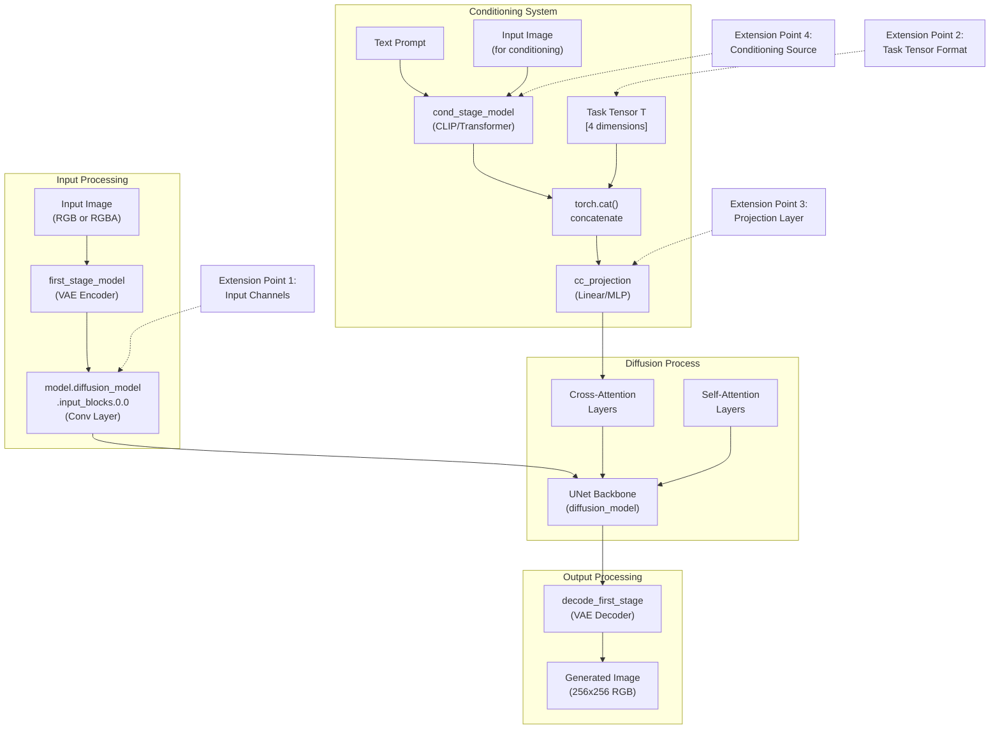
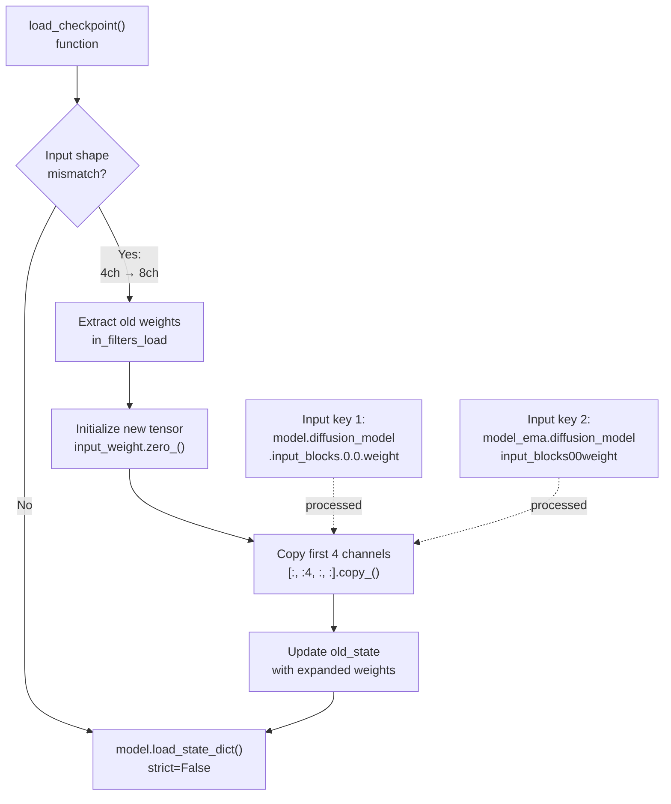
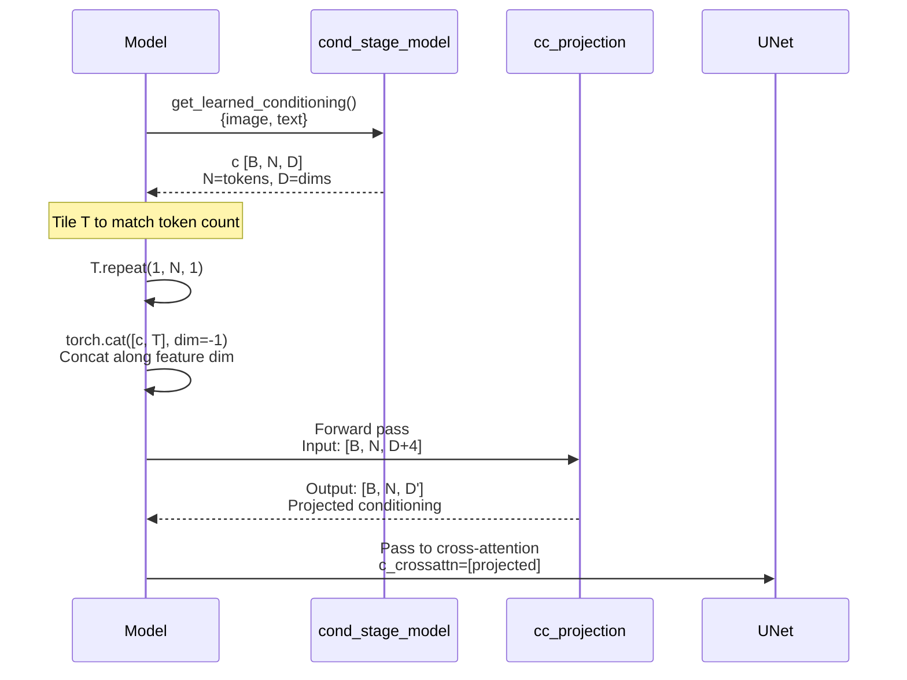
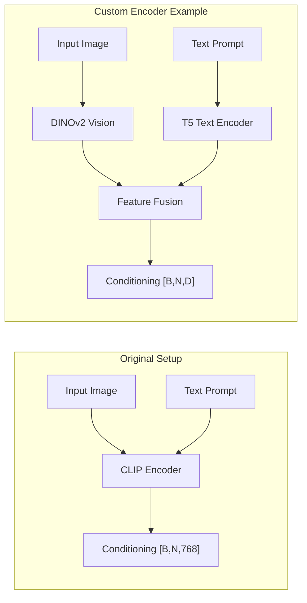
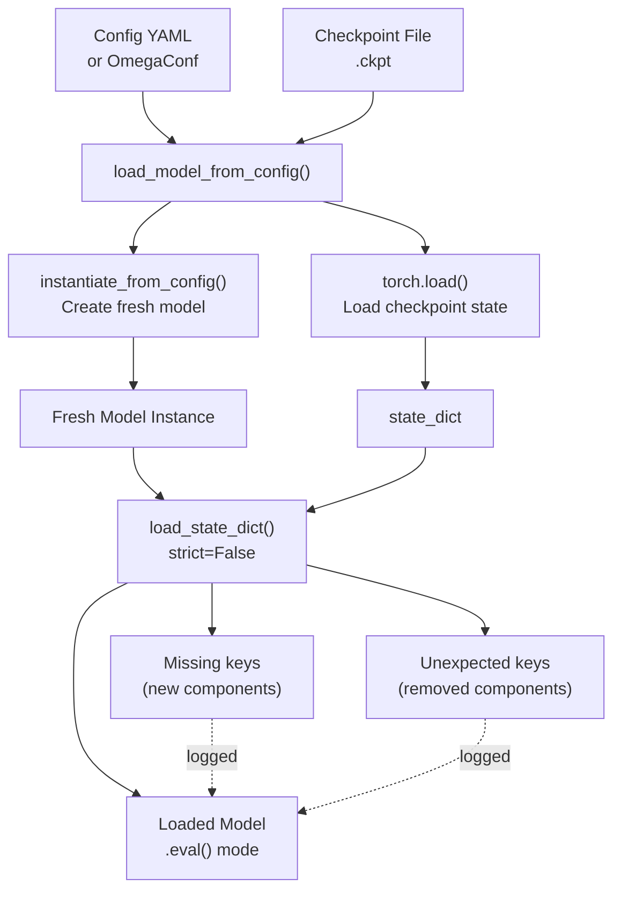
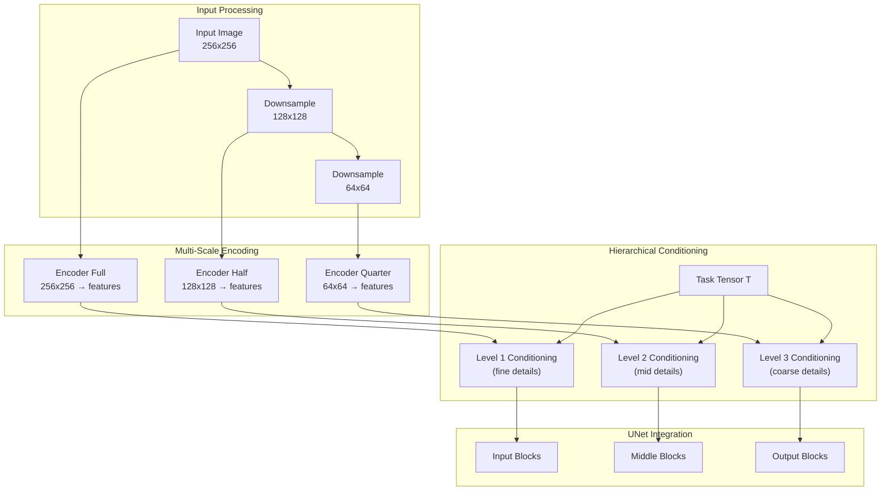

<!-- source: DeepWiki mcp.deepwiki.com · repo allenai/object-edit · page 8.2 Extending the Model · fetched 2026-10-26 -->

# Extending the Model

<details>
<summary>Relevant source files</summary>

The following files were used as context for generating this wiki page:

- [ldm/extras.py](ldm/extras.py)
- [run_generation.py](run_generation.py)

</details>


## Purpose and Scope

This page documents how to extend or modify the Latent Diffusion Model (LDM) architecture used in OBJect 3DIT. It covers adding new conditioning mechanisms, modifying input/output channels, creating custom projection layers, and integrating new task types. For information about the baseline model architecture, see [Model Architecture](#7). For creating custom datasets to train extended models, see [Creating Custom Datasets](#8.1).

---

## Model Extension Points

The OBJect 3DIT model provides several architectural extension points where developers can introduce custom functionality:



**Key Extension Points:**

| Extension Point | Component | Typical Modifications |
|----------------|-----------|----------------------|
| **Input Channels** | `model.diffusion_model.input_blocks.0.0` | Change from 4ch (latent) to 8ch (latent+concat), or add depth/normal channels |
| **Task Tensor Format** | T tensor creation in generation logic | Add new dimensions for additional task parameters |
| **Projection Layer** | `cc_projection` | Modify dimensionality or add nonlinearities for richer conditioning |
| **Conditioning Source** | `cond_stage_model` | Replace CLIP with other encoders (e.g., DINO, ImageBind) |
| **UNet Architecture** | `diffusion_model` blocks | Add residual connections, modify attention patterns |

**Sources:** [run_generation.py:119-123](), [run_generation.py:81-87]()

---

## Modifying Input Channels

The model's first convolutional layer processes latent representations from the VAE encoder. By default, this is 4 channels (RGBD in latent space). The system supports concatenating the input latent with the noisy latent being denoised, creating an 8-channel input.

### Automatic Channel Adaptation

The checkpoint loading system includes automatic adaptation for input channel mismatches:



The automatic adaptation logic is implemented in [run_generation.py:26-44]():

**Implementation Details:**

1. **Shape Comparison**: The system compares `in_filters_load.shape` from the checkpoint against `in_filters_current.shape` from the instantiated model [run_generation.py:26-30]()

2. **Zero Initialization**: When a mismatch is detected, new weights are zero-initialized [run_generation.py:42]()

3. **Selective Copying**: Only the first 4 channels are copied from the pretrained weights, leaving channels 5-8 at zero [run_generation.py:43]()

4. **Multiple Keys**: The system handles both standard and EMA (Exponential Moving Average) weight keys [run_generation.py:31-34]()

### Extending to More Channels

To add additional input channels (e.g., depth maps, normal maps, segmentation masks):

**Step 1: Modify the UNet Configuration**

Update the config YAML to specify the new input channel count in `model.params.unet_config.params`:

```yaml
unet_config:
  params:
    in_channels: 12  # 4 (latent) + 4 (concat) + 4 (additional)
```

**Step 2: Prepare Additional Conditioning in the Dataset**

Modify your dataset loader to encode and concatenate additional modalities:

```python
# In your custom dataset class
extra_channels = self.encode_additional_modality(...)  # [B, 4, H, W]
c_concat = torch.cat([latent_input, extra_channels], dim=1)  # [B, 12, H, W]
```

**Step 3: Extend Channel Adaptation Logic**

For channels beyond 8, extend the `load_checkpoint` function to handle your specific initialization strategy (e.g., copying from different sources, using learned initializations).

**Sources:** [run_generation.py:16-54]()

---

## Adding Custom Conditioning

The conditioning system combines text prompts, image features, and task parameters. To add new conditioning signals:

### Task Tensor Format

Each task uses a 4-dimensional tensor T that encodes task-specific parameters:

| Task | T Format | Description |
|------|----------|-------------|
| **rotate** | `[π/2, sin(θ), cos(θ), 0]` | θ = azimuth angle in radians |
| **remove** | `[0, 0, 0, 0]` | No spatial parameters |
| **insert** | `[0, x, y, 0]` | x, y ∈ [0, 1] normalized coordinates |
| **translate** | `[0, x, y, 0]` | x, y ∈ [0, 1] target position |

**Source:** [run_generation.py:129-141]()

### Defining a New Task Type

To add a new task (e.g., "scale"):

**Step 1: Define the Task Tensor**

```python
# In run_generation.py, extend the task handling
elif args.task == "scale":
    prompt = f"scale the {args.object_prompt}"
    scale_factor = args.scale_factor  # e.g., 0.5 to 2.0
    # Encode scale in log space for symmetry around 1.0
    log_scale = math.log(scale_factor)
    T = torch.tensor([1.0, log_scale, 0, 0])  # Use first two dimensions
```

**Step 2: Update the Conditioning Pipeline**

The tensor T is concatenated with learned conditioning and projected:



The concatenation and projection are implemented in [run_generation.py:81-89]():

1. Learned conditioning `c` has shape `[batch_size, num_tokens, embedding_dim]`
2. Task tensor `T` is repeated to shape `[batch_size, num_tokens, 4]` [run_generation.py:84-85]()
3. Concatenation creates `[batch_size, num_tokens, embedding_dim + 4]` [run_generation.py:86]()
4. `cc_projection` maps to the expected UNet cross-attention dimension [run_generation.py:87]()

**Step 3: Implement Dataset Support**

Create a corresponding dataset class that generates appropriate training pairs for the new task (see [Creating Custom Datasets](#8.1)).

**Sources:** [run_generation.py:68-112](), [run_generation.py:129-141]()

---

## Custom Projection Layers

The `cc_projection` layer transforms concatenated conditioning into the format expected by the UNet's cross-attention layers.

### Default Projection Architecture

The default projection is typically a linear layer or small MLP. To modify it:

**Option 1: Specify in Config**

```yaml
model:
  params:
    cc_projection_config:
      target: torch.nn.Sequential
      params:
        - target: torch.nn.Linear
          params:
            in_features: 772  # 768 (CLIP) + 4 (task tensor)
            out_features: 1024
        - target: torch.nn.GELU
        - target: torch.nn.Linear
          params:
            in_features: 1024
            out_features: 768
```

**Option 2: Custom Projection Module**

Create a custom module in `ldm/modules/`:

```python
# ldm/modules/custom_projections.py
import torch.nn as nn

class AdaptiveTaskProjection(nn.Module):
    """Projects conditioning with task-aware gating"""
    def __init__(self, cond_dim, task_dim, hidden_dim, output_dim):
        super().__init__()
        self.task_gate = nn.Linear(task_dim, hidden_dim)
        self.cond_proj = nn.Linear(cond_dim, hidden_dim)
        self.output_proj = nn.Linear(hidden_dim, output_dim)
        
    def forward(self, x):
        # x: [B, N, cond_dim + task_dim]
        cond, task = x[..., :-4], x[..., -4:]
        gate = torch.sigmoid(self.task_gate(task))
        cond_feat = self.cond_proj(cond)
        return self.output_proj(gate * cond_feat)
```

Reference it in the config:

```yaml
model:
  params:
    cc_projection_config:
      target: ldm.modules.custom_projections.AdaptiveTaskProjection
      params:
        cond_dim: 768
        task_dim: 4
        hidden_dim: 1024
        output_dim: 768
```

**Sources:** [run_generation.py:87]()

---

## Modifying the Conditioning Stage

The `cond_stage_model` encodes text and image inputs. To use alternative encoders:

### Replacing CLIP with Custom Encoders



**Implementation Steps:**

**Step 1: Create Custom Conditioning Module**

```python
# ldm/modules/encoders/custom_encoder.py
import torch.nn as nn
from transformers import AutoModel

class DualEncoderConditioner(nn.Module):
    def __init__(self, vision_model="facebook/dinov2-base", 
                 text_model="t5-base", device="cuda"):
        super().__init__()
        self.vision_encoder = AutoModel.from_pretrained(vision_model)
        self.text_encoder = AutoModel.from_pretrained(text_model)
        self.device = device
        
    def encode_image(self, image):
        return self.vision_encoder(image).last_hidden_state
        
    def encode_text(self, text):
        tokens = self.text_encoder.tokenizer(text, ...)
        return self.text_encoder(**tokens).last_hidden_state
        
    def forward(self, batch):
        # batch is dict with 'image' and 'text' keys
        img_feat = self.encode_image(batch['image'])
        txt_feat = self.encode_text(batch['text'])
        return torch.cat([img_feat, txt_feat], dim=1)
```

**Step 2: Update Model Config**

```yaml
model:
  params:
    cond_stage_config:
      target: ldm.modules.encoders.custom_encoder.DualEncoderConditioner
      params:
        vision_model: "facebook/dinov2-base"
        text_model: "t5-base"
        device: "cuda"
```

**Step 3: Adjust Projection Dimensions**

Ensure `cc_projection` input dimension matches the concatenated output from your custom encoder plus the task tensor dimension.

**Sources:** [run_generation.py:118-119]()

---

## Checkpoint Loading and Adaptation Patterns

The system provides flexible checkpoint loading with automatic adaptation to model changes.

### Loading with `load_model_from_config`

The `ldm.extras` module provides a utility function for loading models with config:



**Key Features:**

1. **Non-Strict Loading** [ldm/extras.py:68](): Uses `strict=False` to allow partial weight loading
2. **Logging Control** [ldm/extras.py:62](): Wraps loading in `all_logging_disabled()` context
3. **Global Step Tracking** [ldm/extras.py:65](): Extracts training step from checkpoint
4. **Device Management** [ldm/extras.py:76](): Sets `cond_stage_model.device` explicitly

### Handling Missing and Unexpected Keys

When extending the model, you'll encounter missing/unexpected keys during loading:

| Scenario | Missing Keys | Unexpected Keys | Strategy |
|----------|-------------|-----------------|----------|
| **Adding layers** | New layer names | None | Initialize randomly or use specific init |
| **Removing layers** | None | Old layer names | Safe to ignore if not needed |
| **Replacing components** | New component parameters | Old component parameters | Implement custom initialization logic |
| **Channel changes** | None | Input conv weights | Use channel adaptation pattern |

**Example: Custom Initialization for New Components**

```python
def load_checkpoint_with_init(model, checkpoint, init_config):
    """Load checkpoint with custom initialization for new components"""
    
    # Standard loading
    old_state = torch.load(checkpoint, map_location="cpu")
    if "state_dict" in old_state:
        old_state = old_state["state_dict"]
    
    # Load with strict=False
    m, u = model.load_state_dict(old_state, strict=False)
    
    # Custom initialization for missing keys
    if len(m) > 0:
        model_state = model.state_dict()
        for key in m:
            if "new_projection" in key:
                # Xavier initialization for new projection layers
                if "weight" in key:
                    nn.init.xavier_uniform_(model_state[key])
                elif "bias" in key:
                    nn.init.zeros_(model_state[key])
    
    return m, u
```

**Sources:** [ldm/extras.py:55-77](), [run_generation.py:16-54]()

---

## Advanced: Multi-Scale and Hierarchical Conditioning

For more complex extensions, you can implement multi-scale conditioning:



This approach allows different levels of the UNet to receive scale-appropriate conditioning, improving quality for detail-sensitive tasks.

**Sources:** [run_generation.py:81-96]()

---

## Testing Extended Models

When extending the model, verify functionality at each stage:

### Validation Checklist

1. **Shape Compatibility**: Verify all tensor shapes match at concatenation points
2. **Gradient Flow**: Ensure gradients propagate through new components during training
3. **Checkpoint Loading**: Test loading both from scratch and from pretrained weights
4. **Memory Usage**: Monitor GPU memory for new components
5. **Generation Quality**: Validate outputs on test cases before full training

### Debug Utilities

Use these patterns to inspect model behavior:

```python
# Check conditioning dimensions
c = model.get_learned_conditioning({"image": input_im, "text": prompt})
print(f"Conditioning shape: {c.shape}")  # Should be [B, N, D]

# Verify projection output
T = torch.tensor([...]).repeat(1, c.shape[1], 1)
c_cat = torch.cat([c, T], dim=-1)
c_proj = model.cc_projection(c_cat)
print(f"Projected shape: {c_proj.shape}")  # Should match UNet expectations

# Test checkpoint adaptation
load_checkpoint(model, checkpoint_path)
# Check logs for "Manual init" messages indicating channel adaptation
```

**Sources:** [run_generation.py:16-54](), [ldm/extras.py:55-77]()

---

## Summary

This page covered the main extension points in the OBJect 3DIT model:

- **Input Channels**: Automatic adaptation for 4ch→8ch, extensible to more channels
- **Conditioning**: Task tensors, custom projection layers, alternative encoders
- **Checkpoints**: Flexible loading with `strict=False` and custom initialization
- **Testing**: Validation strategies for extended models

For practical examples of training extended models, refer to [Training Workflow and Scripts](#4.2). For implementing custom datasets to provide training data for new tasks, see [Creating Custom Datasets](#8.1).

---

