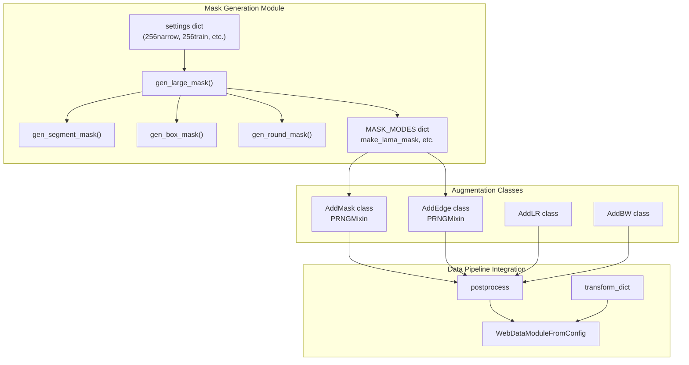
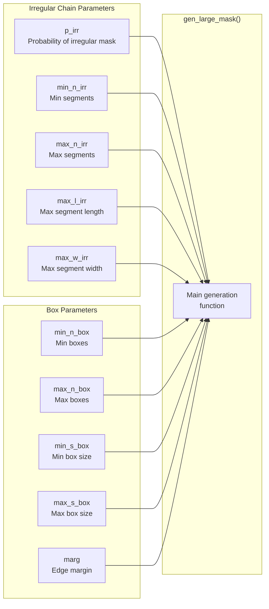
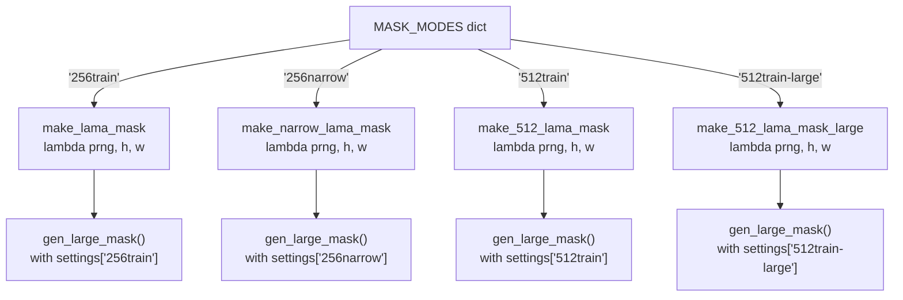
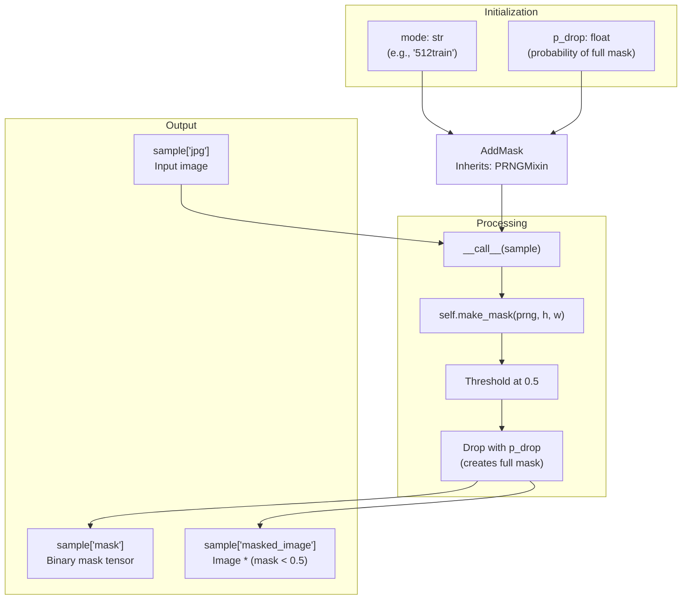
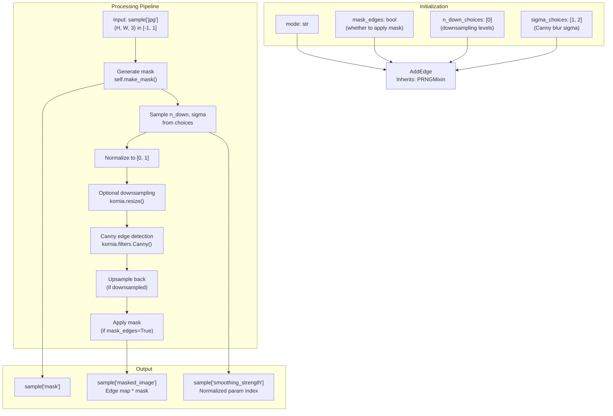
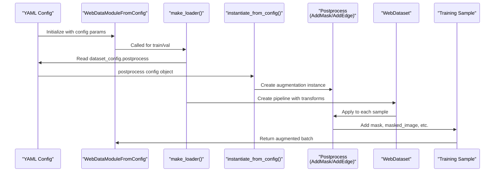
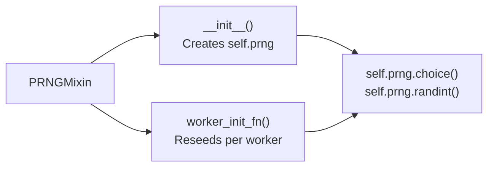

<!-- source: DeepWiki mcp.deepwiki.com · repo allenai/object-edit · page 8.3 Inpainting and Masking · fetched 2026-10-26 -->

# Inpainting and Masking

<details>
<summary>Relevant source files</summary>

The following files were used as context for generating this wiki page:

- [ldm/data/inpainting/__init__.py](ldm/data/inpainting/__init__.py)
- [ldm/data/inpainting/synthetic_mask.py](ldm/data/inpainting/synthetic_mask.py)
- [ldm/data/laion.py](ldm/data/laion.py)

</details>


## Purpose and Scope

This document covers the inpainting and masking subsystem in OBJect 3DIT, which provides synthetic mask generation and mask-based augmentation capabilities for training data. This system is primarily used to support inpainting tasks and image conditioning through masking operations.

For information about the broader data pipeline and dataset loaders, see [Data System](#3). For details on specific augmentation transforms applied during training, this page focuses specifically on mask generation and mask-based augmentations.

## Overview

The inpainting subsystem consists of two main components:

1. **Synthetic Mask Generation** - Algorithmic generation of training masks with configurable parameters
2. **Mask-Based Augmentations** - Data pipeline transformations that apply masks to images

These components are located in the `ldm/data/inpainting/` package and are integrated into the data loading pipeline through the `ldm/data/laion.py` module.



**Sources:** [ldm/data/inpainting/synthetic_mask.py:1-167](), [ldm/data/laion.py:1-538]()

## Synthetic Mask Generation

The mask generation system creates synthetic binary masks for inpainting tasks. Masks are generated procedurally using a combination of irregular polygonal chains and box primitives.

### Mask Configuration Settings

Four predefined mask configurations are available, each optimized for different image resolutions and training scenarios:

| Mode | Purpose | Image Size | Irregularity | Box Masks |
|------|---------|------------|--------------|-----------|
| `256narrow` | Narrow masks only | 256×256 | 100% (4-50 segments) | None |
| `256train` | Balanced training | 256×256 | 50% (1-5 segments) | 50% (1-4 boxes) |
| `512train` | High-res training | 512×512 | 50% (1-5 segments) | 50% (1-4 boxes) |
| `512train-large` | Large masks | 512×512 | 50% (1-5 segments, wider) | 50% (1-4 boxes, larger) |

**Sources:** [ldm/data/inpainting/synthetic_mask.py:4-53]()

### Mask Generation Parameters

Each configuration mode defines the following parameters:



**Sources:** [ldm/data/inpainting/synthetic_mask.py:85-103]()

### Core Mask Generation Functions

The mask generation pipeline consists of specialized functions for different mask types:

#### `gen_large_mask()`

Main entry point for mask generation. This function randomly selects between irregular chain masks and box masks based on the `p_irr` probability parameter.

**Function signature:**
```python
gen_large_mask(prng, img_h, img_w, marg, p_irr, min_n_irr, max_n_irr, 
               max_l_irr, max_w_irr, min_n_box, max_n_box, min_s_box, max_s_box)
```

**Algorithm:**
1. Initialize empty mask with shape `(img_h, img_w)`
2. Sample random value to determine mask type (irregular vs. box)
3. If irregular: Generate `n` segments with random positions, angles, lengths, widths
4. If box: Generate `n` boxes with random positions and sizes (50% square, 50% rounded)
5. Return binary mask array

**Sources:** [ldm/data/inpainting/synthetic_mask.py:85-141]()

#### `gen_segment_mask()`

Generates irregular polygonal chain segments by drawing lines with specified width between two points.

**Parameters:**
- `mask`: Current mask array
- `start`: Starting (x, y) coordinates
- `end`: Ending (x, y) coordinates  
- `brush_width`: Width of the line

Uses PIL's `ImageDraw.line()` with `joint="curve"` for smooth connections.

**Sources:** [ldm/data/inpainting/synthetic_mask.py:56-63]()

#### `gen_box_mask()`

Generates rectangular box masks by directly setting mask values in the specified region.

**Parameters:**
- `mask`: Current mask array
- `masked`: Tuple of (x_0, y_0, width, height)

**Sources:** [ldm/data/inpainting/synthetic_mask.py:66-69]()

#### `gen_round_mask()`

Generates rounded rectangle masks using PIL's `ImageDraw.rounded_rectangle()`.

**Parameters:**
- `mask`: Current mask array
- `masked`: Tuple of (x_0, y_0, width, height)
- `radius`: Corner radius for rounding

**Sources:** [ldm/data/inpainting/synthetic_mask.py:72-82]()

### Pre-configured Mask Factories

The module exports convenience functions through the `MASK_MODES` dictionary:



**Sources:** [ldm/data/inpainting/synthetic_mask.py:143-154]()

## Mask-Based Augmentation Classes

The augmentation classes integrate synthetic mask generation into the data loading pipeline. These classes are designed to be used as postprocessing transforms in WebDataset pipelines.

### `AddMask` Class

The `AddMask` class adds synthetic masks to training samples, creating both the mask itself and a masked version of the input image.



**Key behavior:**
- Inherits from `PRNGMixin` for process-safe random number generation
- Samples mask using the configured mode from `MASK_MODES`
- With probability `p_drop`, replaces the mask with all ones (no masking)
- Applies thresholding: values < 0.5 become 0, values > 0.5 become 1
- Creates `masked_image` by zeroing out pixels where `mask < 0.5`

**Output sample structure:**
- `sample['mask']`: Binary mask tensor of shape (H, W, 1)
- `sample['masked_image']`: Masked image tensor of shape (H, W, 3)

**Sources:** [ldm/data/laion.py:273-291]()

### `AddEdge` Class

The `AddEdge` class generates edge-detected versions of images and applies synthetic masks. This is useful for structure-preserving inpainting tasks.



**Algorithm details:**
1. Generate synthetic mask using selected mode
2. Sample edge detection parameters (downsampling level, Gaussian blur sigma)
3. Normalize image from [-1, 1] to [0, 1]
4. Optionally downsample image using Kornia
5. Apply Canny edge detection with sampled parameters
6. Upsample edge map back to original size (if downsampled)
7. If `mask_edges=True`: multiply edge map by inverse mask
8. If `mask_edges=False`: keep full edge map, zero out mask
9. Store normalized parameter index as `smoothing_strength`

**Canny parameters:**
- `low_threshold=0.1`, `high_threshold=0.2`
- `kernel_size = 4*sigma + 1`
- `hysteresis=True`

**Sources:** [ldm/data/laion.py:294-362]()

### Additional Augmentation Classes

#### `AddLR` Class

Generates low-resolution versions of images using degradation functions and downsampling.

**Key features:**
- Uses `degradation_fn_bsr_light()` for realistic degradation
- Resizes to initial size (if specified), applies degradation, then resizes to output size
- Adds `sample['lr']` containing the low-resolution version
- Useful for super-resolution and image restoration tasks

**Sources:** [ldm/data/laion.py:224-248]()

#### `AddBW` Class

Converts images to grayscale using random weighted color channels.

**Key features:**
- Samples random weights for RGB channels from uniform distribution
- Normalizes weights to sum to 1
- Computes weighted sum: `out = sum(x * w for channel)`
- Replicates grayscale to 3 channels to maintain tensor shape
- Adds `sample['lr']` containing the grayscale version

**Sources:** [ldm/data/laion.py:250-271]()

## Integration with Data Pipeline

The mask augmentation classes are integrated into the WebDataset pipeline through the configuration system.

### Configuration Pattern



**Sources:** [ldm/data/laion.py:108-187]()

### Pipeline Construction

The data loading pipeline is constructed in `make_loader()` with the following stages:

1. **Image transforms** - Basic torchvision transforms (resize, normalize)
2. **Transform dict** - Per-key transforms specified in config
3. **Postprocess** - Instantiated augmentation class (e.g., `AddMask`, `AddEdge`)
4. **WebDataset pipeline** - Streaming data from tar files
5. **Batching** - Collation using `dict_collation_fn()`

**WebDataset pipeline structure:**
```python
dset = wds.WebDataset(tars)
    .select(filter_keys)
    .decode('pil')
    .select(filter_size)
    .map_dict(**transform_dict)
    .map(postprocess)  # AddMask/AddEdge applied here
    .batched(batch_size, collation_fn=dict_collation_fn)
```

**Sources:** [ldm/data/laion.py:125-186]()

### Sample Structure After Augmentation

After passing through the mask augmentation pipeline, training samples contain the following keys:

| Key | Shape | Data Type | Value Range | Description |
|-----|-------|-----------|-------------|-------------|
| `jpg` | (H, W, 3) | float32 | [-1, 1] | Original image |
| `mask` | (H, W, 1) | float32 | {0, 1} | Binary mask |
| `masked_image` | (H, W, 3) | float32 | [-1, 1] | Image with masked regions zeroed |
| `smoothing_strength` | (H, W, 1) | float32 | [0, 1] | Parameter strength (AddEdge only) |
| `txt` | - | str | - | Text caption |

**Sources:** [ldm/data/laion.py:280-291](), [ldm/data/laion.py:354-361]()

## Usage Patterns

### Using Pre-configured Mask Modes

To use a specific mask generation mode directly:

```python
from ldm.data.inpainting.synthetic_mask import MASK_MODES

# Get mask generator function
make_mask = MASK_MODES["512train"]

# Generate mask
import numpy as np
prng = np.random.RandomState(seed=42)
mask = make_mask(prng, h=512, w=512)  # Returns binary mask array
```

**Sources:** [ldm/data/inpainting/synthetic_mask.py:149-154]()

### Configuring Mask Augmentation

To add mask augmentation to a dataset configuration:

```yaml
data:
  params:
    train:
      postprocess:
        target: ldm.data.laion.AddMask
        params:
          mode: "512train"
          p_drop: 0.0
```

Or for edge-based conditioning:

```yaml
postprocess:
  target: ldm.data.laion.AddEdge
  params:
    mode: "512train"
    mask_edges: true
```

**Sources:** [ldm/data/laion.py:146-149]()

### Process-Safe Random Number Generation

Both `AddMask` and `AddEdge` inherit from `PRNGMixin`, which provides process-safe PRNG:



This ensures that each DataLoader worker has a unique random seed, preventing duplicate mask generation across workers.

**Sources:** [ldm/data/base.py]() (referenced), [ldm/data/laion.py:21]()

### Standalone Mask Generation

The mask generation can also be used standalone for testing or visualization:

```bash
python ldm/data/inpainting/synthetic_mask.py output_mask.png
```

This generates a single mask using the `256train` settings and saves it to the specified path.

**Sources:** [ldm/data/inpainting/synthetic_mask.py:156-167]()

## Summary

The inpainting and masking subsystem provides:

1. **Flexible mask generation** with four predefined modes optimized for different resolutions
2. **Composable augmentation classes** that integrate seamlessly with WebDataset pipelines
3. **Edge-based conditioning** through Canny edge detection combined with masking
4. **Process-safe random generation** ensuring diversity across parallel data workers
5. **Configurable parameters** exposed through the OmegaConf configuration system

This subsystem is a critical component for training inpainting models and providing structural conditioning for image generation tasks.

**Sources:** [ldm/data/inpainting/synthetic_mask.py:1-167](), [ldm/data/laion.py:1-538]()

---

