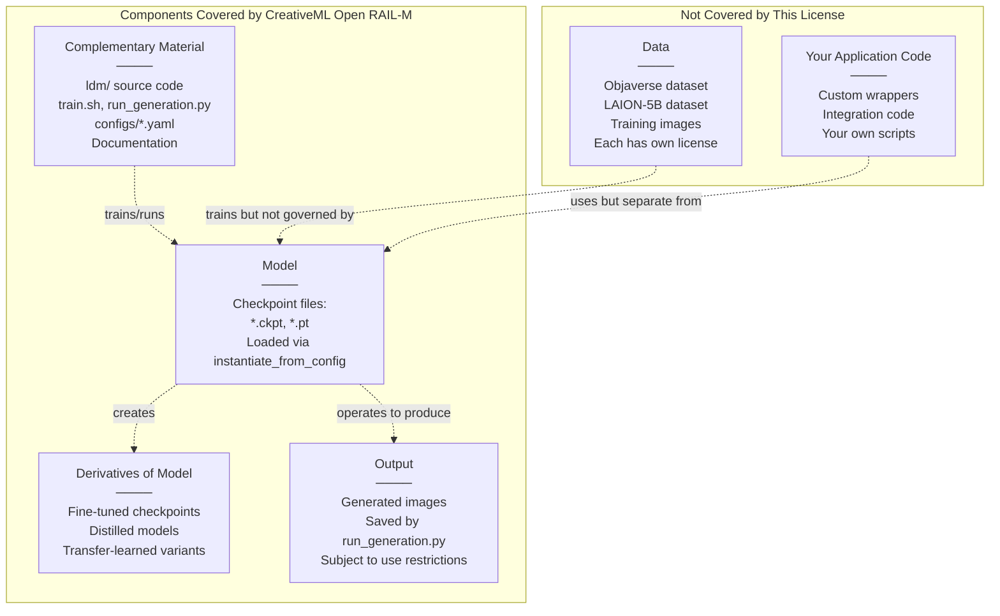
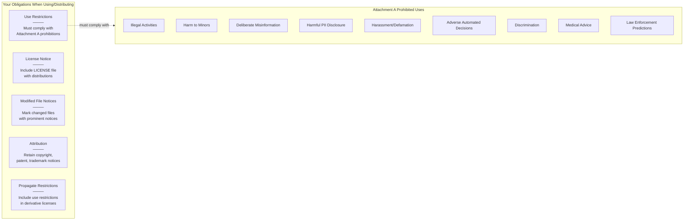
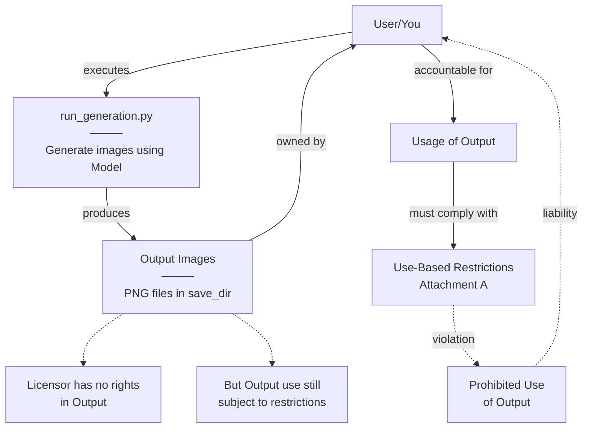
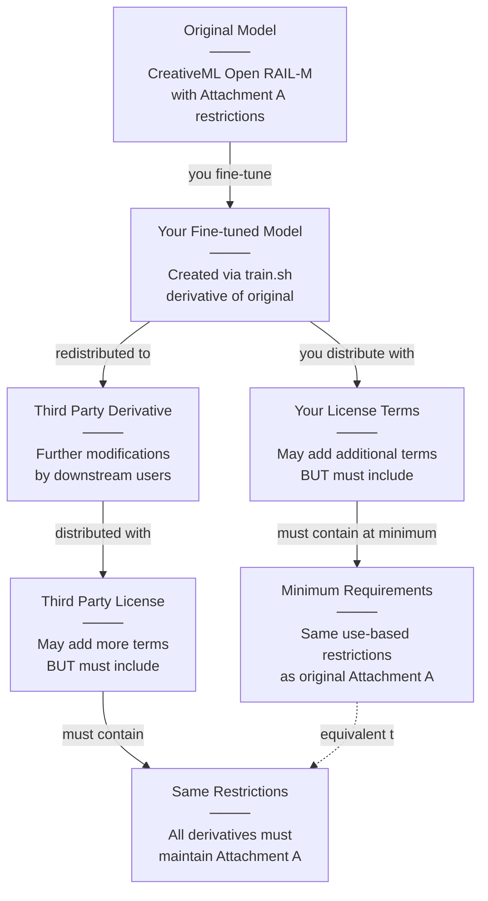

<!-- source: DeepWiki mcp.deepwiki.com · repo allenai/object-edit · page 9 License and Usage Guidelines · fetched 2026-10-26 -->

# License and Usage Guidelines

<details>
<summary>Relevant source files</summary>

The following files were used as context for generating this wiki page:

- [LICENSE](LICENSE)

</details>


## Purpose and Scope

This document provides an overview of the licensing terms governing the OBJect 3DIT model and establishes guidelines for proper usage. The model is distributed under the **CreativeML Open RAIL-M** license, which balances open access to AI technology with responsible use requirements.

This page covers the high-level license structure, key definitions, and general usage principles. For detailed information about:
- Specific license terms and use-based restrictions, see [License Terms and Restrictions](#9.1)
- Requirements for redistribution and attribution, see [Redistribution and Attribution](#9.2)

For information about model architecture and technical components, see [Model Architecture](#7).

**Sources:** [LICENSE:1-80]()

---

## License Overview

The OBJect 3DIT model is licensed under the **CreativeML Open RAIL-M** (Responsible AI License - Multimodal) license. This license is specifically designed for multimodal generative models and aims to:

1. **Enable Open Access**: Grant broad intellectual property rights for use, modification, and distribution
2. **Promote Responsible Use**: Impose use-based restrictions to prevent harmful applications
3. **Ensure Compliance Propagation**: Require derivative works to maintain the same restrictions

The license philosophy recognizes both the transformative potential and possible misuses of generative AI models. It explicitly addresses concerns about technical limitations and ethical considerations while promoting open research.

**Sources:** [LICENSE:1-14]()

---

## License Structure

The CreativeML Open RAIL-M license is organized into four main sections plus an attachment defining specific restrictions:

```mermaid
graph TB
    LICENSE["CreativeML Open RAIL-M License"]
    
    PREAMBLE["Section I: PREAMBLE<br/>Philosophy and Goals"]
    IP["Section II: INTELLECTUAL PROPERTY RIGHTS<br/>Copyright and Patent Grants"]
    CONDITIONS["Section III: CONDITIONS OF USAGE,<br/>DISTRIBUTION AND REDISTRIBUTION"]
    OTHER["Section IV: OTHER PROVISIONS<br/>Warranties, Liability, Updates"]
    ATTACHMENT["Attachment A<br/>Use Restrictions"]
    
    LICENSE --> PREAMBLE
    LICENSE --> IP
    LICENSE --> CONDITIONS
    LICENSE --> OTHER
    LICENSE --> ATTACHMENT
    
    IP --> COPYRIGHT["2. Grant of Copyright License<br/>reproduce, display, distribute"]
    IP --> PATENT["3. Grant of Patent License<br/>make, use, sell, import"]
    
    CONDITIONS --> DIST["4. Distribution and Redistribution<br/>hosting, copying, modifications"]
    CONDITIONS --> USERESTR["5. Use-based restrictions<br/>must comply with Attachment A"]
    CONDITIONS --> OUTPUT["6. The Output You Generate<br/>accountability for generated content"]
    
    OTHER --> UPDATES["7. Updates and Runtime Restrictions"]
    OTHER --> TRADEMARKS["8. Trademarks and related"]
    OTHER --> WARRANTY["9. Disclaimer of Warranty"]
    OTHER --> LIABILITY["10. Limitation of Liability"]
    OTHER --> ACCEPTING["11. Accepting Warranty or Additional Liability"]
    OTHER --> SEVERABILITY["12. Severability"]
    
    ATTACHMENT --> RESTRICTIONS["Specific prohibited uses:<br/>- Illegal activities<br/>- Harm to minors<br/>- Misinformation<br/>- Discrimination<br/>- Medical advice<br/>- and more..."]
```



**Sources:** [LICENSE:1-80]()

---

## Key Definitions and Code Mapping

The license defines several key terms that map to specific components in the OBJect 3DIT codebase:

| License Term | Definition | Code/System Reference |
|--------------|------------|----------------------|
| **Model** | Machine-learning assemblies including checkpoints, weights, parameters, and architecture | Checkpoint files (`.ckpt`, `.pt`), model state loaded in [ldm/models/diffusion/ddpm.py]() |
| **Derivatives of the Model** | Modifications, fine-tuned versions, distillations, or models initialized from transferred weights | Models created via [train.sh]() finetuning process, checkpoint derivatives |
| **Complementary Material** | Source code, scripts, documentation, examples for defining, running, loading, or evaluating the Model | All `.py` files, [train.sh](), [run_generation.py](), [run_eval.py](), [generate_scripts/]() directory, this documentation |
| **Data** | Training/evaluation dataset information extracted from sources | Not licensed under this license; datasets in [ldm/data/]() are subject to their own terms |
| **Output** | Results generated by operating the Model | Images saved by [run_generation.py:startLine-endLine]() to output directories |
| **Distribution** | Transmission, reproduction, publication, or hosted service provision | Sharing checkpoints, hosting via API, providing model access |
| **You** (Licensee) | Individual or entity using the Model | Users running [run_generation.py](), [train.sh](), or accessing via any interface |
| **Contributor** | Licensor or entities submitting contributions | Original model creators, code contributors to repository |

**Sources:** [LICENSE:17-30]()

---

## Scope of Licensed Components

The following diagram illustrates what components are covered by the CreativeML Open RAIL-M license versus what falls under separate terms:



**Important Notes:**
- The **Data** used for training (Objaverse, LAION-5B) is explicitly **NOT** licensed under this license [LICENSE:20]()
- **Output** you generate has no license claims by the Licensor, but you remain accountable for compliance [LICENSE:48]()
- **Complementary Material** (source code) is fully covered by the license grants [LICENSE:36]()

**Sources:** [LICENSE:19-25, 36, 48]()

---

## Intellectual Property Rights Granted

### Copyright License

Under Section II, you receive a **perpetual, worldwide, non-exclusive, royalty-free, irrevocable** copyright license to:

- **Reproduce** the Model and Complementary Material
- **Prepare derivatives** (modify, fine-tune, adapt)
- **Publicly display and perform** (demonstrate, showcase)
- **Sublicense** (grant rights to others, subject to restrictions)
- **Distribute** (share, host, provide access)

**Code Implications:**
- You may run [train.sh]() to fine-tune the model on your data
- You may modify [ldm/models/diffusion/ddpm.py]() and other source files
- You may host [run_generation.py]() as a web service
- You may create derivative checkpoints and share them

**Sources:** [LICENSE:36]()

### Patent License

You receive a **perpetual, worldwide, non-exclusive, royalty-free** patent license for claims necessarily infringed by the Model and Complementary Material. This license **terminates** if you institute patent litigation alleging infringement.

**Sources:** [LICENSE:37]()

---

## Core Obligations and Restrictions



### Use-Based Restrictions (Summary)

The license imposes specific prohibited uses detailed in Attachment A. You **cannot** use the Model or derivatives for:

| Category | Prohibition Summary | Relevance to Image Generation |
|----------|---------------------|-------------------------------|
| **Illegal Activities** | Any violation of applicable laws | Always applicable |
| **Exploitation of Minors** | Exploit, harm, or attempt to harm minors | Prohibited content generation |
| **Misinformation** | Generate verifiably false content to harm others | Deepfakes, manipulated images |
| **PII Exposure** | Disseminate personal identifiable information harmfully | Face generation, private data |
| **Harassment** | Defame, disparage, or harass | Offensive image generation |
| **Automated Decisions** | Fully automated decisions adversely affecting legal rights | Image-based screening systems |
| **Discrimination** | Discriminate based on characteristics or behavior | Biased content generation |
| **Vulnerability Exploitation** | Exploit age, social, physical, mental characteristics | Manipulative content |
| **Protected Characteristics** | Discriminate based on legally protected categories | Stereotype reinforcement |
| **Medical Advice** | Provide medical advice or result interpretation | Medical image generation claims |
| **Justice/Law Enforcement** | Predict fraud/crime, arbitrarily targeted profiling | Surveillance applications |

For complete details on each restriction, see [License Terms and Restrictions](#9.1).

**Sources:** [LICENSE:47, 68-79]()

---

## Distribution Requirements Overview

When distributing the Model or derivatives, you must:

1. **Include License**: Provide a copy of [LICENSE]() to all recipients [LICENSE:43]()
2. **Enforce Restrictions**: Include use-based restrictions in any legal agreement governing distribution [LICENSE:42]()
3. **Mark Modifications**: Add prominent notices to modified files stating changes [LICENSE:44]()
4. **Preserve Notices**: Retain all copyright, patent, trademark, and attribution notices [LICENSE:45]()
5. **Add Your Copyright**: Optionally add your own copyright for modifications [LICENSE:46]()

**Practical Example for Checkpoint Distribution:**

```
my-finetuned-model/
├── LICENSE                          # Required: Original CreativeML Open RAIL-M
├── NOTICE.txt                       # Recommended: Your modifications notice
├── model.ckpt                       # Your fine-tuned checkpoint
├── README.md                        # Should reference license and restrictions
└── configs/
    └── my-config.yaml              # Modified configuration
```

For detailed redistribution requirements, see [Redistribution and Attribution](#9.2).

**Sources:** [LICENSE:41-46]()

---

## Output Rights and Accountability

### Licensor Claims No Rights in Output

The license explicitly states: *"Except as set forth herein, Licensor claims no rights in the Output You generate using the Model."* [LICENSE:48]()

This means images generated via [run_generation.py]() are **not owned** by the model creators. However, you remain fully accountable:



### Accountability Requirements

- **You are accountable** for all Output generated and its subsequent uses [LICENSE:48]()
- **Output use must comply** with the use-based restrictions in Attachment A [LICENSE:48]()
- **You must require** downstream users to comply with restrictions [LICENSE:47]()

**Example Scenarios:**

| Scenario | Permitted? | Reasoning |
|----------|-----------|-----------|
| Generate images for art portfolio | ✅ Yes | Lawful, non-harmful creative use |
| Generate images for academic research | ✅ Yes | Research explicitly encouraged [LICENSE:9]() |
| Generate images depicting specific individuals without consent | ❌ No | Could violate PII/harassment restrictions |
| Generate medical diagnosis visualizations | ❌ No | Violates medical advice restriction |
| Generate synthetic training data for another ML model | ✅ Yes (if lawful) | Provided no restrictions violated |

**Sources:** [LICENSE:47-48]()

---

## Warranty and Liability Disclaimers

### No Warranty

The Model and Complementary Material are provided **"AS IS"** without warranties of any kind, including:
- No warranty of **MERCHANTABILITY**
- No warranty of **FITNESS FOR A PARTICULAR PURPOSE**
- No warranty of **NON-INFRINGEMENT**
- No warranty of **TITLE**

**Code Implication:** When running [run_generation.py]() or [train.sh](), you accept all risks of using the software [LICENSE:54]().

### Limited Liability

Contributors are **not liable** for damages arising from use or inability to use the Model, including:
- Loss of goodwill
- Work stoppage
- Computer failure
- Commercial damages or losses

**Exception:** Deliberate and grossly negligent acts may still create liability under applicable law [LICENSE:55]().

**Sources:** [LICENSE:54-55]()

---

## Licensor Reserved Rights

### Update and Runtime Restrictions

The Licensor reserves the right to:
- **Restrict usage** of the Model if violating the license (remotely or otherwise)
- **Update the Model** through electronic means
- **Modify Output** based on updates

Users should **undertake reasonable efforts** to use the latest version [LICENSE:52]().

### Trademark Restrictions

The license does **not** grant rights to:
- Use Licensor trademarks, trade names, or logos
- Suggest endorsement by the Licensor
- Misrepresent the relationship between parties

All rights not expressly granted are **reserved** by the Licensor [LICENSE:53]().

**Sources:** [LICENSE:52-53]()

---

## Practical Compliance Guidelines

### For Model Users (Running Inference)

If you are using [run_generation.py]() or similar inference scripts:

1. ✅ **Review Attachment A** prohibitions before generating content
2. ✅ **Ensure Output use** complies with restrictions
3. ✅ **Do not use for** medical advice, law enforcement profiling, or other prohibited purposes
4. ✅ **Keep LICENSE file** with any checkpoints you download
5. ✅ **Understand accountability** for generated images

**Code Reference:** [run_generation.py]()

### For Model Trainers (Fine-tuning)

If you are running [train.sh]() to fine-tune:

1. ✅ **Derivative checkpoints** are covered by the license
2. ✅ **Must maintain** all use-based restrictions in derivatives
3. ✅ **Mark modified files** if you change [ldm/]() source code
4. ✅ **Include LICENSE** with any distributed checkpoints
5. ✅ **Add your copyright** to modifications if desired

**Code Reference:** [train.sh]()

### For Service Providers (Hosting)

If you are hosting the model as a service:

1. ✅ **Distribution includes** hosted services and APIs [LICENSE:25]()
2. ✅ **Include use restrictions** in terms of service
3. ✅ **Provide LICENSE** to users accessing the service
4. ✅ **Implement controls** to prevent prohibited uses
5. ✅ **Monitor for compliance** with use restrictions

### For Researchers

Research use is explicitly encouraged by the license preamble [LICENSE:9]():

1. ✅ **Open research** on generative models is promoted
2. ✅ **Academic publications** are permitted
3. ✅ **Benchmark results** from [run_eval.py]() can be shared
4. ✅ **Must still comply** with use-based restrictions
5. ✅ **Cite appropriately** when publishing results

**Code Reference:** [run_eval.py]()

---

## Compliance Propagation Flow



**Key Principle:** *"Downstream derivative versions of the model could be released under different licensing terms, [but] the latter will always have to include - at minimum - the same use-based restrictions as the ones in the original license"* [LICENSE:11]().

**Sources:** [LICENSE:11, 42, 46]()

---

## Summary Checklist

### ✅ Rights You Have

- [x] Use the Model for any lawful purpose
- [x] Reproduce and distribute the Model
- [x] Create and distribute derivatives (fine-tuned models)
- [x] Modify the Complementary Material (source code)
- [x] Host as a service (SaaS, API)
- [x] Use for commercial purposes
- [x] Use for research and academic work
- [x] Own the Output you generate
- [x] Sublicense to others (with restrictions)

### ⚠️ Obligations You Have

- [x] Include LICENSE with distributions
- [x] Enforce use-based restrictions on recipients
- [x] Mark modified files with notices
- [x] Retain copyright and attribution notices
- [x] Ensure derivatives maintain restrictions
- [x] Comply with Attachment A prohibitions
- [x] Accept "AS IS" without warranty
- [x] Be accountable for Output usage

### ❌ Restrictions You Must Follow

- [x] Do not use for illegal activities
- [x] Do not use to harm minors
- [x] Do not generate deliberate misinformation
- [x] Do not use for medical advice
- [x] Do not use for discriminatory purposes
- [x] Do not use for law enforcement profiling
- [x] Do not use Licensor trademarks without permission
- [x] Do not institute patent litigation

---

## References

For detailed information on specific topics:

- **Complete use-based restrictions**: See [License Terms and Restrictions](#9.1)
- **Distribution procedures and attribution requirements**: See [Redistribution and Attribution](#9.2)
- **Model architecture and components**: See [Model Architecture](#7)
- **Training procedures**: See [Training System](#4)
- **Generation workflows**: See [Inference and Generation](#5)

**Primary Source:** [LICENSE:1-80]()

---

## Legal Notice

This documentation provides a summary and interpretation of the license terms for convenience. In case of any conflict between this documentation and the [LICENSE]() file, **the LICENSE file governs**. Users should read the complete license text before using, modifying, or distributing the Model.

The license may be updated by the Licensor [LICENSE:52](). Users should check for the latest version and use reasonable efforts to comply with the most current terms.

**Sources:** [LICENSE:1-80]()

---

