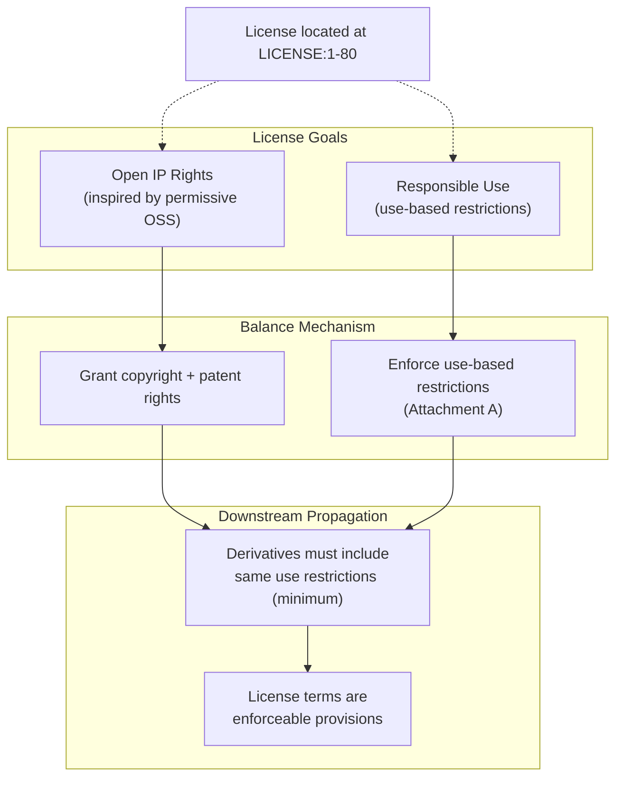
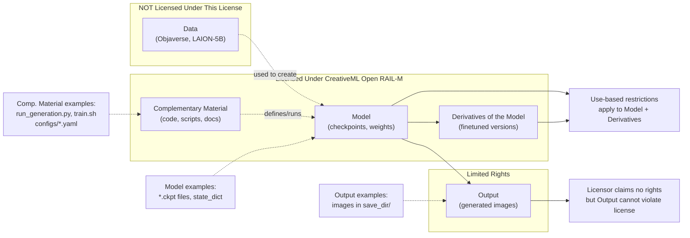
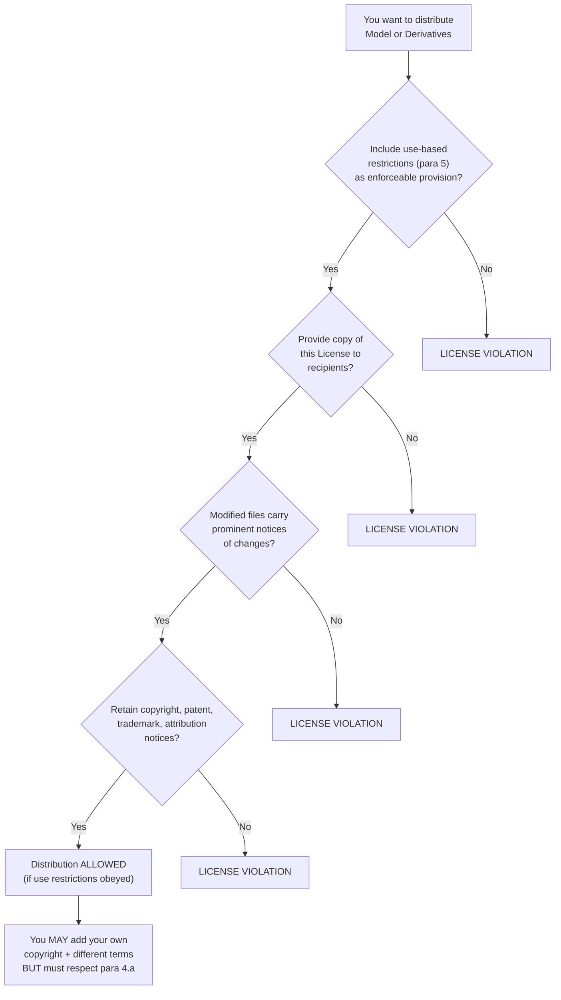
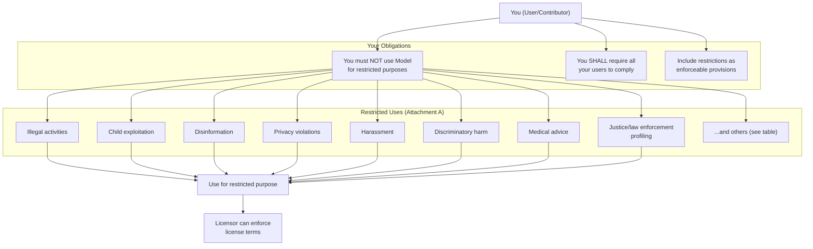
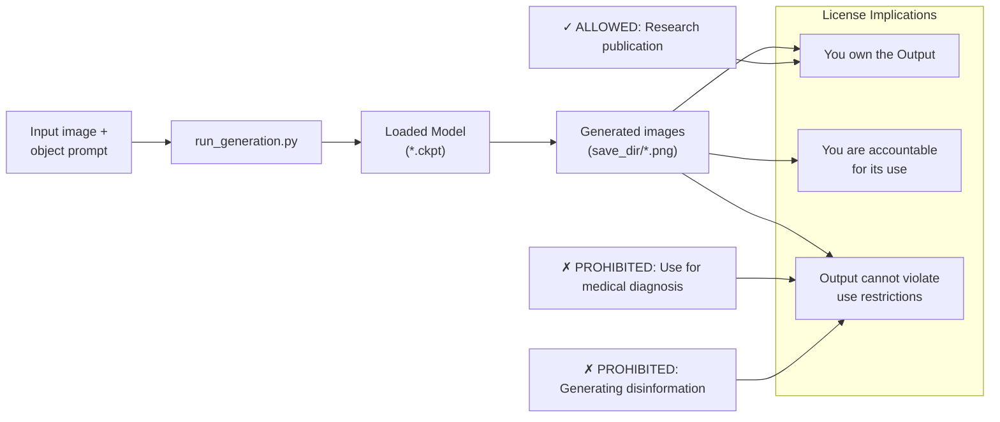
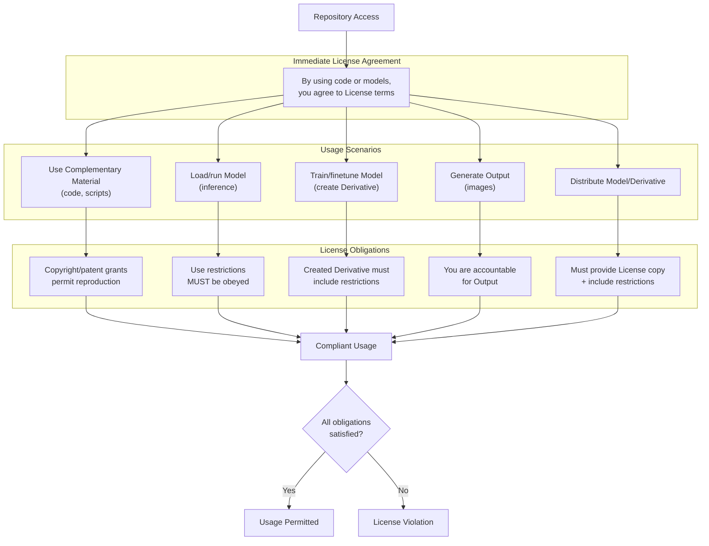

<!-- source: DeepWiki mcp.deepwiki.com · repo allenai/object-edit · page 9.1 License Terms and Restrictions · fetched 2026-10-26 -->

# License Terms and Restrictions

Relevant source files

The following files were used as context for generating this wiki page:

- [LICENSE](LICENSE)

## Purpose and Scope

This page details the specific terms, conditions, and restrictions of the **CreativeML Open RAIL-M** license that governs the use of models and code in the OBJect 3DIT repository. The license defines permissible and prohibited uses of the trained models, derivatives, and generated outputs. For information about redistribution requirements and attribution guidelines, see [Redistribution and Attribution](#9.2).

The CreativeML Open RAIL-M license is a use-based restricted license that combines open-source permissive IP grants with mandatory ethical restrictions on downstream usage. All users, contributors, and redistributors must comply with these terms.

## License Overview

The OBJect 3DIT repository is licensed under the **CreativeML Open RAIL-M** license, which is designed specifically for multimodal generative AI models. This license enables open research and development while prohibiting specific harmful use cases.

### License Philosophy

**Sources:** [LICENSE:1-15]()

The license strives to "promote open and responsible research on generative models for art and content generation" while preventing misuse [LICENSE:9](). Even derivatives released under different licensing terms must include at minimum the same use-based restrictions [LICENSE:11]().

## Key Definitions

The license defines several critical terms that determine its scope and application:

| Term | Definition | Code Relevance |
|------|------------|----------------|
| **Model** | Machine-learning assemblies including checkpoints, learnt weights, parameters (including optimizer states) | All `.ckpt` files, `model.state_dict()` in training system |
| **Derivatives of the Model** | Modifications to the Model, works based on the Model, or models created via transfer learning, distillation, or similar techniques | Fine-tuned checkpoints from `train.sh`, models using transferred weights |
| **Complementary Material** | Source code, scripts, documentation, tutorials, examples used to define, run, load, benchmark, or evaluate the Model | All `.py`, `.sh`, `.yaml` files in repository; [run_generation.py](), [train.sh](), configs |
| **Output** | Results of operating a Model as embodied in informational content | Images generated by [run_generation.py](), saved to output directories |
| **Distribution** | Transmission, reproduction, publication, or sharing to third parties, including hosted services (API/web access) | Deploying models via API, sharing checkpoints on HuggingFace |
| **Data** | Information/content from training datasets; **NOT licensed under this License** | Objaverse dataset, LAION-5B data (separate licenses apply) |

**Sources:** [LICENSE:17-30]()

### License Scope Diagram

**Sources:** [LICENSE:17-30]()

## Intellectual Property Rights Granted

The license grants both **copyright** and **patent** rights to users:

### Copyright License

**Grant:** Perpetual, worldwide, non-exclusive, no-charge, royalty-free, irrevocable copyright license to:
- Reproduce
- Prepare derivative works
- Publicly display and perform
- Sublicense
- Distribute

**Applies to:** Complementary Material, Model, and Derivatives of the Model

**Sources:** [LICENSE:36]()

### Patent License

**Grant:** Perpetual, worldwide, non-exclusive, no-charge, royalty-free, irrevocable patent license to:
- Make, have made, use
- Offer to sell, sell, import
- Transfer the Model and Complementary Material

**Termination condition:** If you initiate patent litigation alleging that the Model/Complementary Material infringes patents, your patent license terminates on the date litigation is filed.

**Sources:** [LICENSE:37]()

## Distribution and Redistribution Requirements

When distributing the Model or Derivatives, you **MUST** comply with the following conditions:

**Sources:** [LICENSE:41-46]()

### Specific Requirements

1. **Use-based restrictions MUST be included** as an enforceable provision in any legal agreement governing use/distribution [LICENSE:42]()

2. **Give recipients a copy of this License** [LICENSE:43]()

3. **Mark modified files** with prominent notices stating changes [LICENSE:44]()

4. **Retain all notices** (copyright, patent, trademark, attribution) that pertain to the Model or Derivatives [LICENSE:45]()

5. **Your modifications** may have different license terms, but must respect the use-based restrictions requirement [LICENSE:46]()

### Code Implementation Context

When using this repository:
- **Training a model** via [train.sh](): Creates a derivative Model subject to all restrictions
- **Finetuning from checkpoint** via [configs/sd-objaverse-finetune-c_concat-256.yaml](): Creates a derivative Model
- **Distributing checkpoints**: Must include this LICENSE file and use restrictions in any agreement
- **Hosting API service** using [run_generation.py](): Constitutes Distribution, requires compliance

**Sources:** [LICENSE:41-46]()

## Use-Based Restrictions (Attachment A)

**Critical:** You **CANNOT** use the Model or Derivatives for the following purposes. These restrictions apply to all downstream users.

### Prohibited Uses Table

| Category | Prohibited Use | License Reference |
|----------|----------------|-------------------|
| **Illegal Activity** | Any use that violates applicable laws or regulations | [LICENSE:69]() |
| **Child Exploitation** | Exploiting, harming, or attempting to exploit/harm minors | [LICENSE:70]() |
| **Disinformation** | Generating/disseminating verifiably false information to harm others | [LICENSE:71]() |
| **Privacy Violation** | Generating/disseminating PII that can harm individuals | [LICENSE:72]() |
| **Harassment** | Defaming, disparaging, or harassing others | [LICENSE:73]() |
| **Automated Decision-Making** | Fully automated decisions adversely impacting legal rights or creating binding obligations | [LICENSE:74]() |
| **Discriminatory Harm** | Discriminating/harming individuals based on social behavior or personal characteristics | [LICENSE:75]() |
| **Vulnerability Exploitation** | Exploiting age, social, physical, or mental vulnerabilities to distort behavior causing harm | [LICENSE:76]() |
| **Protected Characteristics** | Discriminating against legally protected characteristics/categories | [LICENSE:77]() |
| **Medical Advice** | Providing medical advice or medical results interpretation | [LICENSE:78]() |
| **Justice/Law Enforcement** | Generating information for administration of justice, law enforcement, immigration, or asylum processes (e.g., predicting fraud/crime, text profiling) | [LICENSE:79]() |

**Sources:** [LICENSE:64-79]()

### Use Restriction Enforcement

**Sources:** [LICENSE:47](), [LICENSE:68-79]()

The license states: "You shall require all of Your users who use the Model or a Derivative of the Model to comply with the terms of this paragraph (paragraph 5)" [LICENSE:47](). This creates a **cascading obligation** to propagate restrictions to all downstream users.

## Output Rights and Accountability

### Output Ownership

- **Licensor claims no rights** in the Output you generate using the Model [LICENSE:48]()
- **You are accountable** for the Output you generate and its subsequent uses [LICENSE:48]()
- **Restriction:** No use of the output can contravene any provision of the License [LICENSE:48]()

### Practical Implications for Code

When using [run_generation.py]() to generate images:

**Sources:** [LICENSE:48]()

## Other Key Provisions

### Runtime Restrictions and Updates

The Licensor reserves the right to:
- **Restrict usage** remotely or otherwise if License is violated [LICENSE:52]()
- **Update the Model** through electronic means [LICENSE:52]()
- **Modify the Output** based on updates [LICENSE:52]()

**Your obligation:** Undertake reasonable efforts to use the latest version of the Model [LICENSE:52]()

**Sources:** [LICENSE:52]()

### Trademarks

- You **cannot** use Licensor's trademarks, trade names, logos to suggest endorsement or misrepresent relationships [LICENSE:53]()
- All rights not expressly granted are **reserved** by Licensors [LICENSE:53]()

**Sources:** [LICENSE:53]()

### Warranty Disclaimer

**AS IS BASIS:** The Model and Complementary Material are provided **WITHOUT WARRANTIES OR CONDITIONS OF ANY KIND**, including:
- No warranty of TITLE
- No warranty of NON-INFRINGEMENT  
- No warranty of MERCHANTABILITY
- No warranty of FITNESS FOR A PARTICULAR PURPOSE

**Your responsibility:** You are solely responsible for determining appropriateness of use and assume all risks [LICENSE:54]()

**Sources:** [LICENSE:54]()

### Limitation of Liability

Contributors are **NOT LIABLE** for damages arising from use or inability to use the Model/Complementary Material, including:
- Direct, indirect, special, incidental, or consequential damages
- Loss of goodwill, work stoppage, computer failure
- Commercial damages or losses

Exception: Deliberate and grossly negligent acts or as required by applicable law [LICENSE:55]()

**Sources:** [LICENSE:55]()

### Additional Liability

When redistributing, you **MAY** offer support, warranty, indemnity, or other liability obligations, but:
- You act only on **your own behalf** and sole responsibility
- You must **indemnify and defend** each Contributor from any claims arising from your warranty/liability [LICENSE:56]()

**Sources:** [LICENSE:56]()

## License Application to Codebase Components

The following table maps repository components to license coverage:

| Component | License Status | File Examples | Restrictions Apply |
|-----------|----------------|---------------|-------------------|
| **Trained Models** | Licensed (Model) | `*.ckpt` checkpoint files | Yes - all use restrictions |
| **Source Code** | Licensed (Complementary Material) | [run_generation.py](), [train.sh](), [ldm/]() | Copyright/patent grants apply |
| **Configuration Files** | Licensed (Complementary Material) | [configs/sd-objaverse-finetune-c_concat-256.yaml]() | Copyright/patent grants apply |
| **Scripts** | Licensed (Complementary Material) | [generate_scripts/rotate.sh](), [setup_reqs.sh]() | Copyright/patent grants apply |
| **Documentation** | Licensed (Complementary Material) | README, comments in code | Copyright/patent grants apply |
| **Generated Images** | NOT licensed (Output) | Images from `save_dir/` | Output use cannot violate restrictions |
| **Training Data** | NOT licensed | Objaverse, LAION-5B datasets | Separate licenses apply |

**Sources:** [LICENSE:20](), [LICENSE:22](), [LICENSE:24]()

### Licensing Workflow

**Sources:** [LICENSE:1-80]()

## Summary of Critical Compliance Requirements

For users of the OBJect 3DIT repository:

1. **If you use the code/models:** You agree to the License terms automatically
2. **If you run inference:** Ensure your use case doesn't violate Attachment A restrictions
3. **If you finetune:** You create a Derivative subject to all restrictions; must propagate them
4. **If you distribute:** Must include LICENSE file, mark modifications, retain notices, include use restrictions as enforceable provisions
5. **If you generate images:** You own them but are accountable; cannot use them for prohibited purposes

**The most critical requirement:** All use-based restrictions in [LICENSE:68-79]() **MUST** be obeyed and propagated to downstream users, regardless of any other license modifications.

**Sources:** [LICENSE:1-80]()

---

