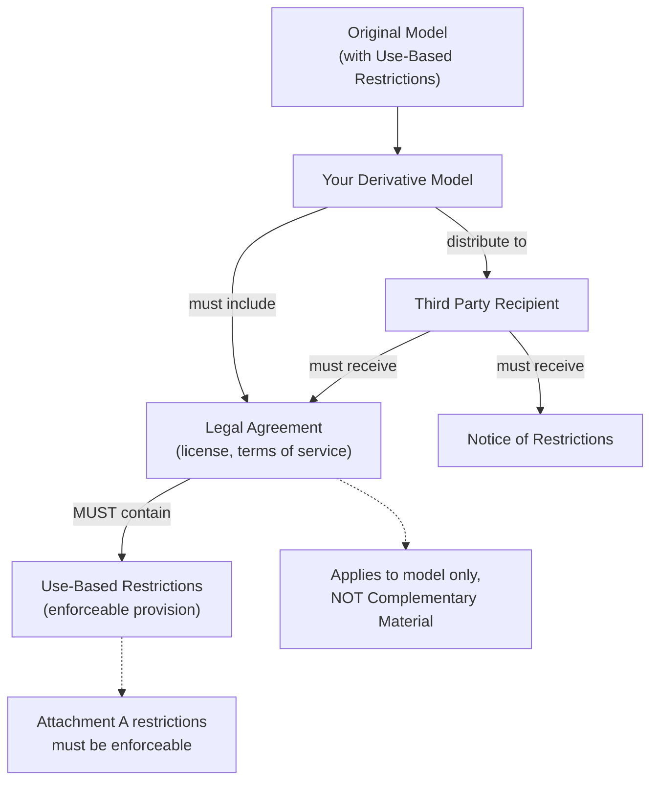
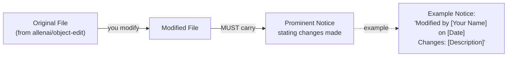
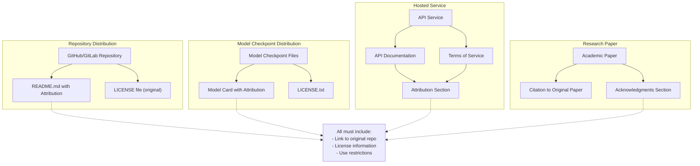
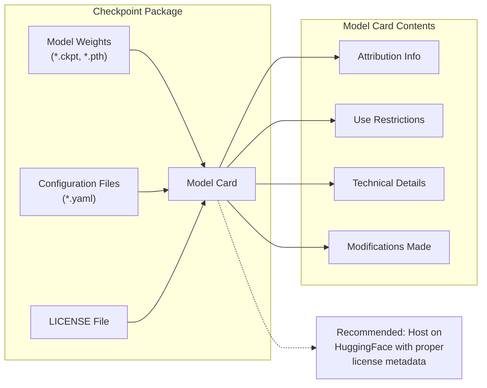
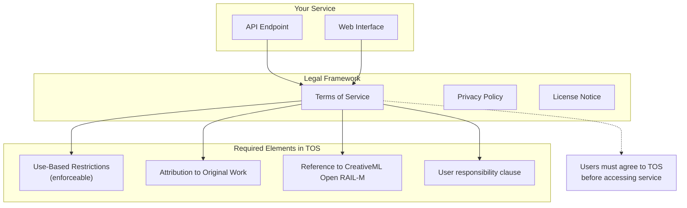
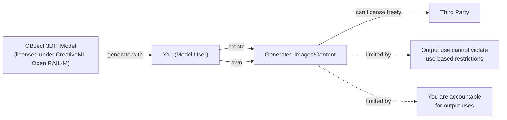

<!-- source: DeepWiki mcp.deepwiki.com · repo allenai/object-edit · page 9.2 Redistribution and Attribution · fetched 2026-10-26 -->

# Redistribution and Attribution

<details>
<summary>Relevant source files</summary>

The following files were used as context for generating this wiki page:

- [LICENSE](LICENSE)
- [README.md](README.md)

</details>


## Purpose and Scope

This page documents the requirements for redistributing the OBJect 3DIT model and its derivatives, including mandatory attribution, license propagation, and notices. These requirements derive from the CreativeML Open RAIL-M license that governs this project. For the broader license terms and use-based restrictions, see [License Terms and Restrictions](#9.1).

**Scope**: This page covers redistribution scenarios including hosting as a service, distributing modified versions, creating derivatives, and commercial distribution. It does not cover basic usage rights (covered in [9.1](#9.1)) or technical implementation details of the model itself (covered in [Model Architecture](#7)).

Sources: [LICENSE:1-80](), [README.md:1-86]()

---

## Redistribution Defined

The CreativeML Open RAIL-M license defines **Distribution** broadly as any transmission, reproduction, publication, or sharing of the Model or Derivatives to third parties. This includes:

| Distribution Type | Description | License Section |
|------------------|-------------|----------------|
| **Hosted Service** | Making the model available via API, web access, or other remote means | [LICENSE:25]() |
| **Binary Distribution** | Distributing compiled or checkpoint files | [LICENSE:25]() |
| **Source Code Distribution** | Sharing model weights, configuration files, training scripts | [LICENSE:25]() |
| **Derivative Works** | Modified models, fine-tuned versions, distilled models | [LICENSE:23]() |
| **Commercial Distribution** | Any of the above in a commercial context | [LICENSE:25]() |

**Important**: Simply using the model internally (without providing access to third parties) is not considered Distribution and has fewer requirements.

Sources: [LICENSE:25](), [LICENSE:23]()

---

## Core Redistribution Requirements

When you distribute the Model or Derivatives of the Model, you MUST comply with four mandatory requirements as specified in [LICENSE:41-46]():

### Requirement 1: Propagate Use-Based Restrictions



**Requirements**:
- Use-based restrictions from [LICENSE:64-79]() (Attachment A) MUST be included as an enforceable provision in any legal agreement governing use/distribution
- You must notify recipients that the model is subject to these restrictions
- This applies to the Model itself, not to Complementary Material (source code, scripts)

Sources: [LICENSE:41-42]()

### Requirement 2: Provide License Copy

Every third party recipient must receive a copy of the CreativeML Open RAIL-M license. This can be accomplished by:

- Including the [LICENSE]() file in your distribution package
- Providing a direct link to the license text
- Embedding the full license text in your legal agreements

Sources: [LICENSE:43]()

### Requirement 3: Notice Modified Files



**Implementation**: Add clear notices at the top of modified files indicating:
- That the file was changed
- Who changed it
- When it was changed
- Summary of changes (optional but recommended)

Example for a modified Python file:
```python
# MODIFIED FILE
# Original: https://github.com/allenai/object-edit/blob/main/ldm/models/diffusion/ddim.py
# Modified by: [Your Organization] on [Date]
# Changes: [Description of modifications]
```

Sources: [LICENSE:44]()

### Requirement 4: Retain Attribution Notices

You MUST retain all existing copyright, patent, trademark, and attribution notices, excluding only those that do not pertain to any part of the Model or Derivatives.

**What to retain**:
- Copyright headers in source files
- Attribution in README files
- Trademark acknowledgments
- Patent notices

**What to exclude**: Notices that genuinely do not apply to the portions you are distributing.

Sources: [LICENSE:45]()

---

## License Propagation for Derivatives

A critical aspect of the CreativeML Open RAIL-M license is that **derivative versions must always include the same use-based restrictions**, even if released under different licensing terms.

### Propagation Flow Diagram

```mermaid
graph TB
    subgraph "Original Model"
        Original["allenai/object-edit<br/>CreativeML Open RAIL-M<br/>Use Restrictions: A1-A10"]
    end
    
    subgraph "Your Derivative"
        Derivative["Your Fine-tuned Model<br/>Your License Terms<br/>(can be different)"]
        MandatoryRestrictions["MANDATORY:<br/>Use Restrictions A1-A10<br/>(must be included)"]
        OptionalTerms["OPTIONAL:<br/>Additional terms,<br/>different copyright,<br/>commercial terms"]
    end
    
    subgraph "Downstream Derivative"
        Downstream["Further Derivative<br/>Another License"]
        StillMandatory["STILL MANDATORY:<br/>Use Restrictions A1-A10"]
    end
    
    Original -->|"create derivative"| Derivative
    Original -->|"restrictions propagate"| MandatoryRestrictions
    Original -->|"you may add"| OptionalTerms
    
    Derivative -->|"someone creates derivative"| Downstream
    MandatoryRestrictions -->|"always propagate"| StillMandatory
    
    Note["Even after multiple generations<br/>of derivatives, use-based<br/>restrictions remain mandatory"]
    StillMandatory -.-> Note
```



Sources: [LICENSE:11](), [LICENSE:41-46]()

### Permitted Modifications to License Terms

| Aspect | Can Modify? | Requirements |
|--------|------------|--------------|
| **Use-Based Restrictions** | ❌ No | Must include at minimum all restrictions from [LICENSE:64-79]() |
| **Copyright Statement** | ✅ Yes | Can add your own copyright to your modifications [LICENSE:46]() |
| **License Terms for Complementary Material** | ✅ Yes | Can use different terms for your source code/scripts [LICENSE:46]() |
| **Additional Restrictions** | ✅ Yes | Can add more restrictive terms, but cannot remove existing ones [LICENSE:46]() |
| **Commercial Terms** | ✅ Yes | Can add fees, commercial terms, etc. [LICENSE:46]() |
| **Distribution of Outputs** | ✅ Yes | You control output licensing [LICENSE:48]() |

Sources: [LICENSE:46](), [LICENSE:48]()

---

## Attribution Requirements

### Required Attribution Information

When redistributing the model or derivatives, provide clear attribution including:

1. **Original Source**: Link to https://github.com/allenai/object-edit
2. **Original Authors**: Reference to AllenAI and paper authors
3. **Original License**: CreativeML Open RAIL-M
4. **Changes Made**: If you modified the model, clearly describe modifications

### Attribution in Different Contexts



Sources: [LICENSE:45](), [README.md:1-3]()

### Example Attribution Text

For inclusion in README or model card:

```markdown
## Attribution

This model is derived from [OBJect 3DIT: Language-guided 3D-aware Image Editing](https://github.com/allenai/object-edit) by AllenAI.

Original paper: [OBJect 3DIT: Language-guided 3D-aware Image Editing](https://arxiv.org/abs/2307.11073)

Licensed under CreativeML Open RAIL-M. See LICENSE file for full terms.

### Modifications
[Describe your modifications here]
```

Sources: [README.md:1-3]()

---

## Redistribution of Model Checkpoints

### Checkpoint Distribution Requirements

When distributing trained model checkpoints (referenced in [README.md:46]()):



**Minimum Required Files**:
- Model checkpoint files
- [LICENSE]() file (original CreativeML Open RAIL-M text)
- Model card or README documenting:
  - Attribution to original work
  - Description of any modifications
  - Use-based restrictions
  - Technical specifications

**Recommended Platform**: HuggingFace Hub (as used by the original project at [README.md:25-46]()), which supports license metadata and model cards.

Sources: [README.md:46](), [LICENSE:41-46]()

---

## Redistribution of Complementary Material

**Complementary Material** (defined in [LICENSE:24]()) includes source code, scripts, documentation, tutorials, and examples. These have different redistribution terms:

| Material Type | License Requirements | Notes |
|--------------|---------------------|-------|
| **Model Weights** | Must include CreativeML Open RAIL-M with use restrictions | [LICENSE:41-46]() |
| **Training Scripts** | Use restrictions do NOT apply | [LICENSE:42]() |
| **Data Loading Code** | Use restrictions do NOT apply | `ldm/data/` files |
| **Inference Scripts** | Use restrictions do NOT apply | [run_generation.py]() |
| **Configuration Files** | Use restrictions do NOT apply | `*.yaml` files |
| **Documentation** | Use restrictions do NOT apply | README, wiki |

**Important**: While use restrictions don't apply to Complementary Material, you still must:
- Retain copyright notices
- Retain attribution
- Provide the license text for the complete package

Sources: [LICENSE:42](), [LICENSE:24]()

---

## Hosted Service Distribution

When providing the model as a hosted service (API, web interface, etc.):

### Service Provider Requirements



**Implementation Checklist**:
1. ✅ Terms of Service include all use-based restrictions as enforceable provisions
2. ✅ Users must explicitly agree to ToS before API access
3. ✅ Attribution visible in documentation/about page
4. ✅ Link to full license text provided
5. ✅ User agreement acknowledges restrictions apply to generated outputs

Sources: [LICENSE:41-42](), [LICENSE:25]()

---

## Outputs and Generated Content

### Rights in Generated Outputs

The license specifies that the licensor (AllenAI) **claims no rights** in outputs you generate using the model [LICENSE:48]().

**Key Points**:
- You own the outputs you generate
- You control licensing of your outputs
- However: outputs cannot contravene license provisions (e.g., cannot use outputs for restricted purposes)
- You are accountable for outputs and their subsequent uses

### Output Redistribution



**Example Scenarios**:

| Scenario | Permitted? | Reasoning |
|----------|-----------|-----------|
| Sell generated images commercially | ✅ Yes | You own the outputs |
| License outputs under different terms | ✅ Yes | You control output licensing |
| Use outputs for prohibited purposes (Attachment A) | ❌ No | Output use must comply with restrictions |
| Claim outputs were not AI-generated | ❌ Discouraged | Transparency recommended |

Sources: [LICENSE:48](), [LICENSE:64-79]()

---

## Redistribution Compliance Checklist

### For Model/Checkpoint Distribution

- [ ] Include complete [LICENSE]() file with distribution
- [ ] Retain all copyright and attribution notices from original files
- [ ] Add prominent notices to any modified files describing changes
- [ ] Create model card or README with:
  - [ ] Attribution to https://github.com/allenai/object-edit
  - [ ] Reference to original paper (https://arxiv.org/abs/2307.11073)
  - [ ] Clear statement of CreativeML Open RAIL-M license
  - [ ] Description of any modifications made
  - [ ] Full text of use-based restrictions (Attachment A)
- [ ] If adding your own license terms, ensure use-based restrictions are preserved
- [ ] Notify recipients that restrictions apply to model use

Sources: [LICENSE:41-46](), [README.md:1-3]()

### For Hosted Services

- [ ] Terms of Service include all use-based restrictions as enforceable provisions
- [ ] Users must explicitly agree to ToS before accessing service
- [ ] Attribution to original work visible in documentation
- [ ] Link to full CreativeML Open RAIL-M license provided
- [ ] Privacy policy addresses data handling (if applicable)
- [ ] API documentation includes license information
- [ ] User agreement clarifies restrictions apply to generated outputs

Sources: [LICENSE:41-42]()

### For Derivative Models

- [ ] All use-based restrictions from original license included
- [ ] License text provided to all recipients
- [ ] Modified files carry prominent change notices
- [ ] Attribution to original OBJect 3DIT work maintained
- [ ] Your modifications clearly documented
- [ ] If using different license for your additions, core restrictions still enforced
- [ ] Downstream users notified of ongoing license requirements

Sources: [LICENSE:11](), [LICENSE:41-46]()

---

## Trademark and Endorsement

The license explicitly states that **nothing in the license permits use of licensor trademarks** or suggesting endorsement [LICENSE:53]().

**Prohibited**:
- Using "AllenAI" trademark without permission
- Claiming your derivative is endorsed by AllenAI
- Suggesting official relationship with original authors
- Using original project name in misleading ways

**Permitted**:
- Factual attribution (e.g., "Based on OBJect 3DIT by AllenAI")
- Academic citations
- Truthful descriptions of derivation

Sources: [LICENSE:53]()

---

## Practical Examples

### Example 1: Fine-tuning and Redistribution

**Scenario**: You fine-tune the model on custom data and want to release it on HuggingFace.

**Required Steps**:
1. Create model repository
2. Upload checkpoint files
3. Create `README.md` with:
   ```markdown
   # My Custom Edit Model
   
   Based on [OBJect 3DIT](https://github.com/allenai/object-edit) by AllenAI.
   
   ## License
   This model is licensed under CreativeML Open RAIL-M with use-based restrictions.
   See LICENSE file for complete terms.
   
   ## Modifications
   Fine-tuned on [describe dataset] for [describe purpose].
   Modified [list specific files/components changed].
   
   ## Use Restrictions
   [Include full text of Attachment A restrictions]
   ```
4. Include original [LICENSE]() file
5. Set HuggingFace license metadata to "CreativeML Open RAIL-M"
6. Tag modified source files with change notices

### Example 2: API Service

**Scenario**: You deploy the model as a commercial API service.

**Required Steps**:
1. Create Terms of Service incorporating:
   - All use-based restrictions as enforceable provisions
   - Attribution to original work
   - Reference to CreativeML Open RAIL-M
   - User responsibility clause
2. Implement ToS acceptance flow before API access
3. Create API documentation with attribution section
4. Include `/license` endpoint returning full license text
5. Implement logging/monitoring to detect restricted uses
6. Handle DMCA/legal requests per license terms

### Example 3: Research Paper

**Scenario**: You use the model in research and publish results.

**Required Steps**:
1. Cite original paper:
   ```bibtex
   @article{prabhudesai2023object,
     title={OBJect 3DIT: Language-guided 3D-aware Image Editing},
     author={[Authors]},
     journal={arXiv preprint arXiv:2307.11073},
     year={2023}
   }
   ```
2. Acknowledge in paper: "Built on OBJect 3DIT (github.com/allenai/object-edit)"
3. If distributing code: include LICENSE file and attribution
4. If releasing fine-tuned model: follow checkpoint redistribution requirements

Sources: [README.md:3](), [LICENSE:41-46]()

---

## Summary

The CreativeML Open RAIL-M license enables open redistribution and modification while ensuring responsible use through mandatory restriction propagation. Key principles:

1. **Four Core Requirements**: License copy, use restrictions, modification notices, attribution retention
2. **Restriction Propagation**: Use-based restrictions apply to all derivatives forever
3. **Flexible Licensing**: Can add your own terms for Complementary Material and commercial use
4. **Output Ownership**: You own and control outputs, but their use must comply with restrictions
5. **No Trademark Rights**: Cannot use licensor trademarks or suggest endorsement

**Non-Compliance Risks**: Failure to comply with redistribution requirements may result in license termination, legal liability, and inability to enforce your own rights in the derivative work.

For questions about specific redistribution scenarios, consult the full license text at [LICENSE:1-80]() or seek legal counsel.

Sources: [LICENSE:1-80](), [README.md:1-86]()