# Page: Overview

# Overview

<details>
<summary>Relevant source files</summary>

The following files were used as context for generating this wiki page:

- [README.md](README.md)
- [req.txt](req.txt)
- [setup_reqs.sh](setup_reqs.sh)

</details>


This document provides a high-level introduction to the OBJect 3DIT repository, a language-guided 3D-aware image editing system. This overview covers the system's purpose, core capabilities, major components, and typical workflows. For detailed environment setup instructions, see [Environment Setup](#2). For in-depth information about specific subsystems, refer to their respective sections: [Data System](#3), [Training System](#4), [Inference and Generation](#5), and [Evaluation System](#6).

## Purpose and Scope

OBJect 3DIT is a diffusion-based image editing system that enables language-guided manipulation of objects in images with 3D awareness. The system supports four primary editing operations:

| Task | Description | Input | Output |
|------|-------------|-------|--------|
| **Rotation** | Rotate objects by specified angles | Image + object prompt + rotation angle | Edited image with rotated object |
| **Translation** | Move objects to new positions | Image + object prompt + (x, y) coordinates | Edited image with translated object |
| **Removal** | Remove objects from scene | Image + object prompt | Edited image without object |
| **Insertion** | Insert objects into scene | Image + object prompt | Edited image with inserted object |

The system is built on **Latent Diffusion Models (LDM)** and can be initialized from Zero123 or Image-Conditioned Stable Diffusion checkpoints. Training is performed on the Objaverse dataset, a collection of 3D object renderings from multiple viewpoints.

**Sources:** [README.md:1-86](), [setup_reqs.sh:1-17]()

## System Architecture

OBJect 3DIT is organized into five major subsystems that work together to enable training, inference, and evaluation of 3D-aware image editing models.

### Component Overview

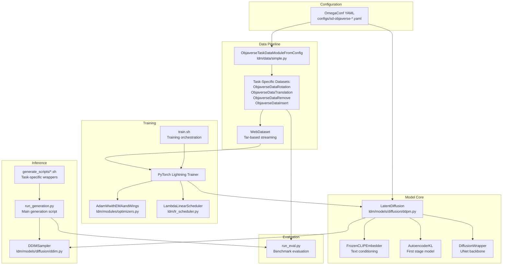

**Sources:** [README.md:1-86](), [setup_reqs.sh:1-17]()

### Key Code Entities

The following table maps high-level components to their concrete implementations in the codebase:

| Component | Primary Files | Key Classes/Functions |
|-----------|--------------|----------------------|
| **Data Loading** | `ldm/data/simple.py`, `ldm/data/base.py` | `ObjaverseTaskDataModuleFromConfig`, `Txt2ImgIterableBaseDataset` |
| **Diffusion Model** | `ldm/models/diffusion/ddpm.py` | `LatentDiffusion`, `DDPM` |
| **Sampling** | `ldm/models/diffusion/ddim.py`, `ldm/models/diffusion/plms.py` | `DDIMSampler`, `PLMSSampler` |
| **Conditioning** | `ldm/modules/encoders/modules.py` | `FrozenCLIPEmbedder`, `FrozenCLIPImageEmbedder` |
| **Training Orchestration** | `train.sh`, `configs/*.yaml` | PyTorch Lightning `Trainer` |
| **Generation** | `run_generation.py` | `main()`, `load_checkpoint()` |
| **Evaluation** | `run_eval.py` | Benchmark matching and metrics |

**Sources:** [README.md:1-86]()

## Core Workflows

### Training Workflow

The training workflow begins with configuration and proceeds through data loading, model initialization, and iterative training:

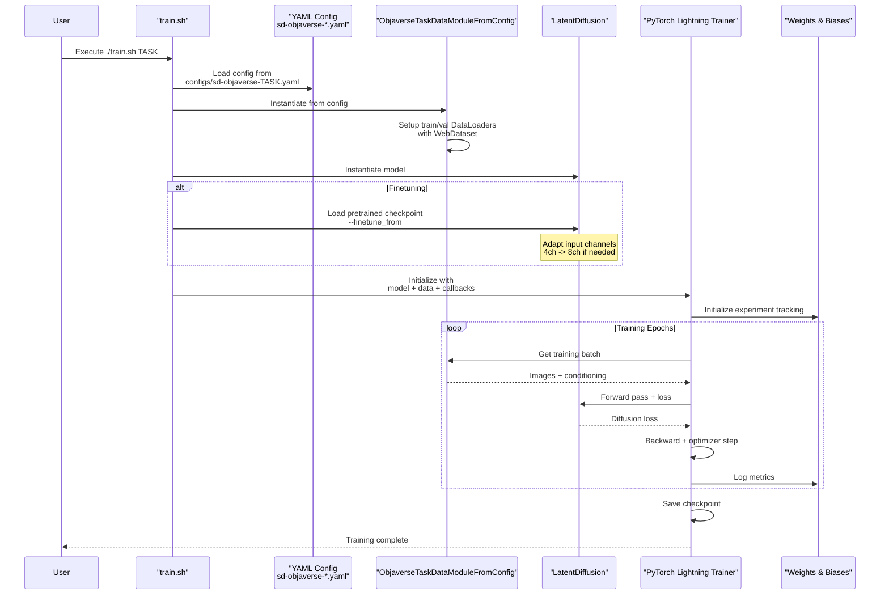

**Sources:** [README.md:47-52]()

### Inference Workflow

The inference workflow loads a trained checkpoint and generates edited images based on task-specific parameters:

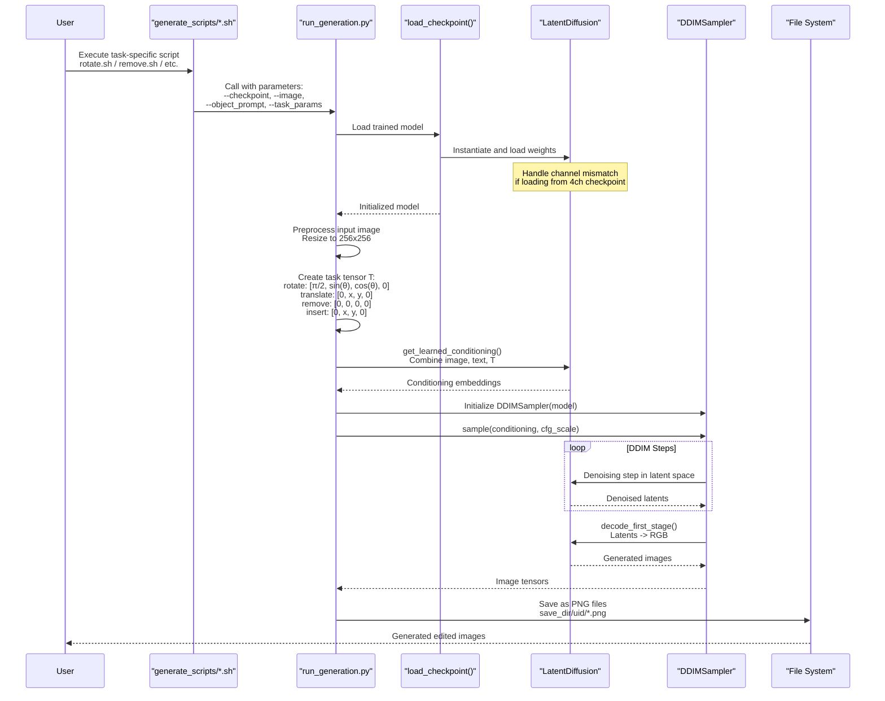

**Sources:** [README.md:54-62]()

## Technology Stack

OBJect 3DIT leverages a modern deep learning stack focused on generative computer vision:

### Core Framework Dependencies

| Category | Package | Version | Purpose |
|----------|---------|---------|---------|
| **Deep Learning** | PyTorch | 1.12.1 | Core tensor operations and neural networks |
| | torchvision | 0.13.1 | Image transformations and models |
| | pytorch_lightning | 1.5.0 | Training orchestration and distributed training |
| **Generative Models** | diffusers | 0.12.1 | Hugging Face diffusion models library |
| | taming-transformers-rom1504 | - | VQGAN and autoencoder components |
| **Multimodal** | CLIP | - | Text and image embeddings (OpenAI) |
| | transformers | 4.22.2 | Hugging Face transformer models |
| **Data Pipeline** | webdataset | 0.2.5 | Efficient tar-based dataset streaming |
| | datasets[vision] | 2.4.0 | Hugging Face datasets with vision support |
| | einops | 0.3.0 | Tensor shape manipulation |
| **Computer Vision** | opencv-python | 4.5.5.64 | Image processing utilities |
| | kornia | 0.6 | Differentiable computer vision |
| | carvekit-colab | 4.1.0 | Background removal and segmentation |
| **Training Infrastructure** | omegaconf | 2.1.1 | Hierarchical configuration management |
| | wandb | - | Experiment tracking and logging |
| | torchmetrics[image] | 0.6.0 | Image quality metrics (PSNR, SSIM, etc.) |

**Sources:** [req.txt:1-27](), [setup_reqs.sh:1-17]()

### System Dependencies

The system requires CUDA 11.3 for GPU acceleration and several system libraries installed via [setup_reqs.sh:16]():

```bash
ffmpeg libsm6 libxext6
```

These provide video codec support and X11 extensions needed by OpenCV.

**Sources:** [setup_reqs.sh:16](), [req.txt:1-2]()

## Dataset Structure

The Objaverse dataset used for training and evaluation follows a hierarchical structure organized by task and split:

```
DATASET/
├── rotate/
│   ├── train/
│   ├── val/
│   └── test/
├── translate/
│   ├── train/
│   ├── val/
│   └── test/
└── remove/
    ├── train/
    ├── val/
    └── test/
```

Each sample within a split is organized by a unique identifier (`uid`) containing:

```
uid/
├── 1.png              # Source view
├── 2.png              # Target view (edited)
├── 1_mask.png         # Object mask for source
├── 2_mask.png         # Object mask for target
└── metadata.json      # Viewpoint and object information
```

The insertion task reuses the removal dataset structure, as it operates on the inverse transformation.

**Sources:** [README.md:34-45]()

## Model Checkpoints

The system supports two initialization strategies:

1. **Finetuning from pretrained checkpoints** (recommended):
   - Zero123 checkpoint for 3D-aware generation
   - Image-Conditioned Stable Diffusion for general image editing
   
2. **Training from scratch**: Remove the `--finetune_from` argument in `train.sh`

Checkpoints are available on the Hugging Face page and should be placed in an accessible location for the training script to reference.

**Sources:** [README.md:46-52]()

## Entry Points

The system provides three main entry points for different operations:

| Script | Purpose | Usage |
|--------|---------|-------|
| `train.sh` | Model training and finetuning | `./train.sh [rotate\|remove\|insert\|translate\|multitask]` |
| `run_generation.py` | Image generation and editing | Called via `generate_scripts/*.sh` |
| `run_eval.py` | Benchmark evaluation | Direct invocation with CLI arguments |

Each entry point is documented in detail in its respective section: training in [Training System](#4), generation in [Inference and Generation](#5), and evaluation in [Evaluation System](#6).

**Sources:** [README.md:1-86]()

## Quick Reference: Task-Specific Parameters

Different editing tasks use different conditioning tensor formats in the `run_generation.py` script:

| Task | T Tensor Format | Additional Parameters |
|------|----------------|----------------------|
| **Rotation** | `[π/2, sin(θ), cos(θ), 0]` | `--rotation_angle` (degrees) |
| **Translation** | `[0, x, y, 0]` | `--translate_x`, `--translate_y` (normalized) |
| **Removal** | `[0, 0, 0, 0]` | None |
| **Insertion** | `[0, x, y, 0]` | `--translate_x`, `--translate_y` (normalized) |

All tasks require `--object_prompt` describing the target object (without the editing instruction).

**Sources:** [README.md:54-62]()

## Next Steps

- For immediate hands-on experience, see [Quick Start Guide](#1.1)
- To understand the system architecture in depth, see [System Architecture](#1.2)
- For environment setup, proceed to [Environment Setup](#2)
- For detailed component documentation, navigate to the relevant subsystem sections

---

# Page: Quick Start Guide

# Quick Start Guide

<details>
<summary>Relevant source files</summary>

The following files were used as context for generating this wiki page:

- [README.md](README.md)
- [req.txt](req.txt)
- [run_generation.py](run_generation.py)
- [setup_reqs.sh](setup_reqs.sh)

</details>


**Purpose and Scope**: This guide provides step-by-step instructions to set up the OBJect 3DIT environment, download necessary data and checkpoints, and run your first 3D-aware image editing operation. By the end of this guide, you will have a working installation and will have successfully generated edited images for one of the four supported tasks (rotate, remove, insert, translate).

For detailed information about the system architecture and how components interact, see [System Architecture](#1.2). For comprehensive environment configuration and troubleshooting, see [Environment Setup](#2). For in-depth documentation of the generation pipeline, see [Generation Pipeline](#5.1).

---

## Prerequisites

The following system requirements must be met before proceeding:

| Component | Requirement | Notes |
|-----------|-------------|-------|
| **Operating System** | Linux (Ubuntu recommended) | System commands assume Linux environment |
| **Python Version** | 3.9 | Required for compatibility with PyTorch 1.12.1 |
| **CUDA** | 11.3 | Specified in PyTorch installation |
| **GPU Memory** | ≥16GB recommended | Required for loading models and generating images |
| **Disk Space** | ≥50GB | For dataset, checkpoints, and dependencies |
| **System Libraries** | ffmpeg, libsm6, libxext6 | Installed via setup script |

**Sources**: [req.txt:1-2](), [setup_reqs.sh:16](), [README.md:15-20]()

---

## Setup Workflow Overview

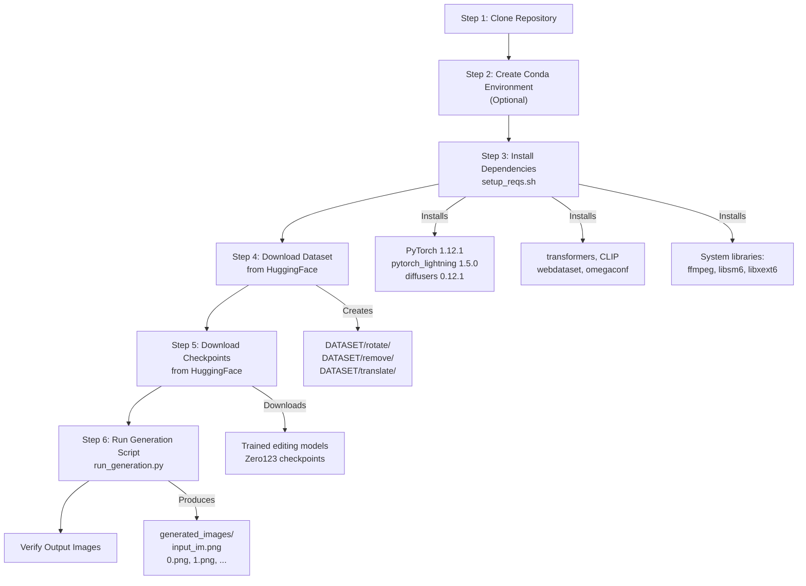

**Sources**: [README.md:5-62](), [setup_reqs.sh:1-17]()

---

## Step 1: Clone Repository and Create Directory Structure

Clone the repository from GitHub and create the required `DATASET` directory:

```bash
git clone https://github.com/allenai/object-edit.git
cd object-edit
mkdir DATASET
```

The repository structure after cloning:

```
object-edit/
├── configs/                    # Configuration files for models and tasks
├── ldm/                       # Latent diffusion model implementation
├── generate_scripts/          # Shell scripts for inference demos
├── run_generation.py          # Main generation script
├── run_eval.py               # Evaluation script
├── train.sh                  # Training script
├── setup_reqs.sh             # Dependency installation script
├── req.txt                   # Python requirements
└── DATASET/                  # Created directory for dataset storage
```

**Sources**: [README.md:9-13]()

---

## Step 2: Create Python Environment (Optional)

Create and activate a conda environment to isolate dependencies:

```bash
conda create --name object python=3.9
conda activate object
```

This step is optional but recommended to avoid conflicts with existing Python packages. Python 3.9 is required for compatibility with the specific versions of PyTorch and other dependencies.

**Sources**: [README.md:15-20]()

---

## Step 3: Install Dependencies

Execute the `setup_reqs.sh` script to install all required dependencies:

```bash
. setup_reqs.sh
```

### Dependency Installation Details

The `setup_reqs.sh` script performs the following installations in sequence:

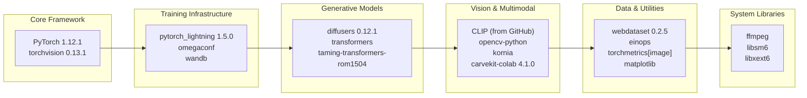

| Package | Version | Purpose |
|---------|---------|---------|
| `torch` | 1.12.1 | Core deep learning framework |
| `pytorch_lightning` | 1.5.0 | Training orchestration |
| `diffusers` | 0.12.1 | Diffusion model implementations |
| `transformers` | 4.22.2 | Language models and CLIP integration |
| `webdataset` | 0.2.5 | Efficient large-scale data loading |
| `omegaconf` | 2.1.1 | Configuration management |
| `CLIP` | from GitHub | Image-text embeddings |
| `carvekit-colab` | 4.1.0 | Image segmentation utilities |
| `kornia` | 0.6 | Differentiable computer vision operations |

**Sources**: [setup_reqs.sh:1-17](), [req.txt:1-27]()

---

## Step 4: Download and Extract Dataset

### Download from HuggingFace

Navigate to the [HuggingFace dataset page](https://huggingface.co/datasets/allenai/object-edit/tree/main) and download the compressed archives for the tasks you need:

- `rotate.tar.gz` - Object rotation task data
- `remove.tar.gz` - Object removal task data  
- `translate.tar.gz` - Object translation task data

The insertion task uses the same data as removal, so no additional download is needed for insert operations.

### Extract Archives

```bash
cd DATASET
tar -xzvf TASK.tar.gz
rm TASK.tar.gz
```

Replace `TASK` with `rotate`, `remove`, or `translate`.

### Dataset Structure

After extraction, the dataset follows this structure:

```
DATASET/
└── {task}/              # "rotate", "remove", or "translate"
    ├── train/
    │   └── {uid}/       # Unique identifier for each sample
    │       ├── 1.png              # First view of the scene
    │       ├── 2.png              # Second view (edited)
    │       ├── 1_mask.png         # Segmentation mask for view 1
    │       ├── 2_mask.png         # Segmentation mask for view 2
    │       └── metadata.json      # Task parameters (angles, positions, etc.)
    ├── val/             # Validation split (same structure)
    └── test/            # Test split (same structure)
```

Each `{uid}` directory contains paired images with corresponding masks and metadata specifying the editing operation parameters.

**Sources**: [README.md:25-45]()

---

## Step 5: Download Model Checkpoints

Download pretrained checkpoints from the [HuggingFace model page](https://huggingface.co/datasets/allenai/object-edit). Available checkpoints include:

- **Trained editing models**: Task-specific finetuned models for each editing operation
- **Zero123 initialization**: Base checkpoint from Zero123 project for initialization
- **Image-Conditioned Stable Diffusion**: Alternative initialization checkpoint

Place downloaded checkpoints in a dedicated directory (e.g., `checkpoints/`). You will need to specify the path to the checkpoint when running generation or training scripts.

**Sources**: [README.md:46]()

---

## Step 6: Run Your First Image Generation

### Using Predefined Generation Scripts

The repository includes ready-to-use shell scripts in the `generate_scripts/` directory:

```bash
# Rotate an object
. generate_scripts/rotate.sh

# Remove an object
. generate_scripts/remove.sh

# Insert an object
. generate_scripts/insert.sh

# Translate an object
. generate_scripts/translate.sh
```

These scripts invoke `run_generation.py` with predefined parameters for demonstration purposes.

### Manual Invocation with Custom Parameters

For custom image editing, invoke `run_generation.py` directly:

```bash
python run_generation.py \
    --task rotate \
    --checkpoint_path /path/to/checkpoint.ckpt \
    --image_path /path/to/input/image.png \
    --save_dir generated_images \
    --object_prompt "red car" \
    --rotation_angle 45.0 \
    --ddim_steps 50 \
    --num_samples 8 \
    --device 0 \
    --cfg_scale 3.0
```

### Key Parameters

| Parameter | Type | Description | Example |
|-----------|------|-------------|---------|
| `--task` | str | Editing operation | `rotate`, `remove`, `insert`, `translate` |
| `--checkpoint_path` | str | Path to model checkpoint | `checkpoints/rotate_model.ckpt` |
| `--image_path` | str | Input image path | `input_images/scene.png` |
| `--save_dir` | str | Output directory | `generated_images` |
| `--object_prompt` | str | Object description (no instruction) | `"red car"` |
| `--rotation_angle` | float | Rotation in degrees (for rotate task) | `45.0` |
| `--position` | str | x,y coordinates for insert/translate | `"0.5,0.3"` |
| `--ddim_steps` | int | Number of denoising steps | `50` |
| `--num_samples` | int | Number of samples to generate | `8` |
| `--cfg_scale` | float | Classifier-free guidance scale | `3.0` |
| `--device` | int | GPU device ID | `0` |

**Important**: The `--object_prompt` should contain only the object description, not the editing instruction. The script automatically constructs the full prompt (e.g., "rotate the red car", "remove the red car") based on the task.

**Sources**: [README.md:54-62](), [run_generation.py:174-235]()

---

## Generation Pipeline Code Flow

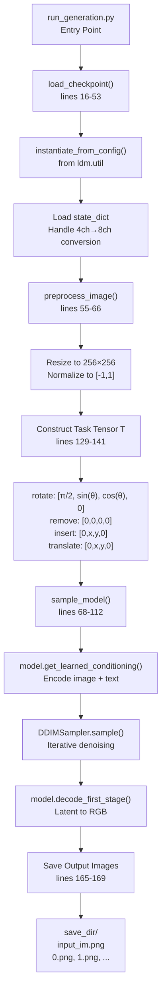

**Sources**: [run_generation.py:1-238]()

---

## Verification and Output

### Expected Output Structure

After successful generation, the `save_dir` will contain:

```
generated_images/
├── input_im.png    # Preprocessed input image (256×256)
├── 0.png          # Generated sample 0
├── 1.png          # Generated sample 1
├── 2.png          # Generated sample 2
├── ...
└── 7.png          # Generated sample N-1 (if num_samples=8)
```

### Visual Verification Checklist

- ✅ **Input preservation**: `input_im.png` should match your input image at 256×256 resolution
- ✅ **Sample diversity**: Generated samples should show variation due to stochastic sampling
- ✅ **Task correctness**: 
  - **Rotate**: Object should appear rotated by specified angle
  - **Remove**: Object should be removed with plausible inpainting
  - **Insert**: New object should appear at specified position
  - **Translate**: Object should move to new position
- ✅ **Image quality**: Generated images should be coherent and artifact-free

### Troubleshooting Quick Checks

| Issue | Likely Cause | Solution |
|-------|--------------|----------|
| CUDA out of memory | Insufficient GPU memory | Reduce `--num_samples` or use smaller batch size |
| Checkpoint loading fails | Incorrect path or corrupted file | Verify checkpoint path and re-download if needed |
| Poor generation quality | Low guidance scale | Increase `--cfg_scale` (try 3.0-7.0) |
| Incorrect task execution | Wrong T tensor format | Verify task name matches checkpoint training task |
| Import errors | Incomplete installation | Re-run `setup_reqs.sh` |

**Sources**: [run_generation.py:165-169]()

---

## Understanding Task-Specific Transformations

The `run_generation.py` script constructs different transformation tensors `T` for each task, which condition the diffusion model:

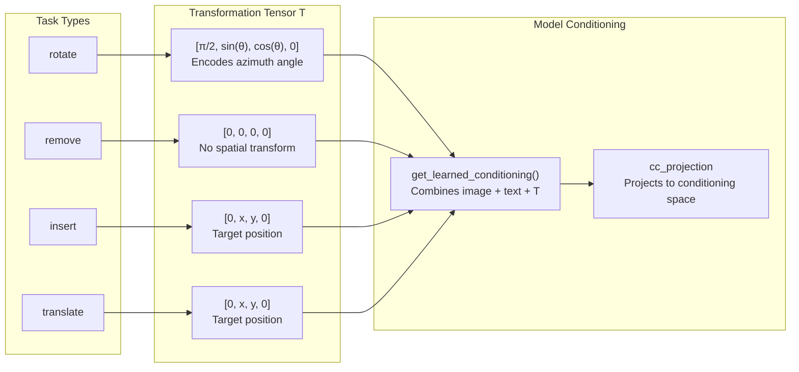

**Task Tensor Details**:

- **Rotation**: Uses spherical coordinates with `[π/2, sin(azimuth), cos(azimuth), 0]` where azimuth is converted from degrees to radians ([run_generation.py:131-132]())
- **Removal**: Uses zero tensor `[0, 0, 0, 0]` as no spatial transformation is needed ([run_generation.py:135]())
- **Insertion & Translation**: Use `[0, x, y, 0]` where x,y ∈ [0,1] specify normalized image coordinates ([run_generation.py:138-141]())

The fourth element (always 0) is reserved for potential future extensions.

**Sources**: [run_generation.py:129-142]()

---

## Next Steps

Now that you have a working installation and have successfully generated your first edited images, explore these topics:

- **[System Architecture](#1.2)**: Understand how components interact across the codebase
- **[Training Workflow and Scripts](#4.2)**: Learn how to finetune or train models from scratch
- **[Generation Parameters and Configuration](#5.3)**: Deep dive into all generation parameters and their effects
- **[Running Evaluations](#6.1)**: Evaluate your generated images against benchmark metrics
- **[Task-Specific Generation](#5.2)**: Detailed documentation of each editing task's unique behavior
- **[Creating Custom Datasets](#8.1)**: Extend the system with your own datasets

For advanced usage including custom conditioning mechanisms and model extensions, see [Advanced Topics](#8).

**Sources**: [README.md:47-86]()

---

# Page: System Architecture

# System Architecture

<details>
<summary>Relevant source files</summary>

The following files were used as context for generating this wiki page:

- [README.md](README.md)
- [ldm/data/simple.py](ldm/data/simple.py)
- [run_generation.py](run_generation.py)

</details>


## Purpose and Scope

This document explains the high-level architecture of the OBJect 3DIT system, detailing how the major components interact to enable language-guided 3D-aware image editing. It covers the relationships between data loading, training, inference, and evaluation subsystems, as well as the core data flows and interfaces that connect them.

For step-by-step setup instructions, see [Quick Start Guide](#1.1). For detailed information about individual subsystems, refer to: [Data System](#3), [Training System](#4), [Inference and Generation](#5), [Evaluation System](#6), and [Model Architecture](#7).

---

## System Overview

The OBJect 3DIT codebase is organized into five major subsystems that operate in sequence to enable language-guided 3D-aware image editing:

| Subsystem | Primary Component | Key Purpose |
|-----------|------------------|-------------|
| **Environment Setup** | [setup_reqs.sh:1-50]() | Install dependencies and configure system libraries |
| **Data Pipeline** | [ldm/data/simple.py:31-484]() | Load and preprocess Objaverse datasets for training/validation |
| **Training** | [train.sh:1-50]() | Train or finetune Latent Diffusion Models on task-specific data |
| **Inference** | [run_generation.py:1-238]() | Generate edited images using trained models |
| **Evaluation** | [run_eval.py:1-100]() | Benchmark generated images against ground truth |

These subsystems operate independently but share common data formats and model interfaces. The Data Pipeline feeds the Training subsystem, which produces checkpoints consumed by Inference, whose outputs are validated by Evaluation.

**Sources:** [README.md:1-86](), [run_generation.py:1-238](), [ldm/data/simple.py:1-534]()

---

## Core Data Flow

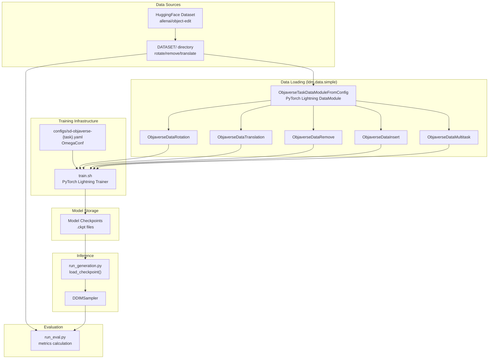

The system follows a linear data flow from raw datasets through training to inference. The `ObjaverseTaskDataModuleFromConfig` class serves as the primary interface between the data layer and training infrastructure, instantiating task-specific dataset classes based on configuration.

**Sources:** [ldm/data/simple.py:31-122](), [README.md:5-86](), [run_generation.py:114-170]()

---

## Data Pipeline Architecture

### Task-Specific Dataset Classes

The data pipeline is built around a polymorphic design where each editing task has a dedicated dataset class:

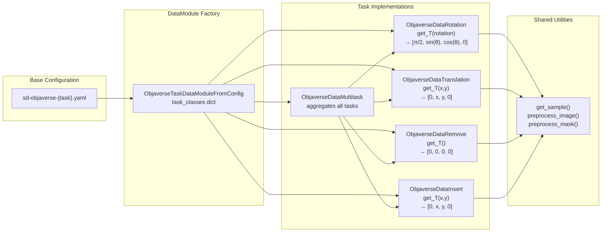

Each dataset class implements a `get_T()` method that produces task-specific transformation tensors with distinct formats:

| Task | Tensor Format | Source Line |
|------|---------------|-------------|
| **Rotation** | `[π/2, sin(θ), cos(θ), 0]` | [ldm/data/simple.py:167-170]() |
| **Translation** | `[0, x, y, 0]` | [ldm/data/simple.py:246-248]() |
| **Removal** | `[0, 0, 0, 0]` | [ldm/data/simple.py:323-325]() |
| **Insertion** | `[0, x, y, 0]` | [ldm/data/simple.py:395-397]() |

The `ObjaverseTaskDataModuleFromConfig` class [ldm/data/simple.py:31-99]() uses a `task_classes` dictionary [ldm/data/simple.py:41-48]() to instantiate the appropriate dataset based on the `task` parameter.

**Sources:** [ldm/data/simple.py:31-484]()

---

## Training Pipeline Components

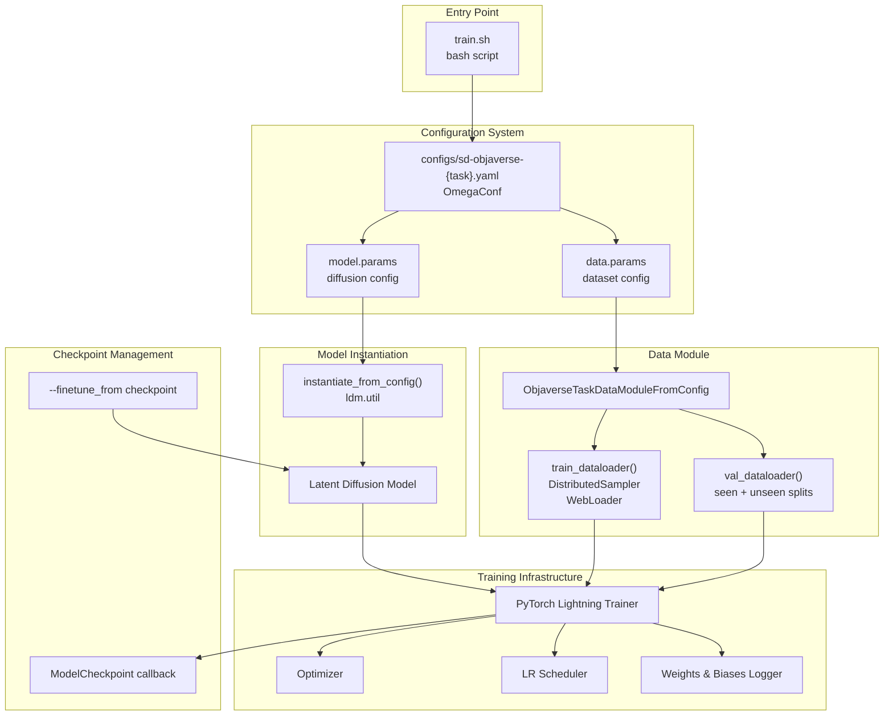

The training system is orchestrated through [train.sh:1-50](), which invokes PyTorch Lightning's training infrastructure with task-specific configuration files. The `--finetune_from` argument [README.md:49]() enables initialization from pretrained Zero123 or Stable Diffusion checkpoints.

Key configuration locations:
- Model architecture: `configs/sd-objaverse-{task}.yaml` → `model` section
- Dataset parameters: `configs/sd-objaverse-{task}.yaml` → `data` section
- Task specification: Passed as command-line argument to `train.sh`

**Sources:** [README.md:47-52](), [ldm/data/simple.py:31-99]()

---

## Inference Pipeline

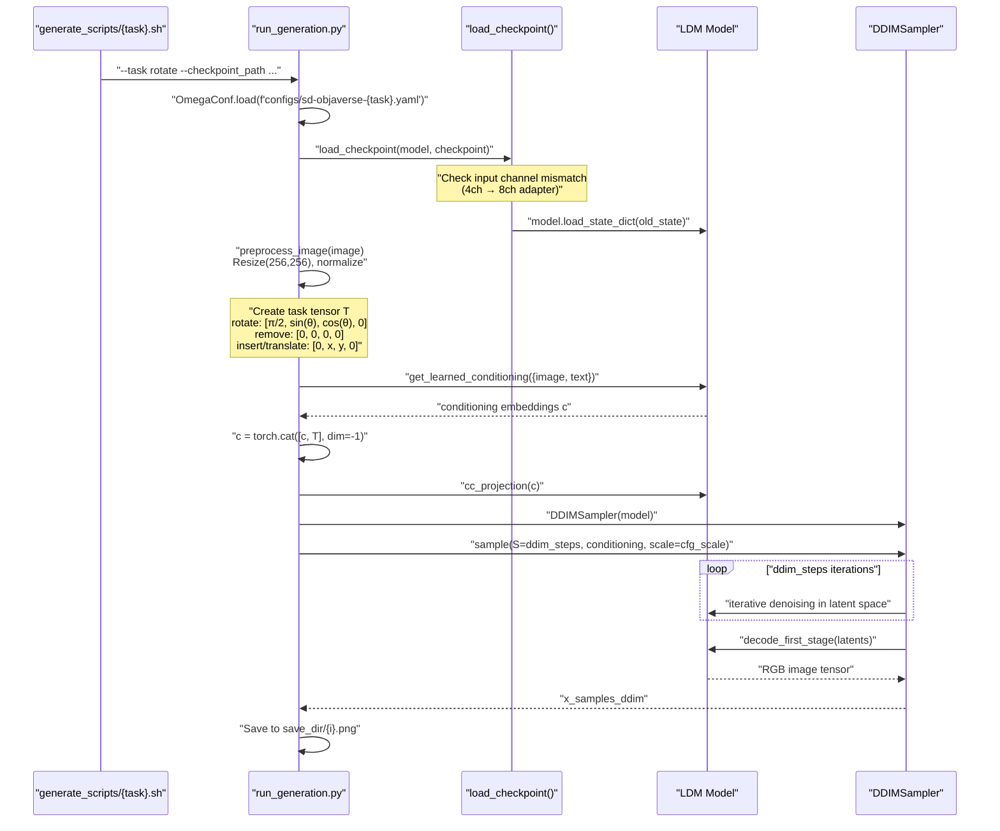

The inference pipeline is implemented in [run_generation.py:114-170]() with the following key steps:

1. **Model Loading** [run_generation.py:116-124](): Loads configuration and checkpoint with automatic channel adaptation for 4ch→8ch models [run_generation.py:25-44]()
2. **Image Preprocessing** [run_generation.py:55-66](): Resizes to 256×256 and normalizes to [-1, 1]
3. **Task Tensor Creation** [run_generation.py:129-141](): Constructs task-specific `T` tensor based on editing operation
4. **Conditioning** [run_generation.py:81-87](): Combines image, text, and task tensor via `get_learned_conditioning()` and `cc_projection()`
5. **Sampling** [run_generation.py:98-106](): DDIM sampling with classifier-free guidance
6. **Decoding** [run_generation.py:108-110](): Converts latents to RGB images
7. **Output** [run_generation.py:165-169](): Saves generated images as PNG files

The `load_checkpoint()` function [run_generation.py:16-53]() includes special handling for input channel mismatches, zero-initializing new channels and copying weights from the first 4 channels [run_generation.py:41-44]().

**Sources:** [run_generation.py:1-238]()

---

## Model Conditioning System

The conditioning system bridges task parameters to model inputs through a multi-stage process:

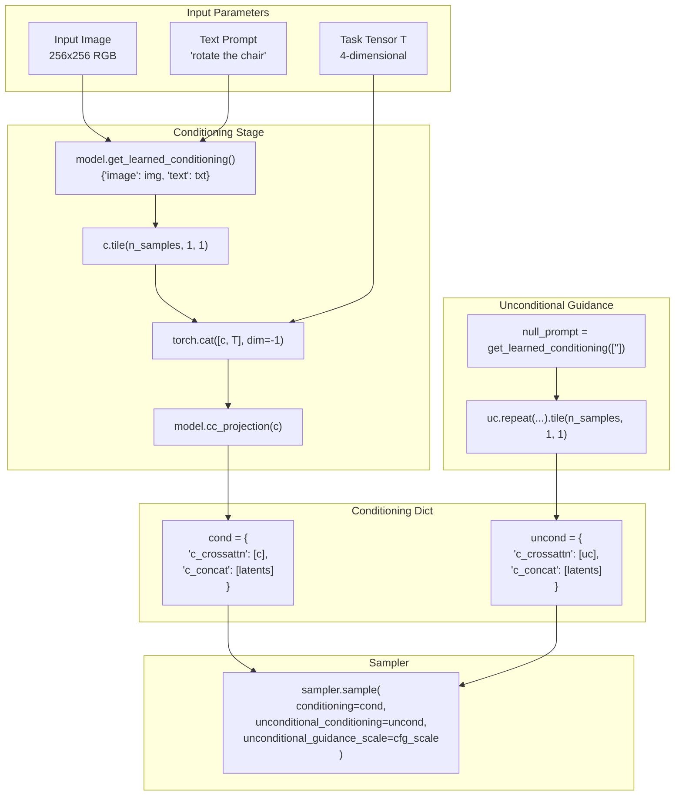

The conditioning process [run_generation.py:81-95]():
1. Combines image and text via `get_learned_conditioning()` to produce embeddings `c`
2. Tiles `c` to batch size `n_samples`
3. Concatenates the task tensor `T` to the conditioning embeddings
4. Projects through `cc_projection()` to final conditioning space
5. Creates separate `c_crossattn` (cross-attention) and `c_concat` (concatenation) conditioning
6. Generates unconditional embeddings for classifier-free guidance

The latent representation of the input image is encoded via `encode_first_stage()` [run_generation.py:90-91]() and concatenated to the model input during sampling.

**Sources:** [run_generation.py:68-112]()

---

## Evaluation System

The evaluation pipeline validates generated images against ground truth using a directory-based matching system:

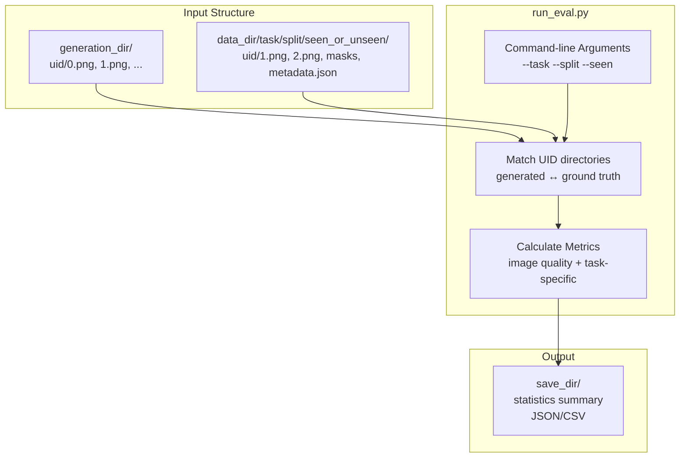

The evaluation script [run_eval.py:1-100]() requires:
- `--generation_dir`: Path to generated images organized by UID
- `--data_dir`: Path to original dataset (DATASET/ directory)
- `--task`: One of `rotate`, `remove`, `insert`, `translate`
- `--split`: One of `train`, `val`, `test`
- `--seen`: One of `seen`, `unseen`

**Critical constraint:** Generated images must preserve the UID-based directory structure [README.md:77-85]() for automated matching between generated outputs and ground truth data.

**Sources:** [README.md:64-86](), [run_eval.py:1-100]()

---

## Configuration System

OBJect 3DIT uses OmegaConf YAML files for declarative configuration:

| Configuration File | Purpose |
|-------------------|---------|
| `configs/sd-objaverse-rotate.yaml` | Rotation task model and data configuration |
| `configs/sd-objaverse-translate.yaml` | Translation task configuration |
| `configs/sd-objaverse-remove.yaml` | Removal task configuration |
| `configs/sd-objaverse-insert.yaml` | Insertion task configuration (uses remove data) |
| `configs/sd-objaverse-multitask.yaml` | Multi-task training configuration |

Configuration files are loaded via `OmegaConf.load()` [run_generation.py:117]() and can be dynamically updated [run_generation.py:118]() to override parameters like device placement. The `instantiate_from_config()` utility [run_generation.py:119]() constructs model objects from configuration dictionaries using Python's import system.

**Sources:** [run_generation.py:114-124](), [README.md:49-52]()

---

## Dataset Directory Structure

The system expects datasets in a specific hierarchical format:

```
DATASET/
├── rotate/
│   ├── train/
│   │   └── {uid}/
│   │       ├── 1.png           # condition image
│   │       ├── 2.png           # target image
│   │       ├── 1_mask.png      # condition mask
│   │       ├── 2_mask.png      # target mask
│   │       └── metadata.json   # task parameters
│   ├── val/
│   │   ├── seen/
│   │   │   └── {uid}/...
│   │   └── unseen/
│   │       └── {uid}/...
│   └── test/
│       ├── seen/...
│       └── unseen/...
├── translate/
│   └── (same structure)
├── remove/
│   └── (same structure)
└── (insert uses remove data)
```

Dataset classes navigate this structure using path construction [ldm/data/simple.py:143-148]():
- Training: `{task}/train/`
- Validation/Test: `{task}/{split}/{seen_or_unseen}/`

The `ObjaverseDataInsert` class [ldm/data/simple.py:353-427]() reuses the `remove` dataset by inverting the condition/target pair [ldm/data/simple.py:377](), treating image 2 (without object) as the condition and image 1 (with object) as the target [ldm/data/simple.py:405]().

**Sources:** [README.md:34-45](), [ldm/data/simple.py:123-427]()

---

## Inter-Component Communication

The primary interfaces between subsystems are:

### Training → Inference
- **Medium:** PyTorch checkpoint files (`.ckpt`)
- **Content:** Model state_dict with diffusion_model weights
- **Loading:** [run_generation.py:16-53]() with channel adaptation

### Configuration → All Systems
- **Medium:** OmegaConf YAML files
- **Pattern:** `instantiate_from_config()` constructs objects from config dictionaries
- **Usage:** Model instantiation, data module creation, training parameters

### Dataset → Model
- **Medium:** Dictionary with keys: `image_target`, `cond` (dict with `image`, `text`), `T`, `mask_cond`, `mask_target`, `uid`, `log_key`
- **Source:** `__getitem__()` methods in [ldm/data/simple.py:172-201](), [ldm/data/simple.py:250-278](), etc.

### Inference → Evaluation
- **Medium:** PNG image files in UID-organized directories
- **Constraint:** Directory structure must match dataset format [README.md:78-85]()

**Sources:** [run_generation.py:16-53](), [ldm/data/simple.py:172-278](), [README.md:64-86]()

---

# Page: Environment Setup

# Environment Setup

<details>
<summary>Relevant source files</summary>

The following files were used as context for generating this wiki page:

- [README.md](README.md)
- [req.txt](req.txt)
- [setup_reqs.sh](setup_reqs.sh)

</details>


## Purpose and Scope

This document covers the complete environment setup process for the OBJect 3DIT codebase, including system dependencies, Python packages, and installation procedures. This is the foundational step required before training models, running inference, or performing evaluation.

For information about training workflows after environment setup, see [Training System](#4). For details on specific dependencies and their architectural roles, see [Dependencies and Requirements](#2.1). For platform-specific installation guidance, see [Installation Instructions](#2.2).

---

## System Requirements

### Hardware Requirements

The OBJect 3DIT system is designed for GPU-accelerated deep learning workloads:

| Component | Requirement | Notes |
|-----------|-------------|-------|
| **GPU** | NVIDIA GPU with CUDA support | Required for training and inference |
| **CUDA** | Version 11.3 | Specified in [req.txt:1]() |
| **VRAM** | 16+ GB recommended | For training; inference may work with less |
| **CPU RAM** | 32+ GB recommended | For data loading and preprocessing |
| **Storage** | 100+ GB free space | For datasets, checkpoints, and outputs |

### Operating System

The system is designed primarily for Linux environments:

- **Recommended**: Ubuntu 18.04+ or similar Debian-based distributions
- System packages installed via `apt-get` include: `ffmpeg`, `libsm6`, `libxext6` [setup_reqs.sh:16]()

### Python Version

Python 3.9 is recommended based on the conda environment setup in [README.md:18-19]():

```bash
conda create --name object python=3.9
```

Sources: [README.md:1-86](), [req.txt:1-27](), [setup_reqs.sh:1-17]()

---

## Dependency Architecture

The OBJect 3DIT system has a layered dependency architecture, with each layer serving specific functional roles.

### Dependency Layer Diagram

```mermaid
graph TB
    subgraph "System Layer"
        CUDA["CUDA 11.3"]
        FFMPEG["ffmpeg + libsm6 + libxext6"]
    end
    
    subgraph "Core Framework"
        TORCH["torch==1.12.1"]
        TORCHVISION["torchvision==0.13.1"]
        LIGHTNING["pytorch_lightning==1.5.0"]
    end
    
    subgraph "Computer Vision"
        CV["opencv-python==4.5.5.64"]
        KORNIA["kornia==0.6"]
        CARVEKIT["carvekit-colab==4.1.0"]
        IMAGEIO["imageio==2.9.0"]
        IMAGEIOFFMPEG["imageio-ffmpeg==0.4.2"]
    end
    
    subgraph "Generative Models"
        DIFFUSERS["diffusers==0.12.1"]
        TAMING["taming-transformers-rom1504"]
        CLIP["openai/CLIP.git"]
    end
    
    subgraph "NLP and Multimodal"
        TRANSFORMERS["transformers==4.22.2"]
        FTFY["ftfy"]
        REGEX["regex"]
    end
    
    subgraph "Data Pipeline"
        WEBDATASET["webdataset==0.2.5"]
        DATASETS["datasets[vision]==2.4.0"]
        EINOPS["einops==0.3.0"]
    end
    
    subgraph "Training Infrastructure"
        OMEGA["omegaconf==2.1.1"]
        WANDB["wandb"]
        TORCHMETRICS["torchmetrics==0.6.0"]
        TORCHMETRICSIMAGE["torchmetrics[image]"]
    end
    
    subgraph "Development Tools"
        PUDB["pudb==2019.2"]
        IPDB["ipdb"]
        MPL["matplotlib"]
        PLOTLY["plotly==5.13.1"]
        STREAM["streamlit>=0.73.1"]
        TQDM["tqdm"]
    end
    
    CUDA --> TORCH
    FFMPEG --> CV
    FFMPEG --> IMAGEIO
    
    TORCH --> TORCHVISION
    TORCH --> LIGHTNING
    TORCH --> KORNIA
    TORCH --> DIFFUSERS
    TORCH --> EINOPS
    TORCH --> TORCHMETRICS
    
    LIGHTNING --> OMEGA
    LIGHTNING --> WANDB
    
    TORCHVISION --> DATASETS
    
    CV --> CARVEKIT
    
    TRANSFORMERS --> CLIP
    TRANSFORMERS --> STREAM
    
    TAMING -.imported by.-> DIFFUSERS
    CLIP -.imported by.-> DIFFUSERS
```

This diagram shows the dependency hierarchy from system-level requirements through core frameworks to application-specific libraries. Solid arrows indicate direct dependencies; dashed arrows indicate usage relationships.

Sources: [req.txt:1-27](), [setup_reqs.sh:1-17]()

---

## Core Dependencies

### Framework Layer

| Package | Version | Purpose | Installation |
|---------|---------|---------|--------------|
| `torch` | 1.12.1 | Core deep learning framework | [req.txt:2]() |
| `torchvision` | 0.13.1 | Image transformations and models | [req.txt:3]() |
| `pytorch_lightning` | 1.5.0 | Training orchestration and boilerplate reduction | [req.txt:8](), [setup_reqs.sh:3]() |

The PyTorch ecosystem is installed from the CUDA 11.3 index: [req.txt:1]()
```
--extra-index-url https://download.pytorch.org/whl/cu113
```

### Generative AI Components

| Package | Version | Purpose | Code Usage |
|---------|---------|---------|------------|
| `diffusers` | 0.12.1 | Hugging Face diffusion models library | Provides `DDIMScheduler`, `DDPMScheduler` |
| `transformers` | 4.22.2 | Hugging Face transformers for NLP | Text encoding and CLIP integration |
| `taming-transformers-rom1504` | Latest | VQ-GAN and VQVAE components | First-stage encoder/decoder |
| `openai/CLIP` | Git HEAD | Contrastive Language-Image Pre-training | Image-text conditioning |

The CLIP package is installed directly from OpenAI's GitHub repository: [setup_reqs.sh:10](), [req.txt:23]()

### Computer Vision Tools

| Package | Version | Purpose |
|---------|---------|---------|
| `opencv-python` | 4.5.5.64 | Image I/O and basic transformations |
| `kornia` | 0.6 | Differentiable computer vision operations |
| `carvekit-colab` | 4.1.0 | Background removal and segmentation |
| `imageio` | 2.9.0 | Image reading/writing |
| `imageio-ffmpeg` | 0.4.2 | Video I/O support |

### Data Pipeline

| Package | Version | Purpose |
|---------|---------|---------|
| `webdataset` | 0.2.5 | Efficient tar-based dataset streaming for large-scale data |
| `datasets[vision]` | 2.4.0 | Hugging Face datasets library with vision extras |
| `einops` | 0.3.0 | Tensor operations with readable notation |

### Training Infrastructure

| Package | Version | Purpose |
|---------|---------|---------|
| `omegaconf` | 2.1.1 | Hierarchical configuration management (YAML-based) |
| `wandb` | Latest | Weights & Biases experiment tracking |
| `torchmetrics` | 0.6.0 | Metric computation |
| `torchmetrics[image]` | - | Image-specific metrics (SSIM, LPIPS, etc.) |

The `torchmetrics[image]` extra is installed separately: [setup_reqs.sh:17]()

### Development and Visualization

| Package | Version | Purpose |
|---------|---------|---------|
| `streamlit` | ≥0.73.1 | Interactive web UI for demos |
| `plotly` | 5.13.1 | Interactive plotting |
| `matplotlib` | Latest | Static plotting |
| `pudb` | 2019.2 | Console debugger |
| `ipdb` | Latest | IPython debugger |
| `tqdm` | Latest | Progress bars |

### Text Processing

| Package | Purpose |
|---------|---------|
| `ftfy` | Fix text encoding issues |
| `regex` | Enhanced regular expressions |

Sources: [req.txt:1-27](), [setup_reqs.sh:1-17]()

---

## Installation Process

### Installation Flow Diagram

```mermaid
flowchart TD
    START["User starts installation"]
    
    CLONE["git clone allenai/object-edit"]
    MKDIR["mkdir DATASET"]
    
    CONDA_CHECK{"Using conda?"}
    CONDA_CREATE["conda create --name object python=3.9"]
    CONDA_ACTIVATE["conda activate object"]
    
    RUN_SETUP["Execute: . setup_reqs.sh"]
    
    INSTALL_REQ["pip install -r req.txt<br/>(Line 2 of setup_reqs.sh)"]
    
    INSTALL_INDIVIDUAL["Install individual packages:<br/>pytorch_lightning==1.5.0<br/>omegaconf<br/>opencv-python<br/>carvekit-colab==4.1.0<br/>einops<br/>taming-transformers-rom1504<br/>kornia<br/>transformers<br/>wandb<br/>webdataset==0.2.5<br/>ipdb<br/>matplotlib"]
    
    INSTALL_CLIP["pip install git+https://github.com/openai/CLIP.git"]
    
    INSTALL_METRICS["pip install torchmetrics[image]"]
    
    APT_UPDATE["sudo apt-get update"]
    APT_INSTALL["sudo apt-get install ffmpeg libsm6 libxext6 -y"]
    
    DOWNLOAD_DATA["Download dataset from HuggingFace"]
    UNZIP["tar -xzvf TASK.tar.gz"]
    
    VERIFY["Verify installation:<br/>import torch, pytorch_lightning, etc."]
    
    COMPLETE["Environment ready"]
    
    START --> CLONE
    CLONE --> MKDIR
    MKDIR --> CONDA_CHECK
    
    CONDA_CHECK -->|"Yes"| CONDA_CREATE
    CONDA_CREATE --> CONDA_ACTIVATE
    CONDA_ACTIVATE --> RUN_SETUP
    
    CONDA_CHECK -->|"No"| RUN_SETUP
    
    RUN_SETUP --> INSTALL_REQ
    INSTALL_REQ --> INSTALL_INDIVIDUAL
    INSTALL_INDIVIDUAL --> INSTALL_CLIP
    INSTALL_CLIP --> INSTALL_METRICS
    INSTALL_METRICS --> APT_UPDATE
    APT_UPDATE --> APT_INSTALL
    APT_INSTALL --> DOWNLOAD_DATA
    DOWNLOAD_DATA --> UNZIP
    UNZIP --> VERIFY
    VERIFY --> COMPLETE
```

This diagram maps the installation workflow to specific commands and script lines from the codebase.

Sources: [README.md:5-31](), [setup_reqs.sh:1-17]()

---

## Step-by-Step Installation

### 1. Clone Repository and Create Directory Structure

```bash
git clone https://github.com/allenai/object-edit.git
cd object-edit
mkdir DATASET
```

Referenced in [README.md:9-13]()

### 2. Create Conda Environment (Optional but Recommended)

```bash
conda create --name object python=3.9
conda activate object
```

Referenced in [README.md:17-20]()

### 3. Execute Installation Script

The primary installation is performed by the `setup_reqs.sh` script:

```bash
. setup_reqs.sh
```

Referenced in [README.md:23]()

#### Installation Script Breakdown

The `setup_reqs.sh` script executes the following sequence:

| Step | Command | File Reference | Purpose |
|------|---------|----------------|---------|
| 1 | `pip install -r req.txt` | [setup_reqs.sh:2]() | Install base requirements |
| 2 | `pip install pytorch_lightning==1.5.0` | [setup_reqs.sh:3]() | Training framework (reinstall for version guarantee) |
| 3 | `pip install omegaconf` | [setup_reqs.sh:4]() | Configuration management |
| 4 | `pip install opencv-python` | [setup_reqs.sh:5]() | Computer vision operations |
| 5 | `pip install carvekit-colab==4.1.0` | [setup_reqs.sh:6]() | Background removal |
| 6 | `pip install einops` | [setup_reqs.sh:7]() | Tensor operations |
| 7 | `pip install taming-transformers-rom1504` | [setup_reqs.sh:8]() | VQ-GAN components |
| 8 | `pip install kornia` | [setup_reqs.sh:9]() | Differentiable CV ops |
| 9 | `pip install git+https://github.com/openai/CLIP.git` | [setup_reqs.sh:10]() | CLIP from source |
| 10 | `pip install transformers` | [setup_reqs.sh:11]() | Hugging Face transformers |
| 11 | `pip install wandb` | [setup_reqs.sh:12]() | Experiment tracking |
| 12 | `pip install webdataset==0.2.5` | [setup_reqs.sh:13]() | Large-scale data loading |
| 13 | `pip install ipdb` | [setup_reqs.sh:14]() | Debugging |
| 14 | `pip install matplotlib` | [setup_reqs.sh:15]() | Plotting |
| 15 | `sudo apt-get update && sudo apt-get install ffmpeg libsm6 libxext6 -y` | [setup_reqs.sh:16]() | System libraries |
| 16 | `pip install torchmetrics[image]` | [setup_reqs.sh:17]() | Image metrics |

**Note**: Some packages like `pytorch_lightning`, `omegaconf`, and `opencv-python` are installed both in `req.txt` and individually in `setup_reqs.sh`. The individual installations serve as version confirmations or overrides.

### 4. System Package Installation

The script requires `sudo` access to install system-level dependencies [setup_reqs.sh:16]():

- **ffmpeg**: Video/audio processing, required by `imageio-ffmpeg`
- **libsm6**: X11 Session Management library
- **libxext6**: X11 extensions library

These system packages are prerequisites for OpenCV's GUI functionality and video processing.

### 5. Dataset Download

Download the Objaverse dataset from the [HuggingFace repository](https://huggingface.co/datasets/allenai/object-edit/tree/main) and extract:

```bash
cd DATASET
tar -xzvf TASK.tar.gz
rm TASK.tar.gz
```

Where `TASK` is one of: `rotate`, `remove`, `translate`. The `insert` task reuses the `remove` dataset. Referenced in [README.md:25-32]()

Sources: [setup_reqs.sh:1-17](), [README.md:5-33]()

---

## Installation Script to Code Entity Mapping

This diagram maps the installation components to their usage in the codebase:

```mermaid
graph TB
    subgraph "setup_reqs.sh Components"
        SETUP_REQ["pip install -r req.txt<br/>(setup_reqs.sh:2)"]
        SETUP_PL["pytorch_lightning==1.5.0<br/>(setup_reqs.sh:3)"]
        SETUP_OMEGA["omegaconf<br/>(setup_reqs.sh:4)"]
        SETUP_CV["opencv-python<br/>(setup_reqs.sh:5)"]
        SETUP_CARVE["carvekit-colab<br/>(setup_reqs.sh:6)"]
        SETUP_EINOPS["einops<br/>(setup_reqs.sh:7)"]
        SETUP_TAMING["taming-transformers-rom1504<br/>(setup_reqs.sh:8)"]
        SETUP_KORNIA["kornia<br/>(setup_reqs.sh:9)"]
        SETUP_CLIP["git+github.com/openai/CLIP.git<br/>(setup_reqs.sh:10)"]
        SETUP_TRANS["transformers<br/>(setup_reqs.sh:11)"]
        SETUP_WANDB["wandb<br/>(setup_reqs.sh:12)"]
        SETUP_WEB["webdataset==0.2.5<br/>(setup_reqs.sh:13)"]
        SETUP_METRICS["torchmetrics[image]<br/>(setup_reqs.sh:17)"]
    end
    
    subgraph "Code Usage Points"
        TRAINER["pytorch_lightning.Trainer"]
        LDMMODULE["ldm.models.diffusion"]
        
        OMEGACONF_USE["OmegaConf.load()<br/>configs/*.yaml"]
        
        CV_USE["cv2.imread()<br/>cv2.resize()"]
        
        EINOPS_USE["rearrange()<br/>repeat()"]
        
        TAMING_USE["taming.models.vqgan<br/>First stage models"]
        
        CLIP_USE["clip.load()<br/>clip.tokenize()"]
        
        WEBDATA_USE["webdataset.WebDataset<br/>ldm/data/laion.py"]
        
        DATAMODULE["ldm.data.simple<br/>ObjaverseData*"]
    end
    
    SETUP_PL --> TRAINER
    SETUP_PL --> LDMMODULE
    
    SETUP_OMEGA --> OMEGACONF_USE
    
    SETUP_CV --> CV_USE
    
    SETUP_EINOPS --> EINOPS_USE
    
    SETUP_TAMING --> TAMING_USE
    
    SETUP_CLIP --> CLIP_USE
    
    SETUP_WEB --> WEBDATA_USE
    
    SETUP_REQ --> DATAMODULE
```

This mapping shows how installation components correspond to specific code entities used throughout the codebase.

Sources: [setup_reqs.sh:1-17]()

---

## Verification

After installation, verify the environment by checking key imports:

```python
import torch
print(f"PyTorch version: {torch.__version__}")
print(f"CUDA available: {torch.cuda.is_available()}")
print(f"CUDA version: {torch.version.cuda}")

import pytorch_lightning as pl
print(f"PyTorch Lightning version: {pl.__version__}")

import diffusers
import transformers
import clip
import omegaconf
import webdataset
import torchmetrics

print("All key dependencies imported successfully")
```

Expected outputs:
- PyTorch version: 1.12.1
- CUDA available: True
- CUDA version: 11.3
- PyTorch Lightning version: 1.5.0

---

## Directory Structure After Setup

After completing installation and dataset download, the repository structure should be:

```
object-edit/
├── configs/                    # Configuration YAML files
├── DATASET/                    # Downloaded datasets
│   ├── rotate/
│   │   ├── train/
│   │   ├── val/
│   │   └── test/
│   ├── remove/
│   └── translate/
├── ldm/                        # Main package
│   ├── data/                   # Dataset loaders
│   ├── models/                 # Model definitions
│   └── modules/                # Model components
├── req.txt                     # Base requirements
├── setup_reqs.sh               # Installation script
├── train.sh                    # Training script
├── run_generation.py           # Inference script
├── run_eval.py                 # Evaluation script
└── generate_scripts/           # Task-specific generation scripts
```

The `DATASET` directory is created by [README.md:12]() and populated by downloading and extracting task-specific archives.

Sources: [README.md:9-45]()

---

## Common Installation Issues

### CUDA Version Mismatch

**Issue**: PyTorch installed without CUDA support or with wrong CUDA version.

**Solution**: Ensure the `--extra-index-url` in [req.txt:1]() is used, which provides CUDA 11.3 wheels.

### System Package Installation Fails

**Issue**: The `sudo apt-get install` command at [setup_reqs.sh:16]() fails due to permissions.

**Solution**: Either run the script with appropriate sudo privileges or manually install the system packages before running the script.

### CLIP Installation from Git

**Issue**: Git-based CLIP installation at [setup_reqs.sh:10]() fails.

**Solution**: Ensure git is installed and you have network access to GitHub. The package is also specified in [req.txt:23]() as a fallback.

### Import Errors After Installation

**Issue**: Packages like `taming` or `ldm` cannot be imported.

**Solution**: 
- For `taming`: Ensure `taming-transformers-rom1504` was installed successfully [setup_reqs.sh:8]()
- For `ldm`: This is a local package in the repository; ensure you're running Python from the repository root

Sources: [setup_reqs.sh:1-17](), [req.txt:1-27]()

---

## Next Steps

After environment setup is complete:

1. **Download Model Checkpoints**: See [Training System](#4) for information on downloading pretrained Zero123 or Stable Diffusion checkpoints
2. **Configure Training**: See [Training Configuration](#4.1) to understand the YAML-based configuration system
3. **Run Inference**: See [Quick Start Guide](#1.1) for running your first generation
4. **Download Datasets**: See the [Dataset Setup](#3.2) for detailed information on Objaverse dataset structure

Sources: [README.md:46-86]()

---

# Page: Dependencies and Requirements

# Dependencies and Requirements

<details>
<summary>Relevant source files</summary>

The following files were used as context for generating this wiki page:

- [req.txt](req.txt)
- [setup_reqs.sh](setup_reqs.sh)

</details>


## Purpose and Scope

This document provides a comprehensive reference of all dependencies required to run the OBJect 3DIT system, including Python packages, system libraries, and hardware requirements. It explains the purpose of each major dependency and how they support different components of the system.

For instructions on how to install these dependencies, see [Installation Instructions](#2.2). For details on how the training system uses these dependencies, see [Training System](#4).

---

## System-Level Requirements

The OBJect 3DIT system requires specific system-level dependencies to be installed before Python packages:

### Hardware Requirements

- **CUDA 11.3**: Required for GPU acceleration with PyTorch
- **GPU Memory**: Recommended minimum 12GB for inference, 24GB+ for training

### System Libraries

The following system packages are installed via `apt-get` [setup_reqs.sh:16]():

| Package | Purpose |
|---------|---------|
| `ffmpeg` | Video processing and frame extraction for dataset preprocessing |
| `libsm6` | X11 Session Management library, required by OpenCV |
| `libxext6` | X11 extension library, required by OpenCV |

These are critical for the computer vision pipeline, particularly for `opencv-python` functionality.

**Sources:** [setup_reqs.sh:16]()

---

## Core Framework Dependencies

### PyTorch Ecosystem

The foundation of the system is built on PyTorch and its ecosystem:

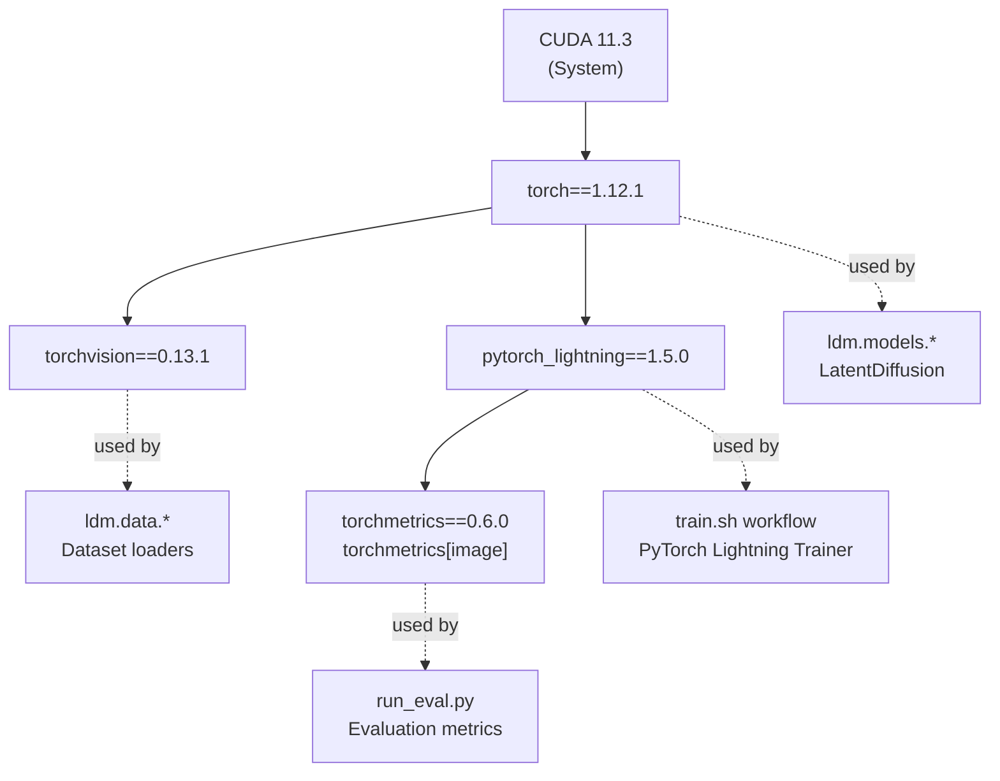

**PyTorch Core Dependencies**

| Package | Version | Purpose |
|---------|---------|---------|
| `torch` | 1.12.1 | Core tensor operations, neural network modules, GPU acceleration |
| `torchvision` | 0.13.1 | Image transformations, pretrained models, dataset utilities |
| `pytorch_lightning` | 1.5.0 | Training orchestration, distributed training, checkpointing |
| `torchmetrics` | 0.6.0 | Evaluation metrics including image-specific metrics |

The `pytorch_lightning` package is critical for the training workflow orchestrated in `train.sh` and powers the `LightningModule` implementation in `ldm.models.diffusion.ddpm.LatentDiffusion`.

**Sources:** [req.txt:1-3,8,15](), [req.txt:27](), [setup_reqs.sh:3,17]()

---

## Computer Vision Libraries

Multiple specialized computer vision libraries support image processing and manipulation:

### OpenCV and Image Processing

| Package | Version | Purpose in System |
|---------|---------|-------------------|
| `opencv-python` | 4.5.5.64 | Image I/O, resizing, color conversion in data preprocessing |
| `kornia` | 0.6 | Differentiable computer vision operations, augmentations |
| `albumentations` | (latest) | Advanced image augmentation pipeline |
| `carvekit-colab` | 4.1.0 | Background removal and object segmentation |

The `opencv-python` package is used extensively in:
- Dataset preprocessing in `ldm.data.simple` (Objaverse loaders)
- Image loading in `run_generation.py` for inference
- Visualization utilities throughout the codebase

The `kornia` library provides differentiable transformations that can be used during training, while `carvekit-colab` handles object extraction for dataset preparation.

**Sources:** [req.txt:4](), [req.txt:13](), [setup_reqs.sh:5-6,9]()

---

## Generative AI Components

The core generative capabilities depend on multiple specialized libraries:

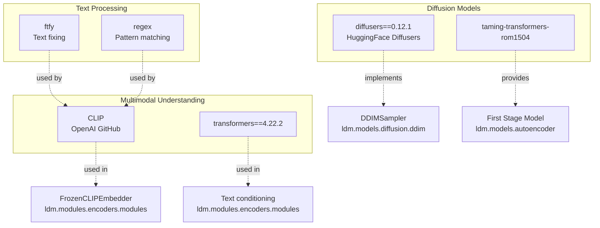

### Diffusion and Generative Models

| Package | Version | Core Usage |
|---------|---------|------------|
| `diffusers` | 0.12.1 | Stable Diffusion components, DDIM/PLMS samplers |
| `taming-transformers-rom1504` | (latest) | VQ-GAN and autoencoder implementations |

The `diffusers` library from HuggingFace provides the foundational diffusion model components. The DDIM sampler implementation in `ldm.models.diffusion.ddim.DDIMSampler` uses these components for the iterative denoising process.

The `taming-transformers-rom1504` package provides the first-stage VAE encoder/decoder used in `ldm.models.autoencoder` for working in latent space rather than pixel space, dramatically improving efficiency.

### Multimodal and Text Processing

| Package | Version | Core Usage |
|---------|---------|------------|
| `CLIP` | OpenAI GitHub | Vision-language embeddings for conditioning |
| `transformers` | 4.22.2 | Tokenizers, transformer models, model loading |
| `ftfy` | (latest) | Text normalization for CLIP |
| `regex` | (latest) | Pattern matching for text processing |

The `CLIP` model from OpenAI is used in `ldm.modules.encoders.modules.FrozenCLIPEmbedder` to encode both text prompts and image features for conditioning the diffusion process. The `transformers` library from HuggingFace provides the underlying transformer architecture.

**Sources:** [req.txt:12,16,20-24](), [setup_reqs.sh:8,10-11]()

---

## Data Pipeline Dependencies

The data system relies on specialized tools for loading and processing large-scale datasets:

### WebDataset and Dataset Loaders

| Package | Version | Purpose |
|---------|---------|---------|
| `webdataset` | 0.2.5 | Efficient tar-based streaming for LAION-5B and large datasets |
| `datasets[vision]` | 2.4.0 | HuggingFace datasets library with vision extras |
| `einops` | 0.3.0 | Tensor reshaping and dimension manipulation |
| `imageio` | 2.9.0 | Image reading/writing |
| `imageio-ffmpeg` | 0.4.2 | Video frame extraction |

The `webdataset` package is critical for the LAION-5B data loader in `ldm.data.laion.WebDataModuleFromConfig`. It enables efficient streaming of data from tar archives without loading everything into memory.

The `datasets` library with vision extras provides access to the Objaverse dataset used in `ldm.data.simple` for task-specific loaders like `ObjaverseDataRotation`, `ObjaverseDataRemoval`, etc.

The `einops` library provides clean tensor manipulation throughout the codebase, particularly for rearranging dimensions in attention mechanisms and diffusion model components.

**Sources:** [req.txt:6-7,11,14,17](), [setup_reqs.sh:7,13]()

---

## Training Infrastructure

Several packages support the training workflow, experiment tracking, and optimization:

### Configuration and Experiment Tracking

| Package | Version | Purpose |
|---------|---------|---------|
| `omegaconf` | 2.1.1 | YAML configuration management |
| `wandb` | (latest) | Weights & Biases experiment tracking |

The `omegaconf` package is used to load and manage configuration files like `configs/stable-diffusion/sd-objaverse-task.yaml`. It provides the `OmegaConf` class used throughout the training pipeline for hierarchical configuration.

The `wandb` package integrates with PyTorch Lightning for experiment tracking, logging metrics, and visualizing training progress.

### Optimization and Scheduling

The learning rate schedulers are implemented using PyTorch's built-in optimizers, but the training configuration system in `ldm.lr_scheduler.LambdaLinearScheduler` and `ldm.lr_scheduler.LambdaWarmUpCosineScheduler` provides advanced scheduling capabilities.

**Sources:** [req.txt:9,26](), [setup_reqs.sh:4,12]()

---

## Utility and Development Libraries

Additional utilities support development, debugging, and visualization:

### Development Tools

| Package | Version | Purpose |
|---------|---------|---------|
| `pudb` | 2019.2 | Terminal-based debugger |
| `ipdb` | (latest) | IPython-enhanced debugger |
| `tqdm` | (latest) | Progress bars for loops |

### Visualization

| Package | Version | Purpose |
|---------|---------|---------|
| `matplotlib` | (latest) | Plotting and visualization |
| `plotly` | 5.13.1 | Interactive plots |
| `streamlit` | ≥0.73.1 | Web-based UI for demos |

The `streamlit` library can be used for creating interactive demonstrations and visualizations of the model's capabilities, though it's not required for core training or inference.

**Sources:** [req.txt:5,10,18-22,25](), [setup_reqs.sh:14-15]()

---

## Dependency Installation Order

The installation process follows a specific order to handle dependencies correctly:

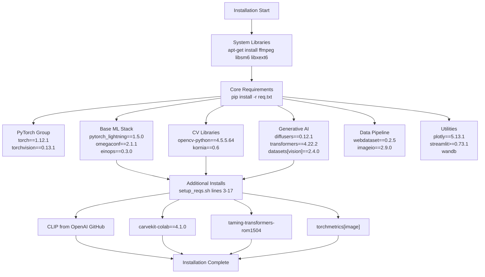

**Installation Notes:**

1. **System libraries must be installed first** [setup_reqs.sh:16]() before any Python packages
2. **req.txt is installed first** [setup_reqs.sh:2]() to establish core dependencies
3. **Additional packages are installed individually** [setup_reqs.sh:3-17]() to handle version conflicts and special sources
4. **CLIP is installed from GitHub** [setup_reqs.sh:10]() rather than PyPI to get the latest version
5. **The `--extra-index-url` flag** [req.txt:1]() ensures CUDA 11.3 compatible PyTorch builds are used

**Sources:** [setup_reqs.sh:1-17](), [req.txt:1-27]()

---

## Dependency-to-System Component Mapping

The following diagram shows how major dependencies map to specific system components and code modules:

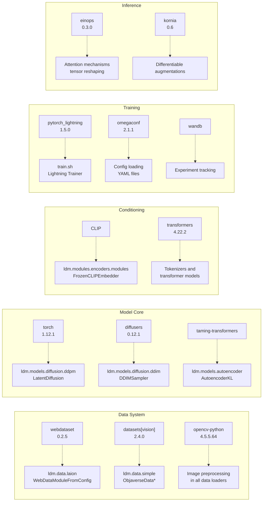

**Sources:** [setup_reqs.sh:1-17](), [req.txt:1-27]()

---

## Version Pinning and Compatibility

All dependencies use pinned versions to ensure reproducibility:

### Critical Version Constraints

| Package | Pinned Version | Reason |
|---------|----------------|--------|
| `torch` | ==1.12.1 | CUDA 11.3 compatibility, API stability |
| `torchvision` | ==0.13.1 | Must match torch version |
| `pytorch_lightning` | ==1.5.0 | Breaking changes in 2.x API |
| `diffusers` | ==0.12.1 | Stable API for DDIM sampler |
| `webdataset` | ==0.2.5 | Tar streaming behavior |
| `transformers` | ==4.22.2 | CLIP model compatibility |

### Flexible Version Constraints

Some packages use minimum version requirements:
- `streamlit>=0.73.1` [req.txt:10]() - Only UI component, minimum version for required features

### Source-Based Installations

Two packages are installed directly from Git repositories:
- `CLIP` from `git+https://github.com/openai/CLIP.git` [req.txt:23](), [setup_reqs.sh:10]()
- `taming-transformers-rom1504` as PyPI package (fork of original) [req.txt:24](), [setup_reqs.sh:8]()

**Sources:** [req.txt:1-27](), [setup_reqs.sh:1-17]()

---

## Hardware and Runtime Considerations

### GPU Requirements

- **Minimum**: NVIDIA GPU with 12GB VRAM for inference
- **Recommended**: 24GB+ VRAM for training (e.g., RTX 3090, RTX 4090, A100)
- **CUDA Version**: 11.3 as specified in PyTorch index URL [req.txt:1]()

### Memory Requirements

- **System RAM**: 32GB+ recommended for data loading
- **Disk Space**: 
  - ~10GB for dependencies
  - ~50GB+ for Objaverse dataset
  - ~100GB+ for LAION-5B data shards

### Multi-GPU Support

PyTorch Lightning [setup_reqs.sh:3]() provides built-in support for:
- Distributed Data Parallel (DDP)
- Model sharding
- Automatic batch size optimization

These are configured through the training configuration files and command-line arguments in `train.sh`.

**Sources:** [req.txt:1](), [setup_reqs.sh:3]()

---

# Page: Installation Instructions

# Installation Instructions

<details>
<summary>Relevant source files</summary>

The following files were used as context for generating this wiki page:

- [README.md](README.md)
- [req.txt](req.txt)
- [setup_reqs.sh](setup_reqs.sh)

</details>


## Purpose and Scope

This page provides detailed step-by-step instructions for installing the OBJect 3DIT development environment on different platforms. It covers repository cloning, environment configuration, dependency installation, and verification procedures. For information about the specific dependencies and their purposes, see [Dependencies and Requirements](#2.1). For a quick setup guide aimed at getting started rapidly, see [Quick Start Guide](#1.1).

## Prerequisites

Before beginning the installation process, ensure your system meets the following requirements:

| Requirement | Specification | Notes |
|-------------|---------------|-------|
| **Operating System** | Linux (Ubuntu recommended) | Windows/macOS may work but are not officially supported |
| **CUDA** | 11.3 | Required for GPU acceleration |
| **Python** | 3.9 | Other versions may work but are not tested |
| **GPU** | CUDA-compatible GPU | Required for training and inference |
| **Disk Space** | ~50GB+ | For dependencies, models, and datasets |
| **Network Access** | Required | For downloading packages and datasets |

**Sources:** [README.md:15-20](), [setup_reqs.sh:16](), [req.txt:1]()

## Installation Workflow Overview

```mermaid
graph TD
    Start["Start Installation"]
    
    Clone["git clone<br/>allenai/object-edit"]
    MkDir["mkdir DATASET"]
    
    CondaCheck{"Optional:<br/>Use Conda?"}
    CondaCreate["conda create<br/>--name object python=3.9"]
    CondaActivate["conda activate object"]
    
    RunSetup["./setup_reqs.sh"]
    
    InstallReq["pip install -r req.txt"]
    InstallIndividual["Install individual packages:<br/>pytorch_lightning, omegaconf,<br/>opencv-python, etc."]
    InstallSystem["sudo apt-get install<br/>ffmpeg libsm6 libxext6"]
    
    Verify["Verify Installation:<br/>Import key packages"]
    
    DownloadData["Download datasets<br/>from HuggingFace"]
    UnzipData["tar -xzvf TASK.tar.gz"]
    
    Complete["Installation Complete"]
    
    Start --> Clone
    Clone --> MkDir
    MkDir --> CondaCheck
    
    CondaCheck -->|Yes| CondaCreate
    CondaCheck -->|No| RunSetup
    CondaCreate --> CondaActivate
    CondaActivate --> RunSetup
    
    RunSetup --> InstallReq
    InstallReq --> InstallIndividual
    InstallIndividual --> InstallSystem
    
    InstallSystem --> Verify
    Verify --> DownloadData
    DownloadData --> UnzipData
    UnzipData --> Complete
```

**Installation Workflow Diagram:** This diagram shows the complete installation process from repository cloning to data setup. The workflow follows [README.md:9-31]() and executes [setup_reqs.sh:1-17]().

**Sources:** [README.md:5-33](), [setup_reqs.sh:1-17]()

## Step 1: Clone Repository and Create Directories

Clone the repository from GitHub and create the required directory structure:

```bash
git clone https://github.com/allenai/object-edit.git
cd object-edit
mkdir DATASET
```

The `DATASET` directory will be used to store downloaded datasets from HuggingFace. This path is referenced in configuration files and can be modified if needed (see [Training Configuration](#4.1)).

**Sources:** [README.md:9-13]()

## Step 2: Environment Setup (Optional but Recommended)

Creating an isolated Conda environment prevents dependency conflicts with other projects:

```bash
conda create --name object python=3.9
conda activate object
```

The environment name `object` is a suggested convention but can be customized. Python 3.9 is the tested version for this codebase.

**Sources:** [README.md:15-20]()

## Step 3: Install Dependencies via setup_reqs.sh

The primary installation is performed by executing the `setup_reqs.sh` script:

```bash
. setup_reqs.sh
```

Note: Use `. setup_reqs.sh` (with the leading dot) rather than `bash setup_reqs.sh` to ensure the script runs in the current shell session, which is important for environment variable persistence.

**Sources:** [README.md:21-24](), [setup_reqs.sh:1-17]()

### Installation Sequence Details

```mermaid
sequenceDiagram
    participant User
    participant Shell as "setup_reqs.sh"
    participant PipReq as "req.txt"
    participant PyPI as "PyPI / GitHub"
    participant AptGet as "apt-get"
    
    User->>Shell: Execute ./setup_reqs.sh
    
    Shell->>PipReq: pip install -r req.txt
    PipReq->>PyPI: Download torch==1.12.1<br/>torchvision==0.13.1<br/>(CUDA 11.3 wheel)
    PyPI-->>PipReq: Install core frameworks
    
    PipReq->>PyPI: Download 25+ packages<br/>(diffusers, transformers,<br/>webdataset, etc.)
    PyPI-->>PipReq: Install dependencies
    PipReq-->>Shell: req.txt complete
    
    Shell->>PyPI: pip install pytorch_lightning==1.5.0
    Shell->>PyPI: pip install omegaconf
    Shell->>PyPI: pip install opencv-python
    Shell->>PyPI: pip install carvekit-colab==4.1.0
    Shell->>PyPI: pip install einops
    Shell->>PyPI: pip install taming-transformers-rom1504
    Shell->>PyPI: pip install kornia
    
    Shell->>PyPI: pip install git+...CLIP.git
    Note over Shell,PyPI: Direct GitHub install<br/>for OpenAI CLIP
    
    Shell->>PyPI: pip install transformers
    Shell->>PyPI: pip install wandb
    Shell->>PyPI: pip install webdataset==0.2.5
    Shell->>PyPI: pip install ipdb
    Shell->>PyPI: pip install matplotlib
    Shell->>PyPI: pip install torchmetrics[image]
    
    PyPI-->>Shell: All pip packages installed
    
    Shell->>AptGet: sudo apt-get update && install<br/>ffmpeg libsm6 libxext6
    Note over Shell,AptGet: System packages for<br/>video/image processing
    AptGet-->>Shell: System packages installed
    
    Shell-->>User: Installation complete
```

**Dependency Installation Sequence:** This diagram shows the execution flow of [setup_reqs.sh:1-17](). The script first installs packages from [req.txt:1-27](), then installs additional packages individually, and finally installs system-level dependencies.

**Sources:** [setup_reqs.sh:1-17](), [req.txt:1-27]()

### Breakdown of Installation Steps

The `setup_reqs.sh` script performs the following operations in sequence:

| Step | Command | Purpose | Lines |
|------|---------|---------|-------|
| 1 | `pip install -r req.txt` | Install 27 core dependencies including PyTorch 1.12.1, torchvision 0.13.1, diffusers, transformers | [setup_reqs.sh:2]() |
| 2 | `pip install pytorch_lightning==1.5.0` | Training orchestration framework | [setup_reqs.sh:3]() |
| 3 | `pip install omegaconf` | Configuration management | [setup_reqs.sh:4]() |
| 4 | `pip install opencv-python` | Image processing utilities | [setup_reqs.sh:5]() |
| 5 | `pip install carvekit-colab==4.1.0` | Image matting and background removal | [setup_reqs.sh:6]() |
| 6 | `pip install einops` | Tensor operations library | [setup_reqs.sh:7]() |
| 7 | `pip install taming-transformers-rom1504` | VQGAN and transformer models | [setup_reqs.sh:8]() |
| 8 | `pip install kornia` | Differentiable computer vision library | [setup_reqs.sh:9]() |
| 9 | `pip install git+...CLIP.git` | OpenAI CLIP model (from GitHub) | [setup_reqs.sh:10]() |
| 10 | `pip install transformers` | HuggingFace transformers library | [setup_reqs.sh:11]() |
| 11 | `pip install wandb` | Experiment tracking and logging | [setup_reqs.sh:12]() |
| 12 | `pip install webdataset==0.2.5` | Large-scale dataset streaming | [setup_reqs.sh:13]() |
| 13 | `pip install ipdb` | Python debugger | [setup_reqs.sh:14]() |
| 14 | `pip install matplotlib` | Plotting and visualization | [setup_reqs.sh:15]() |
| 15 | `sudo apt-get install ffmpeg libsm6 libxext6` | System libraries for video/image codec support | [setup_reqs.sh:16]() |
| 16 | `pip install torchmetrics[image]` | Image quality metrics | [setup_reqs.sh:17]() |

**Sources:** [setup_reqs.sh:1-17](), [req.txt:1-27]()

### Key Dependencies from req.txt

The `req.txt` file specifies the following critical dependencies:

```
--extra-index-url https://download.pytorch.org/whl/cu113
torch==1.12.1
torchvision==0.13.1
opencv-python==4.5.5.64
pytorch_lightning==1.5.0
omegaconf==2.1.1
streamlit>=0.73.1
einops==0.3.0
transformers==4.22.2
kornia==0.6
webdataset==0.2.5
torchmetrics==0.6.0
diffusers==0.12.1
datasets[vision]==2.4.0
```

The `--extra-index-url` directive at [req.txt:1]() ensures PyTorch is installed with CUDA 11.3 support. This is essential for GPU acceleration during training and inference.

**Sources:** [req.txt:1-27]()

## Step 4: Verify Installation

After installation completes, verify that key packages are correctly installed:

```bash
python -c "import torch; print(f'PyTorch: {torch.__version__}, CUDA: {torch.cuda.is_available()}')"
python -c "import pytorch_lightning; print(f'PyTorch Lightning: {pytorch_lightning.__version__}')"
python -c "import diffusers; print(f'Diffusers: {diffusers.__version__}')"
python -c "import transformers; print(f'Transformers: {transformers.__version__}')"
python -c "import clip; print('CLIP: OK')"
```

Expected output should show:
- PyTorch version 1.12.1
- CUDA available: True
- PyTorch Lightning version 1.5.0
- Diffusers version 0.12.1
- Transformers version 4.22.2
- CLIP imports successfully

If CUDA shows as unavailable, verify that:
1. NVIDIA drivers are correctly installed
2. CUDA 11.3 is installed on the system
3. The PyTorch wheel includes CUDA support (check the `--extra-index-url` in req.txt)

**Sources:** [req.txt:1-27](), [setup_reqs.sh:1-17]()

## Step 5: Download and Prepare Datasets

Download the datasets from the [HuggingFace repository](https://huggingface.co/datasets/allenai/object-edit/tree/main):

```bash
cd DATASET
# Download TASK.tar.gz files from HuggingFace
tar -xzvf rotate.tar.gz
tar -xzvf remove.tar.gz
tar -xzvf translate.tar.gz
rm *.tar.gz  # Clean up compressed files
cd ..
```

The dataset structure follows the format described in [Objaverse Dataset](#3.2):

```
DATASET/
└── rotate/
    └── train/
        ├── uid/
        │   ├── 1.png
        │   ├── 2.png
        │   ├── 1_mask.png
        │   ├── 2_mask.png
        │   └── metadata.json
```

Note: The insertion task reuses data from the removal task, so no separate download is needed.

**Sources:** [README.md:25-45]()

## Platform-Specific Notes

### Ubuntu/Debian Systems

The installation script assumes a Debian-based Linux distribution (Ubuntu, Debian) due to the use of `apt-get` for system packages at [setup_reqs.sh:16]().

```bash
sudo apt-get update && sudo apt-get install ffmpeg libsm6 libxext6 -y
```

These packages provide:
- `ffmpeg`: Video codec support for dataset preprocessing
- `libsm6`: X11 Session Management library (required by OpenCV)
- `libxext6`: X11 extensions library (required by OpenCV)

### CentOS/RHEL Systems

For Red Hat-based distributions, replace the apt-get command with:

```bash
sudo yum update
sudo yum install ffmpeg libSM libXext
```

### macOS Systems

For macOS (not officially supported but may work):

```bash
brew install ffmpeg
```

The `libsm6` and `libxext6` packages are Linux-specific and not needed on macOS.

### Windows Systems

Windows is not officially supported. For Windows users, consider:
1. Using Windows Subsystem for Linux (WSL2) with Ubuntu
2. Using Docker with a Linux base image
3. Setting up a Linux virtual machine

**Sources:** [setup_reqs.sh:16]()

## Troubleshooting Common Issues

### Issue 1: CUDA Version Mismatch

**Symptom:** PyTorch installs but `torch.cuda.is_available()` returns `False`

**Solution:** Verify your CUDA version matches the requirement (11.3):

```bash
nvcc --version  # Should show CUDA 11.3
nvidia-smi      # Verify driver compatibility
```

If CUDA 11.3 is not available, modify [req.txt:1]() to match your CUDA version (e.g., `cu116` for CUDA 11.6).

### Issue 2: Permission Denied for apt-get

**Symptom:** `sudo: apt-get: command not found` or permission errors

**Solution:** Ensure you have sudo privileges. If running on a system without sudo access, request administrator installation of ffmpeg, libsm6, and libxext6, or skip the system dependencies (may cause OpenCV errors).

### Issue 3: GitHub Rate Limiting for CLIP

**Symptom:** `git+https://github.com/openai/CLIP.git` installation fails with rate limit error

**Solution:** 
1. Clone CLIP manually and install locally:
   ```bash
   git clone https://github.com/openai/CLIP.git
   cd CLIP
   pip install -e .
   cd ..
   ```
2. Or authenticate with GitHub using a personal access token

### Issue 4: Conflicting Package Versions

**Symptom:** Package version conflicts during installation

**Solution:** 
1. Create a fresh Conda environment
2. Install packages in the exact order specified by `setup_reqs.sh`
3. If conflicts persist, consider using `--no-deps` flag for specific packages and manually resolving dependencies

### Issue 5: Out of Memory During Installation

**Symptom:** Installation fails with memory errors, particularly when building wheels

**Solution:** Increase system swap space or install packages one at a time with `pip install --no-cache-dir`

**Sources:** [setup_reqs.sh:1-17](), [req.txt:1-27]()

## Post-Installation Configuration

After successful installation, you may need to:

1. **Download Pretrained Checkpoints:** For training, download Zero123 or Stable Diffusion checkpoints from the HuggingFace project page. See [Model Checkpoints and Loading](#4.4).

2. **Configure Dataset Paths:** If using custom dataset locations, modify the configuration files. See [Training Configuration](#4.1).

3. **Set up Weights & Biases:** For experiment tracking, configure wandb:
   ```bash
   wandb login
   ```

4. **Verify Training Setup:** Before starting full training, test the configuration:
   ```bash
   # See Quick Start Guide for testing commands
   ```

**Sources:** [README.md:46-52]()

## Next Steps

After completing installation:

- For a quick demonstration of the system, see [Quick Start Guide](#1.1)
- To understand the data pipeline, see [Data System](#3)
- To begin training models, see [Training System](#4)
- To generate images, see [Inference and Generation](#5)

**Sources:** [README.md:1-86]()

---

# Page: Data System

# Data System

<details>
<summary>Relevant source files</summary>

The following files were used as context for generating this wiki page:

- [ldm/data/__init__.py](ldm/data/__init__.py)
- [ldm/data/base.py](ldm/data/base.py)
- [ldm/data/simple.py](ldm/data/simple.py)

</details>


## Purpose and Scope

The Data System is responsible for loading, preprocessing, and preparing image datasets for training and evaluation of the latent diffusion model. It provides unified interfaces for loading Objaverse 3D object datasets with task-specific annotations (rotation, translation, removal, insertion), as well as support for large-scale datasets like LAION-5B and standard computer vision datasets.

This document provides an overview of the data system architecture, core components, and data loading pipeline. For detailed information about:
- Base dataset classes and interfaces, see [Dataset Base Classes](#3.1)
- Objaverse task-specific loaders, see [Objaverse Dataset](#3.2)
- COCO, ImageNet, and LSUN loaders, see [Standard Computer Vision Datasets](#3.3)
- LAION-5B and WebDataset infrastructure, see [LAION and Large-Scale Datasets](#3.4)
- Specialized datasets (NeRF, inpainting, dummy datasets), see [Specialized Datasets](#3.5)

## System Architecture

The data system follows a hierarchical architecture with base classes providing common interfaces, task-specific dataset implementations, and infrastructure for efficient loading and preprocessing.

```mermaid
graph TB
    subgraph "ldm.data Package"
        BASE["base.py<br/>Txt2ImgIterableBaseDataset<br/>PRNGMixin"]
        SIMPLE["simple.py<br/>Objaverse Task Datasets"]
        LAION["laion.py<br/>LAION-5B Loaders"]
        COCO["coco.py<br/>COCO Dataset"]
        IMAGENET["imagenet.py<br/>ImageNet Dataset"]
        OTHER["Other Dataset Modules"]
    end
    
    subgraph "Task-Specific Classes"
        DATAMODULE["ObjaverseTaskDataModuleFromConfig"]
        ROTATE["ObjaverseDataRotation"]
        TRANSLATE["ObjaverseDataTranslation"]
        REMOVE["ObjaverseDataRemove"]
        INSERT["ObjaverseDataInsert"]
        MULTITASK["ObjaverseDataMultitask"]
    end
    
    subgraph "Infrastructure"
        WDS["webdataset.WebDataset"]
        WDLOADER["webdataset.WebLoader"]
        SAMPLER["DistributedSampler"]
        LIGHTNING["PyTorch Lightning<br/>DataModule Interface"]
    end
    
    subgraph "Preprocessing"
        TFORM["torchvision.transforms"]
        PREPROC["preprocess_image()<br/>preprocess_mask()"]
        GETSAMPLE["get_sample()"]
    end
    
    BASE -.inherits.-> SIMPLE
    BASE -.inherits.-> LAION
    
    SIMPLE --> DATAMODULE
    DATAMODULE --> ROTATE
    DATAMODULE --> TRANSLATE
    DATAMODULE --> REMOVE
    DATAMODULE --> INSERT
    DATAMODULE --> MULTITASK
    
    LIGHTNING -.interface.-> DATAMODULE
    
    DATAMODULE --> WDLOADER
    ROTATE --> WDS
    TRANSLATE --> WDS
    REMOVE --> WDS
    INSERT --> WDS
    MULTITASK --> WDS
    
    WDLOADER --> SAMPLER
    
    TFORM --> PREPROC
    PREPROC --> GETSAMPLE
    GETSAMPLE --> ROTATE
    GETSAMPLE --> TRANSLATE
    GETSAMPLE --> REMOVE
    GETSAMPLE --> INSERT
```

**Sources:** [ldm/data/base.py:1-41](), [ldm/data/simple.py:1-534]()

## Data Module and DataLoader Creation

The `ObjaverseTaskDataModuleFromConfig` class implements the PyTorch Lightning `DataModule` interface, providing a standardized way to create train, validation, and test dataloaders for different tasks.

```mermaid
graph LR
    CONFIG["OmegaConf Configuration<br/>task: rotate/translate/remove/insert"]
    
    DATAMODULE["ObjaverseTaskDataModuleFromConfig<br/>__init__()"]
    
    subgraph "DataLoader Creation Methods"
        TRAIN["train_dataloader()"]
        VAL["val_dataloader()"]
        TEST["test_dataloader()"]
    end
    
    subgraph "Dataset Instantiation"
        TASKMAP["task_classes dict:<br/>{rotate: ObjaverseDataRotation,<br/>translate: ObjaverseDataTranslation,<br/>remove: ObjaverseDataRemove,<br/>insert: ObjaverseDataInsert,<br/>multitask: ObjaverseDataMultitask}"]
    end
    
    subgraph "Data Splits"
        TRAIN_DS["Task Dataset<br/>split=train, seen"]
        VAL_SEEN["Task Dataset<br/>split=val, seen"]
        VAL_UNSEEN["Task Dataset<br/>split=val, unseen"]
        TEST_SEEN["Task Dataset<br/>split=test, seen"]
        TEST_UNSEEN["Task Dataset<br/>split=test, unseen"]
    end
    
    CONFIG --> DATAMODULE
    DATAMODULE --> TASKMAP
    
    TRAIN --> TASKMAP
    VAL --> TASKMAP
    TEST --> TASKMAP
    
    TRAIN --> TRAIN_DS
    VAL --> VAL_SEEN
    VAL --> VAL_UNSEEN
    TEST --> TEST_SEEN
    TEST --> TEST_UNSEEN
    
    TRAIN_DS --> SAMPLER["DistributedSampler"]
    SAMPLER --> LOADER["WebLoader<br/>batch_size, num_workers"]
```

**Sources:** [ldm/data/simple.py:31-121]()

### DataModule Configuration

| Parameter | Type | Description |
|-----------|------|-------------|
| `root_dir` | str | Root directory containing task datasets |
| `task` | str | Task name: "rotate", "translate", "remove", "insert", or "multitask" |
| `batch_size` | int | Batch size for dataloaders |
| `num_workers` | int | Number of worker processes for data loading (default: 4) |
| `num_samples` | int | Maximum number of samples to load (default: 100000) |
| `train` | dict | Training dataset configuration |
| `validation` | dict | Validation dataset configuration |

**Sources:** [ldm/data/simple.py:32-39]()

## Task-Specific Dataset Classes

Each task (rotation, translation, removal, insertion) has a dedicated dataset class that handles task-specific data loading, preprocessing, and metadata interpretation.

### Dataset Class Hierarchy

```mermaid
graph TB
    DATASET["torch.utils.data.Dataset"]
    
    ROTATE["ObjaverseDataRotation<br/>rotation_angle → T tensor<br/>prompt: 'rotate the {object}'"]
    TRANSLATE["ObjaverseDataTranslation<br/>end_location_2d → T tensor<br/>prompt: 'move the {object}'"]
    REMOVE["ObjaverseDataRemove<br/>T = [0,0,0,0]<br/>prompt: 'remove the {object}'"]
    INSERT["ObjaverseDataInsert<br/>Uses inverted remove data<br/>prompt: 'insert the {object}'"]
    MULTITASK["ObjaverseDataMultitask<br/>Aggregates all tasks<br/>indices: [(task, idx), ...]"]
    
    DATASET -.inherits.-> ROTATE
    DATASET -.inherits.-> TRANSLATE
    DATASET -.inherits.-> REMOVE
    DATASET -.inherits.-> INSERT
    DATASET -.inherits.-> MULTITASK
    
    MULTITASK --> ROTATE
    MULTITASK --> TRANSLATE
    MULTITASK --> REMOVE
    MULTITASK --> INSERT
```

**Sources:** [ldm/data/simple.py:123-484]()

### Task-Specific T Tensor Format

Each task encodes its parameters into a 4-element tensor `T` used for conditioning the diffusion model:

| Task | T Tensor Format | Components | Source |
|------|----------------|------------|---------|
| Rotation | `[π/2, sin(θ), cos(θ), 0]` | Matches Zero123 format with azimuth angle | [ldm/data/simple.py:167-170]() |
| Translation | `[0, x, y, 0]` | x,y are normalized 2D coordinates | [ldm/data/simple.py:246-248]() |
| Removal | `[0, 0, 0, 0]` | No transformation parameters | [ldm/data/simple.py:323-325]() |
| Insertion | `[0, x, y, 0]` | x,y are insertion location coordinates | [ldm/data/simple.py:395-397]() |

**Sources:** [ldm/data/simple.py:167-170](), [ldm/data/simple.py:246-248](), [ldm/data/simple.py:323-325](), [ldm/data/simple.py:395-397]()

## Dataset Directory Structure

Task datasets are organized in a hierarchical directory structure:

```
{root_dir}/
├── rotate/
│   ├── train/
│   │   └── {uid}/
│   │       ├── 1.png              # Condition image
│   │       ├── 2.png              # Target image
│   │       ├── 1_mask.png         # Condition mask
│   │       ├── 2_mask.png         # Target mask
│   │       └── metadata.json      # Task metadata
│   ├── val/
│   │   ├── seen/
│   │   └── unseen/
│   └── test/
│       ├── seen/
│       └── unseen/
├── translate/
│   └── (same structure)
├── remove/
│   └── (same structure)
└── insert/
    └── (uses remove data, inverted)
```

**Sources:** [ldm/data/simple.py:142-147](), [ldm/data/simple.py:222-225](), [ldm/data/simple.py:299-302](), [ldm/data/simple.py:372-377]()

## Data Loading and Preprocessing Pipeline

The data loading pipeline processes raw images and metadata into tensors suitable for model training.

```mermaid
sequenceDiagram
    participant DS as "Dataset.__getitem__(index)"
    participant GS as "get_sample()"
    participant PI as "preprocess_image()"
    participant PM as "preprocess_mask()"
    participant LI as "load_image()"
    participant TFORM as "image_transforms"
    
    DS->>GS: Call with root_dir, uid, transforms
    
    GS->>LI: Load 1.png (condition)
    LI-->>GS: PIL Image
    GS->>PI: preprocess_image(cond_im, tform)
    PI->>PI: Convert to RGB
    PI->>TFORM: Apply transforms:<br/>Resize → ToTensor → Normalize
    TFORM-->>PI: Tensor [-1, 1] range
    PI-->>GS: cond_im tensor
    
    GS->>LI: Load 2.png (target)
    LI-->>GS: PIL Image
    GS->>PI: preprocess_image(target_im, tform)
    PI-->>GS: target_im tensor
    
    GS->>PM: Load 1_mask.png
    PM->>PM: Convert RGBA to binary mask<br/>Extract object pixels (color matching)
    PM-->>GS: mask_cond tensor
    
    GS->>PM: Load 2_mask.png
    PM-->>GS: mask_target tensor
    
    GS->>GS: Load metadata.json
    
    GS-->>DS: (cond_im, target_im,<br/>mask_cond, mask_target, metadata)
    
    DS->>DS: Extract task parameters<br/>Create T tensor<br/>Format prompt
    DS-->>DS: Return data dict
```

**Sources:** [ldm/data/simple.py:524-532](), [ldm/data/simple.py:487-489](), [ldm/data/simple.py:491-516](), [ldm/data/simple.py:519-522]()

### Image Transform Pipeline

The image transform pipeline normalizes images to the expected input format:

1. **Resize:** Images are resized to the configured size (typically 256×256)
2. **ToTensor:** Convert PIL Image to PyTorch tensor (range [0, 1])
3. **Normalize:** Scale to range [-1, 1] and rearrange dimensions to (H, W, C)

```python
# From ldm/data/simple.py:58-63
image_transforms = [torchvision.transforms.Resize(dataset_config.image_transforms.size)]
image_transforms.extend([
    transforms.ToTensor(),
    transforms.Lambda(lambda x: rearrange(x * 2. - 1., 'c h w -> h w c'))
])
self.image_transforms = torchvision.transforms.Compose(image_transforms)
```

**Sources:** [ldm/data/simple.py:57-63]()

## Data Dictionary Format

Each dataset returns a dictionary containing all necessary information for training:

```mermaid
graph TB
    DATA["data dict"]
    
    MASK_COND["mask_cond<br/>Binary mask for condition image"]
    MASK_TARGET["mask_target<br/>Binary mask for target image"]
    UID["uid<br/>Unique sample identifier"]
    IMAGE_TARGET["image_target<br/>Target image tensor"]
    COND["cond dict"]
    T_TENSOR["T<br/>Task parameter tensor [4]"]
    LOG_KEY["log_key<br/>Dataset split identifier"]
    
    COND_IMAGE["image<br/>Condition image tensor"]
    COND_TEXT["text<br/>Task prompt string"]
    
    DATA --> MASK_COND
    DATA --> MASK_TARGET
    DATA --> UID
    DATA --> IMAGE_TARGET
    DATA --> COND
    DATA --> T_TENSOR
    DATA --> LOG_KEY
    
    COND --> COND_IMAGE
    COND --> COND_TEXT
```

**Sources:** [ldm/data/simple.py:190-200](), [ldm/data/simple.py:267-277](), [ldm/data/simple.py:340-350](), [ldm/data/simple.py:416-426]()

## Object Annotations and Prompts

Object descriptions are loaded from a JSON file `objaverse_cat_descriptions_64k.json` which maps object UIDs to natural language descriptions. These descriptions are formatted into task-specific prompts.

### Prompt Templates by Task

| Task | Template | Example |
|------|----------|---------|
| Rotation | `"rotate the {description}"` | "rotate the red chair" |
| Translation | `"move the {description}"` | "move the blue lamp" |
| Removal | `"remove the {description}"` | "remove the wooden table" |
| Insertion | `"insert the {description}"` | "insert the green plant" |

**Sources:** [ldm/data/simple.py:152-157](), [ldm/data/simple.py:186-187](), [ldm/data/simple.py:235](), [ldm/data/simple.py:312](), [ldm/data/simple.py:338-339](), [ldm/data/simple.py:414-415]()

## Mask Preprocessing

Masks are stored as RGBA images with color-coded object labels. The preprocessing pipeline converts these colored masks to binary masks identifying the primary object.

```mermaid
graph LR
    RGBA["RGBA Mask Image<br/>Color-coded objects"]
    
    RESHAPE["Reshape to (N, 4)<br/>N = num_pixels"]
    
    COLOR_MAP["Compare against<br/>9 predefined colors:<br/>red, blue, green, purple,<br/>orange, yellow, brown,<br/>pink, gray"]
    
    DISTANCE["Calculate L2 distance<br/>to each color"]
    
    ARGMIN["Find closest color<br/>per pixel"]
    
    EXTRACT["Extract pixels with<br/>color index 1 (blue)"]
    
    BINARY["Binary mask tensor<br/>{0, 1}"]
    
    RGBA --> RESHAPE
    RESHAPE --> COLOR_MAP
    COLOR_MAP --> DISTANCE
    DISTANCE --> ARGMIN
    ARGMIN --> EXTRACT
    EXTRACT --> BINARY
```

The mask color map defines 9 standard colors (red, blue, green, purple, orange, yellow, brown, pink, gray). The preprocessing identifies which pixels correspond to the primary object (color index 1, blue) and creates a binary mask.

**Sources:** [ldm/data/simple.py:491-516]()

## Multitask Dataset Aggregation

The `ObjaverseDataMultitask` class aggregates all four task datasets into a single unified dataset for training models on multiple tasks simultaneously.

```mermaid
graph TB
    MULTI["ObjaverseDataMultitask"]
    
    TASKS["self.tasks = [rotate, translate,<br/>remove, insert]"]
    
    CLASSES["self.task_classes = {<br/>rotate: ObjaverseDataRotation,<br/>translate: ObjaverseDataTranslation,<br/>remove: ObjaverseDataRemove,<br/>insert: ObjaverseDataInsert}"]
    
    DATASETS["self.task_datasets = {<br/>task: TaskClass(params)<br/>for task in tasks}"]
    
    INDICES["self.indices = [<br/>(rotate, 0), (rotate, 1), ...,<br/>(translate, 0), ...,<br/>(remove, 0), ...,<br/>(insert, 0), ...]"]
    
    GETITEM["__getitem__(index)<br/>→ task, idx = indices[index]<br/>→ return task_datasets[task][idx]"]
    
    MULTI --> TASKS
    MULTI --> CLASSES
    MULTI --> DATASETS
    MULTI --> INDICES
    MULTI --> GETITEM
    
    DATASETS --> GETITEM
    INDICES --> GETITEM
```

The multitask dataset creates a flat index mapping that interleaves samples from all tasks. When accessed, it routes to the appropriate task-specific dataset.

**Sources:** [ldm/data/simple.py:430-484]()

## WebDataset Integration

The data system uses WebDataset for efficient streaming and distributed loading:

1. **WebDataset Wrapping:** Task datasets are wrapped in `webdataset.WebDataset` for streaming
2. **WebLoader:** `webdataset.WebLoader` provides a DataLoader-compatible interface
3. **DistributedSampler:** Ensures each GPU receives different data in distributed training

```python
# From ldm/data/simple.py:75-76
sampler = DistributedSampler(dataset)
return wds.WebLoader(dataset, batch_size=self.batch_size, 
                     num_workers=self.num_workers, shuffle=False, sampler=sampler)
```

**Sources:** [ldm/data/simple.py:66-76](), [ldm/data/simple.py:87-97](), [ldm/data/simple.py:110-121]()

## Error Handling

All task dataset classes implement fallback error handling: if loading a sample fails, they fall back to loading the first sample (`self.samples[0]`). This prevents training crashes from corrupted or missing data files.

```python
# Pattern used in all task datasets
try:
    sample_dir = self.samples[index]
    cond_im, target_im, mask_cond, mask_target, metadata = get_sample(...)
except Exception as e: 
    sample_dir = self.samples[0]
    cond_im, target_im, mask_cond, mask_target, metadata = get_sample(...)
```

**Sources:** [ldm/data/simple.py:176-181](), [ldm/data/simple.py:253-258](), [ldm/data/simple.py:331-336](), [ldm/data/simple.py:403-408]()

## Base Dataset Classes

The `ldm.data.base` module provides foundational classes used across all dataset implementations:

### Txt2ImgIterableBaseDataset

An abstract base class defining the interface for iterable text-to-image datasets. It provides:
- `num_records`: Total number of examples
- `valid_ids`: Set of valid sample identifiers
- `size`: Image size
- `__len__()`: Returns number of records
- `__iter__()`: Abstract method to be implemented by subclasses

**Sources:** [ldm/data/base.py:7-26]()

### PRNGMixin

A mixin class providing process-safe random number generation. The `prng` property returns a `numpy.RandomState` that reinitializes whenever the process ID changes, preventing synchronized sampling in multiprocessing scenarios.

**Sources:** [ldm/data/base.py:28-41]()

## Summary

The Data System provides a modular, task-oriented architecture for loading and preprocessing Objaverse 3D object datasets. Key features include:

- **PyTorch Lightning Integration:** `ObjaverseTaskDataModuleFromConfig` provides standardized DataModule interface
- **Task-Specific Datasets:** Dedicated classes for rotation, translation, removal, and insertion tasks
- **Unified T Tensor Format:** Task parameters encoded as 4-element tensors for model conditioning
- **Flexible Data Splits:** Support for train/val/test splits with seen/unseen categories
- **WebDataset Infrastructure:** Efficient streaming and distributed loading
- **Robust Error Handling:** Fallback mechanisms prevent training crashes
- **Consistent Preprocessing:** Standardized image normalization and mask extraction

For implementation details of specific dataset types, refer to the child pages in the table of contents.

---

# Page: Dataset Base Classes

# Dataset Base Classes

<details>
<summary>Relevant source files</summary>

The following files were used as context for generating this wiki page:

- [ldm/data/__pycache__/base.cpython-39.pyc](ldm/data/__pycache__/base.cpython-39.pyc)
- [ldm/data/base.py](ldm/data/base.py)

</details>


## Purpose and Scope

This document covers the foundational dataset classes defined in [ldm/data/base.py](), which provide the common interfaces and utilities used by all dataset implementations in the OBJect 3DIT data pipeline. These base classes establish the contract that all dataset loaders must follow and provide process-safe random number generation for multiprocessing scenarios.

For information about specific dataset implementations (Objaverse, LAION, COCO, etc.), see pages [3.2](#3.2), [3.3](#3.3), [3.4](#3.4), and [3.5](#3.5). For the overall data system architecture, see [3](#3).

---

## System Overview

The base class system provides two primary components:

1. **`Txt2ImgIterableBaseDataset`**: An abstract base class that defines the interface for all iterable datasets in the system
2. **`PRNGMixin`**: A mixin class that provides process-safe random number generation for use in multiprocessing contexts

### Architecture Diagram

```mermaid
graph TB
    subgraph "PyTorch Foundation"
        IterableDataset["torch.utils.data.IterableDataset"]
        object["Python object"]
    end
    
    subgraph "ldm/data/base.py"
        Txt2ImgIterableBaseDataset["Txt2ImgIterableBaseDataset"]
        PRNGMixin["PRNGMixin"]
    end
    
    subgraph "Concrete Implementations (ldm/data/simple.py)"
        ObjaverseDataRotation["ObjaverseDataRotation"]
        ObjaverseDataTranslation["ObjaverseDataTranslation"]
        ObjaverseDataRemove["ObjaverseDataRemove"]
        ObjaverseDataInsert["ObjaverseDataInsert"]
        ObjaverseDataMultitask["ObjaverseDataMultitask"]
    end
    
    subgraph "Additional Implementations"
        LaionDataset["WebDataModuleFromConfig<br/>(ldm/data/laion.py)"]
        CocoDataset["CocoBase<br/>(ldm/data/coco.py)"]
        ImageNetDataset["ImageNetBase<br/>(ldm/data/imagenet.py)"]
    end
    
    IterableDataset --> Txt2ImgIterableBaseDataset
    object --> PRNGMixin
    
    Txt2ImgIterableBaseDataset --> ObjaverseDataRotation
    Txt2ImgIterableBaseDataset --> ObjaverseDataTranslation
    Txt2ImgIterableBaseDataset --> ObjaverseDataRemove
    Txt2ImgIterableBaseDataset --> ObjaverseDataInsert
    Txt2ImgIterableBaseDataset --> ObjaverseDataMultitask
    
    Txt2ImgIterableBaseDataset --> LaionDataset
    Txt2ImgIterableBaseDataset -.interface pattern.-> CocoDataset
    Txt2ImgIterableBaseDataset -.interface pattern.-> ImageNetDataset
    
    PRNGMixin -.mixin.-> ObjaverseDataRotation
    PRNGMixin -.mixin.-> ObjaverseDataTranslation
    PRNGMixin -.mixin.-> ObjaverseDataRemove
    PRNGMixin -.mixin.-> ObjaverseDataInsert
    PRNGMixin -.mixin.-> ObjaverseDataMultitask
```

**Sources:** [ldm/data/base.py:1-41]()

---

## Txt2ImgIterableBaseDataset

### Class Definition

The `Txt2ImgIterableBaseDataset` class is defined at [ldm/data/base.py:7-25](). It inherits from PyTorch's `IterableDataset` and establishes a chainable interface for text-to-image datasets.

### Interface Contract

```mermaid
classDiagram
    class IterableDataset {
        <<PyTorch>>
    }
    
    class Txt2ImgIterableBaseDataset {
        +int num_records
        +list valid_ids
        +list sample_ids
        +int size
        +__init__(num_records, valid_ids, size)
        +__len__() int
        +__iter__()* Iterator
    }
    
    IterableDataset <|-- Txt2ImgIterableBaseDataset
    
    note for Txt2ImgIterableBaseDataset "Abstract base class\nDefines chainable interface\nfor text2img datasets"
```

**Sources:** [ldm/data/base.py:7-25]()

### Constructor Parameters

The `__init__` method at [ldm/data/base.py:11-18]() accepts the following parameters:

| Parameter | Type | Default | Description |
|-----------|------|---------|-------------|
| `num_records` | `int` | `0` | Total number of examples in the dataset |
| `valid_ids` | `list` or `None` | `None` | List of valid sample identifiers |
| `size` | `int` | `256` | Target image size for preprocessing |

### Instance Attributes

The constructor initializes four instance attributes:

- **`self.num_records`**: Stores the total count of dataset examples
- **`self.valid_ids`**: Stores the list of valid sample identifiers
- **`self.sample_ids`**: Set to the same value as `valid_ids` (used for sampling operations)
- **`self.size`**: Stores the target image size

At initialization, the class prints a message indicating the dataset size: [ldm/data/base.py:18]()

```python
print(f'{self.__class__.__name__} dataset contains {self.__len__()} examples.')
```

### Required Methods

Subclasses must implement the following methods:

#### `__len__()` 

Defined at [ldm/data/base.py:20-21](), returns the `num_records` attribute:

```python
def __len__(self):
    return self.num_records
```

This method is **not** abstract and provides a default implementation.

#### `__iter__()` (Abstract)

Declared as abstract at [ldm/data/base.py:23-25]():

```python
@abstractmethod
def __iter__(self):
    pass
```

**All concrete subclasses must implement this method** to define how the dataset yields examples during iteration. This is the primary extension point for dataset implementations.

### Chainability Design

The class docstring at [ldm/data/base.py:8-10]() explicitly states that this interface is designed to make datasets **chainable**. This allows multiple datasets to be combined using PyTorch's `ChainDataset` or similar utilities, enabling flexible data pipeline composition.

**Sources:** [ldm/data/base.py:7-25]()

---

## PRNGMixin

### Purpose

The `PRNGMixin` class at [ldm/data/base.py:28-40]() provides a process-safe random number generator (PRNG) for use in multiprocessing scenarios. This is critical when using PyTorch's `DataLoader` with `num_workers > 0`, where each worker process needs its own independent random state.

### Problem Statement

When multiple worker processes are forked from a parent process, they inherit the same random state. Without proper reinitialization, all workers would generate identical random sequences, leading to:
- Duplicate augmentations across workers
- Synchronized sampling behavior
- Reduced effective randomness in training

### Implementation

```mermaid
sequenceDiagram
    participant Worker1 as "Worker Process 1<br/>(PID: 1234)"
    participant Worker2 as "Worker Process 2<br/>(PID: 1235)"
    participant PRNGMixin as "PRNGMixin.prng<br/>property"
    participant NumpyRNG as "np.random.RandomState"
    
    Worker1->>PRNGMixin: Access self.prng
    PRNGMixin->>PRNGMixin: Check self._initpid
    PRNGMixin->>PRNGMixin: _initpid != currentpid (1234)
    PRNGMixin->>NumpyRNG: Create new RandomState()
    PRNGMixin->>PRNGMixin: Store _initpid = 1234
    PRNGMixin-->>Worker1: Return unique PRNG
    
    Worker2->>PRNGMixin: Access self.prng
    PRNGMixin->>PRNGMixin: Check self._initpid
    PRNGMixin->>PRNGMixin: _initpid != currentpid (1235)
    PRNGMixin->>NumpyRNG: Create new RandomState()
    PRNGMixin->>PRNGMixin: Store _initpid = 1235
    PRNGMixin-->>Worker2: Return unique PRNG
```

**Sources:** [ldm/data/base.py:28-40]()

### Property Implementation

The `prng` property at [ldm/data/base.py:34-40]() implements the following logic:

1. **Get current process ID**: Uses `os.getpid()` to determine the current process
2. **Check initialization**: Compares current PID with stored `_initpid` attribute
3. **Reinitialize if needed**: If PID changed (or first access), creates a new `np.random.RandomState()`
4. **Return PRNG**: Returns the process-specific random state

```python
@property
def prng(self):
    currentpid = os.getpid()
    if getattr(self, "_initpid", None) != currentpid:
        self._initpid = currentpid
        self._prng = np.random.RandomState()
    return self._prng
```

### Usage Pattern

Classes that need process-safe random sampling should inherit from both `Txt2ImgIterableBaseDataset` and `PRNGMixin`:

```python
class MyDataset(Txt2ImgIterableBaseDataset, PRNGMixin):
    def __iter__(self):
        while True:
            # Use self.prng for any random operations
            random_value = self.prng.rand()
            # ... dataset logic ...
```

The property-based design ensures automatic reinitialization without requiring explicit calls in subclasses.

**Sources:** [ldm/data/base.py:28-40]()

---

## Usage Patterns in Concrete Implementations

The base classes are used throughout the codebase in various dataset implementations. The following diagram shows the typical inheritance pattern:

### Inheritance Hierarchy

```mermaid
graph TB
    subgraph "Base Layer - ldm/data/base.py"
        Base["Txt2ImgIterableBaseDataset<br/>+ __init__(num_records, valid_ids, size)<br/>+ __len__() → num_records<br/>+ __iter__()* [abstract]"]
        Mixin["PRNGMixin<br/>+ prng property → RandomState"]
    end
    
    subgraph "Implementation Layer - ldm/data/simple.py"
        Rotate["ObjaverseDataRotation<br/>+ __init__(..., azimuth_low, azimuth_high)<br/>+ __iter__() → yields rotation examples<br/>Uses: self.prng.choice()"]
        
        Translate["ObjaverseDataTranslation<br/>+ __init__(..., translate_max_x, translate_max_y)<br/>+ __iter__() → yields translation examples<br/>Uses: self.prng.uniform()"]
        
        Remove["ObjaverseDataRemove<br/>+ __init__(...)<br/>+ __iter__() → yields removal examples<br/>Uses: self.prng (for mask sampling)"]
        
        Insert["ObjaverseDataInsert<br/>+ __init__(..., scale_low, scale_high)<br/>+ __iter__() → yields insertion examples<br/>Uses: self.prng.uniform()"]
    end
    
    subgraph "Data Loading"
        DataLoader["PyTorch DataLoader<br/>with num_workers > 0"]
    end
    
    Base --> Rotate
    Base --> Translate
    Base --> Remove
    Base --> Insert
    
    Mixin -.provides.-> Rotate
    Mixin -.provides.-> Translate
    Mixin -.provides.-> Remove
    Mixin -.provides.-> Insert
    
    Rotate --> DataLoader
    Translate --> DataLoader
    Remove --> DataLoader
    Insert --> DataLoader
    
    DataLoader -.forks workers.-> WorkerProc1["Worker 1<br/>(PID: 1001)<br/>→ unique prng"]
    DataLoader -.forks workers.-> WorkerProc2["Worker 2<br/>(PID: 1002)<br/>→ unique prng"]
```

**Sources:** [ldm/data/base.py:1-41]()

### Key Implementation Requirements

When creating a concrete dataset that inherits from these base classes, developers must:

1. **Call the parent constructor**: Pass `num_records`, `valid_ids`, and `size` to `super().__init__()`
2. **Implement `__iter__()`**: Define the iteration logic that yields dataset examples
3. **Use `self.prng` for randomness**: Access the process-safe PRNG via the property (if using `PRNGMixin`)
4. **Respect `self.size`**: Use the size attribute for image preprocessing/resizing operations
5. **Utilize `self.sample_ids`**: Use for sampling logic if the dataset supports ID-based access

---

## Summary

The base classes in [ldm/data/base.py]() provide a minimal but critical foundation for the entire data system:

| Class | Purpose | Key Features |
|-------|---------|--------------|
| `Txt2ImgIterableBaseDataset` | Abstract base for iterable datasets | Defines interface contract, tracks dataset size, enables chaining |
| `PRNGMixin` | Process-safe randomness | Automatic per-process PRNG initialization, prevents worker synchronization |

These classes are designed for composition: most concrete datasets inherit from `Txt2ImgIterableBaseDataset` and optionally mix in `PRNGMixin` when randomness is needed. This architecture enables the flexible, scalable data pipeline used throughout OBJect 3DIT's training and evaluation workflows.

**Sources:** [ldm/data/base.py:1-41]()

---

# Page: Objaverse Dataset

# Objaverse Dataset

<details>
<summary>Relevant source files</summary>

The following files were used as context for generating this wiki page:

- [README.md](README.md)
- [ldm/data/__pycache__/simple.cpython-39.pyc](ldm/data/__pycache__/simple.cpython-39.pyc)
- [ldm/data/simple.py](ldm/data/simple.py)

</details>


This page documents the Objaverse dataset loaders and data pipeline for training and evaluating the OBJect 3DIT system. The Objaverse dataset provides paired before/after images for four 3D-aware editing tasks: rotation, translation, object removal, and object insertion.

For information about the base dataset classes and interfaces, see [Dataset Base Classes](#3.1). For other dataset loaders (COCO, ImageNet, LAION), see [Standard Computer Vision Datasets](#3.3) and [LAION and Large-Scale Datasets](#3.4).

## Dataset Organization

### Directory Structure

The Objaverse dataset is organized hierarchically by task, split, and visibility category. Each sample is identified by a unique identifier (UID) and contains paired images, segmentation masks, and metadata.

**Dataset Directory Layout**

```mermaid
graph TB
    ROOT["DATASET/"]
    
    ROOT --> ROTATE["rotate/"]
    ROOT --> TRANSLATE["translate/"]
    ROOT --> REMOVE["remove/"]
    
    ROTATE --> R_TRAIN["train/"]
    ROTATE --> R_VAL["val/"]
    ROTATE --> R_TEST["test/"]
    
    R_VAL --> R_VAL_SEEN["seen/"]
    R_VAL --> R_VAL_UNSEEN["unseen/"]
    
    R_VAL_SEEN --> UID["<uid>/"]
    
    UID --> IMG1["1.png - input image"]
    UID --> IMG2["2.png - target image"]
    UID --> MASK1["1_mask.png - input mask"]
    UID --> MASK2["2_mask.png - target mask"]
    UID --> META["metadata.json - task parameters"]
    
    style ROOT fill:#f9f9f9
    style UID fill:#e8f4f8
```

**Sources:** [README.md:34-45](), [ldm/data/simple.py:142-148]()

### Data Splits and Visibility Categories

The dataset is partitioned into three splits with two visibility categories:

| Split | Seen Objects | Unseen Objects | Purpose |
|-------|--------------|----------------|---------|
| `train` | ✓ | ✗ | Training only with seen object categories |
| `val` | ✓ | ✓ | Validation on both seen and unseen categories |
| `test` | ✓ | ✓ | Final evaluation on both seen and unseen categories |

The system enforces that training data cannot use unseen objects through assertions in each dataset class [ldm/data/simple.py:137](), [ldm/data/simple.py:217](), [ldm/data/simple.py:294](), [ldm/data/simple.py:367]().

**Sources:** [ldm/data/simple.py:137-148](), [README.md:34-45]()

## Task-Specific Dataset Classes

All task-specific dataset classes inherit from PyTorch's `Dataset` and implement a common interface. Each class is responsible for loading samples, generating task-specific conditioning tensors (T), and formatting data for the model.

### Class Hierarchy

```mermaid
graph TB
    Dataset["torch.utils.data.Dataset"]
    
    Dataset --> ObjaverseDataRotation["ObjaverseDataRotation"]
    Dataset --> ObjaverseDataTranslation["ObjaverseDataTranslation"]
    Dataset --> ObjaverseDataRemove["ObjaverseDataRemove"]
    Dataset --> ObjaverseDataInsert["ObjaverseDataInsert"]
    Dataset --> ObjaverseDataMultitask["ObjaverseDataMultitask"]
    
    ObjaverseDataRotation --> |"instantiated by"| TaskDataModule["ObjaverseTaskDataModuleFromConfig"]
    ObjaverseDataTranslation --> |"instantiated by"| TaskDataModule
    ObjaverseDataRemove --> |"instantiated by"| TaskDataModule
    ObjaverseDataInsert --> |"instantiated by"| TaskDataModule
    ObjaverseDataMultitask --> |"instantiated by"| TaskDataModule
    
    ObjaverseDataMultitask -.-> |"aggregates"| ObjaverseDataRotation
    ObjaverseDataMultitask -.-> |"aggregates"| ObjaverseDataTranslation
    ObjaverseDataMultitask -.-> |"aggregates"| ObjaverseDataRemove
    ObjaverseDataMultitask -.-> |"aggregates"| ObjaverseDataInsert
```

**Sources:** [ldm/data/simple.py:31-48](), [ldm/data/simple.py:430-484]()

### ObjaverseDataRotation

Handles 3D object rotation tasks where objects are rotated by specified azimuth angles around the vertical axis.

**Key Implementation Details:**

- **Location:** [ldm/data/simple.py:123-201]()
- **Task validation:** Enforces `task == "rotate"` [ldm/data/simple.py:138]()
- **Prompt template:** `"rotate the {}"` [ldm/data/simple.py:156]()
- **Conditioning tensor format:** `[π/2, sin(azimuth), cos(azimuth), 0]` [ldm/data/simple.py:167-170]()
- **Metadata field:** `rotation_angle` [ldm/data/simple.py:183]()

The conditioning tensor format matches Zero123's pose representation [ldm/data/simple.py:169]().

**Sources:** [ldm/data/simple.py:123-201]()

### ObjaverseDataTranslation

Handles 2D translation of objects within the image plane to specified (x, y) coordinates.

**Key Implementation Details:**

- **Location:** [ldm/data/simple.py:203-278]()
- **Task validation:** Enforces `task == "translate"` [ldm/data/simple.py:218]()
- **Prompt template:** `"move the {}"` [ldm/data/simple.py:235]()
- **Conditioning tensor format:** `[0, x, y, 0]` [ldm/data/simple.py:246-248]()
- **Metadata field:** `end_location_2d` [ldm/data/simple.py:260]()

**Sources:** [ldm/data/simple.py:203-278]()

### ObjaverseDataRemove

Handles object removal tasks where specified objects are deleted from the scene.

**Key Implementation Details:**

- **Location:** [ldm/data/simple.py:280-351]()
- **Task validation:** Enforces `task == "remove"` [ldm/data/simple.py:295]()
- **Prompt template:** `"delete the {}"` [ldm/data/simple.py:312]()
- **Conditioning tensor format:** `[0, 0, 0, 0]` [ldm/data/simple.py:323-325]()
- **Metadata field:** `removed_object_uid` [ldm/data/simple.py:338]()
- **Special handling:** Uses input mask for both `mask_cond` and `mask_target` since the target has no object [ldm/data/simple.py:341]()

**Sources:** [ldm/data/simple.py:280-351]()

### ObjaverseDataInsert

Handles object insertion tasks where new objects are added to scenes at specified locations. Implemented by inverting the removal dataset.

**Key Implementation Details:**

- **Location:** [ldm/data/simple.py:353-427]()
- **Task validation:** Enforces `task == "insert"` [ldm/data/simple.py:368]()
- **Data reuse:** Uses removal dataset by loading from `"remove"` directory and swapping input/target [ldm/data/simple.py:377](), [ldm/data/simple.py:405]()
- **Prompt template:** `"insert the {}"` implicitly used [ldm/data/simple.py:415]()
- **Conditioning tensor format:** `[0, x, y, 0]` [ldm/data/simple.py:395-397]()
- **Metadata field:** `removed_object_camera_coords` [ldm/data/simple.py:412]()

**Sources:** [ldm/data/simple.py:353-427](), [README.md:32]()

### ObjaverseDataMultitask

Aggregates all four task datasets into a unified multitask dataset for joint training.

**Key Implementation Details:**

- **Location:** [ldm/data/simple.py:430-484]()
- **Task aggregation:** Creates instances of all four task datasets [ldm/data/simple.py:455-464]()
- **Index mapping:** Maintains `(task, index)` tuples to map global indices to task-specific indices [ldm/data/simple.py:466-470]()
- **Dataset length:** Sum of all individual task dataset lengths [ldm/data/simple.py:472-473]()
- **Sample retrieval:** Routes `__getitem__` calls to appropriate task dataset [ldm/data/simple.py:480-483]()

**Sources:** [ldm/data/simple.py:430-484]()

## Data Module

### ObjaverseTaskDataModuleFromConfig

PyTorch Lightning `DataModule` that orchestrates dataset instantiation and data loading for training, validation, and testing.

```mermaid
graph LR
    Config["OmegaConf Config"] --> DataModule["ObjaverseTaskDataModuleFromConfig"]
    
    DataModule --> |"instantiates"| TaskDatasets["Task-Specific Datasets"]
    
    TaskDatasets --> |"train_dataloader()"| TrainLoader["Training DataLoader<br/>DistributedSampler<br/>WebLoader"]
    TaskDatasets --> |"val_dataloader()"| ValLoaders["Validation DataLoaders<br/>[seen, unseen]"]
    TaskDatasets --> |"test_dataloader()"| TestLoaders["Test DataLoaders<br/>[seen, unseen]"]
    
    TrainLoader --> Model["LDM Model"]
    ValLoaders --> Model
    TestLoaders --> Model
```

**Key Responsibilities:**

1. **Task routing:** Maps task string to appropriate dataset class via `task_classes` dictionary [ldm/data/simple.py:41-47]()
2. **Image transforms:** Configures resize, normalization, and rearrangement transforms [ldm/data/simple.py:57-63]()
3. **Data loader creation:** Creates WebDataset loaders with distributed sampling [ldm/data/simple.py:66-121]()
4. **Validation splits:** Returns separate loaders for seen and unseen categories [ldm/data/simple.py:78-98]()

**Transform Pipeline:**

The module applies the following transforms to all images [ldm/data/simple.py:57-63]():

1. `Resize` to configured size (typically 256×256)
2. `ToTensor` conversion
3. `Lambda` for normalization: `(x * 2 - 1)` and rearrangement to `h w c` format

**Sources:** [ldm/data/simple.py:31-121]()

## Data Loading Pipeline

### Sample Loading Flow

```mermaid
sequenceDiagram
    participant DL as DataLoader
    participant DS as Task Dataset
    participant GS as get_sample()
    participant PP as Preprocessing
    participant Disk as File System
    
    DL->>DS: "__getitem__(index)"
    DS->>DS: "Select sample UID"
    DS->>GS: "get_sample(root_dir, uid, tform)"
    
    GS->>Disk: "Load 1.png, 2.png"
    Disk-->>GS: "Raw images"
    GS->>PP: "preprocess_image()"
    PP-->>GS: "Transformed images"
    
    GS->>Disk: "Load 1_mask.png, 2_mask.png"
    Disk-->>GS: "Raw masks"
    GS->>PP: "preprocess_mask()"
    PP-->>GS: "Binary masks"
    
    GS->>Disk: "Load metadata.json"
    Disk-->>GS: "Task parameters"
    
    GS-->>DS: "cond_im, target_im, masks, metadata"
    DS->>DS: "get_T() - create conditioning tensor"
    DS->>DS: "Format data dict"
    DS-->>DL: "data dict"
```

**Sources:** [ldm/data/simple.py:524-532](), [ldm/data/simple.py:172-201]()

### get_sample Function

The shared `get_sample()` function [ldm/data/simple.py:524-532]() loads all components of a sample:

```python
# Pseudo-code representation of get_sample
def get_sample(root_dir, fp, tform):
    cond_im = preprocess_image(load_image(path/1.png), tform)
    target_im = preprocess_image(load_image(path/2.png), tform)
    mask_cond = preprocess_mask(path/1_mask.png)
    mask_target = preprocess_mask(path/2_mask.png)
    metadata = json.load(path/metadata.json)
    return cond_im, target_im, mask_cond, mask_target, metadata
```

**Error Handling:** All dataset classes implement fallback to the first sample if loading fails [ldm/data/simple.py:176-181](), [ldm/data/simple.py:253-258](), [ldm/data/simple.py:331-336](), [ldm/data/simple.py:403-408]().

**Sources:** [ldm/data/simple.py:524-532]()

## Preprocessing and Transformations

### Image Preprocessing

**Function:** `preprocess_image()` [ldm/data/simple.py:487-489]()

1. Convert to RGB color space
2. Apply transformation pipeline (resize, normalize, rearrange)

### Mask Preprocessing

**Function:** `preprocess_mask()` [ldm/data/simple.py:491-516]()

Masks are stored as RGBA images with color-coded object segmentation. The preprocessing converts them to binary masks:

1. **Load as RGBA:** [ldm/data/simple.py:492]()
2. **Color mapping:** Map each pixel to nearest color in predefined palette [ldm/data/simple.py:494-509]()
3. **Binary extraction:** Extract channel 1 (the target object) [ldm/data/simple.py:511]()
4. **Tensor conversion:** Convert to PyTorch tensor [ldm/data/simple.py:512]()

The color palette contains 9 distinct colors for different object classes [ldm/data/simple.py:494-504](). The algorithm uses Euclidean distance in RGBA space to find the nearest color [ldm/data/simple.py:507-509]().

**Sources:** [ldm/data/simple.py:491-516]()

### Object Annotations

All datasets load object descriptions from `objaverse_cat_descriptions_64k.json` [ldm/data/simple.py:152-153](), [ldm/data/simple.py:227-228](), [ldm/data/simple.py:309-310](), [ldm/data/simple.py:383-384]().

The annotation file maps object UIDs to human-readable descriptions which are inserted into prompt templates to create full text prompts:

```python
# Example from rotation task
description = object_annot[metadata["object_data"][0]["uid"]]["description"]
prompt = "rotate the {}".format(description)
```

**Sources:** [ldm/data/simple.py:152-153](), [ldm/data/simple.py:186-187]()

## Task Conditioning Tensors

Each task generates a 4-element conditioning tensor `T` that encodes task-specific parameters. These tensors are passed to the model alongside image and text conditioning.

### Conditioning Tensor Format

| Task | Tensor Format | Elements | Code Reference |
|------|---------------|----------|----------------|
| **Rotation** | `[π/2, sin(θ), cos(θ), 0]` | θ = azimuth angle in radians | [ldm/data/simple.py:167-170]() |
| **Translation** | `[0, x, y, 0]` | (x, y) = target 2D coordinates | [ldm/data/simple.py:246-248]() |
| **Removal** | `[0, 0, 0, 0]` | No parameters needed | [ldm/data/simple.py:323-325]() |
| **Insertion** | `[0, x, y, 0]` | (x, y) = insertion 2D coordinates | [ldm/data/simple.py:395-397]() |

**Rotation Encoding:** The rotation tensor uses a format compatible with Zero123, encoding the azimuth angle as `[π/2, sin(θ), cos(θ), 0]` [ldm/data/simple.py:169](). The first element is a constant offset of π/2, while the second and third elements encode the rotation direction trigonometrically.

**Sources:** [ldm/data/simple.py:167-170](), [ldm/data/simple.py:246-248](), [ldm/data/simple.py:323-325](), [ldm/data/simple.py:395-397]()

## Data Dictionary Format

All dataset classes return dictionaries with a standardized structure:

```python
data = {
    "mask_cond": torch.Tensor,      # Binary mask for input image
    "mask_target": torch.Tensor,    # Binary mask for target image
    "uid": str,                     # Unique sample identifier
    "image_target": torch.Tensor,   # Target image (normalized)
    "cond": {
        "image": torch.Tensor,      # Condition image (normalized)
        "text": str                 # Text prompt
    },
    "T": torch.Tensor,              # Task conditioning tensor (4 elements)
    "log_key": str                  # Dataset identifier for logging
}
```

**Sources:** [ldm/data/simple.py:190-200](), [ldm/data/simple.py:267-277](), [ldm/data/simple.py:340-350](), [ldm/data/simple.py:416-426]()

---

# Page: Standard Computer Vision Datasets

# Standard Computer Vision Datasets

<details>
<summary>Relevant source files</summary>

The following files were used as context for generating this wiki page:

- [ldm/data/coco.py](ldm/data/coco.py)
- [ldm/data/imagenet.py](ldm/data/imagenet.py)
- [ldm/data/lsun.py](ldm/data/lsun.py)

</details>


## Purpose and Scope

This document covers the standard computer vision dataset loaders included in the OBJect 3DIT system, specifically for COCO, ImageNet, and LSUN datasets. These loaders provide alternative training data sources beyond the primary Objaverse dataset. For information about the Objaverse task-specific datasets, see [Objaverse Dataset](#3.2). For LAION-5B and other large-scale web datasets, see [LAION and Large-Scale Datasets](#3.4).

The standard dataset loaders implement PyTorch `Dataset` interfaces and provide image-caption pairs with optional segmentation masks, supporting both training and validation splits with configurable preprocessing pipelines.

## Supported Datasets Overview

The system provides loaders for three major computer vision benchmark datasets:

| Dataset | Primary Use Case | Classes | Features Supported |
|---------|------------------|---------|-------------------|
| COCO | Image captioning, segmentation | N/A | Multiple captions per image, optional segmentation masks, stuffthing annotations |
| ImageNet | Image classification, super-resolution | 1000 synsets | Class labels, human-readable labels, super-resolution variants |
| LSUN | Scene generation | Scene categories | Churches, bedrooms, cats categories |

All three dataset families follow a similar pattern of providing separate train and validation classes with configurable image preprocessing using `albumentations` transformations.

**Diagram: Dataset Class Hierarchy**

```mermaid
graph TB
    subgraph "Base Classes"
        PytorchDataset["torch.utils.data.Dataset"]
    end
    
    subgraph "COCO Datasets"
        CocoBase["CocoBase<br/>(ldm/data/coco.py)"]
        CocoTrain2017["CocoImagesAndCaptionsTrain2017"]
        CocoVal2017["CocoImagesAndCaptionsValidation2017"]
        CocoTrain2014["CocoImagesAndCaptionsTrain2014"]
        CocoVal2014["CocoImagesAndCaptionsValidation2014"]
        
        PytorchDataset --> CocoBase
        CocoBase --> CocoTrain2017
        CocoBase --> CocoVal2017
        CocoBase --> CocoTrain2014
        CocoBase --> CocoVal2014
    end
    
    subgraph "ImageNet Datasets"
        ImageNetBase["ImageNetBase<br/>(ldm/data/imagenet.py)"]
        ImageNetTrain["ImageNetTrain"]
        ImageNetVal["ImageNetValidation"]
        ImageNetSR["ImageNetSR"]
        ImageNetSRTrain["ImageNetSRTrain"]
        ImageNetSRVal["ImageNetSRValidation"]
        
        PytorchDataset --> ImageNetBase
        PytorchDataset --> ImageNetSR
        ImageNetBase --> ImageNetTrain
        ImageNetBase --> ImageNetVal
        ImageNetSR --> ImageNetSRTrain
        ImageNetSR --> ImageNetSRVal
    end
    
    subgraph "LSUN Datasets"
        LSUNBase["LSUNBase<br/>(ldm/data/lsun.py)"]
        LSUNChurchesTrain["LSUNChurchesTrain"]
        LSUNChurchesVal["LSUNChurchesValidation"]
        LSUNBedroomsTrain["LSUNBedroomsTrain"]
        LSUNBedroomsVal["LSUNBedroomsValidation"]
        LSUNCatsTrain["LSUNCatsTrain"]
        LSUNCatsVal["LSUNCatsValidation"]
        
        PytorchDataset --> LSUNBase
        LSUNBase --> LSUNChurchesTrain
        LSUNBase --> LSUNChurchesVal
        LSUNBase --> LSUNBedroomsTrain
        LSUNBase --> LSUNBedroomsVal
        LSUNBase --> LSUNCatsTrain
        LSUNBase --> LSUNCatsVal
    end
```

Sources: [ldm/data/coco.py:1-236](), [ldm/data/imagenet.py:1-395](), [ldm/data/lsun.py:1-93]()

## COCO Dataset

### CocoBase Class

The `CocoBase` class [ldm/data/coco.py:11-163]() provides the foundational implementation for loading COCO dataset image-caption-segmentation triplets. It reads COCO JSON annotation files and supports both 2014 and 2017 dataset versions.

**Key Features:**
- Multiple captions per image (average 5 captions)
- Optional segmentation masks (stuff and thing categories)
- Configurable one-hot encoding for segmentation labels
- Supports random or center cropping strategies

**Constructor Parameters:**

| Parameter | Type | Default | Description |
|-----------|------|---------|-------------|
| `size` | int | None | Target image size after rescaling |
| `dataroot` | str | "" | Root directory containing images |
| `datajson` | str | "" | Path to COCO captions JSON file |
| `onehot_segmentation` | bool | False | Return segmentation as one-hot instead of RGB |
| `use_stuffthing` | bool | False | Include thing categories in segmentation |
| `crop_size` | int | None | Crop size (defaults to `size` if not specified) |
| `force_no_crop` | bool | False | Skip cropping, only resize |
| `given_files` | list | None | Filter to specific filenames |
| `use_segmentation` | bool | True | Load and return segmentation masks |
| `crop_type` | str | None | Cropping strategy: 'random', 'center', or None |

**Data Structure Initialization:**

During initialization [ldm/data/coco.py:32-68](), the class creates three key mappings:
- `img_id_to_filepath`: Maps image IDs to file paths
- `img_id_to_captions`: Maps image IDs to lists of captions
- `img_id_to_segmentation_filepath`: Maps image IDs to segmentation mask paths

**Diagram: COCO Data Loading Flow**

```mermaid
graph LR
    JSON["captions_train2017.json<br/>or captions_val2017.json"]
    Images["data/coco/train2017/<br/>*.jpg files"]
    Segmentation["data/coco/annotations/<br/>stuff_*_pixelmaps/*.png"]
    
    JSON --> ParseJSON["Parse JSON<br/>build mappings"]
    Images --> ParseJSON
    
    ParseJSON --> Mappings["img_id_to_filepath<br/>img_id_to_captions<br/>img_id_to_segmentation_filepath"]
    
    Mappings --> GetItem["__getitem__(i)"]
    Segmentation --> GetItem
    
    GetItem --> Preprocess["preprocess_image()<br/>lines 101-143"]
    
    Preprocess --> Rescale["SmallestMaxSize(max_size)"]
    Rescale --> Crop["RandomCrop or CenterCrop"]
    Crop --> Normalize["Normalize to [-1, 1]"]
    
    Normalize --> Output["Output dict:<br/>image, caption,<br/>segmentation (optional),<br/>img_path, filename_"]
```

Sources: [ldm/data/coco.py:11-163]()

### Preprocessing Pipeline

The `preprocess_image` method [ldm/data/coco.py:101-143]() implements a two-stage preprocessing pipeline:

1. **Rescaling and Cropping**: Uses `albumentations.SmallestMaxSize` to rescale the smallest dimension to target size, followed by either `RandomCrop` (training) or `CenterCrop` (validation)

2. **Normalization**: Converts uint8 images to float32 in range [-1, 1] via `(image / 127.5 - 1.0)`

For segmentation masks:
- RGB mode: Normalizes masks to [-1, 1] like images
- One-hot mode: Converts to 183-class one-hot encoding [ldm/data/coco.py:130-138]()

### COCO Dataset Variants

**2017 Variants:**
- `CocoImagesAndCaptionsTrain2017` [ldm/data/coco.py:166-179](): Training split with random cropping
- `CocoImagesAndCaptionsValidation2017` [ldm/data/coco.py:182-197](): Validation split with center cropping

**2014 Variants:**
- `CocoImagesAndCaptionsTrain2014` [ldm/data/coco.py:201-216](): Training split, segmentation disabled by default
- `CocoImagesAndCaptionsValidation2014` [ldm/data/coco.py:218-235](): Validation split, segmentation disabled by default

The 2014 variants differ from 2017 primarily in:
- Different annotation file paths (`annotations2014/annotations/`)
- Segmentation disabled by default (`use_segmentation=False`)
- Configurable `crop_type` parameter

**Sample Output Structure:**

```python
{
    "image": np.ndarray,           # shape (H, W, 3), dtype float32, range [-1, 1]
    "caption": str,                # randomly selected from available captions
    "img_path": str,               # full path to source image
    "filename_": str,              # image filename
    "segmentation": np.ndarray,    # (H, W, 3) or (H, W, 183) if use_segmentation=True
    "seg_path": str                # path to segmentation mask
}
```

Sources: [ldm/data/coco.py:145-163](), [ldm/data/coco.py:166-235]()

## ImageNet Dataset

### ImageNetBase Class

The `ImageNetBase` class [ldm/data/imagenet.py:26-131]() provides a flexible foundation for loading ImageNet (ILSVRC2012) data with support for subset selection, class label mapping, and integration with the `taming-transformers` data utilities.

**Key Features:**
- Automatic download of synset mappings and human-readable labels
- Support for arbitrary ImageNet subsets via synset filtering
- Original or remapped class labels
- Optional image processing (can return file paths only)

**Initialization Process:**

The initialization [ldm/data/imagenet.py:27-37]() follows this sequence:
1. `_prepare()`: Subclass-specific preparation (download/extract data)
2. `_prepare_synset_to_human()`: Download synset-to-human-label mapping
3. `_prepare_idx_to_synset()`: Download index-to-synset YAML
4. `_prepare_human_to_integer_label()`: Download class index mapping
5. `_load()`: Load file lists and construct dataset

**Diagram: ImageNet Data Flow**

```mermaid
graph TB
    Tarfile["ILSVRC2012_img_*.tar<br/>(Academic Torrents)"]
    FileList["filelist.txt<br/>(synset/filename.JPEG)"]
    
    Synsets["Mapping Files:<br/>synset_human.txt<br/>index_synset.yaml<br/>imagenet1000_clsidx_to_labels.txt"]
    
    Tarfile --> Extract["Extract and organize<br/>_prepare()"]
    Extract --> FileList
    
    FileList --> Load["_load()<br/>lines 93-131"]
    Synsets --> Load
    
    Load --> Filter["_filter_relpaths()<br/>optional synset filtering"]
    
    Filter --> Construct["Build data structures:<br/>relpaths<br/>synsets<br/>abspaths<br/>class_labels<br/>human_labels"]
    
    Construct --> Wrapper["ImagePaths wrapper<br/>(from taming.data.imagenet)"]
    
    Wrapper --> Output["Output dict:<br/>image, class_label,<br/>human_label, synset,<br/>relpath, file_path_"]
```

Sources: [ldm/data/imagenet.py:26-131]()

### Subset Selection

The `_filter_relpaths` method [ldm/data/imagenet.py:48-64]() enables filtering to specific ImageNet synsets via the `sub_indices` config parameter. This allows training on subsets like "all dog breeds" or "vehicles":

```python
# Example config for subset selection
config = {
    "sub_indices": "0-9,15,20-25",  # Select specific class indices
    "keep_orig_class_label": True    # Preserve original ImageNet labels
}
```

The filtering:
1. Converts string indices to list via `str_to_indices()`
2. Maps indices to synsets using `give_synsets_from_indices()`
3. Filters file paths to only include images from selected synsets

### ImageNet Train and Validation

**ImageNetTrain** [ldm/data/imagenet.py:134-194]():
- 1,281,167 images expected
- Automatic download via Academic Torrents (147GB)
- Extracts nested tar archives (one per synset)
- Default random cropping enabled

**ImageNetValidation** [ldm/data/imagenet.py:197-268]():
- 50,000 images expected
- Automatic synset-based reorganization of validation images
- Default center cropping (no randomness)
- Downloads `validation_synset.txt` for correct label assignment

Both classes support `data_root` parameter to override default cache location (`~/.cache/autoencoders/data/`).

Sources: [ldm/data/imagenet.py:134-268]()

### ImageNet Super-Resolution

The `ImageNetSR` class [ldm/data/imagenet.py:272-372]() creates paired high-resolution and low-resolution images for super-resolution training. It wraps either `ImageNetTrain` or `ImageNetValidation` through `Subset` with pre-selected high-quality indices.

**Degradation Pipeline:**

```mermaid
graph LR
    OrigImage["Original ImageNet Image"]
    
    OrigImage --> Crop["Random/Center Crop<br/>(size=s * min_side_len)<br/>s ∈ [min_crop_f, max_crop_f]"]
    
    Crop --> Resize["Resize to target size<br/>(cv2.INTER_AREA)"]
    
    Resize --> HR["HR Image<br/>(size × size)"]
    Resize --> Degrade["Degradation Process"]
    
    Degrade --> LR["LR Image<br/>(size/downscale_f × size/downscale_f)"]
    
    subgraph "Degradation Options"
        BSRGan["bsrgan<br/>degradation_fn_bsr"]
        BSRGanLight["bsrgan_light<br/>degradation_fn_bsr_light"]
        CVInterp["OpenCV Interpolation<br/>nearest/bilinear/bicubic/area/lanczos"]
        PILInterp["PIL Interpolation<br/>nearest/bilinear/bicubic/box/hamming/lanczos"]
    end
```

Sources: [ldm/data/imagenet.py:272-372]()

**Constructor Parameters:**

| Parameter | Type | Default | Description |
|-----------|------|---------|-------------|
| `size` | int | Required | Target high-resolution size |
| `degradation` | str | Required | Degradation method: 'bsrgan', 'bsrgan_light', or interpolation name |
| `downscale_f` | int | 4 | Downsampling factor (LR_size = size / downscale_f) |
| `min_crop_f` | float | 0.5 | Minimum crop factor relative to image side |
| `max_crop_f` | float | 1.0 | Maximum crop factor relative to image side |
| `random_crop` | bool | True | Use random crop (vs center crop) |

**Output Structure:**

```python
{
    "image": np.ndarray,        # HR image, shape (size, size, 3), range [-1, 1]
    "LR_image": np.ndarray,     # LR image, shape (LR_size, LR_size, 3), range [-1, 1]
    "caption": str,             # human_label used as dummy caption
    "class_label": int,         # ImageNet class index
    "human_label": str,         # Human-readable class name
    # ... other metadata from base dataset
}
```

**ImageNetSRTrain and ImageNetSRValidation:**

These classes [ldm/data/imagenet.py:375-394]() use pre-filtered indices from pickle files (`imagenet_train_hr_indices.p`, `imagenet_val_hr_indices.p`) to select high-quality images suitable for super-resolution training. They wrap the base train/validation datasets with `Subset`.

Sources: [ldm/data/imagenet.py:272-394]()

## LSUN Dataset

### LSUNBase Class

The `LSUNBase` class [ldm/data/lsun.py:9-59]() provides a simple, consistent interface for loading LSUN (Large-scale Scene Understanding) dataset categories. Unlike COCO and ImageNet, LSUN uses text file lists rather than complex JSON annotations.

**Features:**
- Text file-based image path listing
- Center cropping to square before resizing
- Optional random horizontal flipping
- PIL-based interpolation options

**Constructor Parameters:**

| Parameter | Type | Default | Description |
|-----------|------|---------|-------------|
| `txt_file` | str | Required | Path to text file with image paths |
| `data_root` | str | Required | Root directory for images |
| `size` | int | None | Target image size after preprocessing |
| `interpolation` | str | "bicubic" | PIL interpolation: 'linear', 'bilinear', 'bicubic', 'lanczos' |
| `flip_p` | float | 0.5 | Probability of random horizontal flip |

**Preprocessing Pipeline:**

The `__getitem__` method [ldm/data/lsun.py:39-59]() implements:

1. **Center Crop to Square**: Crops to minimum dimension: `crop = min(height, width)` centered
2. **Resize**: Resizes square crop to target size using specified PIL interpolation
3. **Random Flip**: Applies horizontal flip with probability `flip_p`
4. **Normalize**: Converts to [-1, 1] range

```mermaid
graph LR
    TxtFile["*.txt file<br/>(list of relative paths)"]
    Images["LSUN image files"]
    
    TxtFile --> Init["__init__<br/>Read file paths"]
    Init --> Labels["Create labels dict:<br/>relative_file_path_<br/>file_path_"]
    
    Labels --> GetItem["__getitem__(i)"]
    Images --> GetItem
    
    GetItem --> CenterCropSquare["Center crop to<br/>min(height, width)"]
    CenterCropSquare --> Resize["PIL resize to<br/>(size, size)"]
    Resize --> Flip["Random horizontal flip<br/>(p=flip_p)"]
    Flip --> Normalize["Normalize to [-1, 1]"]
    
    Normalize --> Output["Output dict:<br/>image<br/>relative_file_path_<br/>file_path_"]
```

Sources: [ldm/data/lsun.py:9-59]()

### LSUN Category Datasets

LSUN provides six concrete dataset classes, organized by scene category with separate train/validation splits:

**Churches:**
- `LSUNChurchesTrain` [ldm/data/lsun.py:62-64](): Train split with default flip_p=0.5
- `LSUNChurchesValidation` [ldm/data/lsun.py:67-70](): Validation split with flip_p=0.0 (no augmentation)

**Bedrooms:**
- `LSUNBedroomsTrain` [ldm/data/lsun.py:73-75](): Train split with default flip_p=0.5
- `LSUNBedroomsValidation` [ldm/data/lsun.py:78-81](): Validation split with flip_p=0.0

**Cats:**
- `LSUNCatsTrain` [ldm/data/lsun.py:84-86](): Train split with default flip_p=0.5
- `LSUNCatsValidation` [ldm/data/lsun.py:89-92](): Validation split with flip_p=0.0

Each class hardcodes its specific text file and data directory paths:
- Text files: `data/lsun/{category}_{split}.txt`
- Image directories: `data/lsun/{category}/`

**Configuration Pattern:**

All validation classes disable random flipping by default for consistent evaluation, while training classes enable it for data augmentation. Users can override via constructor parameters.

Sources: [ldm/data/lsun.py:62-92]()

## Common Patterns and Preprocessing

### Shared Preprocessing Approach

All three dataset families use similar preprocessing patterns:

| Stage | COCO | ImageNet | LSUN |
|-------|------|----------|------|
| **Rescaling** | `albumentations.SmallestMaxSize` | `albumentations.SmallestMaxSize` (SR only) | PIL resize |
| **Cropping** | `albumentations.RandomCrop` or `CenterCrop` | Via `ImagePaths` or custom (SR) | Center crop to square |
| **Augmentation** | None (in base) | None (in base) | Random horizontal flip |
| **Normalization** | `(x / 127.5 - 1.0)` | `(x / 127.5 - 1.0)` | `(x / 127.5 - 1.0)` |
| **Output Range** | [-1, 1] | [-1, 1] | [-1, 1] |

### Output Dictionary Structure

All datasets return dictionaries with dataset-specific keys:

**Common Keys:**
- `image`: Main image tensor, shape (H, W, 3), dtype float32, range [-1, 1]
- Path information: `file_path_`, `img_path`, or `relative_file_path_`

**Dataset-Specific Keys:**
- COCO: `caption`, `filename_`, `segmentation` (optional), `seg_path` (optional)
- ImageNet: `class_label`, `human_label`, `synset`, `relpath`, `LR_image` (SR only)
- LSUN: Minimal - just image and path information

### Integration with Training System

These datasets integrate with the training system via PyTorch `DataLoader` and the configuration system. Example usage patterns:

```python
# COCO 2017 validation with segmentation
dataset = CocoImagesAndCaptionsValidation2017(
    size=256,
    onehot_segmentation=False,
    use_stuffthing=True,
    crop_size=256
)

# ImageNet subset for dog breeds
dataset = ImageNetTrain(
    config={"sub_indices": "151-268", "size": 512}
)

# LSUN churches for generation
dataset = LSUNChurchesTrain(size=256, interpolation="lanczos")
```

The datasets can be instantiated directly or through configuration files (see [Training Configuration](#4.1)).

Sources: [ldm/data/coco.py:11-236](), [ldm/data/imagenet.py:26-394](), [ldm/data/lsun.py:9-92]()

## Dataset Location Expectations

All three dataset families expect data to be organized in specific directory structures:

**COCO:**
```
data/coco/
├── train2017/              # Training images
├── val2017/                # Validation images
├── train2014/              # COCO 2014 training images
├── val2014/                # COCO 2014 validation images
├── annotations/
│   ├── captions_train2017.json
│   ├── captions_val2017.json
│   ├── stuff_train2017_pixelmaps/  # Segmentation masks
│   └── stuff_val2017_pixelmaps/
└── annotations2014/
    └── annotations/
        ├── captions_train2014.json
        └── captions_val2014.json
```

**ImageNet:**
```
~/.cache/autoencoders/data/ILSVRC2012_train/  (or custom data_root)
├── data/
│   ├── n01440764/           # One directory per synset
│   │   ├── *.JPEG
│   │   └── ...
│   └── ...
├── filelist.txt
├── synset_human.txt
├── index_synset.yaml
└── imagenet1000_clsidx_to_labels.txt
```

**LSUN:**
```
data/lsun/
├── churches/               # Church images
├── bedrooms/              # Bedroom images
├── cats/                  # Cat images
├── church_outdoor_train.txt
├── church_outdoor_val.txt
├── bedrooms_train.txt
├── bedrooms_val.txt
├── cat_train.txt
└── cat_val.txt
```

Sources: [ldm/data/coco.py:39-63](), [ldm/data/imagenet.py:150-222](), [ldm/data/lsun.py:17-25]()

---

# Page: LAION and Large-Scale Datasets

# LAION and Large-Scale Datasets

<details>
<summary>Relevant source files</summary>

The following files were used as context for generating this wiki page:

- [ldm/data/laion.py](ldm/data/laion.py)

</details>


## Purpose and Scope

This document covers the WebDataset-based data loading system for large-scale image-text datasets, primarily LAION-5B. The system provides efficient streaming from cloud storage (AWS S3) with built-in filtering, quality control, and augmentation pipelines. This infrastructure enables training on billion-scale datasets without requiring local storage of the full dataset.

For base dataset interfaces and mixins, see [Dataset Base Classes](#3.1). For task-specific Objaverse datasets, see [Objaverse Dataset](#3.2). For standard vision datasets like COCO and ImageNet, see [Standard Computer Vision Datasets](#3.3).

**Key Features:**
- Streaming data loading from S3 tar archives
- Metadata-based filtering (watermarks, aesthetics, safety)
- Multi-node distributed training support
- Configurable augmentation pipelines
- PyTorch Lightning integration

## System Architecture

The LAION data loading system is built around the WebDataset library, which provides efficient streaming of tar-archived datasets. The architecture consists of three main layers: data source access, filtering/transformation, and batching/loading.

```mermaid
graph TB
    subgraph "Data Sources"
        S3["AWS S3 Buckets<br/>s3://s-datasets/laion5b/laion2B-data/"]
        AESTHETICS["Improved Aesthetics Subset<br/>s3://s-laion/improved-aesthetics/"]
    end
    
    subgraph "Metadata Stores"
        KV_WM["OnDiskKV: Watermark/Safety<br/>laion5B-watermark-safety-ordered"]
        KV_AES["OnDiskKV: Aesthetics<br/>laion5B-aesthetic-tags-kv"]
    end
    
    subgraph "Core Loading Infrastructure [ldm/data/laion.py]"
        WEB["WebDataset<br/>tar-based streaming"]
        FILTER["Filter Pipeline<br/>filter_keys()<br/>filter_size()"]
        DECODE["PIL Decoder<br/>decode('pil')"]
        TRANSFORM["Transform Pipeline<br/>image_transforms<br/>postprocess"]
    end
    
    subgraph "PyTorch Lightning Integration"
        DATAMOD["WebDataModuleFromConfig<br/>[ldm/data/laion.py:108-218]"]
        LOADER["WebLoader<br/>+ DistributedSampler"]
    end
    
    subgraph "Augmentation Layer"
        LR["AddLR<br/>[224-248]"]
        BW["AddBW<br/>[250-271]"]
        MASK["AddMask<br/>[273-291]"]
        EDGE["AddEdge<br/>[294-362]"]
    end
    
    S3 --> WEB
    AESTHETICS --> WEB
    
    KV_WM -.metadata.-> FILTER
    KV_AES -.metadata.-> FILTER
    
    WEB --> FILTER
    FILTER --> DECODE
    DECODE --> TRANSFORM
    
    TRANSFORM --> LR
    TRANSFORM --> BW
    TRANSFORM --> MASK
    TRANSFORM --> EDGE
    
    LR --> DATAMOD
    BW --> DATAMOD
    MASK --> DATAMOD
    EDGE --> DATAMOD
    
    DATAMOD --> LOADER
    LOADER --> TRAIN["Training Loop"]
```

**Sources:** [ldm/data/laion.py:1-538]()

## WebDataModuleFromConfig

The `WebDataModuleFromConfig` class is the main entry point for configuring LAION-5B data loading in the training pipeline. It extends PyTorch Lightning's `LightningDataModule` to provide train, validation, and test dataloaders.

### Class Structure

| Component | Type | Purpose |
|-----------|------|---------|
| `tar_base` | str | Base path or S3 URL for tar archives |
| `batch_size` | int | Number of samples per batch |
| `num_workers` | int | Number of data loading workers |
| `multinode` | bool | Enable multi-node training support |
| `min_size` | int | Minimum image resolution filter |
| `max_pwatermark` | float | Maximum watermark probability threshold |

**Key Methods:**

```mermaid
graph LR
    INIT["__init__()<br/>[109-123]"]
    MAKE["make_loader()<br/>[125-186]"]
    TRAIN["train_dataloader()<br/>[211-212]"]
    VAL["val_dataloader()<br/>[214-215]"]
    TEST["test_dataloader()<br/>[217-218]"]
    
    INIT --> MAKE
    MAKE --> TRAIN
    MAKE --> VAL
    MAKE --> TEST
    
    FILTER_SIZE["filter_size()<br/>[188-203]"]
    FILTER_KEYS["filter_keys()<br/>[205-209]"]
    
    MAKE --> FILTER_SIZE
    MAKE --> FILTER_KEYS
```

**Sources:** [ldm/data/laion.py:108-218]()

### Configuration Pattern

The loader is instantiated from OmegaConf YAML configurations. Example configuration structure:

| Field | Purpose | Example Value |
|-------|---------|---------------|
| `shards` | Tar file pattern | `"{000000..231349}.tar"` |
| `shuffle` | Shuffle buffer size | `10000` |
| `image_key` | Dictionary key for images | `"jpeg"` or `"jpg"` |
| `image_transforms` | List of transform configs | `[Resize, RandomCrop]` |
| `postprocess` | Post-transform processor | `AddMask`, `AddEdge` |

**Sources:** [ldm/data/laion.py:125-186]()

## WebDataset Pipeline Architecture

The data loading pipeline is constructed using WebDataset's functional composition pattern. Each stage in the pipeline performs a specific operation on the streaming data.

```mermaid
sequenceDiagram
    participant S3 as "S3 Tar Shards"
    participant WDS as "WebDataset"
    participant Node as "Node Splitter"
    participant Shuffle as "Shard Shuffler"
    participant Select1 as "filter_keys"
    participant Decode as "PIL Decoder"
    participant Select2 as "filter_size"
    participant Transform as "map_dict"
    participant Post as "postprocess"
    participant Batch as "batched"
    participant Loader as "WebLoader"
    
    S3->>WDS: Stream tar archives
    WDS->>Node: Split by node (multinode)
    Node->>Shuffle: Shuffle shards
    Shuffle->>Select1: Select samples with jpg+txt
    Select1->>Decode: Decode images to PIL
    Decode->>Select2: Filter by size/watermark
    Select2->>Transform: Apply transforms
    Transform->>Post: Apply postprocessing
    Post->>Batch: Batch samples
    Batch->>Loader: Multi-worker loading
    Loader->>Training: Batched data
    
    Note over WDS,Shuffle: Shard-level operations
    Note over Select1,Transform: Sample-level operations
    Note over Batch,Loader: Batch-level operations
```

**Sources:** [ldm/data/laion.py:163-186]()

### Pipeline Stages

The pipeline construction in `make_loader()` follows this pattern:

1. **Shard Selection** [ldm/data/laion.py:163-168]()
   - Load tar files from S3 or local path
   - Apply node splitting for distributed training
   - Enable shard-level shuffling if configured

2. **Sample Filtering** [ldm/data/laion.py:170-175]()
   - `filter_keys()`: Ensure both image and text exist
   - `decode('pil')`: Convert binary data to PIL images
   - `filter_size()`: Apply resolution and watermark filters

3. **Transformation** [ldm/data/laion.py:174-177]()
   - Apply configured image transforms
   - Transform other modalities (text, metadata)
   - Apply postprocessing augmentations

4. **Batching** [ldm/data/laion.py:178-184]()
   - Use custom `dict_collation_fn` to preserve dictionary structure
   - Create fixed-size batches (no partial batches)
   - Wrap in WebLoader with multi-worker support

**Sources:** [ldm/data/laion.py:125-186]()

## Filtering and Quality Control

The system implements multi-stage filtering to ensure data quality. Filters operate at different stages of the pipeline for efficiency.

### Filter Functions

```mermaid
graph TD
    SAMPLE["Sample from WebDataset"]
    
    FK["filter_keys()<br/>[205-209]<br/>Check jpg and txt exist"]
    FS["filter_size()<br/>[188-203]<br/>Check resolution and watermark"]
    
    SAMPLE --> FK
    FK -->|"Pass: Both keys present"| DECODE["Decode to PIL"]
    FK -->|"Fail: Missing key"| DROP1["Drop Sample"]
    
    DECODE --> FS
    FS -->|"Pass: Meets criteria"| TRANSFORM["Apply Transforms"]
    FS -->|"Fail: Too small or watermarked"| DROP2["Drop Sample"]
    
    TRANSFORM --> OUTPUT["Output Sample"]
    
    subgraph "filter_size Criteria"
        CHECK_SIZE["original_width >= min_size<br/>original_height >= min_size"]
        CHECK_WM["pwatermark <= max_pwatermark"]
    end
    
    FS -.uses.-> CHECK_SIZE
    FS -.uses.-> CHECK_WM
```

**Sources:** [ldm/data/laion.py:188-209]()

### Filtering Criteria

| Filter | Location | Criteria | Default Threshold |
|--------|----------|----------|-------------------|
| **Key Filter** | [205-209]() | Both `jpg` and `txt` keys present | N/A (required) |
| **Size Filter** | [188-203]() | `original_width >= min_size` | `min_size` parameter |
| **Size Filter** | [188-203]() | `original_height >= min_size` | `min_size` parameter |
| **Watermark Filter** | [188-203]() | `pwatermark <= max_pwatermark` | `max_pwatermark` parameter |

The filters use exception handling to gracefully skip corrupted or malformed samples without crashing the pipeline.

**Sources:** [ldm/data/laion.py:188-209]()

## DataWithWings: Advanced LAION-5B Loader

The `DataWithWings` class provides a more sophisticated loading system with integrated metadata lookup from on-disk key-value stores. This class is designed for scenarios requiring fine-grained filtering based on watermark, safety, and aesthetic scores.

```mermaid
graph TB
    subgraph "Metadata Infrastructure"
        KV_WM["OnDiskKV<br/>Watermark/Safety Store<br/>[29]"]
        KV_AES["OnDiskKV<br/>Aesthetics Store<br/>[30]"]
    end
    
    subgraph "DataWithWings [24-74]"
        INIT["__init__()<br/>Initialize KV stores<br/>Set thresholds"]
        PIPELINE["inner_dataset<br/>WebDataset Pipeline<br/>[38-47]"]
    end
    
    subgraph "Pipeline Stages"
        RESAMPLE["ResampledShards<br/>S3 streaming"]
        DECODE["Decode to PIL RGB"]
        ADDTAGS["_add_tags()<br/>Lookup metadata<br/>[58-62]"]
        FILTER["_filter_predicate()<br/>Apply thresholds<br/>[67-71]"]
        TRANSFORM["map_dict()<br/>Transforms + punsafe_to_class"]
    end
    
    subgraph "Filter Thresholds"
        T1["pwatermark_threshold: 0.8<br/>[31]"]
        T2["punsafe_threshold: 0.5<br/>[32]"]
        T3["aesthetic_threshold: 5.0<br/>[33]"]
    end
    
    KV_WM -.lookup.-> ADDTAGS
    KV_AES -.lookup.-> ADDTAGS
    
    INIT --> PIPELINE
    PIPELINE --> RESAMPLE
    RESAMPLE --> DECODE
    DECODE --> ADDTAGS
    ADDTAGS --> FILTER
    FILTER --> TRANSFORM
    
    T1 -.threshold.-> FILTER
    T2 -.threshold.-> FILTER
    T3 -.threshold.-> FILTER
```

**Sources:** [ldm/data/laion.py:24-74]()

### Metadata Lookup System

The class uses hash-based lookups to retrieve metadata:

1. **Hash Computation** [ldm/data/laion.py:50-56]()
   - Combines URL and text using MurmurHash3
   - Returns 64-bit hash for key-value lookup

2. **Tag Addition** [ldm/data/laion.py:58-62]()
   - Retrieves watermark and safety scores
   - Retrieves aesthetic score
   - Adds to sample dictionary

3. **Filtering** [ldm/data/laion.py:67-71]()
   - Watermark: `pwatermark < 0.8`
   - Aesthetics: `aesthetic >= 5.0`
   - Resolution: `width >= min_size` and `height >= min_size`

**Sources:** [ldm/data/laion.py:24-74]()

## Augmentation Classes

The module provides specialized augmentation classes that add additional modalities to samples, particularly for conditional generation tasks.

### AddLR: Low-Resolution Degradation

Creates low-resolution versions of images for super-resolution tasks.

| Parameter | Type | Purpose |
|-----------|------|---------|
| `factor` | int | Downsampling factor |
| `output_size` | int | Final output resolution |
| `initial_size` | int (optional) | Pre-degradation resize |
| `image_key` | str | Dictionary key for input image |

**Process:**
1. Convert tensor to NumPy (uint8)
2. Optional initial resize
3. Apply BSR-light degradation
4. Resize to output size
5. Store as `sample['lr']`

**Sources:** [ldm/data/laion.py:224-248]()

### AddBW: Black and White Conversion

Converts images to grayscale using random weighted RGB combination.

```mermaid
graph LR
    INPUT["Input Image<br/>sample[image_key]<br/>Shape: HxWx3"]
    WEIGHTS["Random Weights<br/>w ~ Rand(3)<br/>Normalize: w/sum(w)"]
    EINSUM["Weighted Sum<br/>einsum('hwc,c->hw')"]
    TILE["Tile to 3 channels<br/>.unsqueeze(-1).tile(1,1,3)"]
    OUTPUT["sample['lr']<br/>Grayscale as RGB"]
    
    INPUT --> EINSUM
    WEIGHTS --> EINSUM
    EINSUM --> TILE
    TILE --> OUTPUT
```

**Purpose:** Creates grayscale conditioning for colorization or style transfer tasks while maintaining 3-channel format for encoder compatibility.

**Sources:** [ldm/data/laion.py:250-271]()

### AddMask: Synthetic Mask Generation

Generates random masks for inpainting tasks using the synthetic mask generation system.

| Parameter | Type | Purpose |
|-----------|------|---------|
| `mode` | str | Mask generation mode (e.g., "512train") |
| `p_drop` | float | Probability of using full mask (no masking) |

**Outputs:**
- `sample['mask']`: Binary mask (0 or 1)
- `sample['masked_image']`: Image with masked regions zeroed

**Uses PRNGMixin:** Inherits from `PRNGMixin` (see [Dataset Base Classes](#3.1)) for process-safe random number generation.

**Sources:** [ldm/data/laion.py:273-291]()

### AddEdge: Edge Detection with Masking

Applies Canny edge detection with configurable smoothing, useful for sketch-based generation.

```mermaid
graph TD
    IMAGE["Input Image<br/>sample['jpg']"]
    MASK_GEN["Generate Synthetic Mask<br/>MASK_MODES[mode]"]
    
    subgraph "Edge Detection Parameters"
        N_DOWN["n_down_choices: [0]<br/>Downsampling levels"]
        SIGMA["sigma_choices: [1, 2]<br/>Gaussian blur sigma"]
    end
    
    subgraph "Edge Pipeline"
        NORMALIZE["Normalize to [0,1]"]
        DOWN["Optional Downsampling<br/>Kornia resize"]
        CANNY["Kornia Canny Filter<br/>low_threshold: 0.1<br/>high_threshold: 0.2"]
        UP["Upsample to original size"]
    end
    
    COMBINE["Combine with Mask<br/>if mask_edges:<br/>  masked_image = edges * (mask < 0.5)<br/>else:<br/>  masked_image = edges<br/>  mask = zeros"]
    
    IMAGE --> NORMALIZE
    NORMALIZE --> DOWN
    DOWN --> CANNY
    CANNY --> UP
    
    MASK_GEN --> COMBINE
    UP --> COMBINE
    
    N_DOWN -.controls.-> DOWN
    SIGMA -.controls.-> CANNY
    
    COMBINE --> OUTPUT["sample['masked_image']<br/>sample['mask']<br/>sample['smoothing_strength']"]
```

**Key Features:**
- Configurable edge smoothing via sigma parameter
- Optional multi-scale processing via downsampling
- Conditional masking of edge maps
- Normalized smoothing strength stored for conditioning

**Sources:** [ldm/data/laion.py:294-362]()

## Custom Collation Function

The `dict_collation_fn` function handles batching of dictionary-structured samples while preserving all keys and automatically stacking tensors.

### Collation Logic

| Data Type | Behavior | Result Type |
|-----------|----------|-------------|
| `int`, `float` | Stack into NumPy array if `combine_scalars=True` | `np.ndarray` |
| `torch.Tensor` | Stack into tensor batch if `combine_tensors=True` | `torch.Tensor` |
| `np.ndarray` | Stack into array if `combine_tensors=True` | `np.ndarray` |
| Other types | Keep as list | `list` |

```mermaid
graph TD
    SAMPLES["List of Sample Dicts"]
    KEYS["Intersect Keys<br/>set.intersection(*samples.keys())"]
    BATCH["Create Empty Batch Dict"]
    
    LOOP["For each key"]
    GATHER["Gather values from all samples"]
    
    CHECK_TYPE{"Value Type?"}
    
    SCALAR["int/float<br/>→ np.array()"]
    TENSOR["torch.Tensor<br/>→ torch.stack()"]
    ARRAY["np.ndarray<br/>→ np.array()"]
    LIST["Other<br/>→ list()"]
    
    SAMPLES --> KEYS
    KEYS --> BATCH
    BATCH --> LOOP
    LOOP --> GATHER
    GATHER --> CHECK_TYPE
    
    CHECK_TYPE -->|"scalar"| SCALAR
    CHECK_TYPE -->|"tensor"| TENSOR
    CHECK_TYPE -->|"array"| ARRAY
    CHECK_TYPE -->|"other"| LIST
    
    SCALAR --> OUTPUT["Batched Dict"]
    TENSOR --> OUTPUT
    ARRAY --> OUTPUT
    LIST --> OUTPUT
```

**Usage:** Specified as `collation_fn=dict_collation_fn` in WebDataset's `.batched()` call.

**Sources:** [ldm/data/laion.py:77-105]()

## Dataset Selection Patterns

The system supports multiple LAION-5B subsets through configuration.

### Improved Aesthetics Subset

Special tar_base value `"__improvedaesthetic__"` loads a curated high-quality subset:

```python
# Configuration triggers special handling
tar_base = "__improvedaesthetic__"

# Results in loading from:
# pipe:aws s3 cp s3://s-laion/improved-aesthetics-laion-2B-en-subsets/
#   aesthetics_tars/{000000..060207}.tar -
```

**Characteristics:**
- 60,208 tar shards
- Higher aesthetic scores (typically >= 5.0)
- Pre-filtered for quality
- Suitable for high-fidelity generation tasks

**Sources:** [ldm/data/laion.py:156-161]()

### Full LAION-5B Dataset

Standard configuration uses the full dataset:

```python
# Standard tar pattern
tar_base = "/path/to/laion5b/"
shards = "laion2B-data/{000000..231349}.tar"

# Results in loading:
# /path/to/laion5b/laion2B-data/{000000..231349}.tar
```

**Characteristics:**
- 231,350 tar shards
- Full diversity of web images
- Requires aggressive filtering
- Suitable for large-scale pretraining

**Sources:** [ldm/data/laion.py:161]()

## Transform Pipeline Configuration

Transforms are configured via OmegaConf and instantiated dynamically.

### Standard Transform Workflow

```mermaid
graph LR
    CONFIG["OmegaConf YAML"]
    
    subgraph "Image Transforms [126-133]"
        CUSTOM["Custom Transforms<br/>from config.image_transforms"]
        TOTENSOR["ToTensor()"]
        REARRANGE["Rearrange + Normalize<br/>x*2-1, 'c h w -> h w c'"]
    end
    
    subgraph "Modal Transforms [135-144]"
        TEXT["Text Transform<br/>from config.transforms"]
        META["Metadata Transform<br/>from config.transforms"]
    end
    
    COMPOSE["torchvision.transforms.Compose"]
    APPLY["map_dict(**transform_dict)<br/>[174]"]
    
    CONFIG --> CUSTOM
    CUSTOM --> TOTENSOR
    TOTENSOR --> REARRANGE
    REARRANGE --> COMPOSE
    
    CONFIG --> TEXT
    CONFIG --> META
    
    COMPOSE --> APPLY
    TEXT --> APPLY
    META --> APPLY
```

**Default Normalization:** Images are converted to range `[-1, 1]` and rearranged to `(H, W, C)` format to match the model's expected input format.

**Sources:** [ldm/data/laion.py:126-144]()

## Multi-Node Training Support

The system handles distributed training across multiple nodes using WebDataset's shard splitting.

### Node Splitting Strategy

```python
# Configuration determines splitting behavior
if multinode:
    nodesplitter = wds.shardlists.split_by_node
else:
    nodesplitter = wds.shardlists.single_node_only

# Applied during WebDataset initialization
dset = wds.WebDataset(
    tars,
    nodesplitter=nodesplitter,  # [154]
    shardshuffle=shardshuffle,
    handler=wds.warn_and_continue
)
```

**Shard Distribution:**
- `split_by_node`: Evenly distributes tar shards across nodes/workers
- Each node/worker processes a disjoint subset of shards
- Ensures no data duplication during distributed training
- Shard shuffling occurs before node splitting

**Sources:** [ldm/data/laion.py:154-168]()

## Example Usage Patterns

The module includes several example functions demonstrating usage patterns.

### Example 01: Basic WebDataset Loading

**Purpose:** Demonstrates basic streaming, shuffling, and batching from S3.

**Key Concepts Shown:**
- URL pattern for multiple shards: `{000000..000002}.tar`
- Node-based shard splitting for distributed training
- Shuffle buffer configuration
- Custom collation function
- Multi-worker data loading

**Sources:** [ldm/data/laion.py:397-436]()

### Example 02: Configuration-Based Loading

**Purpose:** Shows how to instantiate from OmegaConf configuration files.

```python
config = OmegaConf.load("configs/stable-diffusion/txt2img-v2-clip-encoder-improved_aesthetics-256.yaml")
datamod = WebDataModuleFromConfig(**config["data"]["params"])
dataloader = datamod.train_dataloader()
```

**Sources:** [ldm/data/laion.py:438-455]()

### Example 03: Filtering Statistics

**Purpose:** Analyzes filtering effectiveness on improved aesthetics subset.

**Filters Applied:**
- `filter_keys`: Ensure jpg and txt present
- `filter_size`: Minimum 512x512 resolution
- `filter_watermark`: Watermark probability < 0.5

**Use Case:** Quality assessment before full training run.

**Sources:** [ldm/data/laion.py:457-502]()

## Integration with Training System

The LAION data module integrates with the training system through PyTorch Lightning's DataModule interface.

```mermaid
graph TB
    subgraph "Configuration Layer"
        YAML["YAML Config<br/>data.params"]
    end
    
    subgraph "Data Module Layer [ldm/data/laion.py]"
        DATAMOD["WebDataModuleFromConfig"]
        TRAIN_LOADER["train_dataloader()"]
        VAL_LOADER["val_dataloader()"]
    end
    
    subgraph "PyTorch Lightning"
        TRAINER["pl.Trainer"]
        FIT["trainer.fit()"]
    end
    
    subgraph "Model Training"
        LDM["Latent Diffusion Model"]
        STEP["training_step()"]
    end
    
    YAML -->|"instantiate_from_config"| DATAMOD
    DATAMOD --> TRAIN_LOADER
    DATAMOD --> VAL_LOADER
    
    TRAIN_LOADER --> TRAINER
    VAL_LOADER --> TRAINER
    
    TRAINER --> FIT
    FIT --> LDM
    LDM --> STEP
    
    STEP -->|"batch = next(dataloader)"| TRAIN_LOADER
```

**DataLoader Methods:**
- `train_dataloader()`: Returns training data WebLoader
- `val_dataloader()`: Returns validation data WebLoader
- `test_dataloader()`: Returns test data WebLoader

Each method calls `make_loader()` with the appropriate configuration.

**Sources:** [ldm/data/laion.py:108-218]()

## Performance Considerations

### Streaming Efficiency

| Feature | Benefit | Configuration |
|---------|---------|---------------|
| **Tar Archives** | Sequential read optimization | Use tar shards instead of individual files |
| **S3 Streaming** | No local storage required | `pipe:aws s3 cp` URLs |
| **WebDataset** | Minimal memory footprint | Streaming iteration |
| **Shuffle Buffer** | Balance randomness vs memory | `shuffle=10000` typical |
| **Shard Shuffling** | Epoch-level diversity | `shardshuffle=True` |

### Multi-Worker Configuration

```python
num_workers = 4  # Typical value
loader = wds.WebLoader(
    dset, 
    batch_size=None,  # Batching done in dataset
    shuffle=False,    # Shuffling done in dataset
    num_workers=num_workers
)
```

**Recommendations:**
- `num_workers=4` for local training
- `num_workers=2-8` for cloud instances
- Higher values increase memory usage
- Each worker processes different shards

**Sources:** [ldm/data/laion.py:183-184]()

## Error Handling

The system uses WebDataset's handler system for robust error handling during streaming.

### Handler Types

| Handler | Behavior | Use Case |
|---------|----------|----------|
| `warn_and_continue` | Log warning, skip sample | Default for most stages |
| `ignore_and_continue` | Silent skip | Known noisy operations |
| `warn_and_stop` | Log warning, raise exception | Critical failures |

**Applied at Multiple Stages:**
- Tar file reading: `handler=wds.warn_and_continue` [ldm/data/laion.py:40]()
- Decode: `handler=wds.warn_and_continue` [ldm/data/laion.py:42]()
- Transform: `handler=wds.warn_and_continue` [ldm/data/laion.py:45]()

**Benefit:** Training continues even with corrupted samples or network issues.

**Sources:** [ldm/data/laion.py:16,38-47,167-174]()

---

# Page: Specialized Datasets

# Specialized Datasets

<details>
<summary>Relevant source files</summary>

The following files were used as context for generating this wiki page:

- [ldm/data/dummy.py](ldm/data/dummy.py)
- [ldm/data/inpainting/synthetic_mask.py](ldm/data/inpainting/synthetic_mask.py)
- [ldm/data/nerf_like.py](ldm/data/nerf_like.py)

</details>


## Purpose and Scope

This page documents specialized dataset loaders that serve specific purposes beyond the standard computer vision datasets. These include dummy datasets for testing and development, synthetic mask generation utilities for inpainting tasks, and NeRF-like datasets for 3D-aware view synthesis. 

For general dataset architecture and base classes, see [3.1](#3.1). For task-specific Objaverse datasets used in production training, see [3.2](#3.2). For standard datasets like COCO and ImageNet, see [3.3](#3.3).

---

## Dummy Datasets

The system provides dummy datasets that generate synthetic random data for testing and rapid prototyping without requiring actual dataset downloads or preprocessing.

### DummyData Class

The `DummyData` class generates random image-text pairs for basic testing scenarios.

| Parameter | Type | Description |
|-----------|------|-------------|
| `length` | int | Number of samples in the dataset |
| `size` | tuple | Shape of the random image arrays |

**Output Format:**
```python
{
    "jpg": np.ndarray,  # Random array of shape `size`
    "txt": str          # Random 10-character lowercase string
}
```

The image data is sampled from a standard normal distribution using `np.random.randn()`, while text labels are randomly generated ASCII lowercase strings.

**Sources:** [ldm/data/dummy.py:6-18]()

### DummyDataWithEmbeddings Class

The `DummyDataWithEmbeddings` class extends the dummy dataset concept to include pre-computed embeddings instead of raw text, useful for testing models that consume embedding vectors directly.

| Parameter | Type | Description |
|-----------|------|-------------|
| `length` | int | Number of samples in the dataset |
| `size` | tuple | Shape of the random image arrays |
| `emb_size` | tuple | Shape of the embedding vectors |

**Output Format:**
```python
{
    "jpg": np.ndarray,      # Random array of shape `size`
    "txt": np.ndarray       # Random float32 array of shape `emb_size`
}
```

The embeddings are also sampled from a standard normal distribution and explicitly cast to `np.float32` for compatibility with typical model architectures.

**Sources:** [ldm/data/dummy.py:21-33]()

### Dummy Dataset Architecture

```mermaid
graph TB
    subgraph "Dummy Dataset Classes"
        DD["DummyData"]
        DDE["DummyDataWithEmbeddings"]
    end
    
    subgraph "Output Types"
        IMG["jpg: np.ndarray<br/>Random image data"]
        TXT["txt: str<br/>Random ASCII string"]
        EMB["txt: np.ndarray<br/>Random embedding vector"]
    end
    
    subgraph "Use Cases"
        TEST["Unit Testing"]
        PROTO["Rapid Prototyping"]
        PIPE["Pipeline Validation"]
    end
    
    DD --> IMG
    DD --> TXT
    DDE --> IMG
    DDE --> EMB
    
    DD --> TEST
    DD --> PROTO
    DDE --> PIPE
    
    style DD fill:#f9f9f9
    style DDE fill:#f9f9f9
```

**Sources:** [ldm/data/dummy.py:1-35]()

---

## Inpainting Mask Generation

The inpainting subsystem includes a sophisticated synthetic mask generation system that creates realistic masking patterns for training inpainting models. This system is defined in `ldm/data/inpainting/synthetic_mask.py`.

### Mask Generation Modes

The system supports four preconfigured mask generation modes with different characteristics:

| Mode | Resolution | Type Mix | Line Characteristics | Box Characteristics |
|------|-----------|----------|---------------------|---------------------|
| `256narrow` | 256×256 | 100% irregular | 4-50 segments, max length 40px, max width 10px | Not used |
| `256train` | 256×256 | 50% irregular / 50% boxes | 1-5 segments, max length 200px, max width 100px | 1-4 boxes, size 30-150px |
| `512train` | 512×512 | 50% irregular / 50% boxes | 1-5 segments, max length 450px, max width 250px | 1-4 boxes, size 30-300px |
| `512train-large` | 512×512 | 50% irregular / 50% boxes | 1-5 segments, max length 450px, max width 400px | 1-4 boxes, size 75-450px |

**Sources:** [ldm/data/inpainting/synthetic_mask.py:4-53]()

### Mask Generation Pipeline

```mermaid
graph TD
    subgraph "Entry Point"
        GEN["gen_large_mask(prng, h, w, settings)"]
    end
    
    subgraph "Decision: Mask Type"
        PROB["Random(0,1) < p_irr?"]
    end
    
    subgraph "Irregular Mask Generation"
        IRR_N["Sample n segments<br/>(min_n_irr, max_n_irr)"]
        IRR_ITER["For each segment:"]
        IRR_POS["Sample start position (x,y)"]
        IRR_ANGLE["Sample angle α ∈ [0°, 360°]"]
        IRR_LEN["Sample length l ∈ [10, max_l_irr]"]
        IRR_WIDTH["Sample width w ∈ [5, max_w_irr]"]
        IRR_DRAW["gen_segment_mask()<br/>Draw line segment"]
    end
    
    subgraph "Box Mask Generation"
        BOX_N["Sample n boxes<br/>(min_n_box, max_n_box)"]
        BOX_ITER["For each box:"]
        BOX_SIZE["Sample width, height<br/>(min_s_box, max_s_box)"]
        BOX_POS["Sample position<br/>with margin constraints"]
        BOX_SHAPE["Random(0,1) < 0.5?"]
        BOX_RECT["gen_box_mask()<br/>Draw rectangle"]
        BOX_ROUND["gen_round_mask()<br/>Draw rounded rectangle<br/>radius ∈ [0, 60]"]
    end
    
    subgraph "Output"
        MASK["Binary mask array<br/>values ∈ {0, 1}"]
    end
    
    GEN --> PROB
    PROB -->|"Yes (irregular)"| IRR_N
    PROB -->|"No (boxes)"| BOX_N
    
    IRR_N --> IRR_ITER
    IRR_ITER --> IRR_POS
    IRR_POS --> IRR_ANGLE
    IRR_ANGLE --> IRR_LEN
    IRR_LEN --> IRR_WIDTH
    IRR_WIDTH --> IRR_DRAW
    IRR_DRAW --> MASK
    
    BOX_N --> BOX_ITER
    BOX_ITER --> BOX_SIZE
    BOX_SIZE --> BOX_POS
    BOX_POS --> BOX_SHAPE
    BOX_SHAPE -->|"Rectangle"| BOX_RECT
    BOX_SHAPE -->|"Rounded"| BOX_ROUND
    BOX_RECT --> MASK
    BOX_ROUND --> MASK
```

**Sources:** [ldm/data/inpainting/synthetic_mask.py:85-141]()

### Mask Primitive Functions

The system provides three primitive drawing functions that operate on mask arrays:

#### gen_segment_mask()

Draws a line segment on a mask using PIL's ImageDraw with curve joints for smooth connections.

**Signature:** `gen_segment_mask(mask, start, end, brush_width)`

**Process:**
1. Converts mask to 8-bit image (0 or 255)
2. Uses `ImageDraw.line()` with `joint="curve"` for smooth connections
3. Returns normalized mask (values in [0, 1])

**Sources:** [ldm/data/inpainting/synthetic_mask.py:56-63]()

#### gen_box_mask()

Draws a rectangular masked region using NumPy array slicing.

**Signature:** `gen_box_mask(mask, masked)`

**Parameters:** `masked` tuple contains `(x_0, y_0, w, h)`

**Sources:** [ldm/data/inpainting/synthetic_mask.py:66-69]()

#### gen_round_mask()

Draws a rounded rectangle using PIL's `rounded_rectangle()` method.

**Signature:** `gen_round_mask(mask, masked, radius)`

**Parameters:** 
- `masked`: tuple `(x_0, y_0, w, h)` defining box bounds
- `radius`: corner radius in pixels

**Sources:** [ldm/data/inpainting/synthetic_mask.py:72-82]()

### Mask Mode Access

The system provides lambda functions for convenient access to each mask mode:

```python
make_lama_mask           # 256train mode
make_narrow_lama_mask    # 256narrow mode
make_512_lama_mask       # 512train mode
make_512_lama_mask_large # 512train-large mode
```

These are stored in the `MASK_MODES` dictionary for programmatic access:

```python
MASK_MODES = {
    "256train": make_lama_mask,
    "256narrow": make_narrow_lama_mask,
    "512train": make_512_lama_mask,
    "512train-large": make_512_lama_mask_large
}
```

**Sources:** [ldm/data/inpainting/synthetic_mask.py:143-154]()

---

## NeRF-like Datasets

The system includes dataset loaders for NeRF-style multi-view datasets that provide multiple camera viewpoints of 3D objects or scenes. These datasets are used for view synthesis and 3D-aware generation tasks.

### Coordinate Transformation Functions

The NeRF-like datasets use spherical coordinate transformations to represent camera pose differences:

#### cartesian_to_spherical()

Converts 3D Cartesian coordinates to spherical coordinates (theta, azimuth, radius).

**Formula:**
- `theta`: elevation angle from Z-axis = `arctan2(sqrt(x² + y²), z)`
- `azimuth`: rotation around Z-axis = `arctan2(y, x)`
- `radius`: distance from origin = `sqrt(x² + y² + z²)`

**Sources:** [ldm/data/nerf_like.py:11-18]()

#### get_T()

Computes the relative transformation between two camera poses in a format suitable for conditioning.

**Output Format:**
```python
torch.tensor([
    d_theta,              # Elevation angle difference
    sin(d_azimuth),       # Sine of azimuth difference
    cos(d_azimuth),       # Cosine of azimuth difference
    d_z                   # Radial distance difference
])
```

The azimuth difference is wrapped to `[0, 2π)` using modulo operation, and sin/cos encoding provides a smooth, continuous representation.

**Sources:** [ldm/data/nerf_like.py:21-30]()

#### get_spherical()

Similar to `get_T()` but returns differences in degrees without sin/cos encoding.

**Output Format:**
```python
torch.tensor([
    degrees(d_theta),     # Elevation difference in degrees
    degrees(d_azimuth),   # Azimuth difference in degrees
    d_z                   # Radial distance difference
])
```

**Sources:** [ldm/data/nerf_like.py:32-41]()

### Dataset Classes

```mermaid
graph TB
    subgraph "NeRF-like Dataset Classes"
        RTMV["RTMV<br/>Real-Time Multi-View"]
        GSO["GSO<br/>Google Scanned Objects"]
        WILD["WILD<br/>NeRF in the Wild"]
    end
    
    subgraph "Data Sources"
        RTMV_DIR["datasets/RTMV/google_scanned/<br/>transforms.json"]
        GSO_DIR["datasets/GoogleScannedObjects/<br/>transforms_*.json<br/>val.json/train.json splits"]
        WILD_DIR["data/nerf_wild/<br/>transforms_train.json"]
    end
    
    subgraph "Common Processing"
        LOAD["Load transforms.json<br/>metadata"]
        RGBA["Read RGBA images"]
        RESIZE["cv2.resize() to target resolution"]
        BLEND["blend_rgba()<br/>Alpha compositing:<br/>RGB * A + (1 - A)"]
        NORM["Normalize to [-1, 1]<br/>SD range"]
        POSE["Extract c2w matrices"]
    end
    
    subgraph "Output"
        IMGS["imgs: torch.Tensor<br/>shape (K, 3, H, W)"]
        POSES["poses: torch.Tensor<br/>shape (K, 4, 4)<br/>camera-to-world matrices"]
    end
    
    RTMV --> RTMV_DIR
    GSO --> GSO_DIR
    WILD --> WILD_DIR
    
    RTMV_DIR --> LOAD
    GSO_DIR --> LOAD
    WILD_DIR --> LOAD
    
    LOAD --> RGBA
    RGBA --> RESIZE
    RESIZE --> BLEND
    BLEND --> NORM
    LOAD --> POSE
    
    NORM --> IMGS
    POSE --> POSES
```

**Sources:** [ldm/data/nerf_like.py:43-165]()

### RTMV Dataset

The `RTMV` class loads the Real-Time Multi-View dataset with Google Scanned objects.

**Constructor Parameters:**

| Parameter | Type | Default | Description |
|-----------|------|---------|-------------|
| `root_dir` | str | `'datasets/RTMV/google_scanned'` | Root directory path |
| `first_K` | int | 64 | Number of views to load per scene |
| `resolution` | int | 256 | Target image resolution (H and W) |
| `load_target` | bool | False | If True, loads all K images; if False, only loads first image |

**Data Structure:**
- Each scene has a directory containing `transforms.json` with camera metadata
- Images are referenced by `file_path` in the metadata
- Transform matrices are 4×4 camera-to-world matrices

**RGBA Blending:**
The dataset uses alpha compositing to convert RGBA images to RGB:
```
RGB_output = RGB * Alpha + (1 - Alpha)
```
This blends the foreground object with a white background.

**Sources:** [ldm/data/nerf_like.py:43-81]()

### GSO Dataset

The `GSO` class loads Google Scanned Objects with split-based loading and multiple rendering variants.

**Constructor Parameters:**

| Parameter | Type | Default | Description |
|-----------|------|---------|-------------|
| `root_dir` | str | `'datasets/GoogleScannedObjects'` | Root directory path |
| `split` | str | `'val'` | Data split (`'train'` or `'val'`) |
| `first_K` | int | 5 | Number of views to load |
| `resolution` | int | 256 | Target image resolution |
| `load_target` | bool | False | Whether to load all views or just first |
| `name` | str | `'render_mvs'` | Rendering variant name |

**Key Features:**
- Uses JSON split files (`val.json`, `train.json`) to define scene lists
- Supports multiple rendering variants through the `name` parameter
- Reads from `transforms_{name}.json` files in each scene directory
- Extracts and returns alpha masks separately (though currently unused)

**Sources:** [ldm/data/nerf_like.py:84-125]()

### WILD Dataset

The `WILD` class loads NeRF in the Wild datasets, which contain real-world captured scenes.

**Constructor Parameters:**

| Parameter | Type | Default | Description |
|-----------|------|---------|-------------|
| `root_dir` | str | `'data/nerf_wild'` | Root directory path |
| `first_K` | int | 33 | Number of views to load |
| `resolution` | int | 256 | Target image resolution |
| `load_target` | bool | False | Whether to load all views or just first |

**Key Differences:**
- Always uses `transforms_train.json` for metadata
- Image file paths in metadata lack the `.png` extension, which is appended during loading
- Uses the same RGBA blending and normalization as other NeRF-like datasets

**Sources:** [ldm/data/nerf_like.py:127-165]()

### NeRF Dataset Comparison

| Feature | RTMV | GSO | WILD |
|---------|------|-----|------|
| Default views (first_K) | 64 | 5 | 33 |
| Transform file | `transforms.json` | `transforms_{name}.json` | `transforms_train.json` |
| Split support | Directory-based | JSON file splits | Directory-based |
| Image format | Direct path | Direct path | Path + `.png` suffix |
| Use case | Multi-view synthesis | Object-centric views | Scene-level NeRF |

**Common Features Across All NeRF Datasets:**
1. All return `(imgs, poses)` tuples
2. Images normalized to [-1, 1] range for Stable Diffusion compatibility
3. RGBA to RGB conversion using alpha blending
4. Support for conditional loading via `load_target` parameter
5. OpenCV-based image resizing with linear interpolation

**Sources:** [ldm/data/nerf_like.py:1-165]()

---

## Integration with Data Pipeline

The specialized datasets integrate with the broader data system through standard PyTorch Dataset interfaces:

```mermaid
graph LR
    subgraph "Specialized Datasets"
        DD["DummyData<br/>DummyDataWithEmbeddings"]
        MASK["synthetic_mask.py<br/>MASK_MODES"]
        NERF["RTMV / GSO / WILD"]
    end
    
    subgraph "Base Infrastructure"
        BASE["Txt2ImgIterableBaseDataset<br/>(from base.py)"]
        LOADER["PyTorch DataLoader"]
    end
    
    subgraph "Consumers"
        TRAIN["Training System"]
        TEST["Testing & Validation"]
        EVAL["Evaluation Pipeline"]
    end
    
    DD -->|"torch.utils.data.Dataset"| LOADER
    NERF -->|"torch.utils.data.Dataset"| LOADER
    MASK -.->|"used by"| BASE
    
    LOADER --> TRAIN
    DD --> TEST
    NERF --> EVAL
    
    style DD fill:#f9f9f9
    style MASK fill:#f9f9f9
    style NERF fill:#f9f9f9
```

**Sources:** [ldm/data/dummy.py:4](), [ldm/data/nerf_like.py:1]()

---

## Usage Examples

### Testing with Dummy Datasets

```python
# Basic dummy dataset for quick testing
dataset = DummyData(length=100, size=(3, 256, 256))
sample = dataset[0]
# sample["jpg"]: (3, 256, 256) array
# sample["txt"]: 10-character string

# Dummy dataset with embeddings
dataset = DummyDataWithEmbeddings(
    length=100, 
    size=(3, 256, 256),
    emb_size=(768,)
)
sample = dataset[0]
# sample["jpg"]: (3, 256, 256) array
# sample["txt"]: (768,) float32 array
```

### Generating Inpainting Masks

```python
import numpy as np
from ldm.data.inpainting.synthetic_mask import MASK_MODES

# Create PRNG for reproducibility
prng = np.random.RandomState(seed=42)

# Generate 256x256 training mask
mask_fn = MASK_MODES["256train"]
mask = mask_fn(prng, h=256, w=256)
# mask shape: (256, 256), values in [0, 1]

# Generate 512x512 large mask
mask_fn = MASK_MODES["512train-large"]
mask = mask_fn(prng, h=512, w=512)
```

### Loading NeRF Datasets

```python
# Load Google Scanned Objects validation set
gso_dataset = GSO(
    root_dir='datasets/GoogleScannedObjects',
    split='val',
    first_K=8,
    resolution=256,
    load_target=True  # Load all 8 views
)
imgs, poses = gso_dataset[0]
# imgs shape: (8, 3, 256, 256)
# poses shape: (8, 4, 4)

# Load RTMV dataset
rtmv_dataset = RTMV(
    root_dir='datasets/RTMV/google_scanned',
    first_K=16,
    resolution=512
)
```

**Sources:** [ldm/data/dummy.py:1-35](), [ldm/data/inpainting/synthetic_mask.py:149-154](), [ldm/data/nerf_like.py:43-165]()

---

# Page: Training System

# Training System

<details>
<summary>Relevant source files</summary>

The following files were used as context for generating this wiki page:

- [README.md](README.md)
- [ldm/data/simple.py](ldm/data/simple.py)

</details>


## Purpose and Scope

This document provides an overview of the training system in the OBJect 3DIT repository, which orchestrates the fine-tuning or training from scratch of latent diffusion models for 3D-aware image editing tasks. The training system integrates PyTorch Lightning for training orchestration, task-specific data modules for dataset management, and configuration-driven workflows for reproducibility.

For detailed information about training configuration files and parameters, see [Training Configuration](#4.1). For the complete training workflow and shell scripts, see [Training Workflow and Scripts](#4.2). For checkpoint management and model loading details, see [Model Checkpoints and Loading](#4.4).

**Sources:** [README.md:47-52](), [ldm/data/simple.py:31-76]()

## System Components

The training system consists of four primary components that work together to enable end-to-end model training:

| Component | Primary Classes/Files | Purpose |
|-----------|----------------------|---------|
| **Data Module** | `ObjaverseTaskDataModuleFromConfig` | PyTorch Lightning DataModule that instantiates task-specific datasets and creates train/validation/test dataloaders |
| **Task Datasets** | `ObjaverseDataRotation`, `ObjaverseDataTranslation`, `ObjaverseDataRemove`, `ObjaverseDataInsert`, `ObjaverseDataMultitask` | Dataset implementations for each editing task, handling task-specific data loading and preprocessing |
| **Training Infrastructure** | PyTorch Lightning `Trainer` | Orchestrates training loops, optimization, distributed training, and logging |
| **Configuration System** | OmegaConf YAML files | Defines model architecture, dataset paths, hyperparameters, and training settings |

**Sources:** [ldm/data/simple.py:31-48](), [README.md:47-52]()

## Training Architecture

The following diagram illustrates the complete training architecture, mapping high-level concepts to concrete code entities:

```mermaid
graph TB
    subgraph ConfigurationLayer["Configuration Layer"]
        YAMLConfig["sd-objaverse-task.yaml<br/>(OmegaConf)"]
        TrainScript["train.sh<br/>Shell Script"]
    end
    
    subgraph DataModuleLayer["Data Module Layer"]
        DataModule["ObjaverseTaskDataModuleFromConfig<br/>(pl.LightningDataModule)"]
        TaskClassMap["task_classes dict<br/>{rotate, translate, remove, insert, multitask}"]
    end
    
    subgraph TaskDatasets["Task-Specific Datasets"]
        RotateDS["ObjaverseDataRotation<br/>torch.utils.data.Dataset"]
        TranslateDS["ObjaverseDataTranslation<br/>torch.utils.data.Dataset"]
        RemoveDS["ObjaverseDataRemove<br/>torch.utils.data.Dataset"]
        InsertDS["ObjaverseDataInsert<br/>torch.utils.data.Dataset"]
        MultiDS["ObjaverseDataMultitask<br/>torch.utils.data.Dataset"]
    end
    
    subgraph DataLoaders["DataLoader Layer"]
        TrainLoader["train_dataloader()<br/>wds.WebLoader + DistributedSampler"]
        ValLoader["val_dataloader()<br/>[loader_seen, loader_unseen]"]
        TestLoader["test_dataloader()<br/>[loader_seen, loader_unseen]"]
    end
    
    subgraph TrainingInfra["Training Infrastructure"]
        PLTrainer["pytorch_lightning.Trainer"]
        ModelLDM["Latent Diffusion Model"]
        WandB["Weights & Biases Logger"]
    end
    
    TrainScript --> YAMLConfig
    YAMLConfig --> DataModule
    YAMLConfig --> ModelLDM
    
    DataModule --> TaskClassMap
    TaskClassMap --> RotateDS
    TaskClassMap --> TranslateDS
    TaskClassMap --> RemoveDS
    TaskClassMap --> InsertDS
    TaskClassMap --> MultiDS
    
    RotateDS --> TrainLoader
    TranslateDS --> TrainLoader
    RemoveDS --> TrainLoader
    InsertDS --> TrainLoader
    MultiDS --> TrainLoader
    
    RotateDS --> ValLoader
    RotateDS --> TestLoader
    
    TrainLoader --> PLTrainer
    ValLoader --> PLTrainer
    TestLoader --> PLTrainer
    
    ModelLDM --> PLTrainer
    WandB --> PLTrainer
```

**Training Architecture: Code Entity Mapping**

This architecture follows a hierarchical design where configuration flows down through layers, ultimately feeding data to the PyTorch Lightning Trainer. The `ObjaverseTaskDataModuleFromConfig` class acts as the central coordinator, using the `task_classes` dictionary [ldm/data/simple.py:41-48]() to instantiate the appropriate dataset implementation based on the task specified in the configuration.

**Sources:** [ldm/data/simple.py:31-98](), [README.md:47-52]()

## Data Module System

The `ObjaverseTaskDataModuleFromConfig` class [ldm/data/simple.py:31-64]() is a PyTorch Lightning DataModule that serves as the interface between raw dataset files and the training system. It handles three key responsibilities:

### Task Routing

The data module maintains a `task_classes` dictionary that maps task names to dataset class implementations:

```python
self.task_classes = {
    "rotate": ObjaverseDataRotation,
    "translate": ObjaverseDataTranslation,
    "remove": ObjaverseDataRemove,
    "insert": ObjaverseDataInsert,
    "multitask": ObjaverseDataMultitask
}
```

**Sources:** [ldm/data/simple.py:41-48]()

### DataLoader Creation

The data module implements three methods that return dataloaders for different phases of training:

| Method | Return Type | Purpose | Special Handling |
|--------|-------------|---------|------------------|
| `train_dataloader()` | Single `wds.WebLoader` | Training data with distributed sampling | Uses `DistributedSampler` for multi-GPU training |
| `val_dataloader()` | List of 2 `wds.WebLoader` | Validation data | Returns `[loader_seen, loader_unseen]` for separate evaluation |
| `test_dataloader()` | List of 2 `wds.WebLoader` | Test data | Returns `[loader_seen, loader_unseen]` for separate evaluation |

**Sources:** [ldm/data/simple.py:66-121]()

### Image Preprocessing Pipeline

All datasets receive a shared `image_transforms` pipeline that:
1. Resizes images to the configured size (typically 256×256)
2. Converts to tensors
3. Normalizes from [0,1] to [-1,1] range
4. Rearranges dimensions to HWC format

**Sources:** [ldm/data/simple.py:57-63]()

## Task-Specific Dataset Implementations

Each task has a dedicated dataset class that inherits from `torch.utils.data.Dataset` and implements task-specific logic for loading data and creating conditioning tensors.

```mermaid
graph LR
    subgraph DatasetInterface["torch.utils.data.Dataset Interface"]
        Init["__init__(root_dir, task, split, seen_or_unseen)"]
        Len["__len__()"]
        GetItem["__getitem__(index)"]
    end
    
    subgraph TaskSpecific["Task-Specific Methods"]
        GetT["get_T()<br/>Creates task conditioning tensor"]
        GetSample["get_sample()<br/>Loads images and metadata"]
        Prompt["Prompt templating<br/>Task-specific instructions"]
    end
    
    subgraph ReturnedData["Returned Data Dictionary"]
        ImageCond["cond['image']<br/>Conditioning image"]
        TextCond["cond['text']<br/>Text prompt"]
        ImageTarget["image_target<br/>Target output image"]
        MaskCond["mask_cond<br/>Conditioning mask"]
        MaskTarget["mask_target<br/>Target mask"]
        TensorT["T tensor<br/>Task parameters"]
        UID["uid<br/>Sample identifier"]
    end
    
    Init --> GetItem
    Len --> GetItem
    GetItem --> GetT
    GetItem --> GetSample
    GetItem --> Prompt
    
    GetT --> TensorT
    GetSample --> ImageCond
    GetSample --> ImageTarget
    GetSample --> MaskCond
    GetSample --> MaskTarget
    Prompt --> TextCond
    
    ImageCond --> ReturnedData
    TextCond --> ReturnedData
    ImageTarget --> ReturnedData
    MaskCond --> ReturnedData
    MaskTarget --> ReturnedData
    TensorT --> ReturnedData
```

**Dataset Interface and Data Flow**

**Sources:** [ldm/data/simple.py:123-483]()

### Task Conditioning Tensor Format

Each task creates a unique 4-dimensional conditioning tensor `T` that encodes task-specific parameters:

| Task | T Tensor Format | Parameters | Code Reference |
|------|----------------|------------|----------------|
| **Rotation** | `[π/2, sin(θ), cos(θ), 0]` | θ = rotation angle in radians | [ldm/data/simple.py:167-170]() |
| **Translation** | `[0, x, y, 0]` | x, y = 2D translation coordinates | [ldm/data/simple.py:246-248]() |
| **Removal** | `[0, 0, 0, 0]` | No parameters (zero vector) | [ldm/data/simple.py:323-325]() |
| **Insertion** | `[0, x, y, 0]` | x, y = 2D insertion location | [ldm/data/simple.py:395-397]() |

The rotation task uses the Zero123 format with `π/2` as the first element and trigonometric encoding of the azimuth angle [ldm/data/simple.py:169](). Translation and insertion use the same format but encode 2D coordinates directly.

**Sources:** [ldm/data/simple.py:167-170](), [ldm/data/simple.py:246-248](), [ldm/data/simple.py:323-325](), [ldm/data/simple.py:395-397]()

### Prompt Templating

Each task uses specific prompt templates that combine with object descriptions from the `objaverse_cat_descriptions_64k.json` annotation file:

- **Rotation:** `"rotate the {description}"`
- **Translation:** `"move the {description}"`
- **Removal:** `"remove the {description}"`
- **Insertion:** `"insert the {description}"`

**Sources:** [ldm/data/simple.py:156-187](), [ldm/data/simple.py:235-264](), [ldm/data/simple.py:312-339](), [ldm/data/simple.py:414]()

### Multitask Dataset Aggregation

The `ObjaverseDataMultitask` class [ldm/data/simple.py:430-483]() aggregates all four task datasets into a single unified dataset:

```mermaid
graph TB
    MultiTask["ObjaverseDataMultitask<br/>__init__()"]
    
    TaskClasses["task_classes dict<br/>{rotate, translate, remove, insert}"]
    
    RotateInst["ObjaverseDataRotation instance"]
    TransInst["ObjaverseDataTranslation instance"]
    RemoveInst["ObjaverseDataRemove instance"]
    InsertInst["ObjaverseDataInsert instance"]
    
    Indices["self.indices list<br/>[(task, idx), ...]"]
    
    GetItem["__getitem__(index)<br/>Routes to task dataset"]
    
    MultiTask --> TaskClasses
    TaskClasses --> RotateInst
    TaskClasses --> TransInst
    TaskClasses --> RemoveInst
    TaskClasses --> InsertInst
    
    RotateInst --> Indices
    TransInst --> Indices
    RemoveInst --> Indices
    InsertInst --> Indices
    
    Indices --> GetItem
    GetItem --> RotateInst
    GetItem --> TransInst
    GetItem --> RemoveInst
    GetItem --> InsertInst
```

**Multitask Dataset Architecture**

The multitask dataset creates a flat list of `(task, index)` tuples [ldm/data/simple.py:466-469]() and routes `__getitem__` calls to the appropriate task dataset [ldm/data/simple.py:480-483](), enabling joint training across all editing tasks.

**Sources:** [ldm/data/simple.py:430-483]()

## Training Workflow

The training process follows this sequence from script invocation to model updates:

```mermaid
sequenceDiagram
    participant User
    participant TrainSh as train.sh
    participant Config as YAML Config
    participant DataModule as ObjaverseTaskDataModuleFromConfig
    participant TaskDS as Task Dataset
    participant Sampler as DistributedSampler
    participant Trainer as pl.Trainer
    participant Model as LDM Model
    participant Optim as Optimizer
    
    User->>TrainSh: Execute with TASK argument
    TrainSh->>Config: Load configuration file
    
    Config->>DataModule: Instantiate with task parameter
    DataModule->>TaskDS: Create task-specific dataset
    TaskDS->>TaskDS: Load Objaverse data from root_dir
    
    DataModule->>Sampler: Create DistributedSampler for multi-GPU
    Sampler->>DataModule: Return sampler
    DataModule->>Trainer: Provide train_dataloader()
    
    Config->>Model: Instantiate LDM with architecture params
    
    Note over TrainSh,Config: Optional: Load pretrained<br/>checkpoint via --finetune_from
    
    TrainSh->>Trainer: Configure with gpus, callbacks, logger
    Trainer->>DataModule: Request batch via dataloader
    DataModule->>TaskDS: Call __getitem__(index)
    TaskDS->>DataModule: Return {cond, image_target, T, mask_cond, mask_target}
    
    Trainer->>Model: Forward pass with batch
    Model->>Trainer: Return loss
    Trainer->>Optim: Compute gradients and update
    
    loop Training Loop
        Trainer->>DataModule: Request next batch
        Trainer->>Model: Forward + backward
        Trainer->>Optim: Update parameters
    end
    
    Trainer->>DataModule: Request validation batch
    DataModule->>TaskDS: Load from val/seen or val/unseen
    Trainer->>Model: Validation forward pass
```

**Training Sequence: From Script to Model Updates**

The training system uses PyTorch Lightning's automatic training loop, which handles gradient accumulation, mixed precision training, distributed data parallel (DDP) mode, and checkpoint saving. The `DistributedSampler` [ldm/data/simple.py:75]() ensures that each GPU processes different samples during multi-GPU training.

**Sources:** [README.md:47-52](), [ldm/data/simple.py:66-98]()

## Key Training Features

### Seen vs. Unseen Splits

The validation and test dataloaders return two separate loaders [ldm/data/simple.py:78-98]():
- **Seen split:** Evaluates on object categories present in the training set
- **Unseen split:** Evaluates on held-out object categories for generalization testing

This design enables separate tracking of in-distribution vs. out-of-distribution performance. The training split only contains "seen" data [ldm/data/simple.py:137]().

**Sources:** [ldm/data/simple.py:78-121]()

### WebDataset Integration

All dataloaders use `webdataset.WebLoader` [ldm/data/simple.py:76]() instead of standard PyTorch `DataLoader` for efficient streaming of large-scale data. This enables:
- Memory-efficient iteration over tar archives
- Better I/O performance for distributed training
- Seamless integration with the WebDataset format used by large datasets

**Sources:** [ldm/data/simple.py:76-98]()

### Checkpoint Initialization

The training script supports two initialization modes via `train.sh` [README.md:49]():
1. **Fine-tuning:** Use `--finetune_from` argument with path to Zero123 or Stable Diffusion checkpoint
2. **Training from scratch:** Omit `--finetune_from` argument to randomly initialize

Fine-tuning from pretrained checkpoints is the recommended approach as it leverages prior knowledge of 3D-aware image generation and text-image conditioning.

**Sources:** [README.md:47-52]()

### Multi-GPU Training Configuration

The `--gpus` argument in `train.sh` specifies which GPUs to use for distributed training [README.md:49](). PyTorch Lightning automatically handles:
- Distributed Data Parallel (DDP) setup
- Gradient synchronization across GPUs
- Dataset splitting via `DistributedSampler`

**Sources:** [README.md:49](), [ldm/data/simple.py:75]()

## Data Sample Structure

Each sample returned by the dataset classes follows a consistent dictionary structure:

```python
{
    "cond": {
        "image": tensor,  # Conditioning input image (HWC format, normalized to [-1,1])
        "text": str       # Text prompt with task instruction and object description
    },
    "image_target": tensor,   # Target output image (HWC format, normalized to [-1,1])
    "mask_cond": tensor,      # Binary mask for conditioning image (HW format)
    "mask_target": tensor,    # Binary mask for target image (HW format)
    "T": tensor,              # Task conditioning tensor (4D vector)
    "uid": str,               # Unique sample identifier (directory name)
    "log_key": str            # Logging key indicating task/split/seen
}
```

The `mask_cond` and `mask_target` tensors identify object regions using a special color-to-binary conversion [ldm/data/simple.py:491-516]() that extracts the object of interest from a predefined color palette.

**Sources:** [ldm/data/simple.py:172-201](), [ldm/data/simple.py:491-516]()

## Dataset Directory Structure

All task datasets expect the following directory structure in the `root_dir`:

```
root_dir/
└── {task}/                    # rotate, translate, or remove
    └── {split}/               # train, val, or test
        └── {seen_or_unseen}/  # seen or unseen (only for val/test)
            └── {uid}/         # Unique sample identifier
                ├── 1.png
                ├── 2.png
                ├── 1_mask.png
                ├── 2_mask.png
                └── metadata.json
```

For the insertion task, data is loaded from the `remove` directory with images swapped [ldm/data/simple.py:377]().

**Sources:** [README.md:34-45](), [ldm/data/simple.py:143-147](), [ldm/data/simple.py:377]()

---

# Page: Training Configuration

# Training Configuration

<details>
<summary>Relevant source files</summary>

The following files were used as context for generating this wiki page:

- [README.md](README.md)
- [ldm/data/simple.py](ldm/data/simple.py)

</details>


## Purpose and Scope

This document explains the configuration system for training the OBJect 3DIT model, including how to specify tasks, datasets, and training parameters through configuration files and command-line arguments. The configuration system uses OmegaConf to manage YAML-based settings for data loading, model parameters, and training hyperparameters.

For information about the actual training workflow and execution, see [Training Workflow and Scripts](#4.2). For details on model checkpoints and loading procedures, see [Model Checkpoints and Loading](#4.4).

## Configuration System Architecture

The training system uses a hierarchical configuration approach where YAML configuration files define the core parameters, which can be overridden by command-line arguments passed to the `train.sh` script.

```mermaid
graph TB
    subgraph "Configuration Sources"
        YAML["YAML Config Files<br/>(sd-objaverse-task.yaml)"]
        CLI["train.sh Script<br/>Command-Line Arguments"]
    end
    
    subgraph "Configuration Manager"
        OMEGA["OmegaConf<br/>Configuration Parser"]
    end
    
    subgraph "Configuration Targets"
        DATA["Data Module Config<br/>ObjaverseTaskDataModuleFromConfig"]
        MODEL["Model Config<br/>Latent Diffusion Model"]
        TRAIN["Training Config<br/>PyTorch Lightning Trainer"]
    end
    
    subgraph "Task Selection"
        TASK_MAP["Task Mapping"]
        ROT["rotate → ObjaverseDataRotation"]
        TRANS["translate → ObjaverseDataTranslation"]
        REM["remove → ObjaverseDataRemove"]
        INS["insert → ObjaverseDataInsert"]
        MULTI["multitask → ObjaverseDataMultitask"]
    end
    
    YAML --> OMEGA
    CLI --> OMEGA
    
    OMEGA --> DATA
    OMEGA --> MODEL
    OMEGA --> TRAIN
    
    DATA --> TASK_MAP
    TASK_MAP --> ROT
    TASK_MAP --> TRANS
    TASK_MAP --> REM
    TASK_MAP --> INS
    TASK_MAP --> MULTI
```

**Sources:** [README.md:48-52](), [ldm/data/simple.py:31-50]()

## Data Module Configuration

The `ObjaverseTaskDataModuleFromConfig` class serves as the primary interface for configuring data loading. This PyTorch Lightning DataModule accepts configuration parameters that control dataset loading, preprocessing, and batching.

### Core Data Parameters

| Parameter | Type | Description | Default |
|-----------|------|-------------|---------|
| `root_dir` | str | Root directory containing task datasets | Required |
| `task` | str | Task type: "rotate", "translate", "remove", "insert", or "multitask" | Required |
| `batch_size` | int | Number of samples per batch | Required |
| `num_workers` | int | Number of worker processes for data loading | 4 |
| `num_samples` | int | Maximum number of samples to use from dataset | 100000 |
| `train` | DictConfig | Training dataset configuration | None |
| `validation` | DictConfig | Validation dataset configuration | None |
| `test` | DictConfig | Test dataset configuration | None |

**Sources:** [ldm/data/simple.py:31-39]()

### Task Class Mapping

The configuration system maps task strings to specific dataset implementation classes:

```mermaid
graph LR
    CONFIG["task: 'rotate'"] --> MAP["task_classes dict"]
    MAP --> CLASS["ObjaverseDataRotation"]
    
    CONFIG2["task: 'translate'"] --> MAP
    MAP --> CLASS2["ObjaverseDataTranslation"]
    
    CONFIG3["task: 'remove'"] --> MAP
    MAP --> CLASS3["ObjaverseDataRemove"]
    
    CONFIG4["task: 'insert'"] --> MAP
    MAP --> CLASS4["ObjaverseDataInsert"]
    
    CONFIG5["task: 'multitask'"] --> MAP
    MAP --> CLASS5["ObjaverseDataMultitask"]
```

The mapping is defined at [ldm/data/simple.py:41-48]() and enforced with an assertion at [ldm/data/simple.py:50]().

**Sources:** [ldm/data/simple.py:41-50]()

## Image Transform Configuration

Image transforms are configured through the dataset configuration and applied to all loaded images. The transform pipeline converts raw images into the format expected by the model.

### Transform Pipeline Structure

```mermaid
graph LR
    INPUT["Raw Image<br/>(PNG files)"]
    
    subgraph "Conditional Transform"
        RESIZE["torchvision.transforms.Resize<br/>(if image_transforms.size specified)"]
    end
    
    subgraph "Standard Transforms"
        TENSOR["transforms.ToTensor<br/>(convert to tensor)"]
        NORM["transforms.Lambda<br/>(normalize to [-1, 1]<br/>rearrange 'c h w → h w c')"]
    end
    
    OUTPUT["Processed Image<br/>(H x W x C tensor)"]
    
    INPUT --> RESIZE
    RESIZE --> TENSOR
    TENSOR --> NORM
    NORM --> OUTPUT
```

The transform configuration is extracted from the dataset config at [ldm/data/simple.py:57-63](). If `image_transforms.size` is specified, a resize operation is added. All images are then converted to tensors, normalized to the range [-1, 1], and rearranged from channel-first to channel-last format.

**Sources:** [ldm/data/simple.py:57-63]()

## Task-Specific Dataset Configuration

Each task type requires specific configuration parameters and generates task-specific conditioning tensors during training.

### Dataset Constructor Parameters

All task-specific datasets share common constructor parameters:

| Parameter | Type | Description | Usage |
|-----------|------|-------------|-------|
| `root_dir` | str | Root directory for dataset | Joined with task/split paths |
| `image_transforms` | list | Composed torchvision transforms | Applied to all images |
| `task` | str | Task identifier | Must match class's expected task |
| `split` | str | Data split: "train", "val", or "test" | Determines subdirectory |
| `seen_or_unseen` | str | Category visibility: "seen" or "unseen" | Not used for training split |
| `num_samples` | int | Maximum samples to load | Limits dataset size |

**Sources:** [ldm/data/simple.py:124-131](), [ldm/data/simple.py:204-211](), [ldm/data/simple.py:281-288](), [ldm/data/simple.py:354-361]()

### Directory Structure Constraints

The configuration enforces a specific directory structure that must be followed:

```
{root_dir}/{task}/{split}/{seen_or_unseen}/
```

For training splits, the structure is simplified to:

```
{root_dir}/{task}/{split}/
```

This is enforced by assertions preventing unseen data in training splits at [ldm/data/simple.py:137](), [ldm/data/simple.py:217](), [ldm/data/simple.py:294](), [ldm/data/simple.py:367]().

**Sources:** [ldm/data/simple.py:137-148](), [ldm/data/simple.py:217-226](), [README.md:34-45]()

### Rotation Task Configuration

The rotation task generates transformation tensors encoding azimuth angles in the format expected by Zero123:

```python
# From ldm/data/simple.py:167-170
def get_T(self, rotation):
    azimuth = math.radians(rotation)
    d_T = torch.tensor([np.pi / 2, math.sin(azimuth), math.cos(azimuth), 0])
    return d_T
```

The rotation angle is extracted from `metadata["rotation_angle"]` in the sample's metadata.json file. Text prompts are formatted as "rotate the {object_description}".

**Sources:** [ldm/data/simple.py:123-201](), [ldm/data/simple.py:167-170]()

### Translation Task Configuration

The translation task generates transformation tensors encoding 2D displacement coordinates:

```python
# From ldm/data/simple.py:246-248
def get_T(self, x, y):
    d_T = torch.tensor([0, x, y, 0])
    return d_T
```

Translation coordinates are extracted from `metadata["end_location_2d"]`. Text prompts are formatted as "move the {object_description}".

**Sources:** [ldm/data/simple.py:203-278](), [ldm/data/simple.py:246-248]()

### Remove Task Configuration

The remove task uses a zero transformation tensor since no spatial transformation is applied:

```python
# From ldm/data/simple.py:323-325
def get_T(self):
    d_T = torch.tensor([0., 0., 0., 0.])
    return d_T
```

Note the special mask handling: `data["mask_target"]` is set to `mask_cond` (not `mask_target`) because the target image has no object after removal [ldm/data/simple.py:341]().

Text prompts are formatted as "remove the {object_description}".

**Sources:** [ldm/data/simple.py:280-351](), [ldm/data/simple.py:323-325](), [ldm/data/simple.py:341]()

### Insert Task Configuration

The insert task reuses the remove dataset directory by inverting source and target images:

```python
# From ldm/data/simple.py:377
self.root_dir = os.path.join(root_dir, os.path.join("remove", split_seen))
```

Images are swapped at [ldm/data/simple.py:405](): `target_im, cond_im, mask_target, mask_cond, metadata = get_sample(...)` (note the order).

Transformation tensors encode the insertion location:

```python
# From ldm/data/simple.py:395-397
def get_T(self, x, y):
    d_T = torch.tensor([0, x, y, 0])
    return d_T
```

The insertion coordinates are extracted from `metadata["removed_object_camera_coords"]`. Text prompts are formatted as "insert the {object_description}".

**Sources:** [ldm/data/simple.py:353-427](), [ldm/data/simple.py:377](), [ldm/data/simple.py:405]()

### Multitask Configuration

The multitask dataset aggregates all individual task datasets and samples from them:

```mermaid
graph TB
    MULTI["ObjaverseDataMultitask<br/>Aggregator"]
    
    subgraph "Task Datasets"
        ROT["ObjaverseDataRotation<br/>task_datasets['rotate']"]
        TRANS["ObjaverseDataTranslation<br/>task_datasets['translate']"]
        REM["ObjaverseDataRemove<br/>task_datasets['remove']"]
        INS["ObjaverseDataInsert<br/>task_datasets['insert']"]
    end
    
    INDICES["indices list<br/>[(task, idx), ...]"]
    
    ROT --> MULTI
    TRANS --> MULTI
    REM --> MULTI
    INS --> MULTI
    
    MULTI --> INDICES
    
    INDICES --> SAMPLE["__getitem__(index)<br/>→ task_datasets[task][idx]"]
```

The multitask dataset creates all four task datasets with identical parameters [ldm/data/simple.py:455-464]() and builds a flat index list mapping to (task, index) pairs [ldm/data/simple.py:466-473]().

**Sources:** [ldm/data/simple.py:430-483](), [ldm/data/simple.py:455-464](), [ldm/data/simple.py:466-473]()

## DataLoader Configuration

The configuration creates three types of dataloaders with different characteristics:

### Training DataLoader

```mermaid
graph LR
    DATASET["Task Dataset<br/>(e.g., ObjaverseDataRotation)"]
    SAMPLER["DistributedSampler<br/>(for multi-GPU training)"]
    WEBLOADER["wds.WebLoader<br/>(batch_size, num_workers)"]
    
    DATASET --> SAMPLER
    SAMPLER --> WEBLOADER
    WEBLOADER --> OUTPUT["Training Batches"]
```

Training uses `DistributedSampler` for multi-GPU training and sets `shuffle=False` since shuffling is handled by the sampler [ldm/data/simple.py:75-76]().

**Sources:** [ldm/data/simple.py:66-76]()

### Validation and Test DataLoaders

Validation and test phases create separate dataloaders for seen and unseen categories:

- **Seen loader**: Uses samples from seen categories during training
- **Unseen loader**: Uses samples from categories not seen during training

Both return a list of two loaders `[loader_seen, loader_unseen]` [ldm/data/simple.py:98](), [ldm/data/simple.py:121]().

The validation split uses a fixed 512 samples per category [ldm/data/simple.py:85](), [ldm/data/simple.py:95](), while test uses the full `num_samples` parameter.

**Sources:** [ldm/data/simple.py:78-121]()

## Training Script Parameters

The `train.sh` script accepts several key configuration parameters:

### Required Arguments

| Argument | Description | Example Values |
|----------|-------------|----------------|
| `TASK` | Task to train on | "rotate", "remove", "insert", "translate", "multitask" |

### Optional Arguments

| Argument | Description | Default |
|----------|-------------|---------|
| `--finetune_from` | Path to pretrained checkpoint (Zero123 or SD) | None (train from scratch) |
| `--gpus` | GPU device IDs for training | System-dependent |

To train from scratch, the `--finetune_from` argument should be omitted. When finetuning, the checkpoint path should point to either a Zero123 or Image-Conditioned Stable Diffusion checkpoint.

**Sources:** [README.md:48-52]()

## Object Annotations

All tasks require object descriptions from the `objaverse_cat_descriptions_64k.json` file for generating text prompts. This file maps object UIDs to natural language descriptions:

```python
# Loaded in each dataset class
with open("objaverse_cat_descriptions_64k.json", "r") as f:
    self.object_annot = json.load(f)

# Used to generate prompts
prompt = self.object_annot[metadata["object_data"][0]["uid"]]["description"]
prompt = "rotate the {}".format(prompt)
```

The annotation file is loaded at [ldm/data/simple.py:152-153](), [ldm/data/simple.py:227-228](), [ldm/data/simple.py:309-310](), [ldm/data/simple.py:383-384]().

**Sources:** [ldm/data/simple.py:152-153](), [ldm/data/simple.py:186-187]()

## Configuration Workflow

The complete configuration workflow from YAML to training:

```mermaid
sequenceDiagram
    participant User
    participant TrainScript as train.sh
    participant Config as OmegaConf
    participant DataModule as ObjaverseTaskDataModuleFromConfig
    participant Dataset as Task-Specific Dataset
    participant Trainer as PyTorch Lightning Trainer
    
    User->>TrainScript: Execute with TASK parameter
    TrainScript->>Config: Load YAML configuration
    TrainScript->>Config: Override with CLI arguments
    
    Config->>DataModule: Instantiate with config params<br/>(root_dir, task, batch_size, etc.)
    
    DataModule->>Dataset: Create train dataset<br/>(task_classes[task])
    DataModule->>Dataset: Apply image_transforms
    Dataset->>Dataset: Load samples from<br/>{root_dir}/{task}/train/
    
    DataModule->>DataModule: Create DistributedSampler
    DataModule->>DataModule: Wrap in WebLoader
    
    DataModule->>Dataset: Create validation datasets<br/>(seen and unseen)
    
    DataModule->>Trainer: Return dataloaders
    Trainer->>Trainer: Begin training loop
```

**Sources:** [README.md:48-52](), [ldm/data/simple.py:31-121]()

## Configuration Examples

### Single Task Training Configuration

To configure training for the rotation task:
- Set `task="rotate"` in DataModule configuration
- Dataset directory: `{root_dir}/rotate/train/`
- Text prompts: "rotate the {object}"
- Transformation tensor: `[π/2, sin(θ), cos(θ), 0]`

### Multitask Training Configuration

To configure training for all tasks simultaneously:
- Set `task="multitask"` in DataModule configuration
- Creates four separate datasets internally
- Samples interleaved from all tasks
- Total dataset size = sum of individual task dataset sizes

**Sources:** [ldm/data/simple.py:41-48](), [ldm/data/simple.py:430-483]()

---

# Page: Training Workflow and Scripts

# Training Workflow and Scripts

<details>
<summary>Relevant source files</summary>

The following files were used as context for generating this wiki page:

- [README.md](README.md)
- [ldm/lr_scheduler.py](ldm/lr_scheduler.py)

</details>


## Purpose and Scope

This document describes the training workflow for the OBJect 3DIT system, focusing on how to execute training runs using the provided shell scripts and understanding the complete training pipeline. For information about configuration files and parameters, see [Training Configuration](#4.1). For details on learning rate scheduling algorithms, see [Learning Rate Scheduling](#4.3). For checkpoint management and model loading, see [Model Checkpoints and Loading](#4.4).

The training system uses PyTorch Lightning to orchestrate the training process and supports both training from scratch and finetuning from pretrained checkpoints such as Zero123 or Stable Diffusion.

## Training Script Overview

The primary entry point for training is the `train.sh` shell script referenced in the README. This script orchestrates the training process by invoking the appropriate Python training module with task-specific configurations.

### Script Usage

```bash
. train.sh TASK
```

Where `TASK` is one of:
- `rotate` - Train the object rotation task
- `remove` - Train the object removal task  
- `insert` - Train the object insertion task
- `translate` - Train the object translation task
- `multitask` - Train a unified model across all tasks

### Key Training Arguments

The training script accepts several critical arguments:

| Argument | Purpose | Example Value |
|----------|---------|---------------|
| `--finetune_from` | Path to pretrained checkpoint for finetuning | Path to Zero123 or SD checkpoint |
| `--gpus` | GPU device IDs to use | `0,1,2,3` for 4 GPUs |
| `--task` | Specific editing task to train | `rotate`, `remove`, `insert`, `translate` |

**Sources:** [README.md:47-52]()

## Training Workflow Architecture

The following diagram illustrates the complete training workflow from script invocation to model output:

### Training Pipeline Flow

```mermaid
graph TD
    User["User executes train.sh TASK"]
    Script["train.sh script"]
    Config["Load config:<br/>configs/sd-objaverse-TASK.yaml"]
    
    subgraph "Initialization Phase"
        LoadConfig["Parse OmegaConf configuration"]
        InitData["ObjaverseTaskDataModuleFromConfig"]
        InitModel["Instantiate LatentDiffusionModel"]
        LoadCkpt["Optional: Load --finetune_from checkpoint"]
    end
    
    subgraph "Data Loading Phase"
        TaskData["Task-Specific Dataset:<br/>ObjaverseDataRotation<br/>ObjaverseDataRemove<br/>ObjaverseDataInsert<br/>ObjaverseDataTranslation<br/>ObjaverseDataMultitask"]
        WebDS["WebDataset wrapper"]
        DistSampler["DistributedSampler for multi-GPU"]
        DataLoader["PyTorch DataLoader"]
    end
    
    subgraph "Training Infrastructure"
        Trainer["PyTorch Lightning Trainer"]
        Optimizer["AdamWwithEMAandWings"]
        Scheduler["LambdaWarmUpCosineScheduler"]
        Logger["Weights & Biases Logger"]
    end
    
    subgraph "Training Loop"
        Forward["Forward pass through LDM"]
        Loss["Compute diffusion loss"]
        Backward["Backward pass"]
        OptStep["Optimizer step"]
        EMA["Update EMA weights"]
    end
    
    subgraph "Validation Phase"
        ValData["Validation DataLoader:<br/>seen/unseen splits"]
        ValLoop["Validation forward pass"]
        Metrics["Log validation metrics"]
    end
    
    Output["Checkpoint output:<br/>logs/TASK/version_X/checkpoints/"]
    
    User --> Script
    Script --> Config
    Config --> LoadConfig
    
    LoadConfig --> InitData
    LoadConfig --> InitModel
    InitModel --> LoadCkpt
    
    InitData --> TaskData
    TaskData --> WebDS
    WebDS --> DistSampler
    DistSampler --> DataLoader
    
    Trainer --> Optimizer
    Trainer --> Scheduler
    Trainer --> Logger
    
    DataLoader --> Trainer
    InitModel --> Trainer
    
    Trainer --> Forward
    Forward --> Loss
    Loss --> Backward
    Backward --> OptStep
    OptStep --> EMA
    
    EMA --> ValData
    ValData --> ValLoop
    ValLoop --> Metrics
    
    Metrics --> Output
```

**Sources:** [README.md:47-52](), System Architecture Diagram 2

## Training Workflow Steps

### Step 1: Environment and Configuration Setup

When `train.sh` is executed, the system performs the following initialization:

1. **Configuration Loading**: The script loads the task-specific YAML configuration file from `configs/sd-objaverse-{TASK}.yaml` using OmegaConf
2. **Data Module Initialization**: An `ObjaverseTaskDataModuleFromConfig` instance is created, which sets up the appropriate dataset loader
3. **Model Instantiation**: A `LatentDiffusionModel` is instantiated with the configuration parameters

### Step 2: Optional Finetuning Checkpoint Loading

If the `--finetune_from` argument is provided:

1. The system loads the pretrained checkpoint (Zero123 or Image-Conditioned Stable Diffusion)
2. The checkpoint state dictionary is loaded into the model
3. Input channel mismatches are automatically handled (4-channel to 8-channel conversion for concatenated conditioning)

For training from scratch, omit the `--finetune_from` argument entirely.

### Step 3: Data Pipeline Setup

The data pipeline is configured based on the specified task:

```mermaid
graph LR
    Config["Configuration<br/>sd-objaverse-TASK.yaml"]
    
    subgraph "Task Selection"
        Rotate["ObjaverseDataRotation<br/>Azimuth angles"]
        Remove["ObjaverseDataRemove<br/>Object removal masks"]
        Insert["ObjaverseDataInsert<br/>Object insertion"]
        Translate["ObjaverseDataTranslation<br/>X,Y coordinates"]
        Multi["ObjaverseDataMultitask<br/>Combined tasks"]
    end
    
    subgraph "Data Processing"
        Transform["Image transforms:<br/>Resize, normalize"]
        Augment["Augmentations:<br/>AddLR, AddBW, AddMask"]
        WebDS["WebDataset packaging"]
    end
    
    DataLoader["DataLoader with<br/>DistributedSampler"]
    
    Config --> Rotate
    Config --> Remove
    Config --> Insert
    Config --> Translate
    Config --> Multi
    
    Rotate --> Transform
    Remove --> Transform
    Insert --> Transform
    Translate --> Transform
    Multi --> Transform
    
    Transform --> Augment
    Augment --> WebDS
    WebDS --> DataLoader
```

**Sources:** [README.md:25-45](), System Architecture Diagram 2

### Step 4: Training Infrastructure Initialization

PyTorch Lightning's `Trainer` class orchestrates the training process:

| Component | Class/Function | Purpose |
|-----------|----------------|---------|
| Optimizer | `AdamWwithEMAandWings` | Parameter updates with exponential moving average |
| LR Scheduler | `LambdaWarmUpCosineScheduler` | Learning rate warm-up and cosine decay |
| Logger | Weights & Biases | Experiment tracking and metrics logging |
| Callbacks | Model checkpointing | Periodic model state saving |

### Step 5: Training Loop Execution

The training loop executes the following steps for each batch:

1. **Forward Pass**: The input image and conditioning (text prompt, task parameters) pass through the `LatentDiffusionModel`
2. **Loss Computation**: The diffusion loss is computed between predicted and actual noise
3. **Backward Pass**: Gradients are computed via backpropagation
4. **Optimizer Step**: Model parameters are updated
5. **EMA Update**: Exponential moving average weights are updated for improved inference quality

### Step 6: Validation

Periodically during training, the model is evaluated on validation data:

- The validation set includes both **seen** and **unseen** object categories
- Validation metrics are computed and logged to Weights & Biases
- No gradient updates occur during validation

### Step 7: Checkpoint Saving

Model checkpoints are saved to `logs/{TASK}/version_{X}/checkpoints/` at regular intervals. Checkpoints include:
- Model state dictionary
- Optimizer state
- Learning rate scheduler state
- Training step counter
- EMA weights

**Sources:** System Architecture Diagram 2

## Finetuning from Pretrained Models

### Supported Pretrained Checkpoints

The system supports finetuning from two types of pretrained checkpoints:

1. **Zero123**: 3D-aware image generation model
2. **Image-Conditioned Stable Diffusion**: Lambda Labs' image-conditioned variant

### Finetuning Workflow

To finetune from a pretrained checkpoint:

1. Download the checkpoint from the Hugging Face repository or the original source
2. Modify the `--finetune_from` path in `train.sh` to point to the checkpoint file
3. Execute the training script:

```bash
. train.sh TASK
```

The system automatically:
- Loads the checkpoint weights
- Handles input channel dimension mismatches
- Continues training from the pretrained state

### Input Channel Adaptation

When finetuning from a 4-channel input model (standard Stable Diffusion) to an 8-channel input model (with concatenated image conditioning), the system automatically:

1. Duplicates the existing 4-channel weights
2. Initializes the additional 4 channels appropriately
3. Allows the model to learn the new input representation during training

**Sources:** [README.md:49-50]()

## Training from Scratch

To train a model from randomly initialized weights:

1. Remove the `--finetune_from` argument from `train.sh`
2. Execute the training script:

```bash
. train.sh TASK
```

Training from scratch requires:
- Longer training time to converge
- More computational resources
- Potentially larger batch sizes for stability

**Sources:** [README.md:49]()

## Task-Specific Training

### Task Parameters

Each task uses different conditioning parameters encoded in the task tensor `T`:

| Task | Tensor Format | Description |
|------|---------------|-------------|
| `rotate` | `[π/2, sin(θ), cos(θ), 0]` | Azimuth rotation angle in radians |
| `remove` | `[0, 0, 0, 0]` | No spatial parameters needed |
| `insert` | `[0, x, y, 0]` | Insertion coordinates (x, y) |
| `translate` | `[0, x, y, 0]` | Translation offsets (x, y) |

### Multitask Training

The `multitask` option trains a single model to handle all four editing tasks:

```bash
. train.sh multitask
```

The multitask model:
- Uses `ObjaverseDataMultitask` dataset loader
- Samples examples from all four tasks during training
- Learns task-agnostic representations
- Requires longer training time but produces a unified model

**Sources:** [README.md:49](), System Architecture Diagram 3

## Multi-GPU Training

### GPU Configuration

The training script supports multi-GPU distributed training via the `--gpus` argument:

```bash
# Example: Use GPUs 0, 1, 2, 3
--gpus 0,1,2,3
```

### Distributed Training Architecture

```mermaid
graph TB
    Config["Configuration"]
    
    subgraph "GPU 0 (Rank 0)"
        Model0["Model Replica"]
        Data0["Data Shard 0"]
        Opt0["Optimizer State"]
    end
    
    subgraph "GPU 1 (Rank 1)"
        Model1["Model Replica"]
        Data1["Data Shard 1"]
        Opt1["Optimizer State"]
    end
    
    subgraph "GPU 2 (Rank 2)"
        Model2["Model Replica"]
        Data2["Data Shard 2"]
        Opt2["Optimizer State"]
    end
    
    subgraph "GPU 3 (Rank 3)"
        Model3["Model Replica"]
        Data3["Data Shard 3"]
        Opt3["Optimizer State"]
    end
    
    Sync["Gradient Synchronization<br/>All-Reduce"]
    
    Config --> Model0
    Config --> Model1
    Config --> Model2
    Config --> Model3
    
    Dataset["WebDataset"] --> Data0
    Dataset --> Data1
    Dataset --> Data2
    Dataset --> Data3
    
    Model0 --> Sync
    Model1 --> Sync
    Model2 --> Sync
    Model3 --> Sync
    
    Sync --> Model0
    Sync --> Model1
    Sync --> Model2
    Sync --> Model3
```

### Distributed Data Loading

The system uses `DistributedSampler` to:
- Partition the dataset across GPUs
- Ensure each GPU processes unique samples per epoch
- Maintain reproducibility with synchronized random seeds

PyTorch Lightning handles:
- Process group initialization
- Gradient synchronization across GPUs
- Collective operations (all-reduce for gradient averaging)

**Sources:** [README.md:49](), System Architecture Diagram 2

## Experiment Tracking

### Weights & Biases Integration

The training system integrates with Weights & Biases (W&B) for experiment tracking:

1. **Metrics Logging**: Training loss, validation loss, learning rate
2. **System Metrics**: GPU utilization, memory usage, throughput
3. **Hyperparameters**: All configuration parameters are logged
4. **Model Artifacts**: Checkpoints can be uploaded to W&B

### Logged Metrics

During training, the following metrics are tracked:

| Metric Category | Examples |
|-----------------|----------|
| Training Loss | `train/loss`, `train/loss_simple`, `train/loss_vlb` |
| Validation Loss | `val/loss`, `val/rec_loss` |
| Learning Rate | `lr` |
| System | `epoch`, `step`, `gpu_memory` |

**Sources:** System Architecture Diagram 2

## Training Outputs

### Checkpoint Directory Structure

Training outputs are saved in the following structure:

```
logs/
└── {TASK}/
    └── version_{X}/
        ├── checkpoints/
        │   ├── epoch=000-step=000000.ckpt
        │   ├── epoch=001-step=000500.ckpt
        │   └── last.ckpt
        ├── hparams.yaml
        └── events.out.tfevents.*
```

### Checkpoint Contents

Each checkpoint file contains:

| Component | Description |
|-----------|-------------|
| `state_dict` | Model parameters |
| `optimizer_states` | Optimizer state (momentum, etc.) |
| `lr_schedulers` | Learning rate scheduler state |
| `epoch` | Current epoch number |
| `global_step` | Total training steps |
| `model_ema` | EMA model parameters (if enabled) |

### Using Saved Checkpoints

Saved checkpoints can be used for:
1. **Resuming Training**: Continue training from a saved state
2. **Inference**: Generate images using the trained model (see [Generation Pipeline](#5.1))
3. **Evaluation**: Benchmark performance on test sets (see [Running Evaluations](#6.1))
4. **Finetuning**: Initialize a new training run with a trained model

**Sources:** [README.md:46]()

## Training Time and Resources

### Computational Requirements

Typical training resource requirements:

| Configuration | Value |
|---------------|-------|
| GPUs | 4x NVIDIA A100 (40GB) recommended |
| Training Time | ~24-48 hours per task (dataset dependent) |
| Batch Size | 8-16 per GPU (depends on available memory) |
| Checkpoint Size | ~5-10 GB per checkpoint |

### Training Convergence

Training convergence indicators:
- **Training Loss**: Should decrease steadily and stabilize
- **Validation Loss**: Should track training loss without significant divergence
- **Visual Inspection**: Generated samples improve in quality and task accuracy

**Sources:** System Architecture Diagrams

---

# Page: Learning Rate Scheduling

# Learning Rate Scheduling

<details>
<summary>Relevant source files</summary>

The following files were used as context for generating this wiki page:

- [ldm/__pycache__/lr_scheduler.cpython-39.pyc](ldm/__pycache__/lr_scheduler.cpython-39.pyc)
- [ldm/lr_scheduler.py](ldm/lr_scheduler.py)

</details>


## Purpose and Scope

This document describes the learning rate scheduling system used during model training in the OBJect 3DIT repository. The system provides three scheduler classes that control how the learning rate changes over the course of training, implementing warm-up and decay strategies to improve model convergence.

For information about the broader training workflow and configuration, see [Training System](#4). For details on the optimizer used with these schedulers, see [Training Workflow and Scripts](#4.2). For model checkpointing and training state management, see [Model Checkpoints and Loading](#4.4).

---

## System Overview

The learning rate scheduling system is implemented in [ldm/lr_scheduler.py]() and provides three scheduler classes that compute learning rate multipliers during training. All schedulers are designed to work with a base learning rate of 1.0, returning multiplier values that are applied to the base rate.

**Scheduler Classes:**

| Class | Description | Use Case |
|-------|-------------|----------|
| `LambdaWarmUpCosineScheduler` | Linear warm-up followed by cosine annealing decay | Single-phase training |
| `LambdaWarmUpCosineScheduler2` | Multiple training cycles with configurable warm-up and decay per cycle | Multi-phase or curriculum training |
| `LambdaLinearScheduler` | Linear warm-up followed by linear decay | Simpler alternative to cosine annealing |

All schedulers support optional verbosity logging to track learning rate changes during training.

Sources: [ldm/lr_scheduler.py:1-99]()

---

## Scheduler Architecture

```mermaid
graph TB
    subgraph "PyTorch Lightning Trainer"
        Trainer["pytorch_lightning.Trainer"]
    end
    
    subgraph "ldm/lr_scheduler.py"
        Base["LambdaWarmUpCosineScheduler"]
        Extended["LambdaWarmUpCosineScheduler2"]
        Linear["LambdaLinearScheduler"]
        
        Extended -.inherits.-> Base
        Linear -.inherits.-> Extended
    end
    
    subgraph "Scheduler Parameters"
        WarmUp["warm_up_steps"]
        LRParams["lr_start, lr_min, lr_max"]
        Decay["max_decay_steps / cycle_lengths"]
        Verbosity["verbosity_interval"]
    end
    
    subgraph "Runtime Behavior"
        Schedule["schedule(n) method"]
        Call["__call__(n) method"]
        State["last_lr / last_f tracking"]
    end
    
    Trainer --> Base
    Trainer --> Extended
    Trainer --> Linear
    
    WarmUp --> Base
    LRParams --> Base
    Decay --> Base
    Verbosity --> Base
    
    WarmUp --> Extended
    LRParams --> Extended
    Decay --> Extended
    Verbosity --> Extended
    
    Base --> Schedule
    Extended --> Schedule
    Linear --> Schedule
    
    Schedule --> Call
    Schedule --> State
    
    Call --> LRMultiplier["Returns LR multiplier"]
```

**Scheduler Invocation Flow:**
The trainer calls the scheduler at each training step with the current step number `n`. The scheduler computes and returns a learning rate multiplier based on the training phase (warm-up vs. decay) and the specific decay strategy (cosine, linear, or cyclic).

Sources: [ldm/lr_scheduler.py:4-98]()

---

## LambdaWarmUpCosineScheduler

The `LambdaWarmUpCosineScheduler` class implements a two-phase learning rate schedule: linear warm-up followed by cosine annealing decay.

### Class Structure

```mermaid
classDiagram
    class LambdaWarmUpCosineScheduler {
        +lr_warm_up_steps: int
        +lr_start: float
        +lr_min: float
        +lr_max: float
        +lr_max_decay_steps: int
        +last_lr: float
        +verbosity_interval: int
        +__init__(warm_up_steps, lr_min, lr_max, lr_start, max_decay_steps, verbosity_interval)
        +schedule(n, kwargs) float
        +__call__(n, kwargs) float
    }
```

### Parameters

| Parameter | Type | Description |
|-----------|------|-------------|
| `warm_up_steps` | int | Number of steps for linear warm-up phase |
| `lr_min` | float | Minimum learning rate multiplier (after decay) |
| `lr_max` | float | Maximum learning rate multiplier (after warm-up) |
| `lr_start` | float | Starting learning rate multiplier at step 0 |
| `max_decay_steps` | int | Total steps over which decay occurs |
| `verbosity_interval` | int | Print logging every N steps (0 = disabled) |

Sources: [ldm/lr_scheduler.py:4-15]()

### Schedule Computation

The scheduler operates in two distinct phases:

**Phase 1: Linear Warm-Up** (steps 0 to `lr_warm_up_steps`)

The learning rate increases linearly from `lr_start` to `lr_max`:

```
lr = (lr_max - lr_start) / lr_warm_up_steps * n + lr_start
```

**Phase 2: Cosine Decay** (steps `lr_warm_up_steps` to `max_decay_steps`)

The learning rate decays following a cosine curve from `lr_max` to `lr_min`:

```
t = (n - lr_warm_up_steps) / (max_decay_steps - lr_warm_up_steps)
t = min(t, 1.0)
lr = lr_min + 0.5 * (lr_max - lr_min) * (1 + cos(t * π))
```

The cosine function creates a smooth decay that starts fast and gradually slows down, which often improves convergence compared to linear decay.

Sources: [ldm/lr_scheduler.py:17-33]()

### Learning Rate Curve Visualization

```mermaid
graph LR
    subgraph "Training Steps"
        S0["Step 0"]
        SW["Step warm_up_steps"]
        SD["Step max_decay_steps"]
    end
    
    subgraph "Learning Rate"
        L0["lr_start"]
        LM["lr_max"]
        LE["lr_min"]
    end
    
    S0 -->|"Linear Warm-Up"| SW
    SW -->|"Cosine Decay"| SD
    
    L0 -.-> LM
    LM -.-> LE
```

The learning rate curve:
1. Starts at `lr_start` at step 0
2. Increases linearly to `lr_max` at step `warm_up_steps`
3. Decreases via cosine annealing to `lr_min` at step `max_decay_steps`
4. Remains at `lr_min` for any steps beyond `max_decay_steps`

Sources: [ldm/lr_scheduler.py:20-30]()

---

## LambdaWarmUpCosineScheduler2

The `LambdaWarmUpCosineScheduler2` class extends the basic scheduler to support multiple training cycles, where each cycle can have different warm-up and decay parameters. This is useful for curriculum learning or multi-phase training strategies.

### Class Structure

```mermaid
classDiagram
    class LambdaWarmUpCosineScheduler2 {
        +lr_warm_up_steps: list
        +f_start: list
        +f_min: list
        +f_max: list
        +cycle_lengths: list
        +cum_cycles: ndarray
        +last_f: float
        +verbosity_interval: int
        +__init__(warm_up_steps, f_min, f_max, f_start, cycle_lengths, verbosity_interval)
        +find_in_interval(n) int
        +schedule(n, kwargs) float
        +__call__(n, kwargs) float
    }
```

### Parameters

All parameters except `verbosity_interval` are **lists** with the same length, where each element corresponds to one training cycle:

| Parameter | Type | Description |
|-----------|------|-------------|
| `warm_up_steps` | list[int] | Warm-up steps for each cycle |
| `f_min` | list[float] | Minimum multiplier for each cycle |
| `f_max` | list[float] | Maximum multiplier for each cycle |
| `f_start` | list[float] | Starting multiplier for each cycle |
| `cycle_lengths` | list[int] | Total length of each cycle in steps |
| `verbosity_interval` | int | Print logging every N steps (0 = disabled) |

The class validates that all list parameters have the same length [ldm/lr_scheduler.py:42]().

Sources: [ldm/lr_scheduler.py:36-50]()

### Cycle Management

The scheduler tracks cumulative cycle boundaries using `cum_cycles`:

```python
self.cum_cycles = np.cumsum([0] + list(self.cycle_lengths))
```

For example, with `cycle_lengths = [1000, 2000, 1500]`:
- `cum_cycles = [0, 1000, 3000, 4500]`
- Cycle 0: steps 0-999
- Cycle 1: steps 1000-2999
- Cycle 2: steps 3000-4499

The `find_in_interval(n)` method [ldm/lr_scheduler.py:52-57]() determines which cycle a given step belongs to by comparing against the cumulative boundaries.

Sources: [ldm/lr_scheduler.py:48-57]()

### Multi-Cycle Schedule Flow

```mermaid
sequenceDiagram
    participant T as Trainer
    participant S as LambdaWarmUpCosineScheduler2
    participant F as find_in_interval
    participant C as schedule
    
    T->>S: __call__(n=2500)
    S->>F: find_in_interval(2500)
    F-->>S: cycle=1
    S->>S: n_local = 2500 - cum_cycles[1]
    S->>S: n_local = 2500 - 1000 = 1500
    
    alt n_local < warm_up_steps[cycle]
        S->>C: Compute linear warm-up
        C-->>S: f = interpolate(f_start[1], f_max[1])
    else n_local >= warm_up_steps[cycle]
        S->>C: Compute cosine decay
        C-->>S: f = cosine_decay(f_max[1], f_min[1])
    end
    
    S->>S: self.last_f = f
    S-->>T: return f
```

The scheduler:
1. Identifies the current cycle using `find_in_interval`
2. Converts the global step `n` to a cycle-local step
3. Applies warm-up or decay using parameters for that specific cycle
4. Returns the computed multiplier

Sources: [ldm/lr_scheduler.py:59-78]()

### Schedule Computation Per Cycle

Within each cycle, the computation mirrors `LambdaWarmUpCosineScheduler`:

**Warm-Up Phase:**
```
f = (f_max[cycle] - f_start[cycle]) / lr_warm_up_steps[cycle] * n_local + f_start[cycle]
```

**Decay Phase:**
```
t = (n_local - lr_warm_up_steps[cycle]) / (cycle_lengths[cycle] - lr_warm_up_steps[cycle])
t = min(t, 1.0)
f = f_min[cycle] + 0.5 * (f_max[cycle] - f_min[cycle]) * (1 + cos(t * π))
```

Sources: [ldm/lr_scheduler.py:65-75]()

---

## LambdaLinearScheduler

The `LambdaLinearScheduler` class inherits from `LambdaWarmUpCosineScheduler2` but replaces the cosine decay with linear decay. This provides a simpler, more predictable decay pattern.

### Inheritance Structure

```mermaid
graph BT
    Linear["LambdaLinearScheduler"]
    Extended["LambdaWarmUpCosineScheduler2"]
    
    Linear -->|inherits| Extended
    
    Linear -.overrides.-> Schedule["schedule() method"]
```

The class inherits all initialization logic and cycle management from `LambdaWarmUpCosineScheduler2` but overrides only the `schedule()` method to implement linear decay.

Sources: [ldm/lr_scheduler.py:81-97]()

### Linear Decay Implementation

The decay phase uses a linear interpolation from `f_max` to `f_min`:

```
f = f_min[cycle] + (f_max[cycle] - f_min[cycle]) * (cycle_lengths[cycle] - n) / cycle_lengths[cycle]
```

This formula ensures:
- At `n = lr_warm_up_steps[cycle]`: `f = f_max[cycle]`
- At `n = cycle_lengths[cycle]`: `f = f_min[cycle]`
- The decay rate is constant throughout the decay phase

Sources: [ldm/lr_scheduler.py:94-96]()

### Comparison: Cosine vs. Linear Decay

| Aspect | Cosine Decay | Linear Decay |
|--------|--------------|--------------|
| Initial decay rate | Fast | Constant |
| Late decay rate | Slow | Constant |
| Mathematical form | `0.5 * (1 + cos(t * π))` | `1 - t` |
| Use case | Better convergence for many tasks | Simpler, more predictable |
| Implementation | `LambdaWarmUpCosineScheduler2` | `LambdaLinearScheduler` |

Sources: [ldm/lr_scheduler.py:70-73](), [ldm/lr_scheduler.py:95]()

---

## Integration with Training System

The learning rate schedulers are integrated into the PyTorch Lightning training workflow through the optimizer and trainer configuration.

### Scheduler Usage Pattern

```mermaid
graph TD
    Config["OmegaConf Configuration<br/>(YAML file)"]
    
    subgraph "Training Setup"
        Scheduler["LR Scheduler Instance"]
        Optimizer["AdamWwithEMAandWings"]
        Trainer["pytorch_lightning.Trainer"]
    end
    
    subgraph "Training Loop"
        Step["Training Step n"]
        GetLR["scheduler(n)"]
        Multiply["lr_multiplier * base_lr"]
        Update["Optimizer Step"]
    end
    
    Config --> Scheduler
    Config --> Optimizer
    Config --> Trainer
    
    Trainer --> Step
    Step --> GetLR
    Scheduler --> GetLR
    GetLR --> Multiply
    Multiply --> Update
    Optimizer --> Update
    
    Update -.next step.-> Step
```

**Integration Flow:**
1. Configuration specifies scheduler type and parameters
2. Scheduler instance is created during training setup
3. At each training step, the trainer calls `scheduler(n)` to get the current multiplier
4. The multiplier is applied to the base learning rate
5. The optimizer performs a parameter update with the adjusted learning rate

Sources: [ldm/lr_scheduler.py:17-33](), [ldm/lr_scheduler.py:59-78]()

### Verbosity and Logging

All schedulers support optional logging via the `verbosity_interval` parameter. When set to a positive integer, the scheduler prints the current step and learning rate multiplier every N steps:

```python
if self.verbosity_interval > 0:
    if n % self.verbosity_interval == 0: 
        print(f"current step: {n}, recent lr-multiplier: {self.last_lr}")
```

For cyclic schedulers, the output also includes the current cycle number [ldm/lr_scheduler.py:63-64]().

This logging helps monitor training progress and debug learning rate schedules during development.

Sources: [ldm/lr_scheduler.py:18-19](), [ldm/lr_scheduler.py:62-64](), [ldm/lr_scheduler.py:86-88]()

---

## Configuration Examples

### Single-Phase Training Example

For a typical training run with 100,000 steps:

```python
scheduler = LambdaWarmUpCosineScheduler(
    warm_up_steps=10000,      # 10% of training for warm-up
    lr_start=1e-7,            # Start very small
    lr_max=1.0,               # Peak at base_lr
    lr_min=1e-2,              # Decay to 1% of base_lr
    max_decay_steps=100000,   # Total training steps
    verbosity_interval=1000   # Log every 1000 steps
)
```

This produces:
- Steps 0-10,000: Linear ramp from 1e-7 to 1.0
- Steps 10,000-100,000: Cosine decay from 1.0 to 1e-2

Sources: [ldm/lr_scheduler.py:8-15]()

### Multi-Phase Training Example

For curriculum learning with three phases:

```python
scheduler = LambdaWarmUpCosineScheduler2(
    warm_up_steps=[5000, 2000, 1000],
    f_start=[1e-7, 1e-2, 1e-2],
    f_max=[1.0, 0.5, 0.1],
    f_min=[1e-2, 1e-2, 1e-3],
    cycle_lengths=[50000, 30000, 20000],
    verbosity_interval=1000
)
```

This produces three training phases:
- **Phase 0** (steps 0-49,999): Warm-up to 1.0, decay to 1e-2
- **Phase 1** (steps 50,000-79,999): Warm-up to 0.5, decay to 1e-2
- **Phase 2** (steps 80,000-99,999): Warm-up to 0.1, decay to 1e-3

Sources: [ldm/lr_scheduler.py:41-50]()

### Linear Decay Example

For simpler linear decay instead of cosine:

```python
scheduler = LambdaLinearScheduler(
    warm_up_steps=[10000],
    f_start=[1e-7],
    f_max=[1.0],
    f_min=[1e-2],
    cycle_lengths=[100000],
    verbosity_interval=0
)
```

This produces a single cycle with linear warm-up and linear decay.

Sources: [ldm/lr_scheduler.py:81-97]()

---

## Design Considerations

### Base Learning Rate Convention

All schedulers are designed with the convention that **base_lr = 1.0**. The scheduler returns a multiplier that is applied to the base rate. This design:

- Decouples the scheduling logic from absolute learning rate values
- Makes it easy to experiment with different base learning rates without changing scheduler parameters
- Allows the same scheduler configuration to work with different optimizers

The note "use with a base_lr of 1.0" appears in the docstrings of both `LambdaWarmUpCosineScheduler` [ldm/lr_scheduler.py:5-6]() and `LambdaWarmUpCosineScheduler2` [ldm/lr_scheduler.py:37-39]().

Sources: [ldm/lr_scheduler.py:5-7](), [ldm/lr_scheduler.py:37-40]()

### State Tracking

All schedulers maintain state to track the most recently computed learning rate multiplier:
- `LambdaWarmUpCosineScheduler` stores `self.last_lr` [ldm/lr_scheduler.py:14]()
- `LambdaWarmUpCosineScheduler2` and `LambdaLinearScheduler` store `self.last_f` [ldm/lr_scheduler.py:49]()

This state is used for optional verbosity logging and can be queried for monitoring purposes, though it does not affect the scheduler's computation logic.

Sources: [ldm/lr_scheduler.py:14](), [ldm/lr_scheduler.py:49]()

### Callable Interface

All schedulers implement the `__call__` method, which simply delegates to the `schedule` method:

```python
def __call__(self, n, **kwargs):
    return self.schedule(n, **kwargs)
```

This allows schedulers to be used as callables: `lr = scheduler(step_number)`, which is the standard interface expected by PyTorch Lightning and other training frameworks.

Sources: [ldm/lr_scheduler.py:32-33](), [ldm/lr_scheduler.py:77-78]()

---

# Page: Model Checkpoints and Loading

# Model Checkpoints and Loading

<details>
<summary>Relevant source files</summary>

The following files were used as context for generating this wiki page:

- [README.md](README.md)
- [ldm/extras.py](ldm/extras.py)

</details>


## Purpose and Scope

This document explains the checkpoint management system in OBJect 3DIT, including how pretrained models are loaded, how training can be resumed or finetuned from existing checkpoints, and the mechanisms for handling model architecture variations. For information about the training workflow that generates these checkpoints, see [Training Workflow and Scripts](#4.2). For details about using loaded models for image generation, see [Generation Pipeline](#5.1).

## Checkpoint File Format

The system uses PyTorch Lightning's checkpoint format, which stores checkpoints as `.ckpt` files containing multiple components in a serialized dictionary structure.

### Checkpoint Structure

A checkpoint file contains the following top-level keys:

| Key | Description | Usage |
|-----|-------------|-------|
| `state_dict` | Model parameters (weights and biases) | Loaded into model via `load_state_dict()` |
| `global_step` | Training iteration count | Used for tracking training progress |
| `epoch` | Training epoch number | Used for resuming training |
| `optimizer_states` | Optimizer state | Used when resuming training |
| `lr_schedulers` | Learning rate scheduler state | Used when resuming training |

The `state_dict` contains all trainable parameters with keys following PyTorch's naming convention (e.g., `model.diffusion_model.input_blocks.0.0.weight`).

**Sources:** [ldm/extras.py:64-66]()

## Core Loading Functions

The system provides two primary functions for loading checkpoints, located in the `ldm.extras` module.

### load_model_from_config()

```mermaid
graph TD
    Input["load_model_from_config(config, ckpt, device)"]
    Input --> CheckConfig["Check if config is path or object"]
    CheckConfig --> LoadConfig["Load config with OmegaConf if needed"]
    LoadConfig --> LoadCkpt["torch.load(ckpt, map_location='cpu')"]
    LoadCkpt --> Extract["Extract state_dict and global_step"]
    Extract --> Instantiate["instantiate_from_config(config.model)"]
    Instantiate --> LoadState["model.load_state_dict(sd, strict=False)"]
    LoadState --> SetDevice["model.to(device)"]
    SetDevice --> SetEval["model.eval()"]
    SetEval --> FixCondStage["model.cond_stage_model.device = device"]
    FixCondStage --> Return["Return model"]
    
    Note1["All logging disabled during load"] -.-> LoadCkpt
    Note2["strict=False allows missing/unexpected keys"] -.-> LoadState
```

**Function: `load_model_from_config(config, ckpt, device="cpu", verbose=False)`**

This is the primary checkpoint loading function used throughout the codebase.

**Parameters:**
- `config`: OmegaConf configuration object or path to YAML config file
- `ckpt`: Path to checkpoint file (`.ckpt`)
- `device`: Target device (`"cpu"`, `"cuda"`, etc.)
- `verbose`: Whether to print missing/unexpected keys

**Behavior:**
1. Loads the config file if a path is provided [ldm/extras.py:59-60]()
2. Suppresses all logging messages using context manager [ldm/extras.py:62]()
3. Loads checkpoint file from disk [ldm/extras.py:64]()
4. Extracts `state_dict` and `global_step` [ldm/extras.py:65-66]()
5. Instantiates model from config [ldm/extras.py:67]()
6. Loads state dict with `strict=False` [ldm/extras.py:68]()
7. Moves model to target device and sets to eval mode [ldm/extras.py:74-75]()
8. Fixes conditioning stage device reference [ldm/extras.py:76]()

**Key Design Choice:** The function uses `strict=False` when loading the state dict, allowing the model to load even when there are missing or unexpected keys. This is critical for:
- Loading pretrained models with different input channels
- Finetuning from related architectures
- Adding new components to existing models

**Sources:** [ldm/extras.py:55-77]()

### load_training_dir()

```mermaid
graph TD
    Input["load_training_dir(train_dir, device, epoch='last')"]
    Input --> FindCkpt["Search for checkpoint matching pattern *{epoch}.ckpt"]
    FindCkpt --> AssertOne["Assert exactly 1 checkpoint found"]
    AssertOne --> FindConfig["Search for config *-project.yaml"]
    FindConfig --> HandleMulti{"Multiple configs found?"}
    HandleMulti -->|Yes| SelectLatest["Sort and select most recent"]
    HandleMulti -->|No| UseConfig["Use single config"]
    SelectLatest --> LoadModel["load_model_from_config(config, ckpt, device)"]
    UseConfig --> LoadModel
    LoadModel --> Return["Return model"]
```

**Function: `load_training_dir(train_dir, device, epoch="last")`**

Convenience function for loading a checkpoint from a training output directory.

**Parameters:**
- `train_dir`: Path to training directory containing checkpoints and config
- `device`: Target device
- `epoch`: Checkpoint epoch to load (default: `"last"`)

**Behavior:**
1. Recursively searches training directory for checkpoint files [ldm/extras.py:40]()
2. Asserts exactly one matching checkpoint exists [ldm/extras.py:41]()
3. Searches for project config files [ldm/extras.py:42]()
4. If multiple configs exist, selects the most recent [ldm/extras.py:44-47]()
5. Delegates to `load_model_from_config()` [ldm/extras.py:53]()

This function is useful for loading models from PyTorch Lightning's default checkpoint directory structure.

**Sources:** [ldm/extras.py:37-53]()

## Loading for Training and Finetuning

### Finetuning from Pretrained Checkpoints

The training script supports initializing from pretrained checkpoints using the `--finetune_from` argument.

```mermaid
graph LR
    TrainScript["train.sh"]
    TrainScript --> FinetuneArg["--finetune_from PATH"]
    FinetuneArg --> Zero123["Zero123 checkpoint"]
    FinetuneArg --> StableDiff["Stable Diffusion checkpoint"]
    FinetuneArg --> Custom["Custom checkpoint"]
    
    Zero123 --> Trainer["PyTorch Lightning Trainer"]
    StableDiff --> Trainer
    Custom --> Trainer
    
    Trainer --> LoadCkpt["Load checkpoint with strict=False"]
    LoadCkpt --> ContinueTrain["Continue training with new data/task"]
```

**Training Command Structure:**

From the training script, finetuning is configured as:

```bash
--finetune_from /path/to/checkpoint.ckpt
```

**Supported Pretrained Models:**
1. **Zero123** - 3D-aware image generation model
2. **Image-Conditioned Stable Diffusion** - Lambda Labs checkpoint
3. **Custom trained checkpoints** - Previously trained OBJect 3DIT models

The system automatically handles architecture differences between the pretrained model and target task through the `strict=False` loading mechanism.

**Sources:** [README.md:49-51]()

### Checkpoint Storage Locations

Pretrained checkpoints are available from multiple sources:

| Source | Purpose | Access Method |
|--------|---------|---------------|
| HuggingFace Hub | Official pretrained models for all tasks | Download from [allenai/object-edit](https://huggingface.co/datasets/allenai/object-edit) |
| Zero123 GitHub | Base 3D-aware generation model | Download from [cvlab-columbia/zero123](https://github.com/cvlab-columbia/zero123) |
| Lambda Labs HF | Image-conditioned Stable Diffusion | Download from [lambdalabs/stable-diffusion-image-conditioned](https://huggingface.co/lambdalabs/stable-diffusion-image-conditioned) |
| Local training | User-trained checkpoints | Saved by PyTorch Lightning in training output directory |

**Sources:** [README.md:46-49]()

## Loading for Inference

### Inference Loading Pipeline

```mermaid
sequenceDiagram
    participant User
    participant GenScript as "generate_scripts/*.sh"
    participant RunGen as "run_generation.py"
    participant Extras as "ldm.extras.load_model_from_config()"
    participant Model as "Latent Diffusion Model"
    
    User->>GenScript: Execute generation script
    GenScript->>RunGen: --ckpt_path CHECKPOINT
    RunGen->>RunGen: Load config from checkpoint directory
    RunGen->>Extras: load_model_from_config(config, ckpt, device)
    
    Extras->>Extras: torch.load(ckpt)
    Extras->>Extras: Extract state_dict
    Extras->>Model: Instantiate from config
    Extras->>Model: load_state_dict(sd, strict=False)
    
    Note over Extras,Model: Handles channel mismatch automatically
    
    Extras->>Model: Move to device and set eval()
    Extras-->>RunGen: Return loaded model
    RunGen->>RunGen: Initialize DDIMSampler with model
    RunGen->>User: Ready for generation
```

The inference pipeline loads checkpoints through the same `load_model_from_config()` function, but with specific considerations:

1. **Model is set to evaluation mode** - `model.eval()` disables dropout and batch normalization training behavior [ldm/extras.py:75]()
2. **Gradients are not needed** - Inference typically wraps generation in `torch.no_grad()` context
3. **Device placement is explicit** - Model is moved to specified device before generation [ldm/extras.py:74]()
4. **Conditioning stage device fix** - Ensures text encoder uses correct device [ldm/extras.py:76]()

**Sources:** [ldm/extras.py:55-77]()

## Handling Architecture Mismatches

### Strict Loading vs Lenient Loading

```mermaid
graph TD
    LoadAttempt["load_state_dict(sd, strict=False)"]
    LoadAttempt --> Compare["Compare checkpoint keys with model keys"]
    Compare --> Missing["Identify missing keys"]
    Compare --> Unexpected["Identify unexpected keys"]
    
    Missing --> Examples1["Example: New task-specific layers<br/>not in pretrained model"]
    Unexpected --> Examples2["Example: Input channel mismatch<br/>4 channels vs 8 channels"]
    
    Missing --> Decision{"verbose=True?"}
    Unexpected --> Decision
    
    Decision -->|Yes| Print["Print missing and unexpected keys"]
    Decision -->|No| Silent["Silently continue"]
    
    Print --> Initialize["Initialize missing params randomly"]
    Silent --> Initialize
    
    Initialize --> Ignore["Ignore unexpected params"]
    Ignore --> Success["Model loaded successfully"]
```

The system uses `strict=False` in all checkpoint loading operations, enabling flexible model initialization:

**Missing Keys Handling:**
- Keys present in model but not in checkpoint are randomly initialized
- Common when adding new components (e.g., task-specific conditioning layers)
- Allows progressive model development and finetuning

**Unexpected Keys Handling:**
- Keys present in checkpoint but not in model are ignored
- Common when loading checkpoints from different architectures
- Enables transfer learning from related models

**Verbose Output:**
When `verbose=True`, the function prints detailed information about mismatched keys:

```python
m, u = model.load_state_dict(sd, strict=False)
if len(m) > 0 and verbose:
    print("missing keys:")
    print(m)
if len(u) > 0 and verbose:
    print("unexpected keys:")
    print(u)  # Note: line 73 prints u but doesn't show its content
```

**Sources:** [ldm/extras.py:68-73]()

### Channel Adaptation Example

A common architecture mismatch occurs when loading models with different input channel counts:

| Scenario | Pretrained Model | Target Model | Handling |
|----------|-----------------|--------------|----------|
| Zero123 to Objaverse Tasks | 4 channels (RGB + alpha) | 8 channels (image + conditioning) | Ignore 4-channel conv weights, initialize 8-channel randomly |
| Standard SD to Conditioned SD | 4 channels | 4 channels | Direct loading |
| Custom modifications | Variable | Variable | Partial loading with `strict=False` |

The `strict=False` approach automatically handles these mismatches without manual intervention.

**Sources:** [ldm/extras.py:68](), Diagram 3 from system overview

## Logging Suppression During Loading

### all_logging_disabled Context Manager

```mermaid
graph TD
    Enter["Enter context manager"]
    Enter --> SaveLevel["Save current logging.root.manager.disable"]
    SaveLevel --> SetDisable["logging.disable(CRITICAL)"]
    SetDisable --> Execute["Execute loading code"]
    Execute --> HasError{"Exception raised?"}
    HasError -->|Yes| Restore1["Restore previous logging level"]
    HasError -->|No| Restore2["Restore previous logging level"]
    Restore1 --> Reraise["Re-raise exception"]
    Restore2 --> Exit["Exit context manager"]
```

The loading functions wrap checkpoint operations in a logging suppression context manager to prevent verbose output from dependencies:

**Purpose:**
- Suppresses warnings and info messages from PyTorch, transformers, and other libraries
- Keeps checkpoint loading output clean and focused
- User still sees the main "Loading model from..." message [ldm/extras.py:63]()

**Implementation:**
Uses the `all_logging_disabled()` context manager which:
1. Saves the current logging disable level [ldm/extras.py:28]()
2. Disables all logging up to CRITICAL level [ldm/extras.py:30]()
3. Restores previous level on exit (even if exception occurs) [ldm/extras.py:32-35]()

**Sources:** [ldm/extras.py:11-35](), [ldm/extras.py:62]()

## Checkpoint Loading Workflow Summary

### Complete Loading Decision Tree

```mermaid
graph TD
    Start["Need to load model"]
    Start --> Purpose{"Purpose?"}
    
    Purpose -->|Training/Finetuning| TrainPath["Use --finetune_from in train.sh"]
    Purpose -->|Inference| InfPath["Specify --ckpt_path in generation script"]
    Purpose -->|Programmatic| ProgPath["Call loading functions directly"]
    
    TrainPath --> PTL["PyTorch Lightning handles loading"]
    InfPath --> LoadFunc["load_model_from_config()"]
    ProgPath --> Choice{"Have training directory?"}
    
    Choice -->|Yes| LoadDir["load_training_dir()"]
    Choice -->|No| LoadFunc
    
    LoadDir --> LoadFunc
    
    LoadFunc --> CheckConfig["Config provided?"]
    CheckConfig -->|Path string| LoadYAML["OmegaConf.load(config)"]
    CheckConfig -->|Object| UseConfig["Use config directly"]
    
    LoadYAML --> TorchLoad["torch.load(checkpoint)"]
    UseConfig --> TorchLoad
    
    TorchLoad --> Extract["Extract state_dict"]
    Extract --> Instantiate["instantiate_from_config()"]
    Instantiate --> LoadState["load_state_dict(strict=False)"]
    LoadState --> Setup["to(device) + eval()"]
    Setup --> Ready["Model ready for use"]
```

**Key Takeaways:**

1. **All loading uses `strict=False`** - Enables flexible architecture adaptation
2. **Logging is suppressed** - Clean output during loading
3. **Device placement is explicit** - Model is moved to correct device after loading
4. **Evaluation mode is default** - `model.eval()` is called automatically
5. **Config and checkpoint are paired** - Both are needed for proper instantiation

**Sources:** [ldm/extras.py:37-77](), [README.md:46-51]()

---

# Page: Inference and Generation

# Inference and Generation

<details>
<summary>Relevant source files</summary>

The following files were used as context for generating this wiki page:

- [README.md](README.md)
- [run_generation.py](run_generation.py)

</details>


## Purpose and Scope

This document provides an overview of the inference and generation system used to perform language-guided 3D-aware image editing with trained OBJect 3DIT models. The system takes an input image, a text prompt describing the object to edit, and task-specific parameters (e.g., rotation angle, translation coordinates), then generates edited output images using pretrained diffusion models.

For detailed information about:
- The step-by-step generation pipeline and internal processing, see [Generation Pipeline](#5.1)
- How individual tasks (rotate, remove, insert, translate) create their conditioning tensors, see [Task-Specific Generation](#5.2)
- Complete parameter documentation and configuration options, see [Generation Parameters and Configuration](#5.3)
- Model architecture details, see [Model Architecture](#7)
- Training procedures that produce the checkpoints used here, see [Training System](#4)

This page focuses on the high-level architecture and workflow of the inference system as implemented in `run_generation.py`.

## System Overview

The inference system consists of a single main entry point script that orchestrates the entire generation process. The system is designed to work with checkpoints from different tasks and automatically adapts to model configurations.

### Core Components

| Component | Code Location | Purpose |
|-----------|--------------|---------|
| Main Orchestrator | `run_generation.py:run()` | Coordinates the entire inference workflow |
| Checkpoint Loader | `run_generation.py:load_checkpoint()` | Loads pretrained weights with automatic input channel adaptation |
| Image Preprocessor | `run_generation.py:preprocess_image()` | Normalizes and resizes input images to 256×256 |
| Sampling Function | `run_generation.py:sample_model()` | Implements DDIM sampling with classifier-free guidance |
| Sampler Class | `ldm.models.diffusion.ddim.DDIMSampler` | Performs iterative denoising in latent space |

**Sources:** [run_generation.py:1-238]()

## Inference Architecture

The following diagram maps the natural language concepts in the inference system to their concrete code implementations:

```mermaid
graph TB
    subgraph "Entry Point"
        CLI["Command-Line Interface<br/>argparse.ArgumentParser<br/>(run_generation.py:176-234)"]
    end
    
    subgraph "Configuration Loading"
        YAML["Task Config YAML<br/>sd-objaverse-{task}.yaml<br/>(run_generation.py:117)"]
        OMEGA["OmegaConf.load()<br/>(run_generation.py:117)"]
        INST["instantiate_from_config()<br/>(run_generation.py:119)"]
    end
    
    subgraph "Model Initialization"
        CKPT["load_checkpoint()<br/>(run_generation.py:16-53)"]
        STATE["state_dict loading<br/>(run_generation.py:19-23)"]
        ADAPT["4ch→8ch adaptation<br/>(run_generation.py:26-44)"]
        MODEL["LDM model instance<br/>model.state_dict()<br/>(run_generation.py:27)"]
    end
    
    subgraph "Input Processing"
        IMG["PIL.Image.open()<br/>(run_generation.py:126)"]
        PREP["preprocess_image()<br/>(run_generation.py:55-66)"]
        RESIZE["torchvision.transforms.Resize<br/>to 256x256<br/>(run_generation.py:59)"]
        NORM["normalize to [-1, 1]<br/>(run_generation.py:64)"]
    end
    
    subgraph "Task Conditioning"
        TASK["Task-specific logic<br/>(run_generation.py:129-141)"]
        T_ROT["T = [π/2, sin(θ), cos(θ), 0]<br/>(run_generation.py:132)"]
        T_REM["T = [0, 0, 0, 0]<br/>(run_generation.py:135)"]
        T_INS["T = [0, x, y, 0]<br/>(run_generation.py:138)"]
        T_TRANS["T = [0, x, y, 0]<br/>(run_generation.py:141)"]
        PROMPT["f-string prompt construction<br/>(run_generation.py:130-141)"]
    end
    
    subgraph "Sampling Pipeline"
        SAMPLER["DDIMSampler(model)<br/>(run_generation.py:144)"]
        SAMPLE_FN["sample_model()<br/>(run_generation.py:68-112)"]
        COND["get_learned_conditioning()<br/>(run_generation.py:81)"]
        CC_PROJ["cc_projection()<br/>(run_generation.py:87)"]
        DDIM_SAMPLE["sampler.sample()<br/>(run_generation.py:98-106)"]
        DECODE["decode_first_stage()<br/>(run_generation.py:108)"]
    end
    
    subgraph "Output Generation"
        CLAMP["torch.clamp(-1, 1)<br/>(run_generation.py:109)"]
        DENORM["scale to [0, 1]<br/>(run_generation.py:110)"]
        REARR["einops.rearrange()<br/>(run_generation.py:158)"]
        SAVE["Image.save()<br/>(run_generation.py:169)"]
    end
    
    CLI --> YAML
    YAML --> OMEGA
    OMEGA --> INST
    INST --> MODEL
    
    CLI --> CKPT
    CKPT --> STATE
    STATE --> ADAPT
    ADAPT --> MODEL
    
    CLI --> IMG
    IMG --> PREP
    PREP --> RESIZE
    RESIZE --> NORM
    
    CLI --> TASK
    TASK --> T_ROT
    TASK --> T_REM
    TASK --> T_INS
    TASK --> T_TRANS
    TASK --> PROMPT
    
    MODEL --> SAMPLER
    NORM --> SAMPLE_FN
    PROMPT --> SAMPLE_FN
    T_ROT & T_REM & T_INS & T_TRANS --> SAMPLE_FN
    SAMPLER --> SAMPLE_FN
    
    SAMPLE_FN --> COND
    COND --> CC_PROJ
    CC_PROJ --> DDIM_SAMPLE
    DDIM_SAMPLE --> DECODE
    
    DECODE --> CLAMP
    CLAMP --> DENORM
    DENORM --> REARR
    REARR --> SAVE
```

**Sources:** [run_generation.py:1-238](), [README.md:54-62]()

## Generation Workflow

The generation process follows a linear pipeline from input to output. The following sequence diagram shows the exact function calls and data transformations:

```mermaid
sequenceDiagram
    participant User
    participant run as "run(args)<br/>(run_generation.py:114)"
    participant load as "load_checkpoint()<br/>(run_generation.py:16)"
    participant prep as "preprocess_image()<br/>(run_generation.py:55)"
    participant sample as "sample_model()<br/>(run_generation.py:68)"
    participant sampler as "DDIMSampler<br/>(ldm.models.diffusion.ddim)"
    participant model as "LDM model"
    
    User->>run: "Execute with CLI args"
    
    Note over run: "Load config from<br/>sd-objaverse-{task}.yaml"
    run->>run: "OmegaConf.load(config)"
    run->>run: "instantiate_from_config()"
    
    run->>load: "load_checkpoint(model, ckpt_path)"
    Note over load: "Handle 4ch→8ch conversion<br/>(lines 26-44)"
    load->>model: "model.load_state_dict()"
    model-->>run: "Model ready"
    
    run->>prep: "preprocess_image(image)"
    Note over prep: "Resize to 256×256<br/>Normalize to [-1, 1]"
    prep-->>run: "input_im tensor"
    
    Note over run: "Create task-specific T tensor<br/>and prompt (lines 129-141)"
    
    run->>sampler: "DDIMSampler(model)"
    sampler-->>run: "sampler instance"
    
    run->>sample: "sample_model(model, input_im,<br/>prompt, T, sampler, ...)"
    
    sample->>model: "get_learned_conditioning()<br/>(line 81)"
    Note over model: "Encode image + text"
    model-->>sample: "conditioning c"
    
    sample->>model: "cc_projection(c + T)<br/>(line 87)"
    model-->>sample: "projected conditioning"
    
    sample->>model: "encode_first_stage(input_im)<br/>(line 90)"
    model-->>sample: "latent encoding"
    
    sample->>sampler: "sampler.sample(S=ddim_steps,<br/>conditioning, shape, ...)"
    Note over sampler: "Iterative denoising<br/>with CFG scale"
    sampler-->>sample: "samples_ddim (latents)"
    
    sample->>model: "decode_first_stage(samples)<br/>(line 108)"
    model-->>sample: "x_samples_ddim (images)"
    
    Note over sample: "Clamp, denormalize<br/>(lines 109-110)"
    sample-->>run: "Generated image tensors"
    
    Note over run: "Convert to PIL images<br/>Save to disk (lines 157-169)"
    run-->>User: "Generated images saved"
```

**Sources:** [run_generation.py:114-170](), [run_generation.py:68-112](), [run_generation.py:16-53]()

## Checkpoint Loading and Model Initialization

The checkpoint loading system includes automatic adaptation for models with different input channel configurations. This is critical when loading Zero123 or Stable Diffusion checkpoints (4 input channels) into the 8-channel OBJect 3DIT architecture.

### Channel Adaptation Mechanism

The `load_checkpoint()` function [run_generation.py:16-53]() performs the following operations:

1. **Load checkpoint** from disk with `torch.load()` [run_generation.py:19]()
2. **Extract state dict** if nested under `"state_dict"` key [run_generation.py:21-23]()
3. **Check input channel mismatch** by comparing shapes [run_generation.py:26-29]()
4. **Zero-initialize new channels** and copy existing weights [run_generation.py:42-44]()
5. **Load with strict=False** to handle missing/unexpected keys [run_generation.py:46]()

The adaptation specifically handles the input block weights at `model.diffusion_model.input_blocks.0.0.weight`, ensuring the first 4 channels retain pretrained weights while additional channels are zero-initialized.

**Sources:** [run_generation.py:16-53]()

## Image Preprocessing

Input images undergo standardized preprocessing before conditioning:

| Operation | Implementation | Result |
|-----------|---------------|--------|
| Color conversion | `img.convert("RGB")` [run_generation.py:57]() | Ensures 3-channel RGB |
| Resizing | `torchvision.transforms.Resize((256,256))` [run_generation.py:59]() | Standard 256×256 resolution |
| Tensorization | `torchvision.transforms.ToTensor()` [run_generation.py:60]() | Converts to [0,1] tensor |
| Normalization | `img*2. - 1.` [run_generation.py:64]() | Maps to [-1, 1] range |
| Batching | `img.unsqueeze(0)` [run_generation.py:65]() | Adds batch dimension |

**Sources:** [run_generation.py:55-66]()

## Task-Specific Conditioning

Each editing task uses a 4-dimensional transformation tensor `T` that encodes task-specific parameters:

```mermaid
graph LR
    subgraph "Task Logic (run_generation.py:129-141)"
        TASK_ARG["args.task"]
    end
    
    subgraph "Rotation"
        ROT_CHECK["if args.task == 'rotate'"]
        ROT_PROMPT["prompt = f'rotate the {object_prompt}'"]
        ROT_T["T = [π/2, sin(azimuth), cos(azimuth), 0]"]
        ROT_ANGLE["azimuth = radians(args.rotation_angle)"]
    end
    
    subgraph "Removal"
        REM_CHECK["if args.task == 'remove'"]
        REM_PROMPT["prompt = f'remove the {object_prompt}'"]
        REM_T["T = [0, 0, 0, 0]"]
    end
    
    subgraph "Insertion"
        INS_CHECK["if args.task == 'insert'"]
        INS_PROMPT["prompt = f'insert the {object_prompt}'"]
        INS_T["T = [0, x, y, 0]"]
        INS_POS["x, y = map(float, args.position.split(','))"]
    end
    
    subgraph "Translation"
        TRANS_CHECK["if args.task == 'translate'"]
        TRANS_PROMPT["prompt = f'move the {object_prompt}'"]
        TRANS_T["T = [0, x, y, 0]"]
        TRANS_POS["x, y from args.position"]
    end
    
    TASK_ARG --> ROT_CHECK
    TASK_ARG --> REM_CHECK
    TASK_ARG --> INS_CHECK
    TASK_ARG --> TRANS_CHECK
    
    ROT_CHECK --> ROT_ANGLE
    ROT_ANGLE --> ROT_T
    ROT_CHECK --> ROT_PROMPT
    
    REM_CHECK --> REM_T
    REM_CHECK --> REM_PROMPT
    
    INS_CHECK --> INS_POS
    INS_POS --> INS_T
    INS_CHECK --> INS_PROMPT
    
    TRANS_CHECK --> TRANS_POS
    TRANS_POS --> TRANS_T
    TRANS_CHECK --> TRANS_PROMPT
```

The tensor `T` is concatenated with the learned conditioning before being projected by `model.cc_projection()` [run_generation.py:87](). This allows the model to condition generation on both the semantic content (from text and image embeddings) and the geometric transformation parameters.

**Sources:** [run_generation.py:128-141](), [run_generation.py:84-87]()

## Sampling Pipeline

The core generation happens in `sample_model()` [run_generation.py:68-112](), which implements classifier-free guidance with DDIM sampling:

### Conditioning Construction

```mermaid
graph TB
    INPUT["input_im<br/>input image tensor"]
    PROMPT["prompt<br/>task + object description"]
    T["T tensor<br/>task parameters"]
    
    COND["model.get_learned_conditioning()<br/>(line 81)"]
    NULL["null_prompt = get_learned_conditioning([''])<br/>(line 82)"]
    
    TILE["c.tile(n_samples, 1, 1)<br/>(line 81)"]
    UC["uc = null_prompt.repeat(...).tile(...)<br/>(line 83)"]
    
    T_EXPAND["T.repeat(n_samples, 1, 1).repeat(1, c.shape[1], 1)<br/>(line 84-85)"]
    
    CONCAT["torch.cat([c, T], dim=-1)<br/>(line 86)"]
    PROJ["model.cc_projection(c)<br/>(line 87)"]
    
    ENCODE["model.encode_first_stage(input_im).mode()<br/>(line 90)"]
    
    COND_DICT["cond = {<br/>'c_crossattn': [c],<br/>'c_concat': [latent]<br/>}<br/>(line 88-91)"]
    UNCOND_DICT["uncond = {<br/>'c_crossattn': [uc],<br/>'c_concat': [latent]<br/>}<br/>(line 92-95)"]
    
    INPUT --> COND
    PROMPT --> COND
    COND --> TILE
    NULL --> UC
    
    T --> T_EXPAND
    TILE --> CONCAT
    T_EXPAND --> CONCAT
    CONCAT --> PROJ
    
    INPUT --> ENCODE
    
    PROJ --> COND_DICT
    UC --> UNCOND_DICT
    ENCODE --> COND_DICT
    ENCODE --> UNCOND_DICT
```

### Iterative Denoising

The DDIM sampler performs `ddim_steps` iterations [run_generation.py:98]() of denoising in latent space:

1. **Initialize shape**: `[4, h//8, w//8]` for 256×256 output [run_generation.py:96-97]()
2. **Sample with guidance**: `sampler.sample()` with `unconditional_guidance_scale` [run_generation.py:98-106]()
3. **Decode latents**: `model.decode_first_stage()` converts to RGB [run_generation.py:108]()
4. **Clamp and normalize**: Ensures valid pixel range [run_generation.py:109-110]()

The `unconditional_guidance_scale` parameter (exposed as `--cfg_scale` in CLI) controls the strength of conditioning, with higher values producing outputs more faithful to the text prompt and task parameters.

**Sources:** [run_generation.py:68-112](), [run_generation.py:146-155]()

## Output Format

Generated images are saved as PNG files in the specified output directory [run_generation.py:165-169]():

```
save_dir/
├── input_im.png      # Preprocessed input image
├── 0.png             # Sample 1
├── 1.png             # Sample 2
├── ...
└── N.png             # Sample N (N = num_samples)
```

Each sample is generated independently from the same conditioning, providing multiple variations of the requested edit. The number of samples is controlled by `--num_samples` parameter [run_generation.py:220-223]().

**Sources:** [run_generation.py:156-169]()

## Command-Line Interface

The system is invoked through shell scripts that call `run_generation.py`:

| Script | Task | Example Command |
|--------|------|-----------------|
| `generate_scripts/rotate.sh` | Object rotation | Rotates specified object by angle |
| `generate_scripts/remove.sh` | Object removal | Removes specified object |
| `generate_scripts/insert.sh` | Object insertion | Inserts object at position |
| `generate_scripts/translate.sh` | Object translation | Moves object to position |

All scripts follow the pattern of executing `python run_generation.py` with task-specific arguments. The `--object_prompt` parameter should contain only the object description (e.g., "red car"), not the full editing instruction—the system automatically prepends task-specific verbs like "rotate the", "remove the", etc. [run_generation.py:129-141]().

**Sources:** [README.md:54-62](), [run_generation.py:176-235]()

## Usage Example

Basic workflow for running inference:

1. **Prepare checkpoint**: Download from HuggingFace or use trained checkpoint
2. **Prepare input**: Ensure image is accessible on disk
3. **Execute generation script**:
   ```bash
   . generate_scripts/rotate.sh
   ```
4. **Modify parameters** in the script as needed (checkpoint path, image path, object prompt, rotation angle)
5. **Retrieve outputs** from the specified `save_dir`

For complete parameter documentation and advanced configuration options, see [Generation Parameters and Configuration](#5.3).

**Sources:** [README.md:54-62]()

---

# Page: Generation Pipeline

# Generation Pipeline

<details>
<summary>Relevant source files</summary>

The following files were used as context for generating this wiki page:

- [run_generation.py](run_generation.py)

</details>


## Purpose and Scope

This document provides a detailed technical walkthrough of the image generation pipeline implemented in [run_generation.py](). The generation pipeline is responsible for taking a trained latent diffusion model and using it to perform 3D-aware image editing tasks (rotation, removal, insertion, translation) on input images.

This page covers the complete flow from checkpoint loading through DDIM sampling to final image output. For information about the specific differences between tasks and how task parameters are constructed, see [Task-Specific Generation](#5.2). For a complete reference of all command-line parameters and configuration options, see [Generation Parameters and Configuration](#5.3). For details on how conditioning embeddings are computed within the model, see [Conditioning and Guidance System](#7.2).

## Overview

The generation pipeline consists of five major stages:

1. **Model Initialization**: Loading configuration and instantiating the latent diffusion model
2. **Checkpoint Loading**: Loading pretrained weights with automatic channel adaptation
3. **Input Preprocessing**: Converting input images to the expected format and resolution
4. **Conditioning Construction**: Creating task-specific prompts and transformation tensors
5. **Iterative Sampling**: Performing DDIM sampling in latent space to generate output images

The entire pipeline is orchestrated by the `run()` function in [run_generation.py:114-172]().

## High-Level Generation Flow

```mermaid
graph TD
    Start["run() Entry Point"] --> LoadConfig["Load OmegaConf Config<br/>configs/sd-objaverse-{task}.yaml"]
    LoadConfig --> InstantiateModel["instantiate_from_config()<br/>Create LDM Model Instance"]
    InstantiateModel --> LoadCkpt["load_checkpoint()<br/>Load Pretrained Weights"]
    LoadCkpt --> PrepImage["preprocess_image()<br/>Resize to 256x256, Normalize"]
    PrepImage --> ConstructT["Construct Task Tensor T<br/>Based on Task Type"]
    ConstructT --> ConstructPrompt["Construct Text Prompt<br/>e.g., 'rotate the {object}'"]
    ConstructPrompt --> InitSampler["DDIMSampler(model)"]
    InitSampler --> SampleModel["sample_model()<br/>DDIM Sampling Loop"]
    SampleModel --> DecodeLatents["Decode Latents to RGB<br/>model.decode_first_stage()"]
    DecodeLatents --> SaveImages["Save to save_dir/<br/>input_im.png, 0.png, 1.png, ..."]
    SaveImages --> End["Generation Complete"]
```

**Sources**: [run_generation.py:114-172]()

## Model Initialization and Checkpoint Loading

### Configuration Loading

The pipeline begins by loading a task-specific configuration file using OmegaConf:

```python
config = OmegaConf.load(f"configs/sd-objaverse-{args.task}.yaml")
```

The configuration specifies the model architecture, conditioning mechanisms, and other hyperparameters. The device for the conditioning stage is updated dynamically based on the command-line argument.

**Sources**: [run_generation.py:117-119]()

### Model Instantiation

The model is instantiated using the `instantiate_from_config()` utility function from the LDM codebase:

```python
model = instantiate_from_config(config.model)
```

This creates a complete latent diffusion model instance including:
- First stage encoder/decoder (VAE)
- Diffusion model (UNet)
- Conditioning stage (CLIP or transformer)
- Cross-attention projection layers

**Sources**: [run_generation.py:119]()

### Checkpoint Loading with Channel Adaptation

The `load_checkpoint()` function handles loading pretrained weights with special logic for adapting models trained with different input channel counts:

```mermaid
graph TD
    LoadStart["load_checkpoint(model, checkpoint)"] --> LoadFile["torch.load(checkpoint)<br/>Load State Dict"]
    LoadFile --> CheckNested{"'state_dict' key<br/>present?"}
    CheckNested -->|Yes| UnwrapNested["Extract nested state_dict"]
    CheckNested -->|No| ContinueLoad["Use state_dict as-is"]
    UnwrapNested --> CheckChannels["Compare Input Channels<br/>model.diffusion_model.input_blocks.0.0.weight"]
    ContinueLoad --> CheckChannels
    CheckChannels --> ChannelMismatch{"Shape<br/>mismatch?"}
    ChannelMismatch -->|Yes| ExpandChannels["Zero-initialize new channels<br/>Copy first 4 channels from checkpoint"]
    ChannelMismatch -->|No| DirectLoad["Load state_dict directly"]
    ExpandChannels --> LoadState["model.load_state_dict()<br/>strict=False"]
    DirectLoad --> LoadState
    LoadState --> ReportMissing["Report missing/unexpected keys"]
```

The channel adaptation is necessary when finetuning from a 4-channel Stable Diffusion checkpoint to an 8-channel model (4 for latent input + 4 for conditioning image). The function handles two keys:

- `model.diffusion_model.input_blocks.0.0.weight`
- `model_ema.diffusion_modelinput_blocks00weight`

For mismatched channels, the function zero-initializes the new weight tensor and copies the first 4 channels from the checkpoint.

**Sources**: [run_generation.py:16-53]()

## Input Image Preprocessing

### Image Transformation Pipeline

The `preprocess_image()` function converts PIL images to the format expected by the model:

| Transformation Step | Operation | Parameters |
|---------------------|-----------|------------|
| Color Conversion | `img.convert("RGB")` | Ensure 3-channel RGB |
| Resize | `torchvision.transforms.Resize()` | Target: 256×256 |
| Tensorization | `torchvision.transforms.ToTensor()` | Convert to [0,1] tensor |
| Normalization | `img * 2. - 1.` | Normalize to [-1, 1] |
| Batch Dimension | `img.unsqueeze(0)` | Shape: [1, 3, 256, 256] |

The preprocessing pipeline ensures consistency with training data normalization and dimensions.

**Sources**: [run_generation.py:55-66]()

## Task-Specific Conditioning Construction

### Transformation Tensor (T) Format

The pipeline constructs a 4-dimensional transformation tensor `T` that encodes task-specific parameters. The format varies by task:

```python
# Rotation task
T = torch.tensor([π/2, sin(θ), cos(θ), 0])

# Remove task
T = torch.tensor([0., 0., 0., 0.])

# Insert/Translate tasks
T = torch.tensor([0, x, y, 0])
```

The first element distinguishes rotation (π/2) from translation/insertion (0). The middle two elements encode either polar coordinates (for rotation) or Cartesian coordinates (for translation/insertion). The fourth element is reserved for future use.

### Prompt Construction

Text prompts follow a simple template based on the task and object description:

```python
# Task-specific prompt templates
"rotate the {object_prompt}"    # Rotation
"remove the {object_prompt}"    # Removal
"insert the {object_prompt}"    # Insertion
"move the {object_prompt}"      # Translation
```

**Sources**: [run_generation.py:128-141]()

## DDIM Sampling Process

### Sampler Initialization

The pipeline uses the DDIM (Denoising Diffusion Implicit Models) sampler for efficient generation:

```python
sampler = DDIMSampler(model)
```

The `DDIMSampler` class is imported from `ldm.models.diffusion.ddim` and provides deterministic sampling with fewer steps than DDPM.

**Sources**: [run_generation.py:7](), [run_generation.py:144]()

### Sample Model Function

The `sample_model()` function implements the core sampling logic with classifier-free guidance:

```mermaid
graph TD
    SampleStart["sample_model(model, input_im,<br/>prompt, T, sampler, ...)"] --> GetCond["model.get_learned_conditioning()<br/>{image: input_im, text: prompt}"]
    GetCond --> TileC["Tile conditioning to n_samples"]
    TileC --> GetUC["Get null conditioning<br/>model.get_learned_conditioning([''])"]
    GetUC --> TileUC["Tile unconditional to n_samples"]
    TileUC --> AppendT["Append T tensor to conditioning<br/>c = torch.cat([c, T], dim=-1)"]
    AppendT --> ProjectC["Project conditioning<br/>model.cc_projection(c)"]
    ProjectC --> EncodeImg["Encode input image to latent<br/>model.encode_first_stage()"]
    EncodeImg --> BuildCond["Build cond dict:<br/>c_crossattn: [projected_c]<br/>c_concat: [latent_image]"]
    BuildCond --> BuildUncond["Build uncond dict:<br/>c_crossattn: [uc]<br/>c_concat: [latent_image]"]
    BuildUncond --> SampleLoop["sampler.sample()<br/>S=ddim_steps, guidance_scale, ...)"]
    SampleLoop --> DecodeSamples["model.decode_first_stage()<br/>Latent → RGB"]
    DecodeSamples --> ClampNormalize["Clamp to [-1,1]<br/>Normalize to [0,1]"]
```

#### Conditioning Construction Details

The function constructs two types of conditioning:

**Conditional (with prompt and image)**:
- `c_crossattn`: Text and task embedding projected through `cc_projection`
- `c_concat`: Encoded input image latent (VAE encoding)

**Unconditional (for classifier-free guidance)**:
- `c_crossattn`: Empty prompt embedding
- `c_concat`: Same encoded input image latent

Both conditioning paths include the input image latent via `c_concat`, which provides the model with the original image context during denoising.

**Sources**: [run_generation.py:68-112]()

### Key Parameters

| Parameter | Type | Purpose |
|-----------|------|---------|
| `ddim_steps` | int | Number of denoising steps (default: 50) |
| `n_samples` | int | Number of images to generate (default: 8) |
| `scale` | float | Classifier-free guidance scale (default: 1.0) |
| `ddim_eta` | float | Stochasticity parameter (default: 1.0) |
| `shape` | list | Latent shape [4, 32, 32] for 256×256 output |

The latent shape is always `[4, 32, 32]` because the VAE downsamples by a factor of 8 (256/8 = 32) and uses 4 latent channels.

**Sources**: [run_generation.py:74-77](), [run_generation.py:96-97]()

## Conditioning Embedding Flow

```mermaid
graph LR
    InputImg["Input Image<br/>[1, 3, 256, 256]"] --> VAE["VAE Encoder<br/>encode_first_stage()"]
    VAE --> LatentImg["Latent Image<br/>[1, 4, 32, 32]"]
    
    TextPrompt["Text Prompt<br/>'rotate the car'"] --> CLIP["get_learned_conditioning()"]
    TaskT["Task Tensor T<br/>[π/2, sin(θ), cos(θ), 0]"] --> Concat["torch.cat([c, T])"]
    CLIP --> Concat
    Concat --> Proj["cc_projection()"]
    Proj --> CrossAttn["Cross-Attention Embedding"]
    
    LatentImg --> ConcatCond["c_concat conditioning"]
    CrossAttn --> CrossAttnCond["c_crossattn conditioning"]
    
    ConcatCond --> Sampler["DDIM Sampler"]
    CrossAttnCond --> Sampler
```

The model receives conditioning through two mechanisms:
1. **Cross-attention** (`c_crossattn`): Text + task parameters projected to embedding space
2. **Concatenation** (`c_concat`): Input image latent concatenated with noise in channel dimension

**Sources**: [run_generation.py:81-95]()

## Output Processing and Saving

### Latent Decoding

After DDIM sampling completes, the pipeline decodes latents to RGB images:

```python
x_samples_ddim = model.decode_first_stage(samples_ddim)
x_samples_ddim = torch.clamp(x_samples_ddim, -1., 1.)
x_samples_ddim = ((x_samples_ddim + 1.0) / 2.0).cpu()
```

The decoding process:
1. Passes latents through VAE decoder
2. Clamps values to [-1, 1] range
3. Normalizes to [0, 1] for image saving
4. Moves to CPU for post-processing

**Sources**: [run_generation.py:108-110]()

### Image Saving

Generated images are saved with a consistent naming scheme:

```
save_dir/
  ├── input_im.png       # Preprocessed input image
  ├── 0.png              # First generated sample
  ├── 1.png              # Second generated sample
  └── ...                # Additional samples
```

Each tensor is converted using:

```python
x_sample = 255.0 * rearrange(x_sample.cpu().numpy(), 'c h w -> h w c')
Image.fromarray(x_sample.astype(np.uint8))
```

This rearranges from CHW (channels, height, width) to HWC (height, width, channels) format and scales to [0, 255] for PNG encoding.

**Sources**: [run_generation.py:157-169]()

## Complete Pipeline Code Flow

The following diagram maps the natural language pipeline stages to specific code entities:

```mermaid
graph TB
    CLI["Command Line Arguments<br/>argparse"] --> RunFunc["run(args)<br/>line 114"]
    
    RunFunc --> Stage1["Stage 1: Model Init"]
    Stage1 --> LoadConfig["OmegaConf.load()<br/>line 117"]
    Stage1 --> Instantiate["instantiate_from_config()<br/>line 119"]
    Stage1 --> LoadCkpt["load_checkpoint()<br/>line 121"]
    
    RunFunc --> Stage2["Stage 2: Input Prep"]
    Stage2 --> PILOpen["Image.open()<br/>line 126"]
    Stage2 --> Preprocess["preprocess_image()<br/>line 127"]
    
    RunFunc --> Stage3["Stage 3: Task Setup"]
    Stage3 --> ParsePos["Parse x,y from args.position<br/>line 128"]
    Stage3 --> BuildT["Build T tensor<br/>lines 129-141"]
    Stage3 --> BuildPrompt["Build prompt string<br/>lines 130-141"]
    
    RunFunc --> Stage4["Stage 4: Sampling"]
    Stage4 --> InitSampler["DDIMSampler(model)<br/>line 144"]
    Stage4 --> CallSample["sample_model()<br/>lines 146-155"]
    CallSample --> GetCond["get_learned_conditioning()<br/>line 81"]
    CallSample --> SamplerSample["sampler.sample()<br/>lines 98-106"]
    CallSample --> DecodeFirst["decode_first_stage()<br/>line 108"]
    
    RunFunc --> Stage5["Stage 5: Output"]
    Stage5 --> Rearrange["einops.rearrange()<br/>line 158"]
    Stage5 --> SaveLoop["Save loop<br/>lines 168-169"]
    
    style CLI fill:#f9f9f9
    style Stage1 fill:#f9f9f9
    style Stage2 fill:#f9f9f9
    style Stage3 fill:#f9f9f9
    style Stage4 fill:#f9f9f9
    style Stage5 fill:#f9f9f9
```

**Sources**: [run_generation.py:1-238]()

## Error Handling and Edge Cases

### Channel Mismatch Handling

The checkpoint loading function explicitly handles the common case of loading a 4-channel Stable Diffusion checkpoint into an 8-channel model:

```python
if in_shape != in_filters_load.shape:
    # Zero-initialize and copy first 4 channels
    input_weight.zero_()
    input_weight[:, :4, :, :].copy_(old_state[input_key])
```

This allows seamless finetuning from pretrained Stable Diffusion weights.

**Sources**: [run_generation.py:30-44]()

### Strict Loading

The model state dict is loaded with `strict=False`, allowing missing or unexpected keys. The function prints diagnostics for debugging:

```python
m, u = model.load_state_dict(old_state, strict=False)
if len(m) > 0:
    print("missing keys:")
    print(m)
if len(u) > 0:
    print("unexpected keys:")
    print(u)
```

**Sources**: [run_generation.py:46-53]()

## Performance Considerations

### Latent Space Operations

The entire sampling process occurs in a compressed 4-channel latent space (32×32) rather than RGB space (256×256). This provides:
- **8× spatial compression**: 32×32 vs 256×256
- **3/4 channel reduction**: 4 channels vs 3 RGB channels
- **~21× fewer operations** per denoising step

Only the final decode operation converts from latent to RGB space.

### Batch Generation

The pipeline supports generating multiple samples in a single forward pass via the `n_samples` parameter. Conditioning tensors are tiled to match the batch size:

```python
c = model.get_learned_conditioning(...).tile(n_samples, 1, 1)
```

This amortizes the cost of model loading and conditioning computation across multiple outputs.

**Sources**: [run_generation.py:81]()

## Summary

The generation pipeline in [run_generation.py]() provides a complete inference workflow for 3D-aware image editing. Key design features include:

- **Modular checkpoint loading** with automatic channel adaptation for finetuning
- **Task-agnostic architecture** with task-specific conditioning via T tensors
- **Efficient sampling** in compressed latent space using DDIM
- **Classifier-free guidance** for improved generation quality
- **Batch generation** support for generating multiple variants

The pipeline is designed to be easily invoked from shell scripts (see `generate_scripts/` directory) and supports all four editing tasks: rotation, removal, insertion, and translation.

---

# Page: Task-Specific Generation

# Task-Specific Generation

<details>
<summary>Relevant source files</summary>

The following files were used as context for generating this wiki page:

- [README.md](README.md)
- [run_generation.py](run_generation.py)

</details>


## Purpose and Scope

This document explains how the OBJect 3DIT system handles different 3D-aware image editing tasks through task-specific transformation tensors and prompt construction. Each of the four supported editing tasks—rotation, removal, insertion, and translation—uses a distinct conditioning strategy to guide the diffusion model.

For information about the overall generation pipeline and sampling process, see [Generation Pipeline](#5.1). For details on command-line parameters and configuration options, see [Generation Parameters and Configuration](#5.3).

**Sources:** [run_generation.py:114-172]()

---

## Overview of Editing Tasks

The system supports four distinct 3D-aware editing operations, each configured through the `--task` argument:

| Task | Operation | Description |
|------|-----------|-------------|
| `rotate` | Object Rotation | Rotates a specified object around its vertical axis by a given azimuth angle |
| `remove` | Object Removal | Removes a specified object from the scene |
| `insert` | Object Insertion | Inserts a specified object at a target position in normalized coordinates |
| `translate` | Object Translation | Moves a specified object to a target position in normalized coordinates |

Each task transforms the input image based on a user-provided object description (`--object_prompt`) and task-specific parameters (e.g., rotation angle or position coordinates).

**Sources:** [run_generation.py:177-181](), [README.md:49-62]()

---

## Task-Specific Transformation Tensors

The core mechanism that differentiates tasks is the **transformation tensor `T`**, a 4-dimensional vector that encodes task-specific spatial or geometric information. This tensor is concatenated with the conditioning embeddings before being passed to the diffusion model.

### Transformation Tensor Formats

```mermaid
graph TB
    subgraph "Rotate Task"
        ROT["T = [π/2, sin(θ), cos(θ), 0]"]
        ROT_DESC["θ: azimuth angle in radians<br/>First element: constant π/2<br/>Elements 2-3: encode rotation<br/>Last element: unused (0)"]
        ROT --> ROT_DESC
    end
    
    subgraph "Remove Task"
        REM["T = [0, 0, 0, 0]"]
        REM_DESC["All zeros indicate<br/>no spatial transformation<br/>Task identified by prompt only"]
        REM --> REM_DESC
    end
    
    subgraph "Insert Task"
        INS["T = [0, x, y, 0]"]
        INS_DESC["x, y: normalized coordinates [0,1]<br/>Specify target insertion position<br/>First & last elements: unused (0)"]
        INS --> INS_DESC
    end
    
    subgraph "Translate Task"
        TRANS["T = [0, x, y, 0]"]
        TRANS_DESC["x, y: normalized coordinates [0,1]<br/>Specify target translation position<br/>Identical format to insert task"]
        TRANS --> TRANS_DESC
    end
```

### Implementation Details

The transformation tensor is constructed in [run_generation.py:129-141]() based on the selected task:

#### Rotation Task
```python
azimuth = math.radians(args.rotation_angle)
T = torch.tensor([np.pi / 2, math.sin(azimuth), math.cos(azimuth), 0])
```
- **Element 0:** Fixed value of π/2 (approximately 1.5708)
- **Element 1:** Sine of the azimuth angle
- **Element 2:** Cosine of the azimuth angle  
- **Element 3:** Unused (set to 0)

The rotation angle is provided in degrees via `--rotation_angle` and converted to radians. The sine/cosine encoding provides a continuous, periodic representation suitable for angular transformations.

#### Remove Task
```python
T = torch.tensor([0., 0., 0., 0.])
```
All elements are zero. The removal operation is primarily distinguished by its text prompt; the zero tensor indicates no spatial transformation is required.

#### Insert Task
```python
x, y = map(float, args.position.split(','))
T = torch.tensor([0, x, y, 0])
```
- **Element 0:** Unused (set to 0)
- **Element 1:** Normalized x-coordinate [0, 1]
- **Element 2:** Normalized y-coordinate [0, 1]
- **Element 3:** Unused (set to 0)

Coordinates are normalized such that (0, 0) represents the top-left corner and (1, 1) represents the bottom-right corner of the image.

#### Translate Task
```python
x, y = map(float, args.position.split(','))
T = torch.tensor([0, x, y, 0])
```
The translate task uses an identical tensor format to the insert task. The semantic difference (moving an existing object vs. inserting a new one) is encoded in the text prompt rather than the transformation tensor.

**Sources:** [run_generation.py:129-141]()

---

## Prompt Construction

Each task automatically constructs a task-specific prompt by combining a verb phrase with the user-provided object description:

```mermaid
graph LR
    OBJ["args.object_prompt<br/>(e.g., 'red chair')"]
    
    OBJ --> ROT_PROMPT["'rotate the red chair'"]
    OBJ --> REM_PROMPT["'remove the red chair'"]
    OBJ --> INS_PROMPT["'insert the red chair'"]
    OBJ --> TRANS_PROMPT["'move the red chair'"]
    
    ROT_PROMPT --> TASK_ROT["Rotate Task"]
    REM_PROMPT --> TASK_REM["Remove Task"]
    INS_PROMPT --> TASK_INS["Insert Task"]
    TRANS_PROMPT --> TASK_TRANS["Translate Task"]
```

### Prompt Template per Task

| Task | Template | Example |
|------|----------|---------|
| Rotate | `"rotate the {object_prompt}"` | `"rotate the red chair"` |
| Remove | `"remove the {object_prompt}"` | `"remove the red chair"` |
| Insert | `"insert the {object_prompt}"` | `"insert the red chair"` |
| Translate | `"move the {object_prompt}"` | `"move the red chair"` |

**Important:** The `--object_prompt` argument should contain only a description of the target object, **not** the editing instruction. The verb phrase is automatically prepended based on the task type. As noted in [README.md:62](), "the object prompt should not contain the editing instruction, that will be filled in automatically."

**Sources:** [run_generation.py:130-141](), [README.md:62]()

---

## Conditioning Integration Pipeline

The transformation tensor `T` is integrated into the model's conditioning mechanism through a multi-step process:

```mermaid
sequenceDiagram
    participant Args as "Task Arguments"
    participant T as "Transformation Tensor"
    participant Prompt as "Text Prompt"
    participant Model as "model.get_learned_conditioning()"
    participant Concat as "torch.cat([c, T])"
    participant Proj as "model.cc_projection()"
    participant Sample as "sampler.sample()"
    
    Args->>T: Create task-specific T tensor
    Args->>Prompt: Construct task-specific prompt
    
    Note over Model: {"image": input_im, "text": prompt}
    Prompt->>Model: Get conditioning embeddings
    Model->>Concat: c [n_samples, seq_len, emb_dim]
    
    T->>Concat: T expanded to [n_samples, seq_len, 4]
    Concat->>Proj: Concatenated tensor [n_samples, seq_len, emb_dim+4]
    
    Proj->>Sample: Projected conditioning c_crossattn
    
    Note over Sample: Also receives c_concat<br/>(encoded input image)
```

### Step-by-Step Process

1. **Tensor Creation** [run_generation.py:129-141]()
   - Task-specific `T` tensor is created with 4 elements
   - Text prompt is constructed by prepending task verb

2. **Text and Image Conditioning** [run_generation.py:81]()
   - `model.get_learned_conditioning()` encodes both the input image and text prompt
   - Returns conditioning tensor `c` with shape `[batch_size, sequence_length, embedding_dim]`

3. **Tensor Expansion** [run_generation.py:84-85]()
   - `T` is expanded from shape `[4]` to `[n_samples, sequence_length, 4]`
   - This matches the sequence length dimension of the conditioning tensor

4. **Concatenation** [run_generation.py:86]()
   - `T` is concatenated with `c` along the last dimension
   - Result has shape `[n_samples, sequence_length, embedding_dim + 4]`

5. **Projection** [run_generation.py:87]()
   - The concatenated tensor passes through `model.cc_projection`
   - This learned projection layer maps the extended embedding space back to the expected dimensionality

6. **Sampling** [run_generation.py:89-106]()
   - The projected conditioning is packaged into a dictionary with key `c_crossattn`
   - Also includes `c_concat` containing the encoded input image
   - Both are passed to the DDIM sampler for iterative denoising

**Sources:** [run_generation.py:68-112]()

---

## Task Configuration Examples

The following examples demonstrate how to configure each task using the shell scripts in `generate_scripts/`:

### Rotation Example

```bash
# generate_scripts/rotate.sh
python run_generation.py \
    --task rotate \
    --checkpoint_path path/to/rotate_checkpoint.ckpt \
    --image_path input_image.png \
    --object_prompt "red chair" \
    --rotation_angle 45.0 \
    --save_dir outputs/rotation
```

- Creates prompt: `"rotate the red chair"`
- Generates `T = [π/2, sin(45°), cos(45°), 0]`
- Rotates the red chair 45 degrees around vertical axis

### Removal Example

```bash
# generate_scripts/remove.sh
python run_generation.py \
    --task remove \
    --checkpoint_path path/to/remove_checkpoint.ckpt \
    --image_path input_image.png \
    --object_prompt "red chair" \
    --save_dir outputs/removal
```

- Creates prompt: `"remove the red chair"`
- Generates `T = [0, 0, 0, 0]`
- Removes the red chair from the scene

### Insertion Example

```bash
# generate_scripts/insert.sh
python run_generation.py \
    --task insert \
    --checkpoint_path path/to/insert_checkpoint.ckpt \
    --image_path input_image.png \
    --object_prompt "red chair" \
    --position "0.7,0.3" \
    --save_dir outputs/insertion
```

- Creates prompt: `"insert the red chair"`
- Generates `T = [0, 0.7, 0.3, 0]`
- Inserts a red chair at position (70% from left, 30% from top)

### Translation Example

```bash
# generate_scripts/translate.sh
python run_generation.py \
    --task translate \
    --checkpoint_path path/to/translate_checkpoint.ckpt \
    --image_path input_image.png \
    --object_prompt "red chair" \
    --position "0.5,0.5" \
    --save_dir outputs/translation
```

- Creates prompt: `"move the red chair"`
- Generates `T = [0, 0.5, 0.5, 0]`
- Moves the red chair to the center of the image

**Sources:** [README.md:54-62](), [run_generation.py:174-235]()

---

## Task-Specific Model Checkpoints

Each task requires a dedicated checkpoint trained on task-specific data. The system loads task-specific configurations from YAML files:

```mermaid
graph TB
    TASK["--task argument"]
    
    TASK -->|"rotate"| CONFIG_ROT["configs/sd-objaverse-rotate.yaml"]
    TASK -->|"remove"| CONFIG_REM["configs/sd-objaverse-remove.yaml"]
    TASK -->|"insert"| CONFIG_INS["configs/sd-objaverse-insert.yaml"]
    TASK -->|"translate"| CONFIG_TRANS["configs/sd-objaverse-translate.yaml"]
    
    CONFIG_ROT --> CKPT_ROT["Rotation checkpoint<br/>(trained on ObjaverseDataRotation)"]
    CONFIG_REM --> CKPT_REM["Remove checkpoint<br/>(trained on ObjaverseDataRemove)"]
    CONFIG_INS --> CKPT_INS["Insert checkpoint<br/>(trained on ObjaverseDataRemove)"]
    CONFIG_TRANS --> CKPT_TRANS["Translate checkpoint<br/>(trained on ObjaverseDataTranslation)"]
    
    CKPT_ROT --> MODEL["Loaded Model"]
    CKPT_REM --> MODEL
    CKPT_INS --> MODEL
    CKPT_TRANS --> MODEL
```

The configuration file is loaded at [run_generation.py:117]():
```python
config = OmegaConf.load(f"configs/sd-objaverse-{args.task}.yaml")
```

**Note:** The insertion task uses the same training data as the removal task (see [README.md:32]()), but with inverted semantics—instead of removing objects, it learns to insert them.

**Sources:** [run_generation.py:117](), [README.md:32](), [README.md:49-51]()

---

## Coordinate System Conventions

For tasks that use spatial coordinates (insert and translate), the coordinate system follows these conventions:

| Coordinate | Range | Interpretation |
|------------|-------|----------------|
| x | [0, 1] | Horizontal position: 0 = left edge, 1 = right edge |
| y | [0, 1] | Vertical position: 0 = top edge, 1 = bottom edge |

Coordinates are specified as a comma-separated string via the `--position` argument (e.g., `"0.7,0.3"`). The system parses this at [run_generation.py:128]():

```python
x, y = map(float, args.position.split(','))
```

The normalization ensures that the model can learn position-independent representations that work across different image sizes, though all images are resized to 256×256 during preprocessing [run_generation.py:59]().

**Sources:** [run_generation.py:128](), [run_generation.py:209-212]()

---

## Classifier-Free Guidance and Task Performance

All tasks support classifier-free guidance through the `--cfg_scale` parameter. The guidance scale affects task performance differently:

- **Rotation:** Higher guidance (e.g., 3.0-5.0) typically improves geometric consistency
- **Remove:** Moderate guidance (e.g., 1.5-3.0) balances object removal with scene coherence
- **Insert/Translate:** Lower guidance (e.g., 1.0-2.0) often produces more natural-looking results

The guidance mechanism is implemented in the `sample_model()` function by providing both conditional and unconditional (null prompt) embeddings to the sampler [run_generation.py:82-95]().

**Sources:** [run_generation.py:82-95](), [run_generation.py:103](), [run_generation.py:230-233]()

---

## Summary of Task Differences

| Aspect | Rotate | Remove | Insert | Translate |
|--------|--------|--------|--------|-----------|
| **Prompt Verb** | "rotate the" | "remove the" | "insert the" | "move the" |
| **T[0]** | π/2 | 0 | 0 | 0 |
| **T[1]** | sin(θ) | 0 | x | x |
| **T[2]** | cos(θ) | 0 | y | y |
| **T[3]** | 0 | 0 | 0 | 0 |
| **Key Parameter** | `--rotation_angle` (degrees) | None | `--position` (x,y) | `--position` (x,y) |
| **Training Data** | ObjaverseDataRotation | ObjaverseDataRemove | ObjaverseDataRemove | ObjaverseDataTranslation |
| **Typical Guidance** | 3.0-5.0 | 1.5-3.0 | 1.0-2.0 | 1.0-2.0 |

**Sources:** [run_generation.py:129-141](), [README.md:32]()

---

# Page: Generation Parameters and Configuration

# Generation Parameters and Configuration

<details>
<summary>Relevant source files</summary>

The following files were used as context for generating this wiki page:

- [README.md](README.md)
- [run_generation.py](run_generation.py)

</details>


## Purpose and Scope

This page documents all command-line parameters and configuration options available when generating images using the trained OBJect 3DIT models. It covers the arguments for `run_generation.py`, their valid values, default settings, and how they interact with the generation pipeline.

For the overall generation workflow and internal processing steps, see [Generation Pipeline](#5.1). For task-specific conditioning logic and transformation tensors, see [Task-Specific Generation](#5.2).

---

## Command-Line Interface Overview

The primary interface for image generation is the `run_generation.py` script, which accepts a comprehensive set of arguments to control the editing task, model loading, sampling behavior, and output configuration.

```mermaid
graph TB
    CLI["run_generation.py<br/>Command-Line Interface"]
    
    subgraph "Required Parameters"
        TASK["--task<br/>rotate|remove|insert|translate"]
        CKPT["--checkpoint_path<br/>Model weights file"]
        IMG["--image_path<br/>Input image file"]
        OBJ["--object_prompt<br/>Object description"]
    end
    
    subgraph "Task-Specific Parameters"
        ROT["--rotation_angle<br/>Degrees (float)"]
        POS["--position<br/>x,y coordinates (str)"]
    end
    
    subgraph "Sampling Control"
        STEPS["--ddim_steps<br/>Denoising iterations"]
        SAMPLES["--num_samples<br/>Batch size"]
        CFG["--cfg_scale<br/>Guidance strength"]
    end
    
    subgraph "System Configuration"
        DEV["--device<br/>GPU device ID"]
        SAVE["--save_dir<br/>Output directory"]
    end
    
    CLI --> TASK
    CLI --> CKPT
    CLI --> IMG
    CLI --> OBJ
    CLI --> ROT
    CLI --> POS
    CLI --> STEPS
    CLI --> SAMPLES
    CLI --> CFG
    CLI --> DEV
    CLI --> SAVE
    
    TASK -.determines.-> ROT
    TASK -.determines.-> POS
```

**Diagram: Command-Line Parameter Categories**

Sources: [run_generation.py:176-234]()

---

## Parameter Reference

### Complete Parameter Table

| Parameter | Type | Required | Default | Valid Values | Description |
|-----------|------|----------|---------|--------------|-------------|
| `--task` | str | Yes | - | `rotate`, `remove`, `insert`, `translate` | Editing operation to perform |
| `--checkpoint_path` | str | Yes | - | File path | Path to trained model checkpoint |
| `--image_path` | str | Yes | - | Image file | Input image to edit |
| `--object_prompt` | str | Yes | - | Text string | Description of target object (no instruction) |
| `--save_dir` | str | No | `generated_images` | Directory path | Output directory for results |
| `--rotation_angle` | float | No | `0.0` | Degrees | Rotation angle for `rotate` task |
| `--position` | str | No | `0.5,0.5` | `x,y` where 0≤x,y≤1 | Target position for `insert`/`translate` |
| `--ddim_steps` | int | No | `50` | Positive integer | Number of denoising steps |
| `--num_samples` | int | No | `8` | Positive integer | Number of images to generate |
| `--device` | int | No | `0` | GPU device ID | CUDA device index |
| `--cfg_scale` | float | No | `1.0` | Non-negative float | Classifier-free guidance scale |

Sources: [run_generation.py:176-234]()

---

## Core Required Parameters

### Task Selection

The `--task` parameter determines which editing operation to perform and automatically configures the prompt template and transformation tensor construction.

**Valid choices:**
- `rotate`: 3D rotation of object around vertical axis
- `remove`: Object removal/inpainting
- `insert`: Object insertion at specified position
- `translate`: Object translation to new position

**Code usage:** The task parameter is used to load the appropriate configuration file and construct task-specific prompts at [run_generation.py:117]() and [run_generation.py:129-141]().

```mermaid
graph LR
    TASK["args.task"]
    
    CONFIG["configs/sd-objaverse-{task}.yaml"]
    PROMPT["Prompt Template"]
    TENSOR["Transformation Tensor T"]
    
    TASK --> CONFIG
    TASK --> PROMPT
    TASK --> TENSOR
    
    ROTATE["rotate → 'rotate the X'<br/>T=[π/2, sin(θ), cos(θ), 0]"]
    REMOVE["remove → 'remove the X'<br/>T=[0, 0, 0, 0]"]
    INSERT["insert → 'insert the X'<br/>T=[0, x, y, 0]"]
    TRANS["translate → 'move the X'<br/>T=[0, x, y, 0]"]
    
    PROMPT --> ROTATE
    PROMPT --> REMOVE
    PROMPT --> INSERT
    PROMPT --> TRANS
```

**Diagram: Task Parameter Controls Multiple System Components**

Sources: [run_generation.py:117](), [run_generation.py:129-141]()

### Checkpoint Path

The `--checkpoint_path` parameter specifies the trained model weights to load. The system supports automatic channel adaptation for checkpoints with mismatched input dimensions (e.g., loading a 4-channel checkpoint into an 8-channel model).

**Checkpoint loading logic:**
- Attempts to load from the specified path at [run_generation.py:16-53]()
- Handles nested `state_dict` keys automatically at [run_generation.py:21-23]()
- Performs 4ch→8ch input weight adaptation if needed at [run_generation.py:25-44]()
- Loads weights with `strict=False` to allow partial loading at [run_generation.py:46]()

**Available checkpoints** (from HuggingFace):
- Task-specific trained models for each editing operation
- Zero123 initialization checkpoint
- Image-Conditioned StableDiffusion checkpoint

Sources: [run_generation.py:16-53](), [README.md:46]()

### Image Path and Object Prompt

**Image Path (`--image_path`):**
- Must be a valid image file readable by PIL
- Automatically preprocessed to 256×256 resolution at [run_generation.py:55-66]()
- Converted to RGB format (removes alpha channel if present)
- Normalized to [-1, 1] range for model input

**Object Prompt (`--object_prompt`):**
- Should describe the target object WITHOUT including the editing instruction
- The task-specific instruction is automatically prepended at [run_generation.py:130-141]()
- Example: Use `"red apple"` not `"remove the red apple"`
- The prompt is embedded using the model's text encoder via `get_learned_conditioning` at [run_generation.py:81]()

Sources: [run_generation.py:55-66](), [run_generation.py:130-141](), [run_generation.py:81](), [README.md:62]()

---

## Task-Specific Parameters

### Rotation Angle

**Parameter:** `--rotation_angle` (float, default: `0.0`)

**Usage:** Only relevant for `--task rotate`

**Interpretation:**
- Specified in degrees (converted to radians internally at [run_generation.py:131-132]())
- Represents the azimuthal rotation angle around the vertical axis
- Positive values indicate counter-clockwise rotation
- Encoded into transformation tensor as: `T = [π/2, sin(θ), cos(θ), 0]`

**Example:**
```bash
--task rotate --rotation_angle 90.0  # Rotate object 90° counter-clockwise
```

Sources: [run_generation.py:129-132]()

### Position Coordinates

**Parameter:** `--position` (string, default: `"0.5,0.5"`)

**Usage:** Relevant for `--task insert` and `--task translate`

**Format:** Comma-separated `x,y` coordinates where both values are in [0, 1]
- `(0, 0)`: Top-left corner
- `(1, 1)`: Bottom-right corner
- `(0.5, 0.5)`: Center of image

**Parsing and encoding:**
- Parsed at [run_generation.py:128]() via `map(float, args.position.split(','))`
- Encoded into transformation tensor as: `T = [0, x, y, 0]`
- Used identically for both `insert` and `translate` tasks at [run_generation.py:136-141]()

**Example:**
```bash
--task insert --position "0.3,0.7"  # Insert object at 30% from left, 70% from top
```

Sources: [run_generation.py:128](), [run_generation.py:136-141](), [run_generation.py:209-213]()

---

## Sampling Parameters

These parameters control the DDIM sampling process that generates images from the learned latent distribution.

### DDIM Steps

**Parameter:** `--ddim_steps` (int, default: `50`)

**Description:**
- Number of denoising iterations in the DDIM sampling process
- Higher values → better quality but slower generation
- Lower values → faster generation but potentially lower quality

**Typical ranges:**
- Fast preview: 20-30 steps
- Standard quality: 50 steps (default)
- High quality: 100+ steps

**Code usage:** Passed to `sample_model` at [run_generation.py:152]() and used by `DDIMSampler.sample` at [run_generation.py:98]().

Sources: [run_generation.py:74](), [run_generation.py:98](), [run_generation.py:152](), [run_generation.py:215-218]()

### Classifier-Free Guidance Scale

**Parameter:** `--cfg_scale` (float, default: `1.0`)

**Description:**
- Controls the strength of classifier-free guidance (CFG)
- `1.0`: No guidance (unconditional generation)
- `> 1.0`: Stronger adherence to conditioning (text prompt and task parameters)
- Typical range: 1.0 to 10.0

**Implementation:**
- Requires both conditional and unconditional embeddings
- Unconditional embeddings computed with empty prompt at [run_generation.py:82-83]()
- Applied during sampling via `unconditional_guidance_scale` at [run_generation.py:103]()

**Trade-offs:**
- Higher values → more faithful to prompt, potentially less diverse
- Lower values → more diverse outputs, potentially less accurate

```mermaid
graph LR
    CFG["cfg_scale parameter"]
    
    COND["Conditional embedding<br/>c = f(image, prompt, T)"]
    UNCOND["Unconditional embedding<br/>uc = f(image, '', T)"]
    
    SAMPLE["DDIMSampler.sample()"]
    OUTPUT["x_samples"]
    
    CFG --> SAMPLE
    COND --> SAMPLE
    UNCOND --> SAMPLE
    
    SAMPLE --> OUTPUT
    
    NOTE["output = uncond + cfg_scale * (cond - uncond)"]
    SAMPLE -.formula.-> NOTE
```

**Diagram: Classifier-Free Guidance Flow**

Sources: [run_generation.py:76](), [run_generation.py:82-95](), [run_generation.py:103](), [run_generation.py:154](), [run_generation.py:230-233]()

### Number of Samples

**Parameter:** `--num_samples` (int, default: `8`)

**Description:**
- Number of images to generate in a single batch
- All samples use the same conditioning but different noise initializations
- Limited by GPU memory capacity

**Output:**
- Images saved as `0.png`, `1.png`, ..., `{num_samples-1}.png` in the save directory
- Additionally saves the input image as `input_im.png`

**Code usage:**
- Used to tile conditioning tensors at [run_generation.py:75](), [run_generation.py:81]()
- Determines batch size for sampling at [run_generation.py:100]()
- Iterates through outputs for saving at [run_generation.py:157-169]()

Sources: [run_generation.py:75](), [run_generation.py:81](), [run_generation.py:100](), [run_generation.py:157-169](), [run_generation.py:219-223]()

---

## System Configuration

### Device Selection

**Parameter:** `--device` (int, default: `0`)

**Description:**
- CUDA device index for GPU execution
- Used to configure both the model and the CLIP text encoder
- Set via `OmegaConf.update` for the conditioning stage at [run_generation.py:118]()

**Code flow:**
```mermaid
graph TB
    DEV["args.device"]
    
    CONFIG["OmegaConf config"]
    MODEL["Model instantiation"]
    COND["CLIP text encoder"]
    
    DEV --> CONFIG
    CONFIG --> MODEL
    CONFIG --> COND
    
    MODEL --> GPU["model.to(args.device)"]
    COND --> GPU_COND["device set in config"]
    
    INPUT["Input tensors"]
    INPUT --> TO["tensor.to(c.device)"]
```

**Diagram: Device Configuration Propagation**

Sources: [run_generation.py:118](), [run_generation.py:122](), [run_generation.py:225-228]()

### Save Directory

**Parameter:** `--save_dir` (str, default: `"generated_images"`)

**Description:**
- Output directory for generated images
- Created automatically if it doesn't exist via `os.makedirs(..., exist_ok=True)` at [run_generation.py:165]()
- Contains numbered output images and the preprocessed input image

**Output structure:**
```
save_dir/
├── input_im.png          # Preprocessed input (256×256)
├── 0.png                 # First generated sample
├── 1.png                 # Second generated sample
├── ...
└── {num_samples-1}.png   # Last generated sample
```

Sources: [run_generation.py:165-169](), [run_generation.py:194-197]()

---

## Configuration Files

The `--task` parameter determines which YAML configuration file is loaded. These files specify model architecture, conditioning mechanisms, and other hyperparameters.

**Configuration loading:**
```python
config = OmegaConf.load(f"configs/sd-objaverse-{args.task}.yaml")
```

**Configuration file locations:**
- `configs/sd-objaverse-rotate.yaml`
- `configs/sd-objaverse-remove.yaml`
- `configs/sd-objaverse-insert.yaml`
- `configs/sd-objaverse-translate.yaml`

**Dynamic configuration updates:**
- The device setting is updated at runtime: [run_generation.py:118]()
- Allows override of config parameters without modifying files

Sources: [run_generation.py:117-118]()

---

## Shell Script Examples

The repository provides example shell scripts in the `generate_scripts/` directory that demonstrate typical parameter combinations for each task.

### Script Structure Pattern

All generation scripts follow a common structure:

```mermaid
graph TB
    SCRIPT["generate_scripts/{task}.sh"]
    
    VARS["Variable definitions:<br/>CHECKPOINT, IMAGE, SAVE_DIR, etc."]
    CMD["python run_generation.py"]
    
    SCRIPT --> VARS
    VARS --> CMD
    
    TASK["--task {task}"]
    CKPT["--checkpoint_path $CHECKPOINT"]
    IMG["--image_path $IMAGE"]
    PARAMS["Task-specific params"]
    SAMPLING["Sampling params:<br/>steps, cfg_scale, num_samples"]
    
    CMD --> TASK
    CMD --> CKPT
    CMD --> IMG
    CMD --> PARAMS
    CMD --> SAMPLING
```

**Diagram: Shell Script Organization**

Sources: [README.md:55-61]()

### Rotation Script Example

**File:** `generate_scripts/rotate.sh`

**Key parameters:**
- Uses `--task rotate`
- Specifies `--rotation_angle` (in degrees)
- Typically uses higher `--cfg_scale` for accurate rotation control

### Removal Script Example

**File:** `generate_scripts/remove.sh`

**Key parameters:**
- Uses `--task remove`
- No task-specific parameters needed
- The `--position` parameter is ignored for this task

### Insertion Script Example

**File:** `generate_scripts/insert.sh`

**Key parameters:**
- Uses `--task insert`
- Requires `--position` to specify insertion location
- Object described in `--object_prompt` is synthesized at the target position

### Translation Script Example

**File:** `generate_scripts/translate.sh`

**Key parameters:**
- Uses `--task translate`
- Requires `--position` to specify target location
- Moves existing object to new coordinates

Sources: [README.md:55-61]()

---

## Parameter Interactions and Recommendations

### Task-Parameter Dependencies

| Task | Required Params | Ignored Params | Recommended CFG Scale |
|------|----------------|----------------|----------------------|
| `rotate` | `rotation_angle` | `position` | 3.0 - 7.0 |
| `remove` | None | `rotation_angle`, `position` | 1.0 - 3.0 |
| `insert` | `position` | `rotation_angle` | 5.0 - 10.0 |
| `translate` | `position` | `rotation_angle` | 3.0 - 7.0 |

### Quality vs. Speed Trade-offs

```mermaid
graph LR
    subgraph "Fast Generation"
        F_STEPS["ddim_steps: 20-30"]
        F_SAMPLES["num_samples: 1-4"]
        F_CFG["cfg_scale: 1.0-3.0"]
    end
    
    subgraph "Balanced"
        B_STEPS["ddim_steps: 50"]
        B_SAMPLES["num_samples: 4-8"]
        B_CFG["cfg_scale: 3.0-7.0"]
    end
    
    subgraph "High Quality"
        H_STEPS["ddim_steps: 100+"]
        H_SAMPLES["num_samples: 8-16"]
        H_CFG["cfg_scale: 5.0-10.0"]
    end
    
    FAST["⚡ Fast<br/>~10s per batch"]
    BALANCED["⚖️ Balanced<br/>~30s per batch"]
    HIGH["🎯 High Quality<br/>~60s+ per batch"]
    
    F_STEPS --> FAST
    B_STEPS --> BALANCED
    H_STEPS --> HIGH
```

**Diagram: Parameter Profiles for Different Use Cases**

### Memory Considerations

**GPU memory usage scales with:**
1. `num_samples`: Linear scaling (each sample uses ~1GB VRAM)
2. `ddim_steps`: Minimal impact on peak memory
3. Image resolution: Fixed at 256×256 in latent space (32×32×4)

**Typical memory requirements:**
- `num_samples=4`: ~4-5 GB VRAM
- `num_samples=8`: ~8-9 GB VRAM
- `num_samples=16`: ~16-18 GB VRAM

---

## Advanced Parameter Usage

### DDIM Eta Parameter

While not exposed in the command-line interface, the `ddim_eta` parameter can be modified in the code at [run_generation.py:77]() and [run_generation.py:105]().

**Default value:** `1.0`

**Effect:**
- `eta=0.0`: Deterministic DDIM sampling (same noise → same output)
- `eta=1.0`: Stochastic sampling (equivalent to DDPM)
- Intermediate values blend deterministic and stochastic behavior

### Null Text Conditioning

The system automatically generates unconditional embeddings using an empty prompt for classifier-free guidance at [run_generation.py:82-83]():

```python
null_prompt = model.get_learned_conditioning([""])
uc = null_prompt.repeat(1, c.shape[1], 1).tile(n_samples, 1, 1)
```

This is required for any `cfg_scale > 1.0`.

Sources: [run_generation.py:77](), [run_generation.py:82-83](), [run_generation.py:105]()

---

## Parameter Validation

The script performs minimal parameter validation:

**Enforced constraints:**
1. `--task` must be one of the four valid choices (enforced by argparse at [run_generation.py:181]())
2. All required parameters must be provided (enforced by argparse)

**Not enforced (user responsibility):**
- Valid checkpoint file path
- Valid image file path
- `position` coordinates in [0, 1] range
- Reasonable `ddim_steps` and `cfg_scale` values
- Sufficient GPU memory for `num_samples`

Sources: [run_generation.py:176-234]()

---

## Summary Reference

**Minimal working example:**
```bash
python run_generation.py \
  --task rotate \
  --checkpoint_path checkpoints/rotate.ckpt \
  --image_path input.png \
  --object_prompt "wooden chair" \
  --rotation_angle 45.0
```

**Full parameter example:**
```bash
python run_generation.py \
  --task translate \
  --checkpoint_path checkpoints/translate.ckpt \
  --image_path input.png \
  --object_prompt "red ball" \
  --position "0.7,0.3" \
  --ddim_steps 100 \
  --num_samples 16 \
  --cfg_scale 5.0 \
  --device 0 \
  --save_dir results/translation_experiment
```

Sources: [run_generation.py:114-235](), [README.md:55-61]()

---

# Page: Evaluation System

# Evaluation System

<details>
<summary>Relevant source files</summary>

The following files were used as context for generating this wiki page:

- [README.md](README.md)

</details>


## Purpose and Scope

The Evaluation System provides automated benchmarking capabilities for validating generated images against ground truth data from the Objaverse dataset. This system enables quantitative assessment of the model's performance across different editing tasks (rotation, removal, insertion, translation), data splits (train/val/test), and object categories (seen/unseen).

This page covers the overall evaluation architecture and workflow. For detailed instructions on running evaluations, see [Running Evaluations](#6.1). For information about specific metrics and benchmark interpretation, see [Metrics and Benchmarks](#6.2). For details about the generation process that produces images to be evaluated, see [Inference and Generation](#5).

**Sources:** [README.md:64-86]()

## System Overview

The evaluation system operates as a validation loop that compares generated images with ground truth images from the original dataset. It calculates multiple image quality metrics and task-specific accuracy measurements to provide comprehensive performance statistics.

The system consists of three primary components:

| Component | Purpose | Key Script |
|-----------|---------|-----------|
| **Image Matching** | Matches generated images to ground truth based on UID structure | `run_eval.py` |
| **Metric Calculation** | Computes image quality and task-specific metrics | `run_eval.py` |
| **Results Aggregation** | Generates statistics summaries in JSON/CSV format | `run_eval.py` |

**Sources:** [README.md:64-86]()

## Evaluation Architecture

```mermaid
graph TB
    subgraph "Input Sources"
        GENDIR["generation_dir/<br/>Generated Images<br/>(from run_generation.py)"]
        DATADIR["data_dir/<br/>Ground Truth Dataset<br/>(Objaverse)"]
    end
    
    subgraph "run_eval.py Script"
        CLI["Command-Line Interface<br/>--generation_dir<br/>--data_dir<br/>--task<br/>--split<br/>--seen<br/>--save_dir"]
        
        MATCH["Image Matcher<br/>Match UID structures<br/>between generated & GT"]
        
        LOADER["Image Loader<br/>Load PNG files<br/>Apply preprocessing"]
        
        CALC["Metrics Calculator<br/>Image Quality Metrics<br/>Task-Specific Metrics"]
        
        AGG["Statistics Aggregator<br/>Per-sample metrics<br/>Aggregate statistics"]
    end
    
    subgraph "Output"
        SAVEDIR["save_dir/<br/>Statistics Summary<br/>JSON/CSV files"]
    end
    
    GENDIR --> CLI
    DATADIR --> CLI
    
    CLI --> MATCH
    MATCH --> LOADER
    LOADER --> CALC
    CALC --> AGG
    AGG --> SAVEDIR
    
    DATADIR -.provides structure.-> MATCH
```

**Diagram: Evaluation System Architecture - Components of run_eval.py**

The evaluation script coordinates the flow from input directories through matching, loading, metric calculation, and aggregation to produce final statistics.

**Sources:** [README.md:64-86]()

## Evaluation Workflow

```mermaid
sequenceDiagram
    participant User
    participant RunEval as run_eval.py
    participant GenDir as generation_dir
    participant DataDir as data_dir
    participant Metrics as Metric Calculators
    participant Output as save_dir
    
    User->>RunEval: Execute with parameters<br/>(task, split, seen)
    
    RunEval->>DataDir: Scan for ground truth<br/>task/split/ directory
    DataDir-->>RunEval: List of UIDs and metadata.json
    
    RunEval->>GenDir: Scan for generated images<br/>matching UID structure
    GenDir-->>RunEval: Generated images per UID
    
    RunEval->>RunEval: Match UIDs between<br/>generated and ground truth
    
    loop For each matched UID
        RunEval->>DataDir: Load ground truth images<br/>(1.png, 2.png, masks)
        RunEval->>GenDir: Load generated images<br/>(0.png, 1.png, 2.png, 3.png)
        
        RunEval->>Metrics: Calculate image quality<br/>(PSNR, SSIM, LPIPS, FID)
        Metrics-->>RunEval: Quality scores
        
        RunEval->>Metrics: Calculate task-specific<br/>(rotation accuracy, etc.)
        Metrics-->>RunEval: Task scores
        
        RunEval->>RunEval: Accumulate per-sample stats
    end
    
    RunEval->>RunEval: Aggregate statistics<br/>(mean, std, percentiles)
    
    RunEval->>Output: Save statistics summary<br/>(JSON/CSV format)
    Output-->>User: Evaluation complete
    
    Note over RunEval,DataDir: Critical: UID structure must match<br/>between generation_dir and data_dir
```

**Diagram: Evaluation Sequence Flow - Step-by-step evaluation process**

The workflow shows how `run_eval.py` orchestrates the comparison between generated and ground truth images, computing metrics for each matched UID pair.

**Sources:** [README.md:64-86]()

## Directory Structure Requirements

The evaluation system requires strict adherence to the UID-based directory structure. Generated images must be organized with the same UID identifiers as the ground truth dataset.

### Ground Truth Structure

```
data_dir/
└── {task}/              # rotate, remove, insert, or translate
    └── {split}/         # train, val, or test
        └── {uid}/       # Unique identifier for each sample
            ├── 1.png
            ├── 2.png
            ├── 1_mask.png
            ├── 2_mask.png
            └── metadata.json
```

### Generated Images Structure

```
generation_dir/
└── {uid}/               # Must match ground truth UIDs
    ├── 0.png
    ├── 1.png
    ├── 2.png
    └── 3.png
```

The evaluation script assumes this structure and will fail to match images if the UID directories do not correspond between the two locations.

**Sources:** [README.md:77-86]()

## Command-Line Interface

The `run_eval.py` script accepts the following command-line arguments:

| Argument | Required | Description | Valid Values |
|----------|----------|-------------|--------------|
| `--generation_dir` | Yes | Path to directory containing generated images | Valid directory path |
| `--data_dir` | Yes | Path to Objaverse dataset root directory | Valid directory path |
| `--task` | Yes | Editing task to evaluate | `rotate`, `remove`, `insert`, `translate` |
| `--split` | Yes | Dataset split to evaluate | `train`, `val`, `test` |
| `--seen` | Yes | Object category type | `seen`, `unseen` |
| `--save_dir` | Yes | Path to save statistics summary | Valid directory path |

### Example Usage

```bash
python run_eval.py \
  --generation_dir outputs/rotate_experiment_001 \
  --data_dir DATASET \
  --task rotate \
  --split val \
  --seen unseen \
  --save_dir results/rotate_val_unseen
```

This command evaluates rotation task results on the validation split for unseen objects, comparing generated images in `outputs/rotate_experiment_001` against ground truth in `DATASET/rotate/val/`.

**Sources:** [README.md:67-75]()

## Evaluation Parameters

### Task Selection

The `--task` parameter determines which editing operation to evaluate:

- **rotate**: Evaluates object rotation accuracy and consistency
- **remove**: Evaluates clean object removal and background inpainting quality
- **insert**: Evaluates object insertion realism and blending
- **translate**: Evaluates object translation accuracy and scene coherence

Each task may use different task-specific metrics in addition to standard image quality metrics.

### Split and Seen Parameters

The `--split` parameter selects which portion of the dataset to evaluate:
- **train**: Training set samples (typically for debugging)
- **val**: Validation set for model selection
- **test**: Test set for final benchmark results

The `--seen` parameter filters evaluation by object category:
- **seen**: Objects that appeared in the training data
- **unseen**: Objects not seen during training (tests generalization)

**Sources:** [README.md:67-75]()

## System Integration

The evaluation system integrates with other components of the OBJect 3DIT pipeline:

```mermaid
graph LR
    subgraph "Generation System"
        RUNGEN["run_generation.py"]
        GENOUT["Generated Images<br/>(task-specific)"]
    end
    
    subgraph "Dataset System"
        DATASET["Objaverse Dataset<br/>(ldm.data.simple)"]
        GTDATA["Ground Truth Images<br/>+ Metadata"]
    end
    
    subgraph "Evaluation System"
        RUNEVAL["run_eval.py"]
        STATS["Statistics<br/>JSON/CSV"]
    end
    
    RUNGEN --> GENOUT
    GENOUT --> RUNEVAL
    
    DATASET --> GTDATA
    GTDATA --> RUNEVAL
    
    RUNEVAL --> STATS
```

**Diagram: System Integration - How evaluation connects to generation and data systems**

The evaluation system serves as the final validation stage, consuming outputs from the generation system ([Inference and Generation](#5)) and comparing them against the ground truth data loaded by the data system ([Data System](#3)).

**Sources:** [README.md:64-86]()

## Output and Results

The evaluation script saves results to the specified `--save_dir` directory. The output includes:

| Output Type | Description | Format |
|------------|-------------|--------|
| **Per-Sample Statistics** | Metrics for each evaluated UID | JSON/CSV |
| **Aggregate Statistics** | Mean, standard deviation, percentiles across all samples | JSON/CSV |
| **Task-Specific Metrics** | Task-dependent measurements (e.g., rotation error) | JSON/CSV |
| **Image Quality Metrics** | Standard metrics (PSNR, SSIM, LPIPS, FID) | JSON/CSV |

These statistics enable:
- Model comparison across different training runs
- Performance analysis across different object categories
- Identification of failure cases and edge conditions
- Benchmark reporting for research publications

For detailed information about specific metrics computed and how to interpret benchmark results, see [Metrics and Benchmarks](#6.2).

**Sources:** [README.md:74-75]()

---

# Page: Running Evaluations

# Running Evaluations

<details>
<summary>Relevant source files</summary>

The following files were used as context for generating this wiki page:

- [README.md](README.md)

</details>


## Purpose and Scope

This document explains how to execute evaluations using the `run_eval.py` script to benchmark generated images against ground truth data from the Objaverse dataset. The evaluation system validates the quality and correctness of images produced by the generation pipeline (see [Generation Pipeline](#5.1)) by comparing them to reference data.

For information about the specific metrics calculated and how to interpret benchmark results, see [Metrics and Benchmarks](#6.2). For details on how to generate images for evaluation, see [Task-Specific Generation](#5.2).

**Sources:** [README.md:64-86]()

---

## Directory Structure Requirements

The evaluation system enforces a strict directory structure requirement: **generated images must preserve the uid-based directory structure** from the original dataset. This enables automated matching between generated outputs and ground truth data.

### Required Structure

```
generation_dir/
│
├── uid_001/
│   ├── 0.png
│   ├── 1.png
│   ├── 2.png
│   └── 3.png
│
├── uid_002/
│   ├── 0.png
│   ├── 1.png
│   └── ...
│
└── uid_N/
    └── ...
```

### Ground Truth Structure

The ground truth data directory follows this structure:

```
data_dir/
└── TASK/                    # rotate, remove, insert, or translate
    └── SPLIT/               # train, val, or test
        └── uid/
            ├── 1.png        # Reference images
            ├── 2.png
            ├── 1_mask.png   # Object masks
            ├── 2_mask.png
            └── metadata.json # Task metadata (angles, positions, etc.)
```

The evaluation script matches each `uid` directory in `generation_dir` with the corresponding `uid` in `data_dir/TASK/SPLIT/`, enabling per-sample metric computation.

**Sources:** [README.md:34-45](), [README.md:78-85]()

---

## Command-Line Interface

### Basic Usage

```bash
python run_eval.py \
  --generation_dir YOUR_GENERATED_IMAGES_PATH \
  --data_dir PATH_OF_OBJECT_DATASET \
  --task [rotate|remove|insert|translate] \
  --split [train|val|test] \
  --seen [seen|unseen] \
  --save_dir PATH_TO_SAVE_STATISTICS_SUMMARY
```

### Arguments Reference

| Argument | Type | Required | Description |
|----------|------|----------|-------------|
| `--generation_dir` | Path | Yes | Directory containing generated images with uid-based subdirectories |
| `--data_dir` | Path | Yes | Root directory of the Objaverse dataset (contains task subdirectories) |
| `--task` | Choice | Yes | Editing task to evaluate: `rotate`, `remove`, `insert`, or `translate` |
| `--split` | Choice | Yes | Dataset split to use: `train`, `val`, or `test` |
| `--seen` | Choice | Yes | Object category: `seen` (training categories) or `unseen` (held-out categories) |
| `--save_dir` | Path | Yes | Output directory for evaluation statistics and summary files |

### Example Commands

**Evaluate rotation edits on validation set (seen objects):**
```bash
python run_eval.py \
  --generation_dir outputs/rotate_val_seen \
  --data_dir DATASET \
  --task rotate \
  --split val \
  --seen seen \
  --save_dir eval_results/rotate_val_seen
```

**Evaluate removal edits on test set (unseen objects):**
```bash
python run_eval.py \
  --generation_dir outputs/remove_test_unseen \
  --data_dir DATASET \
  --task remove \
  --split test \
  --seen unseen \
  --save_dir eval_results/remove_test_unseen
```

**Sources:** [README.md:65-75]()

---

## Evaluation Workflow

The following diagram illustrates the complete evaluation process from input directories to output statistics:

**Evaluation Pipeline Architecture**

```mermaid
graph TD
    subgraph Inputs["Input Directories"]
        GenDir["generation_dir/<br/>uid/0.png, 1.png, ..."]
        DataDir["data_dir/task/split/<br/>uid/1.png, 2.png, masks, metadata.json"]
    end
    
    subgraph CLI["Command-Line Arguments"]
        Task["--task"]
        Split["--split"]
        Seen["--seen"]
    end
    
    subgraph Process["run_eval.py Execution"]
        Load["Load Ground Truth<br/>from data_dir/task/split/"]
        Discover["Discover Generated Images<br/>from generation_dir/"]
        Match["Match UIDs<br/>Generated ↔ Ground Truth"]
        Validate["Validate Structure<br/>Check all required files exist"]
        Compute["Compute Metrics<br/>Per-sample and aggregate"]
    end
    
    subgraph Output["Output Files"]
        Stats["save_dir/<br/>Statistics Summary<br/>JSON/CSV format"]
    end
    
    GenDir --> Discover
    DataDir --> Load
    Task --> Load
    Split --> Load
    Seen --> Load
    
    Discover --> Match
    Load --> Match
    Match --> Validate
    Validate --> Compute
    Compute --> Stats
```

**Sources:** [README.md:64-86]()

---

## Evaluation Process Details

### Step-by-Step Execution

**1. UID Discovery and Matching**

```mermaid
sequenceDiagram
    participant Script as run_eval.py
    participant GenFS as generation_dir Filesystem
    participant DataFS as data_dir Filesystem
    participant Matcher as UID Matcher
    
    Script->>GenFS: List subdirectories
    GenFS-->>Script: [uid_001, uid_002, ...]
    
    Script->>DataFS: Load ground truth path<br/>data_dir/task/split/
    DataFS-->>Script: Available UIDs in dataset
    
    Script->>Matcher: Match UIDs<br/>Generated vs Available
    Matcher-->>Script: Matched pairs<br/>+ unmatched UIDs
    
    Note over Script,Matcher: Only matched UIDs<br/>are evaluated
```

**2. File Validation**

For each matched uid, the script validates:

| Generated Images | Ground Truth Files |
|-----------------|-------------------|
| `uid/0.png` | `uid/1.png` (reference view 1) |
| `uid/1.png` | `uid/2.png` (reference view 2) |
| `uid/2.png` | `uid/1_mask.png` (object mask 1) |
| `uid/3.png` | `uid/2_mask.png` (object mask 2) |
| ... | `uid/metadata.json` (task parameters) |

**3. Metric Computation**

The evaluation system computes metrics by:
- Loading generated and ground truth image pairs
- Extracting task-specific metadata from `metadata.json`
- Computing image quality metrics (see [Metrics and Benchmarks](#6.2))
- Aggregating results across all samples

**Sources:** [README.md:77-85](), [README.md:34-45]()

---

## Task-Specific Considerations

Different editing tasks have specific evaluation requirements based on their metadata:

**Task-Metadata Mapping**

```mermaid
graph LR
    subgraph TaskTypes["Editing Tasks"]
        Rotate["rotate<br/>--task rotate"]
        Remove["remove<br/>--task remove"]
        Insert["insert<br/>--task insert"]
        Translate["translate<br/>--task translate"]
    end
    
    subgraph Metadata["metadata.json Contents"]
        RotMeta["azimuth angles<br/>elevation angles"]
        RemMeta["object category<br/>bounding box"]
        InsMeta["insertion position<br/>object category"]
        TransMeta["translation coordinates<br/>x, y offsets"]
    end
    
    Rotate --> RotMeta
    Remove --> RemMeta
    Insert --> InsMeta
    Translate --> TransMeta
```

### Rotation Task
- Metadata includes target azimuth/elevation angles
- Evaluation checks if object is rotated to correct viewpoint
- Reference images show different viewing angles

### Removal Task
- Metadata specifies which object to remove
- Evaluation verifies object absence using masks
- Background should remain coherent

### Insertion Task
- Uses same ground truth as removal (inverse operation)
- Metadata specifies insertion position
- Evaluation checks object presence and placement

### Translation Task
- Metadata includes x, y translation coordinates
- Evaluation validates object moved to correct position
- Object appearance should be preserved

**Sources:** [README.md:49-51](), [README.md:32]()

---

## Output Format and Location

The evaluation script saves results to the specified `save_dir` with the following structure:

### Output Directory Structure

```
save_dir/
├── summary.json           # Aggregate statistics across all samples
├── per_sample_results.csv # Individual sample metrics
└── metadata.json          # Evaluation configuration and parameters
```

### Summary Statistics

The summary files typically contain:
- **Aggregate metrics**: Mean, median, std dev across all samples
- **Task-specific accuracy**: Rotation accuracy, removal completeness, etc.
- **Image quality metrics**: PSNR, SSIM, LPIPS, FID (see [Metrics and Benchmarks](#6.2))
- **Evaluation parameters**: Task, split, seen/unseen, number of samples evaluated

### Per-Sample Results

Individual sample metrics enable:
- Identifying failure cases
- Analyzing performance by object category
- Debugging generation issues for specific UIDs

**Sources:** [README.md:74]()

---

## Common Issues and Troubleshooting

### UID Mismatch Errors

**Problem:** Script reports "UID not found in ground truth"

**Solution:** Ensure `generation_dir` uses the same uid naming as the dataset. The generation pipeline (see [Task-Specific Generation](#5.2)) should preserve uid directories when saving outputs.

### Missing Files

**Problem:** "Required file not found" errors

**Solution:** Verify the ground truth dataset is properly extracted:
```bash
cd DATASET
tar -xzvf TASK.tar.gz
```

### Incorrect Split/Seen Combination

**Problem:** No samples found for evaluation

**Solution:** Check that the combination of `--split` and `--seen` exists in the dataset. Not all combinations may have data depending on the dataset structure.

### Path Configuration

**Problem:** Cannot locate dataset or generation directories

**Solution:** Use absolute paths or ensure paths are relative to the script execution directory. The default dataset location is `DATASET/` as configured in the training configs (see [Training Configuration](#4.1)).

**Sources:** [README.md:26-31](), [README.md:77]()

---

## Integration with Generation Pipeline

The evaluation system is designed to work seamlessly with the generation pipeline:

**Generation-to-Evaluation Workflow**

```mermaid
graph LR
    Gen["run_generation.py<br/>See section 5.1"]
    GenOut["generation_dir/<br/>uid-based structure"]
    Eval["run_eval.py<br/>This section"]
    Results["save_dir/<br/>Statistics"]
    
    Gen -->|"Produces images<br/>preserving UIDs"| GenOut
    GenOut -->|"Input to evaluation"| Eval
    Eval -->|"Computes metrics"| Results
    
    Dataset["DATASET/<br/>task/split/<br/>Ground truth"] -->|"Reference data"| Eval
```

When running the generation scripts in `generate_scripts/` ([Task-Specific Generation](#5.2)), ensure the output directory structure matches the evaluation requirements. The `--save_dir` argument in `run_generation.py` should create uid subdirectories automatically.

**Sources:** [README.md:54-62](), [README.md:77-85]()

---

# Page: Metrics and Benchmarks

# Metrics and Benchmarks

<details>
<summary>Relevant source files</summary>

The following files were used as context for generating this wiki page:

- [README.md](README.md)

</details>


## Purpose and Scope

This page documents the evaluation metrics and benchmark framework used to assess the quality of generated images in the OBJect 3DIT system. It covers the types of metrics computed, their interpretation, and the benchmark structure including task types, data splits, and seen/unseen object categories.

For information on how to execute evaluations, see [Running Evaluations](#6.1). For details on the generation pipeline that produces images to be evaluated, see [Generation Pipeline](#5.1).

---

## Benchmark Structure

The OBJect 3DIT evaluation framework organizes benchmarks across three primary dimensions: **task type**, **data split**, and **object category**.

### Evaluation Dimensions

| Dimension | Values | Purpose |
|-----------|--------|---------|
| **Task** | `rotate`, `remove`, `insert`, `translate` | Evaluates different editing operations |
| **Split** | `train`, `val`, `test` | Standard train/validation/test partitioning |
| **Object Category** | `seen`, `unseen` | Tests generalization to novel object types |

### Task-Specific Requirements

Each task has different expectations for what constitutes a successful edit:

- **Rotation**: Object should maintain identity while changing viewpoint
- **Removal**: Object should be cleanly removed with plausible background inpainting
- **Insertion**: New object should be realistically integrated into the scene
- **Translation**: Object should move to the specified location while preserving appearance

**Sources:** [README.md:64-86]()

---

## Metric Computation Pipeline

The evaluation system matches generated images with ground truth data based on unique identifiers (UIDs) and computes both general image quality metrics and task-specific measures.

```mermaid
graph TB
    subgraph "Input Data"
        GENDIR["Generated Images<br/>(generation_dir/uid/*.png)"]
        GTDIR["Ground Truth Dataset<br/>(data_dir/task/split/uid/*.png)"]
    end
    
    subgraph "Matching Phase"
        UIDMATCH["UID-based Matching<br/>Match generated to GT by directory structure"]
    end
    
    subgraph "Metric Computation"
        PIXELMETRICS["Pixel-Level Metrics<br/>PSNR, SSIM"]
        PERCEPTUAL["Perceptual Metrics<br/>LPIPS"]
        DISTRIBUTION["Distribution Metrics<br/>FID"]
        TASKMETRICS["Task-Specific Metrics<br/>Rotation accuracy, removal quality"]
    end
    
    subgraph "Output"
        STATS["Statistics Summary<br/>(save_dir/results.json)"]
    end
    
    GENDIR --> UIDMATCH
    GTDIR --> UIDMATCH
    
    UIDMATCH --> PIXELMETRICS
    UIDMATCH --> PERCEPTUAL
    UIDMATCH --> DISTRIBUTION
    UIDMATCH --> TASKMETRICS
    
    PIXELMETRICS --> STATS
    PERCEPTUAL --> STATS
    DISTRIBUTION --> STATS
    TASKMETRICS --> STATS
```

**UID Structure Requirement**: Generated images must preserve the same directory hierarchy as the ground truth dataset. Each sample's generated images should be stored in a directory named with the sample's UID, containing numbered PNG files (0.png, 1.png, etc.).

```
generation_dir/
├── uid_001/
│   ├── 0.png
│   ├── 1.png
│   └── 2.png
├── uid_002/
│   ├── 0.png
│   └── 1.png
```

**Sources:** [README.md:77-86]()

---

## Image Quality Metrics

The evaluation system computes standard image quality metrics to assess the fidelity of generated images compared to ground truth.

### Pixel-Level Metrics

#### Peak Signal-to-Noise Ratio (PSNR)

PSNR measures pixel-wise similarity between generated and ground truth images. Higher values indicate better reconstruction.

| PSNR Range | Quality Interpretation |
|------------|----------------------|
| > 30 dB | Excellent quality, minimal perceptible differences |
| 25-30 dB | Good quality, minor artifacts |
| 20-25 dB | Moderate quality, visible differences |
| < 20 dB | Poor quality, significant artifacts |

**Computation**: PSNR is calculated in the standard way as 10 * log10(MAX²/MSE), where MAX is the maximum possible pixel value and MSE is the mean squared error between images.

#### Structural Similarity Index (SSIM)

SSIM evaluates structural information preservation, considering luminance, contrast, and structure. Values range from -1 to 1, with 1 indicating perfect similarity.

| SSIM Range | Quality Interpretation |
|------------|----------------------|
| > 0.9 | Excellent structural preservation |
| 0.8-0.9 | Good structural similarity |
| 0.7-0.8 | Moderate structural differences |
| < 0.7 | Significant structural degradation |

### Perceptual Metrics

#### Learned Perceptual Image Patch Similarity (LPIPS)

LPIPS uses deep features from pretrained networks to measure perceptual similarity. Lower values indicate better perceptual quality.

| LPIPS Range | Quality Interpretation |
|-------------|----------------------|
| < 0.1 | Perceptually very similar |
| 0.1-0.2 | Noticeable but minor differences |
| 0.2-0.3 | Moderate perceptual differences |
| > 0.3 | Significant perceptual degradation |

**Network Backend**: LPIPS typically uses features from VGG or AlexNet. The specific implementation in this codebase would be verified in the `run_eval.py` script.

### Distribution Metrics

#### Fréchet Inception Distance (FID)

FID measures the similarity between the distribution of generated images and ground truth images using Inception network features. Lower values indicate distributions closer to the ground truth.

| FID Range | Quality Interpretation |
|-----------|----------------------|
| < 10 | Excellent distribution match |
| 10-20 | Good quality generation |
| 20-50 | Moderate quality |
| > 50 | Poor distribution match |

**Note**: FID requires a sufficient number of samples (typically ≥ 50-100) to provide stable estimates.

**Sources:** Inferred from [README.md:64-76]() and standard computer vision evaluation practices referenced in Diagram 6

---

## Task-Specific Metrics

Beyond general image quality, each editing task requires specialized metrics to evaluate task-specific success criteria.

```mermaid
graph LR
    subgraph "Rotation Task"
        ROT_ANGLE["Rotation Angle Accuracy<br/>Compare actual vs. target rotation"]
        ROT_CONSIST["Multi-view Consistency<br/>3D geometry preservation"]
    end
    
    subgraph "Removal Task"
        REM_CLEAN["Object Removal Completeness<br/>Mask-based evaluation"]
        REM_INPAINT["Inpainting Quality<br/>Background plausibility"]
    end
    
    subgraph "Insertion Task"
        INS_PRESENCE["Object Presence Detection<br/>Verify object in target location"]
        INS_BLEND["Blending Quality<br/>Integration with scene"]
    end
    
    subgraph "Translation Task"
        TRANS_POS["Position Accuracy<br/>Compare actual vs. target location"]
        TRANS_APP["Appearance Preservation<br/>Object identity maintained"]
    end
```

### Rotation Metrics

**Rotation Angle Accuracy**: Measures how accurately the model achieves the target rotation angle. This can be computed by:
- Feature-based pose estimation comparing generated vs. target views
- CLIP-based semantic similarity at the target angle
- Direct 3D geometry estimation if available

**Multi-view Consistency**: Evaluates whether multiple generated views maintain 3D geometric consistency, typically by checking feature correspondence across views.

### Removal Metrics

**Object Removal Completeness**: Uses the provided object masks to verify that the object has been removed from the specified region. Computed as:
- Pixel difference in masked regions between input and output
- Object detection scores in the removal region

**Inpainting Quality**: Assesses the plausibility of the inpainted background using:
- Local texture consistency
- Perceptual quality of the filled region
- Boundary blending smoothness

### Insertion Metrics

**Object Presence Detection**: Verifies that the specified object appears in the generated image using:
- CLIP-based object detection with the object prompt
- Bounding box detection matching the insertion specification

**Blending Quality**: Evaluates realistic integration including:
- Shadow and lighting consistency
- Scale appropriateness
- Occlusion handling

### Translation Metrics

**Position Accuracy**: Measures deviation between target and actual object position using:
- Center-of-mass calculation from segmentation masks
- Coordinate distance in the normalized image space (x, y values in conditioning tensor)

**Appearance Preservation**: Ensures the object maintains its identity during translation using:
- Feature similarity between input and output object regions
- CLIP embedding distance for object description

**Sources:** Inferred from task descriptions in [README.md:49-62]() and Diagram 6

---

## Evaluation Command Structure

The `run_eval.py` script orchestrates metric computation across all evaluation dimensions.

```mermaid
graph TB
    subgraph "Command Line Arguments"
        GENDIR["--generation_dir<br/>Path to generated images"]
        DATADIR["--data_dir<br/>Path to ground truth dataset"]
        TASK["--task<br/>[rotate|remove|insert|translate]"]
        SPLIT["--split<br/>[train|val|test]"]
        SEEN["--seen<br/>[seen|unseen]"]
        SAVEDIR["--save_dir<br/>Statistics output location"]
    end
    
    subgraph "run_eval.py Execution"
        LOADER["Load Generated Images<br/>Read from generation_dir/uid/*.png"]
        GTLOAD["Load Ground Truth<br/>Read from data_dir/task/split/uid/*.png"]
        MATCH["Match by UID<br/>Pair generated with GT"]
        COMPUTE["Compute All Metrics<br/>Per evaluation parameters"]
        AGGREGATE["Aggregate Statistics<br/>Mean, std, per-sample results"]
    end
    
    GENDIR --> LOADER
    DATADIR --> GTLOAD
    TASK --> COMPUTE
    SPLIT --> GTLOAD
    SEEN --> GTLOAD
    
    LOADER --> MATCH
    GTLOAD --> MATCH
    MATCH --> COMPUTE
    COMPUTE --> AGGREGATE
    AGGREGATE --> SAVEDIR
```

### Example Evaluation Command

```bash
python run_eval.py \
    --generation_dir outputs/rotate_experiments/generated/ \
    --data_dir DATASET \
    --task rotate \
    --split test \
    --seen unseen \
    --save_dir results/rotate_unseen_test/
```

This command evaluates rotation task performance on unseen objects in the test split, comparing generated images in `outputs/rotate_experiments/generated/` against ground truth in `DATASET/rotate/test/`.

**Sources:** [README.md:67-75]()

---

## Output Format

The evaluation script produces a statistics summary saved to the specified `save_dir`. The output format enables detailed analysis of model performance.

### Statistics Summary Structure

The output typically includes:

| Component | Format | Content |
|-----------|--------|---------|
| **Aggregate Metrics** | JSON/CSV | Mean and standard deviation for each metric across all samples |
| **Per-Sample Results** | JSON/CSV | Individual metric values for each UID, enabling detailed analysis |
| **Task-Specific Stats** | JSON | Additional task-specific measurements and breakdowns |
| **Metadata** | JSON | Evaluation parameters, timestamps, number of samples |

### Example Output Structure

```
save_dir/
├── summary.json          # Aggregate statistics
├── per_sample.csv        # Detailed per-UID results
└── metadata.json         # Evaluation configuration
```

### Interpreting Aggregate Results

Key statistics in the summary typically include:

- **Mean PSNR/SSIM/LPIPS**: Overall image quality across the evaluation set
- **FID Score**: Distribution similarity to ground truth
- **Task Success Rate**: Percentage of samples meeting task-specific criteria
- **Standard Deviation**: Variance in performance across samples

**Sources:** [README.md:74-75]()

---

## Benchmark Comparison Guidelines

When comparing models or configurations using these metrics:

### Statistical Significance

- Report confidence intervals or standard errors alongside mean values
- Use sufficient sample sizes (minimum 50-100 samples per configuration)
- Consider multiple random seeds for stochastic generation processes

### Fair Comparison Requirements

| Requirement | Rationale |
|-------------|-----------|
| **Same Data Split** | Ensure train/val/test partitions are identical |
| **Same Seen/Unseen Categories** | Test generalization consistently |
| **Same Generation Parameters** | Use identical `cfg_scale`, `ddim_steps`, etc. |
| **Same Random Seeds** | Control for sampling stochasticity |

### Reporting Best Practices

When publishing benchmark results:

1. **Report all core metrics**: PSNR, SSIM, LPIPS, and FID at minimum
2. **Include task-specific metrics**: Don't rely solely on general image quality
3. **Specify evaluation parameters**: Clearly state task, split, and seen/unseen setting
4. **Provide sample counts**: Report N for each reported statistic
5. **Show qualitative examples**: Include representative success and failure cases

### Cross-Task Performance

Different tasks may require different metric priorities:

| Task | Primary Metrics | Secondary Metrics |
|------|----------------|-------------------|
| **Rotate** | LPIPS, Multi-view consistency | PSNR, SSIM |
| **Remove** | Inpainting quality, Removal completeness | LPIPS, FID |
| **Insert** | Object presence, Blending quality | LPIPS, CLIP similarity |
| **Translate** | Position accuracy, LPIPS | PSNR, Appearance preservation |

**Sources:** Inferred from evaluation framework structure in [README.md:64-86]() and standard benchmarking practices

---

## Seen vs. Unseen Evaluation

The benchmark's distinction between seen and unseen object categories is critical for assessing generalization.

### Category Definitions

- **Seen Objects**: Object categories present in the training set
- **Unseen Objects**: Novel object categories held out from training

### Generalization Analysis

```mermaid
graph LR
    subgraph "Model Evaluation"
        TRAIN_PERF["Training Set Performance<br/>(seen objects)"]
        VAL_SEEN["Validation Seen Performance<br/>(seen objects)"]
        VAL_UNSEEN["Validation Unseen Performance<br/>(novel objects)"]
        TEST_SEEN["Test Seen Performance"]
        TEST_UNSEEN["Test Unseen Performance"]
    end
    
    subgraph "Analysis"
        OVERFIT["Overfitting Check<br/>Train vs. Val (seen)"]
        GENERAL["Generalization Gap<br/>Seen vs. Unseen"]
        FINAL["Final Performance<br/>Test set results"]
    end
    
    TRAIN_PERF --> OVERFIT
    VAL_SEEN --> OVERFIT
    
    VAL_SEEN --> GENERAL
    VAL_UNSEEN --> GENERAL
    
    TEST_SEEN --> FINAL
    TEST_UNSEEN --> FINAL
```

### Expected Performance Patterns

| Scenario | Interpretation |
|----------|---------------|
| **High seen, Low unseen** | Model overfits to training object categories; limited generalization |
| **Similar seen/unseen** | Strong generalization; model learns task-invariant editing |
| **Higher unseen than seen** | Unusual; may indicate overfitting or data leakage issues |

### Computing the Generalization Gap

The generalization gap quantifies the performance difference:

```
Generalization Gap = Performance(seen) - Performance(unseen)
```

For metrics where lower is better (LPIPS, FID), a positive gap indicates worse performance on unseen objects. For higher-is-better metrics (PSNR, SSIM), a negative gap indicates the same.

**Sources:** [README.md:72-73]() and evaluation framework in Diagram 6

---

## Integration with Generation Pipeline

The evaluation system directly connects to the generation workflow documented in [Generation Pipeline](#5.1).

```mermaid
sequenceDiagram
    participant User
    participant GenScript as "generate_scripts/*.sh"
    participant RunGen as "run_generation.py"
    participant RunEval as "run_eval.py"
    participant Results as "Statistics Summary"
    
    User->>GenScript: "Execute generation for task"
    GenScript->>RunGen: "Generate images with parameters"
    RunGen->>RunGen: "Save to generation_dir/uid/*.png"
    Note over RunGen: "Preserve UID structure"
    
    User->>RunEval: "python run_eval.py --generation_dir ..."
    RunEval->>RunEval: "Load generated images by UID"
    RunEval->>RunEval: "Load ground truth by UID"
    RunEval->>RunEval: "Match pairs and compute metrics"
    RunEval->>Results: "Save aggregate and per-sample statistics"
    Results-->>User: "Benchmark results"
```

### Critical Requirements for Evaluation

1. **UID Preservation**: Generation must maintain the UID directory structure from the dataset
2. **Consistent Naming**: Generated images must use the same naming convention (0.png, 1.png, etc.)
3. **Complete Generation**: All samples in the evaluation split should have generated outputs
4. **Image Format**: PNG format with appropriate bit depth (typically 8-bit RGB)

**Sources:** [README.md:77-86]() and Diagram 6

---

## Summary

The OBJect 3DIT evaluation framework provides comprehensive assessment through:

- **Multi-dimensional benchmarking**: Task × Split × Seen/Unseen
- **Diverse metrics**: Pixel-level (PSNR, SSIM), perceptual (LPIPS), distribution (FID), and task-specific
- **Structured output**: Aggregate statistics and per-sample analysis
- **Generalization testing**: Explicit seen/unseen object evaluation

For executing evaluations with these metrics, refer to [Running Evaluations](#6.1). For understanding how generated images are produced prior to evaluation, see [Generation Pipeline](#5.1) and [Task-Specific Generation](#5.2).

**Sources:** [README.md:64-86]()

---

# Page: Model Architecture

# Model Architecture

<details>
<summary>Relevant source files</summary>

The following files were used as context for generating this wiki page:

- [ldm/extras.py](ldm/extras.py)
- [run_generation.py](run_generation.py)

</details>


## Purpose and Scope

This page provides a detailed technical overview of the **Latent Diffusion Model (LDM)** architecture used in OBJect 3DIT for language-guided 3D-aware image editing. The document covers the core model components, conditioning mechanisms, and sampling procedures. 

For information about training the model, see [Training System](#4). For details on the inference pipeline that uses this architecture, see [Generation Pipeline](#5.1). For specifics on how conditioning is computed for different tasks, see [Task-Specific Generation](#5.2).

---

## Core Architecture Overview

The OBJect 3DIT model is built on a **Latent Diffusion Model** architecture that operates in a compressed latent space rather than directly in pixel space. This architecture consists of three primary components that work together during both training and inference.

```mermaid
graph TB
    subgraph "Input Processing"
        INPUT_IMG["Input Image<br/>(256×256×3)"]
        INPUT_TEXT["Text Prompt<br/>'rotate the car'"]
        INPUT_TASK["Task Parameters<br/>T tensor [4]"]
    end
    
    subgraph "First Stage VAE"
        ENCODER["encode_first_stage()<br/>Encoder Network"]
        LATENT["Latent Space<br/>(4×32×32)"]
        DECODER["decode_first_stage()<br/>Decoder Network"]
    end
    
    subgraph "Conditioning System"
        COND_STAGE["get_learned_conditioning()<br/>CLIP Text Encoder"]
        CC_PROJ["cc_projection<br/>Linear Projection"]
        CONCAT["Concatenate<br/>text + task params"]
    end
    
    subgraph "Diffusion Model"
        UNET["model.diffusion_model<br/>U-Net Architecture"]
        INPUT_BLOCKS["input_blocks.0.0<br/>Conv2d(8, 320, 3×3)"]
        CROSSATTN["Cross-Attention Layers<br/>c_crossattn"]
        CONCAT_COND["Concatenation Conditioning<br/>c_concat"]
    end
    
    subgraph "Sampling"
        SAMPLER["DDIMSampler<br/>Denoising Process"]
        NOISE["Gaussian Noise<br/>x_T"]
        OUTPUT["Generated Image<br/>(256×256×3)"]
    end
    
    INPUT_IMG --> ENCODER
    ENCODER --> LATENT
    LATENT --> CONCAT_COND
    
    INPUT_TEXT --> COND_STAGE
    INPUT_TASK --> CONCAT
    COND_STAGE --> CONCAT
    CONCAT --> CC_PROJ
    CC_PROJ --> CROSSATTN
    
    CONCAT_COND --> INPUT_BLOCKS
    INPUT_BLOCKS --> UNET
    CROSSATTN --> UNET
    
    NOISE --> SAMPLER
    UNET --> SAMPLER
    SAMPLER --> LATENT
    
    LATENT --> DECODER
    DECODER --> OUTPUT
```

**Sources:** [run_generation.py:68-112](), [run_generation.py:119-123]()

---

## Model Components

### First Stage VAE

The first stage is a **Variational Autoencoder (VAE)** that compresses input images into a lower-dimensional latent space. This component is responsible for the perceptual compression that enables efficient diffusion in a compact representation.

| Method | Input | Output | Purpose |
|--------|-------|--------|---------|
| `encode_first_stage()` | Image tensor (B×3×256×256) | Latent tensor (B×4×32×32) | Compress to latent space |
| `decode_first_stage()` | Latent tensor (B×4×32×32) | Image tensor (B×3×256×256) | Reconstruct from latent |

The VAE operates at a compression factor of 8 (256/32 = 8), reducing computational requirements while preserving perceptual quality. The `.mode()` method is called on encoded latents to use the mode of the distribution rather than sampling [run_generation.py:90]().

```mermaid
graph LR
    IMG["RGB Image<br/>256×256×3"] --> ENC["VAE Encoder"]
    ENC --> DIST["Distribution<br/>μ, σ"]
    DIST --> MODE[".mode()"]
    MODE --> LAT["Latent<br/>32×32×4"]
    LAT --> DEC["VAE Decoder"]
    DEC --> RECON["Reconstructed<br/>256×256×3"]
```

**Sources:** [run_generation.py:90-91](), [run_generation.py:94-95](), [run_generation.py:108]()

### Diffusion Model

The core diffusion model is implemented as a U-Net architecture accessed via `model.diffusion_model`. This network learns to predict noise at each timestep of the diffusion process.

#### Input Block Architecture

The first input block is particularly important as it handles channel concatenation:

```
model.diffusion_model.input_blocks.0.0.weight
Shape: (320, 8, 3, 3)
```

This Conv2d layer accepts **8 input channels**:
- **4 channels**: Noisy latent representation
- **4 channels**: Encoded input image (conditioning via concatenation)

The 8-channel input design enables the model to be conditioned on both the noisy latent and the original input image simultaneously [run_generation.py:26-44]().

**Sources:** [run_generation.py:26-29](), [run_generation.py:30-44]()

### Conditioning System

The conditioning system combines multiple sources of information to guide the diffusion process. It uses both **cross-attention conditioning** (`c_crossattn`) and **concatenation conditioning** (`c_concat`).

```mermaid
graph TB
    subgraph "Conditioning Inputs"
        IMG["Input Image"]
        TEXT["Text Prompt"]
        TASK["Task Tensor T<br/>[4] values"]
    end
    
    subgraph "Learned Conditioning"
        GET_COND["get_learned_conditioning()<br/>{'image': img, 'text': text}"]
        NULL_COND["null prompt ''<br/>for unconditional"]
    end
    
    subgraph "Projection and Concatenation"
        TILE["tile(n_samples, 1, 1)"]
        CAT["torch.cat([c, T], dim=-1)"]
        PROJ["cc_projection<br/>Linear Layer"]
    end
    
    subgraph "Final Conditioning Dict"
        C_CROSS["c_crossattn<br/>Cross-Attention"]
        C_CONCAT["c_concat<br/>Encoded Image Latent"]
    end
    
    IMG --> GET_COND
    TEXT --> GET_COND
    GET_COND --> TILE
    
    TASK --> CAT
    TILE --> CAT
    CAT --> PROJ
    
    PROJ --> C_CROSS
    IMG --> C_CONCAT
    
    NULL_COND --> C_CROSS
```

**Sources:** [run_generation.py:81-95]()

---

## Conditioning Mechanisms

### Text and Image Conditioning

The model uses `get_learned_conditioning()` to encode both text prompts and input images into a unified conditioning representation [run_generation.py:81]().

**Input format:**
```python
conditioning_input = {
    "image": input_im,  # Preprocessed image tensor
    "text": prompt       # Text description string
}
c = model.get_learned_conditioning(conditioning_input)
```

The method returns a tensor of shape `(1, N, C)` where:
- `N`: Sequence length (typically 77 for CLIP)
- `C`: Conditioning dimension

**Sources:** [run_generation.py:81]()

### Task Parameter Encoding

Task-specific parameters are encoded as a 4-element tensor `T` that is concatenated with the learned conditioning before projection:

| Task | T Encoding | Dimensions Used |
|------|-----------|-----------------|
| **rotate** | `[π/2, sin(θ), cos(θ), 0]` | [0]: elevation, [1-2]: azimuth encoding, [3]: unused |
| **remove** | `[0, 0, 0, 0]` | All zeros (no spatial info) |
| **insert** | `[0, x, y, 0]` | [1-2]: normalized x,y coordinates |
| **translate** | `[0, x, y, 0]` | [1-2]: normalized x,y coordinates |

The task tensor is repeated to match the conditioning sequence length and then concatenated [run_generation.py:84-86]():

```python
T = T[None, None, :].repeat(n_samples, 1, 1).to(c.device)
T = T.repeat(1, c.shape[1], 1)  # Repeat along sequence dimension
c = torch.cat([c, T], dim=-1)    # Concatenate along feature dimension
```

**Sources:** [run_generation.py:84-87](), [run_generation.py:129-141]()

### Conditioning Projection

After concatenation, the combined conditioning vector passes through `cc_projection`, a learned linear layer that projects it to the dimension expected by the cross-attention layers [run_generation.py:87]().

```
Input: [conditioning_features + 4]
Output: [cross_attention_dimension]
```

**Sources:** [run_generation.py:87]()

### Dual Conditioning Pathways

The diffusion model receives conditioning through two pathways:

1. **Cross-Attention (`c_crossattn`)**: Projected text+task conditioning that interacts with features via attention mechanisms
2. **Concatenation (`c_concat`)**: Encoded image latent that is concatenated with the noisy latent at the input layer

```mermaid
graph TB
    subgraph "Conditional Pathway"
        COND_IN["Conditioning c"]
        COND_OUT["c_crossattn: [c]"]
    end
    
    subgraph "Unconditional Pathway"
        UNCOND_IN["Null Prompt uc"]
        UNCOND_OUT["c_crossattn: [uc]"]
    end
    
    subgraph "Image Concatenation"
        IMG_ENC["encode_first_stage(input_im).mode()"]
        IMG_REPEAT["repeat(n_samples, 1, 1, 1)"]
        CONCAT_COND["c_concat: [encoded_img]"]
        CONCAT_UNCOND["c_concat: [encoded_img]"]
    end
    
    COND_IN --> COND_OUT
    UNCOND_IN --> UNCOND_OUT
    
    IMG_ENC --> IMG_REPEAT
    IMG_REPEAT --> CONCAT_COND
    IMG_REPEAT --> CONCAT_UNCOND
    
    COND_OUT --> SAMPLE["sampler.sample()"]
    CONCAT_COND --> SAMPLE
    UNCOND_OUT --> SAMPLE
    CONCAT_UNCOND --> SAMPLE
```

Note that the same encoded image latent is used for both conditional and unconditional pathways during classifier-free guidance [run_generation.py:90-95]().

**Sources:** [run_generation.py:88-95]()

---

## Model Instantiation and Loading

### Config-Based Instantiation

Models are instantiated from configuration files using the `instantiate_from_config()` utility function. The configuration specifies all model parameters including architecture details, conditioning mechanisms, and training hyperparameters.

```python
from ldm.util import instantiate_from_config
from omegaconf import OmegaConf

config = OmegaConf.load(f"configs/sd-objaverse-{task}.yaml")
model = instantiate_from_config(config.model)
```

**Sources:** [run_generation.py:117-119](), [ldm/extras.py:67]()

### Checkpoint Loading

Checkpoint loading handles nested state dictionaries and performs necessary weight adaptations:

```mermaid
graph TB
    LOAD["torch.load(checkpoint)"] --> CHECK{"'state_dict'<br/>key exists?"}
    CHECK -->|Yes| NESTED["Use old_state['state_dict']"]
    CHECK -->|No| DIRECT["Use old_state directly"]
    
    NESTED --> CHANNEL
    DIRECT --> CHANNEL
    
    CHANNEL{"Input channel<br/>mismatch?"}
    CHANNEL -->|4ch → 8ch| ADAPT["Zero-initialize new channels<br/>Copy first 4 channels"]
    CHANNEL -->|Match| SKIP["No adaptation needed"]
    
    ADAPT --> LOAD_STATE
    SKIP --> LOAD_STATE
    
    LOAD_STATE["model.load_state_dict()<br/>strict=False"]
    LOAD_STATE --> REPORT["Report missing/unexpected keys"]
```

**Sources:** [run_generation.py:16-53]()

### Channel Adaptation for Input Mismatch

When loading a 4-channel pretrained model (e.g., from Stable Diffusion) into an 8-channel model, the loader automatically adapts the input layer weights [run_generation.py:30-44]():

```python
if in_shape != in_filters_load.shape:
    input_weight = new_state[input_key]
    input_weight.zero_()
    input_weight[:, :4, :, :].copy_(old_state[input_key])
    old_state[input_key] = torch.nn.parameter.Parameter(input_weight)
```

This initialization:
1. Zero-initializes the 8-channel weight tensor
2. Copies the 4-channel pretrained weights to the first 4 channels
3. Leaves the additional 4 channels at zero (to be learned during finetuning)

**Sources:** [run_generation.py:25-44]()

### Loading from Training Directory

The `ldm/extras.py` module provides utilities for loading models from training directories:

```python
from ldm.extras import load_training_dir, load_model_from_config

# Load from training directory (finds latest checkpoint)
model = load_training_dir(train_dir, device, epoch="last")

# Load from explicit config and checkpoint
model = load_model_from_config(config, ckpt_path, device)
```

The `load_model_from_config()` function automatically sets the model to evaluation mode and configures the conditioning stage device [ldm/extras.py:74-76]().

**Sources:** [ldm/extras.py:37-53](), [ldm/extras.py:55-76]()

---

## Sampling Process

### DDIM Sampling

The model uses **Denoising Diffusion Implicit Models (DDIM)** for sampling via the `DDIMSampler` class [run_generation.py:144]().

```mermaid
graph TB
    INIT["DDIMSampler(model)"] --> CONFIG["Configure sampling parameters"]
    CONFIG --> NOISE["x_T ~ N(0,I)<br/>Random noise in latent space"]
    
    NOISE --> ITER["Iterative Denoising<br/>S steps (e.g., 50)"]
    
    ITER --> STEP1["Step t"]
    STEP1 --> PRED["model predicts noise ε_θ(x_t, t, c)"]
    PRED --> UPDATE["Update: x_{t-1} = f(x_t, ε_θ, t)"]
    UPDATE --> STEP2{"More steps?"}
    STEP2 -->|Yes| STEP1
    STEP2 -->|No| X0["x_0 (clean latent)"]
    
    X0 --> DECODE["decode_first_stage(x_0)"]
    DECODE --> OUTPUT["Generated Image"]
```

**Sampling parameters:**
- **S (ddim_steps)**: Number of denoising steps (default: 50)
- **shape**: Latent space shape `[4, 32, 32]` for 256×256 output
- **eta**: Stochasticity parameter (0 = deterministic DDIM)

**Sources:** [run_generation.py:98-106](), [run_generation.py:144]()

### Classifier-Free Guidance

The sampling process uses **classifier-free guidance** to improve generation quality and prompt following. This technique combines conditional and unconditional predictions:

```
ε̃_θ = ε_θ(x_t, c) + scale * (ε_θ(x_t, c) - ε_θ(x_t, ∅))
```

Where:
- `ε_θ(x_t, c)`: Conditional noise prediction
- `ε_θ(x_t, ∅)`: Unconditional noise prediction (null prompt)
- `scale`: Guidance scale (unconditional_guidance_scale parameter)

**Implementation details:**

Both conditional (`cond`) and unconditional (`uncond`) dictionaries are passed to the sampler [run_generation.py:88-95]():

```python
cond = {
    'c_crossattn': [c],           # Projected text+task conditioning
    'c_concat': [encoded_image]    # Input image latent
}

uncond = {
    'c_crossattn': [uc],          # Null prompt conditioning
    'c_concat': [encoded_image]    # Same input image latent
}
```

The guidance scale is controlled via the `unconditional_guidance_scale` parameter [run_generation.py:103]().

**Sources:** [run_generation.py:82-95](), [run_generation.py:98-106]()

---

## Model Interface Summary

### Key Methods

| Method | Purpose | Input | Output |
|--------|---------|-------|--------|
| `get_learned_conditioning()` | Encode text and image | `{"image": tensor, "text": str}` | Conditioning tensor |
| `encode_first_stage()` | Encode to latent space | Image tensor (B×3×H×W) | Latent distribution |
| `decode_first_stage()` | Decode from latent | Latent tensor (B×4×H/8×W/8) | Image tensor |
| `cc_projection()` | Project conditioning | Concatenated conditioning | Cross-attention features |

**Sources:** [run_generation.py:81](), [run_generation.py:87](), [run_generation.py:90-91](), [run_generation.py:94-95](), [run_generation.py:108]()

### Model State Dictionary Keys

Important checkpoint keys for debugging and adaptation:

```
model.diffusion_model.input_blocks.0.0.weight     # First conv layer (8 → 320 channels)
model_ema.diffusion_modelinput_blocks00weight     # EMA version (alternate naming)
```

**Sources:** [run_generation.py:26](), [run_generation.py:32-33]()

### Typical Image Processing Pipeline

```mermaid
graph LR
    PIL["PIL Image"] --> RESIZE["Resize(256, 256)"]
    RESIZE --> TOTENSOR["ToTensor()"]
    TOTENSOR --> NORM["Normalize [-1, 1]"]
    NORM --> BATCH["unsqueeze(0)"]
    BATCH --> DEVICE["to(device)"]
    DEVICE --> MODEL["Model Processing"]
    MODEL --> CLAMP["clamp(-1, 1)"]
    CLAMP --> DENORM["Denormalize [0, 1]"]
    DENORM --> UINT8["* 255 → uint8"]
    UINT8 --> SAVE["PIL.Image.fromarray()"]
```

**Sources:** [run_generation.py:55-66](), [run_generation.py:109-110](), [run_generation.py:158-163]()

---

## Dimensions and Shapes Reference

| Component | Shape | Notes |
|-----------|-------|-------|
| Input Image | (B, 3, 256, 256) | RGB image, normalized to [-1, 1] |
| Encoded Latent | (B, 4, 32, 32) | 8× compression factor |
| Task Tensor T | (B, N, 4) | Repeated along sequence dimension N |
| Conditioning | (B, N, C) | N ≈ 77 (CLIP tokens), C varies |
| Projected Conditioning | (B, N, D) | D = cross-attention dimension |
| Diffusion Input | (B, 8, 32, 32) | 4 noisy + 4 conditioning channels |
| Output Image | (B, 3, 256, 256) | RGB image, range [0, 1] after processing |

**Sources:** [run_generation.py:55-66](), [run_generation.py:81-87](), [run_generation.py:90-97]()

---

# Page: Latent Diffusion Model Components

# Latent Diffusion Model Components

<details>
<summary>Relevant source files</summary>

The following files were used as context for generating this wiki page:

- [ldm/extras.py](ldm/extras.py)
- [run_generation.py](run_generation.py)

</details>


## Purpose and Scope

This document describes the core architectural components of the Latent Diffusion Model (LDM) used in OBJect 3DIT. It covers the three primary subsystems: the **First Stage Model** (VAE encoder/decoder), the **Diffusion Model** (UNet), and the **Conditioning Stage** (text/image encoder). 

For information about how conditioning is applied during generation and how text prompts and task parameters are processed, see [Conditioning and Guidance System](#7.2). For model loading utilities and helper functions, see [Utilities and Helper Functions](#7.3).

**Sources:** [run_generation.py:1-238]()

---

## Architecture Overview

The Latent Diffusion Model operates in a compressed latent space rather than directly on pixel space, enabling efficient training and inference. The architecture consists of three main components that work together during both training and inference.

### High-Level Component Diagram

```mermaid
graph TB
    subgraph "Input Space"
        INPUT["Input Image<br/>256×256×3 RGB"]
        TEXT["Text Prompt<br/>+ Task Parameters"]
    end
    
    subgraph "First Stage Model (VAE)"
        ENCODER["encode_first_stage()<br/>Encoder Network"]
        DECODER["decode_first_stage()<br/>Decoder Network"]
        LATENT["Latent Space<br/>4×32×32"]
    end
    
    subgraph "Conditioning Stage"
        COND_STAGE["get_learned_conditioning()<br/>CLIP/Transformer"]
        CC_PROJ["cc_projection<br/>Conditioning Projection"]
        COND_EMB["Conditioning Embeddings"]
    end
    
    subgraph "Diffusion Model (UNet)"
        DIFF_MODEL["model.diffusion_model<br/>UNet Architecture"]
        INPUT_BLOCKS["input_blocks<br/>Downsampling Path"]
        MIDDLE_BLOCKS["middle_block<br/>Bottleneck"]
        OUTPUT_BLOCKS["output_blocks<br/>Upsampling Path"]
    end
    
    subgraph "Sampling Process"
        SAMPLER["DDIMSampler<br/>Iterative Denoising"]
    end
    
    INPUT --> ENCODER
    ENCODER --> LATENT
    LATENT --> DIFF_MODEL
    
    TEXT --> COND_STAGE
    COND_STAGE --> CC_PROJ
    CC_PROJ --> COND_EMB
    
    INPUT --> COND_STAGE
    
    COND_EMB --> DIFF_MODEL
    LATENT -.c_concat.-> DIFF_MODEL
    
    DIFF_MODEL --> INPUT_BLOCKS
    INPUT_BLOCKS --> MIDDLE_BLOCKS
    MIDDLE_BLOCKS --> OUTPUT_BLOCKS
    
    OUTPUT_BLOCKS --> SAMPLER
    SAMPLER --> LATENT
    LATENT --> DECODER
    DECODER --> OUTPUT["Generated Image<br/>256×256×3 RGB"]
```

**Sources:** [run_generation.py:68-112](), [run_generation.py:114-124]()

---

## First Stage Model: VAE Encoder and Decoder

The first stage model is a Variational Autoencoder (VAE) that compresses images into a lower-dimensional latent representation and reconstructs them back to pixel space. This compression enables efficient diffusion modeling in latent space.

### Encoding Process

The `encode_first_stage()` method converts RGB images to latent representations:

| Operation | Input | Output | Purpose |
|-----------|-------|--------|---------|
| `encode_first_stage()` | 256×256×3 image | 4×32×32 latent | Compress to latent space |
| `.mode()` | Distribution | 4×32×32 tensor | Extract mode of distribution |

The encoding process in the generation pipeline:

```python
# From run_generation.py:90-91, 94-95
latent = model.encode_first_stage(input_im.to(device)).mode().detach()
```

This produces a 4-channel latent representation at 1/8th the spatial resolution (32×32 for 256×256 input).

**Sources:** [run_generation.py:90-95]()

### Decoding Process

The `decode_first_stage()` method reconstructs RGB images from latent representations:

| Operation | Input | Output | Purpose |
|-----------|-------|--------|---------|
| `decode_first_stage()` | 4×32×32 latent | 256×256×3 image | Reconstruct to pixel space |
| `torch.clamp()` | Unbounded | [-1, 1] | Normalize output range |
| Post-processing | [-1, 1] | [0, 1] | Convert to displayable range |

The decoding process in the generation pipeline:

```python
# From run_generation.py:108-110
x_samples_ddim = model.decode_first_stage(samples_ddim)
x_samples_ddim = torch.clamp(x_samples_ddim, -1., 1.)
x_samples_ddim = ((x_samples_ddim + 1.0) / 2.0).cpu()
```

**Sources:** [run_generation.py:108-110]()

### Latent Space Properties

The latent space has specific dimensional properties:

| Property | Value | Description |
|----------|-------|-------------|
| Channels | 4 | Number of latent feature channels |
| Spatial Size | 32×32 | For 256×256 input images |
| Downsampling Factor | 8 | Ratio of input to latent resolution |
| Value Range | Unbounded | No explicit normalization |

**Sources:** [run_generation.py:96-97]()

---

## Diffusion Model: UNet Architecture

The diffusion model is a UNet-based neural network that learns to denoise latent representations. It operates on concatenated inputs that combine the noisy latent with the encoded input image.

### Input Channel Configuration

The diffusion model input block handles channel concatenation:

```mermaid
graph LR
    subgraph "Input Channels"
        NOISY["Noisy Latent<br/>4 channels"]
        CONCAT["Input Image Latent<br/>4 channels"]
    end
    
    subgraph "Concatenation"
        CAT["Concatenate<br/>8 channels total"]
    end
    
    subgraph "First Conv Block"
        CONV["input_blocks.0.0.weight<br/>Conv2d Layer"]
    end
    
    NOISY --> CAT
    CONCAT --> CAT
    CAT --> CONV
```

**Sources:** [run_generation.py:26-44]()

### Channel Adaptation for Fine-tuning

When loading pretrained checkpoints, the system handles mismatches between 4-channel (standard) and 8-channel (conditioned) input configurations:

| Checkpoint Type | Input Channels | Adaptation Strategy |
|----------------|----------------|---------------------|
| Standard SD | 4 | Copy weights to first 4 channels, zero-initialize remaining 4 |
| Conditioned | 8 | Load directly without adaptation |

The adaptation logic:

```python
# From run_generation.py:30-44
if in_shape != in_filters_load.shape:
    input_keys = [
        "model.diffusion_model.input_blocks.0.0.weight",
        "model_ema.diffusion_modelinput_blocks00weight",
    ]
    
    for input_key in input_keys:
        if input_key not in old_state or input_key not in new_state:
            continue
        input_weight = new_state[input_key]
        if input_weight.size() != old_state[input_key].size():
            print(f"Manual init: {input_key}")
            input_weight.zero_()
            input_weight[:, :4, :, :].copy_(old_state[input_key])
            old_state[input_key] = torch.nn.parameter.Parameter(input_weight)
```

This enables fine-tuning from standard Stable Diffusion checkpoints (4-channel input) to task-conditioned models (8-channel input with concatenated conditioning).

**Sources:** [run_generation.py:25-44]()

### UNet Block Structure

The diffusion model consists of three main sections:

| Component | Key in State Dict | Purpose |
|-----------|------------------|---------|
| Input Blocks | `model.diffusion_model.input_blocks.*` | Downsampling path with cross-attention |
| Middle Block | `model.diffusion_model.middle_block.*` | Bottleneck with full resolution processing |
| Output Blocks | `model.diffusion_model.output_blocks.*` | Upsampling path with skip connections |

**Sources:** [run_generation.py:26-44]()

---

## Conditioning Stage: Text and Image Encoding

The conditioning stage processes both text prompts and input images to create embeddings that guide the diffusion process.

### Conditioning Pipeline

```mermaid
graph TB
    subgraph "Input Modalities"
        IMG["Input Image"]
        TXT["Text Prompt"]
        TASK["Task Parameters<br/>T tensor"]
    end
    
    subgraph "Encoding"
        COND["get_learned_conditioning()<br/>Dict input"]
        ENCODE_TEXT["Text Encoder<br/>CLIP"]
        ENCODE_IMG["Image Encoder<br/>CLIP"]
    end
    
    subgraph "Combination"
        CONCAT_COND["Concatenate<br/>Text + Image + Task"]
        PROJ["cc_projection<br/>Linear Projection"]
    end
    
    subgraph "Output"
        CROSS_ATTN["c_crossattn<br/>Cross-attention conditioning"]
        C_CONCAT["c_concat<br/>Concatenation conditioning"]
    end
    
    IMG --> COND
    TXT --> COND
    COND --> ENCODE_TEXT
    COND --> ENCODE_IMG
    
    ENCODE_TEXT --> CONCAT_COND
    ENCODE_IMG --> CONCAT_COND
    TASK --> CONCAT_COND
    
    CONCAT_COND --> PROJ
    PROJ --> CROSS_ATTN
    
    IMG --> ENCODE_VAE["encode_first_stage()"]
    ENCODE_VAE --> C_CONCAT
```

**Sources:** [run_generation.py:81-95]()

### Conditioning Dictionary Format

The `get_learned_conditioning()` method accepts a dictionary with specific keys:

```python
# From run_generation.py:81
conditioning_input = {
    "image": input_im,  # Preprocessed image tensor
    "text": prompt      # Text prompt string
}
c = model.get_learned_conditioning(conditioning_input)
```

**Sources:** [run_generation.py:81]()

### Conditioning Concatenation and Projection

The conditioning embeddings are concatenated with task-specific parameters and projected:

```python
# From run_generation.py:84-87
T = T[None, None, :].repeat(n_samples, 1, 1).to(c.device)
T = T.repeat(1, c.shape[1], 1)
c = torch.cat([c, T], dim=-1)
c = model.cc_projection(c)
```

The `cc_projection` is a learned linear layer that projects the concatenated conditioning to the appropriate dimensionality for cross-attention.

**Sources:** [run_generation.py:84-87]()

### Dual Conditioning Mechanism

The model uses two types of conditioning simultaneously:

| Conditioning Type | Key | Source | Purpose |
|------------------|-----|--------|---------|
| Cross-Attention | `c_crossattn` | Text + Image + Task (projected) | Guides content generation |
| Concatenation | `c_concat` | Encoded input image latent | Preserves spatial structure |

```python
# From run_generation.py:88-95
cond = {}
cond['c_crossattn'] = [c]
cond['c_concat'] = [model.encode_first_stage((input_im.to(c.device))).mode().detach()
                    .repeat(n_samples, 1, 1, 1)]
```

**Sources:** [run_generation.py:88-95]()

---

## Model Instantiation and Configuration

### Configuration-Based Instantiation

Models are instantiated from YAML configuration files using OmegaConf:

```python
# From run_generation.py:117-119
config = OmegaConf.load(f"configs/sd-objaverse-{args.task}.yaml")
OmegaConf.update(config, "model.params.cond_stage_config.params.device", args.device)
model = instantiate_from_config(config.model)
```

The configuration specifies:
- Model class and parameters
- Conditioning stage configuration (device, model type)
- First stage model configuration
- UNet architecture details

**Sources:** [run_generation.py:117-119](), [ldm/extras.py:55-76]()

### Checkpoint Loading Process

The checkpoint loading process handles both nested and flat state dictionaries:

```mermaid
graph TD
    START["Load checkpoint file<br/>torch.load()"]
    CHECK_NESTED{"'state_dict' key<br/>in checkpoint?"}
    EXTRACT["Extract state_dict"]
    CHECK_CHANNELS{"Input channels<br/>mismatch?"}
    ADAPT["Adapt 4ch→8ch<br/>Copy + zero-init"]
    LOAD["model.load_state_dict()"]
    REPORT["Report missing/unexpected keys"]
    
    START --> CHECK_NESTED
    CHECK_NESTED -->|Yes| EXTRACT
    CHECK_NESTED -->|No| CHECK_CHANNELS
    EXTRACT --> CHECK_CHANNELS
    CHECK_CHANNELS -->|Yes| ADAPT
    CHECK_CHANNELS -->|No| LOAD
    ADAPT --> LOAD
    LOAD --> REPORT
```

**Sources:** [run_generation.py:16-53]()

### State Dictionary Keys

Important state dictionary keys for the model components:

| Component | Key Pattern | Example |
|-----------|-------------|---------|
| Diffusion Model Input | `model.diffusion_model.input_blocks.*` | `model.diffusion_model.input_blocks.0.0.weight` |
| Diffusion Model EMA | `model_ema.diffusion_model*` | `model_ema.diffusion_modelinput_blocks00weight` |
| Conditioning Projection | `model.cc_projection.*` | Not explicitly shown but referenced |
| First Stage Encoder | `first_stage_model.encoder.*` | Not shown in provided code |
| First Stage Decoder | `first_stage_model.decoder.*` | Not shown in provided code |

**Sources:** [run_generation.py:26-44]()

### Device Management

The model loading process includes explicit device management:

```python
# From run_generation.py:120-123
model.cpu()  # Load on CPU first
load_checkpoint(model, args.checkpoint_path)
model.to(args.device)  # Move to target device
model.eval()  # Set to evaluation mode
```

This pattern avoids OOM errors during checkpoint loading by loading on CPU first, then transferring to GPU.

**Sources:** [run_generation.py:120-123]()

---

## Latent Space Dimensionality

The relationship between image space and latent space:

| Space | Resolution | Channels | Total Elements | Compression Ratio |
|-------|-----------|----------|----------------|-------------------|
| Image | 256×256 | 3 | 196,608 | 1× (baseline) |
| Latent | 32×32 | 4 | 4,096 | 48× compression |

The 48× compression enables efficient processing while maintaining sufficient representational capacity for high-quality image generation.

**Sources:** [run_generation.py:96-97]()

---

## Component Interaction During Sampling

The complete flow during image generation:

```mermaid
sequenceDiagram
    participant Input as "Input Image + Prompt"
    participant Cond as "Conditioning Stage"
    participant Enc as "VAE Encoder"
    participant Diff as "Diffusion Model"
    participant Sample as "DDIMSampler"
    participant Dec as "VAE Decoder"
    participant Output as "Generated Image"
    
    Input->>Cond: get_learned_conditioning()
    Cond-->>Cond: Encode text + image
    Cond->>Cond: Concatenate with task params
    Cond->>Cond: cc_projection()
    Cond-->>Diff: c_crossattn conditioning
    
    Input->>Enc: encode_first_stage()
    Enc-->>Diff: c_concat conditioning
    
    Diff->>Sample: Initialize sampler
    Sample->>Diff: Iterative denoising (S steps)
    loop DDIM Steps
        Diff->>Diff: Apply UNet with conditioning
        Diff-->>Sample: Denoised latent
    end
    
    Sample->>Dec: decode_first_stage()
    Dec-->>Output: RGB image [0, 1]
```

**Sources:** [run_generation.py:68-112]()

---

# Page: Conditioning and Guidance System

# Conditioning and Guidance System

<details>
<summary>Relevant source files</summary>

The following files were used as context for generating this wiki page:

- [ldm/data/simple.py](ldm/data/simple.py)
- [run_generation.py](run_generation.py)

</details>


## Purpose and Scope

This document describes the conditioning and guidance mechanisms used in the OBJect 3DIT latent diffusion model. Conditioning refers to how the model receives and processes control signals (text prompts, input images, and task parameters) to guide the image generation process. The guidance system controls the strength and application of these conditioning signals during sampling.

For details about the underlying model architecture components (encoder, decoder, diffusion process), see [Latent Diffusion Model Components](#7.1). For information about how these conditioning mechanisms are used during generation, see [Generation Pipeline](#5.1).

---

## Overview of Conditioning Architecture

The OBJect 3DIT system uses a multi-modal conditioning approach that combines three distinct types of information:

1. **Text Conditioning**: Natural language descriptions of the editing task (e.g., "rotate the chair")
2. **Image Conditioning**: The input image to be edited, encoded into latent space
3. **Task Parameter Conditioning**: Task-specific numeric parameters (rotation angles, translation coordinates)

These three conditioning modalities are processed, combined, and projected before being fed into the diffusion model's cross-attention and concatenation mechanisms.

```mermaid
graph TB
    subgraph "Input Space"
        TEXT["Text Prompt<br/>'rotate the chair'"]
        IMAGE["Input Image<br/>(256x256 RGB)"]
        PARAMS["Task Parameters<br/>(rotation angle, xy coords)"]
    end
    
    subgraph "Encoding"
        CLIP["CLIP Text Encoder<br/>get_learned_conditioning()"]
        VAE["First Stage VAE Encoder<br/>encode_first_stage()"]
        TVEC["Task Vector Constructor<br/>get_T()"]
    end
    
    subgraph "Conditioning Tensors"
        CTEXT["Text Embeddings<br/>(batch, seq_len, dim)"]
        CIMAGE["Latent Image<br/>(batch, 4, 32, 32)"]
        CTASK["T Tensor<br/>(batch, seq_len, 4)"]
    end
    
    subgraph "Combination"
        CONCAT["torch.cat([c, T], dim=-1)"]
        PROJ["cc_projection<br/>Linear layer"]
    end
    
    subgraph "Model Input"
        CROSS["c_crossattn<br/>Cross-attention conditioning"]
        CONC["c_concat<br/>Channel concatenation"]
    end
    
    TEXT --> CLIP
    IMAGE --> VAE
    PARAMS --> TVEC
    
    CLIP --> CTEXT
    VAE --> CIMAGE
    TVEC --> CTASK
    
    CTEXT --> CONCAT
    CTASK --> CONCAT
    CONCAT --> PROJ
    PROJ --> CROSS
    
    CIMAGE --> CONC
    
    style TEXT fill:#f9f9f9
    style IMAGE fill:#f9f9f9
    style PARAMS fill:#f9f9f9
```

**Sources:** [run_generation.py:81-96](), [run_generation.py:129-141]()

---

## Text Conditioning

Text conditioning uses natural language prompts to describe the desired editing operation. The system constructs task-specific prompts by combining a verb phrase with an object description.

### Prompt Construction

Each task type has a specific prompt template:

| Task | Prompt Template | Example |
|------|----------------|---------|
| **rotate** | `"rotate the {object}"` | "rotate the chair" |
| **remove** | `"remove the {object}"` | "remove the lamp" |
| **insert** | `"insert the {object}"` | "insert the table" |
| **translate** | `"move the {object}"` | "move the vase" |

The object descriptions are retrieved from the Objaverse dataset annotations stored in `objaverse_cat_descriptions_64k.json`.

### Text Encoding Process

Text prompts are encoded using the model's conditioning stage (typically CLIP-based):

```mermaid
sequenceDiagram
    participant Input as "Text Prompt"
    participant Method as "get_learned_conditioning()"
    participant Encoder as "CLIP/Transformer Encoder"
    participant Output as "Text Embeddings"
    
    Input->>Method: {"text": prompt, "image": input_im}
    Method->>Encoder: Process text through tokenizer
    Encoder->>Encoder: Encode to hidden states
    Encoder->>Output: Return embeddings (batch, seq_len, dim)
    Output->>Method: Text conditioning tensor
```

The `get_learned_conditioning()` method processes the text prompt and returns embeddings that capture semantic information about the editing task.

**Sources:** [run_generation.py:81](), [ldm/data/simple.py:156-187](), [ldm/data/simple.py:235-264](), [ldm/data/simple.py:312-339]()

---

## Image Conditioning

The input image is encoded into latent space and provided to the model through channel concatenation (`c_concat`). This allows the diffusion model to condition on the spatial structure of the input image throughout the denoising process.

### Image Preprocessing

Before encoding, input images undergo standardized preprocessing:

1. **Resize**: Images are resized to 256×256 pixels
2. **Normalization**: Pixel values are normalized from [0, 1] to [-1, 1]
3. **Format**: Converted to torch tensors with shape `(batch, 3, 256, 256)`

[run_generation.py:55-66]() implements this preprocessing:

```
Resize(256, 256) → ToTensor() → Normalize([-1, 1])
```

### Latent Encoding

The preprocessed image is encoded using the first-stage VAE:

```mermaid
graph LR
    INPUT["Input Image<br/>(batch, 3, 256, 256)"]
    ENCODE["encode_first_stage()"]
    MODE["mode()<br/>Extract mean"]
    LATENT["Latent Encoding<br/>(batch, 4, 32, 32)"]
    REPEAT["repeat(n_samples, ...)"]
    CONCAT["c_concat"]
    
    INPUT --> ENCODE
    ENCODE --> MODE
    MODE --> LATENT
    LATENT --> REPEAT
    REPEAT --> CONCAT
```

The encoding produces a 4-channel latent representation at 32×32 spatial resolution (8× downsampling). The `.mode()` operation extracts the mean of the VAE's distribution, providing a deterministic encoding.

**Sources:** [run_generation.py:90-91](), [run_generation.py:94-95](), [run_generation.py:127]()

---

## Task Parameter Conditioning (T Tensor)

Each editing task requires specific numeric parameters that control the transformation. These are encoded in a 4-dimensional tensor called `T`, which is concatenated with the text embeddings before being fed to the model.

### T Tensor Format by Task

The `T` tensor has shape `(batch, seq_len, 4)` and different tasks use different formats:

| Task | T[0] | T[1] | T[2] | T[3] | Description |
|------|------|------|------|------|-------------|
| **rotate** | π/2 | sin(θ) | cos(θ) | 0 | Follows Zero123 convention for azimuth encoding |
| **translate** | 0 | x | y | 0 | x, y are normalized coordinates in [0, 1] |
| **insert** | 0 | x | y | 0 | x, y are insertion position coordinates |
| **remove** | 0 | 0 | 0 | 0 | No parameters needed for removal |

### Rotation Task

For rotation, the azimuth angle is encoded trigonometrically:

[run_generation.py:131-132]():
```python
azimuth = math.radians(args.rotation_angle)
T = torch.tensor([np.pi / 2, math.sin(azimuth), math.cos(azimuth), 0])
```

[ldm/data/simple.py:167-170]():
```python
def get_T(self, rotation):
    azimuth = math.radians(rotation)
    d_T = torch.tensor([np.pi / 2, math.sin(azimuth), math.cos(azimuth), 0])
    return d_T
```

This encoding matches the Zero123 convention, where the first element is a constant (π/2), and the next two elements encode the angle using sin/cos to provide rotational continuity.

### Translation and Insertion Tasks

Translation and insertion use normalized 2D coordinates:

[run_generation.py:138-141]():
```python
elif args.task == "insert":
    prompt = f"insert the {args.object_prompt}"
    T = torch.tensor([0, x, y, 0])
```

[ldm/data/simple.py:246-248]():
```python
def get_T(self, x, y):
    d_T = torch.tensor([0, x, y, 0])
    return d_T
```

The coordinates `x` and `y` are in the range [0, 1], representing normalized positions in the image.

### Removal Task

Removal requires no parameters:

[run_generation.py:134-135]():
```python
elif args.task == "remove":
    prompt = f"remove the {args.object_prompt}"
    T = torch.tensor([0., 0., 0., 0.])
```

**Sources:** [run_generation.py:129-141](), [ldm/data/simple.py:167-170](), [ldm/data/simple.py:246-248](), [ldm/data/simple.py:323-325](), [ldm/data/simple.py:395-397]()

---

## Conditioning Combination and Projection

The text embeddings and task parameter tensor are combined and projected before being used for cross-attention conditioning.

### Concatenation Step

The text conditioning `c` and task tensor `T` are concatenated along the feature dimension:

[run_generation.py:84-86]():
```python
T = T[None, None, :].repeat(n_samples, 1, 1).to(c.device)
T = T.repeat(1, c.shape[1], 1)  # Expand to match sequence length
c = torch.cat([c, T], dim=-1)   # Concatenate features
```

This produces a combined conditioning tensor of shape `(batch, seq_len, text_dim + 4)`.

### Projection Layer

The concatenated conditioning is passed through a learnable projection layer (`cc_projection`):

[run_generation.py:87]():
```python
c = model.cc_projection(c)
```

This projection layer:
- Maps the combined conditioning to the dimensionality expected by the cross-attention layers
- Allows the model to learn how to weight and combine text and task information
- Produces the final `c_crossattn` conditioning tensor

### Conditioning Dictionary Structure

The final conditioning is organized into a dictionary structure:

```mermaid
graph TD
    COND["Conditioning Dictionary"]
    
    CROSS["c_crossattn<br/>[projected text + task]"]
    CONCAT["c_concat<br/>[encoded input image]"]
    
    COND --> CROSS
    COND --> CONCAT
    
    CROSS --> ATTN["Cross-Attention Layers<br/>in UNet"]
    CONCAT --> CONV["Input Convolution<br/>Channel concatenation"]
```

[run_generation.py:88-91]():
```python
cond = {}
cond['c_crossattn'] = [c]
cond['c_concat'] = [model.encode_first_stage((input_im.to(c.device))).mode().detach()
                    .repeat(n_samples, 1, 1, 1)]
```

**Sources:** [run_generation.py:84-91]()

---

## Classifier-Free Guidance

Classifier-free guidance improves generation quality by using the difference between conditional and unconditional predictions to strengthen the conditioning signal.

### Unconditional Conditioning

An unconditional version of the conditioning is created using an empty text prompt:

[run_generation.py:82-83]():
```python
null_prompt = model.get_learned_conditioning([""])
uc = null_prompt.repeat(1, c.shape[1], 1).tile(n_samples, 1, 1)
```

The unconditional conditioning dictionary mirrors the conditional structure but uses the null prompt:

[run_generation.py:92-95]():
```python
uncond = {}
uncond['c_crossattn'] = [uc]
uncond['c_concat'] = [model.encode_first_stage((input_im.to(c.device))).mode().detach()
                    .repeat(n_samples, 1, 1, 1)]
```

Note that the image conditioning (`c_concat`) is the same for both conditional and unconditional paths—only the text conditioning differs.

### Guidance Scale

The guidance scale (`cfg_scale` or `unconditional_guidance_scale`) controls the strength of the guidance:

[run_generation.py:103]():
```python
samples_ddim, _ = sampler.sample(
    S=ddim_steps,
    conditioning=cond,
    batch_size=n_samples,
    shape=shape,
    verbose=False,
    unconditional_guidance_scale=scale,  # <-- Guidance scale
    unconditional_conditioning=uncond,
    eta=ddim_eta,
    x_T=None
)
```

During sampling, the model computes:

```
output = uncond_output + scale * (cond_output - uncond_output)
```

Higher values of `scale` (typically 1.0-10.0) strengthen the conditioning effect, making the model pay more attention to the text prompt and task parameters.

**Sources:** [run_generation.py:82-95](), [run_generation.py:98-106](), [run_generation.py:230-233]()

---

## Conditioning Flow: Training vs Inference

The conditioning system operates similarly during training and inference, with some key differences in how data is prepared and batched.

### Training Flow

```mermaid
graph TB
    subgraph "Dataset Loading"
        DS["ObjaverseData*<br/>(Rotation/Translation/etc)"]
        SAMPLE["__getitem__(index)"]
    end
    
    subgraph "Data Preparation"
        META["metadata.json"]
        ANNOT["objaverse_cat_descriptions_64k.json"]
        GETT["get_T(params)"]
        PROMPT["Construct prompt<br/>task_verb + object_desc"]
    end
    
    subgraph "Batch Structure"
        BATCH["Training Batch"]
        IMG_T["image_target"]
        COND["cond: {image, text}"]
        T["T tensor"]
        MASK["mask_cond, mask_target"]
    end
    
    subgraph "Model Processing"
        LDM["Latent Diffusion Model"]
        ENC["Encode conditioning"]
        DIFF["Diffusion process"]
    end
    
    DS --> SAMPLE
    SAMPLE --> META
    SAMPLE --> ANNOT
    META --> GETT
    ANNOT --> PROMPT
    
    GETT --> T
    PROMPT --> COND
    SAMPLE --> IMG_T
    SAMPLE --> MASK
    
    COND --> BATCH
    T --> BATCH
    IMG_T --> BATCH
    MASK --> BATCH
    
    BATCH --> LDM
    LDM --> ENC
    ENC --> DIFF
```

During training, the dataset classes construct the conditioning data:

[ldm/data/simple.py:194-199]():
```python
data["cond"] = {
    "image": cond_im,
    "text": prompt
}
data["T"] = self.get_T(rotation_angle)
```

### Inference Flow

```mermaid
graph TB
    subgraph "User Input"
        ARGS["Command-line Arguments"]
        TASK["--task"]
        IMG["--image_path"]
        OBJ["--object_prompt"]
        ANGLE["--rotation_angle / --position"]
    end
    
    subgraph "Processing"
        PREP["preprocess_image()"]
        CONST_P["Construct prompt"]
        CONST_T["Construct T tensor"]
    end
    
    subgraph "Sampling"
        SAMP["sample_model()"]
        GETCOND["get_learned_conditioning()"]
        DDIM["DDIMSampler.sample()"]
    end
    
    ARGS --> TASK
    ARGS --> IMG
    ARGS --> OBJ
    ARGS --> ANGLE
    
    IMG --> PREP
    TASK --> CONST_P
    OBJ --> CONST_P
    ANGLE --> CONST_T
    TASK --> CONST_T
    
    PREP --> SAMP
    CONST_P --> SAMP
    CONST_T --> SAMP
    
    SAMP --> GETCOND
    GETCOND --> DDIM
```

During inference, the conditioning is constructed from user-provided parameters:

[run_generation.py:129-141]()

**Sources:** [ldm/data/simple.py:172-201](), [ldm/data/simple.py:250-278](), [run_generation.py:114-170]()

---

## Conditioning Tensor Shapes Summary

Understanding the tensor shapes is crucial for debugging and extending the system:

| Component | Shape | Description |
|-----------|-------|-------------|
| Input image (RGB) | `(batch, 3, 256, 256)` | Preprocessed input |
| Latent image | `(batch, 4, 32, 32)` | VAE-encoded, for `c_concat` |
| Text embeddings | `(batch, seq_len, text_dim)` | CLIP/transformer output |
| T tensor (raw) | `(4,)` | Task parameters |
| T tensor (expanded) | `(batch, seq_len, 4)` | Repeated to match text |
| Combined conditioning | `(batch, seq_len, text_dim + 4)` | Before projection |
| Projected conditioning | `(batch, seq_len, proj_dim)` | After `cc_projection`, for `c_crossattn` |

The sequence length (`seq_len`) depends on the text tokenization and typically includes a special token, often resulting in `seq_len=77` for CLIP-based models.

**Sources:** [run_generation.py:81-91]()

---

## Key Implementation Details

### Channel Adaptation

When loading checkpoints trained with 4-channel input (standard Stable Diffusion) for use with 8-channel input (4 latent + 4 concat), the loading function automatically adapts:

[run_generation.py:26-44]():
```python
if in_shape != in_filters_load.shape:
    input_weight = new_state[input_key]
    input_weight.zero_()
    input_weight[:, :4, :, :].copy_(old_state[input_key])
```

This zero-initializes the new channels and copies the original weights, allowing fine-tuning from pretrained models.

### Batch Replication

The conditioning tensors are replicated across the batch dimension to support generating multiple samples:

[run_generation.py:81]():
```python
c = model.get_learned_conditioning({"image": input_im, "text": prompt}).tile(n_samples, 1, 1)
```

Each sample in the batch receives identical conditioning, with variation introduced through the stochastic sampling process.

**Sources:** [run_generation.py:16-54](), [run_generation.py:81]()

---

## Related Configuration

The conditioning system is configured through the model configuration files:

- **Model config**: `configs/sd-objaverse-{task}.yaml` defines the conditioning stage configuration
- **Conditioning stage**: Typically uses CLIP or similar encoder, configured under `model.params.cond_stage_config`

[run_generation.py:117-119]():
```python
config = OmegaConf.load(f"configs/sd-objaverse-{args.task}.yaml")
OmegaConf.update(config, "model.params.cond_stage_config.params.device", args.device)
model = instantiate_from_config(config.model)
```

**Sources:** [run_generation.py:117-124]()

---

# Page: Utilities and Helper Functions

# Utilities and Helper Functions

<details>
<summary>Relevant source files</summary>

The following files were used as context for generating this wiki page:

- [ldm/__pycache__/util.cpython-39.pyc](ldm/__pycache__/util.cpython-39.pyc)
- [ldm/extras.py](ldm/extras.py)

</details>


This page documents the utility functions and helper classes used throughout the OBJect 3DIT codebase for model instantiation, checkpoint loading, image processing, and training support. These utilities provide foundational functionality that enables the training, inference, and evaluation systems to operate efficiently.

For information about the core model architecture components, see [Latent Diffusion Model Components](#7.1). For training-specific workflows, see [Training Workflow and Scripts](#4.2).

---

## Overview and Scope

The utility system consists of two primary modules:

- **`ldm/util.py`**: Core utilities for image processing, tensor operations, model instantiation, and custom optimizers
- **`ldm/extras.py`**: Specialized utilities for loading trained models and managing logging context

These utilities are imported throughout the codebase and serve as the foundational layer for higher-level operations.

---

## Model Instantiation System

The model instantiation system provides a configuration-driven approach to creating model instances from YAML specifications.

### Configuration-Based Instantiation

The `instantiate_from_config()` function creates objects dynamically from OmegaConf dictionaries, enabling the entire model architecture to be specified declaratively.

```mermaid
graph TD
    CONFIG["OmegaConf Config Dictionary"]
    INSTANTIATE["instantiate_from_config()"]
    TARGET["get_obj_from_str()"]
    CLASS["Python Class Object"]
    INSTANCE["Instantiated Object"]
    
    CONFIG -->|"contains 'target' key"| INSTANTIATE
    INSTANTIATE -->|"extract class path"| TARGET
    TARGET -->|"import and resolve"| CLASS
    CONFIG -->|"extract 'params' dict"| INSTANTIATE
    CLASS -->|"call constructor"| INSTANCE
    INSTANTIATE -->|"pass params as kwargs"| INSTANCE
    
    style CONFIG fill:#f9f9f9
    style INSTANCE fill:#f9f9f9
```

**Sources:** [ldm/extras.py:4](), [ldm/util.py]() (inferred from bytecode)

### Implementation Details

| Function | Purpose | Key Behavior |
|----------|---------|--------------|
| `instantiate_from_config(config)` | Creates object from config dict | Expects `target` key with class path, optional `params` dict |
| `get_obj_from_str(string, reload=False)` | Imports and returns class from dotted path | Splits on last `.`, imports module, returns attribute |

The instantiation process:

1. Extracts `target` string (e.g., `"ldm.models.diffusion.ddpm.LatentDiffusion"`)
2. Calls `get_obj_from_str()` to import the class
3. Extracts `params` dictionary from config
4. Calls the class constructor: `Class(**params)`
5. Returns the instantiated object

**Sources:** [ldm/util.py]() (functions inferred from bytecode patterns)

---

## Checkpoint Loading System

The checkpoint loading system handles loading pretrained models from disk, including configuration resolution and state dictionary management.

```mermaid
graph LR
    subgraph "Input"
        TRAINDIR["Training Directory Path"]
        CKPT["Checkpoint .ckpt File"]
        CONFIG["Config .yaml File"]
    end
    
    subgraph "Loading Functions"
        LOADDIR["load_training_dir()"]
        LOADMODEL["load_model_from_config()"]
        LOGGING["all_logging_disabled()"]
    end
    
    subgraph "Process"
        SEARCH["Search for epoch*.ckpt"]
        READCKPT["torch.load()"]
        PARSESD["Extract state_dict"]
        INSTANTIATE["instantiate_from_config()"]
        LOADSD["model.load_state_dict()"]
    end
    
    subgraph "Output"
        MODEL["Loaded Model"]
    end
    
    TRAINDIR --> LOADDIR
    LOADDIR --> SEARCH
    SEARCH --> CKPT
    TRAINDIR --> CONFIG
    
    CKPT --> LOADMODEL
    CONFIG --> LOADMODEL
    LOADMODEL --> LOGGING
    LOGGING --> READCKPT
    READCKPT --> PARSESD
    CONFIG --> INSTANTIATE
    INSTANTIATE --> LOADSD
    PARSESD --> LOADSD
    LOADSD --> MODEL
```

**Sources:** [ldm/extras.py:37-77]()

### Load Training Directory

The `load_training_dir()` function provides a convenience wrapper for loading models from training output directories.

**Function Signature:**
```python
load_training_dir(train_dir, device, epoch="last")
```

**Behavior:**
- Searches recursively for checkpoint files matching `*{epoch}.ckpt` pattern
- Searches for config files matching `*-project.yaml` pattern
- Validates exactly one checkpoint is found (asserts if 0 or >1)
- Selects most recent config if multiple found
- Delegates to `load_model_from_config()`

**Sources:** [ldm/extras.py:37-53]()

### Load Model From Config

The `load_model_from_config()` function is the core loading utility.

**Function Signature:**
```python
load_model_from_config(config, ckpt, device="cpu", verbose=False)
```

**Loading Process:**

| Step | Operation | Implementation |
|------|-----------|----------------|
| 1 | Config resolution | If `config` is path, load with `OmegaConf.load()` |
| 2 | Suppress logging | Use `all_logging_disabled()` context manager |
| 3 | Load checkpoint | `torch.load(ckpt, map_location="cpu")` |
| 4 | Extract state dict | Access `pl_sd["state_dict"]` and `pl_sd["global_step"]` |
| 5 | Instantiate model | Call `instantiate_from_config(config.model)` |
| 6 | Load weights | `model.load_state_dict(sd, strict=False)` |
| 7 | Move to device | `model.to(device)` |
| 8 | Set eval mode | `model.eval()` |
| 9 | Fix conditioning | Set `model.cond_stage_model.device = device` |

**Key Features:**
- Non-strict loading (`strict=False`) allows handling of missing/unexpected keys
- Reports missing keys (m) and unexpected keys (u) when `verbose=True`
- Ensures model is in evaluation mode
- Manually sets device on conditioning model to avoid device mismatch issues

**Sources:** [ldm/extras.py:55-77]()

### Logging Context Manager

The `all_logging_disabled()` context manager suppresses all logging output during model loading, preventing verbose output from cluttering the console.

**Implementation:**
```python
@contextmanager
def all_logging_disabled(highest_level=logging.CRITICAL):
    previous_level = logging.root.manager.disable
    logging.disable(highest_level)
    try:
        yield
    finally:
        logging.disable(previous_level)
```

**Sources:** [ldm/extras.py:11-35]()

---

## Image Processing Utilities

The image processing utilities handle PIL Image transformations commonly needed for preprocessing input images.

```mermaid
graph TB
    subgraph "Image Processing Pipeline"
        INPUT["PIL Image Input"]
        CROP["pil_rectangle_crop()"]
        MARGIN["add_margin()"]
        CARVE["create_carvekit_interface()"]
        PREPROCESS["load_and_preprocess()"]
        OUTPUT["Processed Array [0,1]"]
    end
    
    subgraph "Carvekit Integration"
        INTERFACE["HiInterface"]
        SEGMENT["Segmentation"]
        MATTING["Matting"]
        FOREGROUND["Foreground Extraction"]
    end
    
    INPUT --> CROP
    CROP --> MARGIN
    INPUT --> PREPROCESS
    PREPROCESS --> CARVE
    CARVE --> INTERFACE
    INTERFACE --> SEGMENT
    SEGMENT --> MATTING
    MATTING --> FOREGROUND
    FOREGROUND --> OUTPUT
    
    style INPUT fill:#f9f9f9
    style OUTPUT fill:#f9f9f9
```

**Sources:** [ldm/util.py]() (functions inferred from bytecode)

### Rectangle Crop

The `pil_rectangle_crop()` function crops PIL images to make them square by trimming the longer dimension.

**Behavior:**
- If width > height: crops left and right equally
- If height > width: crops top and bottom equally
- Returns cropped PIL Image

**Sources:** [ldm/util.py]() (inferred from bytecode patterns around line 10-15)

### Add Margin

The `add_margin()` function adds uniform padding around an image.

**Behavior:**
- Creates new image with same mode as input
- Fills with specified color
- Pastes original image centered in new canvas
- Returns padded PIL Image

**Sources:** [ldm/util.py]() (inferred from bytecode patterns around line 20-30)

### Carvekit Background Removal

The `create_carvekit_interface()` function initializes the Carvekit library for automated background removal.

**Configuration Parameters:**

| Parameter | Purpose | Value |
|-----------|---------|-------|
| `object_type` | Type of object to segment | `"object"` |
| `device` | Computation device | `"cuda"` if available, else `"cpu"` |
| `batch_size_seg` | Segmentation batch size | 5 |
| `batch_size_matting` | Matting batch size | 1 |
| `seg_mask_size` | Segmentation mask resolution | 640 |
| `matting_mask_size` | Matting mask resolution | 2048 |
| `trimap_prob_threshold` | Trimap probability threshold | 231 |
| `trimap_dilation` | Trimap dilation iterations | 25 |
| `trimap_erosion_iters` | Trimap erosion iterations | 5 |
| `fp16` | Use half precision | `False` |

**Sources:** [ldm/util.py]() (inferred from bytecode patterns around line 35-50)

### Load and Preprocess

The `load_and_preprocess()` function provides a complete preprocessing pipeline for input images.

**Pipeline Steps:**

1. Convert input PIL Image to RGB
2. Apply Carvekit interface for background removal
3. Convert to numpy array
4. Extract foreground mask
5. Compute bounding box of foreground
6. Crop to bounding box
7. Convert back to PIL Image
8. Resize to 256×256 using Lanczos resampling
9. Add white margin
10. Convert to numpy array in [0,1] range
11. Return tensor

**Sources:** [ldm/util.py]() (inferred from bytecode patterns around line 50-80)

---

## Tensor Utility Functions

The tensor utilities provide common operations and predicates for tensor manipulation.

### Type Checking Functions

```mermaid
graph LR
    TENSOR["torch.Tensor"]
    
    ISMAP["ismap(x)"]
    ISIMAGE["isimage(x)"]
    EXISTS["exists(x)"]
    
    ISMAP -->|"True if shape (B,H,W,C) C=1"| BOOL1["Boolean"]
    ISIMAGE -->|"True if shape (B,H,W,C) C=3 or C=1"| BOOL2["Boolean"]
    EXISTS -->|"True if x is not None"| BOOL3["Boolean"]
    
    TENSOR --> ISMAP
    TENSOR --> ISIMAGE
```

**Sources:** [ldm/util.py]() (inferred from bytecode)

| Function | Purpose | Condition |
|----------|---------|-----------|
| `ismap(x)` | Check if tensor is a map/mask | `isinstance(x, torch.Tensor) and len(x.shape) == 4 and x.shape[1] == 1` |
| `isimage(x)` | Check if tensor is an image | `isinstance(x, torch.Tensor) and len(x.shape) == 4 and x.shape[1] in [3,1]` |
| `exists(x)` | Check if value exists | `x is not None` |
| `default(val, d)` | Return default if val doesn't exist | `val if exists(val) else d() if isfunction(d) else d` |

**Sources:** [ldm/util.py]() (inferred from bytecode around lines 115-135)

### Tensor Operations

The `mean_flat()` function computes the mean over all non-batch dimensions, useful for loss computation in diffusion models.

**Implementation:**
```python
def mean_flat(tensor):
    """
    Take the mean over all non-batch dimensions.
    https://github.com/openai/guided-diffusion/blob/27c20a8fab9cb472df5d6bdd6c8d11c8f430b924/guided_diffusion/nn.py#L86
    """
    return tensor.mean(dim=list(range(1, len(tensor.shape))))
```

**Usage:** Commonly used in diffusion loss computations to aggregate per-pixel losses into per-sample losses.

**Sources:** [ldm/util.py]() (inferred from bytecode around line 140)

---

## Text and Logging Utilities

### Text to Image Rendering

The `log_txt_as_img()` function renders text strings as image tensors for logging to visualization tools like Weights & Biases.

**Process:**

```mermaid
graph TD
    TEXT["List of Text Strings"]
    SPLIT["Split into lines (n chars each)"]
    PIL["Create PIL Image per text"]
    DRAW["ImageDraw.Draw()"]
    FONT["DejaVuSans.ttf font"]
    RENDER["Render text to image"]
    ARRAY["Convert to numpy array"]
    TENSOR["Stack as torch.Tensor"]
    
    TEXT --> SPLIT
    SPLIT --> PIL
    PIL --> DRAW
    FONT --> DRAW
    DRAW --> RENDER
    RENDER --> ARRAY
    ARRAY --> TENSOR
    
    style TEXT fill:#f9f9f9
    style TENSOR fill:#f9f9f9
```

**Sources:** [ldm/util.py]() (inferred from bytecode around lines 100-125)

**Key Features:**
- Creates white background images
- Uses DejaVuSans font from `data/DejaVuSans.ttf`
- Handles Unicode encoding errors gracefully
- Returns normalized tensors in [0,1] range
- Suitable for logging to tensorboard or wandb

---

## Training Utilities

### Model Parameter Counting

The `count_params()` function computes the total number of trainable parameters in a model.

**Function Signature:**
```python
count_params(model, verbose=False)
```

**Behavior:**
- Sums `param.numel()` across all parameters
- If `verbose=True`, prints formatted count with model class name
- Returns total parameter count

**Output Format:** `"{ModelClassName} has {count:.2f} M params."`

**Sources:** [ldm/util.py]() (inferred from bytecode around line 150)

### Custom Optimizer: AdamWwithEMAandWings

The `AdamWwithEMAandWings` class is a custom optimizer that extends PyTorch's AdamW with exponential moving average (EMA) parameter tracking.

```mermaid
graph TB
    subgraph "Optimizer Inheritance"
        BASE["torch.optim.Optimizer"]
        ADAMW["AdamWwithEMAandWings"]
        BASE --> ADAMW
    end
    
    subgraph "Core Features"
        STEP["step() method"]
        STATE["State Management"]
        EMA["EMA Parameter Tracking"]
    end
    
    subgraph "Optimizer State"
        EXP_AVG["exp_avg: First moment"]
        EXP_AVG_SQ["exp_avg_sq: Second moment"]
        PARAM_EXP_AVG["param_exp_avg: EMA copy"]
        MAX_EXP["max_exp_avg_sq: Max second moment"]
    end
    
    ADAMW --> STEP
    STEP --> STATE
    STATE --> EXP_AVG
    STATE --> EXP_AVG_SQ
    STATE --> PARAM_EXP_AVG
    STATE --> MAX_EXP
    STEP --> EMA
```

**Sources:** [ldm/util.py]() (inferred from bytecode around lines 160-220)

### Constructor Parameters

| Parameter | Type | Default | Purpose |
|-----------|------|---------|---------|
| `params` | iterable | required | Model parameters to optimize |
| `lr` | float | 1e-3 | Learning rate |
| `betas` | tuple | (0.9, 0.999) | Adam beta coefficients |
| `eps` | float | 1e-8 | Epsilon for numerical stability |
| `weight_decay` | float | 0.01 | Weight decay coefficient |
| `amsgrad` | bool | False | Whether to use AMSGrad variant |
| `ema_decay` | float | 0.9999 | EMA decay rate |
| `ema_power` | float | 1.0 | Power for EMA decay schedule |
| `param_names` | list | [] | Names of parameters for tracking |

### EMA Parameter Updates

The optimizer maintains EMA copies of parameters that decay according to:

```
current_ema_decay = min(ema_decay, (1 + step) / (10 + step)) ^ ema_power
ema_param = ema_param * current_ema_decay + param * (1 - current_ema_decay)
```

This provides smoothed parameter values that can be used for inference, often yielding better generalization than the raw parameter values.

**Key Implementation Details:**

1. **State Initialization:** Creates `exp_avg`, `exp_avg_sq`, `max_exp_avg_sq` (if amsgrad), and `param_exp_avg` tensors for each parameter
2. **Step Counter:** Tracks per-parameter step count in `state['step']`
3. **Gradient Handling:** Validates no sparse gradients (raises RuntimeError)
4. **AdamW Update:** Delegates to `torch._functional.adamw()` for core optimization
5. **EMA Update:** Updates EMA parameters using scheduled decay rate
6. **Memory Efficiency:** Uses `torch.preserve_format` for state tensors

**Sources:** [ldm/util.py]() (inferred from bytecode patterns in optimizer class)

---

## Function Reference Summary

### Model and Configuration Utilities

| Function | Module | Purpose |
|----------|--------|---------|
| `instantiate_from_config(config)` | `ldm.util` | Create object from OmegaConf config |
| `get_obj_from_str(string, reload)` | `ldm.util` | Import and return class from path string |
| `load_training_dir(train_dir, device, epoch)` | `ldm.extras` | Load model from training directory |
| `load_model_from_config(config, ckpt, device)` | `ldm.extras` | Load model from config and checkpoint |

### Image Processing Utilities

| Function | Module | Purpose |
|----------|--------|---------|
| `pil_rectangle_crop(im)` | `ldm.util` | Crop PIL image to square |
| `add_margin(pil_img, color)` | `ldm.util` | Add padding to PIL image |
| `create_carvekit_interface()` | `ldm.util` | Initialize background removal interface |
| `load_and_preprocess(input_im)` | `ldm.util` | Full preprocessing pipeline with background removal |

### Tensor Utilities

| Function | Module | Purpose |
|----------|--------|---------|
| `ismap(x)` | `ldm.util` | Check if tensor is single-channel map |
| `isimage(x)` | `ldm.util` | Check if tensor is image (1 or 3 channels) |
| `exists(x)` | `ldm.util` | Check if value is not None |
| `default(val, d)` | `ldm.util` | Return value or default |
| `mean_flat(tensor)` | `ldm.util` | Mean over non-batch dimensions |

### Logging and Visualization

| Function | Module | Purpose |
|----------|--------|---------|
| `log_txt_as_img(wh, txt)` | `ldm.util` | Render text as image tensor |
| `all_logging_disabled(highest_level)` | `ldm.extras` | Context manager to suppress logging |

### Training Utilities

| Function/Class | Module | Purpose |
|----------------|--------|---------|
| `count_params(model, verbose)` | `ldm.util` | Count model parameters |
| `AdamWwithEMAandWings` | `ldm.util` | Custom optimizer with EMA tracking |

**Sources:** [ldm/util.py](), [ldm/extras.py:1-77]()

---

# Page: Advanced Topics

# Advanced Topics

<details>
<summary>Relevant source files</summary>

The following files were used as context for generating this wiki page:

- [ldm/data/base.py](ldm/data/base.py)
- [ldm/data/simple.py](ldm/data/simple.py)

</details>


## Purpose and Scope

This page covers advanced usage scenarios and extension points in the OBJect 3DIT codebase. It is intended for developers who want to customize the system beyond basic training and inference workflows. Topics include implementing custom dataset loaders, extending the model architecture, and working with specialized techniques like inpainting and masking.

For basic training workflows, see [Training System](#4). For standard inference operations, see [Inference and Generation](#5). For details on the base data pipeline, see [Data System](#3).

---

## Extension Architecture Overview

The OBJect 3DIT system is designed with several key extension points that allow customization without modifying core functionality. The primary extension mechanisms are:

| Extension Point | Base Class/Interface | Primary Use Case | Key Methods to Override |
|----------------|---------------------|------------------|------------------------|
| Dataset Loaders | `Txt2ImgIterableBaseDataset` | Custom data sources | `__iter__()`, `__len__()` |
| Task-Specific Datasets | `torch.utils.data.Dataset` | New editing tasks | `__getitem__()`, `get_T()` |
| Data Modules | `pl.LightningDataModule` | Training orchestration | `train_dataloader()`, `val_dataloader()` |
| Conditioning Mechanisms | Model conditioning layers | New control signals | `get_learned_conditioning()` |

The system follows a hierarchical design where abstract base classes define interfaces and concrete implementations provide task-specific behavior.

**Sources:** [ldm/data/base.py:1-41](), [ldm/data/simple.py:31-122]()

---

## Dataset Extension Patterns

### Base Dataset Interface

The foundation for custom datasets is the `Txt2ImgIterableBaseDataset` class, which provides a minimal interface for iterable datasets:

```mermaid
classDiagram
    class Txt2ImgIterableBaseDataset {
        +int num_records
        +list valid_ids
        +list sample_ids
        +int size
        +__init__(num_records, valid_ids, size)
        +__len__() int
        +__iter__()* Iterator
    }
    
    class PRNGMixin {
        -int _initpid
        -RandomState _prng
        +prng RandomState
    }
    
    class CustomDataset {
        +__iter__() Iterator
    }
    
    IterableDataset <|-- Txt2ImgIterableBaseDataset
    Txt2ImgIterableBaseDataset <|-- CustomDataset
    PRNGMixin <|-- CustomDataset
    
    note for Txt2ImgIterableBaseDataset "Base interface for chainable\ntext-to-image datasets"
    note for PRNGMixin "Process-safe random number\ngeneration for multiprocessing"
```

**Diagram: Base Dataset Class Hierarchy**

The `Txt2ImgIterableBaseDataset` class [ldm/data/base.py:7-26]() defines the contract for iterable datasets:
- `num_records`: Total number of samples in the dataset
- `valid_ids`: Optional list of valid sample identifiers
- `__iter__()`: Abstract method that must be implemented to yield samples

The `PRNGMixin` class [ldm/data/base.py:28-41]() provides process-safe random number generation. It reinitializes the numpy `RandomState` whenever the process ID changes, preventing synchronized sampling in multiprocessing contexts.

**Sources:** [ldm/data/base.py:7-41]()

### Task-Specific Dataset Pattern

For non-iterable datasets (standard PyTorch `Dataset` subclasses), the system uses a consistent pattern across all task types:

```mermaid
graph TB
    subgraph "Task Dataset Pattern"
        INIT["__init__(root_dir, task, split, seen_or_unseen)"]
        GETITEM["__getitem__(index)"]
        GET_T["get_T() → task-specific tensor"]
        HELPER["Helper: get_sample()"]
    end
    
    subgraph "Data Structure"
        DIR["Directory: root_dir/task/split/seen_or_unseen/uid/"]
        FILES["Files: 1.png, 2.png, 1_mask.png, 2_mask.png, metadata.json"]
    end
    
    subgraph "Return Format"
        DATA["data dict"]
        KEYS["Keys: image_target, cond, T, mask_cond, mask_target, uid, log_key"]
    end
    
    INIT --> DIR
    DIR --> FILES
    GETITEM --> HELPER
    HELPER --> FILES
    HELPER --> DATA
    GET_T --> DATA
    DATA --> KEYS
    
    note1["cond = {'image': tensor, 'text': str}"]
    note2["T = task transformation tensor"]
    note1 -.-> KEYS
    note2 -.-> KEYS
```

**Diagram: Task Dataset Data Flow**

All task-specific datasets (`ObjaverseDataRotation`, `ObjaverseDataTranslation`, `ObjaverseDataRemove`, `ObjaverseDataInsert`) follow this pattern:

1. **Initialization** [ldm/data/simple.py:124-160](): Sets up directory paths, loads samples, and prepares transforms
2. **Sampling** [ldm/data/simple.py:172-201](): Implements `__getitem__()` to return a standardized data dictionary
3. **Task Encoding** [ldm/data/simple.py:167-170](): Implements `get_T()` to create task-specific transformation tensors
4. **Shared Loading** [ldm/data/simple.py:524-532](): Uses `get_sample()` helper for consistent image/mask loading

**Sources:** [ldm/data/simple.py:123-201](), [ldm/data/simple.py:524-532]()

### Task Transformation Tensor Format

Each task type encodes its parameters into a 4-element tensor `T` with different semantics:

| Task | T[0] | T[1] | T[2] | T[3] | Implementation |
|------|------|------|------|------|----------------|
| **rotate** | π/2 | sin(azimuth) | cos(azimuth) | 0 | [ldm/data/simple.py:167-170]() |
| **translate** | 0 | x_coordinate | y_coordinate | 0 | [ldm/data/simple.py:246-248]() |
| **remove** | 0 | 0 | 0 | 0 | [ldm/data/simple.py:323-325]() |
| **insert** | 0 | x_coordinate | y_coordinate | 0 | [ldm/data/simple.py:395-397]() |

The rotation format matches Zero123's pose encoding convention, using trigonometric components to represent azimuth angles.

**Sources:** [ldm/data/simple.py:167-170](), [ldm/data/simple.py:246-248](), [ldm/data/simple.py:323-325](), [ldm/data/simple.py:395-397]()

---

## Multi-Task Dataset Architecture

The `ObjaverseDataMultitask` class demonstrates a composition pattern for combining multiple task datasets:

```mermaid
graph LR
    subgraph "ObjaverseDataMultitask"
        MULTI["__init__()"]
        TASK_CLASSES["task_classes dict"]
        TASK_DATASETS["task_datasets dict"]
        INDICES["indices: [(task, idx), ...]"]
        GETITEM_MULTI["__getitem__(index)"]
    end
    
    subgraph "Composed Datasets"
        ROT["ObjaverseDataRotation"]
        TRANS["ObjaverseDataTranslation"]
        REM["ObjaverseDataRemove"]
        INS["ObjaverseDataInsert"]
    end
    
    MULTI --> TASK_CLASSES
    TASK_CLASSES --> TASK_DATASETS
    TASK_DATASETS --> ROT
    TASK_DATASETS --> TRANS
    TASK_DATASETS --> REM
    TASK_DATASETS --> INS
    
    ROT --> INDICES
    TRANS --> INDICES
    REM --> INDICES
    INS --> INDICES
    
    GETITEM_MULTI --> INDICES
    INDICES --> ROT
    INDICES --> TRANS
    INDICES --> REM
    INDICES --> INS
```

**Diagram: Multi-Task Dataset Composition**

The multi-task dataset [ldm/data/simple.py:430-483]() creates a unified dataset by:

1. **Instantiation** [ldm/data/simple.py:455-464](): Creates one instance of each task-specific dataset
2. **Index Mapping** [ldm/data/simple.py:466-470](): Builds a flat index mapping `(task_name, task_index)` tuples
3. **Delegation** [ldm/data/simple.py:480-483](): Delegates `__getitem__()` calls to the appropriate task dataset

This pattern allows training on mixed tasks while maintaining task-specific data loading logic. The total dataset length equals the sum of individual task dataset lengths [ldm/data/simple.py:472-474]().

**Sources:** [ldm/data/simple.py:430-483]()

---

## Data Module Integration

The `ObjaverseTaskDataModuleFromConfig` class bridges datasets to PyTorch Lightning's training infrastructure:

```mermaid
graph TB
    subgraph "Configuration"
        CONFIG["OmegaConf YAML config"]
        PARAMS["root_dir, task, batch_size, num_workers"]
    end
    
    subgraph "ObjaverseTaskDataModuleFromConfig"
        INIT["__init__()"]
        TASK_MAP["task_classes = {rotate: ObjaverseDataRotation, ...}"]
        TRANSFORMS["image_transforms = Compose([Resize, ToTensor, Lambda])"]
        
        TRAIN_DL["train_dataloader()"]
        VAL_DL["val_dataloader()"]
        TEST_DL["test_dataloader()"]
    end
    
    subgraph "Data Loading"
        DATASET["Task-specific Dataset(split, seen_or_unseen)"]
        SAMPLER["DistributedSampler"]
        WEBLOADER["wds.WebLoader"]
    end
    
    CONFIG --> INIT
    PARAMS --> INIT
    INIT --> TASK_MAP
    INIT --> TRANSFORMS
    
    TRAIN_DL --> DATASET
    VAL_DL --> DATASET
    TEST_DL --> DATASET
    
    DATASET --> SAMPLER
    SAMPLER --> WEBLOADER
    TRANSFORMS --> DATASET
    
    note1["train: seen only"]
    note2["val/test: seen + unseen loaders"]
    
    TRAIN_DL -.-> note1
    VAL_DL -.-> note2
    TEST_DL -.-> note2
```

**Diagram: Data Module Structure and Flow**

The data module [ldm/data/simple.py:31-122]() provides:

- **Task Mapping** [ldm/data/simple.py:41-50](): Maps task names to dataset classes
- **Transform Configuration** [ldm/data/simple.py:57-63](): Configures image preprocessing pipeline
- **Train Loader** [ldm/data/simple.py:66-76](): Creates training dataloader with distributed sampling for "seen" data only
- **Val/Test Loaders** [ldm/data/simple.py:78-121](): Returns two dataloaders (seen and unseen) as a list

The assertion `assert not (split == "train" and seen_or_unseen == "unseen")` [ldm/data/simple.py:137]() enforces that training only uses "seen" categories, while validation and testing evaluate on both seen and unseen splits.

**Sources:** [ldm/data/simple.py:31-122]()

---

## Image and Mask Preprocessing

The system uses specialized preprocessing for images and segmentation masks:

### Image Preprocessing Pipeline

The image transformation chain [ldm/data/simple.py:57-63]() applies:

1. **Resize**: Optional resizing to configured dimensions
2. **ToTensor**: Conversion to torch tensor
3. **Normalization**: Lambda function that normalizes to [-1, 1] and rearranges dimensions

The normalization uses `rearrange(x * 2. - 1., 'c h w -> h w c')` to convert from [0, 1] range to [-1, 1] and change from channel-first to channel-last format.

### Mask Color-to-ID Mapping

Masks are stored as color images and converted to binary masks using nearest-neighbor color mapping [ldm/data/simple.py:491-516]():

| Color Map Index | RGBA Value | Semantic Meaning |
|----------------|------------|------------------|
| 0 | (0.894, 0.102, 0.110, 1.0) | Background/other |
| 1 | (0.216, 0.494, 0.722, 1.0) | **Target object** |
| 2 | (0.302, 0.686, 0.290, 1.0) | Secondary object |
| 3-8 | Various colors | Additional objects |

The preprocessing:
1. Reshapes mask to (N, 4) array of RGBA pixels
2. Computes L2 distance to each color in the predefined map
3. Assigns each pixel the ID of the nearest color
4. Creates binary mask where `mask = (id == 1)` selects only the target object

This approach allows rendering masks with distinct colors for visualization while extracting precise binary masks for training.

**Sources:** [ldm/data/simple.py:487-516](), [ldm/data/simple.py:524-532]()

---

## Custom Dataset Implementation Guide

To implement a custom dataset for a new task:

### Step 1: Define Dataset Class

```python
class CustomTaskDataset(Dataset):
    def __init__(self, root_dir, image_transforms, task, split, seen_or_unseen, num_samples):
        # Validate inputs
        assert not (split == "train" and seen_or_unseen == "unseen")
        assert task == "your_task_name"
        
        # Set up paths
        self.root_dir = os.path.join(root_dir, task, split)
        self.samples = [list of sample identifiers]
        self.tform = image_transforms
        
    def __len__(self):
        return len(self.samples)
    
    def get_T(self, task_params):
        # Return 4-element tensor encoding task parameters
        return torch.tensor([param0, param1, param2, param3])
    
    def __getitem__(self, index):
        # Load images and masks
        # Create data dictionary
        return {
            "image_target": target_image,
            "cond": {"image": cond_image, "text": prompt},
            "T": self.get_T(params),
            "mask_cond": cond_mask,
            "mask_target": target_mask,
            "uid": sample_id,
            "log_key": logging_key
        }
```

### Step 2: Register in Data Module

Add the custom dataset to the task mapping in `ObjaverseTaskDataModuleFromConfig`:

```python
self.task_classes = {
    "rotate": ObjaverseDataRotation,
    "translate": ObjaverseDataTranslation,
    "remove": ObjaverseDataRemove,
    "insert": ObjaverseDataInsert,
    "your_task": CustomTaskDataset  # Add here
}
```

### Step 3: Configure Dataset Directory Structure

Organize data following the expected structure:
```
root_dir/
  your_task/
    train/
      sample_uid_1/
        1.png          # Condition image
        2.png          # Target image
        1_mask.png     # Condition mask
        2_mask.png     # Target mask
        metadata.json  # Task parameters
      sample_uid_2/
        ...
    val/
      seen/
        ...
      unseen/
        ...
    test/
      seen/
        ...
      unseen/
        ...
```

**Sources:** [ldm/data/simple.py:123-201](), [ldm/data/simple.py:31-50]()

---

## Specialized Dataset Techniques

### Insert Task: Data Reuse Pattern

The `ObjaverseDataInsert` class demonstrates an efficient data reuse pattern [ldm/data/simple.py:353-427]():

1. **Source Reuse**: Uses the "remove" task data directory [ldm/data/simple.py:377]()
2. **Inversion**: Swaps condition and target images [ldm/data/simple.py:405]()
3. **Location Mapping**: Extracts insertion coordinates from `removed_object_camera_coords` [ldm/data/simple.py:412]()

This allows training an insertion model without creating duplicate datasets, by simply inverting the removal task data.

### Exception Handling Pattern

All task datasets use a consistent fallback pattern [ldm/data/simple.py:176-181]():

```python
try:
    sample_dir = self.samples[index]
    cond_im, target_im, mask_cond, mask_target, metadata = get_sample(...)
except Exception as e:
    sample_dir = self.samples[0]  # Fall back to first sample
    cond_im, target_im, mask_cond, mask_target, metadata = get_sample(...)
```

This ensures training doesn't crash on corrupted samples by falling back to a known-good example (index 0).

### Metadata Integration

Each sample includes a `metadata.json` file containing task-specific parameters:

| Task | Key Metadata Fields |
|------|-------------------|
| rotate | `rotation_angle`, `rotation_category`, `object_data` |
| translate | `end_location_2d`, `translation_category`, `object_data` |
| remove | `removed_object_uid`, object descriptions |
| insert | `removed_object_camera_coords`, `removed_object_uid` |

The metadata is loaded in `get_sample()` [ldm/data/simple.py:529-530]() and used to construct task-specific prompts and transformation tensors.

**Sources:** [ldm/data/simple.py:353-427](), [ldm/data/simple.py:176-181](), [ldm/data/simple.py:524-532]()

---

## Subsections

For detailed implementation guides on specific advanced topics, see:

- **[Creating Custom Datasets](#8.1)**: Step-by-step guide for implementing new dataset loaders
- **[Extending the Model](#8.2)**: Techniques for modifying model architecture and conditioning
- **[Inpainting and Masking](#8.3)**: Advanced masking techniques and synthetic mask generation

---

# Page: Creating Custom Datasets

# Creating Custom Datasets

<details>
<summary>Relevant source files</summary>

The following files were used as context for generating this wiki page:

- [ldm/data/base.py](ldm/data/base.py)
- [ldm/data/simple.py](ldm/data/simple.py)

</details>


## Purpose and Scope

This document provides technical guidance for implementing custom dataset loaders in the OBJect 3DIT system. It covers the base dataset interfaces, required methods, expected data formats, and integration with the training pipeline. By following this guide, developers can create dataset loaders for new tasks or data sources beyond the provided Objaverse task datasets.

For information about using the existing Objaverse datasets, see [Objaverse Dataset](#3.2). For details on the overall data system architecture, see [Data System](#3).

---

## Dataset System Architecture

The dataset system follows a hierarchical structure with abstract base classes providing common interfaces and task-specific implementations extending these bases.

```mermaid
graph TB
    subgraph "PyTorch Base Classes"
        IterableDataset["torch.utils.data.IterableDataset"]
        Dataset["torch.utils.data.Dataset"]
    end
    
    subgraph "OBJect 3DIT Base Classes"
        Txt2ImgIterableBaseDataset["Txt2ImgIterableBaseDataset<br/>ldm/data/base.py"]
        PRNGMixin["PRNGMixin<br/>ldm/data/base.py"]
    end
    
    subgraph "Task-Specific Implementations"
        ObjaverseDataRotation["ObjaverseDataRotation<br/>ldm/data/simple.py"]
        ObjaverseDataTranslation["ObjaverseDataTranslation<br/>ldm/data/simple.py"]
        ObjaverseDataRemove["ObjaverseDataRemove<br/>ldm/data/simple.py"]
        ObjaverseDataInsert["ObjaverseDataInsert<br/>ldm/data/simple.py"]
        ObjaverseDataMultitask["ObjaverseDataMultitask<br/>ldm/data/simple.py"]
    end
    
    subgraph "Integration Layer"
        ObjaverseTaskDataModuleFromConfig["ObjaverseTaskDataModuleFromConfig<br/>pl.LightningDataModule"]
        WebLoader["wds.WebLoader"]
    end
    
    IterableDataset --> Txt2ImgIterableBaseDataset
    Dataset --> ObjaverseDataRotation
    Dataset --> ObjaverseDataTranslation
    Dataset --> ObjaverseDataRemove
    Dataset --> ObjaverseDataInsert
    Dataset --> ObjaverseDataMultitask
    
    PRNGMixin -.mixin.-> Txt2ImgIterableBaseDataset
    
    ObjaverseDataRotation --> ObjaverseTaskDataModuleFromConfig
    ObjaverseDataTranslation --> ObjaverseTaskDataModuleFromConfig
    ObjaverseDataRemove --> ObjaverseTaskDataModuleFromConfig
    ObjaverseDataInsert --> ObjaverseTaskDataModuleFromConfig
    ObjaverseDataMultitask --> ObjaverseTaskDataModuleFromConfig
    
    ObjaverseTaskDataModuleFromConfig --> WebLoader
    
    WebLoader --> TrainingSystem["Training System"]
```

**Sources:** [ldm/data/base.py:1-41](), [ldm/data/simple.py:1-534]()

---

## Base Classes

### Txt2ImgIterableBaseDataset

The `Txt2ImgIterableBaseDataset` class provides the foundational interface for iterable-style datasets in the system. It extends PyTorch's `IterableDataset` and is designed for streaming or large-scale datasets.

**Key Attributes:**

| Attribute | Type | Purpose |
|-----------|------|---------|
| `num_records` | int | Total number of examples in the dataset |
| `valid_ids` | list/None | Optional list of valid sample identifiers |
| `sample_ids` | list/None | Alias for `valid_ids` |
| `size` | int | Image size (default: 256) |

**Required Methods:**

- `__len__()`: Returns `num_records`
- `__iter__()`: Abstract method that must be implemented by subclasses to yield data samples

**Sources:** [ldm/data/base.py:7-26]()

### PRNGMixin

The `PRNGMixin` class provides process-safe pseudo-random number generation (PRNG) for use in multi-process data loading scenarios. This prevents synchronized sampling behavior when using PyTorch's `DataLoader` with multiple workers.

**Implementation Details:**

```mermaid
graph LR
    Worker1["DataLoader Worker 1<br/>PID: 12345"] --> PRNG1["Unique PRNG<br/>Seed based on PID"]
    Worker2["DataLoader Worker 2<br/>PID: 12346"] --> PRNG2["Unique PRNG<br/>Seed based on PID"]
    Worker3["DataLoader Worker 3<br/>PID: 12347"] --> PRNG3["Unique PRNG<br/>Seed based on PID"]
    
    PRNG1 --> Samples1["Random Augmentations"]
    PRNG2 --> Samples2["Random Augmentations"]
    PRNG3 --> Samples3["Random Augmentations"]
```

The `prng` property reinitializes `np.random.RandomState()` whenever the process ID changes, ensuring each worker process has its own random state.

**Sources:** [ldm/data/base.py:28-41]()

---

## Required Data Structure

All custom datasets must return data dictionaries with the following structure when accessed via `__getitem__` or yielded from `__iter__`:

### Standard Data Dictionary Format

| Key | Type | Description |
|-----|------|-------------|
| `image_target` | torch.Tensor | Target output image, shape (H, W, C), normalized to [-1, 1] |
| `cond` | dict | Conditioning information dictionary |
| `cond["image"]` | torch.Tensor | Conditioning input image, shape (H, W, C), normalized to [-1, 1] |
| `cond["text"]` | str | Text prompt describing the editing operation |
| `T` | torch.Tensor | Task-specific transformation tensor, shape (4,) |
| `mask_cond` | torch.Tensor | Binary mask for conditioning image, shape (H, W) |
| `mask_target` | torch.Tensor | Binary mask for target image, shape (H, W) |
| `uid` | str | Unique identifier for the sample |
| `log_key` | str | Logging key for tracking dataset splits |

### Task-Specific Transformation Tensor (T)

The `T` tensor format varies by task type:

```mermaid
graph TD
    subgraph "Rotation Task"
        RotT["T = [π/2, sin(θ), cos(θ), 0]<br/>θ = azimuth angle in radians"]
    end
    
    subgraph "Translation Task"
        TransT["T = [0, x, y, 0]<br/>x, y = 2D translation coordinates"]
    end
    
    subgraph "Remove Task"
        RemT["T = [0, 0, 0, 0]<br/>All zeros"]
    end
    
    subgraph "Insert Task"
        InsT["T = [0, x, y, 0]<br/>x, y = insertion location"]
    end
    
    TaskType["Task Type"] --> RotT
    TaskType --> TransT
    TaskType --> RemT
    TaskType --> InsT
```

**Sources:** [ldm/data/simple.py:167-170](), [ldm/data/simple.py:246-248](), [ldm/data/simple.py:323-325](), [ldm/data/simple.py:395-397]()

---

## Implementing a Custom Dataset

### Step 1: Choose Base Class

Decide whether to extend `torch.utils.data.Dataset` (map-style) or `Txt2ImgIterableBaseDataset` (iterable-style):

- **Map-style (`Dataset`)**: Random access by index, suitable for smaller datasets
- **Iterable-style (`Txt2ImgIterableBaseDataset`)**: Sequential access, suitable for streaming large datasets

The existing Objaverse task datasets use map-style (`Dataset`) for simplicity.

### Step 2: Implement Constructor

The constructor should:
1. Accept configuration parameters (root_dir, task, split, transforms, etc.)
2. Build a list of samples or sample identifiers
3. Store image transforms
4. Load any required metadata files

**Example Pattern from ObjaverseDataRotation:**

```mermaid
graph LR
    Init["__init__<br/>(root_dir, task, split, ...)"] --> ValidateParams["Validate parameters<br/>assert task == 'rotate'"]
    ValidateParams --> BuildPath["Construct data path<br/>root_dir/task/split/seen"]
    BuildPath --> LoadSamples["Load sample list<br/>os.listdir(root_dir)"]
    LoadSamples --> LoadMetadata["Load object annotations<br/>objaverse_cat_descriptions_64k.json"]
    LoadMetadata --> StoreTransforms["Store image transforms"]
```

**Sources:** [ldm/data/simple.py:123-161]()

### Step 3: Implement __len__

Return the total number of samples in the dataset:

```python
def __len__(self):
    return self.len
```

**Sources:** [ldm/data/simple.py:162-164]()

### Step 4: Implement __getitem__

The `__getitem__` method must:
1. Load the sample data (images, masks, metadata)
2. Apply transforms to images
3. Generate task-specific prompt text
4. Compute the transformation tensor `T`
5. Return the data dictionary

**Data Loading Flow:**

```mermaid
sequenceDiagram
    participant DL as DataLoader
    participant DS as CustomDataset
    participant FS as File System
    participant TF as Transforms
    
    DL->>DS: __getitem__(index)
    DS->>DS: Get sample_dir from self.samples[index]
    DS->>FS: Load conditioning image (1.png)
    DS->>FS: Load target image (2.png)
    DS->>FS: Load conditioning mask (1_mask.png)
    DS->>FS: Load target mask (2_mask.png)
    DS->>FS: Load metadata (metadata.json)
    
    FS-->>DS: Raw image/mask/metadata
    
    DS->>TF: Apply image transforms
    TF-->>DS: Transformed tensors
    
    DS->>DS: Generate text prompt from metadata
    DS->>DS: Compute T tensor
    DS->>DS: Assemble data dictionary
    
    DS-->>DL: Return data dict
```

**Sources:** [ldm/data/simple.py:172-201]()

### Step 5: Implement Task-Specific Methods

Create helper methods for task-specific logic:

**Example: get_T method variations**

| Task | Method Signature | Implementation |
|------|------------------|----------------|
| Rotation | `get_T(self, rotation)` | `torch.tensor([np.pi/2, sin(azimuth), cos(azimuth), 0])` |
| Translation | `get_T(self, x, y)` | `torch.tensor([0, x, y, 0])` |
| Remove | `get_T(self)` | `torch.tensor([0., 0., 0., 0.])` |
| Insert | `get_T(self, x, y)` | `torch.tensor([0, x, y, 0])` |

**Sources:** [ldm/data/simple.py:167-170](), [ldm/data/simple.py:246-248](), [ldm/data/simple.py:323-325](), [ldm/data/simple.py:395-397]()

---

## Helper Functions

The system provides reusable helper functions for common data loading operations:

### Image Loading and Preprocessing

```mermaid
graph LR
    RawFile["Image File<br/>(PNG)"] --> load_image["load_image(fp)<br/>Read with matplotlib"]
    load_image --> RGBImage["PIL.Image<br/>(RGB)"]
    RGBImage --> preprocess_image["preprocess_image(im, tform)<br/>Apply transforms"]
    preprocess_image --> Tensor["torch.Tensor<br/>(H, W, C)<br/>normalized to [-1, 1]"]
```

**Functions:**

| Function | Purpose | Location |
|----------|---------|----------|
| `load_image(fp)` | Load image from file path using matplotlib | [ldm/data/simple.py:519-522]() |
| `preprocess_image(im, tform)` | Convert to RGB and apply transforms | [ldm/data/simple.py:487-489]() |
| `preprocess_mask(fp)` | Load and process segmentation masks | [ldm/data/simple.py:491-516]() |
| `get_sample(root_dir, fp, tform)` | Load complete sample (images + masks + metadata) | [ldm/data/simple.py:524-532]() |

**Sources:** [ldm/data/simple.py:485-533]()

### Standard Transform Pipeline

The standard image transform pipeline used across all Objaverse tasks:

1. **Resize** to configured size (typically 256×256)
2. **ToTensor** conversion
3. **Normalization** from [0, 1] to [-1, 1] using lambda function
4. **Rearrange** from CHW to HWC format using einops

**Sources:** [ldm/data/simple.py:57-63]()

---

## Integration with DataModule

Custom datasets must be integrated with PyTorch Lightning's `LightningDataModule` for use in training.

### DataModule Architecture

```mermaid
graph TB
    Config["YAML Configuration<br/>task, batch_size, root_dir"] --> DataModule["ObjaverseTaskDataModuleFromConfig"]
    
    DataModule --> Registry["Task Registry<br/>task_classes dict"]
    
    Registry --> RotClass["'rotate': ObjaverseDataRotation"]
    Registry --> TransClass["'translate': ObjaverseDataTranslation"]
    Registry --> RemClass["'remove': ObjaverseDataRemove"]
    Registry --> InsClass["'insert': ObjaverseDataInsert"]
    Registry --> MultiClass["'multitask': ObjaverseDataMultitask"]
    
    DataModule --> TrainLoader["train_dataloader()<br/>DistributedSampler + WebLoader"]
    DataModule --> ValLoader["val_dataloader()<br/>seen + unseen splits"]
    DataModule --> TestLoader["test_dataloader()<br/>seen + unseen splits"]
    
    TrainLoader --> Training["Training Loop"]
    ValLoader --> Validation["Validation Loop"]
    TestLoader --> Testing["Evaluation"]
```

**Sources:** [ldm/data/simple.py:31-122]()

### Registering Custom Datasets

To add a custom dataset to the training system:

1. **Add to task registry** in `ObjaverseTaskDataModuleFromConfig.__init__`:

```python
self.task_classes = {
    "rotate": ObjaverseDataRotation,
    "translate": ObjaverseDataTranslation,
    "remove": ObjaverseDataRemove,
    "insert": ObjaverseDataInsert,
    "multitask": ObjaverseDataMultitask,
    "custom_task": CustomTaskDataset  # Add your custom dataset
}
```

2. **Ensure constructor compatibility** with the DataModule's instantiation pattern:
   - Accept `root_dir`, `image_transforms`, `task`, `split`, `seen_or_unseen`, `num_samples`
   - Match the parameter names exactly

**Sources:** [ldm/data/simple.py:41-48]()

---

## Multitask Dataset Pattern

The `ObjaverseDataMultitask` class demonstrates how to combine multiple task datasets into a unified dataset:

```mermaid
graph TB
    Multi["ObjaverseDataMultitask"] --> CreateSub["Create task_datasets dict"]
    
    CreateSub --> Rot["rotate dataset<br/>ObjaverseDataRotation"]
    CreateSub --> Trans["translate dataset<br/>ObjaverseDataTranslation"]
    CreateSub --> Rem["remove dataset<br/>ObjaverseDataRemove"]
    CreateSub --> Ins["insert dataset<br/>ObjaverseDataInsert"]
    
    Rot --> BuildIndices["Build unified index mapping<br/>indices = [(task, idx), ...]"]
    Trans --> BuildIndices
    Rem --> BuildIndices
    Ins --> BuildIndices
    
    BuildIndices --> GetItem["__getitem__(index)<br/>1. Look up (task, idx)<br/>2. Delegate to task_datasets[task][idx]"]
```

**Key Implementation Details:**

1. Instantiate each task dataset with identical parameters
2. Build a flat index list containing `(task, idx)` tuples
3. Delegate `__getitem__` calls to the appropriate task dataset

**Sources:** [ldm/data/simple.py:430-483]()

---

## Implementation Checklist

When creating a custom dataset, ensure the following requirements are met:

### Required Components

- [ ] Extend `torch.utils.data.Dataset` or `Txt2ImgIterableBaseDataset`
- [ ] Implement `__init__` with standard parameters
- [ ] Implement `__len__` returning integer count
- [ ] Implement `__getitem__` or `__iter__` yielding data dictionaries
- [ ] Return data dict with all required keys: `image_target`, `cond`, `T`, `mask_cond`, `mask_target`, `uid`, `log_key`

### Data Format Compliance

- [ ] Images normalized to [-1, 1] range
- [ ] Images in HWC format (height, width, channels)
- [ ] Masks as binary tensors (H, W)
- [ ] T tensor has shape (4,)
- [ ] Text prompts are strings

### Error Handling

- [ ] Implement try-except blocks in `__getitem__` with fallback to index 0
- [ ] Validate task parameters in constructor
- [ ] Assert mutual exclusivity constraints (e.g., no unseen split during training)

**Example Error Handling Pattern:**

```python
def __getitem__(self, index):
    data = {}
    try:
        sample_dir = self.samples[index]
        cond_im, target_im, mask_cond, mask_target, metadata = get_sample(
            self.root_dir, sample_dir, self.tform
        )
    except Exception as e:
        # Fallback to first sample on error
        sample_dir = self.samples[0]
        cond_im, target_im, mask_cond, mask_target, metadata = get_sample(
            self.root_dir, sample_dir, self.tform
        )
    # ... process data ...
    return data
```

**Sources:** [ldm/data/simple.py:176-181](), [ldm/data/simple.py:253-258]()

### Integration

- [ ] Add dataset class to `task_classes` registry in DataModule
- [ ] Test with `train_dataloader()`, `val_dataloader()`, and `test_dataloader()`
- [ ] Verify compatibility with `wds.WebLoader` and `DistributedSampler`
- [ ] Ensure proper split handling (train/val/test and seen/unseen)

**Sources:** [ldm/data/simple.py:66-121]()

---

# Page: Extending the Model

# Extending the Model

<details>
<summary>Relevant source files</summary>

The following files were used as context for generating this wiki page:

- [ldm/extras.py](ldm/extras.py)
- [run_generation.py](run_generation.py)

</details>


## Purpose and Scope

This page documents how to extend or modify the Latent Diffusion Model (LDM) architecture used in OBJect 3DIT. It covers adding new conditioning mechanisms, modifying input/output channels, creating custom projection layers, and integrating new task types. For information about the baseline model architecture, see [Model Architecture](#7). For creating custom datasets to train extended models, see [Creating Custom Datasets](#8.1).

---

## Model Extension Points

The OBJect 3DIT model provides several architectural extension points where developers can introduce custom functionality:

```mermaid
graph TB
    subgraph "Input Processing"
        INPUT["Input Image<br/>(RGB or RGBA)"]
        FIRST_STAGE["first_stage_model<br/>(VAE Encoder)"]
        INPUT_CONV["model.diffusion_model<br/>.input_blocks.0.0<br/>(Conv Layer)"]
    end
    
    subgraph "Conditioning System"
        TEXT["Text Prompt"]
        IMAGE_COND["Input Image<br/>(for conditioning)"]
        TASK_TENSOR["Task Tensor T<br/>[4 dimensions]"]
        COND_STAGE["cond_stage_model<br/>(CLIP/Transformer)"]
        CONCAT["torch.cat()<br/>concatenate"]
        CC_PROJ["cc_projection<br/>(Linear/MLP)"]
    end
    
    subgraph "Diffusion Process"
        UNET["UNet Backbone<br/>(diffusion_model)"]
        CROSS_ATTN["Cross-Attention<br/>Layers"]
        SELF_ATTN["Self-Attention<br/>Layers"]
    end
    
    subgraph "Output Processing"
        DECODER["decode_first_stage<br/>(VAE Decoder)"]
        OUTPUT["Generated Image<br/>(256x256 RGB)"]
    end
    
    INPUT --> FIRST_STAGE
    FIRST_STAGE --> INPUT_CONV
    INPUT_CONV --> UNET
    
    TEXT --> COND_STAGE
    IMAGE_COND --> COND_STAGE
    COND_STAGE --> CONCAT
    TASK_TENSOR --> CONCAT
    CONCAT --> CC_PROJ
    CC_PROJ --> CROSS_ATTN
    
    CROSS_ATTN --> UNET
    SELF_ATTN --> UNET
    
    UNET --> DECODER
    DECODER --> OUTPUT
    
    EXT1["Extension Point 1:<br/>Input Channels"]
    EXT2["Extension Point 2:<br/>Task Tensor Format"]
    EXT3["Extension Point 3:<br/>Projection Layer"]
    EXT4["Extension Point 4:<br/>Conditioning Source"]
    
    EXT1 -.-> INPUT_CONV
    EXT2 -.-> TASK_TENSOR
    EXT3 -.-> CC_PROJ
    EXT4 -.-> COND_STAGE
```

**Key Extension Points:**

| Extension Point | Component | Typical Modifications |
|----------------|-----------|----------------------|
| **Input Channels** | `model.diffusion_model.input_blocks.0.0` | Change from 4ch (latent) to 8ch (latent+concat), or add depth/normal channels |
| **Task Tensor Format** | T tensor creation in generation logic | Add new dimensions for additional task parameters |
| **Projection Layer** | `cc_projection` | Modify dimensionality or add nonlinearities for richer conditioning |
| **Conditioning Source** | `cond_stage_model` | Replace CLIP with other encoders (e.g., DINO, ImageBind) |
| **UNet Architecture** | `diffusion_model` blocks | Add residual connections, modify attention patterns |

**Sources:** [run_generation.py:119-123](), [run_generation.py:81-87]()

---

## Modifying Input Channels

The model's first convolutional layer processes latent representations from the VAE encoder. By default, this is 4 channels (RGBD in latent space). The system supports concatenating the input latent with the noisy latent being denoised, creating an 8-channel input.

### Automatic Channel Adaptation

The checkpoint loading system includes automatic adaptation for input channel mismatches:

```mermaid
graph TD
    LOAD["load_checkpoint()<br/>function"]
    CHECK{"Input shape<br/>mismatch?"}
    EXTRACT["Extract old weights<br/>in_filters_load"]
    INIT["Initialize new tensor<br/>input_weight.zero_()"]
    COPY["Copy first 4 channels<br/>[:, :4, :, :].copy_()"]
    ASSIGN["Update old_state<br/>with expanded weights"]
    LOAD_STATE["model.load_state_dict()<br/>strict=False"]
    
    LOAD --> CHECK
    CHECK -->|"Yes:<br/>4ch → 8ch"| EXTRACT
    CHECK -->|No| LOAD_STATE
    EXTRACT --> INIT
    INIT --> COPY
    COPY --> ASSIGN
    ASSIGN --> LOAD_STATE
    
    KEY1["Input key 1:<br/>model.diffusion_model<br/>.input_blocks.0.0.weight"]
    KEY2["Input key 2:<br/>model_ema.diffusion_model<br/>input_blocks00weight"]
    
    KEY1 -.processed.-> COPY
    KEY2 -.processed.-> COPY
```

The automatic adaptation logic is implemented in [run_generation.py:26-44]():

**Implementation Details:**

1. **Shape Comparison**: The system compares `in_filters_load.shape` from the checkpoint against `in_filters_current.shape` from the instantiated model [run_generation.py:26-30]()

2. **Zero Initialization**: When a mismatch is detected, new weights are zero-initialized [run_generation.py:42]()

3. **Selective Copying**: Only the first 4 channels are copied from the pretrained weights, leaving channels 5-8 at zero [run_generation.py:43]()

4. **Multiple Keys**: The system handles both standard and EMA (Exponential Moving Average) weight keys [run_generation.py:31-34]()

### Extending to More Channels

To add additional input channels (e.g., depth maps, normal maps, segmentation masks):

**Step 1: Modify the UNet Configuration**

Update the config YAML to specify the new input channel count in `model.params.unet_config.params`:

```yaml
unet_config:
  params:
    in_channels: 12  # 4 (latent) + 4 (concat) + 4 (additional)
```

**Step 2: Prepare Additional Conditioning in the Dataset**

Modify your dataset loader to encode and concatenate additional modalities:

```python
# In your custom dataset class
extra_channels = self.encode_additional_modality(...)  # [B, 4, H, W]
c_concat = torch.cat([latent_input, extra_channels], dim=1)  # [B, 12, H, W]
```

**Step 3: Extend Channel Adaptation Logic**

For channels beyond 8, extend the `load_checkpoint` function to handle your specific initialization strategy (e.g., copying from different sources, using learned initializations).

**Sources:** [run_generation.py:16-54]()

---

## Adding Custom Conditioning

The conditioning system combines text prompts, image features, and task parameters. To add new conditioning signals:

### Task Tensor Format

Each task uses a 4-dimensional tensor T that encodes task-specific parameters:

| Task | T Format | Description |
|------|----------|-------------|
| **rotate** | `[π/2, sin(θ), cos(θ), 0]` | θ = azimuth angle in radians |
| **remove** | `[0, 0, 0, 0]` | No spatial parameters |
| **insert** | `[0, x, y, 0]` | x, y ∈ [0, 1] normalized coordinates |
| **translate** | `[0, x, y, 0]` | x, y ∈ [0, 1] target position |

**Source:** [run_generation.py:129-141]()

### Defining a New Task Type

To add a new task (e.g., "scale"):

**Step 1: Define the Task Tensor**

```python
# In run_generation.py, extend the task handling
elif args.task == "scale":
    prompt = f"scale the {args.object_prompt}"
    scale_factor = args.scale_factor  # e.g., 0.5 to 2.0
    # Encode scale in log space for symmetry around 1.0
    log_scale = math.log(scale_factor)
    T = torch.tensor([1.0, log_scale, 0, 0])  # Use first two dimensions
```

**Step 2: Update the Conditioning Pipeline**

The tensor T is concatenated with learned conditioning and projected:

```mermaid
sequenceDiagram
    participant Model
    participant CondStage as cond_stage_model
    participant CCProj as cc_projection
    participant UNet
    
    Model->>CondStage: get_learned_conditioning()<br/>{image, text}
    CondStage-->>Model: c [B, N, D]<br/>N=tokens, D=dims
    
    Note over Model: Tile T to match token count
    Model->>Model: T.repeat(1, N, 1)
    
    Model->>Model: torch.cat([c, T], dim=-1)<br/>Concat along feature dim
    
    Model->>CCProj: Forward pass<br/>Input: [B, N, D+4]
    CCProj-->>Model: Output: [B, N, D']<br/>Projected conditioning
    
    Model->>UNet: Pass to cross-attention<br/>c_crossattn=[projected]
```

The concatenation and projection are implemented in [run_generation.py:81-89]():

1. Learned conditioning `c` has shape `[batch_size, num_tokens, embedding_dim]`
2. Task tensor `T` is repeated to shape `[batch_size, num_tokens, 4]` [run_generation.py:84-85]()
3. Concatenation creates `[batch_size, num_tokens, embedding_dim + 4]` [run_generation.py:86]()
4. `cc_projection` maps to the expected UNet cross-attention dimension [run_generation.py:87]()

**Step 3: Implement Dataset Support**

Create a corresponding dataset class that generates appropriate training pairs for the new task (see [Creating Custom Datasets](#8.1)).

**Sources:** [run_generation.py:68-112](), [run_generation.py:129-141]()

---

## Custom Projection Layers

The `cc_projection` layer transforms concatenated conditioning into the format expected by the UNet's cross-attention layers.

### Default Projection Architecture

The default projection is typically a linear layer or small MLP. To modify it:

**Option 1: Specify in Config**

```yaml
model:
  params:
    cc_projection_config:
      target: torch.nn.Sequential
      params:
        - target: torch.nn.Linear
          params:
            in_features: 772  # 768 (CLIP) + 4 (task tensor)
            out_features: 1024
        - target: torch.nn.GELU
        - target: torch.nn.Linear
          params:
            in_features: 1024
            out_features: 768
```

**Option 2: Custom Projection Module**

Create a custom module in `ldm/modules/`:

```python
# ldm/modules/custom_projections.py
import torch.nn as nn

class AdaptiveTaskProjection(nn.Module):
    """Projects conditioning with task-aware gating"""
    def __init__(self, cond_dim, task_dim, hidden_dim, output_dim):
        super().__init__()
        self.task_gate = nn.Linear(task_dim, hidden_dim)
        self.cond_proj = nn.Linear(cond_dim, hidden_dim)
        self.output_proj = nn.Linear(hidden_dim, output_dim)
        
    def forward(self, x):
        # x: [B, N, cond_dim + task_dim]
        cond, task = x[..., :-4], x[..., -4:]
        gate = torch.sigmoid(self.task_gate(task))
        cond_feat = self.cond_proj(cond)
        return self.output_proj(gate * cond_feat)
```

Reference it in the config:

```yaml
model:
  params:
    cc_projection_config:
      target: ldm.modules.custom_projections.AdaptiveTaskProjection
      params:
        cond_dim: 768
        task_dim: 4
        hidden_dim: 1024
        output_dim: 768
```

**Sources:** [run_generation.py:87]()

---

## Modifying the Conditioning Stage

The `cond_stage_model` encodes text and image inputs. To use alternative encoders:

### Replacing CLIP with Custom Encoders

```mermaid
graph LR
    subgraph "Original Setup"
        ORIG_IMG["Input Image"]
        ORIG_TEXT["Text Prompt"]
        CLIP["CLIP Encoder"]
        ORIG_IMG --> CLIP
        ORIG_TEXT --> CLIP
        CLIP --> COND1["Conditioning [B,N,768]"]
    end
    
    subgraph "Custom Encoder Example"
        CUSTOM_IMG["Input Image"]
        CUSTOM_TEXT["Text Prompt"]
        DINO["DINOv2 Vision"]
        T5["T5 Text Encoder"]
        CUSTOM_IMG --> DINO
        CUSTOM_TEXT --> T5
        DINO --> FUSE["Feature Fusion"]
        T5 --> FUSE
        FUSE --> COND2["Conditioning [B,N,D]"]
    end
```

**Implementation Steps:**

**Step 1: Create Custom Conditioning Module**

```python
# ldm/modules/encoders/custom_encoder.py
import torch.nn as nn
from transformers import AutoModel

class DualEncoderConditioner(nn.Module):
    def __init__(self, vision_model="facebook/dinov2-base", 
                 text_model="t5-base", device="cuda"):
        super().__init__()
        self.vision_encoder = AutoModel.from_pretrained(vision_model)
        self.text_encoder = AutoModel.from_pretrained(text_model)
        self.device = device
        
    def encode_image(self, image):
        return self.vision_encoder(image).last_hidden_state
        
    def encode_text(self, text):
        tokens = self.text_encoder.tokenizer(text, ...)
        return self.text_encoder(**tokens).last_hidden_state
        
    def forward(self, batch):
        # batch is dict with 'image' and 'text' keys
        img_feat = self.encode_image(batch['image'])
        txt_feat = self.encode_text(batch['text'])
        return torch.cat([img_feat, txt_feat], dim=1)
```

**Step 2: Update Model Config**

```yaml
model:
  params:
    cond_stage_config:
      target: ldm.modules.encoders.custom_encoder.DualEncoderConditioner
      params:
        vision_model: "facebook/dinov2-base"
        text_model: "t5-base"
        device: "cuda"
```

**Step 3: Adjust Projection Dimensions**

Ensure `cc_projection` input dimension matches the concatenated output from your custom encoder plus the task tensor dimension.

**Sources:** [run_generation.py:118-119]()

---

## Checkpoint Loading and Adaptation Patterns

The system provides flexible checkpoint loading with automatic adaptation to model changes.

### Loading with `load_model_from_config`

The `ldm.extras` module provides a utility function for loading models with config:

```mermaid
graph TD
    CONFIG["Config YAML<br/>or OmegaConf"]
    CKPT["Checkpoint File<br/>.ckpt"]
    FUNC["load_model_from_config()"]
    
    INST["instantiate_from_config()<br/>Create fresh model"]
    LOAD["torch.load()<br/>Load checkpoint state"]
    STRICT["load_state_dict()<br/>strict=False"]
    
    CONFIG --> FUNC
    CKPT --> FUNC
    
    FUNC --> INST
    FUNC --> LOAD
    
    INST --> MODEL["Fresh Model Instance"]
    LOAD --> STATE["state_dict"]
    
    MODEL --> STRICT
    STATE --> STRICT
    
    STRICT --> MISSING["Missing keys<br/>(new components)"]
    STRICT --> UNEXPECTED["Unexpected keys<br/>(removed components)"]
    STRICT --> LOADED["Loaded Model<br/>.eval() mode"]
    
    MISSING -.logged.-> LOADED
    UNEXPECTED -.logged.-> LOADED
```

**Key Features:**

1. **Non-Strict Loading** [ldm/extras.py:68](): Uses `strict=False` to allow partial weight loading
2. **Logging Control** [ldm/extras.py:62](): Wraps loading in `all_logging_disabled()` context
3. **Global Step Tracking** [ldm/extras.py:65](): Extracts training step from checkpoint
4. **Device Management** [ldm/extras.py:76](): Sets `cond_stage_model.device` explicitly

### Handling Missing and Unexpected Keys

When extending the model, you'll encounter missing/unexpected keys during loading:

| Scenario | Missing Keys | Unexpected Keys | Strategy |
|----------|-------------|-----------------|----------|
| **Adding layers** | New layer names | None | Initialize randomly or use specific init |
| **Removing layers** | None | Old layer names | Safe to ignore if not needed |
| **Replacing components** | New component parameters | Old component parameters | Implement custom initialization logic |
| **Channel changes** | None | Input conv weights | Use channel adaptation pattern |

**Example: Custom Initialization for New Components**

```python
def load_checkpoint_with_init(model, checkpoint, init_config):
    """Load checkpoint with custom initialization for new components"""
    
    # Standard loading
    old_state = torch.load(checkpoint, map_location="cpu")
    if "state_dict" in old_state:
        old_state = old_state["state_dict"]
    
    # Load with strict=False
    m, u = model.load_state_dict(old_state, strict=False)
    
    # Custom initialization for missing keys
    if len(m) > 0:
        model_state = model.state_dict()
        for key in m:
            if "new_projection" in key:
                # Xavier initialization for new projection layers
                if "weight" in key:
                    nn.init.xavier_uniform_(model_state[key])
                elif "bias" in key:
                    nn.init.zeros_(model_state[key])
    
    return m, u
```

**Sources:** [ldm/extras.py:55-77](), [run_generation.py:16-54]()

---

## Advanced: Multi-Scale and Hierarchical Conditioning

For more complex extensions, you can implement multi-scale conditioning:

```mermaid
graph TB
    subgraph "Input Processing"
        IMG["Input Image<br/>256x256"]
        DS1["Downsample<br/>128x128"]
        DS2["Downsample<br/>64x64"]
    end
    
    subgraph "Multi-Scale Encoding"
        ENC_FULL["Encoder Full<br/>256x256 → features"]
        ENC_HALF["Encoder Half<br/>128x128 → features"]
        ENC_QUARTER["Encoder Quarter<br/>64x64 → features"]
    end
    
    subgraph "Hierarchical Conditioning"
        TASK_T["Task Tensor T"]
        COND_L1["Level 1 Conditioning<br/>(fine details)"]
        COND_L2["Level 2 Conditioning<br/>(mid details)"]
        COND_L3["Level 3 Conditioning<br/>(coarse details)"]
    end
    
    subgraph "UNet Integration"
        UNET_IN["Input Blocks"]
        UNET_MID["Middle Blocks"]
        UNET_OUT["Output Blocks"]
    end
    
    IMG --> ENC_FULL
    IMG --> DS1
    DS1 --> ENC_HALF
    DS1 --> DS2
    DS2 --> ENC_QUARTER
    
    ENC_FULL --> COND_L1
    ENC_HALF --> COND_L2
    ENC_QUARTER --> COND_L3
    
    TASK_T --> COND_L1
    TASK_T --> COND_L2
    TASK_T --> COND_L3
    
    COND_L1 --> UNET_IN
    COND_L2 --> UNET_MID
    COND_L3 --> UNET_OUT
```

This approach allows different levels of the UNet to receive scale-appropriate conditioning, improving quality for detail-sensitive tasks.

**Sources:** [run_generation.py:81-96]()

---

## Testing Extended Models

When extending the model, verify functionality at each stage:

### Validation Checklist

1. **Shape Compatibility**: Verify all tensor shapes match at concatenation points
2. **Gradient Flow**: Ensure gradients propagate through new components during training
3. **Checkpoint Loading**: Test loading both from scratch and from pretrained weights
4. **Memory Usage**: Monitor GPU memory for new components
5. **Generation Quality**: Validate outputs on test cases before full training

### Debug Utilities

Use these patterns to inspect model behavior:

```python
# Check conditioning dimensions
c = model.get_learned_conditioning({"image": input_im, "text": prompt})
print(f"Conditioning shape: {c.shape}")  # Should be [B, N, D]

# Verify projection output
T = torch.tensor([...]).repeat(1, c.shape[1], 1)
c_cat = torch.cat([c, T], dim=-1)
c_proj = model.cc_projection(c_cat)
print(f"Projected shape: {c_proj.shape}")  # Should match UNet expectations

# Test checkpoint adaptation
load_checkpoint(model, checkpoint_path)
# Check logs for "Manual init" messages indicating channel adaptation
```

**Sources:** [run_generation.py:16-54](), [ldm/extras.py:55-77]()

---

## Summary

This page covered the main extension points in the OBJect 3DIT model:

- **Input Channels**: Automatic adaptation for 4ch→8ch, extensible to more channels
- **Conditioning**: Task tensors, custom projection layers, alternative encoders
- **Checkpoints**: Flexible loading with `strict=False` and custom initialization
- **Testing**: Validation strategies for extended models

For practical examples of training extended models, refer to [Training Workflow and Scripts](#4.2). For implementing custom datasets to provide training data for new tasks, see [Creating Custom Datasets](#8.1).

---

# Page: Inpainting and Masking

# Inpainting and Masking

<details>
<summary>Relevant source files</summary>

The following files were used as context for generating this wiki page:

- [ldm/data/inpainting/__init__.py](ldm/data/inpainting/__init__.py)
- [ldm/data/inpainting/synthetic_mask.py](ldm/data/inpainting/synthetic_mask.py)
- [ldm/data/laion.py](ldm/data/laion.py)

</details>


## Purpose and Scope

This document covers the inpainting and masking subsystem in OBJect 3DIT, which provides synthetic mask generation and mask-based augmentation capabilities for training data. This system is primarily used to support inpainting tasks and image conditioning through masking operations.

For information about the broader data pipeline and dataset loaders, see [Data System](#3). For details on specific augmentation transforms applied during training, this page focuses specifically on mask generation and mask-based augmentations.

## Overview

The inpainting subsystem consists of two main components:

1. **Synthetic Mask Generation** - Algorithmic generation of training masks with configurable parameters
2. **Mask-Based Augmentations** - Data pipeline transformations that apply masks to images

These components are located in the `ldm/data/inpainting/` package and are integrated into the data loading pipeline through the `ldm/data/laion.py` module.

```mermaid
graph TB
    subgraph "Mask Generation Module"
        SETTINGS["settings dict<br/>(256narrow, 256train, etc.)"]
        GEN_LARGE["gen_large_mask()"]
        GEN_SEG["gen_segment_mask()"]
        GEN_BOX["gen_box_mask()"]
        GEN_ROUND["gen_round_mask()"]
        MASK_MODES["MASK_MODES dict<br/>make_lama_mask, etc."]
    end
    
    subgraph "Augmentation Classes"
        ADD_MASK["AddMask class<br/>PRNGMixin"]
        ADD_EDGE["AddEdge class<br/>PRNGMixin"]
        ADD_LR["AddLR class"]
        ADD_BW["AddBW class"]
    end
    
    subgraph "Data Pipeline Integration"
        WEB_DATA["WebDataModuleFromConfig"]
        TRANSFORM["transform_dict"]
        POST_PROCESS["postprocess"]
    end
    
    SETTINGS --> GEN_LARGE
    GEN_LARGE --> GEN_SEG
    GEN_LARGE --> GEN_BOX
    GEN_LARGE --> GEN_ROUND
    GEN_LARGE --> MASK_MODES
    
    MASK_MODES --> ADD_MASK
    MASK_MODES --> ADD_EDGE
    
    ADD_MASK --> POST_PROCESS
    ADD_EDGE --> POST_PROCESS
    ADD_LR --> POST_PROCESS
    ADD_BW --> POST_PROCESS
    
    POST_PROCESS --> WEB_DATA
    TRANSFORM --> WEB_DATA
```

**Sources:** [ldm/data/inpainting/synthetic_mask.py:1-167](), [ldm/data/laion.py:1-538]()

## Synthetic Mask Generation

The mask generation system creates synthetic binary masks for inpainting tasks. Masks are generated procedurally using a combination of irregular polygonal chains and box primitives.

### Mask Configuration Settings

Four predefined mask configurations are available, each optimized for different image resolutions and training scenarios:

| Mode | Purpose | Image Size | Irregularity | Box Masks |
|------|---------|------------|--------------|-----------|
| `256narrow` | Narrow masks only | 256×256 | 100% (4-50 segments) | None |
| `256train` | Balanced training | 256×256 | 50% (1-5 segments) | 50% (1-4 boxes) |
| `512train` | High-res training | 512×512 | 50% (1-5 segments) | 50% (1-4 boxes) |
| `512train-large` | Large masks | 512×512 | 50% (1-5 segments, wider) | 50% (1-4 boxes, larger) |

**Sources:** [ldm/data/inpainting/synthetic_mask.py:4-53]()

### Mask Generation Parameters

Each configuration mode defines the following parameters:

```mermaid
graph LR
    subgraph "Irregular Chain Parameters"
        P_IRR["p_irr<br/>Probability of irregular mask"]
        MIN_N_IRR["min_n_irr<br/>Min segments"]
        MAX_N_IRR["max_n_irr<br/>Max segments"]
        MAX_L_IRR["max_l_irr<br/>Max segment length"]
        MAX_W_IRR["max_w_irr<br/>Max segment width"]
    end
    
    subgraph "Box Parameters"
        MIN_N_BOX["min_n_box<br/>Min boxes"]
        MAX_N_BOX["max_n_box<br/>Max boxes"]
        MIN_S_BOX["min_s_box<br/>Min box size"]
        MAX_S_BOX["max_s_box<br/>Max box size"]
        MARG["marg<br/>Edge margin"]
    end
    
    subgraph "gen_large_mask()"
        FUNC["Main generation<br/>function"]
    end
    
    P_IRR --> FUNC
    MIN_N_IRR --> FUNC
    MAX_N_IRR --> FUNC
    MAX_L_IRR --> FUNC
    MAX_W_IRR --> FUNC
    MIN_N_BOX --> FUNC
    MAX_N_BOX --> FUNC
    MIN_S_BOX --> FUNC
    MAX_S_BOX --> FUNC
    MARG --> FUNC
```

**Sources:** [ldm/data/inpainting/synthetic_mask.py:85-103]()

### Core Mask Generation Functions

The mask generation pipeline consists of specialized functions for different mask types:

#### `gen_large_mask()`

Main entry point for mask generation. This function randomly selects between irregular chain masks and box masks based on the `p_irr` probability parameter.

**Function signature:**
```python
gen_large_mask(prng, img_h, img_w, marg, p_irr, min_n_irr, max_n_irr, 
               max_l_irr, max_w_irr, min_n_box, max_n_box, min_s_box, max_s_box)
```

**Algorithm:**
1. Initialize empty mask with shape `(img_h, img_w)`
2. Sample random value to determine mask type (irregular vs. box)
3. If irregular: Generate `n` segments with random positions, angles, lengths, widths
4. If box: Generate `n` boxes with random positions and sizes (50% square, 50% rounded)
5. Return binary mask array

**Sources:** [ldm/data/inpainting/synthetic_mask.py:85-141]()

#### `gen_segment_mask()`

Generates irregular polygonal chain segments by drawing lines with specified width between two points.

**Parameters:**
- `mask`: Current mask array
- `start`: Starting (x, y) coordinates
- `end`: Ending (x, y) coordinates  
- `brush_width`: Width of the line

Uses PIL's `ImageDraw.line()` with `joint="curve"` for smooth connections.

**Sources:** [ldm/data/inpainting/synthetic_mask.py:56-63]()

#### `gen_box_mask()`

Generates rectangular box masks by directly setting mask values in the specified region.

**Parameters:**
- `mask`: Current mask array
- `masked`: Tuple of (x_0, y_0, width, height)

**Sources:** [ldm/data/inpainting/synthetic_mask.py:66-69]()

#### `gen_round_mask()`

Generates rounded rectangle masks using PIL's `ImageDraw.rounded_rectangle()`.

**Parameters:**
- `mask`: Current mask array
- `masked`: Tuple of (x_0, y_0, width, height)
- `radius`: Corner radius for rounding

**Sources:** [ldm/data/inpainting/synthetic_mask.py:72-82]()

### Pre-configured Mask Factories

The module exports convenience functions through the `MASK_MODES` dictionary:

```mermaid
graph TD
    MASK_MODES["MASK_MODES dict"]
    
    MASK_MODES --> |"'256train'"| LAMA["make_lama_mask<br/>lambda prng, h, w"]
    MASK_MODES --> |"'256narrow'"| NARROW["make_narrow_lama_mask<br/>lambda prng, h, w"]
    MASK_MODES --> |"'512train'"| L512["make_512_lama_mask<br/>lambda prng, h, w"]
    MASK_MODES --> |"'512train-large'"| L512L["make_512_lama_mask_large<br/>lambda prng, h, w"]
    
    LAMA --> GEN["gen_large_mask()<br/>with settings['256train']"]
    NARROW --> GEN2["gen_large_mask()<br/>with settings['256narrow']"]
    L512 --> GEN3["gen_large_mask()<br/>with settings['512train']"]
    L512L --> GEN4["gen_large_mask()<br/>with settings['512train-large']"]
```

**Sources:** [ldm/data/inpainting/synthetic_mask.py:143-154]()

## Mask-Based Augmentation Classes

The augmentation classes integrate synthetic mask generation into the data loading pipeline. These classes are designed to be used as postprocessing transforms in WebDataset pipelines.

### `AddMask` Class

The `AddMask` class adds synthetic masks to training samples, creating both the mask itself and a masked version of the input image.

```mermaid
graph TB
    ADDMASK["AddMask<br/>Inherits: PRNGMixin"]
    
    subgraph "Initialization"
        MODE["mode: str<br/>(e.g., '512train')"]
        P_DROP["p_drop: float<br/>(probability of full mask)"]
    end
    
    subgraph "Processing"
        CALL["__call__(sample)"]
        GET_MASK["self.make_mask(prng, h, w)"]
        THRESH["Threshold at 0.5"]
        DROP["Drop with p_drop<br/>(creates full mask)"]
    end
    
    subgraph "Output"
        SAMPLE_IN["sample['jpg']<br/>Input image"]
        MASK_OUT["sample['mask']<br/>Binary mask tensor"]
        MASKED_OUT["sample['masked_image']<br/>Image * (mask < 0.5)"]
    end
    
    MODE --> ADDMASK
    P_DROP --> ADDMASK
    ADDMASK --> CALL
    CALL --> GET_MASK
    GET_MASK --> THRESH
    THRESH --> DROP
    DROP --> MASK_OUT
    DROP --> MASKED_OUT
    SAMPLE_IN --> CALL
```

**Key behavior:**
- Inherits from `PRNGMixin` for process-safe random number generation
- Samples mask using the configured mode from `MASK_MODES`
- With probability `p_drop`, replaces the mask with all ones (no masking)
- Applies thresholding: values < 0.5 become 0, values > 0.5 become 1
- Creates `masked_image` by zeroing out pixels where `mask < 0.5`

**Output sample structure:**
- `sample['mask']`: Binary mask tensor of shape (H, W, 1)
- `sample['masked_image']`: Masked image tensor of shape (H, W, 3)

**Sources:** [ldm/data/laion.py:273-291]()

### `AddEdge` Class

The `AddEdge` class generates edge-detected versions of images and applies synthetic masks. This is useful for structure-preserving inpainting tasks.

```mermaid
graph TB
    ADDEDGE["AddEdge<br/>Inherits: PRNGMixin"]
    
    subgraph "Initialization"
        MODE_E["mode: str"]
        MASK_EDGES_E["mask_edges: bool<br/>(whether to apply mask)"]
        N_DOWN["n_down_choices: [0]<br/>(downsampling levels)"]
        SIGMA["sigma_choices: [1, 2]<br/>(Canny blur sigma)"]
    end
    
    subgraph "Processing Pipeline"
        INPUT_E["Input: sample['jpg']<br/>(H, W, 3) in [-1, 1]"]
        GEN_MASK_E["Generate mask<br/>self.make_mask()"]
        SAMPLE_PARAMS["Sample n_down, sigma<br/>from choices"]
        NORMALIZE_E["Normalize to [0, 1]"]
        DOWNSAMPLE["Optional downsampling<br/>kornia.resize()"]
        CANNY["Canny edge detection<br/>kornia.filters.Canny()"]
        UPSAMPLE["Upsample back<br/>(if downsampled)"]
        APPLY_MASK_E["Apply mask<br/>(if mask_edges=True)"]
    end
    
    subgraph "Output"
        MASK_E["sample['mask']"]
        MASKED_E["sample['masked_image']<br/>Edge map * mask"]
        SMOOTH["sample['smoothing_strength']<br/>Normalized param index"]
    end
    
    MODE_E --> ADDEDGE
    MASK_EDGES_E --> ADDEDGE
    N_DOWN --> ADDEDGE
    SIGMA --> ADDEDGE
    
    INPUT_E --> GEN_MASK_E
    GEN_MASK_E --> SAMPLE_PARAMS
    SAMPLE_PARAMS --> NORMALIZE_E
    NORMALIZE_E --> DOWNSAMPLE
    DOWNSAMPLE --> CANNY
    CANNY --> UPSAMPLE
    UPSAMPLE --> APPLY_MASK_E
    
    GEN_MASK_E --> MASK_E
    APPLY_MASK_E --> MASKED_E
    SAMPLE_PARAMS --> SMOOTH
```

**Algorithm details:**
1. Generate synthetic mask using selected mode
2. Sample edge detection parameters (downsampling level, Gaussian blur sigma)
3. Normalize image from [-1, 1] to [0, 1]
4. Optionally downsample image using Kornia
5. Apply Canny edge detection with sampled parameters
6. Upsample edge map back to original size (if downsampled)
7. If `mask_edges=True`: multiply edge map by inverse mask
8. If `mask_edges=False`: keep full edge map, zero out mask
9. Store normalized parameter index as `smoothing_strength`

**Canny parameters:**
- `low_threshold=0.1`, `high_threshold=0.2`
- `kernel_size = 4*sigma + 1`
- `hysteresis=True`

**Sources:** [ldm/data/laion.py:294-362]()

### Additional Augmentation Classes

#### `AddLR` Class

Generates low-resolution versions of images using degradation functions and downsampling.

**Key features:**
- Uses `degradation_fn_bsr_light()` for realistic degradation
- Resizes to initial size (if specified), applies degradation, then resizes to output size
- Adds `sample['lr']` containing the low-resolution version
- Useful for super-resolution and image restoration tasks

**Sources:** [ldm/data/laion.py:224-248]()

#### `AddBW` Class

Converts images to grayscale using random weighted color channels.

**Key features:**
- Samples random weights for RGB channels from uniform distribution
- Normalizes weights to sum to 1
- Computes weighted sum: `out = sum(x * w for channel)`
- Replicates grayscale to 3 channels to maintain tensor shape
- Adds `sample['lr']` containing the grayscale version

**Sources:** [ldm/data/laion.py:250-271]()

## Integration with Data Pipeline

The mask augmentation classes are integrated into the WebDataset pipeline through the configuration system.

### Configuration Pattern

```mermaid
sequenceDiagram
    participant Config as "YAML Config"
    participant WebMod as "WebDataModuleFromConfig"
    participant MakeLdr as "make_loader()"
    participant InstFrom as "instantiate_from_config()"
    participant PostProc as "Postprocess<br/>(AddMask/AddEdge)"
    participant WebDS as "WebDataset"
    participant Sample as "Training Sample"
    
    Config->>WebMod: Initialize with config params
    WebMod->>MakeLdr: Called for train/val
    MakeLdr->>Config: Read dataset_config.postprocess
    Config->>InstFrom: postprocess config object
    InstFrom->>PostProc: Create augmentation instance
    MakeLdr->>WebDS: Create pipeline with transforms
    WebDS->>PostProc: Apply to each sample
    PostProc->>Sample: Add mask, masked_image, etc.
    Sample->>WebMod: Return augmented batch
```

**Sources:** [ldm/data/laion.py:108-187]()

### Pipeline Construction

The data loading pipeline is constructed in `make_loader()` with the following stages:

1. **Image transforms** - Basic torchvision transforms (resize, normalize)
2. **Transform dict** - Per-key transforms specified in config
3. **Postprocess** - Instantiated augmentation class (e.g., `AddMask`, `AddEdge`)
4. **WebDataset pipeline** - Streaming data from tar files
5. **Batching** - Collation using `dict_collation_fn()`

**WebDataset pipeline structure:**
```python
dset = wds.WebDataset(tars)
    .select(filter_keys)
    .decode('pil')
    .select(filter_size)
    .map_dict(**transform_dict)
    .map(postprocess)  # AddMask/AddEdge applied here
    .batched(batch_size, collation_fn=dict_collation_fn)
```

**Sources:** [ldm/data/laion.py:125-186]()

### Sample Structure After Augmentation

After passing through the mask augmentation pipeline, training samples contain the following keys:

| Key | Shape | Data Type | Value Range | Description |
|-----|-------|-----------|-------------|-------------|
| `jpg` | (H, W, 3) | float32 | [-1, 1] | Original image |
| `mask` | (H, W, 1) | float32 | {0, 1} | Binary mask |
| `masked_image` | (H, W, 3) | float32 | [-1, 1] | Image with masked regions zeroed |
| `smoothing_strength` | (H, W, 1) | float32 | [0, 1] | Parameter strength (AddEdge only) |
| `txt` | - | str | - | Text caption |

**Sources:** [ldm/data/laion.py:280-291](), [ldm/data/laion.py:354-361]()

## Usage Patterns

### Using Pre-configured Mask Modes

To use a specific mask generation mode directly:

```python
from ldm.data.inpainting.synthetic_mask import MASK_MODES

# Get mask generator function
make_mask = MASK_MODES["512train"]

# Generate mask
import numpy as np
prng = np.random.RandomState(seed=42)
mask = make_mask(prng, h=512, w=512)  # Returns binary mask array
```

**Sources:** [ldm/data/inpainting/synthetic_mask.py:149-154]()

### Configuring Mask Augmentation

To add mask augmentation to a dataset configuration:

```yaml
data:
  params:
    train:
      postprocess:
        target: ldm.data.laion.AddMask
        params:
          mode: "512train"
          p_drop: 0.0
```

Or for edge-based conditioning:

```yaml
postprocess:
  target: ldm.data.laion.AddEdge
  params:
    mode: "512train"
    mask_edges: true
```

**Sources:** [ldm/data/laion.py:146-149]()

### Process-Safe Random Number Generation

Both `AddMask` and `AddEdge` inherit from `PRNGMixin`, which provides process-safe PRNG:

```mermaid
graph LR
    PRNGMIXIN["PRNGMixin"]
    INIT["__init__()<br/>Creates self.prng"]
    WORKER_INIT["worker_init_fn()<br/>Reseeds per worker"]
    USAGE["self.prng.choice()<br/>self.prng.randint()"]
    
    PRNGMIXIN --> INIT
    PRNGMIXIN --> WORKER_INIT
    INIT --> USAGE
    WORKER_INIT --> USAGE
```

This ensures that each DataLoader worker has a unique random seed, preventing duplicate mask generation across workers.

**Sources:** [ldm/data/base.py]() (referenced), [ldm/data/laion.py:21]()

### Standalone Mask Generation

The mask generation can also be used standalone for testing or visualization:

```bash
python ldm/data/inpainting/synthetic_mask.py output_mask.png
```

This generates a single mask using the `256train` settings and saves it to the specified path.

**Sources:** [ldm/data/inpainting/synthetic_mask.py:156-167]()

## Summary

The inpainting and masking subsystem provides:

1. **Flexible mask generation** with four predefined modes optimized for different resolutions
2. **Composable augmentation classes** that integrate seamlessly with WebDataset pipelines
3. **Edge-based conditioning** through Canny edge detection combined with masking
4. **Process-safe random generation** ensuring diversity across parallel data workers
5. **Configurable parameters** exposed through the OmegaConf configuration system

This subsystem is a critical component for training inpainting models and providing structural conditioning for image generation tasks.

**Sources:** [ldm/data/inpainting/synthetic_mask.py:1-167](), [ldm/data/laion.py:1-538]()

---

# Page: License and Usage Guidelines

# License and Usage Guidelines

<details>
<summary>Relevant source files</summary>

The following files were used as context for generating this wiki page:

- [LICENSE](LICENSE)

</details>


## Purpose and Scope

This document provides an overview of the licensing terms governing the OBJect 3DIT model and establishes guidelines for proper usage. The model is distributed under the **CreativeML Open RAIL-M** license, which balances open access to AI technology with responsible use requirements.

This page covers the high-level license structure, key definitions, and general usage principles. For detailed information about:
- Specific license terms and use-based restrictions, see [License Terms and Restrictions](#9.1)
- Requirements for redistribution and attribution, see [Redistribution and Attribution](#9.2)

For information about model architecture and technical components, see [Model Architecture](#7).

**Sources:** [LICENSE:1-80]()

---

## License Overview

The OBJect 3DIT model is licensed under the **CreativeML Open RAIL-M** (Responsible AI License - Multimodal) license. This license is specifically designed for multimodal generative models and aims to:

1. **Enable Open Access**: Grant broad intellectual property rights for use, modification, and distribution
2. **Promote Responsible Use**: Impose use-based restrictions to prevent harmful applications
3. **Ensure Compliance Propagation**: Require derivative works to maintain the same restrictions

The license philosophy recognizes both the transformative potential and possible misuses of generative AI models. It explicitly addresses concerns about technical limitations and ethical considerations while promoting open research.

**Sources:** [LICENSE:1-14]()

---

## License Structure

The CreativeML Open RAIL-M license is organized into four main sections plus an attachment defining specific restrictions:

```mermaid
graph TB
    LICENSE["CreativeML Open RAIL-M License"]
    
    PREAMBLE["Section I: PREAMBLE<br/>Philosophy and Goals"]
    IP["Section II: INTELLECTUAL PROPERTY RIGHTS<br/>Copyright and Patent Grants"]
    CONDITIONS["Section III: CONDITIONS OF USAGE,<br/>DISTRIBUTION AND REDISTRIBUTION"]
    OTHER["Section IV: OTHER PROVISIONS<br/>Warranties, Liability, Updates"]
    ATTACHMENT["Attachment A<br/>Use Restrictions"]
    
    LICENSE --> PREAMBLE
    LICENSE --> IP
    LICENSE --> CONDITIONS
    LICENSE --> OTHER
    LICENSE --> ATTACHMENT
    
    IP --> COPYRIGHT["2. Grant of Copyright License<br/>reproduce, display, distribute"]
    IP --> PATENT["3. Grant of Patent License<br/>make, use, sell, import"]
    
    CONDITIONS --> DIST["4. Distribution and Redistribution<br/>hosting, copying, modifications"]
    CONDITIONS --> USERESTR["5. Use-based restrictions<br/>must comply with Attachment A"]
    CONDITIONS --> OUTPUT["6. The Output You Generate<br/>accountability for generated content"]
    
    OTHER --> UPDATES["7. Updates and Runtime Restrictions"]
    OTHER --> TRADEMARKS["8. Trademarks and related"]
    OTHER --> WARRANTY["9. Disclaimer of Warranty"]
    OTHER --> LIABILITY["10. Limitation of Liability"]
    OTHER --> ACCEPTING["11. Accepting Warranty or Additional Liability"]
    OTHER --> SEVERABILITY["12. Severability"]
    
    ATTACHMENT --> RESTRICTIONS["Specific prohibited uses:<br/>- Illegal activities<br/>- Harm to minors<br/>- Misinformation<br/>- Discrimination<br/>- Medical advice<br/>- and more..."]
```

**Sources:** [LICENSE:1-80]()

---

## Key Definitions and Code Mapping

The license defines several key terms that map to specific components in the OBJect 3DIT codebase:

| License Term | Definition | Code/System Reference |
|--------------|------------|----------------------|
| **Model** | Machine-learning assemblies including checkpoints, weights, parameters, and architecture | Checkpoint files (`.ckpt`, `.pt`), model state loaded in [ldm/models/diffusion/ddpm.py]() |
| **Derivatives of the Model** | Modifications, fine-tuned versions, distillations, or models initialized from transferred weights | Models created via [train.sh]() finetuning process, checkpoint derivatives |
| **Complementary Material** | Source code, scripts, documentation, examples for defining, running, loading, or evaluating the Model | All `.py` files, [train.sh](), [run_generation.py](), [run_eval.py](), [generate_scripts/]() directory, this documentation |
| **Data** | Training/evaluation dataset information extracted from sources | Not licensed under this license; datasets in [ldm/data/]() are subject to their own terms |
| **Output** | Results generated by operating the Model | Images saved by [run_generation.py:startLine-endLine]() to output directories |
| **Distribution** | Transmission, reproduction, publication, or hosted service provision | Sharing checkpoints, hosting via API, providing model access |
| **You** (Licensee) | Individual or entity using the Model | Users running [run_generation.py](), [train.sh](), or accessing via any interface |
| **Contributor** | Licensor or entities submitting contributions | Original model creators, code contributors to repository |

**Sources:** [LICENSE:17-30]()

---

## Scope of Licensed Components

The following diagram illustrates what components are covered by the CreativeML Open RAIL-M license versus what falls under separate terms:

```mermaid
graph TB
    subgraph COVERED["Components Covered by CreativeML Open RAIL-M"]
        MODEL["Model<br/>────<br/>Checkpoint files:<br/>*.ckpt, *.pt<br/>Loaded via instantiate_from_config"]
        DERIVATIVES["Derivatives of Model<br/>────<br/>Fine-tuned checkpoints<br/>Distilled models<br/>Transfer-learned variants"]
        COMPLEMENTARY["Complementary Material<br/>────<br/>ldm/ source code<br/>train.sh, run_generation.py<br/>configs/*.yaml<br/>Documentation"]
        OUTPUT["Output<br/>────<br/>Generated images<br/>Saved by run_generation.py<br/>Subject to use restrictions"]
    end
    
    subgraph NOTCOVERED["Not Covered by This License"]
        DATA["Data<br/>────<br/>Objaverse dataset<br/>LAION-5B dataset<br/>Training images<br/>Each has own license"]
        USERCODE["Your Application Code<br/>────<br/>Custom wrappers<br/>Integration code<br/>Your own scripts"]
    end
    
    MODEL -.creates.-> DERIVATIVES
    MODEL -.operates to produce.-> OUTPUT
    COMPLEMENTARY -.trains/runs.-> MODEL
    DATA -.trains but not governed by.-> MODEL
    USERCODE -.uses but separate from.-> MODEL
```

**Important Notes:**
- The **Data** used for training (Objaverse, LAION-5B) is explicitly **NOT** licensed under this license [LICENSE:20]()
- **Output** you generate has no license claims by the Licensor, but you remain accountable for compliance [LICENSE:48]()
- **Complementary Material** (source code) is fully covered by the license grants [LICENSE:36]()

**Sources:** [LICENSE:19-25, 36, 48]()

---

## Intellectual Property Rights Granted

### Copyright License

Under Section II, you receive a **perpetual, worldwide, non-exclusive, royalty-free, irrevocable** copyright license to:

- **Reproduce** the Model and Complementary Material
- **Prepare derivatives** (modify, fine-tune, adapt)
- **Publicly display and perform** (demonstrate, showcase)
- **Sublicense** (grant rights to others, subject to restrictions)
- **Distribute** (share, host, provide access)

**Code Implications:**
- You may run [train.sh]() to fine-tune the model on your data
- You may modify [ldm/models/diffusion/ddpm.py]() and other source files
- You may host [run_generation.py]() as a web service
- You may create derivative checkpoints and share them

**Sources:** [LICENSE:36]()

### Patent License

You receive a **perpetual, worldwide, non-exclusive, royalty-free** patent license for claims necessarily infringed by the Model and Complementary Material. This license **terminates** if you institute patent litigation alleging infringement.

**Sources:** [LICENSE:37]()

---

## Core Obligations and Restrictions

```mermaid
graph LR
    subgraph OBLIGATIONS["Your Obligations When Using/Distributing"]
        USE["Use Restrictions<br/>────<br/>Must comply with<br/>Attachment A prohibitions"]
        NOTICE["License Notice<br/>────<br/>Include LICENSE file<br/>with distributions"]
        MODIFIED["Modified File Notices<br/>────<br/>Mark changed files<br/>with prominent notices"]
        ATTRIBUTION["Attribution<br/>────<br/>Retain copyright,<br/>patent, trademark notices"]
        PROPAGATE["Propagate Restrictions<br/>────<br/>Include use restrictions<br/>in derivative licenses"]
    end
    
    subgraph PROHIBITED["Attachment A Prohibited Uses"]
        ILLEGAL["Illegal Activities"]
        MINORS["Harm to Minors"]
        MISINFO["Deliberate Misinformation"]
        PII["Harmful PII Disclosure"]
        HARASS["Harassment/Defamation"]
        AUTOMATED["Adverse Automated Decisions"]
        DISCRIMINATE["Discrimination"]
        MEDICAL["Medical Advice"]
        JUSTICE["Law Enforcement Predictions"]
    end
    
    USE -.must comply with.-> PROHIBITED
```

### Use-Based Restrictions (Summary)

The license imposes specific prohibited uses detailed in Attachment A. You **cannot** use the Model or derivatives for:

| Category | Prohibition Summary | Relevance to Image Generation |
|----------|---------------------|-------------------------------|
| **Illegal Activities** | Any violation of applicable laws | Always applicable |
| **Exploitation of Minors** | Exploit, harm, or attempt to harm minors | Prohibited content generation |
| **Misinformation** | Generate verifiably false content to harm others | Deepfakes, manipulated images |
| **PII Exposure** | Disseminate personal identifiable information harmfully | Face generation, private data |
| **Harassment** | Defame, disparage, or harass | Offensive image generation |
| **Automated Decisions** | Fully automated decisions adversely affecting legal rights | Image-based screening systems |
| **Discrimination** | Discriminate based on characteristics or behavior | Biased content generation |
| **Vulnerability Exploitation** | Exploit age, social, physical, mental characteristics | Manipulative content |
| **Protected Characteristics** | Discriminate based on legally protected categories | Stereotype reinforcement |
| **Medical Advice** | Provide medical advice or result interpretation | Medical image generation claims |
| **Justice/Law Enforcement** | Predict fraud/crime, arbitrarily targeted profiling | Surveillance applications |

For complete details on each restriction, see [License Terms and Restrictions](#9.1).

**Sources:** [LICENSE:47, 68-79]()

---

## Distribution Requirements Overview

When distributing the Model or derivatives, you must:

1. **Include License**: Provide a copy of [LICENSE]() to all recipients [LICENSE:43]()
2. **Enforce Restrictions**: Include use-based restrictions in any legal agreement governing distribution [LICENSE:42]()
3. **Mark Modifications**: Add prominent notices to modified files stating changes [LICENSE:44]()
4. **Preserve Notices**: Retain all copyright, patent, trademark, and attribution notices [LICENSE:45]()
5. **Add Your Copyright**: Optionally add your own copyright for modifications [LICENSE:46]()

**Practical Example for Checkpoint Distribution:**

```
my-finetuned-model/
├── LICENSE                          # Required: Original CreativeML Open RAIL-M
├── NOTICE.txt                       # Recommended: Your modifications notice
├── model.ckpt                       # Your fine-tuned checkpoint
├── README.md                        # Should reference license and restrictions
└── configs/
    └── my-config.yaml              # Modified configuration
```

For detailed redistribution requirements, see [Redistribution and Attribution](#9.2).

**Sources:** [LICENSE:41-46]()

---

## Output Rights and Accountability

### Licensor Claims No Rights in Output

The license explicitly states: *"Except as set forth herein, Licensor claims no rights in the Output You generate using the Model."* [LICENSE:48]()

This means images generated via [run_generation.py]() are **not owned** by the model creators. However, you remain fully accountable:

```mermaid
graph TB
    USER["User/You"]
    GENERATION["run_generation.py<br/>────<br/>Generate images using Model"]
    OUTPUT["Output Images<br/>────<br/>PNG files in save_dir"]
    
    USER -->|executes| GENERATION
    GENERATION -->|produces| OUTPUT
    OUTPUT -->|owned by| USER
    
    USER -->|accountable for| USAGE["Usage of Output"]
    USAGE -->|must comply with| RESTRICTIONS["Use-Based Restrictions<br/>Attachment A"]
    
    VIOLATION["Prohibited Use<br/>of Output"]
    RESTRICTIONS -.violation.-> VIOLATION
    VIOLATION -.liability.-> USER
    
    NOTE1["Licensor has no rights<br/>in Output"]
    NOTE2["But Output use still<br/>subject to restrictions"]
    
    OUTPUT -.-> NOTE1
    OUTPUT -.-> NOTE2
```

### Accountability Requirements

- **You are accountable** for all Output generated and its subsequent uses [LICENSE:48]()
- **Output use must comply** with the use-based restrictions in Attachment A [LICENSE:48]()
- **You must require** downstream users to comply with restrictions [LICENSE:47]()

**Example Scenarios:**

| Scenario | Permitted? | Reasoning |
|----------|-----------|-----------|
| Generate images for art portfolio | ✅ Yes | Lawful, non-harmful creative use |
| Generate images for academic research | ✅ Yes | Research explicitly encouraged [LICENSE:9]() |
| Generate images depicting specific individuals without consent | ❌ No | Could violate PII/harassment restrictions |
| Generate medical diagnosis visualizations | ❌ No | Violates medical advice restriction |
| Generate synthetic training data for another ML model | ✅ Yes (if lawful) | Provided no restrictions violated |

**Sources:** [LICENSE:47-48]()

---

## Warranty and Liability Disclaimers

### No Warranty

The Model and Complementary Material are provided **"AS IS"** without warranties of any kind, including:
- No warranty of **MERCHANTABILITY**
- No warranty of **FITNESS FOR A PARTICULAR PURPOSE**
- No warranty of **NON-INFRINGEMENT**
- No warranty of **TITLE**

**Code Implication:** When running [run_generation.py]() or [train.sh](), you accept all risks of using the software [LICENSE:54]().

### Limited Liability

Contributors are **not liable** for damages arising from use or inability to use the Model, including:
- Loss of goodwill
- Work stoppage
- Computer failure
- Commercial damages or losses

**Exception:** Deliberate and grossly negligent acts may still create liability under applicable law [LICENSE:55]().

**Sources:** [LICENSE:54-55]()

---

## Licensor Reserved Rights

### Update and Runtime Restrictions

The Licensor reserves the right to:
- **Restrict usage** of the Model if violating the license (remotely or otherwise)
- **Update the Model** through electronic means
- **Modify Output** based on updates

Users should **undertake reasonable efforts** to use the latest version [LICENSE:52]().

### Trademark Restrictions

The license does **not** grant rights to:
- Use Licensor trademarks, trade names, or logos
- Suggest endorsement by the Licensor
- Misrepresent the relationship between parties

All rights not expressly granted are **reserved** by the Licensor [LICENSE:53]().

**Sources:** [LICENSE:52-53]()

---

## Practical Compliance Guidelines

### For Model Users (Running Inference)

If you are using [run_generation.py]() or similar inference scripts:

1. ✅ **Review Attachment A** prohibitions before generating content
2. ✅ **Ensure Output use** complies with restrictions
3. ✅ **Do not use for** medical advice, law enforcement profiling, or other prohibited purposes
4. ✅ **Keep LICENSE file** with any checkpoints you download
5. ✅ **Understand accountability** for generated images

**Code Reference:** [run_generation.py]()

### For Model Trainers (Fine-tuning)

If you are running [train.sh]() to fine-tune:

1. ✅ **Derivative checkpoints** are covered by the license
2. ✅ **Must maintain** all use-based restrictions in derivatives
3. ✅ **Mark modified files** if you change [ldm/]() source code
4. ✅ **Include LICENSE** with any distributed checkpoints
5. ✅ **Add your copyright** to modifications if desired

**Code Reference:** [train.sh]()

### For Service Providers (Hosting)

If you are hosting the model as a service:

1. ✅ **Distribution includes** hosted services and APIs [LICENSE:25]()
2. ✅ **Include use restrictions** in terms of service
3. ✅ **Provide LICENSE** to users accessing the service
4. ✅ **Implement controls** to prevent prohibited uses
5. ✅ **Monitor for compliance** with use restrictions

### For Researchers

Research use is explicitly encouraged by the license preamble [LICENSE:9]():

1. ✅ **Open research** on generative models is promoted
2. ✅ **Academic publications** are permitted
3. ✅ **Benchmark results** from [run_eval.py]() can be shared
4. ✅ **Must still comply** with use-based restrictions
5. ✅ **Cite appropriately** when publishing results

**Code Reference:** [run_eval.py]()

---

## Compliance Propagation Flow

```mermaid
graph TD
    ORIGINAL["Original Model<br/>────<br/>CreativeML Open RAIL-M<br/>with Attachment A restrictions"]
    
    FINETUNE["Your Fine-tuned Model<br/>────<br/>Created via train.sh<br/>derivative of original"]
    
    YOURLICENSE["Your License Terms<br/>────<br/>May add additional terms<br/>BUT must include"]
    
    MINREQ["Minimum Requirements<br/>────<br/>Same use-based restrictions<br/>as original Attachment A"]
    
    THIRDPARTY["Third Party Derivative<br/>────<br/>Further modifications<br/>by downstream users"]
    
    THIRDLICENSE["Third Party License<br/>────<br/>May add more terms<br/>BUT must include"]
    
    SAMERESTR["Same Restrictions<br/>────<br/>All derivatives must<br/>maintain Attachment A"]
    
    ORIGINAL -->|you fine-tune| FINETUNE
    FINETUNE -->|you distribute with| YOURLICENSE
    YOURLICENSE -->|must contain at minimum| MINREQ
    
    FINETUNE -->|redistributed to| THIRDPARTY
    THIRDPARTY -->|distributed with| THIRDLICENSE
    THIRDLICENSE -->|must contain| SAMERESTR
    
    MINREQ -.equivalent to.-> SAMERESTR
```

**Key Principle:** *"Downstream derivative versions of the model could be released under different licensing terms, [but] the latter will always have to include - at minimum - the same use-based restrictions as the ones in the original license"* [LICENSE:11]().

**Sources:** [LICENSE:11, 42, 46]()

---

## Summary Checklist

### ✅ Rights You Have

- [x] Use the Model for any lawful purpose
- [x] Reproduce and distribute the Model
- [x] Create and distribute derivatives (fine-tuned models)
- [x] Modify the Complementary Material (source code)
- [x] Host as a service (SaaS, API)
- [x] Use for commercial purposes
- [x] Use for research and academic work
- [x] Own the Output you generate
- [x] Sublicense to others (with restrictions)

### ⚠️ Obligations You Have

- [x] Include LICENSE with distributions
- [x] Enforce use-based restrictions on recipients
- [x] Mark modified files with notices
- [x] Retain copyright and attribution notices
- [x] Ensure derivatives maintain restrictions
- [x] Comply with Attachment A prohibitions
- [x] Accept "AS IS" without warranty
- [x] Be accountable for Output usage

### ❌ Restrictions You Must Follow

- [x] Do not use for illegal activities
- [x] Do not use to harm minors
- [x] Do not generate deliberate misinformation
- [x] Do not use for medical advice
- [x] Do not use for discriminatory purposes
- [x] Do not use for law enforcement profiling
- [x] Do not use Licensor trademarks without permission
- [x] Do not institute patent litigation

---

## References

For detailed information on specific topics:

- **Complete use-based restrictions**: See [License Terms and Restrictions](#9.1)
- **Distribution procedures and attribution requirements**: See [Redistribution and Attribution](#9.2)
- **Model architecture and components**: See [Model Architecture](#7)
- **Training procedures**: See [Training System](#4)
- **Generation workflows**: See [Inference and Generation](#5)

**Primary Source:** [LICENSE:1-80]()

---

## Legal Notice

This documentation provides a summary and interpretation of the license terms for convenience. In case of any conflict between this documentation and the [LICENSE]() file, **the LICENSE file governs**. Users should read the complete license text before using, modifying, or distributing the Model.

The license may be updated by the Licensor [LICENSE:52](). Users should check for the latest version and use reasonable efforts to comply with the most current terms.

**Sources:** [LICENSE:1-80]()

---

# Page: License Terms and Restrictions

# License Terms and Restrictions

<details>
<summary>Relevant source files</summary>

The following files were used as context for generating this wiki page:

- [LICENSE](LICENSE)

</details>


## Purpose and Scope

This page details the specific terms, conditions, and restrictions of the **CreativeML Open RAIL-M** license that governs the use of models and code in the OBJect 3DIT repository. The license defines permissible and prohibited uses of the trained models, derivatives, and generated outputs. For information about redistribution requirements and attribution guidelines, see [Redistribution and Attribution](#9.2).

The CreativeML Open RAIL-M license is a use-based restricted license that combines open-source permissive IP grants with mandatory ethical restrictions on downstream usage. All users, contributors, and redistributors must comply with these terms.

## License Overview

The OBJect 3DIT repository is licensed under the **CreativeML Open RAIL-M** license, which is designed specifically for multimodal generative AI models. This license enables open research and development while prohibiting specific harmful use cases.

### License Philosophy

```mermaid
graph TB
    subgraph "License Goals"
        OPEN["Open IP Rights<br/>(inspired by permissive OSS)"]
        RESP["Responsible Use<br/>(use-based restrictions)"]
    end
    
    subgraph "Balance Mechanism"
        GRANT["Grant copyright + patent rights"]
        RESTRICT["Enforce use-based restrictions<br/>(Attachment A)"]
    end
    
    subgraph "Downstream Propagation"
        DERIV["Derivatives must include<br/>same use restrictions (minimum)"]
        ENFORCE["License terms are<br/>enforceable provisions"]
    end
    
    OPEN --> GRANT
    RESP --> RESTRICT
    
    GRANT --> DERIV
    RESTRICT --> DERIV
    
    DERIV --> ENFORCE
    
    Note1["License located at LICENSE:1-80"] -.-> OPEN
    Note1 -.-> RESP
```

**Sources:** [LICENSE:1-15]()

The license strives to "promote open and responsible research on generative models for art and content generation" while preventing misuse [LICENSE:9](). Even derivatives released under different licensing terms must include at minimum the same use-based restrictions [LICENSE:11]().

## Key Definitions

The license defines several critical terms that determine its scope and application:

| Term | Definition | Code Relevance |
|------|------------|----------------|
| **Model** | Machine-learning assemblies including checkpoints, learnt weights, parameters (including optimizer states) | All `.ckpt` files, `model.state_dict()` in training system |
| **Derivatives of the Model** | Modifications to the Model, works based on the Model, or models created via transfer learning, distillation, or similar techniques | Fine-tuned checkpoints from `train.sh`, models using transferred weights |
| **Complementary Material** | Source code, scripts, documentation, tutorials, examples used to define, run, load, benchmark, or evaluate the Model | All `.py`, `.sh`, `.yaml` files in repository; [run_generation.py](), [train.sh](), configs |
| **Output** | Results of operating a Model as embodied in informational content | Images generated by [run_generation.py](), saved to output directories |
| **Distribution** | Transmission, reproduction, publication, or sharing to third parties, including hosted services (API/web access) | Deploying models via API, sharing checkpoints on HuggingFace |
| **Data** | Information/content from training datasets; **NOT licensed under this License** | Objaverse dataset, LAION-5B data (separate licenses apply) |

**Sources:** [LICENSE:17-30]()

### License Scope Diagram

```mermaid
graph LR
    subgraph "Licensed Under CreativeML Open RAIL-M"
        MODEL["Model<br/>(checkpoints, weights)"]
        DERIV["Derivatives of the Model<br/>(finetuned versions)"]
        COMP["Complementary Material<br/>(code, scripts, docs)"]
    end
    
    subgraph "NOT Licensed Under This License"
        DATA["Data<br/>(Objaverse, LAION-5B)"]
    end
    
    subgraph "Limited Rights"
        OUTPUT["Output<br/>(generated images)"]
    end
    
    MODEL --> DERIV
    MODEL --> OUTPUT
    
    DATA -.used to create.-> MODEL
    COMP -.defines/runs.-> MODEL
    
    LICENSE_TERMS["Use-based restrictions<br/>apply to Model + Derivatives"]
    OUTPUT_RULE["Licensor claims no rights<br/>but Output cannot violate license"]
    
    MODEL --> LICENSE_TERMS
    DERIV --> LICENSE_TERMS
    OUTPUT --> OUTPUT_RULE
    
    Note1["Model examples:<br/>*.ckpt files, state_dict"] -.-> MODEL
    Note2["Comp. Material examples:<br/>run_generation.py, train.sh<br/>configs/*.yaml"] -.-> COMP
    Note3["Output examples:<br/>images in save_dir/"] -.-> OUTPUT
```

**Sources:** [LICENSE:17-30]()

## Intellectual Property Rights Granted

The license grants both **copyright** and **patent** rights to users:

### Copyright License

**Grant:** Perpetual, worldwide, non-exclusive, no-charge, royalty-free, irrevocable copyright license to:
- Reproduce
- Prepare derivative works
- Publicly display and perform
- Sublicense
- Distribute

**Applies to:** Complementary Material, Model, and Derivatives of the Model

**Sources:** [LICENSE:36]()

### Patent License

**Grant:** Perpetual, worldwide, non-exclusive, no-charge, royalty-free, irrevocable patent license to:
- Make, have made, use
- Offer to sell, sell, import
- Transfer the Model and Complementary Material

**Termination condition:** If you initiate patent litigation alleging that the Model/Complementary Material infringes patents, your patent license terminates on the date litigation is filed.

**Sources:** [LICENSE:37]()

## Distribution and Redistribution Requirements

When distributing the Model or Derivatives, you **MUST** comply with the following conditions:

```mermaid
graph TB
    DIST_START["You want to distribute<br/>Model or Derivatives"]
    
    CHECK1{"Include use-based<br/>restrictions (para 5)<br/>as enforceable provision?"}
    CHECK2{"Provide copy of<br/>this License to<br/>recipients?"}
    CHECK3{"Modified files carry<br/>prominent notices<br/>of changes?"}
    CHECK4{"Retain copyright, patent,<br/>trademark, attribution<br/>notices?"}
    
    DIST_START --> CHECK1
    CHECK1 -->|Yes| CHECK2
    CHECK1 -->|No| VIOLATION1["LICENSE VIOLATION"]
    
    CHECK2 -->|Yes| CHECK3
    CHECK2 -->|No| VIOLATION2["LICENSE VIOLATION"]
    
    CHECK3 -->|Yes| CHECK4
    CHECK3 -->|No| VIOLATION3["LICENSE VIOLATION"]
    
    CHECK4 -->|Yes| ALLOWED["Distribution ALLOWED<br/>(if use restrictions obeyed)"]
    CHECK4 -->|No| VIOLATION4["LICENSE VIOLATION"]
    
    ADDITIONAL["You MAY add your own<br/>copyright + different terms<br/>BUT must respect para 4.a"]
    
    ALLOWED --> ADDITIONAL
```

**Sources:** [LICENSE:41-46]()

### Specific Requirements

1. **Use-based restrictions MUST be included** as an enforceable provision in any legal agreement governing use/distribution [LICENSE:42]()

2. **Give recipients a copy of this License** [LICENSE:43]()

3. **Mark modified files** with prominent notices stating changes [LICENSE:44]()

4. **Retain all notices** (copyright, patent, trademark, attribution) that pertain to the Model or Derivatives [LICENSE:45]()

5. **Your modifications** may have different license terms, but must respect the use-based restrictions requirement [LICENSE:46]()

### Code Implementation Context

When using this repository:
- **Training a model** via [train.sh](): Creates a derivative Model subject to all restrictions
- **Finetuning from checkpoint** via [configs/sd-objaverse-finetune-c_concat-256.yaml](): Creates a derivative Model
- **Distributing checkpoints**: Must include this LICENSE file and use restrictions in any agreement
- **Hosting API service** using [run_generation.py](): Constitutes Distribution, requires compliance

**Sources:** [LICENSE:41-46]()

## Use-Based Restrictions (Attachment A)

**Critical:** You **CANNOT** use the Model or Derivatives for the following purposes. These restrictions apply to all downstream users.

### Prohibited Uses Table

| Category | Prohibited Use | License Reference |
|----------|----------------|-------------------|
| **Illegal Activity** | Any use that violates applicable laws or regulations | [LICENSE:69]() |
| **Child Exploitation** | Exploiting, harming, or attempting to exploit/harm minors | [LICENSE:70]() |
| **Disinformation** | Generating/disseminating verifiably false information to harm others | [LICENSE:71]() |
| **Privacy Violation** | Generating/disseminating PII that can harm individuals | [LICENSE:72]() |
| **Harassment** | Defaming, disparaging, or harassing others | [LICENSE:73]() |
| **Automated Decision-Making** | Fully automated decisions adversely impacting legal rights or creating binding obligations | [LICENSE:74]() |
| **Discriminatory Harm** | Discriminating/harming individuals based on social behavior or personal characteristics | [LICENSE:75]() |
| **Vulnerability Exploitation** | Exploiting age, social, physical, or mental vulnerabilities to distort behavior causing harm | [LICENSE:76]() |
| **Protected Characteristics** | Discriminating against legally protected characteristics/categories | [LICENSE:77]() |
| **Medical Advice** | Providing medical advice or medical results interpretation | [LICENSE:78]() |
| **Justice/Law Enforcement** | Generating information for administration of justice, law enforcement, immigration, or asylum processes (e.g., predicting fraud/crime, text profiling) | [LICENSE:79]() |

**Sources:** [LICENSE:64-79]()

### Use Restriction Enforcement

```mermaid
graph TD
    USER["You (User/Contributor)"]
    
    subgraph "Your Obligations"
        COMPLY["You must NOT use Model<br/>for restricted purposes"]
        REQUIRE["You SHALL require all<br/>your users to comply"]
        ENFORCE["Include restrictions as<br/>enforceable provisions"]
    end
    
    subgraph "Restricted Uses (Attachment A)"
        R1["Illegal activities"]
        R2["Child exploitation"]
        R3["Disinformation"]
        R4["Privacy violations"]
        R5["Harassment"]
        R6["Discriminatory harm"]
        R7["Medical advice"]
        R8["Justice/law enforcement<br/>profiling"]
        MORE["...and others (see table)"]
    end
    
    USER --> COMPLY
    USER --> REQUIRE
    USER --> ENFORCE
    
    COMPLY --> R1 & R2 & R3 & R4 & R5 & R6 & R7 & R8 & MORE
    
    VIOLATION["Use for restricted purpose"] --> ENFORCEMENT["Licensor can enforce<br/>license terms"]
    
    R1 & R2 & R3 & R4 & R5 & R6 & R7 & R8 --> VIOLATION
```

**Sources:** [LICENSE:47](), [LICENSE:68-79]()

The license states: "You shall require all of Your users who use the Model or a Derivative of the Model to comply with the terms of this paragraph (paragraph 5)" [LICENSE:47](). This creates a **cascading obligation** to propagate restrictions to all downstream users.

## Output Rights and Accountability

### Output Ownership

- **Licensor claims no rights** in the Output you generate using the Model [LICENSE:48]()
- **You are accountable** for the Output you generate and its subsequent uses [LICENSE:48]()
- **Restriction:** No use of the output can contravene any provision of the License [LICENSE:48]()

### Practical Implications for Code

When using [run_generation.py]() to generate images:

```mermaid
graph LR
    INPUT["Input image +<br/>object prompt"]
    SCRIPT["run_generation.py"]
    MODEL["Loaded Model<br/>(*.ckpt)"]
    OUTPUT["Generated images<br/>(save_dir/*.png)"]
    
    INPUT --> SCRIPT
    SCRIPT --> MODEL
    MODEL --> OUTPUT
    
    subgraph "License Implications"
        OWN["You own the Output"]
        ACC["You are accountable<br/>for its use"]
        RESTRICT["Output cannot violate<br/>use restrictions"]
    end
    
    OUTPUT --> OWN
    OUTPUT --> ACC
    OUTPUT --> RESTRICT
    
    EXAMPLE1["✓ ALLOWED: Research publication"] --> OWN
    EXAMPLE2["✗ PROHIBITED: Use for medical diagnosis"] --> RESTRICT
    EXAMPLE3["✗ PROHIBITED: Generating disinformation"] --> RESTRICT
```

**Sources:** [LICENSE:48]()

## Other Key Provisions

### Runtime Restrictions and Updates

The Licensor reserves the right to:
- **Restrict usage** remotely or otherwise if License is violated [LICENSE:52]()
- **Update the Model** through electronic means [LICENSE:52]()
- **Modify the Output** based on updates [LICENSE:52]()

**Your obligation:** Undertake reasonable efforts to use the latest version of the Model [LICENSE:52]()

**Sources:** [LICENSE:52]()

### Trademarks

- You **cannot** use Licensor's trademarks, trade names, logos to suggest endorsement or misrepresent relationships [LICENSE:53]()
- All rights not expressly granted are **reserved** by Licensors [LICENSE:53]()

**Sources:** [LICENSE:53]()

### Warranty Disclaimer

**AS IS BASIS:** The Model and Complementary Material are provided **WITHOUT WARRANTIES OR CONDITIONS OF ANY KIND**, including:
- No warranty of TITLE
- No warranty of NON-INFRINGEMENT  
- No warranty of MERCHANTABILITY
- No warranty of FITNESS FOR A PARTICULAR PURPOSE

**Your responsibility:** You are solely responsible for determining appropriateness of use and assume all risks [LICENSE:54]()

**Sources:** [LICENSE:54]()

### Limitation of Liability

Contributors are **NOT LIABLE** for damages arising from use or inability to use the Model/Complementary Material, including:
- Direct, indirect, special, incidental, or consequential damages
- Loss of goodwill, work stoppage, computer failure
- Commercial damages or losses

Exception: Deliberate and grossly negligent acts or as required by applicable law [LICENSE:55]()

**Sources:** [LICENSE:55]()

### Additional Liability

When redistributing, you **MAY** offer support, warranty, indemnity, or other liability obligations, but:
- You act only on **your own behalf** and sole responsibility
- You must **indemnify and defend** each Contributor from any claims arising from your warranty/liability [LICENSE:56]()

**Sources:** [LICENSE:56]()

## License Application to Codebase Components

The following table maps repository components to license coverage:

| Component | License Status | File Examples | Restrictions Apply |
|-----------|----------------|---------------|-------------------|
| **Trained Models** | Licensed (Model) | `*.ckpt` checkpoint files | Yes - all use restrictions |
| **Source Code** | Licensed (Complementary Material) | [run_generation.py](), [train.sh](), [ldm/]() | Copyright/patent grants apply |
| **Configuration Files** | Licensed (Complementary Material) | [configs/sd-objaverse-finetune-c_concat-256.yaml]() | Copyright/patent grants apply |
| **Scripts** | Licensed (Complementary Material) | [generate_scripts/rotate.sh](), [setup_reqs.sh]() | Copyright/patent grants apply |
| **Documentation** | Licensed (Complementary Material) | README, comments in code | Copyright/patent grants apply |
| **Generated Images** | NOT licensed (Output) | Images from `save_dir/` | Output use cannot violate restrictions |
| **Training Data** | NOT licensed | Objaverse, LAION-5B datasets | Separate licenses apply |

**Sources:** [LICENSE:20](), [LICENSE:22](), [LICENSE:24]()

### Licensing Workflow

```mermaid
graph TB
    START["Repository Access"]
    
    subgraph "Immediate License Agreement"
        AGREE["By using code or models,<br/>you agree to License terms"]
    end
    
    subgraph "Usage Scenarios"
        USE1["Use Complementary Material<br/>(code, scripts)"]
        USE2["Load/run Model<br/>(inference)"]
        USE3["Train/finetune Model<br/>(create Derivative)"]
        USE4["Generate Output<br/>(images)"]
        USE5["Distribute Model/Derivative"]
    end
    
    START --> AGREE
    AGREE --> USE1 & USE2 & USE3 & USE4 & USE5
    
    subgraph "License Obligations"
        OBL1["Copyright/patent grants<br/>permit reproduction"]
        OBL2["Use restrictions<br/>MUST be obeyed"]
        OBL3["Created Derivative must<br/>include restrictions"]
        OBL4["You are accountable<br/>for Output"]
        OBL5["Must provide License copy<br/>+ include restrictions"]
    end
    
    USE1 --> OBL1
    USE2 --> OBL2
    USE3 --> OBL3
    USE4 --> OBL4
    USE5 --> OBL5
    
    COMPLIANT["Compliant Usage"]
    VIOLATION["License Violation"]
    
    OBL1 & OBL2 & OBL3 & OBL4 --> COMPLIANT
    OBL5 --> COMPLIANT
    
    CHECK{"All obligations<br/>satisfied?"}
    COMPLIANT --> CHECK
    CHECK -->|Yes| ALLOWED["Usage Permitted"]
    CHECK -->|No| VIOLATION
```

**Sources:** [LICENSE:1-80]()

## Summary of Critical Compliance Requirements

For users of the OBJect 3DIT repository:

1. **If you use the code/models:** You agree to the License terms automatically
2. **If you run inference:** Ensure your use case doesn't violate Attachment A restrictions
3. **If you finetune:** You create a Derivative subject to all restrictions; must propagate them
4. **If you distribute:** Must include LICENSE file, mark modifications, retain notices, include use restrictions as enforceable provisions
5. **If you generate images:** You own them but are accountable; cannot use them for prohibited purposes

**The most critical requirement:** All use-based restrictions in [LICENSE:68-79]() **MUST** be obeyed and propagated to downstream users, regardless of any other license modifications.

**Sources:** [LICENSE:1-80]()

---

# Page: Redistribution and Attribution

# Redistribution and Attribution

<details>
<summary>Relevant source files</summary>

The following files were used as context for generating this wiki page:

- [LICENSE](LICENSE)
- [README.md](README.md)

</details>


## Purpose and Scope

This page documents the requirements for redistributing the OBJect 3DIT model and its derivatives, including mandatory attribution, license propagation, and notices. These requirements derive from the CreativeML Open RAIL-M license that governs this project. For the broader license terms and use-based restrictions, see [License Terms and Restrictions](#9.1).

**Scope**: This page covers redistribution scenarios including hosting as a service, distributing modified versions, creating derivatives, and commercial distribution. It does not cover basic usage rights (covered in [9.1](#9.1)) or technical implementation details of the model itself (covered in [Model Architecture](#7)).

Sources: [LICENSE:1-80](), [README.md:1-86]()

---

## Redistribution Defined

The CreativeML Open RAIL-M license defines **Distribution** broadly as any transmission, reproduction, publication, or sharing of the Model or Derivatives to third parties. This includes:

| Distribution Type | Description | License Section |
|------------------|-------------|----------------|
| **Hosted Service** | Making the model available via API, web access, or other remote means | [LICENSE:25]() |
| **Binary Distribution** | Distributing compiled or checkpoint files | [LICENSE:25]() |
| **Source Code Distribution** | Sharing model weights, configuration files, training scripts | [LICENSE:25]() |
| **Derivative Works** | Modified models, fine-tuned versions, distilled models | [LICENSE:23]() |
| **Commercial Distribution** | Any of the above in a commercial context | [LICENSE:25]() |

**Important**: Simply using the model internally (without providing access to third parties) is not considered Distribution and has fewer requirements.

Sources: [LICENSE:25](), [LICENSE:23]()

---

## Core Redistribution Requirements

When you distribute the Model or Derivatives of the Model, you MUST comply with four mandatory requirements as specified in [LICENSE:41-46]():

### Requirement 1: Propagate Use-Based Restrictions

```mermaid
graph TD
    Original["Original Model<br/>(with Use-Based Restrictions)"]
    Legal["Legal Agreement<br/>(license, terms of service)"]
    Derivative["Your Derivative Model"]
    ThirdParty["Third Party Recipient"]
    Notice["Notice of Restrictions"]
    
    Original --> Derivative
    Derivative -->|"must include"| Legal
    Legal -->|"MUST contain"| Restrictions["Use-Based Restrictions<br/>(enforceable provision)"]
    
    Derivative -->|"distribute to"| ThirdParty
    ThirdParty -->|"must receive"| Notice
    ThirdParty -->|"must receive"| Legal
    
    Note1["Attachment A restrictions<br/>must be enforceable"]
    Note2["Applies to model only,<br/>NOT Complementary Material"]
    
    Restrictions -.-> Note1
    Legal -.-> Note2
```

**Requirements**:
- Use-based restrictions from [LICENSE:64-79]() (Attachment A) MUST be included as an enforceable provision in any legal agreement governing use/distribution
- You must notify recipients that the model is subject to these restrictions
- This applies to the Model itself, not to Complementary Material (source code, scripts)

Sources: [LICENSE:41-42]()

### Requirement 2: Provide License Copy

Every third party recipient must receive a copy of the CreativeML Open RAIL-M license. This can be accomplished by:

- Including the [LICENSE]() file in your distribution package
- Providing a direct link to the license text
- Embedding the full license text in your legal agreements

Sources: [LICENSE:43]()

### Requirement 3: Notice Modified Files

```mermaid
graph LR
    OriginalFile["Original File<br/>(from allenai/object-edit)"]
    ModifiedFile["Modified File"]
    ProminentNotice["Prominent Notice<br/>stating changes made"]
    
    OriginalFile -->|"you modify"| ModifiedFile
    ModifiedFile -->|"MUST carry"| ProminentNotice
    
    Example["Example Notice:<br/>'Modified by [Your Name] on [Date]<br/>Changes: [Description]'"]
    ProminentNotice -.example.-> Example
```

**Implementation**: Add clear notices at the top of modified files indicating:
- That the file was changed
- Who changed it
- When it was changed
- Summary of changes (optional but recommended)

Example for a modified Python file:
```python
# MODIFIED FILE
# Original: https://github.com/allenai/object-edit/blob/main/ldm/models/diffusion/ddim.py
# Modified by: [Your Organization] on [Date]
# Changes: [Description of modifications]
```

Sources: [LICENSE:44]()

### Requirement 4: Retain Attribution Notices

You MUST retain all existing copyright, patent, trademark, and attribution notices, excluding only those that do not pertain to any part of the Model or Derivatives.

**What to retain**:
- Copyright headers in source files
- Attribution in README files
- Trademark acknowledgments
- Patent notices

**What to exclude**: Notices that genuinely do not apply to the portions you are distributing.

Sources: [LICENSE:45]()

---

## License Propagation for Derivatives

A critical aspect of the CreativeML Open RAIL-M license is that **derivative versions must always include the same use-based restrictions**, even if released under different licensing terms.

### Propagation Flow Diagram

```mermaid
graph TB
    subgraph "Original Model"
        Original["allenai/object-edit<br/>CreativeML Open RAIL-M<br/>Use Restrictions: A1-A10"]
    end
    
    subgraph "Your Derivative"
        Derivative["Your Fine-tuned Model<br/>Your License Terms<br/>(can be different)"]
        MandatoryRestrictions["MANDATORY:<br/>Use Restrictions A1-A10<br/>(must be included)"]
        OptionalTerms["OPTIONAL:<br/>Additional terms,<br/>different copyright,<br/>commercial terms"]
    end
    
    subgraph "Downstream Derivative"
        Downstream["Further Derivative<br/>Another License"]
        StillMandatory["STILL MANDATORY:<br/>Use Restrictions A1-A10"]
    end
    
    Original -->|"create derivative"| Derivative
    Original -->|"restrictions propagate"| MandatoryRestrictions
    Original -->|"you may add"| OptionalTerms
    
    Derivative -->|"someone creates derivative"| Downstream
    MandatoryRestrictions -->|"always propagate"| StillMandatory
    
    Note["Even after multiple generations<br/>of derivatives, use-based<br/>restrictions remain mandatory"]
    StillMandatory -.-> Note
```

Sources: [LICENSE:11](), [LICENSE:41-46]()

### Permitted Modifications to License Terms

| Aspect | Can Modify? | Requirements |
|--------|------------|--------------|
| **Use-Based Restrictions** | ❌ No | Must include at minimum all restrictions from [LICENSE:64-79]() |
| **Copyright Statement** | ✅ Yes | Can add your own copyright to your modifications [LICENSE:46]() |
| **License Terms for Complementary Material** | ✅ Yes | Can use different terms for your source code/scripts [LICENSE:46]() |
| **Additional Restrictions** | ✅ Yes | Can add more restrictive terms, but cannot remove existing ones [LICENSE:46]() |
| **Commercial Terms** | ✅ Yes | Can add fees, commercial terms, etc. [LICENSE:46]() |
| **Distribution of Outputs** | ✅ Yes | You control output licensing [LICENSE:48]() |

Sources: [LICENSE:46](), [LICENSE:48]()

---

## Attribution Requirements

### Required Attribution Information

When redistributing the model or derivatives, provide clear attribution including:

1. **Original Source**: Link to https://github.com/allenai/object-edit
2. **Original Authors**: Reference to AllenAI and paper authors
3. **Original License**: CreativeML Open RAIL-M
4. **Changes Made**: If you modified the model, clearly describe modifications

### Attribution in Different Contexts

```mermaid
graph TD
    subgraph "Repository Distribution"
        Repo["GitHub/GitLab Repository"]
        README["README.md with Attribution"]
        LICENSE_FILE["LICENSE file (original)"]
        
        Repo --> README
        Repo --> LICENSE_FILE
    end
    
    subgraph "Model Checkpoint Distribution"
        Checkpoint["Model Checkpoint Files"]
        ModelCard["Model Card with Attribution"]
        LicenseText["LICENSE.txt"]
        
        Checkpoint --> ModelCard
        Checkpoint --> LicenseText
    end
    
    subgraph "Hosted Service"
        API["API Service"]
        Docs["API Documentation"]
        Terms["Terms of Service"]
        Attribution["Attribution Section"]
        
        API --> Docs
        API --> Terms
        Docs --> Attribution
        Terms --> Attribution
    end
    
    subgraph "Research Paper"
        Paper["Academic Paper"]
        Citation["Citation to Original Paper"]
        Acknowledgment["Acknowledgments Section"]
        
        Paper --> Citation
        Paper --> Acknowledgment
    end
    
    Note1["All must include:<br/>- Link to original repo<br/>- License information<br/>- Use restrictions"]
    
    README -.-> Note1
    ModelCard -.-> Note1
    Attribution -.-> Note1
    Acknowledgment -.-> Note1
```

Sources: [LICENSE:45](), [README.md:1-3]()

### Example Attribution Text

For inclusion in README or model card:

```markdown
## Attribution

This model is derived from [OBJect 3DIT: Language-guided 3D-aware Image Editing](https://github.com/allenai/object-edit) by AllenAI.

Original paper: [OBJect 3DIT: Language-guided 3D-aware Image Editing](https://arxiv.org/abs/2307.11073)

Licensed under CreativeML Open RAIL-M. See LICENSE file for full terms.

### Modifications
[Describe your modifications here]
```

Sources: [README.md:1-3]()

---

## Redistribution of Model Checkpoints

### Checkpoint Distribution Requirements

When distributing trained model checkpoints (referenced in [README.md:46]()):

```mermaid
graph LR
    subgraph "Checkpoint Package"
        Weights["Model Weights<br/>(*.ckpt, *.pth)"]
        Config["Configuration Files<br/>(*.yaml)"]
        License["LICENSE File"]
        Card["Model Card"]
    end
    
    subgraph "Model Card Contents"
        Attribution["Attribution Info"]
        Restrictions["Use Restrictions"]
        Technical["Technical Details"]
        Changes["Modifications Made"]
    end
    
    Weights --> Card
    Config --> Card
    License --> Card
    
    Card --> Attribution
    Card --> Restrictions
    Card --> Technical
    Card --> Changes
    
    Note["Recommended: Host on<br/>HuggingFace with proper<br/>license metadata"]
    
    Card -.-> Note
```

**Minimum Required Files**:
- Model checkpoint files
- [LICENSE]() file (original CreativeML Open RAIL-M text)
- Model card or README documenting:
  - Attribution to original work
  - Description of any modifications
  - Use-based restrictions
  - Technical specifications

**Recommended Platform**: HuggingFace Hub (as used by the original project at [README.md:25-46]()), which supports license metadata and model cards.

Sources: [README.md:46](), [LICENSE:41-46]()

---

## Redistribution of Complementary Material

**Complementary Material** (defined in [LICENSE:24]()) includes source code, scripts, documentation, tutorials, and examples. These have different redistribution terms:

| Material Type | License Requirements | Notes |
|--------------|---------------------|-------|
| **Model Weights** | Must include CreativeML Open RAIL-M with use restrictions | [LICENSE:41-46]() |
| **Training Scripts** | Use restrictions do NOT apply | [LICENSE:42]() |
| **Data Loading Code** | Use restrictions do NOT apply | `ldm/data/` files |
| **Inference Scripts** | Use restrictions do NOT apply | [run_generation.py]() |
| **Configuration Files** | Use restrictions do NOT apply | `*.yaml` files |
| **Documentation** | Use restrictions do NOT apply | README, wiki |

**Important**: While use restrictions don't apply to Complementary Material, you still must:
- Retain copyright notices
- Retain attribution
- Provide the license text for the complete package

Sources: [LICENSE:42](), [LICENSE:24]()

---

## Hosted Service Distribution

When providing the model as a hosted service (API, web interface, etc.):

### Service Provider Requirements

```mermaid
graph TB
    subgraph "Your Service"
        API["API Endpoint"]
        WebUI["Web Interface"]
    end
    
    subgraph "Legal Framework"
        TOS["Terms of Service"]
        Privacy["Privacy Policy"]
        License["License Notice"]
    end
    
    subgraph "Required Elements in TOS"
        UseRestrictions["Use-Based Restrictions<br/>(enforceable)"]
        Attribution["Attribution to Original Work"]
        LicenseRef["Reference to CreativeML Open RAIL-M"]
        UserResponsibility["User responsibility clause"]
    end
    
    API --> TOS
    WebUI --> TOS
    
    TOS --> UseRestrictions
    TOS --> Attribution
    TOS --> LicenseRef
    TOS --> UserResponsibility
    
    Note["Users must agree to TOS<br/>before accessing service"]
    TOS -.-> Note
```

**Implementation Checklist**:
1. ✅ Terms of Service include all use-based restrictions as enforceable provisions
2. ✅ Users must explicitly agree to ToS before API access
3. ✅ Attribution visible in documentation/about page
4. ✅ Link to full license text provided
5. ✅ User agreement acknowledges restrictions apply to generated outputs

Sources: [LICENSE:41-42](), [LICENSE:25]()

---

## Outputs and Generated Content

### Rights in Generated Outputs

The license specifies that the licensor (AllenAI) **claims no rights** in outputs you generate using the model [LICENSE:48]().

**Key Points**:
- You own the outputs you generate
- You control licensing of your outputs
- However: outputs cannot contravene license provisions (e.g., cannot use outputs for restricted purposes)
- You are accountable for outputs and their subsequent uses

### Output Redistribution

```mermaid
graph LR
    Model["OBJect 3DIT Model<br/>(licensed under CreativeML Open RAIL-M)"]
    You["You (Model User)"]
    Output["Generated Images/Content"]
    ThirdParty["Third Party"]
    
    Model -->|"generate with"| You
    You -->|"create"| Output
    You -->|"own"| Output
    Output -->|"can license freely"| ThirdParty
    
    Restriction1["Output use cannot violate<br/>use-based restrictions"]
    Restriction2["You are accountable<br/>for output uses"]
    
    Output -.limited by.-> Restriction1
    Output -.limited by.-> Restriction2
```

**Example Scenarios**:

| Scenario | Permitted? | Reasoning |
|----------|-----------|-----------|
| Sell generated images commercially | ✅ Yes | You own the outputs |
| License outputs under different terms | ✅ Yes | You control output licensing |
| Use outputs for prohibited purposes (Attachment A) | ❌ No | Output use must comply with restrictions |
| Claim outputs were not AI-generated | ❌ Discouraged | Transparency recommended |

Sources: [LICENSE:48](), [LICENSE:64-79]()

---

## Redistribution Compliance Checklist

### For Model/Checkpoint Distribution

- [ ] Include complete [LICENSE]() file with distribution
- [ ] Retain all copyright and attribution notices from original files
- [ ] Add prominent notices to any modified files describing changes
- [ ] Create model card or README with:
  - [ ] Attribution to https://github.com/allenai/object-edit
  - [ ] Reference to original paper (https://arxiv.org/abs/2307.11073)
  - [ ] Clear statement of CreativeML Open RAIL-M license
  - [ ] Description of any modifications made
  - [ ] Full text of use-based restrictions (Attachment A)
- [ ] If adding your own license terms, ensure use-based restrictions are preserved
- [ ] Notify recipients that restrictions apply to model use

Sources: [LICENSE:41-46](), [README.md:1-3]()

### For Hosted Services

- [ ] Terms of Service include all use-based restrictions as enforceable provisions
- [ ] Users must explicitly agree to ToS before accessing service
- [ ] Attribution to original work visible in documentation
- [ ] Link to full CreativeML Open RAIL-M license provided
- [ ] Privacy policy addresses data handling (if applicable)
- [ ] API documentation includes license information
- [ ] User agreement clarifies restrictions apply to generated outputs

Sources: [LICENSE:41-42]()

### For Derivative Models

- [ ] All use-based restrictions from original license included
- [ ] License text provided to all recipients
- [ ] Modified files carry prominent change notices
- [ ] Attribution to original OBJect 3DIT work maintained
- [ ] Your modifications clearly documented
- [ ] If using different license for your additions, core restrictions still enforced
- [ ] Downstream users notified of ongoing license requirements

Sources: [LICENSE:11](), [LICENSE:41-46]()

---

## Trademark and Endorsement

The license explicitly states that **nothing in the license permits use of licensor trademarks** or suggesting endorsement [LICENSE:53]().

**Prohibited**:
- Using "AllenAI" trademark without permission
- Claiming your derivative is endorsed by AllenAI
- Suggesting official relationship with original authors
- Using original project name in misleading ways

**Permitted**:
- Factual attribution (e.g., "Based on OBJect 3DIT by AllenAI")
- Academic citations
- Truthful descriptions of derivation

Sources: [LICENSE:53]()

---

## Practical Examples

### Example 1: Fine-tuning and Redistribution

**Scenario**: You fine-tune the model on custom data and want to release it on HuggingFace.

**Required Steps**:
1. Create model repository
2. Upload checkpoint files
3. Create `README.md` with:
   ```markdown
   # My Custom Edit Model
   
   Based on [OBJect 3DIT](https://github.com/allenai/object-edit) by AllenAI.
   
   ## License
   This model is licensed under CreativeML Open RAIL-M with use-based restrictions.
   See LICENSE file for complete terms.
   
   ## Modifications
   Fine-tuned on [describe dataset] for [describe purpose].
   Modified [list specific files/components changed].
   
   ## Use Restrictions
   [Include full text of Attachment A restrictions]
   ```
4. Include original [LICENSE]() file
5. Set HuggingFace license metadata to "CreativeML Open RAIL-M"
6. Tag modified source files with change notices

### Example 2: API Service

**Scenario**: You deploy the model as a commercial API service.

**Required Steps**:
1. Create Terms of Service incorporating:
   - All use-based restrictions as enforceable provisions
   - Attribution to original work
   - Reference to CreativeML Open RAIL-M
   - User responsibility clause
2. Implement ToS acceptance flow before API access
3. Create API documentation with attribution section
4. Include `/license` endpoint returning full license text
5. Implement logging/monitoring to detect restricted uses
6. Handle DMCA/legal requests per license terms

### Example 3: Research Paper

**Scenario**: You use the model in research and publish results.

**Required Steps**:
1. Cite original paper:
   ```bibtex
   @article{prabhudesai2023object,
     title={OBJect 3DIT: Language-guided 3D-aware Image Editing},
     author={[Authors]},
     journal={arXiv preprint arXiv:2307.11073},
     year={2023}
   }
   ```
2. Acknowledge in paper: "Built on OBJect 3DIT (github.com/allenai/object-edit)"
3. If distributing code: include LICENSE file and attribution
4. If releasing fine-tuned model: follow checkpoint redistribution requirements

Sources: [README.md:3](), [LICENSE:41-46]()

---

## Summary

The CreativeML Open RAIL-M license enables open redistribution and modification while ensuring responsible use through mandatory restriction propagation. Key principles:

1. **Four Core Requirements**: License copy, use restrictions, modification notices, attribution retention
2. **Restriction Propagation**: Use-based restrictions apply to all derivatives forever
3. **Flexible Licensing**: Can add your own terms for Complementary Material and commercial use
4. **Output Ownership**: You own and control outputs, but their use must comply with restrictions
5. **No Trademark Rights**: Cannot use licensor trademarks or suggest endorsement

**Non-Compliance Risks**: Failure to comply with redistribution requirements may result in license termination, legal liability, and inability to enforce your own rights in the derivative work.

For questions about specific redistribution scenarios, consult the full license text at [LICENSE:1-80]() or seek legal counsel.

Sources: [LICENSE:1-80](), [README.md:1-86]()