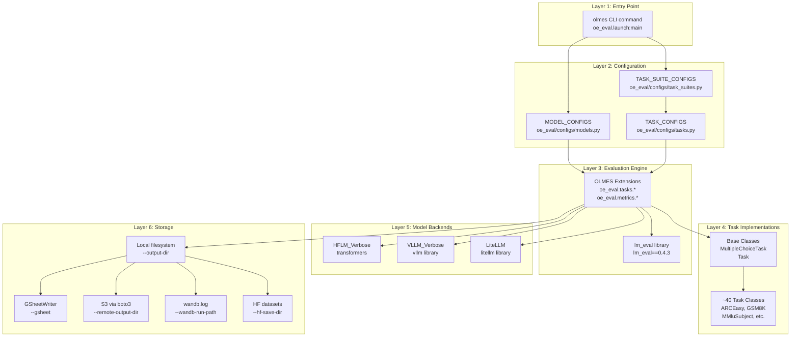
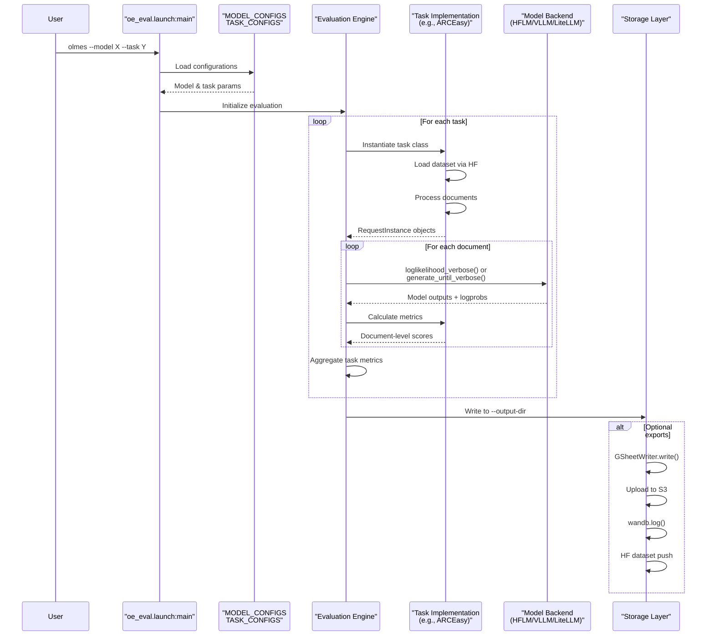
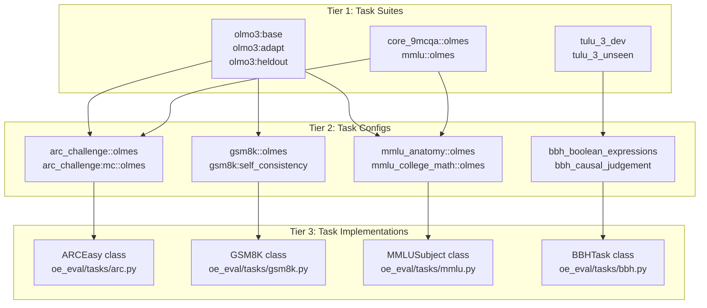
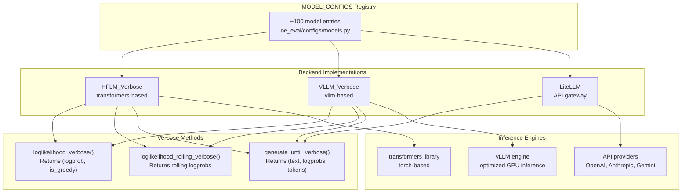
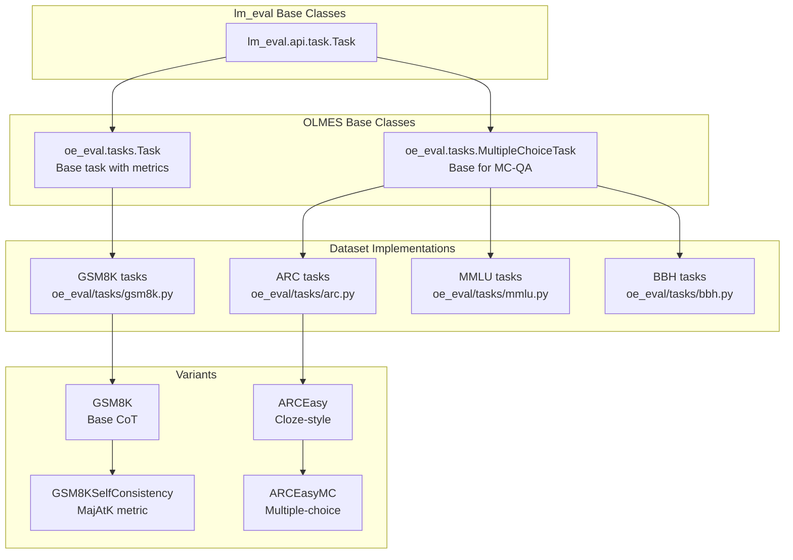
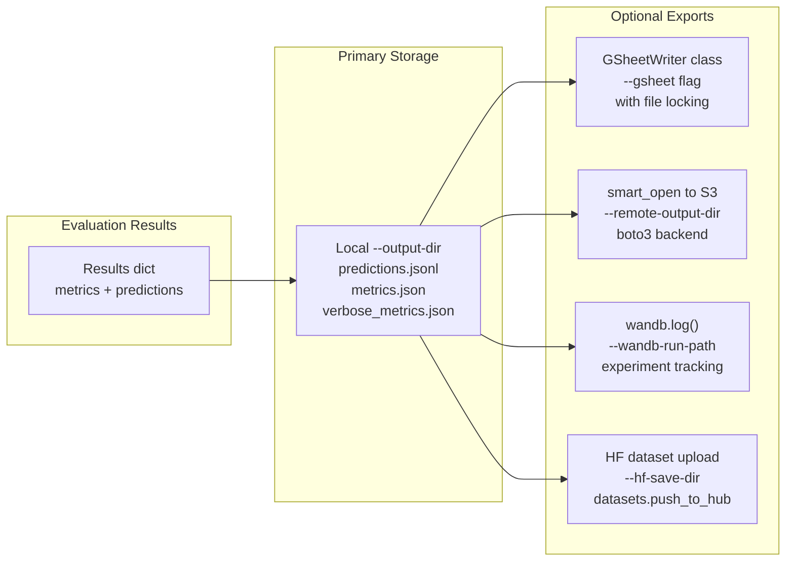

<!-- source: DeepWiki mcp.deepwiki.com · repo allenai/olmes · page 1 Overview · fetched 2026-10-26 -->

# Overview

<details>
<summary>Relevant source files</summary>

The following files were used as context for generating this wiki page:

- [.gitignore](.gitignore)
- [README.md](README.md)
- [pyproject.toml](pyproject.toml)

</details>


OLMES (Open Language Model Evaluation System) is a comprehensive framework for evaluating large language models across diverse benchmark tasks. Developed by the Allen Institute for AI as part of their Open Language Model efforts, OLMES has been used to produce evaluation results for multiple research releases including OLMo, OLMo 2, OLMo 3, TÜLU 3, and the OLMES standard itself.

## Purpose and Relationship to lm-evaluation-harness

OLMES extends the [lm-evaluation-harness](https://github.com/EleutherAI/lm-evaluation-harness) framework (version 0.4.3) from Eleuther AI with several AI2-specific enhancements:

| Enhancement | Description |
|-------------|-------------|
| **Deep configurations** | Support for task variants with different prompt styles, metrics, and evaluation parameters |
| **Instance predictions** | Detailed logging of per-instance predictions including logprobs and intermediate outputs |
| **Custom metrics** | Extended metric system including `PassAtK`, `MajAtK`, and specialized aggregations |
| **Storage integrations** | Export results to Google Sheets, S3, Weights & Biases, and Hugging Face datasets |

The codebase maintains `lm_eval==0.4.3` as a pinned dependency while extending core task classes and evaluation workflows.

Sources: [README.md:1-26](), [pyproject.toml:27]()

## Supported Model Types

OLMES supports three model backend types through distinct implementations:

| Model Type | Implementation | Use Case | Example |
|------------|---------------|----------|---------|
| **HuggingFace** | `HFLM_Verbose` class | Standard transformers models with detailed logging | `allenai/OLMo-2-1B` |
| **vLLM** | `VLLM_Verbose` class | High-throughput GPU inference with optimizations | Any HF model with `--model-type vllm` |
| **LiteLLM** | `LiteLLM` class | API-based models (OpenAI, Anthropic, Gemini) | `gpt-4`, `claude-3-opus` |

Models are configured via the `MODEL_CONFIGS` registry in [oe_eval/configs/models.py]() (~100 pre-configured models) or specified directly by HuggingFace path.

Sources: [README.md:224-238](), [pyproject.toml:68-70]()

## Supported Task Types

OLMES implements approximately 40 task classes spanning multiple evaluation categories:

| Task Category | Example Tasks | Base Class | Evaluation Method |
|---------------|---------------|------------|-------------------|
| **Multiple-Choice QA** | ARC, BoolQ, COPA, HellaSwag, PIQA | `MultipleChoiceTask` | Loglikelihood scoring |
| **Knowledge** | MMLU (57 subjects), TruthfulQA | `MultipleChoiceTask` | MC1/MC2 accuracy |
| **Math Reasoning** | GSM8K with CoT/self-consistency | `Task` | Generated answer extraction |
| **Code Generation** | HumanEval, MBPP | `Task` | Pass@k with execution |
| **Reasoning** | Big-Bench Hard (27 tasks) | `MultipleChoiceTask` | Chain-of-thought variants |

Tasks are organized into research-specific suites via `TASK_SUITE_CONFIGS` in [oe_eval/configs/task_suites.py]() (e.g., `olmo3:base`, `tulu_3_dev`).

Sources: [README.md:89-215]()

## System Architecture Overview

OLMES implements a six-layer architecture with clear separation of concerns:

### Component Layers and Code Mapping



Sources: [pyproject.toml:60](), [README.md:1-26]()

### Data Flow and Request Processing

The evaluation process follows a structured pipeline from configuration to storage:



Sources: [README.md:46-86](), [README.md:293-300]()

## Configuration Hierarchy

OLMES uses a three-tier configuration system that enables flexible task composition:

### Configuration Structure



**Key Configuration Files:**
- [oe_eval/configs/task_suites.py](): Defines suite-level aggregations with primary metrics
- [oe_eval/configs/tasks.py](): Contains ~200 task configuration entries specifying splits, shots, and metrics
- [oe_eval/tasks/*.py](): Implements concrete task classes inheriting from `Task` or `MultipleChoiceTask`

Sources: [README.md:91-289]()

## Model Backend Implementations

OLMES provides three model backend types with verbose logging capabilities:

### Model Backend Architecture



**Backend Selection:**
- Default: `HFLM_Verbose` (standard transformers)
- Flag `--model-type vllm`: `VLLM_Verbose` (GPU-optimized)
- Flag `--model-type litellm`: `LiteLLM` (API models)

The `_verbose` suffix indicates these implementations extend base lm_eval classes with additional logging of logprobs, token IDs, and intermediate outputs for detailed analysis.

Sources: [README.md:224-238](), [pyproject.toml:25-29, 68-70]()

## Task Implementation Pattern

All task implementations follow a consistent inheritance pattern:

### Task Class Hierarchy



**Common Implementation Methods:**
- `has_training_docs()`, `has_validation_docs()`, `has_test_docs()`: Dataset split availability
- `training_docs()`, `validation_docs()`, `test_docs()`: Dataset loading
- `_process_doc(doc)`: Convert dataset document to evaluation format
- `doc_to_text(doc)`: Generate prompt text
- `doc_to_target(doc)`: Extract correct answer
- `construct_requests(doc, ctx, **kwargs)`: Create `RequestInstance` objects

Sources: [README.md:244-289]()

## Results Storage and Export

OLMES implements a hub-and-spoke storage pattern with local-first writes and optional remote exports:

### Storage System Architecture



**Export Configuration:**
| Export Type | CLI Flag | Authentication | Format |
|-------------|----------|----------------|--------|
| Google Sheets | `--gsheet <sheet-id>` | `GDRIVE_SERVICE_ACCOUNT_JSON` env var | GSheetWriter with locking |
| S3 | `--remote-output-dir s3://...` | boto3 credentials | Direct file copy |
| Wandb | `--wandb-run-path <project/run>` | `WANDB_API_KEY` | Structured metrics logging |
| HF Datasets | `--hf-save-dir <path>` | HF token | Dataset format |

Sources: [README.md:293-300]()

## Basic Usage

To start using OLMES:

1. **Installation**:
   ```
   git clone https://github.com/allenai/olmes.git
   cd olmes
   conda create -n olmes python=3.10
   conda activate olmes
   pip install -e .
   ```

2. **Basic Evaluation**:
   ```
   olmes --model olmo-1b --task arc_challenge::olmes --output-dir my-eval-dir1
   ```

3. **Running Task Suites**:
   ```
   olmes --model olmo-7b --task core_9mcqa::olmes --output-dir <dir>
   ```

4. **Inspecting Tasks Before Running**:
   ```
   olmes --task arc_challenge:mc::olmes --inspect
   ```

Sources: [README.md:23-67]()

For more detailed information on specific components and advanced usage, please refer to the other documentation pages linked at the top of this document.

---

