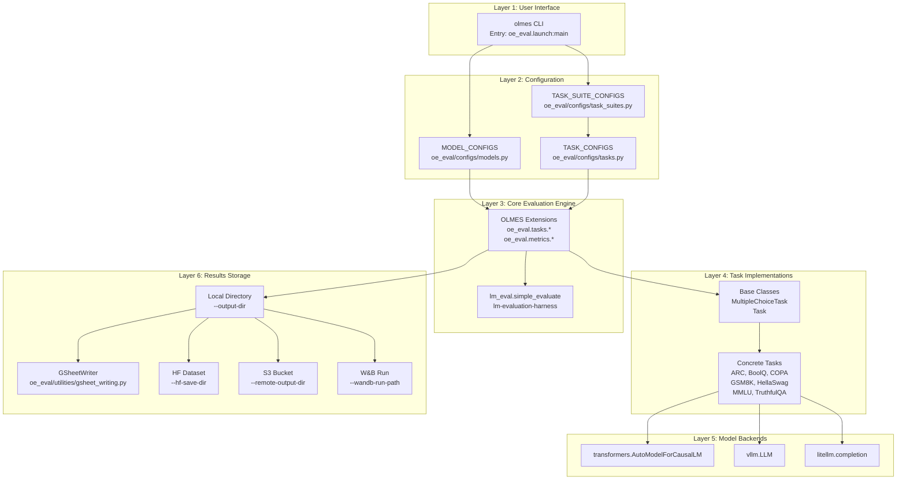
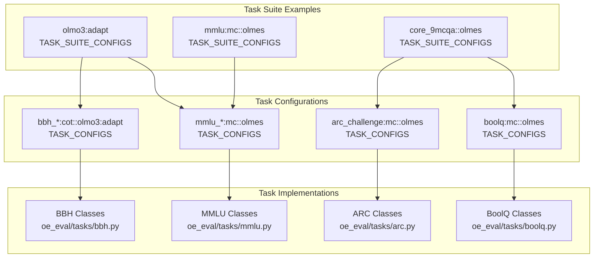
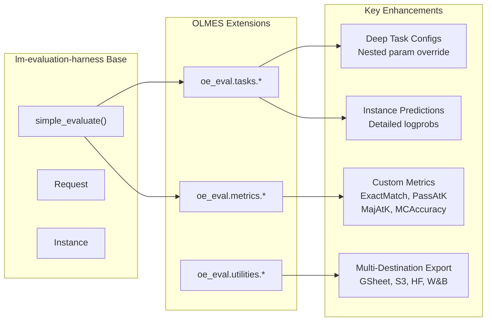
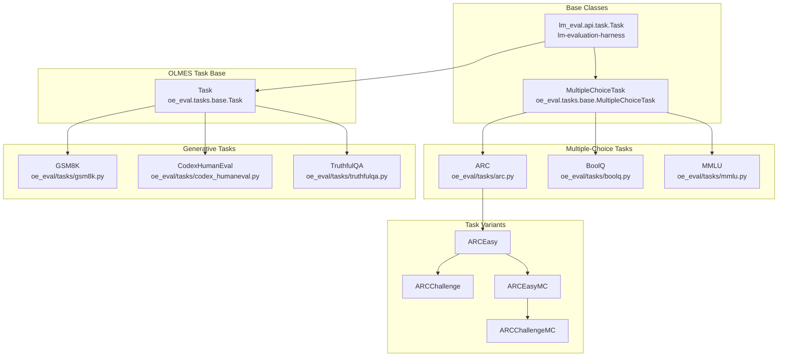
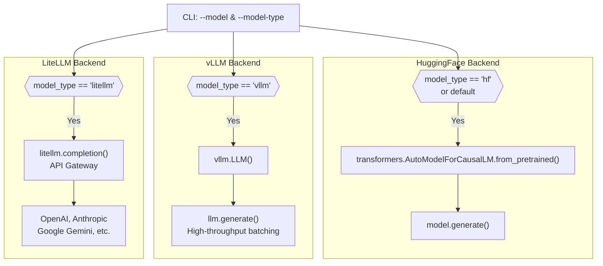
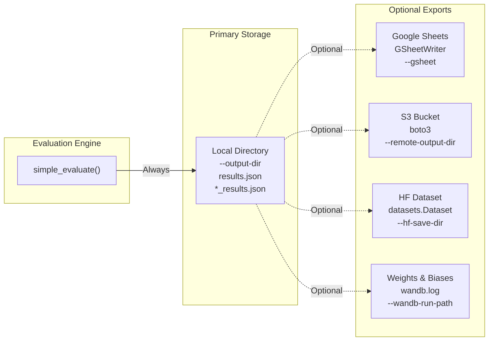
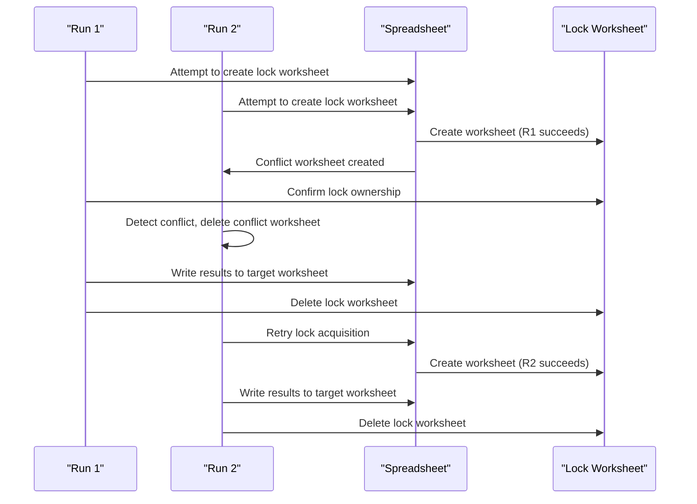
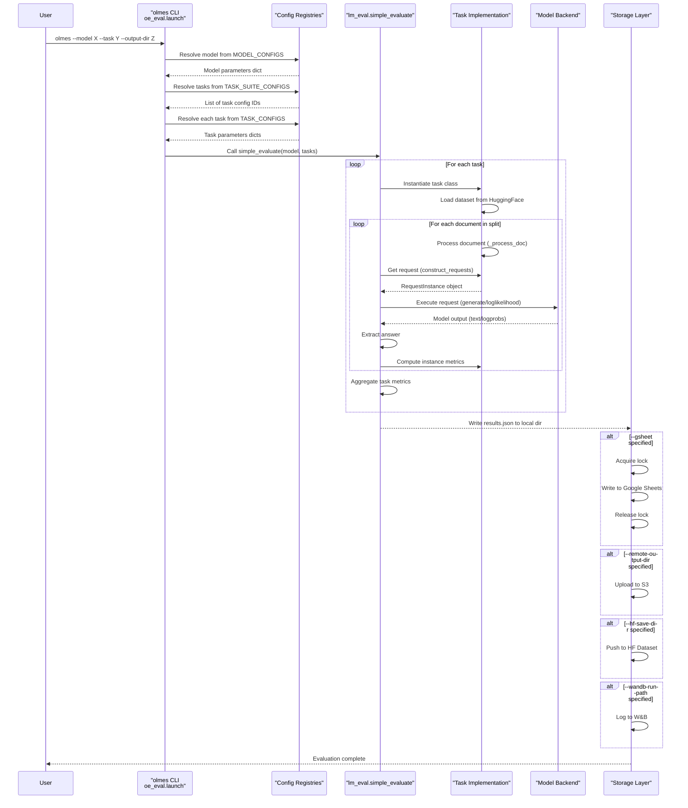

<!-- source: DeepWiki mcp.deepwiki.com · repo allenai/olmes · page 1.1 System Architecture · fetched 2026-10-26 -->

# System Architecture

<details>
<summary>Relevant source files</summary>

The following files were used as context for generating this wiki page:

- [README.md](README.md)
- [oe_eval/configs/task_suites.py](oe_eval/configs/task_suites.py)
- [oe_eval/utilities/gsheet_writing.py](oe_eval/utilities/gsheet_writing.py)

</details>


## Purpose and Scope

This document describes the high-level architecture of the OLMES evaluation framework, including its layered structure, core components, and how they interact during evaluation execution. It covers the configuration layer, evaluation engine, task implementations, model backends, and results storage systems.

For information about specific command-line options, see [Command Line Interface](#2). For details on configuring individual models, see [Model Configuration](#3). For task-specific implementation details, see [Task System](#4).

## System Overview

OLMES is built as a six-layer architecture that separates concerns between user interaction, configuration management, evaluation orchestration, task execution, model inference, and results persistence.



**Sources:** [README.md:1-300](), [oe_eval/configs/task_suites.py:1-50]()

## Configuration Layer

The configuration layer implements a three-tier hierarchy: models, task suites, and individual tasks. This design enables composition and reuse across different evaluation scenarios.

### Configuration Registries

| Registry | File Location | Purpose | Size |
|----------|---------------|---------|------|
| `MODEL_CONFIGS` | `oe_eval/configs/models.py` | Model specifications and parameters | ~100 models |
| `TASK_SUITE_CONFIGS` | `oe_eval/configs/task_suites.py` | Aggregated task groups | ~150 suites |
| `TASK_CONFIGS` | `oe_eval/configs/tasks.py` | Individual task configurations | ~500 tasks |

### Task Suite Composition Pattern



Task suite configurations specify:
- `tasks`: List of task configuration IDs or other task suite IDs
- `primary_metric`: Aggregation method (`"macro"`, `"micro"`, or `"mc_or_rc"`)

Task configurations specify:
- `task_name`: Implementation class identifier
- `split`: Dataset split to evaluate (`"test"`, `"validation"`, `"train"`)
- `primary_metric`: Metric field to report as primary score
- `num_shots`: Number of few-shot examples
- `fewshot_source`: Source for few-shot examples
- `context_kwargs`: Prompt configuration parameters
- `generation_kwargs`: Generation configuration parameters
- `metric_kwargs`: Metric computation parameters

**Sources:** [oe_eval/configs/task_suites.py:29-112](), [README.md:244-289]()

## Evaluation Engine

The evaluation engine extends the `lm-evaluation-harness` library with OLMES-specific enhancements. It coordinates the evaluation flow from configuration resolution through result aggregation.

### Engine Components



### Enhancement Details

**Deep Configurations**: OLMES supports variant-specific configurations through naming conventions. Task IDs follow the pattern `base_name:variant1:variant2::regime`, allowing multiple configuration layers to override base task parameters.

**Instance Predictions**: The framework records detailed per-instance information including:
- Model logprobabilities for each token
- Full generated text before answer extraction
- Normalized and extracted answers
- Individual instance metrics

**Custom Metrics**: OLMES implements specialized metric classes in `oe_eval/metrics/`:
- `ExactMatch`: String matching with normalization
- `PassAtK`: Code execution success rate
- `MajAtK`: Majority voting across multiple samples
- `MCAccuracy`: Multiple-choice accuracy variants

**Sources:** [README.md:18-25](), [README.md:291-300]()

## Task System

Tasks are implemented using an inheritance hierarchy with two primary base classes: `Task` for generative evaluations and `MultipleChoiceTask` for multiple-choice questions.

### Task Class Hierarchy



### Task Implementation Pattern

Each task implementation provides:

| Component | Purpose | Example |
|-----------|---------|---------|
| `dataset` | HuggingFace dataset identifier | `"allenai/ai2_arc"` |
| `has_*_docs()` | Check if split exists | `has_test_docs()` |
| `*_docs()` | Iterator over dataset split | `test_docs()` |
| `_process_doc()` | Convert dataset item to prompt | Field extraction, formatting |
| `doc_to_text()` | Generate question text | Prompt template application |
| `doc_to_target()` | Extract ground truth | Answer extraction |
| `construct_requests()` | Create evaluation requests | `RequestInstance` objects |

**Sources:** [README.md:244-289]()

## Model Backends

OLMES supports three model backend types, each optimized for different use cases:

### Backend Selection



### Backend Characteristics

| Backend | File/Module | Use Case | Requirements |
|---------|-------------|----------|--------------|
| HuggingFace | `transformers` | Default, maximum compatibility | PyTorch, model weights |
| vLLM | `vllm` | High-throughput GPU inference | GPU, `pip install .[gpu]` |
| LiteLLM | `litellm` | Remote API models | API keys in environment |

**Model Arguments**: All backends accept model-specific arguments via `--model-args`. Common parameters include:
- `max_length`: Maximum context size
- `trust_remote_code`: Enable custom model code
- `add_bos_token`: Add beginning-of-sequence token
- `dtype`: Model precision (`"bfloat16"`, `"float16"`)

**Sources:** [README.md:222-238]()

## Results Storage

OLMES implements a hub-and-spoke storage pattern with a required local directory and optional external destinations.

### Storage Architecture



### Google Sheets Writer with Locking

The `GSheetWriter` class implements a distributed locking mechanism to prevent concurrent writes from multiple evaluation runs:



**Lock Implementation Details:**
- Lock worksheet name: `"lock"` ([oe_eval/utilities/gsheet_writing.py:23]())
- Lock timeout: 20 minutes ([oe_eval/utilities/gsheet_writing.py:60-64]())
- Lock acquisition attempts: 30 with exponential backoff ([oe_eval/utilities/gsheet_writing.py:305]())
- Conflict resolution: Automatic detection via worksheet ID comparison ([oe_eval/utilities/gsheet_writing.py:129-248]())

**Sources:** [oe_eval/utilities/gsheet_writing.py:1-570](), [README.md:293-299]()

## Evaluation Execution Flow

The evaluation process follows a nested iteration pattern with clear separation between configuration, orchestration, and execution phases.

### Execution Sequence



### Key Execution States

| Phase | Entry Point | Responsibilities |
|-------|-------------|------------------|
| **Configuration Resolution** | `oe_eval.launch:main` | Parse CLI args, resolve configs from registries |
| **Evaluation Setup** | `lm_eval.simple_evaluate` | Initialize model backend, instantiate task classes |
| **Document Processing** | Task `*_docs()` methods | Load datasets, iterate over splits |
| **Request Construction** | Task `construct_requests()` | Format prompts, create request objects |
| **Model Inference** | Backend-specific methods | Execute generations or score loglikelihoods |
| **Metric Computation** | Task `process_results()` | Aggregate instance metrics to task metrics |
| **Result Persistence** | Storage layer methods | Write JSON, export to external systems |

**Sources:** [README.md:44-86]()

## Component Integration Points

### Configuration to Engine

The engine receives resolved configurations as dictionaries. Model configs specify backend type and initialization parameters. Task configs override base task class defaults.

**Example Model Config:**
```python
{
    "model": "allenai/OLMo-2-1124-7B",
    "model_path": "/local/path/to/model",
    "max_length": 2048,
    "dtype": "bfloat16"
}
```

**Example Task Config:**
```python
{
    "task_name": "arc_challenge:mc",
    "split": "test",
    "num_shots": 5,
    "fewshot_source": "OLMES:ARC-Challenge",
    "primary_metric": "acc_raw"
}
```

### Engine to Tasks

The engine instantiates task classes dynamically by task name and calls standardized methods:
- `has_{split}_docs()` - Check split availability
- `{split}_docs()` - Iterate documents  
- `doc_to_text()` - Format question
- `doc_to_target()` - Extract answer
- `construct_requests()` - Build request objects
- `process_results()` - Compute metrics

### Tasks to Model Backends

Tasks create `RequestInstance` objects specifying:
- `request_type`: `"loglikelihood"`, `"loglikelihood_rolling"`, or `"generate_until"`
- `arguments`: Prompt text, continuation text, or generation parameters
- `idx`: Document index for result tracking

The engine dispatches requests to the appropriate model backend method based on `request_type`.

### Engine to Storage

After evaluation completes, the engine returns a results dictionary containing:
- Per-task metrics aggregated across instances
- Model configuration used
- Task configurations used
- Timestamp and processing time
- Instance-level predictions (if enabled)

The storage layer serializes this to JSON in the local directory, then optionally exports to external systems using service-specific APIs.

**Sources:** [README.md:44-300](), [oe_eval/configs/task_suites.py:29-56]()

---

